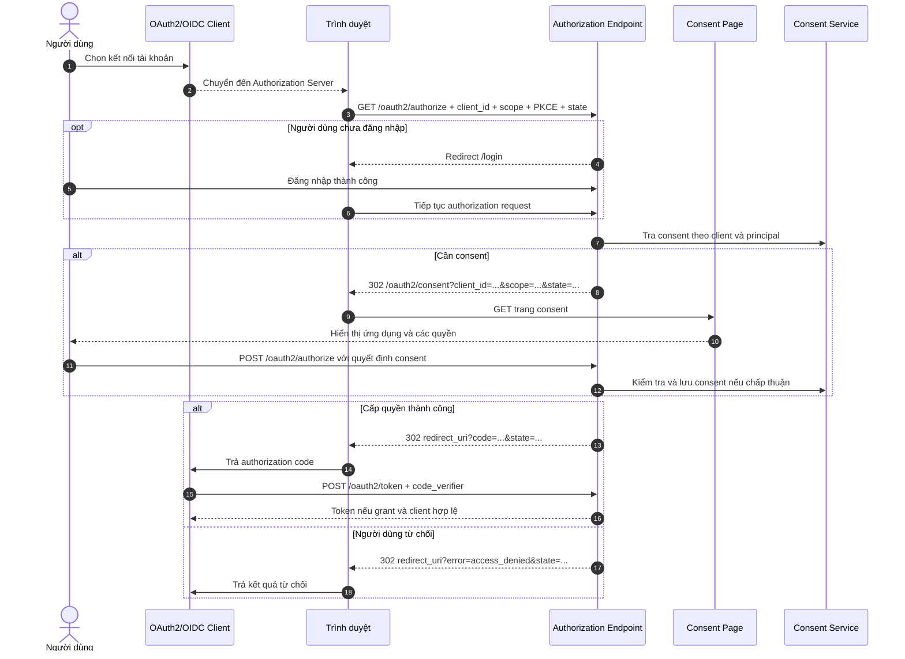
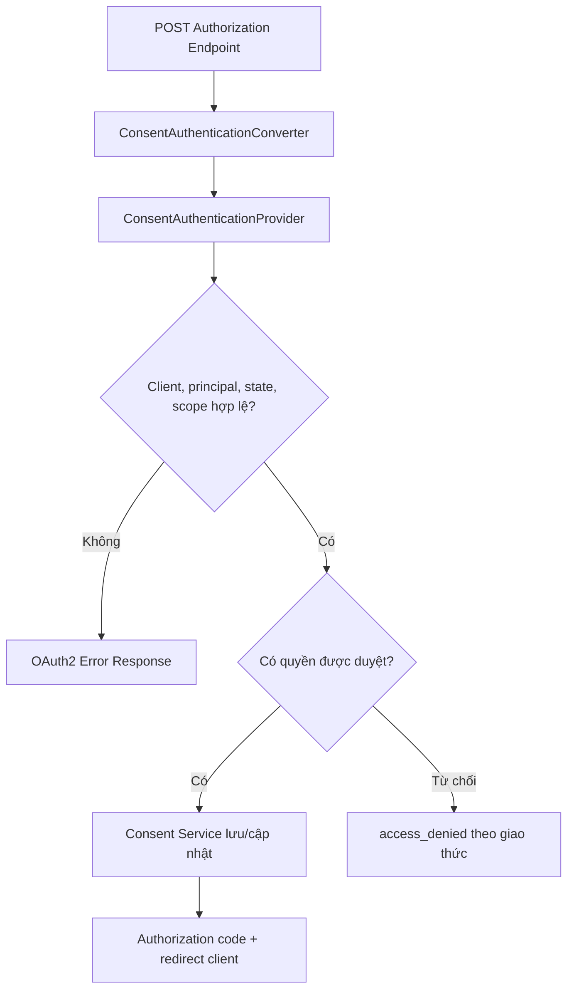

# Chuyển tiếp sang consent và xử lý lựa chọn của người dùng

## Mục tiêu bài học

Trong chương **Authorization Endpoint**, bài học này của module **SPRING_SECURITY_OAUTH2_OIDC_AUTHORIZATION_SERVER** hướng dẫn thiết kế và triển khai luồng **authorization consent** bằng **Spring Security**, **Spring Authorization Server** và ứng dụng **Spring Boot**. Ta sẽ theo dõi việc Authorization Endpoint chuyển trình duyệt sang trang chấp thuận quyền, cách người dùng chọn **Cho phép** hoặc **Từ chối**, cách framework nhận lại quyết định, lưu quyền đã phê duyệt và trả phản hồi OAuth 2.0/OpenID Connect (OIDC) đúng chuẩn.

Sau khi học, bạn có thể:

- Mô tả điểm chuyển sang consent trong Authorization Code + PKCE flow và phân biệt consent với đăng nhập.
- Hiểu điều kiện hiển thị consent, tác động của `ClientSettings.requireAuthorizationConsent(true)` và consent đã lưu.
- Phân biệt `state` ở authorization request của client với `state` do Authorization Server gửi tới consent page.
- Cấu hình `OAuth2AuthorizationServerConfigurer.authorizationEndpoint(...).consentPage(...)`, giữ đúng `SecurityFilterChain`.
- Tạo controller và form consent an toàn; gửi `POST` về Authorization Endpoint chứa `client_id`, `state` và các `scope` được chọn.
- Giải thích xử lý chấp thuận toàn bộ, chấp thuận một phần, từ chối, replay, phiên hết hạn, scope sai và thu hồi consent.
- Kiểm thử trình duyệt, HTTP, persistence và bảo mật theo chính sách triển khai.

> **Nguyên tắc cốt lõi:** Trang consent chỉ giúp người dùng xem xét và gửi quyết định. Việc đối chiếu authorization request, client, principal, scope, state và cấp authorization code phải thuộc **bộ xử lý giao thức của Spring Authorization Server**.

## 1. Consent nằm ở đâu trong Authorization Code flow?

Một OAuth2 Client muốn truy cập API thay mặt người dùng sẽ điều hướng trình duyệt tới Authorization Endpoint, mặc định `/oauth2/authorize`. Request gồm các tham số như `client_id`, `response_type=code`, `redirect_uri`, `scope`, `state` và `code_challenge` với `code_challenge_method=S256` nếu dùng PKCE.

Authorization Server kiểm tra request và trạng thái đăng nhập. Nếu người dùng chưa xác thực, server đưa người dùng sang login, rồi khôi phục yêu cầu cấp quyền. Nếu client/chính sách yêu cầu consent và còn quyền chưa được duyệt, server chuyển trình duyệt sang trang consent.



Sơ đồ trên diễn giải một authorization request có `redirect_uri` hợp lệ. Nếu redirect URI không xác minh được, máy chủ **không** được redirect đến URI do attacker tự gửi chỉ để trả thông báo lỗi.

### 1.1. Đăng nhập, consent và kiểm tra quyền là ba việc khác nhau

| Bước | Mục tiêu | Ai thực hiện? |
|---|---|---|
| Xác thực người dùng | Xác định người dùng hiện tại là ai. | Spring Security và hệ thống danh tính. |
| Consent | Người dùng chấp nhận phạm vi quyền mà client đang yêu cầu. | Authorization Server và giao diện consent. |
| Kiểm tra quyền API | Token và principal được phép tác động tài nguyên nào. | Resource Server và chính sách nghiệp vụ. |

Ví dụ người dùng đã đăng nhập thành công nhưng ứng dụng đối tác yêu cầu `orders.read` và `orders.write`. Người dùng có thể chấp nhận quyền đọc mà từ chối quyền sửa. Tuy nhiên, kể cả khi họ consent `orders.write`, Resource Server vẫn phải kiểm tra người dùng có quyền sửa **đơn hàng cụ thể** hay không; consent không tạo thêm quyền nghiệp vụ.

## 2. Khi nào Authorization Server chuyển đến consent?

Spring Authorization Server lưu chính sách ở `RegisteredClient.clientSettings`. Ví dụ:

```java
RegisteredClient client = RegisteredClient.withId("partner-console-v1")
        .clientId("partner-console")
        .clientName("Ứng dụng đối tác")
        .clientSecret(passwordEncoder.encode(
                environment.getRequiredProperty("PARTNER_CLIENT_SECRET")))
        .clientAuthenticationMethod(ClientAuthenticationMethod.CLIENT_SECRET_BASIC)
        .authorizationGrantType(AuthorizationGrantType.AUTHORIZATION_CODE)
        .authorizationGrantType(AuthorizationGrantType.REFRESH_TOKEN)
        .redirectUri("https://partner.example.com/login/oauth2/code/partner")
        .scope(OidcScopes.OPENID)
        .scope("orders.read")
        .scope("orders.write")
        .clientSettings(ClientSettings.builder()
                .requireProofKey(true)
                .requireAuthorizationConsent(true)
                .build())
        .build();
```

Đoạn mã là **phần cấu hình client minh họa**, giả định `passwordEncoder` và `environment` đã được inject, có repository, các Bean Authorization Server và nguồn secret an toàn. Không lưu secret thật trong source code, log hoặc file commit.

- `requireAuthorizationConsent(true)` làm consent trở thành một điều kiện cấp quyền theo chính sách của client.
- `requireProofKey(true)` yêu cầu PKCE trong Authorization Code flow, giải quyết mối đe dọa khác consent.
- Scope xin cấp không thể vượt tập scope client đã đăng ký, dù UI có hiển thị checkbox tương ứng.
- `clientName` dùng để hiển thị phải lấy từ repository đã quản lý, không lấy tên trực tiếp trong query.

### 2.1. Không phải lần đăng nhập nào cũng hiện màn hình

| Dữ liệu trước request | Scope lần này | Hành vi mong đợi |
|---|---|---|
| Chưa có consent | `orders.read` | Yêu cầu người dùng xem xét quyền nếu client buộc consent. |
| Đã duyệt `orders.read` | `orders.read` | Thường có thể bỏ qua màn hình khi chính sách cho phép. |
| Đã duyệt `orders.read` | `orders.read orders.write` | Cần consent với quyền mới `orders.write`. |
| Client chỉ có `orders.read` | `orders.admin` | Yêu cầu sai scope bị từ chối; không cho UI “hợp lệ hóa”. |
| Phiên login hết hạn nhưng consent còn lưu | `orders.read` | Có thể phải đăng nhập lại rồi dùng consent cũ. |
| Grant `client_credentials` | Scope dịch vụ | Không có bước user consent của Authorization Code flow. |

Cơ chế OIDC có các quy tắc riêng cho những scope/claim và tham số như `prompt`. Hãy đối chiếu với phiên bản và cấu hình thực tế; không giả định mọi scope (kể cả `openid`) đều hiện thành checkbox, hoặc `prompt=consent` luôn được hỗ trợ giống nhau trong mọi bản.

## 3. Phân biệt state của OAuth2 Client và state của consent

Đây là điểm rất dễ gây lỗi khi xây trang consent tùy chỉnh.

**`state` của OAuth2 Client** xuất hiện trong authorization request ban đầu nhằm ràng buộc response với giao dịch mà client đã bắt đầu. **`state` ở redirect sang consent page** do Spring Authorization Server cung cấp cho form để ràng buộc quyết định với **authorization request đang chờ ở server**. Hai giá trị này có thể khác nhau.

Ví dụ minh họa:

```text
1. Client gửi:
   GET /oauth2/authorize?...&state=client-state-123

2. Authorization Server redirect:
   Location: /oauth2/consent?client_id=partner-console
            &scope=orders.read%20orders.write
            &state=server-consent-state-456

3. Form POST trở lại Authorization Endpoint:
   client_id=partner-console
   state=server-consent-state-456
   scope=orders.read

4. Framework trả về callback client:
   Location: https://partner.example.com/callback
            ?code=AUTHORIZATION_CODE&state=client-state-123
```

Các dòng URL được ngắt để dễ đọc, không phải raw HTTP request nguyên vẹn. **Trang consent phải giữ nguyên state được nhận ở bước 2 khi submit bước 3**, không thay bằng state ban đầu của client và không tạo state khác. Nếu dùng sai, framework có thể không tìm thấy transaction hợp lệ, từ chối request hoặc lặp lại trang consent.

| Giá trị | Nguồn | Điểm đến | Bảo vệ điều gì? |
|---|---|---|---|
| Client state | OAuth2 Client | Authorization request và callback cuối cùng | Client nhận diện response đúng giao dịch, chống request/response bị trộn. |
| Consent state | Authorization Server | Redirect sang consent UI rồi POST về Authorization Endpoint | Ràng buộc quyết định người dùng với giao dịch chờ ở AS. |
| CSRF token của Spring Security | Spring Security CSRF infrastructure (nếu dùng) | Form POST của ứng dụng theo filter chain | Chống cross-site request forgery đối với endpoint áp dụng CSRF validation. |

Consent state và `_csrf` **không mặc nhiên là một**. Form có thể cần cả hai tùy cấu hình filter chain. Không bỏ toàn bộ CSRF protection chỉ vì Authorization Server đã có state riêng.

## 4. Cấu hình trang consent trong SecurityFilterChain

### 4.1. Cấu hình đường dẫn chuyển tiếp

Spring Authorization Server có thể sinh **trang consent mặc định**. Khi muốn giao diện riêng, cấu hình `consentPage("/oauth2/consent")` ở `OAuth2AuthorizationEndpointConfigurer` và tự phục vụ GET URI đó.

Ví dụ với API Spring Authorization Server 1.x / Spring Security 6.2+:

```java
package com.example.authserver.config;

import org.springframework.context.annotation.Bean;
import org.springframework.context.annotation.Configuration;
import org.springframework.core.annotation.Order;
import org.springframework.http.MediaType;
import org.springframework.security.config.Customizer;
import org.springframework.security.config.annotation.web.builders.HttpSecurity;
import org.springframework.security.oauth2.server.authorization.config.annotation.web.configurers.OAuth2AuthorizationServerConfigurer;
import org.springframework.security.web.SecurityFilterChain;
import org.springframework.security.web.authentication.LoginUrlAuthenticationEntryPoint;
import org.springframework.security.web.util.matcher.MediaTypeRequestMatcher;

@Configuration(proxyBeanMethods = false)
class AuthorizationServerSecurityConfig {

    @Bean
    @Order(1)
    SecurityFilterChain authorizationServerChain(HttpSecurity http)
            throws Exception {

        var authorizationServer =
                OAuth2AuthorizationServerConfigurer.authorizationServer();

        http.securityMatcher(authorizationServer.getEndpointsMatcher())
            .with(authorizationServer, configurer -> configurer
                .authorizationEndpoint(endpoint ->
                    endpoint.consentPage("/oauth2/consent"))
                .oidc(Customizer.withDefaults()))
            .authorizeHttpRequests(authorize ->
                authorize.anyRequest().authenticated())
            .exceptionHandling(exceptions -> exceptions
                .defaultAuthenticationEntryPointFor(
                    new LoginUrlAuthenticationEntryPoint("/login"),
                    new MediaTypeRequestMatcher(MediaType.TEXT_HTML)));

        return http.build();
    }

    @Bean
    @Order(2)
    SecurityFilterChain applicationChain(HttpSecurity http)
            throws Exception {

        http.authorizeHttpRequests(authorize -> authorize
                .requestMatchers("/assets/**").permitAll()
                .requestMatchers("/oauth2/consent").authenticated()
                .anyRequest().authenticated())
            .formLogin(Customizer.withDefaults());

        return http.build();
    }
}
```

Ví dụ trên tập trung vào filter chain. Ứng dụng hoàn chỉnh còn cần `RegisteredClientRepository`, `OAuth2AuthorizationService`, consent service nếu dùng, cấu hình người dùng/authentication, issuer, khóa ký/JWKS và các Bean khác. Nếu dùng phiên bản framework khác, phải kiểm tra lại tên API và cách kích hoạt.

GET `/oauth2/consent` được xử lý ở application MVC chain; `/oauth2/authorize` thuộc Authorization Server chain. Không tự tạo filter matcher chặn nhầm trang consent hoặc vô tình cho phép người dùng chưa đăng nhập lấy dữ liệu nhạy cảm.

### 4.2. Consent page và Authorization Endpoint là hai URL khác nhau

Theo hợp đồng `OAuth2AuthorizationEndpointConfigurer.consentPage(...)`, Spring Authorization Server redirect browser tới consent page với query:

- `client_id`: client đang xin quyền.
- `scope`: danh sách scope của request (phân cách bằng dấu cách).
- `state`: giá trị dành cho giao dịch consent của framework.

**Form phải thực hiện HTTP POST đến Authorization Endpoint**, mặc định `/oauth2/authorize`, chứ không POST ngược lại `/oauth2/consent`. Form mang `client_id`, `state` nhận từ redirect và một tham số `scope` cho mỗi quyền được phê duyệt.

Nếu đã đổi Authorization Endpoint thành `/identity/oauth2/authorize` bằng `AuthorizationServerSettings` thì form cũng phải POST tới path đó. Có thể lấy path trực tiếp bằng `AuthorizationServerSettings.getAuthorizationEndpoint()`.

## 5. Triển khai controller cho trang consent

Một MVC controller hợp lý chỉ dựng model để hiển thị. Nó lấy tên client từ nguồn đăng ký tin cậy, principal từ phiên đã xác thực và consent trước đó từ service. Controller **không ghi consent và không cấp code/token**.

### 5.1. Ví dụ Spring MVC

```java
package com.example.authserver.consent;

import java.security.Principal;
import java.util.Arrays;
import java.util.LinkedHashSet;
import java.util.Set;
import java.util.stream.Collectors;

import org.springframework.http.HttpStatus;
import org.springframework.security.oauth2.core.endpoint.OAuth2ParameterNames;
import org.springframework.security.oauth2.server.authorization.client.RegisteredClient;
import org.springframework.security.oauth2.server.authorization.client.RegisteredClientRepository;
import org.springframework.security.oauth2.server.authorization.consent.OAuth2AuthorizationConsent;
import org.springframework.security.oauth2.server.authorization.consent.OAuth2AuthorizationConsentService;
import org.springframework.security.oauth2.server.authorization.settings.AuthorizationServerSettings;
import org.springframework.stereotype.Controller;
import org.springframework.ui.Model;
import org.springframework.web.bind.annotation.GetMapping;
import org.springframework.web.bind.annotation.RequestParam;
import org.springframework.web.server.ResponseStatusException;

@Controller
class ConsentPageController {
    private final RegisteredClientRepository clients;
    private final OAuth2AuthorizationConsentService consents;
    private final AuthorizationServerSettings settings;

    ConsentPageController(
            RegisteredClientRepository clients,
            OAuth2AuthorizationConsentService consents,
            AuthorizationServerSettings settings) {
        this.clients = clients;
        this.consents = consents;
        this.settings = settings;
    }

    @GetMapping("/oauth2/consent")
    String consent(
            @RequestParam(OAuth2ParameterNames.CLIENT_ID) String clientId,
            @RequestParam(OAuth2ParameterNames.SCOPE) String scope,
            @RequestParam(OAuth2ParameterNames.STATE) String state,
            Principal principal,
            Model model) {

        RegisteredClient client = clients.findByClientId(clientId);
        if (client == null || principal == null) {
            throw new ResponseStatusException(HttpStatus.BAD_REQUEST);
        }

        Set<String> requested = Arrays.stream(scope.trim().split("\\s+"))
                .filter(s -> !s.isBlank())
                .collect(Collectors.toCollection(LinkedHashSet::new));

        // Kiểm tra phòng vệ cho view; provider vẫn phải xác minh
        // transaction và phạm vi cấp quyền trong POST.
        if (!client.getScopes().containsAll(requested)) {
            throw new ResponseStatusException(HttpStatus.BAD_REQUEST);
        }

        OAuth2AuthorizationConsent previous =
                consents.findById(client.getId(), principal.getName());

        Set<String> approved = previous == null
                ? Set.of()
                : previous.getAuthorities().stream()
                    .map(a -> a.getAuthority())
                    .filter(a -> a.startsWith("SCOPE_"))
                    .map(a -> a.substring("SCOPE_".length()))
                    .collect(Collectors.toSet());

        Set<String> toApprove = requested.stream()
                .filter(s -> !approved.contains(s))
                .collect(Collectors.toCollection(LinkedHashSet::new));

        model.addAttribute("clientName", client.getClientName());
        model.addAttribute("clientId", client.getClientId());
        model.addAttribute("state", state);
        model.addAttribute("scopesToApprove", toApprove);
        model.addAttribute("previouslyApprovedScopes", approved);
        model.addAttribute("authorizationEndpoint",
                settings.getAuthorizationEndpoint());

        return "oauth2/consent";
    }
}
```

Giải thích:

- `RegisteredClientRepository.findByClientId` lấy client thực sự đã đăng ký và `clientName` dùng hiển thị.
- `Principal` là người dùng hiện đang xác thực, không chấp nhận `principalName` lấy từ query string.
- `OAuth2AuthorizationConsentService.findById` dùng ID nội bộ của RegisteredClient và tên principal; không nhầm với `client_id` công khai.
- Tập authority bắt đầu bằng `SCOPE_` được diễn giải là những scope đã duyệt trong mô hình thông thường; extension authority khác cần cách xử lý riêng.
- Controller vẫn đọc `scope` từ query để dựng UI. **Đó chưa phải bằng chứng transaction hợp lệ**. Khi POST, provider phải kiểm tra scope, principal, client và state với yêu cầu đang chờ.
- `AuthorizationServerSettings.getAuthorizationEndpoint()` giúp form tránh hard-code endpoint cũ.
- Ví dụ giả định luồng Authorization Code thông thường; các trường hợp OIDC có scope đặc thù, PAR hoặc Device Authorization phải đối chiếu và kiểm thử theo phiên bản.

Không nên trả thông báo “client ID không tồn tại” với chi tiết nội bộ ra browser. Không render secret, token, authorization code hoặc thông tin cá nhân không cần thiết trong trang consent.

### 5.2. Hiển thị quyền bằng ngôn ngữ người dùng

Người dùng cần hiểu tác động thực của quyền:

| Scope | Nội dung hiển thị đề xuất |
|---|---|
| `orders.read` | Cho phép ứng dụng xem đơn hàng bạn có quyền truy cập. |
| `orders.write` | Cho phép ứng dụng tạo hoặc sửa đơn hàng trong phạm vi quyền của bạn. |
| `profile` | Cho phép ứng dụng nhận thông tin hồ sơ được cấp theo cấu hình OIDC. |
| `email` | Cho phép ứng dụng nhận thông tin email được phép chia sẻ. |

Đừng đưa thẳng mọi scope thành một checkbox chỉ có nhãn kỹ thuật hoặc tên quá rộng như “Cho phép tất cả”. Với scope nhạy cảm, thêm lời giải thích rõ. Nội dung client/scope trong view phải được **escape để chống XSS**; nhãn không rõ cần được rà soát trước khi cho phép client yêu cầu scope đó.

## 6. Form Approve và Deny: gửi đúng method và tham số

### 6.1. Template Thymeleaf minh họa

Có thể dùng template tại `templates/oauth2/consent.html`. Đoạn dưới minh họa hợp đồng gửi form trong một trang HTML; không phải bản giao diện production đầy đủ.

```html
<!DOCTYPE html>
<html xmlns:th="http://www.thymeleaf.org" lang="vi">
<head>
    <meta charset="UTF-8">
    <title>Chấp thuận quyền</title>
</head>
<body>
<h1>Xem xét quyền truy cập</h1>
<p>
    Ứng dụng <strong th:text="${clientName}">Tên ứng dụng</strong>
    yêu cầu các quyền:
</p>

<!-- Approve: POST VỀ AUTHORIZATION ENDPOINT -->
<form method="post" th:action="${authorizationEndpoint}">
    <input type="hidden" name="client_id" th:value="${clientId}">
    <input type="hidden" name="state" th:value="${state}">

    <!-- Tích hợp Thymeleaf/Spring Security với th:action có thể
         tự thêm trường CSRF qua RequestDataValueProcessor. -->

    <label th:each="scope : ${scopesToApprove}">
        <input type="checkbox" name="scope" th:value="${scope}">
        <span th:text="${scope}">Scope</span>
    </label>

    <p>Đã chấp thuận trước đó:</p>
    <ul>
        <li th:each="item : ${previouslyApprovedScopes}"
            th:text="${item}">Quyền đã duyệt</li>
    </ul>
    <button type="submit">Cho phép các quyền đã chọn</button>
</form>

<!-- Deny: cùng client_id/state nhưng không gửi scope được chọn -->
<form method="post" th:action="${authorizationEndpoint}">
    <input type="hidden" name="client_id" th:value="${clientId}">
    <input type="hidden" name="state" th:value="${state}">
    <button type="submit">Từ chối</button>
</form>
</body>
</html>
```

Các biểu thức `${...}` tham chiếu thuộc tính model do controller cung cấp. Khi dùng Spring MVC, Thymeleaf và Spring Security tích hợp qua `RequestDataValueProcessor`, `th:action` thường tự bổ sung trường CSRF ẩn cho form POST. Không chèn thêm cùng trường lần hai; nếu dùng view engine khác hoặc cấu hình đặc biệt, phải kiểm chứng request thực tế và tự bổ sung token khi cần. Với production cần:

- Dùng template engine tự động escape dữ liệu; render mô tả scope thay vì chỉ mã.
- POST tới đúng Authorization Endpoint, không POST tới `/oauth2/consent`.
- Giữ nguyên `state` consent được redirect từ Authorization Server.
- Tạo **một tham số `scope` cho mỗi quyền mới được chấp thuận**; submit không kèm các scope người dùng không chọn.
- Duy trì CSRF protection theo cấu hình security chain; kiểm thử trường hợp token thiếu/sai.
- Thiết kế từ chối chủ động, tránh dùng nút chỉ đóng tab hoặc gọi JavaScript mà không gửi quyết định về framework.

Trong luồng consent thông thường, gửi POST với cùng `client_id`/`state` nhưng không gửi `scope` được phê duyệt có thể được framework xử lý là từ chối; **hãy kiểm chứng hành vi `access_denied` trong phiên bản Spring Authorization Server và tổ hợp scope cụ thể**, nhất là khi đã có prior consent. Không thêm quyền đã chọn vào form Deny.

### 6.2. Vì sao không dùng POST `/oauth2/consent`?

`/oauth2/consent` ở ví dụ chỉ là **controller GET dựng giao diện**. Auth Code request và consent submission đều thuộc `OAuth2AuthorizationEndpointFilter` tại `/oauth2/authorize` hoặc đường dẫn Authorization Endpoint đã cấu hình. Nếu POST ngược về view path, bạn có thể nhận 404, 405, 403 hoặc tạo vòng lặp vì provider chưa nhận được decision.

### 6.3. Chấp thuận một phần scope

Nếu client yêu cầu `orders.read orders.write` và chỉ `orders.read` được duyệt, framework có thể cấp authorization trong phạm vi quyền đã chấp thuận theo khả năng/chính sách của grant. OAuth2 Client phải kiểm tra **scope thực tế được cấp**, không coi toàn bộ scope đã yêu cầu là chắc chắn được cấp.

Không tin checkbox do browser gửi: một attacker có thể thêm `orders.admin` vào POST. Bộ xử lý ở server phải từ chối quyền ngoài registration, request gốc và consent hợp lệ.

### 6.4. Quyền đã chấp thuận trước đó có bị xóa khi không chọn lại?

Thông thường consent service giữ các scope/authority đã đồng ý trước đó. Khi một màn hình chỉ hỏi phần quyền bổ sung, bỏ chọn những quyền **đã duyệt từ trước** không mặc nhiên là thao tác thu hồi. Nếu sản phẩm cần “Bỏ quyền đã cấp”, xây quy trình thu hồi riêng với authentication, kiểm tra owner và chính sách token. Không thay đổi consent bền vững dựa đơn thuần vào danh sách checkbox của một form thêm quyền.

## 7. Spring Authorization Server xử lý lựa chọn như thế nào?

`OAuth2AuthorizationEndpointConfigurer` kết nối `OAuth2AuthorizationEndpointFilter` với các converter/provider. Trong Spring Authorization Server 1.x, các thành phần quan trọng có thể gồm:

- `OAuth2AuthorizationCodeRequestAuthenticationConverter`: chuyển authorization request thành token xác thực phù hợp.
- `OAuth2AuthorizationConsentAuthenticationConverter`: chuyển HTTP POST consent thành token đại diện lựa chọn.
- `OAuth2AuthorizationCodeRequestAuthenticationProvider`: thẩm định request ban đầu.
- `OAuth2AuthorizationConsentAuthenticationProvider`: xử lý quyết định consent dựa trên giao dịch đang chờ.
- `OAuth2AuthorizationConsentService`: tra/lưu quyền người dùng đã duyệt.
- `OAuth2AuthorizationService`: quản lý authorization, code và token state.



Đây là mô hình chức năng để học, không phải cam kết thứ tự method nội bộ của mọi phiên bản. Framework phải kiểm tra liên kết giữa **principal hiện tại, client, state, redirect URI, scope và pending authorization**. Controller/view không thể tự xác nhận các điều kiện đó chỉ bằng query.

### 7.1. Kết quả Approve

Khi authorization request hợp lệ và người dùng chấp thuận những scope được phép, server có thể phát authorization code và redirect về client đã đăng ký:

```http
HTTP/1.1 302 Found
Location: https://partner.example.com/callback?code=AUTH_CODE&state=CLIENT_STATE
Cache-Control: no-store
```

Đây là ví dụ rút gọn, không phải full response mẫu. `CLIENT_STATE` ở callback là state do OAuth2 Client tạo trong request gốc, **không phải state của consent form**. Client tiếp tục đổi code tại Token Endpoint và gửi `code_verifier` chính xác nếu PKCE bắt buộc. Consent không phát access token trực tiếp trong trình duyệt theo Authorization Code flow.

### 7.2. Kết quả Deny

Với authorization request hợp lệ và redirect URI đã xác minh, từ chối thường đưa đến:

```http
HTTP/1.1 302 Found
Location: https://partner.example.com/callback?error=access_denied&state=CLIENT_STATE
```

`access_denied` khác `invalid_client` và `invalid_grant`. Client nên xử lý như lựa chọn từ chối của người dùng, đồng thời đối chiếu state để ngăn phản hồi giả. Máy chủ không cấp code/token cho yêu cầu bị từ chối, không tiết lộ thông tin người dùng trong query và không redirect tới URI chưa được xác minh.

### 7.3. Người dùng đóng tab, mất phiên hoặc submit nhiều lần

- **Đóng tab** không có nghĩa đã đồng ý hoặc từ chối qua giao thức; giao dịch có thể hết hạn.
- **Mất/đổi session** giữa GET consent và POST approve: phải từ chối hoặc bắt đầu lại luồng an toàn, tránh lưu consent sang principal khác.
- **Submit hai lần/replay**: yêu cầu cũ không được phát thêm code/token sai giao dịch.
- **Hai tab đồng thời**: mỗi authorization request cần transaction/state đúng, không tráo state giữa các tab.
- **Chuyển replica**: nếu Authorization Server chạy nhiều instance, session/authorization state và consent persistence phải nhất quán theo kiến trúc.

Không giải quyết lỗi redirect loop bằng cách bỏ kiểm tra state hoặc cho phép POST tùy ý không có session xác thực.

## 8. Lưu consent bền vững và thu hồi quyền

### 8.1. Phân biệt hai service

| Abstraction | Sở hữu | Ví dụ |
|---|---|---|
| `OAuth2AuthorizationConsentService` | Quyền đã phê duyệt theo registered client và principal. | `SCOPE_orders.read` đã được người dùng chấp thuận. |
| `OAuth2AuthorizationService` | Authorization code, access/refresh token, trạng thái grant. | Code đang chờ, refresh token còn hạn. |
| `RegisteredClientRepository` | Client, redirect URI, scope, auth method, consent policy. | `partner-console` được yêu cầu `orders.read`. |

Spring Authorization Server cung cấp `InMemoryOAuth2AuthorizationConsentService` dùng cho phát triển/kiểm thử và `JdbcOAuth2AuthorizationConsentService` để lưu consent trong database. Production chạy nhiều replica nên dùng backend bền vững khi cần ghi nhớ consent sau restart.

```java
import org.springframework.context.annotation.Bean;
import org.springframework.context.annotation.Configuration;
import org.springframework.jdbc.core.JdbcTemplate;
import org.springframework.security.oauth2.server.authorization.client.RegisteredClientRepository;
import org.springframework.security.oauth2.server.authorization.consent.JdbcOAuth2AuthorizationConsentService;
import org.springframework.security.oauth2.server.authorization.consent.OAuth2AuthorizationConsentService;

@Configuration(proxyBeanMethods = false)
class ConsentPersistenceConfig {

    @Bean
    OAuth2AuthorizationConsentService authorizationConsentService(
            JdbcTemplate jdbcTemplate,
            RegisteredClientRepository clients) {

        return new JdbcOAuth2AuthorizationConsentService(jdbcTemplate, clients);
    }
}
```

Cần áp dụng schema/migration phù hợp phiên bản, index, quyền DB, retention, backup và kiểm thử khôi phục. `RegisteredClient.id` phải ổn định; nếu thay ID nội bộ sau mỗi restart thì consent cũ có thể không còn liên kết đúng client. Hệ thống đa tenant phải thiết kế principal ID và phân vùng client phù hợp, tránh hai người có username giống nhau dùng nhầm consent.

### 8.2. Thu hồi consent không đồng nghĩa thu hồi access token

Một tính năng “Ngắt kết nối ứng dụng” cần xác thực owner và có thể gọi:

```java
OAuth2AuthorizationConsent consent =
        consentService.findById(registeredClient.getId(), principal.getName());

if (consent != null) {
    consentService.removeAuthorizationConsent(consent);
}
```

Đây chỉ là đoạn logic nội bộ sau khi đã xác minh principal/tenant, không phải public endpoint độc lập. Xóa consent có thể khiến lần authorization sau phải duyệt lại, nhưng **không làm JWT access token đã phát hành hết hiệu lực ngay** tại Resource Server kiểm chứng ngoại tuyến. Nếu cần thu hồi quyền tức thời, phải phối hợp thêm thu hồi authorization/refresh token, TTL phù hợp, introspection hoặc cơ chế chặn token tùy chính sách.

## 9. Bảo mật consent page

| Nguy cơ | Biện pháp |
|---|---|
| Giả tên/nhãn client | Lấy `clientName` từ repository đã quản trị, kiểm soát thay đổi tên/logo. |
| XSS từ tên/mô tả scope | Escape HTML, không render nội dung không tin cậy qua raw HTML. |
| CSRF hoặc replay | Giữ state giao dịch; dùng CSRF token đúng filter chain khi áp dụng; thử submit lặp. |
| Phê duyệt sai người | Lấy principal từ phiên đã xác thực, bảo vệ session fixation và thay đổi account. |
| Nâng scope | Provider đối chiếu requested scopes, registered scopes và sự chấp thuận; không tin checkbox. |
| Open redirect | Framework kiểm tra `redirect_uri`; không tự redirect theo query người dùng. |
| Clickjacking/giao diện ép đồng ý | Dùng frame policy/CSP phù hợp, nút Từ chối rõ, giải thích quyền dễ hiểu. |
| Rò dữ liệu qua log | Không log code, client secret, refresh/access token, PKCE verifier, cookie session. |
| Consent cross-tenant | Principal và client ID được quản lý đúng ranh giới tenant/issuer. |

Nếu tự dựng trang bằng JavaScript, chú ý CSRF/XSS và nguồn dữ liệu: token/secret không được đẩy lên client chỉ để render consent. Tránh “mặc định tích toàn bộ checkbox” cho quyền nhạy cảm. Quyền ít rủi ro và quyền có thể ghi/xóa dữ liệu nên được mô tả phân biệt rõ.

## 10. Ma trận kiểm thử cho chuyển tiếp và xử lý lựa chọn

| Tình huống | Kỳ vọng |
|---|---|
| Client buộc consent, chưa có record | Browser được chuyển tới consent khi các điều kiện authorization khác đã hợp lệ. |
| Đã duyệt đủ scope từ trước | Có thể bỏ qua consent UI theo chính sách hiện hành. |
| Client xin thêm scope | Yêu cầu phê duyệt phần scope bổ sung. |
| Login session chưa tồn tại | Đăng nhập trước rồi tiếp tục authorization. |
| GET consent thiếu client ID/scope/state | Không render như giao dịch hợp lệ. |
| POST consent tới sai path | Không cấp authorization code; sửa form trỏ Authorization Endpoint. |
| POST state khác state trong redirect consent | Bị từ chối, không được chấp thuận quyền giao dịch khác. |
| POST scope vượt request/registration | Không cấp scope trái phép. |
| Nhấn Approve, chọn một phần scope | Xử lý theo phạm vi được chấp thuận và chính sách grant. |
| Nhấn Deny | Không cấp code/token; trả lỗi OAuth2 theo phiên bản, thường `access_denied`. |
| Bỏ CSRF token khi filter bắt buộc | Bị từ chối theo CSRF validation. |
| Redirect URI không hợp lệ | Không redirect đến địa chỉ của attacker. |
| Tái dùng form sau khi request hoàn tất | Không phát code/token sai transaction. |
| Đổi user hoặc mất session trước submit | Từ chối hoặc yêu cầu bắt đầu lại luồng. |
| Restart / chuyển replica | Consent lưu bền vững và pending state được quản lý nhất quán. |
| Rút consent, xin scope lại | Có thể phải chấp thuận lại; token cũ có chính sách thu hồi riêng. |

### 10.1. Kiểm tra cấu hình bằng JUnit/AssertJ

```java
@Test
void registeredClientMustRequireConsentAndPkce() {
    RegisteredClient client =
            registeredClientRepository.findByClientId("partner-console");

    assertThat(client).isNotNull();
    assertThat(client.getClientSettings()
            .isRequireAuthorizationConsent()).isTrue();
    assertThat(client.getClientSettings().isRequireProofKey()).isTrue();
    assertThat(client.getScopes())
            .contains("orders.read", "orders.write");
}
```

Ví dụ trên cần JUnit/AssertJ và test fixture RegisteredClient. Nó chỉ kiểm tra **cấu hình client**, không kiểm tra thành công hay từ chối. Cần E2E test thật có session browser, bước GET authorize -> login -> consent -> POST authorize -> callback.

### 10.2. Quy trình E2E có thể lặp lại

1. Dùng OAuth2 Client thử nghiệm tạo `state` ngẫu nhiên, `code_verifier` và challenge `S256`.
2. Gửi authorize request tới Authorization Server, đăng nhập tài khoản test.
3. Quan sát Location redirect sang consent. Chụp `client_id`, `scope` và **state do server đưa tới consent**.
4. Chọn một scope và POST form với cùng session và state consent; quan sát callback chứa `code` cùng **state ban đầu của client**.
5. Đổi code với verifier đúng, xác minh token và granted scopes.
6. Lặp lại request scope đã consent; kiểm tra việc hỏi lại theo chính sách.
7. Thêm scope mới, kiểm tra UI hiển thị quyền mới.
8. Bấm Deny, kiểm tra không phát code và kết quả `access_denied`.
9. Thay `state` hoặc thêm scope không đăng ký bằng công cụ test; yêu cầu bị từ chối.
10. Restart/đổi node và kiểm tra consent persistence, session behavior, audit và log redaction.

Không chỉ gọi `GET /oauth2/consent` và coi HTTP 200 là thành công: **bài kiểm thử phải bao gồm authorization request đang chờ và POST quyết định**.

## 11. Lỗi phổ biến và cách chẩn đoán

| Hiện tượng | Nguyên nhân thường gặp | Hướng xử lý |
|---|---|---|
| Không thấy consent | Client không yêu cầu consent, quyền đã duyệt, hoặc request chưa qua validation. | Kiểm tra `ClientSettings`, consent record, scopes và session. |
| GET consent 404 | Đã cấu hình `consentPage(...)` nhưng thiếu controller/view. | Cung cấp MVC route GET và template tương ứng. |
| POST consent 404/405 | Form POST tới consent UI thay vì Authorization Endpoint. | Dùng `settings.getAuthorizationEndpoint()`. |
| Consent lặp vô hạn | Dùng sai `state`, session không được giữ hoặc form thiếu scope. | So sánh state của redirect consent và POST; kiểm tra cookie/session. |
| Submit trả 403 | CSRF token hoặc filter chain sai. | Xem CSRF config và matcher endpoint thực tế. |
| Consent gắn nhầm user | Truyền principal từ query hoặc session/tenant sai. | Lấy principal đã xác thực, kiểm tra isolation. |
| Token thiếu scope | Chỉ một phần scope được duyệt. | Kiểm tra consent và scope thực tế của token. |
| Trang consent cấp scope lạ | Tự xử lý POST không validate hoặc scope đăng ký sai. | Giữ provider chuẩn và kiểm thử scope ngoài registration. |
| Từ chối nhưng vẫn phát code | Form Deny gửi scope cũ/checkbox, hoặc custom logic xử lý sai. | Kiểm tra POST body và test theo phiên bản. |
| Consent biến mất sau restart | In-memory storage hoặc RegisteredClient ID thay đổi. | Dùng JDBC, migration và ID bền vững. |
| Sau proxy URL form sai | Authorization Endpoint đổi path hoặc gateway rewrite. | Đồng bộ settings, route và public URL. |

Khi debug, không bật log chứa authorization code, refresh token, code verifier, cookie phiên, mật khẩu hoặc client secret. Dùng request ID, event type và error category có kiểm soát.

## 12. Bài tập thực hành

**Bối cảnh:** Client `invoice-portal` dùng Authorization Code + PKCE, yêu cầu `invoices.read` và `invoices.write`, với `requireAuthorizationConsent(true)`. User đã từng chấp thuận `invoices.read`, hôm nay ứng dụng xin thêm `invoices.write`.

Yêu cầu:

1. Cấu hình RegisteredClient với redirect URI, scope và client settings phù hợp.
2. Cấu hình custom consent page tại `/oauth2/consent`, nhưng giữ `POST /oauth2/authorize` làm nơi xử lý quyết định.
3. Tạo controller đọc `client_id`, `scope`, `state`, tra RegisteredClient và consent trước đó.
4. Thiết kế UI hiển thị quyền đã duyệt và quyền mới; có nút Approve và Deny rõ ràng.
5. Giải thích hai state và xác định state nào phải đưa vào hidden field của form.
6. Thử chỉ cho phép `invoices.write` ở bước consent mới; kiểm tra consent và granted scopes sau flow.
7. Thử bấm Deny; bảo đảm không có code/token mới được phát hành.
8. Sửa POST body thành `invoices.admin` hoặc state sai; bảo đảm framework từ chối.
9. Restart server, thử thêm một node và kiểm tra trạng thái consent/authorization.
10. Mô tả cơ chế rút consent đã lưu và khác biệt với thu hồi JWT/access token hiện tại.

**Tiêu chí hoàn thành:** người dùng có thể lựa chọn quyền, Authorization Server chỉ phát code sau khi request/consent hợp lệ, state không bị tráo, quyền mới không được cấp tự động và dữ liệu consent được lưu bền vững trong môi trường yêu cầu.

## 13. Checklist triển khai

- [ ] Client registration có `requireAuthorizationConsent`, redirect URI, grant, scope và PKCE phù hợp.
- [ ] Consent được kích hoạt đúng thời điểm sau login và authorization validation.
- [ ] Trang consent lấy client name từ repository và principal từ session đã xác thực.
- [ ] Form **POST về Authorization Endpoint** với `client_id`, consent `state` và từng `scope` đã chọn.
- [ ] Không dùng nhầm client state cho hidden field của consent form.
- [ ] Approve/partial/deny được kiểm thử; không tạo code/token cho request bị từ chối.
- [ ] Scope không vượt danh sách đã đăng ký và authorization request ban đầu.
- [ ] Có escaping, CSRF, TLS, cookie/session, chống clickjacking và log redaction.
- [ ] Consent đã duyệt được phân biệt với scope mới; bỏ chọn trong form không ngầm thu hồi quyền cũ.
- [ ] `OAuth2AuthorizationConsentService` sử dụng persistence phù hợp, ID client/principal ổn định.
- [ ] Có quy trình rút consent và chính sách riêng cho token đang còn hạn.
- [ ] Đã thử state sai, replay, redirect URI sai, session hết hạn và nhiều replica.

## Tổng kết

Trong Spring Authorization Server, **Authorization Endpoint** kiểm tra yêu cầu cấp quyền, xác thực người dùng và chỉ chuyển tới consent khi cần. Một trang consent tùy chỉnh phải gửi quyết định qua **HTTP POST về Authorization Endpoint**; việc kiểm chứng state, client, principal và scope vẫn do framework đảm nhận. Điều dễ nhầm nhất là state của consent page: **hãy gửi lại đúng state do Authorization Server cung cấp khi redirect tới consent**, rồi để server trả state gốc của client trong callback.

Consent service lưu quyền người dùng đã phê duyệt để phục vụ những lần cấp quyền sau. Khi thiết kế thu hồi, cần tách consent với authorization và token đã phát hành để không hứa rằng xóa consent sẽ vô hiệu hóa mọi JWT ngay lập tức.

## Tài liệu tham khảo

1. [Spring Authorization Server — Protocol Endpoints](https://docs.spring.io/spring-authorization-server/reference/protocol-endpoints.html): `OAuth2AuthorizationEndpointConfigurer`, `consentPage`, converter/provider của Authorization Endpoint.
2. [Spring Authorization Server — API OAuth2AuthorizationEndpointConfigurer](https://docs.spring.io/spring-authorization-server/reference/api/java/org/springframework/security/oauth2/server/authorization/config/annotation/web/configurers/OAuth2AuthorizationEndpointConfigurer.html): hợp đồng `client_id`, `scope`, `state` và đích POST cho form.
3. [Spring Authorization Server — Core Model / Components](https://docs.spring.io/spring-authorization-server/reference/core-model-components.html): `RegisteredClient`, `OAuth2AuthorizationConsent`, consent service/JDBC.
4. [Spring Authorization Server — Authenticate a Single-Page Application using PKCE](https://docs.spring.io/spring-authorization-server/reference/guides/how-to-pkce.html): trình tự authorize, login, consent, code, token.
5. [RFC 6749 — OAuth 2.0 Authorization Framework](https://www.rfc-editor.org/rfc/rfc6749.html): Authorization Code flow, `state`, redirect URI và `access_denied`.
6. [RFC 7636 — Proof Key for Code Exchange](https://www.rfc-editor.org/rfc/rfc7636.html): `code_verifier`, `code_challenge` và luồng PKCE.
7. [RFC 9700 — OAuth 2.0 Security Best Current Practice](https://www.rfc-editor.org/rfc/rfc9700.html): bảo vệ authorization request và redirect.
8. [OpenID Connect Core 1.0](https://openid.net/specs/openid-connect-core-1_0.html): scope, authentication và phản hồi của OIDC.

