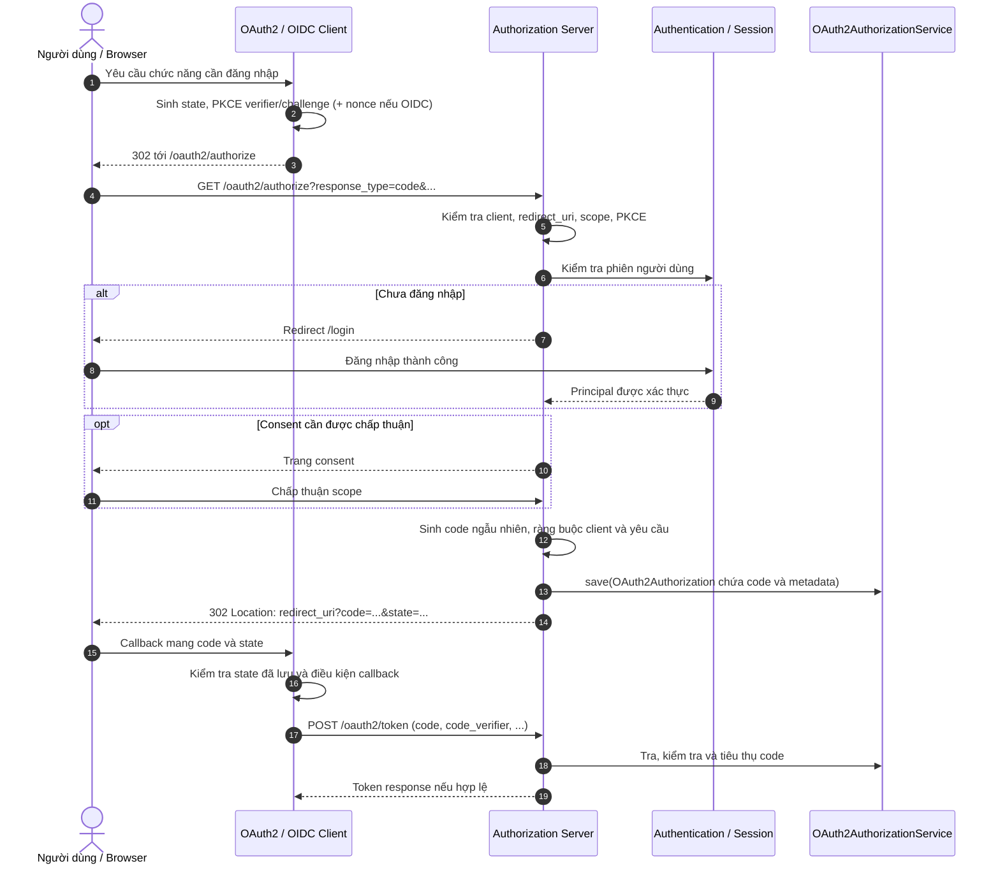
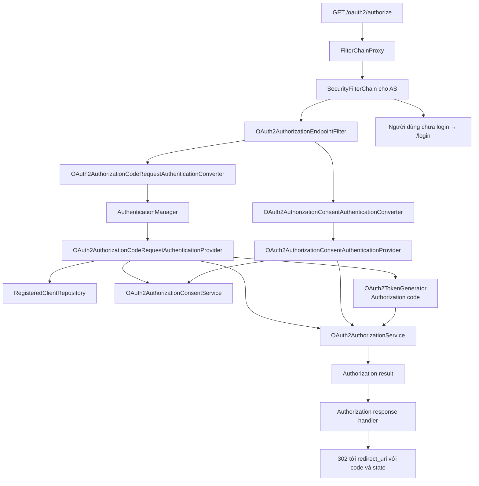
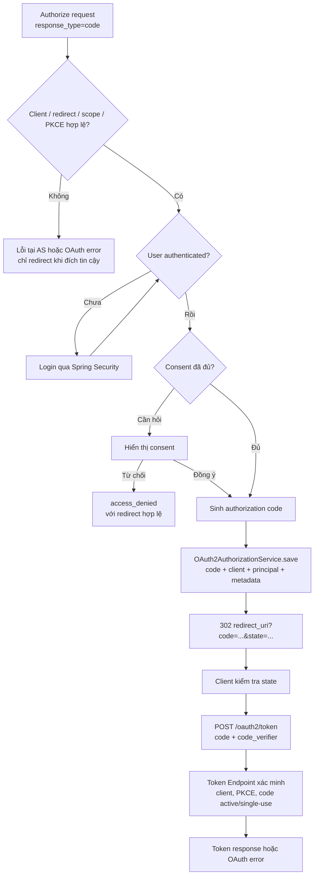

# Phát hành authorization code và trả phản hồi về client

## 1. Mục tiêu và vị trí của bài học

Trong chương **Authorization Endpoint** của module **SPRING_SECURITY_OAUTH2_OIDC_AUTHORIZATION_SERVER**, nhiệm vụ trung tâm của `/oauth2/authorize` trong **Authorization Code Flow** là xác định rằng yêu cầu cấp quyền hợp lệ, người dùng đã được xác thực và các quyền cần thiết đã được chấp thuận; từ đó **phát hành authorization code** và **chuyển hướng trình duyệt trở lại client**.

Bài này thuộc lộ trình thiết kế, cấu hình, bảo mật, kiểm thử và vận hành OAuth 2.0/OpenID Connect (OIDC) Authorization Server bằng **Spring Security** và **Spring Authorization Server (SAS)** trong ứng dụng **Spring Boot**.

Sau bài học, bạn có thể:

- Mô tả các điều kiện để Authorization Server (AS) được phép phát hành authorization code.
- Phân biệt **authorization request**, **authorization code**, **authorization response**, **token request** và **token response**.
- Hiểu cách SAS sử dụng `OAuth2AuthorizationEndpointFilter`, authentication provider, `OAuth2AuthorizationService` và `OAuth2TokenGenerator` để tạo, lưu và gửi code.
- Giải thích các trường `code`, `state`, `redirect_uri` và ràng buộc PKCE khi hoàn tất authorization response.
- Phân biệt lỗi **được phép redirect về client** với lỗi **không được redirect** nhằm tránh open redirect và rò rỉ code.
- Thiết kế timeout, chính sách sử dụng một lần, quan sát hệ thống và các bài kiểm thử luồng thành công/thất bại.

**Phạm vi:** Bài tập trung vào giai đoạn **phát code và trả response** của Authorization Code Grant. Bước trao đổi code lấy access token, ID token và refresh token ở `/oauth2/token` được trình bày để làm rõ ranh giới, không thay thế tài liệu chuyên sâu về Token Endpoint. Ví dụ lập trình sử dụng API phổ biến của Spring Authorization Server 1.x / Spring Security 6.x / Spring Boot 3.x; cần đối chiếu phiên bản framework dự án khi áp dụng.

## 2. Từ yêu cầu authorize đến authorization response

Trong Authorization Code Flow, client không trực tiếp gọi `/oauth2/authorize` để nhận token qua một HTTP response backend. Client điều hướng **browser của người dùng** tới AS. AS có thể yêu cầu đăng nhập và consent, sau đó chuyển browser về `redirect_uri` đã được kiểm tra.



Tại thời điểm **authorization response**, kết quả thành công chuẩn của grant này là **authorization code**, không phải access token. Nếu sử dụng OIDC với scope `openid`, **ID token** thường được cấp sau khi client đổi code thành công ở Token Endpoint, theo các quy tắc OIDC.

### 2.1. Bốn lớp trách nhiệm phải tách biệt

| Giai đoạn | Ai thực hiện? | Đầu vào quan trọng | Đầu ra |
| --- | --- | --- | --- |
| Client dựng authorization request | OAuth2/OIDC Client | `client_id`, `redirect_uri`, `scope`, `state`, PKCE; `nonce` nếu cần | URL authorize chuyển cho browser |
| AS quyết định cấp code | Authorization Endpoint và các provider | Client đăng ký, phiên người dùng, consent, chính sách grant | Authorization code được tạo và lưu trạng thái |
| AS trả authorization response | Authorization Endpoint | Code, `redirect_uri` hợp lệ, `state` gốc nếu có | Redirect browser tới client |
| Client đổi code lấy token | Token Endpoint | Code, client authentication nếu cần, redirect URI, PKCE `code_verifier` | Access token, có thể ID/refresh token |

Nếu code được phát hành nhưng callback chưa tới client do trình duyệt đóng hoặc lỗi mạng, **không có nghĩa token đã được phát hành**. Code có thời hạn ngắn và thường sẽ hết hạn nếu không được trao đổi.

## 3. Điều kiện cần trước khi phát authorization code

Authorization Endpoint chỉ nên phát code khi những điều kiện phù hợp đã được đáp ứng:

1. **Client tồn tại:** `client_id` được tìm thấy trong `RegisteredClientRepository`.
2. **Grant được cho phép:** client được đăng ký `AuthorizationGrantType.AUTHORIZATION_CODE`.
3. **Response type hợp lệ:** yêu cầu Authorization Code Flow có `response_type=code`; không tự nâng cấp một response type lạ thành code.
4. **Redirect hợp lệ:** `redirect_uri` được kiểm tra dựa trên những URI đăng ký cho client, theo quy tắc áp dụng cho loại client/flow.
5. **Scope hợp lệ:** scope yêu cầu được đăng ký và được phê duyệt theo chính sách. Nếu có consent, các scope cần thiết phải được người dùng chấp thuận.
6. **PKCE phù hợp:** nếu client bắt buộc PKCE, authorization request phải chứa `code_challenge` và phương thức được chấp nhận, ưu tiên `S256`.
7. **Người dùng đã xác thực:** với flow tương tác, `Authentication` của resource owner hợp lệ trong security context.
8. **Không bị từ chối consent/chính sách:** nếu người dùng hoặc chính sách từ chối, AS không được phát code.
9. **Dữ liệu authorization có thể lưu:** authorization code cần được liên kết với authorization state để Token Endpoint có thể tra và kiểm tra lúc đổi code.

Không nên chỉ nhìn trạng thái “user đã login” rồi phát code; người dùng đã xác thực với AS vẫn có thể chưa cấp quyền cho client yêu cầu.

### 3.1. Ví dụ yêu cầu authorize

Giả sử client backend tên `portal-web` đã đăng ký callback:

```text
https://portal.example.com/login/oauth2/code/portal-web
```

Client tạo yêu cầu (xuống dòng để dễ đọc, HTTP thực tế dùng một query string):

```http
GET /oauth2/authorize?
    response_type=code&
    client_id=portal-web&
    redirect_uri=https%3A%2F%2Fportal.example.com%2Flogin%2Foauth2%2Fcode%2Fportal-web&
    scope=openid%20profile&
    state=RANDOM_UNPREDICTABLE_STATE&
    nonce=RANDOM_OIDC_NONCE&
    code_challenge=BASE64URL_SHA256_OF_VERIFIER&
    code_challenge_method=S256 HTTP/1.1
Host: auth.example.com
```

Trong request này:

- `response_type=code` yêu cầu authorization response chứa code.
- `client_id` là định danh công khai của client, không phải secret.
- `redirect_uri` xác định callback dự kiến; phải phù hợp cấu hình đã đăng ký.
- `state` được client sinh và lưu gắn với phiên yêu cầu, dùng để chống CSRF/mix-up khi callback.
- `nonce` là giá trị OIDC giúp ràng buộc ID token với yêu cầu đăng nhập, được kiểm tra về sau.
- `code_challenge`/`code_challenge_method` là phần của PKCE; `code_verifier` **không** gửi trong authorization request.

**Lưu ý:** Khi có nhiều redirect URI hoặc quy tắc bắt buộc truyền URI, client cần gửi `redirect_uri` tường minh. Với mọi trường hợp, AS chỉ redirect tới URI hợp lệ đã xác định từ đăng ký và request; không lấy URL tùy ý do bên gọi cung cấp.

## 4. Bên trong Spring Authorization Server xử lý ra sao?

### 4.1. Sơ đồ các thành phần liên quan



Sơ đồ minh họa các **trách nhiệm tổng quát** và nhánh consent; không mô tả thứ tự gọi nội bộ cứng nhắc cho mọi request hoặc mọi phiên bản SAS. Trong triển khai tiêu chuẩn, Spring Security xử lý xác thực người dùng tại chain/login; SAS sử dụng các provider giao thức cho yêu cầu authorize và quyết định consent.

| Thành phần | Công việc |
| --- | --- |
| `OAuth2AuthorizationEndpointFilter` | Nhận request tới Authorization Endpoint, chuyển thành authentication request và tạo response/lỗi. |
| `OAuth2AuthorizationCodeRequestAuthenticationConverter` | Đọc tham số authorization request, tạo authentication token cho manager/provider. |
| `OAuth2AuthorizationCodeRequestAuthenticationProvider` | Thẩm định client/grant, redirect/scope và điều kiện cấp code; phối hợp các dịch vụ cần thiết. |
| `OAuth2AuthorizationConsentAuthenticationConverter` | Xử lý dữ liệu submit consent phù hợp với endpoint. |
| `OAuth2AuthorizationConsentAuthenticationProvider` | Xác minh kết quả consent và tiếp tục quá trình cấp quyền. |
| `RegisteredClientRepository` | Đọc client được đăng ký, redirect URI, grant type, scope, client settings, token settings. |
| `OAuth2AuthorizationConsentService` | Đọc và ghi consent đã được chấp thuận cho principal/client. |
| `OAuth2AuthorizationService` | Lưu `OAuth2Authorization` có code, principal, client và thông tin liên quan; sau đó Token Endpoint truy xuất code từ đây. |
| `OAuth2TokenGenerator<?>` | Sinh authorization code khi nhận `OAuth2TokenContext` thích hợp; chính sách thời hạn thường lấy từ token settings. |
| Authorization response handler | Tạo redirect thành công hoặc lỗi theo giao thức và quy tắc bảo mật. |

**Dễ nhầm tên provider:** `OAuth2AuthorizationCodeRequestAuthenticationProvider` thuộc xử lý **authorization request** tại `/oauth2/authorize`. Còn `OAuth2AuthorizationCodeAuthenticationProvider` (không có “Request”) thuộc quá trình **đổi code** ở `/oauth2/token`. Hai bước có nhiệm vụ và điều kiện bảo mật khác nhau.

### 4.2. Tại sao cần lưu authorization trước khi redirect?

Authorization code phải có trạng thái để khi client đổi code, Token Endpoint biết:

- Code có thực sự do AS này cấp và còn hiệu lực không?
- Code thuộc registered client nào và principal nào?
- Những scope nào đã được chấp thuận?
- `redirect_uri` và PKCE challenge tương ứng với yêu cầu ban đầu là gì?
- Code đã được sử dụng hoặc bị invalidated chưa?

SAS lưu đối tượng `OAuth2Authorization` qua `OAuth2AuthorizationService`. Nếu chỉ gửi một chuỗi ngẫu nhiên ra redirect mà không có dữ liệu tương ứng, Token Endpoint không có nguồn đáng tin để xác minh các ràng buộc cần thiết.

Trong một triển khai nhiều instance, code cấp tại instance A phải có thể được tìm thấy khi token request đến instance B. Vì vậy authorization store dùng chung là yếu tố quan trọng; in-memory store chỉ phù hợp demo hoặc topology chấp nhận giới hạn của nó.

## 5. Phát hành code: hình dạng, entropy, thời hạn và sử dụng một lần

### 5.1. Authorization code là gì?

Authorization code là một **credential tạm thời, opaque với client**. Client không cần biết cấu trúc nội bộ, chỉ chuyển code đến Token Endpoint để đổi token theo đúng ràng buộc.

Một authorization code đúng thiết kế cần:

- Không thể dự đoán bằng cách quan sát một số code khác; generator dùng nguồn ngẫu nhiên mật mã phù hợp.
- Có **thời hạn ngắn**, giảm thời gian kẻ tấn công có thể lợi dụng nếu code bị lộ.
- **Chỉ dùng một lần** để ngăn replay.
- Gắn với **client đã đăng ký**, principal, redirect URI/PKCE và authorized scopes theo yêu cầu giao thức.
- Được lưu trong authorization state theo cách Token Endpoint có thể kiểm tra.
- Không xuất hiện trong log, metrics tag, thông báo lỗi hoặc liên kết chia sẻ tùy tiện.

Code có thể được nhìn thấy trên đường dẫn callback trong browser; vì vậy không nên coi code tự nó là bằng chứng đủ để phát token. **PKCE + client binding + redirect URI validation + single-use** là các lớp kiểm soát thiết yếu.

### 5.2. Cấu hình thời hạn bằng `TokenSettings`

Với registered client, có thể đặt thời hạn code tường minh:

```java
RegisteredClient client = RegisteredClient.withId(
                UUID.randomUUID().toString())
        .clientId("portal-web")
        .clientSecret(passwordEncoder.encode(rawClientSecret))
        .clientAuthenticationMethod(
                ClientAuthenticationMethod.CLIENT_SECRET_BASIC)
        .authorizationGrantType(
                AuthorizationGrantType.AUTHORIZATION_CODE)
        .authorizationGrantType(
                AuthorizationGrantType.REFRESH_TOKEN)
        .redirectUri(
                "https://portal.example.com/login/oauth2/code/portal-web")
        .scope(OidcScopes.OPENID)
        .scope(OidcScopes.PROFILE)
        .clientSettings(ClientSettings.builder()
                .requireProofKey(true)
                .requireAuthorizationConsent(true)
                .build())
        .tokenSettings(TokenSettings.builder()
                .authorizationCodeTimeToLive(Duration.ofMinutes(2))
                .build())
        .build();
```

Đây là đoạn xây dựng `RegisteredClient` để đưa vào `RegisteredClientRepository`, không phải một file Java hoàn chỉnh. Các biến `passwordEncoder` và `rawClientSecret` phải được cung cấp bởi quy trình đăng ký client có bảo vệ. `rawClientSecret` không được ghi vào source hoặc log.

`authorizationCodeTimeToLive(Duration.ofMinutes(2))` minh họa thời hạn 2 phút. Không có giá trị “2 phút” bắt buộc cho mọi sản phẩm; cần cân nhắc độ trễ login/consent, retry, trải nghiệm người dùng và rủi ro. Thời hạn của **authorization code** khác thời hạn **access token**, **refresh token** và **session login**.

### 5.3. Các thời điểm quan trọng

| Sự kiện | Trạng thái của code | Hành vi cần có |
| --- | --- | --- |
| Trước khi người dùng login/consent | Chưa có code thành công cho flow | Không chuyển hướng với `code`. |
| Sau khi đủ điều kiện cấp quyền | Code mới sinh, thời hạn ngắn | Lưu authorization và tạo redirect. |
| Client nhận callback | Code chưa nhất thiết đã bị tiêu thụ | Client xác minh `state`, rồi gửi token request ngay. |
| Đổi code hợp lệ lần đầu | Code được tiêu thụ/invalidated theo xử lý server | Phát token và lưu trạng thái mới. |
| Đổi lại cùng code | Code đã dùng | Từ chối với lỗi phù hợp, không cấp thêm token. |
| Code hết hạn trước khi đổi | Code không còn hiệu lực | Từ chối, client phải khởi động authorization flow mới. |
| Người dùng từ chối consent | Không phát code | Trả lỗi cấp quyền theo quy tắc redirect hợp lệ. |

`OAuth2AuthorizationService.findByToken(codeValue, new OAuth2TokenType(OAuth2ParameterNames.CODE))` là một cách tra cứu trạng thái code trong AS; việc **tìm thấy bản ghi** không tự chứng minh code còn active hay đúng client/PKCE.

### 5.4. Vì sao PKCE vẫn quan trọng với confidential client?

Client backend có thể xác thực tại `/oauth2/token` bằng `client_secret_basic`. Tuy nhiên, việc client giữ secret không làm cho authorization code trong browser tự an toàn trước mọi kiểu đánh cắp/chèn code. PKCE giúp ràng buộc quá trình đổi code với `code_verifier` do client tạo ban đầu. Thực hành hiện đại nên dùng `S256` cho cả public và confidential clients khi hỗ trợ.

Đối với public client (SPA/mobile), không đặt shared client secret trong bundle/app rồi xem đó là bí mật. Public client sử dụng `ClientAuthenticationMethod.NONE` với Authorization Code + PKCE và các biện pháp phù hợp khác.

## 6. Authorization response thành công

### 6.1. Redirect 302 với `code` và `state`

Sau khi AS đã xác nhận các điều kiện và lưu code, phản hồi điển hình:

```http
HTTP/1.1 302 Found
Location: https://portal.example.com/login/oauth2/code/portal-web?code=CODE_VALUE&state=RANDOM_UNPREDICTABLE_STATE
Cache-Control: no-store
```

`Location` là URI callback của client đã được xác minh. Các tham số `code` và `state` được **URL-encode** theo quy tắc thích hợp. Nếu `redirect_uri` ban đầu có query component được cho phép, AS phải thêm tham số response đúng cách, không ghép chuỗi thủ công gây URL sai hoặc mở lỗ hổng.

`state` là giá trị **do client gửi** trong authorization request và AS **trả lại không thay đổi** nếu request có `state`. Client phải so sánh nó với giá trị đã lưu gắn với yêu cầu hiện tại, xử lý sai khớp như lỗi bảo mật.

### 6.2. Tại sao chỉ có code?

Với `response_type=code`:

- Browser được chuyển về client cùng **code**, có thể có `state`.
- Client thực hiện `POST /oauth2/token` ở kênh phù hợp để đổi code.
- **Access token** được trả trong phản hồi token endpoint, không phải response authorize thông thường.
- Nếu client dùng OIDC với `scope=openid`, **ID token** được phát theo quy tắc OIDC tại token endpoint khi trao đổi code thành công.
- **Refresh token** chỉ được cấp nếu grant, loại client và policy cho phép; không nằm trong redirect code tiêu chuẩn.

Điều này phân biệt Authorization Code Flow với Implicit/Hybrid flows có những dạng response khác và không nên được chọn mặc định cho thiết kế mới.

### 6.3. Authorization response đến client qua browser như thế nào?

AS thường không gửi request HTTP trực tiếp tới backend client bằng một server-side callback. AS trả **redirect cho browser**; browser truy cập `Location`. Vì vậy:

1. **Client phải có callback endpoint** nhận redirect.
2. **Browser có thể bị điều hướng hoặc đóng** trước khi đến callback; code có thể không bao giờ được đổi.
3. Callback phải kiểm tra `state` và các điều kiện của yêu cầu khởi tạo.
4. Backend client nên đổi code qua kênh backend; public client dùng PKCE và cơ chế token storage phù hợp loại client.
5. Callback nên xóa tham số nhạy cảm khỏi URL sau khi xử lý (ví dụ chuyển hướng sang URL sạch) và tránh để code đi vào analytics/referrer/log.

Không đọc `code` từ một callback URL bất kỳ rồi chấp nhận mặc nhiên. Client cần ràng buộc callback với **đúng phiên login/request**, redirect URI đã định trước và `state`.

## 7. Phản hồi lỗi: khi nào được redirect và khi nào phải dừng?

SAS phải xử lý lỗi ở Authorization Endpoint mà **không trở thành open redirector**.

### 7.1. Hai nhóm lỗi quan trọng

**Nhóm A — Đã xác minh được client và redirect URI hợp lệ:** AS có thể trả lỗi giao thức về callback theo quy tắc OAuth 2.0. Ví dụ:

```http
HTTP/1.1 302 Found
Location: https://portal.example.com/login/oauth2/code/portal-web?error=access_denied&state=RANDOM_UNPREDICTABLE_STATE
Cache-Control: no-store
```

Trong trường hợp này, `access_denied` có thể biểu thị người dùng từ chối cấp quyền hoặc chính sách từ chối. Nếu request chứa `state`, giá trị đó phải được trả lại khi phản hồi lỗi theo quy tắc tương ứng. Client kiểm tra `state` trước khi diễn giải lỗi thuộc phiên của mình.

**Nhóm B — Không thể tin cậy client hoặc redirect URI:** Chẳng hạn `client_id` không xác định hoặc `redirect_uri` không khớp đăng ký. AS **không được redirect browser tới URL chưa được xác minh** để “báo lỗi”, vì điều đó có thể gửi dữ liệu tới kẻ tấn công hoặc biến AS thành open redirector. AS trả lỗi tại chính AS, ví dụ trang lỗi HTTP hoặc response lỗi phù hợp, không dùng redirect tùy ý của request.

### 7.2. Một số mã lỗi thường gặp

| Mã lỗi | Tình huống điển hình | Lưu ý |
| --- | --- | --- |
| `invalid_request` | Thiếu tham số bắt buộc, trùng tham số không hợp lệ, format request sai | Không tiết lộ raw credential hoặc dữ liệu nhạy cảm trong mô tả lỗi. |
| `unauthorized_client` | Client không được phép dùng flow/grant theo đăng ký | Kiểm tra `RegisteredClient` và `authorizationGrantTypes`. |
| `unsupported_response_type` | AS không hỗ trợ `response_type` được yêu cầu | Không tự đổi flow để “cho chạy được”. |
| `invalid_scope` | Scope không được phép hoặc không hợp lệ | Đối chiếu scope đăng ký và policy. |
| `access_denied` | Người dùng từ chối consent hoặc bị policy từ chối | Không phát code. |
| `server_error` | AS không hoàn thành xử lý vì sự cố nội bộ | Ghi log nội bộ đã được làm sạch; không lộ stacktrace trong redirect. |
| `temporarily_unavailable` | AS tạm thời quá tải hoặc bảo trì | Client có thể hiển thị lỗi/retry flow theo chính sách. |

Không phải mọi lỗi đều được redirect; việc dùng redirect phụ thuộc **mức độ đã xác minh được client và đích trả response**. Không gắn `error_description` chứa stack trace, thông tin tài khoản, secret hoặc code.

### 7.3. Vì sao `redirect_uri` là ranh giới bảo mật?

Giả sử request có:

```text
client_id=portal-web
redirect_uri=https://attacker.example/collect
response_type=code
```

Nếu client `portal-web` chỉ đăng ký callback tại `https://portal.example.com/login/oauth2/code/portal-web`, AS phải từ chối `redirect_uri` không khớp. Không “linh hoạt” bằng cách:

- Chấp nhận mọi subdomain.
- So khớp kiểu starts-with khi URI có phần path/query tùy ý.
- Dựa vào `Host` header không được tin cậy để tự suy callback.
- Cho phép wildcard redirect URI với confidential web client.
- Gửi lỗi kèm `state` hoặc thông tin request đến URL do kẻ tấn công chỉ định.

Các ngoại lệ theo loại native/loopback redirect URI nếu được profile/framework hỗ trợ phải được cấu hình và kiểm thử theo chuẩn cụ thể, không suy rộng thành quy tắc chung.

## 8. Mối liên hệ với PKCE, `state` và OIDC `nonce`

Ba giá trị có mục đích khác nhau:

| Giá trị | Ai tạo? | Được gửi ở bước nào? | Mục tiêu bảo vệ |
| --- | --- | --- | --- |
| `state` | Client | Authorization request; trả lại trong authorization response nếu được gửi | Gắn callback với yêu cầu đã khởi tạo; chống CSRF/code injection khi client kiểm tra đúng. |
| `code_verifier` | Client | **Token request**, không gửi ở authorize | Bằng chứng client giữ verifier đã tạo từ đầu. |
| `code_challenge` | Client tính từ verifier | Authorization request | AS lưu ràng buộc PKCE để kiểm tra verifier lúc đổi code. |
| `nonce` | OIDC Client | Authorization request; kiểm tra với ID token khi áp dụng | Ràng buộc ID token với phiên yêu cầu OIDC, giảm replay/mix-up. |

Với phương thức `S256`:

```text
code_challenge =
    BASE64URL( SHA256( ASCII(code_verifier) ) )
```

Trong Authorization Endpoint, AS kiểm tra `code_challenge` và phương thức theo chính sách client, sau đó lưu thông tin cần thiết cùng authorization. Tới Token Endpoint, AS tính/đối chiếu verifier với challenge đã lưu. Không biến `code_challenge` thành `code_verifier` và không kiểm tra verifier ngay ở authorization endpoint, bởi client chưa gửi nó ở bước đó.

**`state` không thay thế PKCE.** Một request có `state` đúng vẫn có thể bị đánh cắp code nếu không có lớp bảo vệ PKCE thích hợp. Ngược lại, PKCE không thay client kiểm tra `state` trong callback. Với OIDC, việc kiểm tra `nonce` áp dụng cho ID token khi client đã nhận được token.

## 9. Cấu hình Spring Boot / Spring Authorization Server tối thiểu

Ví dụ này nối Authorization Endpoint với security chain, consent và kho lưu trạng thái. Đây là bộ khung có thể dùng trong lab; cần bổ sung user authentication, signing key/JWK, client registration, token generator và các bean khác tương ứng với flow thực tế.

### 9.1. Đăng ký filter chain dành cho AS

```java
@Configuration(proxyBeanMethods = false)
@EnableWebSecurity
public class AuthorizationServerSecurityConfig {

    @Bean
    @Order(1)
    SecurityFilterChain authorizationServerChain(HttpSecurity http)
            throws Exception {

        OAuth2AuthorizationServerConfigurer as =
                OAuth2AuthorizationServerConfigurer.authorizationServer();

        http
            .securityMatcher(as.getEndpointsMatcher())
            .with(as, configurer ->
                    configurer.oidc(Customizer.withDefaults()))
            .authorizeHttpRequests(authorize ->
                    authorize.anyRequest().authenticated())
            .exceptionHandling(exceptions ->
                    exceptions.defaultAuthenticationEntryPointFor(
                            new LoginUrlAuthenticationEntryPoint("/login"),
                            new MediaTypeRequestMatcher(MediaType.TEXT_HTML)))
            .oauth2ResourceServer(resourceServer ->
                    resourceServer.jwt(Customizer.withDefaults()));

        return http.build();
    }

    @Bean
    @Order(2)
    SecurityFilterChain applicationChain(HttpSecurity http)
            throws Exception {

        http
            .authorizeHttpRequests(authorize ->
                    authorize.anyRequest().authenticated())
            .formLogin(Customizer.withDefaults());

        return http.build();
    }

    @Bean
    AuthorizationServerSettings authorizationServerSettings() {
        return AuthorizationServerSettings.builder()
                .issuer("http://localhost:9000")
                .build();
    }
}
```

`as.getEndpointsMatcher()` định tuyến request OAuth2/OIDC vào chain dành cho SAS. `/login` được chain ứng dụng xử lý. Trong ví dụ dùng issuer local `http://localhost:9000`, nhưng URI redirect của client phải được đăng ký riêng. Trong production cần issuer HTTPS nhất quán với discovery/token và reverse proxy.

**Lưu ý:** Bật OIDC thường đòi hỏi `JWKSource<SecurityContext>` và `JwtDecoder` phù hợp, cùng các hạ tầng bắt buộc của AS. Ví dụ ở đây nhằm thể hiện đường vào Authorization Endpoint; không tự tạo một hệ thống user/registered client đầy đủ từ ba bean này.

### 9.2. Đăng ký client yêu cầu PKCE và consent

```java
@Bean
RegisteredClientRepository registeredClientRepository(
        PasswordEncoder encoder,
        @Value("${LOCAL_CLIENT_SECRET}") String rawSecret) {

    RegisteredClient client = RegisteredClient
            .withId(UUID.randomUUID().toString())
            .clientId("portal-web")
            .clientSecret(encoder.encode(rawSecret))
            .clientAuthenticationMethod(
                    ClientAuthenticationMethod.CLIENT_SECRET_BASIC)
            .authorizationGrantType(
                    AuthorizationGrantType.AUTHORIZATION_CODE)
            .authorizationGrantType(
                    AuthorizationGrantType.REFRESH_TOKEN)
            .redirectUri(
                    "http://127.0.0.1:8080/login/oauth2/code/portal-web")
            .scope(OidcScopes.OPENID)
            .scope(OidcScopes.PROFILE)
            .clientSettings(ClientSettings.builder()
                    .requireProofKey(true)
                    .requireAuthorizationConsent(true)
                    .build())
            .tokenSettings(TokenSettings.builder()
                    .authorizationCodeTimeToLive(Duration.ofMinutes(2))
                    .build())
            .build();

    return new InMemoryRegisteredClientRepository(client);
}

@Bean
PasswordEncoder passwordEncoder() {
    return new BCryptPasswordEncoder();
}

@Bean
OAuth2AuthorizationService authorizationService() {
    return new InMemoryOAuth2AuthorizationService();
}

@Bean
OAuth2AuthorizationConsentService authorizationConsentService() {
    return new InMemoryOAuth2AuthorizationConsentService();
}
```

Đặt các bean trên trong class `@Configuration` thích hợp (không tạo bean trùng loại nếu Boot/SAS đã đăng ký implementation tương ứng).

- `requireProofKey(true)` khiến request thiếu PKCE bị từ chối theo cấu hình.
- `requireAuthorizationConsent(true)` yêu cầu người dùng chấp thuận scope theo luồng consent.
- `authorizationCodeTimeToLive` điều khiển hạn dùng code, không phải access token.
- `InMemoryOAuth2AuthorizationService` lưu code/token metadata trong bộ nhớ. Khi restart hoặc chuyển instance sẽ mất dữ liệu; production cần kho bền vững như JDBC.
- `client_secret_basic` dành cho **confidential client**; public client dùng `none` và PKCE, không nhúng secret vào SPA/mobile.
- Code ví dụ dùng redirect URI cục bộ `127.0.0.1:8080` và issuer `localhost:9000` với hai vai trò khác nhau. Client thực tế phải dùng đúng URI đăng ký.

Đừng lưu raw secret vào source. Biến môi trường `LOCAL_CLIENT_SECRET` chỉ dùng local/test; với production nên dùng secret manager, cấp quyền tối thiểu và quy trình rotation.

### 9.3. Cấu hình consent page khi cần

SAS có thể sử dụng giao diện consent mặc định theo cấu hình hoặc tích hợp một trang riêng. Ví dụ tùy chỉnh ở Authorization Endpoint:

```java
OAuth2AuthorizationServerConfigurer as =
        OAuth2AuthorizationServerConfigurer.authorizationServer();

http
    .securityMatcher(as.getEndpointsMatcher())
    .with(as, server -> server.authorizationEndpoint(
            endpoint -> endpoint.consentPage("/oauth2/consent")));
```

Đoạn này **chỉ minh họa cách chọn URL consent page**; cần ghép với cấu hình chain, login, authorization rules và controller/template riêng nếu triển khai custom page.

Trang consent tự viết phải:

- Chỉ hiển thị scope và client được AS xác minh; không tin tham số do browser sửa đổi.
- Ràng buộc form submit với người dùng đăng nhập và authorization request đang chờ.
- Dùng CSRF protection phù hợp cho thao tác POST.
- Cho phép người dùng phân biệt đồng ý và từ chối; không âm thầm cấp thêm scope.
- Không tự sinh code trong controller; để SAS tiếp tục quá trình xử lý giao thức.

## 10. Kiểm tra authorization code trong `OAuth2AuthorizationService`

Để hiểu quan hệ giữa code phát hành và state server-side, có thể tra cứu ở một chức năng **nội bộ chỉ dành cho kiểm thử/quản trị đã bảo vệ**:

```java
OAuth2Authorization authorization = authorizationService.findByToken(
        codeValue,
        new OAuth2TokenType(OAuth2ParameterNames.CODE));

if (authorization != null) {
    OAuth2Authorization.Token<OAuth2AuthorizationCode> code =
            authorization.getToken(OAuth2AuthorizationCode.class);

    if (code != null && code.isActive()) {
        // Code còn active theo metadata của authorization.
        // Đây chưa phải quyết định cho phép đổi code.
    }
}
```

`findByToken` chỉ trả authorization đang chứa token phù hợp. Việc có bản ghi hoặc `code.isActive() == true` **không thay thế** toàn bộ kiểm tra của Token Endpoint: client binding, redirect URI, PKCE verifier, grant, tình trạng replay và điều kiện giao thức vẫn phải được provider xử lý.

Trong production, không nên xây dựng một endpoint public `GET /debug/code?code=...` để tra cứu authorization theo code. Code là credential, có thể bị lộ qua access log hoặc query string; không trả thẳng `OAuth2Authorization` ra JSON vì đối tượng chứa token/metadata nhạy cảm.

### 10.1. Những mảnh dữ liệu cần giữ nhất quán

| Đối tượng | Nơi quản lý | Phục vụ điều gì? |
| --- | --- | --- |
| `RegisteredClient` | `RegisteredClientRepository` | Client/grant/scope/redirect URI/PKCE settings. |
| Principal và phiên đăng nhập | Spring Security `Authentication`, session/IdP | Người dùng nào thực hiện cấp quyền. |
| `OAuth2AuthorizationConsent` | `OAuth2AuthorizationConsentService` | Những scope người dùng đã đồng ý. |
| `OAuth2Authorization` | `OAuth2AuthorizationService` | Code, client ID, principal, scopes, attributes và token metadata. |
| `OAuth2AuthorizationCode` | Token nằm trong `OAuth2Authorization` | Giá trị code và issued/expires state; tra cứu/tiêu thụ ở Token Endpoint. |
| `TokenSettings` | `RegisteredClient` | Thời gian sống code và chính sách token khác. |

Không dùng ID của `RegisteredClient` để thay authorization ID, hoặc dùng raw code làm khóa chính duy nhất của toàn bộ authorization model. Một authorization có thể trải qua nhiều giai đoạn và chứa nhiều loại token.

## 11. Trả response an toàn: URL, browser và log

### 11.1. Rủi ro rò code trong callback URL

Code được đưa vào query parameter của redirect URL; tùy cấu hình hệ thống, nó có thể xuất hiện trong:

- Browser history hoặc trang callback được người dùng sao chép.
- Reverse proxy/access log của **client callback**.
- Tracking/analytics tự ghi full URL.
- Header `Referer` nếu callback tải tài nguyên từ website khác trước khi code được loại khỏi URL.
- Công cụ quan sát request bị cấu hình thu thập query string.

Bảo vệ ở cả AS và client:

1. Chỉ cho phép callback đã đăng ký và dùng HTTPS ngoài môi trường loopback test.
2. Giữ code ngắn hạn, sử dụng một lần, ràng buộc với client và PKCE.
3. Client xử lý callback sớm và redirect sang URL sạch, tránh giữ `code` trong thanh địa chỉ lâu hơn cần thiết.
4. Thiết lập `Referrer-Policy: no-referrer` hoặc policy tương đương theo yêu cầu trang callback để giảm rò thông tin qua referer.
5. Không đưa code/state/secret/token vào metrics tag, trace attribute hoặc log URL đầy đủ.
6. Không nhúng script bên thứ ba không cần thiết trên trang nhận code.

`Referrer-Policy` không thay cho PKCE hay single-use, và không tự xóa URL đang nằm trong history; cần kết hợp nhiều kiểm soát.

### 11.2. Bảo vệ response khỏi cache

Các trang login/consent, callback và token endpoint nên có chính sách cache phù hợp, nhất là với response chứa credential hoặc dữ liệu người dùng. Các header như `Cache-Control: no-store` có thể giảm nguy cơ lưu nhầm response nhạy cảm, nhưng việc endpoint nào tự đặt header phụ thuộc cấu hình framework/proxy.

Không đặt `code` vào HTTP response body dạng JSON chỉ vì client backend “dễ parse hơn” nếu đang triển khai Authorization Code Flow chuẩn. Phản hồi authorize đi qua browser redirect; backend trao đổi code ở Token Endpoint.

### 11.3. Phòng vệ khỏi open redirect và URL injection

Nếu tự viết authorization response handler, phải kiểm tra chặt:

- URI đích đến từ **redirect URI đã xác minh**; không lấy tham số arbitrary `returnUrl`/`next` của browser.
- `code`, `state` và lỗi được percent-encode bằng URI builder phù hợp.
- Query parameters được ghép theo parser/builder, không nối chuỗi thô.
- Không chèn CRLF vào header `Location`.
- Nếu URI đích không hợp lệ, dừng ở AS và trả lỗi an toàn.
- Không phát token, client secret hoặc private key cùng authorization response.

Chỉ custom handler khi có yêu cầu giao thức/UX rõ ràng. Handler mặc định của SAS giúp giữ các quy tắc này nhất quán.

## 12. Kiểm thử Authorization Endpoint theo từng ranh giới

### 12.1. Kịch bản end-to-end thành công

Chạy AS tại `http://localhost:9000` và client tại `http://127.0.0.1:8080` theo cấu hình demo. Dùng OAuth2 client library có khả năng quản lý `state`, PKCE và callback.

1. Client sinh `state` ngẫu nhiên, `code_verifier` và `code_challenge=S256`; với OIDC thêm `nonce` theo policy.
2. Client chuyển browser đến `/oauth2/authorize` với `client_id=portal-web`, `response_type=code`, redirect URI và scope đã đăng ký.
3. Nếu chưa đăng nhập, browser tới `/login`. Đăng nhập thành công rồi tiếp tục authorize.
4. Nếu consent được yêu cầu, user chấp thuận scope phù hợp.
5. AS phát code, lưu authorization và chuyển browser về callback đã đăng ký.
6. Callback có `code` và `state` đúng; **không có access token trong URL**.
7. Client kiểm tra `state`, đổi code với đúng `code_verifier` và client authentication method nếu cần.
8. Token Endpoint cấp token hợp lệ; thử lại code cũ phải thất bại.
9. Kiểm tra code đã hết hạn bằng luồng mới và thời hạn test rút ngắn; AS từ chối trao đổi.

Khi user đóng browser trước callback hoặc token request thất bại do mạng, client nên khởi tạo một authorization flow mới nếu code không còn dùng được. Không tự yêu cầu AS “trả lại code cũ” từ database.

### 12.2. Ma trận kiểm thử success/failure

| Kịch bản | Kỳ vọng ở Authorization Endpoint | Điều cần xác minh |
| --- | --- | --- |
| Client hợp lệ, login/consent đã xong | Redirect tới callback có `code` và `state` (nếu request có) | Có authorization state; code còn active ngay sau phát hành. |
| User chưa login | Chuyển tới login, tiếp tục flow sau khi xác thực | Không phát code chỉ dựa vào client ID. |
| User từ chối consent | Trả lỗi như `access_denied` khi redirect hợp lệ | Không phát code; scope không bị cấp lén. |
| `response_type` không hỗ trợ | Lỗi OAuth2 tương ứng | Không cấp code/token sai flow. |
| Client không tồn tại | Lỗi tại AS, không chuyển tới URI không đáng tin | Không có open redirect. |
| `redirect_uri` sai | Từ chối request, không dùng callback do attacker cung cấp | Không để lộ `state`/code tới đích sai. |
| Grant `authorization_code` không đăng ký | `unauthorized_client` theo quy tắc phản hồi | Repository/policy được thực thi. |
| Scope không được đăng ký | `invalid_scope` hoặc lỗi phù hợp | Không cấp scope ngoài quyền. |
| Thiếu PKCE khi `requireProofKey(true)` | Từ chối yêu cầu | Không có code được phát hành. |
| PKCE method không được phép | Từ chối yêu cầu | Không mặc nhiên fallback xuống `plain`. |
| `state` có mặt | Phản hồi mang lại giá trị tương ứng | Client phát hiện callback sai phiên. |
| Sai secret ở token endpoint | Không thay đổi kết quả authorize trước đó; token request bị từ chối | Phân biệt xác thực client và phát code. |
| Sai `code_verifier` tại token endpoint | Token exchange thất bại | Code không cho phép bỏ qua PKCE. |
| Code hết hạn/đã dùng | Token endpoint từ chối | Code có TTL và single-use. |
| Nhiều AS instance | Code tạo ở A, token request tới B hoạt động nếu cấu hình hợp lệ | Authorization store chung; signing key/issuer nhất quán. |

### 12.3. Kiểm thử HTTP redirect với Spring Security Test

Có thể dùng `MockMvc` để kiểm tra callback thành công, nhưng một request authorize hoàn chỉnh cần **client đã đăng ký, principal đã xác thực, PKCE đúng và consent thỏa chính sách**. Một skeleton kiểm thử:

```java
@Test
void successfulAuthorizeRedirectContainsCodeAndState() throws Exception {
    // Client và consent được chuẩn bị trong test fixture.
    String state = "test-state-from-secure-test-fixture";

    mockMvc.perform(get("/oauth2/authorize")
            .param("response_type", "code")
            .param("client_id", "portal-web")
            .param("redirect_uri",
                    "http://127.0.0.1:8080/login/oauth2/code/portal-web")
            .param("scope", "openid")
            .param("state", state)
            .param("code_challenge", validS256Challenge)
            .param("code_challenge_method", "S256")
            .with(user("alice")))
        .andExpect(status().is3xxRedirection())
        .andExpect(header().string(
                "Location", containsString("code=")))
        .andExpect(header().string(
                "Location", containsString("state=" + state)));
}
```

Đây là mẫu minh họa, **không phải test tự chạy độc lập**: cần dựng test context và fixture, bảo đảm consent đã được cấp hoặc có flow đồng ý, và tạo `validS256Challenge` hợp lệ. Khi viết test thực, nên parse `Location` thành URI để so sánh **host/path đích chính xác** và query parameters, không chỉ tìm chuỗi “code=” như skeleton.

**Tách test cho redirect URI không hợp lệ:** Không kiểm tra rằng request trả mã lỗi nào rồi kết luận an toàn; phải kiểm tra response **không có Location tới attacker domain**. Với lỗi xảy ra sau khi đã có redirect hợp lệ, assert query `error` và `state` phù hợp.

### 12.4. Kiểm thử persistence và concurrency

- Sau khi phát code, tra `OAuth2AuthorizationService` bằng code value trong môi trường test có quyền; xác minh client/principal/authorized scope tương ứng.
- Restart AS với lưu trữ in-memory: code cũ có thể mất, nên thất bại theo giới hạn demo.
- Với JDBC, authorize ở node A và đổi code ở node B trong thời gian hợp lệ.
- Thực hiện hai token request gần đồng thời dùng cùng code; yêu cầu bảo mật là không cấp token hợp lệ nhiều lần vì race. Phụ thuộc provider và persistence, có thể cần đánh giá transaction/locking và kiểm thử cạnh tranh riêng.
- Khi database lỗi trước lúc lưu authorization, không được trả authorization response có code không thể sử dụng. Kiểm tra lỗi server an toàn và khả năng retry flow.
- Khi AS restart trong quá trình consent, xử lý request/session được định nghĩa rõ; không tái sử dụng consent/challenge sai ngữ cảnh.

## 13. Quan sát và xử lý sự cố khi vận hành

### 13.1. Những chỉ số nên có

| Điểm quan sát | Số liệu hữu ích | Điều không ghi |
| --- | --- | --- |
| `/oauth2/authorize` | Số yêu cầu, thời gian xử lý, nhóm lỗi theo client/grant đã chuẩn hóa | Full URL chứa `state`/`nonce`/`code_challenge` khi không cần thiết. |
| Login / session | Tỷ lệ thành công, redirect loop, hết hạn session | Session ID, mật khẩu, raw cookie. |
| Consent | Số lần đồng ý/từ chối, thời gian xử lý | PII hoặc scope nhạy cảm ở dữ liệu log không kiểm soát. |
| Sinh/lưu authorization code | Lỗi generator/store, latency persistence | Raw authorization code hoặc toàn bộ `OAuth2Authorization`. |
| Callback client | Tỷ lệ state mismatch, lỗi code exchange, response time | Full callback URL, raw code, token. |
| Token endpoint | `invalid_grant`, `invalid_client`, latency, lỗi PKCE | `code_verifier`, client secret, access/refresh token. |

Có thể dùng correlation ID để liên kết log giữa authorization request, consent, redirect và token request mà **không dùng raw code/state làm correlation ID**. Nên tách mã lỗi giao thức hiển thị cho client khỏi chẩn đoán nội bộ đã kiểm soát truy cập.

### 13.2. Lỗi thường gặp và nguyên nhân

| Triệu chứng | Nguyên nhân khả dĩ | Cách xử lý |
| --- | --- | --- |
| Browser tới `/oauth2/authorize` rồi luôn quay lại `/login` | Session/SecurityFilterChain, cookie hoặc request cache không ổn | Kiểm tra chain AS, chain login, session cookie và saved request. |
| Người dùng đã consent nhưng không có code | Chính sách client/scope, lỗi lưu authorization hoặc consent chưa hợp lệ | Kiểm tra error response, consent form và store. |
| AS redirect đến đường dẫn callback sai | `redirect_uri` đăng ký hoặc client request sai; cấu hình reverse proxy | So exact URI, scheme, host, port, path và query. |
| Authorization Endpoint trả 404 | Matcher `SecurityFilterChain` hoặc endpoint path thay đổi | Đối chiếu `AuthorizationServerSettings` và security chain. |
| Mọi request sai client đều redirect được tới URL nhập vào | Custom response handler thiếu validation | Loại bỏ open redirect, dùng registered redirect URI và handler chuẩn. |
| Token Endpoint trả `invalid_grant` ngay sau callback | Code đã dùng/hết hạn, sai client, PKCE/redirect URI hoặc store không chung | Kiểm tra ràng buộc ở token exchange, clocks và persistence. |
| Client nhận callback nhưng báo `state mismatch` | Mất session client, callback lẫn flow hoặc bị chèn response | Không bỏ kiểm tra state; xem session/cookie client. |
| Code có TTL quá ngắn | Điều hướng/login/consent chậm hoặc clock drift | Đo độ trễ; cân chỉnh TTL nhưng giữ ngắn và tránh replay. |
| Code bị lộ trong log | Proxy/client callback ghi nguyên URL query | Redact query, loại code khỏi URL sau callback và dùng PKCE. |
| Code cấp ở node A không đổi được ở B | In-memory authorization store, cấu hình đa instance sai | Dùng persistence chung, kiểm tra session/issuer/khóa ký. |

## 14. Một số quyết định thiết kế cần nắm chắc

### 14.1. Có nên tạo controller riêng để phát code?

Với Spring Authorization Server tiêu chuẩn, **không cần** tự viết controller `GET /oauth2/authorize` để sinh code và redirect. Framework đã có converter/provider, persistence integration và error handling cho giao thức. Chỉ tùy biến qua extension points khi yêu cầu thực sự cần.

Tự viết controller phát code dễ bỏ sót **client registration, exact redirect validation, PKCE, consent, code expiry, single-use và error redirect rules**. Thay vì sao chép logic đó, nên cấu hình đúng `OAuth2AuthorizationServerConfigurer`, `RegisteredClientRepository`, services và filter chain.

### 14.2. Có nên trả access token ngay khi user consent?

**Không** trong Authorization Code Flow chuẩn. Consent là một điều kiện để **phát code**, còn phát access token là trách nhiệm của Token Endpoint sau khi code và client/PKCE được kiểm tra. Đưa token vào query callback làm tăng rủi ro và thay đổi flow giao thức.

### 14.3. Có nên lưu code trong browser session thay vì authorization store?

Không nên xem browser session là nguồn trạng thái duy nhất của code. Browser session hỗ trợ xác thực tương tác; `OAuth2AuthorizationService` lưu trạng thái authorization để Token Endpoint xử lý yêu cầu từ client. Trong nhiều instance, hai loại state này có thể ở các kho khác nhau và phải được thiết kế nhất quán.

### 14.4. Có nên dùng lại code khi token request thất bại?

Authorization code được thiết kế cho mục tiêu **sử dụng một lần**; việc code đã được đánh dấu used/invalidated và xử lý tình huống token exchange lỗi phải tuân theo provider và quy tắc bảo mật. Client không nên tự cố đổi lại code đã dùng hoặc xây cơ chế “gia hạn code”. Khi nghi ngờ code không còn dùng được, khởi tạo authorization flow mới.

## 15. Checklist trước khi đưa Authorization Endpoint vào vận hành

- [ ] `RegisteredClientRepository` có client hợp lệ, grant `authorization_code`, scope và redirect URI chính xác.
- [ ] `SecurityFilterChain` định tuyến `/oauth2/authorize` đúng SAS, còn `/login` và consent hoạt động an toàn.
- [ ] User authentication và authorization consent được kiểm tra trước khi phát code.
- [ ] Authorization Code Flow được cấu hình PKCE S256, nhất là public client; `requireProofKey(true)` khi policy yêu cầu.
- [ ] `state` từ client được phản hồi đúng khi có mặt; client kiểm tra state gắn với request trước khi đổi code.
- [ ] Code được sinh ngẫu nhiên an toàn, có TTL ngắn, lưu trong `OAuth2AuthorizationService` và chỉ dùng một lần.
- [ ] Callback chỉ tới `redirect_uri` hợp lệ; không dùng wildcard hoặc URL tùy ý.
- [ ] Lỗi có thể redirect chỉ khi đích đã được xác minh; lỗi client/redirect không hợp lệ ở lại AS.
- [ ] Authorization response thành công chỉ chuyển code và state theo flow; token được cấp tại Token Endpoint.
- [ ] Không log raw code, `code_verifier`, session cookie, client secret hoặc token.
- [ ] Callback client được bảo vệ bằng HTTPS ngoài local, xử lý URL sạch và `Referrer-Policy` phù hợp.
- [ ] Đã kiểm thử success, consent denied, client/redirect/scope sai, PKCE thiếu, code hết hạn và code reuse.
- [ ] Khi chạy nhiều instance, authorization store được chia sẻ; issuer, session và các khóa ký phù hợp topology.
- [ ] Có theo dõi lỗi `invalid_grant`/`invalid_client` và latency, nhưng không làm lộ credential trong tracing.

## 16. Bản đồ ghi nhớ



**Phát hành authorization code là một quyết định cấp quyền được kiểm soát và lưu trạng thái, còn redirect là kênh trả kết quả qua browser về đúng client đã đăng ký.** Spring Authorization Server tổ chức luồng này bằng Authorization Endpoint filter/provider, repository và authorization service; Spring Security cung cấp danh tính người dùng và bảo vệ phiên tương tác. Khi code ngắn hạn, dùng một lần, được ràng buộc PKCE/client và chỉ chuyển tới redirect URI hợp lệ, Authorization Code Flow tạo nền tảng để ứng dụng đổi code lấy token an toàn ở bước tiếp theo.
