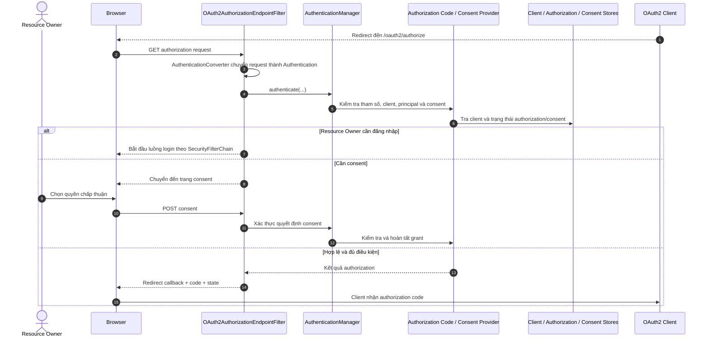
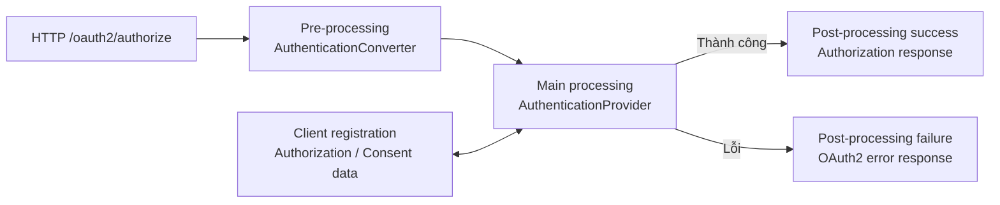
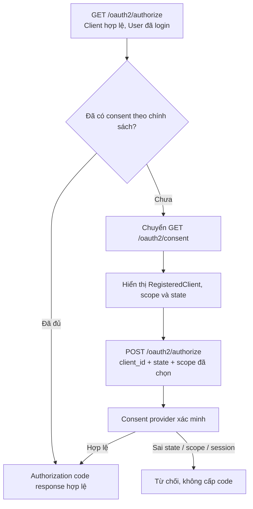

# Tùy chỉnh OAuth2AuthorizationEndpointConfigurer

> **Chương:** Authorization Endpoint  
> **Module:** `SPRING_SECURITY_OAUTH2_OIDC_AUTHORIZATION_SERVER`  
> **Phạm vi:** Thiết kế, cấu hình, bảo mật, kiểm thử và vận hành OAuth 2.0/OpenID Connect Authorization Server bằng Spring Security và Spring Authorization Server trong Spring Boot.  
> **Phiên bản ví dụ:** Servlet stack, Spring Security 6.x và Spring Authorization Server 1.x, theo API `OAuth2AuthorizationServerConfigurer.authorizationServer()` và `HttpSecurity.with(...)`. Với Spring Security 7.x tích hợp Authorization Server, cần đối chiếu package, dependency, DSL theo tài liệu đúng phiên bản.

## 1. Mục tiêu học tập

Hoàn thành bài học, bạn có thể:

1. Giải thích vai trò của `OAuth2AuthorizationEndpointConfigurer`, mối quan hệ với `OAuth2AuthorizationServerConfigurer`, `OAuth2AuthorizationEndpointFilter` và `SecurityFilterChain`.
2. Xác định chính xác **bảy extension point** cho request converter, authentication provider, response handler và consent page.
3. Tùy biến việc kiểm tra authorization request qua `authenticationProviders(...)` mà vẫn **giữ lại kiểm tra mặc định** của `redirect_uri` và `scope`.
4. Phân biệt những thành phần nên tùy chỉnh với những thành phần cần giữ nguyên semantics của OAuth 2.0/OIDC.
5. Xây dựng trang consent tùy biến và hiểu yêu cầu POST consent về `client_id`, `scope`, `state` và CSRF.
6. Kiểm thử thành công, lỗi giao thức, redirect, PKCE, consent và các trường hợp bảo mật có khả năng bị bỏ sót khi can thiệp vào endpoint.

Bài tập trung vào **ủy quyền qua trình duyệt**, nhất là Authorization Code + PKCE. Việc cấp access token tại `/oauth2/token`, client authentication tại token endpoint và xử lý ID token thuộc những extension point khác; không nên gom hết vào configurer của authorization endpoint.

## 2. Authorization Endpoint ở đâu trong kiến trúc?

Authorization Endpoint là nơi **Resource Owner** tương tác thông qua browser để cho phép một OAuth 2.0 Client nhận authorization code. Khi có OIDC, client có thể yêu cầu thêm scope `openid` để dùng ID token sau khi đổi code tại token endpoint.

Ví dụ đường dẫn mặc định:

```http
GET /oauth2/authorize?response_type=code&client_id=booking-web&redirect_uri=https%3A%2F%2Fclient.example.test%2Fcallback&scope=openid%20booking.read&state=EXAMPLE_STATE&code_challenge=EXAMPLE_CHALLENGE&code_challenge_method=S256 HTTP/1.1
Host: auth.example.test
Accept: text/html
```

`EXAMPLE_STATE` và `EXAMPLE_CHALLENGE` là giá trị để đọc sơ đồ, **không phải giá trị PKCE hợp lệ để dùng trong kiểm thử thật**. Trong triển khai thực tế, client phải sinh `state` khó đoán, `code_verifier` đủ entropy, tính `code_challenge` theo S256; AS phải kiểm tra đăng ký client, redirect URI và các tham số giao thức.



Sơ đồ diễn tả các **giai đoạn logic**; vị trí phát sinh login redirect còn phụ thuộc filter chain và exception handling. Không phải mọi response đều trực tiếp đi qua một provider như cùng một thứ tự gọi cố định.

### 2.1. Ai phụ trách phần nào?

| Thành phần | Chức năng |
| --- | --- |
| `OAuth2AuthorizationServerConfigurer` | Cấu hình tập endpoint và thành phần chung của Authorization Server |
| `OAuth2AuthorizationEndpointConfigurer` | Tùy biến riêng cách xử lý authorization request và consent tại authorization endpoint |
| `OAuth2AuthorizationEndpointFilter` | Nhận và xử lý HTTP request thuộc authorization endpoint |
| `AuthenticationConverter` | Chuyển HTTP request thành một loại `Authentication` phù hợp với authorize/consent |
| `AuthenticationManager` | Điều phối các `AuthenticationProvider` liên quan |
| `OAuth2AuthorizationCodeRequestAuthenticationProvider` | Xác minh và xử lý yêu cầu Authorization Code |
| `OAuth2AuthorizationConsentAuthenticationProvider` | Xác minh bước user consent |
| `AuthenticationSuccessHandler` | Tạo authorization response thành công |
| `AuthenticationFailureHandler` | Tạo OAuth2 error response khi bước xử lý thất bại |
| `RegisteredClientRepository` | Nguồn cấu hình `client_id`, redirect URI, grant type, scopes |
| `OAuth2AuthorizationService` | Lưu thông tin authorization, code và token được cấp |
| `OAuth2AuthorizationConsentService` | Lưu quyết định chấp thuận quyền |

**Chú ý:** `OAuth2AuthorizationEndpointConfigurer` không phải nơi cấu hình mọi hành vi token endpoint hay Resource Server. Nếu customizer làm mất một kiểm tra an toàn của bộ lọc/protocol handler mặc định, hệ thống có thể cấp authorization code cho request không đúng điều kiện.

## 3. Bảy điểm mở rộng mà configurer cung cấp

Theo API Spring Authorization Server 1.x, đây là các phương thức cấu hình chính:

| Điểm mở rộng | Loại đầu vào | Tác động | Khi nào thực sự cần |
| --- | --- | --- | --- |
| `authorizationRequestConverter(...)` | `AuthenticationConverter` | Thêm converter chuyển request trước authentication | Có định dạng request tùy biến cần ánh xạ hợp lệ |
| `authorizationRequestConverters(...)` | `Consumer<List<AuthenticationConverter>>` | Xem/điều chỉnh danh sách converter mặc định và mở rộng | Cần kiểm soát rõ thứ tự/đăng ký converter |
| `authenticationProvider(...)` | `AuthenticationProvider` | Thêm provider vào giai đoạn xử lý chính | Có một loại authentication request mở rộng được định nghĩa rõ |
| `authenticationProviders(...)` | `Consumer<List<AuthenticationProvider>>` | Truy cập các provider, bao gồm provider mặc định, để cấu hình thêm | Muốn gắn custom validator/chính sách vào provider mặc định |
| `authorizationResponseHandler(...)` | `AuthenticationSuccessHandler` | Thay handler tạo authorization response thành công | Rất đặc biệt; cần kiểm soát format response chuẩn |
| `errorResponseHandler(...)` | `AuthenticationFailureHandler` | Thay handler tạo OAuth2 error response | Cần custom protocol error behavior có kiểm thử chặt |
| `consentPage(...)` | `String` URL | Chỉ định trang consent do ứng dụng xây dựng | Muốn giao diện xin quyền, bản dịch hoặc quy trình chấp thuận tùy biến |

Mặc định, authorization endpoint sử dụng một `DelegatingAuthenticationConverter` gồm `OAuth2AuthorizationCodeRequestAuthenticationConverter` và `OAuth2AuthorizationConsentAuthenticationConverter`; và các provider tương ứng để xử lý authorization request, consent. Success/error handler mặc định tạo response theo giao thức. Đây là các thành phần nên **giữ nguyên nếu không có yêu cầu cụ thể**.

### 3.1. Ba giai đoạn xử lý



- **Converter** đọc và chuẩn hóa request thành đối tượng authentication theo hợp đồng giao thức; không được tự quyết định cấp code.
- **Provider** áp dụng validation, state, client registration, resource owner và consent.
- **Handler** tạo phản hồi cuối cho user agent và client, không có quyền làm sai điều kiện redirect URI, state hoặc error code.

Không tự xử lý grant bằng controller riêng chỉ vì muốn thay đổi một validation nhỏ: hãy dùng extension point thích hợp để giữ được phần còn lại của cơ chế Spring Authorization Server.

## 4. Cấu hình tối thiểu trên Spring Authorization Server 1.x

Ví dụ dưới đây chỉ tập trung vào **authorization endpoint customizer** với một trang consent riêng và chính sách validation bổ sung; các bean đăng ký client, authorization service, khóa ký, cấu hình issuer, user authentication và consent storage phải có ở ứng dụng hoàn chỉnh.

```java
@Configuration
public class AuthorizationEndpointSecurityConfig {

    @Bean
    @Order(1)
    SecurityFilterChain authorizationServerSecurityFilterChain(
            HttpSecurity http) throws Exception {

        OAuth2AuthorizationServerConfigurer authorizationServer =
            OAuth2AuthorizationServerConfigurer.authorizationServer();

        http
            .securityMatcher(authorizationServer.getEndpointsMatcher())
            .with(authorizationServer, as -> as
                .authorizationEndpoint(endpoint -> endpoint
                    .consentPage("/oauth2/consent")
                    .authenticationProviders(providers ->
                        providers.forEach(provider -> {
                            if (provider instanceof
                                    OAuth2AuthorizationCodeRequestAuthenticationProvider
                                        codeRequestProvider) {
                                codeRequestProvider.setAuthenticationValidator(
                                    defaultValidationWithExtraPolicy()
                                );
                            }
                        })
                    )
                )
                .oidc(Customizer.withDefaults())
            )
            .authorizeHttpRequests(auth -> auth
                .anyRequest().authenticated()
            )
            .exceptionHandling(exceptions -> exceptions
                .defaultAuthenticationEntryPointFor(
                    new LoginUrlAuthenticationEntryPoint("/login"),
                    new MediaTypeRequestMatcher(MediaType.TEXT_HTML)
                )
            );

        return http.build();
    }

    @Bean
    @Order(2)
    SecurityFilterChain applicationSecurityFilterChain(
            HttpSecurity http) throws Exception {

        return http
            .authorizeHttpRequests(auth -> auth
                .requestMatchers("/assets/**").permitAll()
                .anyRequest().authenticated()
            )
            .formLogin(Customizer.withDefaults())
            .build();
    }

    private static Consumer<OAuth2AuthorizationCodeRequestAuthenticationContext>
            defaultValidationWithExtraPolicy() {

        return OAuth2AuthorizationCodeRequestAuthenticationValidator
                .DEFAULT_REDIRECT_URI_VALIDATOR
            .andThen(OAuth2AuthorizationCodeRequestAuthenticationValidator
                .DEFAULT_SCOPE_VALIDATOR)
            .andThen(context -> {
                RegisteredClient client = context.getRegisteredClient();
                Set<String> scopes = context.getAuthentication().getScopes();

                // Chính sách ví dụ: client báo cáo không được xin scope ghi.
                if ("reporting-web".equals(client.getClientId())
                        && scopes.contains("booking.write")) {
                    throw new OAuth2AuthorizationCodeRequestAuthenticationException(
                        new OAuth2Error(OAuth2ErrorCodes.INVALID_SCOPE),
                        null
                    );
                }
            });
    }
}
```

Các import quan trọng (IDE có thể bổ sung tự động):

```java
import java.util.Set;
import java.util.function.Consumer;

import org.springframework.context.annotation.Bean;
import org.springframework.context.annotation.Configuration;
import org.springframework.core.annotation.Order;
import org.springframework.http.MediaType;
import org.springframework.security.config.Customizer;
import org.springframework.security.config.annotation.web.builders.HttpSecurity;
import org.springframework.security.oauth2.core.OAuth2Error;
import org.springframework.security.oauth2.core.OAuth2ErrorCodes;
import org.springframework.security.oauth2.server.authorization.authentication.OAuth2AuthorizationCodeRequestAuthenticationContext;
import org.springframework.security.oauth2.server.authorization.authentication.OAuth2AuthorizationCodeRequestAuthenticationException;
import org.springframework.security.oauth2.server.authorization.authentication.OAuth2AuthorizationCodeRequestAuthenticationProvider;
import org.springframework.security.oauth2.server.authorization.authentication.OAuth2AuthorizationCodeRequestAuthenticationValidator;
import org.springframework.security.oauth2.server.authorization.client.RegisteredClient;
import org.springframework.security.oauth2.server.authorization.config.annotation.web.configurers.OAuth2AuthorizationServerConfigurer;
import org.springframework.security.web.SecurityFilterChain;
import org.springframework.security.web.authentication.LoginUrlAuthenticationEntryPoint;
import org.springframework.security.web.util.matcher.MediaTypeRequestMatcher;
```

### 4.1. Những điều ví dụ này bảo đảm

- AS chain có `@Order(1)`, dùng `authorizationServer.getEndpointsMatcher()` để chỉ xử lý các endpoint giao thức tương ứng.
- `authorizationEndpoint(...)` tùy chỉnh **authorization endpoint**, không thay token endpoint.
- `.authenticationProviders(...)` truy cập provider mặc định và tìm đúng `OAuth2AuthorizationCodeRequestAuthenticationProvider` để gắn validator.
- Validator mới tiếp tục gọi **kiểm tra redirect URI và scope mặc định** rồi mới áp dụng luật hạn chế `booking.write` đối với `reporting-web`.
- `.consentPage(...)` chỉ đặt URL trang consent; **chưa tự tạo trang HTML**.
- Browser yêu cầu login được chuyển tới `/login` khi cần qua entry point phù hợp với request HTML.
- Application chain phục vụ form login mặc định và endpoint không thuộc AS matcher.

**Giới hạn:** đây là bản minh họa cấu hình trong một ứng dụng có đầy đủ bean cần thiết. Đường dẫn trang consent là controller/view cần thêm ở mục 7. Cấu hình này chưa chứng minh tính đúng đắn của toàn bộ Authorization Code + PKCE/OIDC; phải kiểm thử tích hợp với đăng ký client thực tế và test consent/token endpoint.

### 4.2. Thứ tự `SecurityFilterChain` quan trọng hơn bạn tưởng

Với nhiều `SecurityFilterChain`, Spring Security chọn chain **đầu tiên có matcher phù hợp**. Nếu application chain `anyRequest()` đứng trước AS chain, nó có thể chặn xử lý `/oauth2/authorize` và các endpoint giao thức. Đừng sửa triệu chứng bằng cách bỏ authentication/authorization khỏi chain; hãy kiểm tra thứ tự và matcher.

Nếu đổi path authorization endpoint bằng `AuthorizationServerSettings`, dùng `getEndpointsMatcher()` của configurer giúp mapping tự điều chỉnh theo AS settings thay vì hardcode matcher `/oauth2/authorize` trong mọi chỗ.

## 5. Tùy biến việc xác minh authorization request

### 5.1. Luật mặc định cần giữ nguyên

`OAuth2AuthorizationCodeRequestAuthenticationValidator` mặc định kiểm tra các tham số quan trọng, đặc biệt `redirect_uri` và `scope` của Authorization Code Grant. Thực tế provider/AS còn thực hiện các kiểm tra giao thức liên quan như client registration, grant, PKCE và principal theo từng bước.

Khi dùng `setAuthenticationValidator(custom)`, bạn **thay validator của provider**, nên phải chủ động giữ các validation mặc định cần thiết. Nếu chỉ dùng một lambda kiểm tra một claim nghiệp vụ, bạn có thể vô tình bỏ điều kiện bảo mật quan trọng.

Ví dụ **đúng hướng**:

```java
Consumer<OAuth2AuthorizationCodeRequestAuthenticationContext> validator =
    OAuth2AuthorizationCodeRequestAuthenticationValidator
        .DEFAULT_REDIRECT_URI_VALIDATOR
    .andThen(OAuth2AuthorizationCodeRequestAuthenticationValidator
        .DEFAULT_SCOPE_VALIDATOR)
    .andThen(context -> {
        // Chỉ THÊM chính sách cụ thể, không mở rộng redirect URI.
        enforceOrganizationPolicy(context);
    });

codeRequestProvider.setAuthenticationValidator(validator);
```

`enforceOrganizationPolicy(context)` ở đây là hàm do ứng dụng triển khai, cần ném `OAuth2AuthorizationCodeRequestAuthenticationException` với `OAuth2Error` phù hợp khi từ chối. Nếu không cần tùy chỉnh validation, hãy **không gọi `setAuthenticationValidator(...)`**.

### 5.2. Khi nào chính sách bổ sung có giá trị?

Một số trường hợp:

- Chặn scope nhạy cảm đối với một nhóm client ngay cả khi registration chung có scope đó.
- Yêu cầu client thuộc tổ chức/tenant đã đăng ký phải thỏa điều kiện vận hành trước khi cấp authorization code.
- Từ chối yêu cầu khi user hoặc tổ chức bị hạn chế theo chính sách riêng, dù authentication đã thành công.
- Kiểm tra yêu cầu tăng mức assurance cho thao tác nhạy cảm, phối hợp với quá trình login/step-up thực tế.
- Yêu cầu luồng khai báo tham số extension đã chuẩn hóa trong một hệ sinh thái nội bộ, khi đã hiểu và kiểm thử semantics tương ứng.

Với đa số yêu cầu, nên giới hạn policy ở `RegisteredClient`, scopes, PKCE, consent và authentication policy trước. **Tùy chỉnh provider** có ích khi đã có lý do không thể diễn đạt bằng cấu hình thông thường.

### 5.3. Ví dụ từ chối redirect URI không được đăng ký

Một điều quan trọng trong tài liệu Spring Authorization Server là so khớp redirect URI theo chính sách chính xác, đặc biệt không chấp nhận pattern tùy tiện:

```java
String requestedRedirectUri =
    context.getAuthentication().getRedirectUri();

RegisteredClient client = context.getRegisteredClient();

if (!client.getRedirectUris().contains(requestedRedirectUri)) {
    throw new OAuth2AuthorizationCodeRequestAuthenticationException(
        new OAuth2Error(OAuth2ErrorCodes.INVALID_REQUEST),
        null
    );
}
```

Đây chỉ là đoạn minh họa **logic kiểm tra khi redirect URI được cung cấp**, không thay thế đầy đủ validator mặc định. Những edge case như redirect URI vắng mặt, cấu hình client có một URI, localhost loopback, public client hoặc các profile riêng cần được xử lý theo chuẩn và API chính thức. Trong triển khai thông thường, **giữ `DEFAULT_REDIRECT_URI_VALIDATOR` là lựa chọn an toàn hơn**.

Tuyệt đối tránh các quy tắc kiểu:

```java
// KHÔNG AN TOÀN: so theo prefix rất dễ cho phép domain không mong muốn.
if (redirectUri.startsWith("https://client.example.test")) {
    // "https://client.example.test.attacker.example" cũng khớp prefix!
}
```

Và tuyệt đối không dùng `response.sendRedirect(request.getParameter("redirect_uri"))` để tự tạo redirect từ giá trị chưa được AS xác minh.

### 5.4. PKCE, `state` và OIDC `nonce` không phải cùng một việc

| Thông số | Bên nào tạo/sử dụng chính | Mục đích |
| --- | --- | --- |
| `state` | OAuth2 Client tạo và đối chiếu khi callback | Liên kết response với authorization request, giảm rủi ro CSRF/mix-up theo thiết kế client |
| `code_challenge` + `code_challenge_method` | Client gửi lúc authorize; AS lưu/ràng buộc vào code | Phần công khai của PKCE |
| `code_verifier` | Client gửi khi đổi code ở token endpoint | Chứng minh bên đổi code nắm bí mật PKCE |
| `nonce` (OIDC, khi sử dụng) | OIDC Client tạo và kiểm tra trong ID token theo yêu cầu | Ràng buộc ID token với phiên authentication |
| `redirect_uri` | Client đăng ký, request cung cấp theo rules | Xác định callback hợp lệ, chống code/token leak qua redirect trái phép |
| `scope` | Client yêu cầu, AS kiểm tra/được user consent | Phạm vi truy cập, bao gồm `openid` khi dùng OIDC |

Can thiệp vào authorization converter/validator **không được xóa hoặc thay đổi tùy tiện các ràng buộc này**. PKCE còn cần được kiểm tra lại khi client đổi code; không thể “xác thực PKCE hoàn tất” chỉ từ một request ở authorization endpoint.

## 6. Tùy chỉnh converter và provider đúng chỗ

### 6.1. `authorizationRequestConverter(...)` làm gì?

Một `AuthenticationConverter` nhận `HttpServletRequest` và tạo `Authentication` tương ứng, hoặc trả `null` khi nó không nhận diện loại request. Converter mặc định đảm nhiệm cả:

- `OAuth2AuthorizationCodeRequestAuthenticationConverter` cho authorization request.
- `OAuth2AuthorizationConsentAuthenticationConverter` cho POST consent.

Khi ứng dụng dùng extension parameter, đôi khi cần converter riêng. Ví dụ một giao thức nội bộ có thêm tham số `tenant_hint`, converter có thể kiểm tra định dạng hợp lệ rồi ánh xạ metadata theo API đã được thiết kế. Tuy nhiên, **không tự ý chọn principal hoặc cấp quyền chỉ bằng tenant_hint từ URL**; tenant phải được xác minh từ session, client registration và nguồn tài khoản của hệ thống.

Mẫu đăng ký một converter đã triển khai:

```java
AuthenticationConverter customConverter = new TenantAwareAuthorizationConverter();

authorizationEndpoint.authorizationRequestConverter(customConverter);
```

Đây là **mảnh mã minh họa**, `TenantAwareAuthorizationConverter` là lớp do hệ thống tự định nghĩa, không phải API được Spring cung cấp sẵn. Implementation phải trả `null` cho request ngoài phạm vi mà nó hỗ trợ; không phá xử lý consent hoặc request Authorization Code mặc định.

### 6.2. `authorizationRequestConverters(...)` và thứ tự xử lý

Khi cần kiểm soát danh sách converter, có thể dùng:

```java
authorizationEndpoint.authorizationRequestConverters(converters -> {
    // Converter tùy biến chỉ nhận những request mở rộng cụ thể.
    converters.add(0, customConverter);
});
```

Danh sách này có các converter mặc định và converter bổ sung. `DelegatingAuthenticationConverter` thường thử converter theo thứ tự; converter tự viết quá rộng có thể “nuốt” request trước khi converter chuẩn được chạy.

Checklist cho converter tùy biến:

1. Phân biệt rõ GET authorization request và POST consent.
2. Không coi tham số URL là bằng chứng xác thực.
3. Không chấp nhận scope hay redirect URI trái cấu hình.
4. Không thay đổi tên `code`, `state`, `client_id` hoặc semantics của protocol nếu client khác vẫn phải tương thích.
5. Không đọc/ghi raw authorization code, state, session cookie hoặc nội dung nhạy cảm vào log.
6. Có test converter trả `null` cho request không thuộc trách nhiệm.

### 6.3. `authenticationProvider(...)` và `authenticationProviders(...)`

Hai API có ý nghĩa khác nhau:

- `authenticationProvider(newProvider)`: **thêm provider** hỗ trợ loại `Authentication` thích hợp; cần triển khai `supports(...)` chính xác.
- `authenticationProviders(providersConsumer)`: cho phép **tìm/cấu hình provider hiện có**, ví dụ \u0060OAuth2AuthorizationCodeRequestAuthenticationProvider\u0060 để áp dụng validator bổ sung; đây là cách được dùng ở mục 4.

Nếu chỉ muốn thêm một policy kiểm tra `redirect_uri`/scope, việc tạo một provider mới có thể dẫn đến chồng chéo với provider mặc định. Đó là lý do ví dụ chính dùng `authenticationProviders(...)` để tùy chỉnh provider đúng trách nhiệm.

### 6.4. Cấu hình điều kiện consent ngay trên provider

Ở Spring Authorization Server 1.x, `OAuth2AuthorizationCodeRequestAuthenticationProvider` còn có khả năng tùy biến điều kiện yêu cầu consent, ví dụ qua `setAuthorizationConsentRequired(...)` trên các bản hỗ trợ. Bối cảnh có thể gồm registered client, authorization request và consent trước đó.

Một thay đổi kiểu “bỏ qua consent nếu user đã đăng nhập” là **không an toàn về mặt thiết kế**. Khi thay predicate mặc định, phải xét policy consent đã đăng ký, scopes chưa được chấp thuận, loại client, mức độ nhạy cảm và yêu cầu quản trị. Chỉ tùy biến khi có test xác nhận rằng scope mới hoặc client mới không tự được chấp thuận ngoài ý muốn.

## 7. Tạo trang consent tùy biến

### 7.1. `consentPage(...)` chỉ định URL, không tự tạo UI

Mặc định Spring Authorization Server có trang consent do framework cung cấp. Khi gọi:

```java
authorizationEndpoint.consentPage("/oauth2/consent");
```

framework sẽ chuyển Resource Owner đến URL này khi cần chấp thuận quyền, nhưng **ứng dụng phải xử lý GET request và dựng trang HTML**.

Theo API của Spring Authorization Server 1.x, query của consent page gồm những tham số như `client_id`, `scope` (danh sách phân tách bằng dấu cách) và `state` do luồng consent quản lý. Trang cần đưa các giá trị cần thiết trở lại authorization endpoint qua form POST.

### 7.2. Ví dụ controller hiển thị consent

Giả định ứng dụng dùng Spring MVC + Thymeleaf, có `RegisteredClientRepository`, session đã đăng nhập và login chain bảo vệ đường dẫn consent.

```java
@Controller
public class ConsentPageController {

    private final RegisteredClientRepository clients;

    public ConsentPageController(RegisteredClientRepository clients) {
        this.clients = clients;
    }

    @GetMapping("/oauth2/consent")
    String consent(
            @RequestParam("client_id") String clientId,
            @RequestParam("scope") String scope,
            @RequestParam("state") String state,
            Model model,
            Authentication user) {

        RegisteredClient client = clients.findByClientId(clientId);
        if (client == null || user == null) {
            throw new ResponseStatusException(HttpStatus.BAD_REQUEST);
        }

        Set<String> scopes = Arrays.stream(scope.split(" "))
            .filter(s -> !s.isBlank())
            .collect(Collectors.toCollection(LinkedHashSet::new));

        // Không đưa lên UI một scope không thuộc registration.
        if (!client.getScopes().containsAll(scopes)) {
            throw new ResponseStatusException(HttpStatus.BAD_REQUEST);
        }

        model.addAttribute("clientId", client.getClientId());
        model.addAttribute("clientDisplayName", client.getClientName());
        model.addAttribute("state", state);
        model.addAttribute("scopes", scopes);
        return "oauth2-consent";
    }
}
```

Import cần thiết gồm `Arrays`, `Set`, `LinkedHashSet`, `Collectors`, `Model`, `Authentication`, `RegisteredClient`, `RegisteredClientRepository`, `ResponseStatusException`, `HttpStatus`, `@Controller`, `@GetMapping` và `@RequestParam` theo Spring/Java.

Đây là ví dụ UI và validation tối thiểu. Trong production, cần xác định chính xác **consent request hiện hành có hợp lệ và còn gắn với session đã xác thực hay không**. Không dùng query GET tùy ý làm nguồn sự thật để cấp thêm quyền. POST consent vẫn phải được provider của AS kiểm tra lại với authorization request và trạng thái server.

### 7.3. Ví dụ form Thymeleaf

```html
<h1>Đồng ý cấp quyền</h1>
<p>
  Ứng dụng:
  <strong th:text="${clientDisplayName}">Tên ứng dụng</strong>
</p>

<form method="post" th:action="@{/oauth2/authorize}">
  <input type="hidden" name="client_id"
         th:value="${clientId}">
  <input type="hidden" name="state"
         th:value="${state}">

  <div th:each="requestedScope : ${scopes}">
    <label>
      <input type="checkbox" name="scope"
             th:value="${requestedScope}">
      <span th:text="${requestedScope}">scope</span>
    </label>
  </div>

  <!-- CSRF token của Spring Security, khi cấu hình yêu cầu. -->
  <input type="hidden" th:name="${_csrf.parameterName}"
         th:value="${_csrf.token}">

  <button type="submit">Đồng ý</button>
</form>
```

Bộ lọc consent của Spring Authorization Server mong một **POST tới authorization endpoint** với `client_id`, `state` và các scope mà người dùng chấp thuận. Việc có checkbox không đồng nghĩa user đã được cấp scope; AS vẫn phải kiểm tra request/consent trên server.

**Hai giá trị thường bị nhầm:**

- `state` trên URL/form consent là token phục vụ **ràng buộc ngữ cảnh consent** do AS sử dụng; không được tự tạo lại từ một giá trị tự nhập.
- `_csrf` (nếu Spring Security CSRF protection đang áp dụng) là token chống CSRF cho HTTP form submit theo chính sách bảo mật ứng dụng; nó không thay thế toàn bộ kiểm tra của consent provider và không phải `state` của callback OAuth2 Client.

Không tạo form “Từ chối” bằng cách tự chuyển browser đến một `redirect_uri` chưa xác minh. Cần xử lý từ chối consent theo response `access_denied` hợp lệ hoặc để endpoint có sẵn xử lý theo API đúng phiên bản.

### 7.4. Bảo vệ đường dẫn trang consent

Một ứng dụng có hai chain thường tổ chức:

- AS chain: xử lý `/oauth2/authorize`, nằm trong `getEndpointsMatcher()`.
- Application/login chain: xử lý `GET /oauth2/consent`, `GET /login` và các route web khác.

Trang consent cần người dùng **đã xác thực**. Không `permitAll()` cho toàn bộ consent page chỉ để tránh redirect lỗi; nếu có dữ liệu nhạy cảm, phải kiểm tra principal/session và không cache HTML consent tại proxy công cộng. Phải tạo đường dẫn và view thực sự tồn tại để không rơi vào 404 hoặc vòng lặp login.

Trang không được đưa ra các scope không thuộc policy, không hiển thị client name từ query tùy ý, không sao chép raw authorization code hoặc token. Đối với nội dung scope có mô tả, hãy lấy mô tả đã kiểm soát tại server và escape đầu ra HTML.

## 8. Tùy chỉnh success handler và error handler

### 8.1. `authorizationResponseHandler(...)`

`AuthenticationSuccessHandler` của Authorization Endpoint chịu trách nhiệm tạo authorization response tương ứng sau khi AS xác thực và xử lý request thành công. Với Authorization Code, response chuẩn thường chuyển hướng về **redirect URI đã được xác minh** với `code` và `state` phù hợp.

Khi thay success handler, bạn phải duy trì:

- Callback URL được xây từ **thông tin đã qua validation**, không từ query chưa kiểm tra.
- `code` xuất hiện đúng vị trí, không rò sang logging/referrer hoặc trang không đáng tin cậy.
- `state` của yêu cầu được bảo toàn khi chuẩn yêu cầu.
- Tham số response được URL-encode đúng và không cho phép response splitting.
- Hành vi OIDC/hybrid/response mode khác nếu được bật phải giữ đúng contract.

Vì success handler mặc định là implementation nội bộ của framework, thay thế chỉ để “ghi thêm log” thường có rủi ro: nếu không có cách delegate chắc chắn, bạn sẽ phải tự duy trì phần xây response qua các phiên bản. Với mục tiêu audit, ưu tiên **sự kiện, hook nghiệp vụ, observability hoặc filter được thiết kế phù hợp** thay vì tự viết lại authorization response.

### 8.2. `errorResponseHandler(...)`

Error handler trả OAuth2 error response, có thể gồm `error`, `error_description` và `state` tùy ngữ cảnh. Một số lỗi được phép chuyển đến redirect URI hợp lệ; một số khác **bắt buộc xử lý trực tiếp tại AS** vì redirect URI/client không đáng tin cậy.

Ví dụ:

| Lỗi | Nguyên nhân | Lưu ý xử lý |
| --- | --- | --- |
| `invalid_request` | Thiếu/sai tham số hoặc request không hợp lệ | Không tự redirect đến URI chưa được xác minh |
| `unauthorized_client` | Client không được phép dùng flow yêu cầu | Kiểm tra registered client/grant type |
| `invalid_scope` | Scope yêu cầu không hợp lệ | Không tự “cấp tạm” scope chưa đăng ký |
| `unsupported_response_type` | Response type không được hỗ trợ | Trả lỗi giao thức tương ứng |
| `access_denied` | Resource Owner từ chối hoặc AS từ chối cấp quyền | Duy trì semantics của authorization response |

Nếu muốn thay đổi cách hiển thị lỗi cho người dùng, trước tiên xác định lỗi thuộc **authorization endpoint**, **login flow** hay **token endpoint**. `errorResponseHandler(...)` ở configurer này chỉ ảnh hưởng phạm vi của authorization endpoint, không tự xử lý mọi lỗi ứng dụng.

### 8.3. Logging đúng chỗ

Không log nguyên:

- Authorization code, client secret, Bearer token, session cookie.
- Full URL nếu query chứa `code`, `state` hoặc dữ liệu nhạy cảm.
- Thông tin cá nhân không cần thiết trong client request hoặc consent form.

Thay vào đó, dùng request ID, thời điểm, client ID đã được kiểm soát, loại grant/response type, mã lỗi và kết quả chính sách. Cần giới hạn retention, quyền đọc audit log và chuẩn hóa thông tin trước khi ghi.

## 9. Tách chính sách OAuth2, đăng nhập người dùng và client authentication

Một trong những lỗi kiến trúc thường thấy là dùng sai extension point:

| Nhu cầu | Nơi đúng để xử lý |
| --- | --- |
| Hiển thị login khi user chưa xác thực | Application login chain + `AuthenticationEntryPoint` |
| Kiểm tra password người dùng | `UserDetailsService`/`AuthenticationProvider` của user login |
| Kiểm tra redirect URI, scope, consent ở authorize | Authorization Endpoint configurer/provider |
| Kiểm tra `client_secret` hoặc private_key_jwt khi đổi code | Client authentication configurer/provider của AS |
| Xử lý `POST /oauth2/token`, grant type, access token | Token Endpoint configurer và token generator |
| Bổ sung claim JWT access token hoặc ID token | Token customizer/generator đúng loại token |
| Quyết định API được xem booking của ai | Resource Server và chính sách nghiệp vụ |
| Bảo vệ request `/api/**` bằng Bearer token | Resource Server security filter chain |

Việc chuyển phần token generation vào converter của authorization endpoint sẽ làm sai phân tách giao thức. Authorization code là hiện vật trung gian; Client chỉ đổi code lấy access/ID token tại token endpoint hợp lệ.

### 9.1. Nhiều authorization flow có thể cùng dùng AS

- Authorization Code + PKCE dùng authorization endpoint và token endpoint.
- Client Credentials đi thẳng tới token endpoint, không dùng browser authorization endpoint.
- Device Authorization có endpoint riêng cho device flow; không phải mọi request thiết bị chạy qua `OAuth2AuthorizationEndpointConfigurer`.
- Pushed Authorization Requests (PAR) có endpoint/configurer riêng; policy tùy biến request có thể cần áp dụng **nhất quán cả PAR và authorization endpoint**.
- OIDC bổ sung các quy tắc như `openid`/`nonce`/ID token; không tự suy diễn rằng Java code tùy biến OAuth2 sẽ bao phủ mọi trường hợp response của OIDC.

Các kiến trúc hỗ trợ nhiều flow nên có test theo **đường đi cụ thể của mỗi grant**.

## 10. Kiểm thử tùy biến end-to-end

### 10.1. Những ca quan trọng

| Ca test | Input/điều kiện | Kỳ vọng |
| --- | --- | --- |
| Authorization request hợp lệ, user đã login | Client/redirect URI/scope/PKCE đúng | AS tiếp tục consent hoặc cấp code theo policy |
| User chưa login, request HTML hợp lệ | `Accept: text/html` | Redirect đến login, lưu/tiếp tục request theo cấu hình |
| Redirect URI khác registration | `redirect_uri` sai | AS từ chối; không redirect đến URI không tin cậy |
| Client không có quyền dùng code grant | RegisteredClient không cho phép | AS từ chối đúng error |
| Scope không đăng ký | `scope=unknown` | `invalid_scope` hoặc lỗi tương ứng |
| Chính sách custom | `reporting-web` yêu cầu `booking.write` | Validator từ chối; không phát code |
| Scope hợp lệ khác | `reporting-web` yêu cầu `booking.read` | Không bị custom validator từ chối ngoài ý muốn |
| PKCE bị thiếu/sai theo loại client | Client yêu cầu PKCE | AS áp dụng validation phù hợp |
| Consent page tự viết | User đã đăng nhập; consent required | Trả UI có đúng client, scopes, state |
| Consent POST bị sửa scope | Người dùng gửi scope chưa được cho phép | AS từ chối/cắt quyền theo policy, không cấp thừa |
| Consent POST sai `state` | State khác ngữ cảnh cấp quyền | Từ chối và không phát code |
| Browser không gửi CSRF token khi được yêu cầu | POST consent/login | Bị từ chối theo CSRF policy |
| User từ chối consent | Thao tác từ chối hợp lệ | Không phát code; lỗi `access_denied` đúng chuẩn |
| Auth code đã cấp, đổi code sai verifier | Token endpoint | `invalid_grant`, không cấp access token |
| Nâng phiên bản Spring | Các chain/extension point vẫn build | Test giao thức, redirect và consent pass |

### 10.2. Test policy trên provider

Có thể tạo test tích hợp hoặc unit test quanh validator chính sách. Khi kiểm thử trực tiếp validator, chuẩn bị `OAuth2AuthorizationCodeRequestAuthenticationContext` hợp lệ với client registration và request token; sau đó xác nhận:

1. Default redirect URI validator từ chối URI không đăng ký.
2. Default scope validator từ chối scope không đăng ký.
3. Custom validator từ chối điều kiện dành cho client cụ thể.
4. Request hợp lệ của client khác không bị ảnh hưởng.
5. Exception sinh ra chứa loại OAuth2 error phù hợp; không trả chi tiết nội bộ.

Đừng chỉ test riêng lambda business rồi kết luận hệ thống đã an toàn: một integration test qua filter sẽ chứng minh validator thực sự được gắn vào provider và áp dụng tại endpoint.

### 10.3. MockMvc: kiểm thử một authorization request hợp lệ

Ví dụ sau giả định test đã khởi tạo `RegisteredClient` với `client_id=booking-web`, callback đúng, scope được phép, Authorization Code + PKCE và có cơ chế user login/consent tương ứng:

```java
@Test
void unauthenticatedBrowserIsRedirectedToLogin() throws Exception {
    mockMvc.perform(get("/oauth2/authorize")
            .param("response_type", "code")
            .param("client_id", "booking-web")
            .param("redirect_uri", "https://client.example.test/callback")
            .param("scope", "openid", "booking.read")
            .param("state", "test-state-unique-per-request")
            .param("code_challenge",
                "E9Melhoa2OwvFrEMTJguCHaoeK1t8URWbuGJSstw-cM")
            .param("code_challenge_method", "S256")
            .accept(MediaType.TEXT_HTML))
        .andExpect(status().is3xxRedirection())
        .andExpect(header().string(
            "Location", containsString("/login")));
}
```

Cần bổ sung static imports của `MockMvcRequestBuilders.get`, `MockMvcResultMatchers.*` và `Matchers.containsString`. `test-state-unique-per-request` là fixture minh họa, không phải giá trị ngẫu nhiên production. Trong test thực tế, bảo đảm `state` khớp kỳ vọng client và `code_challenge` là giá trị hợp lệ theo thuật toán đã chọn.

### 10.4. Khi test custom validator, tránh nhầm lỗi

Một request sai redirect URI có thể bị từ chối **trước** khi custom policy chạy. Nếu muốn test policy `booking.write`, phải gửi redirect URI hợp lệ và scope đó nằm trong registration để default validator cho qua, rồi mới chứng minh **custom rule** từ chối. Nếu không, test có thể pass vì default validator từ chối, làm bạn tưởng custom policy đã hoạt động.

Ngược lại, test để chứng minh default validator còn hiệu lực cần dùng client mà custom policy **không từ chối**. Hai nhóm test phải độc lập về nguyên nhân lỗi.

### 10.5. Bổ sung kiểm thử consent

Không đủ nếu chỉ mở được URL consent. Nên kiểm tra chu trình:



Với form custom, cần test cả HTML escaping, hiển thị scope đúng client, CSRF protection, cookie/session, reverse proxy và trường hợp người dùng cố tình sửa hidden fields.

## 11. Các lỗi thường gặp và cách chẩn đoán

| Triệu chứng | Nguyên nhân hay gặp | Cách điều tra |
| --- | --- | --- |
| `/oauth2/authorize` trả 404 | AS endpoint matcher/configurer chưa được áp dụng | Kiểm tra dependency, `@Order`, `getEndpointsMatcher()`, AS settings |
| Luôn redirect `/login` | User chưa có session, context không được lưu hoặc chain sai | Kiểm tra login chain, session cookie, `SecurityContextRepository` |
| Trang consent tự viết 404 | Gọi `consentPage(...)` nhưng chưa có GET controller/view | Tạo route/view và test authenticated access |
| Consent hiện scope/client lạ | Controller tin query param không kiểm tra | Lấy client từ repository, đối chiếu scope với server state |
| Consent POST trả 403 | CSRF, session/state sai hoặc authorization bị từ chối | Kiểm tra CSRF token và authorization consent state |
| Custom validator dường như không chạy | Gắn sai provider hoặc request fail trước đó | Dùng `authenticationProviders(...)` để tìm đúng provider, test input hợp lệ ở bước trước |
| Redirect URI lạ được chấp nhận | Custom validator đã thay mất default redirect validation | Chain lại `DEFAULT_REDIRECT_URI_VALIDATOR` và scope validator |
| Scope không đăng ký lại được cấp | Đã bỏ hoặc làm yếu scope validation | Khôi phục default validator, kiểm thử cấp code và token |
| Client nhận lỗi callback bất thường | Success handler tự xây URL/encoding sai | Giữ handler mặc định hoặc kiểm thử đầy đủ OAuth2 response |
| Response lỗi thành HTML không chuẩn | Error handler tùy biến không giữ OAuth2 semantics | Phục hồi handler mặc định, test lỗi authorization |
| PKCE fail khi đổi code | `code_challenge`/`code_verifier` sai, redirect URI khác, request bị thay đổi | Test cả authorize và token request |
| PAR hoạt động nhưng authorize bypass policy | Tùy biến chỉ áp dụng authorization endpoint | Kiểm tra tương ứng `pushedAuthorizationRequestEndpoint(...)` |

Khi debug, thứ tự nên là: filter chain nào match request, có principal user chưa, converter nào nhận request, provider nào xử lý, default validator có chạy không, authorization/consent service trả gì và response handler nào viết kết quả.

## 12. Checklist bảo mật và vận hành

- [ ] AS chain match đúng endpoint, có thứ tự trước web chain.
- [ ] Không tắt các kiểm tra mặc định `redirect_uri`, scope, client registration hoặc PKCE.
- [ ] Validation bổ sung chỉ **siết** quyền theo policy; không cho phép callback chưa đăng ký.
- [ ] Nếu dùng custom converter, nó trả `null` cho request ngoài phạm vi.
- [ ] Không thay success/error handler nếu chưa có test OAuth2 response toàn diện.
- [ ] Trang consent được bảo vệ bằng authentication, hiển thị đúng client từ `RegisteredClientRepository` và scopes hợp lệ.
- [ ] Form consent POST về đúng authorization endpoint với `client_id`, `state`, scopes được đồng ý và CSRF token khi cần.
- [ ] Có test consent từ chối, sửa scope/state, login chưa hoàn tất và session mất hiệu lực.
- [ ] Phân biệt OAuth2 client authentication tại token endpoint với resource owner login.
- [ ] Không log code, token, client secret, cookie hoặc URL mang dữ liệu nhạy cảm.
- [ ] Test tích hợp qua Authorization Code + PKCE; nếu dùng OIDC, test cả hành vi tương ứng.
- [ ] Theo dõi lỗ hổng, release notes và API migration phù hợp nhánh Spring Security/Spring Authorization Server triển khai.

## 13. Câu hỏi tự kiểm tra

**Câu 1.** `OAuth2AuthorizationEndpointConfigurer` và `OAuth2AuthorizationServerConfigurer` khác nhau thế nào?

**Đáp án:** Configurer tổng quản lý cấu hình Authorization Server và các endpoint; configurer authorization endpoint chỉ quản lý phần xử lý authorization request/consent tại endpoint tương ứng.

**Câu 2.** Vì sao không nên gọi `setAuthenticationValidator(ctx -> enforceMyRule(ctx))` mà bỏ các validator mặc định?

**Đáp án:** Khi thay validator của provider, code có thể bỏ qua kiểm tra redirect URI/scope mặc định, dẫn đến chấp nhận request nguy hiểm hoặc cấp quyền ngoài policy.

**Câu 3.** Muốn thay đổi một điều kiện validation trong provider mặc định, dùng `authenticationProvider(...)` hay `authenticationProviders(...)` phù hợp hơn?

**Đáp án:** `authenticationProviders(...)` cho phép tìm provider mặc định và chỉnh cách nó kiểm tra request. `authenticationProvider(...)` dùng khi chủ động bổ sung provider khác với hợp đồng `supports(...)` đúng.

**Câu 4.** Gọi `consentPage("/oauth2/consent")` đã đủ để trang consent chạy chưa?

**Đáp án:** Chưa. Ứng dụng phải tạo GET controller/view và form POST về authorization endpoint với các tham số đúng; AS vẫn xác minh consent.

**Câu 5.** Có thể redirect tới bất kỳ `redirect_uri` nào client gửi khi xảy ra lỗi không?

**Đáp án:** Không. Phải xác minh URI thuộc registration và tuân thủ quy tắc giao thức. Khi URI không đáng tin, không được chuyển browser đến đó.

**Câu 6.** Custom success handler có thể bỏ `state` và chỉ trả `code` được không?

**Đáp án:** Không nên. `state` cần được bảo toàn theo yêu cầu của OAuth2 response để client đối chiếu request; custom handler phải giữ semantics chuẩn, encoding và kiểm tra redirect.

**Câu 7.** Nếu Authorization Server hỗ trợ PAR, tùy biến validation ở authorization endpoint đã đủ chưa?

**Đáp án:** Không nhất thiết. PAR có endpoint/provider riêng; phải đảm bảo policy áp dụng nhất quán trên đường đi được hệ thống hỗ trợ.

## 14. Kết luận và tài liệu tham khảo

`OAuth2AuthorizationEndpointConfigurer` là **điểm can thiệp có kiểm soát** vào ba giai đoạn xử lý của authorization endpoint: chuyển HTTP request thành authentication, xác minh và áp dụng chính sách, rồi tạo response thành công/thất bại. Các API converter, provider, handler và `consentPage` giúp tùy chỉnh theo yêu cầu sản phẩm mà không phải tự viết lại giao thức.

Điểm cần giữ vững là **không làm yếu kiểm tra chuẩn**, nhất là `redirect_uri`, scope, PKCE, consent, principal/session và khả năng xây OAuth2 error response an toàn. Khi chỉ cần custom validator, tìm provider mặc định qua `authenticationProviders(...)`, giữ default validators rồi thêm policy có test. Khi cần custom consent, tạo giao diện đúng luồng và để AS kiểm tra lại trạng thái trên server.

Tài liệu đối chiếu cho Spring Authorization Server 1.x:

- [Spring Authorization Server 1.5 — Protocol Endpoints](https://docs.spring.io/spring-authorization-server/reference/protocol-endpoints.html)
- [Spring Authorization Server — OAuth2AuthorizationEndpointConfigurer API](https://docs.spring.io/spring-authorization-server/reference/api/java/org/springframework/security/oauth2/server/authorization/config/annotation/web/configurers/OAuth2AuthorizationEndpointConfigurer.html)
- [Spring Authorization Server — Configuration Model](https://docs.spring.io/spring-authorization-server/reference/configuration-model.html)
- [Spring Security — Servlet Authentication Architecture](https://docs.spring.io/spring-security/reference/servlet/authentication/architecture.html)
- [RFC 6749 — OAuth 2.0 Authorization Framework](https://www.rfc-editor.org/rfc/rfc6749)
- [RFC 7636 — Proof Key for Code Exchange (PKCE)](https://www.rfc-editor.org/rfc/rfc7636)
- [RFC 9207 — Authorization Server Issuer Identification](https://www.rfc-editor.org/rfc/rfc9207)

Các ví dụ là hướng dẫn tích hợp kỹ thuật, chưa thay thế một ứng dụng AS hoàn chỉnh có user store, client registration, authorization/consent persistence, khóa ký, issuer HTTPS, logging và quy trình test/triển khai được quản lý. Khi thay đổi major phiên bản Spring Security, phải kiểm tra tài liệu release cụ thể và chạy lại test giao thức.

