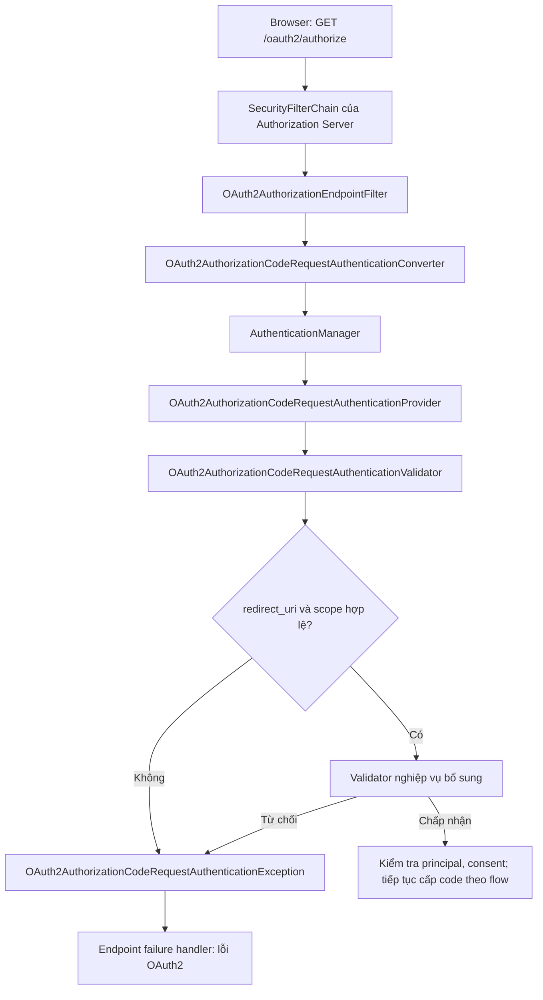

# Tùy chỉnh validation bằng OAuth2AuthorizationCodeRequestAuthenticationValidator

## 1. Vì sao cần tùy chỉnh validation tại Authorization Endpoint?

Trong chương **Authorization Endpoint** của module `SPRING_SECURITY_OAUTH2_OIDC_AUTHORIZATION_SERVER`, chúng ta tìm hiểu cách kiểm tra một yêu cầu OAuth 2.0 Authorization Code trước khi máy chủ cho phép tiếp tục ủy quyền. Kiến thức này phục vụ mục tiêu **thiết kế, cấu hình, bảo mật, kiểm thử và vận hành OAuth 2.0/OpenID Connect Authorization Server bằng Spring Security và Spring Authorization Server trong Spring Boot**.

Ví dụ một ứng dụng đã đăng ký với Authorization Server gửi:

```http
GET /oauth2/authorize?response_type=code
    &client_id=portal-web
    &redirect_uri=https%3A%2F%2Fportal.example.com%2Fcallback
    &scope=openid%20payments.read%20payments.write
    &state=<random-state>
    &code_challenge=<s256-challenge>
    &code_challenge_method=S256
Host: auth.example.com
```

Authorization Server phải xác minh yêu cầu này có thuộc một client đã đăng ký, dùng redirect URI phù hợp và yêu cầu các scope hợp lệ hay không. Một tổ chức còn có thể muốn áp dụng quy tắc riêng, chẳng hạn **ứng dụng `portal-web` chỉ được yêu cầu `payments.write` nếu đồng thời yêu cầu `payments.read`**. Đây là chính sách nghiệp vụ minh họa, không phải điều kiện của chuẩn OAuth 2.0.

Spring Authorization Server cung cấp điểm mở rộng qua `OAuth2AuthorizationCodeRequestAuthenticationProvider.setAuthenticationValidator(...)`. **Cách an toàn khi chỉ muốn bổ sung ràng buộc** là chạy validator mặc định trước, rồi chạy validator riêng. Nếu vô tình thay cả validator mặc định, ứng dụng có thể không còn kiểm tra đúng `redirect_uri` hoặc `scope`.

Sau bài này, người học có thể:

1. Giải thích vị trí `OAuth2AuthorizationCodeRequestAuthenticationValidator` trong pipeline Authorization Endpoint.
2. Phân biệt validation của `redirect_uri`/`scope` với việc xác thực người dùng, kiểm tra PKCE, consent và đổi code lấy token.
3. Lắp một `Consumer<OAuth2AuthorizationCodeRequestAuthenticationContext>` tùy chỉnh bằng hook của `OAuth2AuthorizationEndpointConfigurer`.
4. Giữ kiểm tra chuẩn với `DEFAULT_REDIRECT_URI_VALIDATOR` và `DEFAULT_SCOPE_VALIDATOR`.
5. Kiểm thử cả đường thành công lẫn những yêu cầu bị từ chối, đặc biệt các trường hợp có nguy cơ open redirect.

**Phạm vi API:** các ví dụ sử dụng API Spring Authorization Server 1.5.x và Spring Security Servlet 6.x (thường đi cùng Spring Boot 3.x). Ở các dòng phiên bản mới, mã Authorization Server có thể nằm trong bản phân phối Spring Security; hãy đối chiếu artifact và tài liệu API của phiên bản đang chạy trước khi sao chép cấu hình.

## 2. Validator nằm ở đâu trong pipeline?

Ở cấu hình Servlet phổ biến, `OAuth2AuthorizationEndpointFilter` nhận yêu cầu `/oauth2/authorize`, dùng `AuthenticationConverter` để tạo đối tượng `OAuth2AuthorizationCodeRequestAuthenticationToken`, sau đó gọi `AuthenticationManager` và `OAuth2AuthorizationCodeRequestAuthenticationProvider`.



Sơ đồ diễn đạt các trách nhiệm chính, **không phải thứ tự gọi mọi method nội bộ của framework**. Các kiểm tra về client, response type, PKCE, người dùng và consent còn được thực hiện tại những bước phù hợp của pipeline; không nên nghĩ rằng validator này chịu trách nhiệm toàn bộ giao thức.

| Thành phần | Trách nhiệm chính |
| --- | --- |
| `OAuth2AuthorizationEndpointFilter` | Nhận request HTTP và điều phối thành công/thất bại của endpoint |
| `OAuth2AuthorizationCodeRequestAuthenticationConverter` | Parse tham số yêu cầu ủy quyền, xây dựng `Authentication` đầu vào |
| `OAuth2AuthorizationCodeRequestAuthenticationProvider` | Kiểm tra yêu cầu và quyền cấp code; gọi validator; phối hợp trạng thái authorization/consent |
| `OAuth2AuthorizationCodeRequestAuthenticationValidator` | Kiểm tra mặc định `redirect_uri`, sau đó `scope` |
| `OAuth2AuthorizationCodeRequestAuthenticationContext` | Cung cấp token yêu cầu cùng `RegisteredClient` và ngữ cảnh liên quan |
| `OAuth2AuthorizationCodeRequestAuthenticationException` | Mang lỗi validation để Authorization Endpoint xử lý theo giao thức |

Đây là **authorization request validation**. Yêu cầu `POST /oauth2/token` với `grant_type=authorization_code` được xử lý bằng các converter/provider của **Token Endpoint**, có các kiểm tra riêng đối với code, client authentication và `code_verifier`.

## 3. Validator mặc định kiểm tra những gì?

`OAuth2AuthorizationCodeRequestAuthenticationValidator` là một `Consumer<OAuth2AuthorizationCodeRequestAuthenticationContext>`. Với Spring Authorization Server 1.5.x, nó cung cấp hai thành phần công khai:

```java
OAuth2AuthorizationCodeRequestAuthenticationValidator.DEFAULT_REDIRECT_URI_VALIDATOR
OAuth2AuthorizationCodeRequestAuthenticationValidator.DEFAULT_SCOPE_VALIDATOR
```

| Thành phần | Mục đích | Sai sót thường gặp |
| --- | --- | --- |
| `DEFAULT_REDIRECT_URI_VALIDATOR` | Kiểm tra `redirect_uri` của yêu cầu với thông tin redirect đã đăng ký theo quy tắc được hỗ trợ | Client trỏ callback tới domain khác, path khác, hoặc URI không phù hợp |
| `DEFAULT_SCOPE_VALIDATOR` | Kiểm tra các scope được yêu cầu trong phạm vi mà `RegisteredClient` được cho phép | Client yêu cầu `payments.admin` dù chỉ đăng ký `payments.read` |
| Validator tổng hợp mặc định | Thực thi kiểm tra redirect URI rồi scope | Hành vi an toàn có thể bị mất nếu thay hoàn toàn bằng custom validator |

Ví dụ client được đăng ký:

```text
client_id: portal-web
redirect_uris:
  - https://portal.example.com/callback
scopes:
  - openid
  - payments.read
  - payments.write
```

Nếu browser gửi `redirect_uri=https://attacker.example/callback`, yêu cầu không phù hợp với đăng ký. Nếu browser yêu cầu scope `payments.admin`, yêu cầu cũng không phù hợp. Việc phân tích query thành các trường hợp lệ về mặt cú pháp là trách nhiệm của các thành phần đọc request trước đó; validator mặc định tập trung vào kiểm tra giá trị so với cấu hình client.

**Không được suy luận rằng hai validator trên đã kiểm tra toàn bộ OAuth 2.0.** Ngoài chúng còn có điều kiện về `response_type`, grant type, PKCE, user authentication, consent, trạng thái giao dịch và các quy tắc OIDC nếu scope chứa `openid`.

### 3.1. Phân biệt `redirect_uri` yêu cầu và redirect URI đã đăng ký

`redirect_uri` nằm trong request của browser là **dữ liệu do phía client gửi**. Giá trị được lưu trong `RegisteredClient.getRedirectUris()` là cấu hình do Authorization Server quản lý. Chỉ vì request được truyền qua HTTPS không có nghĩa URI của callback hợp lệ.

Không dùng kiểm tra kiểu:

```java
// VÍ DỤ KHÔNG AN TOÀN - KHÔNG ÁP DỤNG
if (requestedRedirectUri.contains("example.com")) {
    // chấp nhận
}
```

Chuỗi `https://example.com.attacker.invalid/cb` vẫn chứa `example.com` nhưng không thuộc domain mong muốn. Tương tự, cách so sánh bắt đầu bằng chuỗi, wildcard tùy ý hoặc bỏ qua cổng/path có thể tạo ra lỗ hổng chuyển hướng và lộ authorization code.

**Ưu tiên đăng ký URI cụ thể và giữ validator chuẩn.** Những ngoại lệ như loopback redirect dành cho native app cần được thiết kế theo profile phù hợp, chỉ áp dụng cho loại client được phép, với chính sách riêng và test âm tính đầy đủ.

### 3.2. `scope` có hai lớp kiểm tra

Kiểm tra mặc định xác nhận scope mà client yêu cầu **được đăng ký**; chính sách ứng dụng có thể còn quy định **scope nào được phép dùng cùng nhau, trong ngữ cảnh nào**. Ví dụ:

- Client đăng ký `payments.read` và `payments.write`.
- Chính sách nội bộ yêu cầu `payments.write` chỉ xuất hiện khi yêu cầu cũng bao gồm `payments.read`.
- Sau khi cấp token, Resource Server vẫn phải kiểm tra scope/audience và quyền nghiệp vụ tương ứng cho mỗi API.

Một scope hợp lệ trong `RegisteredClient` không tự cấp quyền truy cập mọi tài nguyên; cũng không thay thế consent của người dùng khi cần.

## 4. Cơ chế mở rộng qua `setAuthenticationValidator`

Điểm mở rộng ở **`OAuth2AuthorizationCodeRequestAuthenticationProvider`**, với chữ ký khái niệm:

```java
void setAuthenticationValidator(
        Consumer<OAuth2AuthorizationCodeRequestAuthenticationContext> validator);
```

Chúng ta không cần thay `OAuth2AuthorizationEndpointFilter` hay viết lại `AuthenticationProvider`. Trong cấu hình:

```text
OAuth2AuthorizationServerConfigurer
  -> authorizationEndpoint(...)
  -> authenticationProviders(Consumer<List<AuthenticationProvider>>)
  -> tìm OAuth2AuthorizationCodeRequestAuthenticationProvider
  -> setAuthenticationValidator(validator đã ghép)
```

Phương thức `authenticationProviders(...)` trả quyền truy cập danh sách provider mặc định và provider tùy chỉnh, để có thể cấu hình đúng đối tượng. **Không lấy nhầm `OAuth2AuthorizationCodeAuthenticationProvider`**: tên này liên quan việc *đổi authorization code tại Token Endpoint*, khác với `OAuth2AuthorizationCodeRequestAuthenticationProvider` xử lý *yêu cầu xin code tại Authorization Endpoint*.

### 4.1. Hai mẫu ghép validator

**Mẫu A – giữ toàn bộ validator mặc định rồi bổ sung chính sách:**

```java
Consumer<OAuth2AuthorizationCodeRequestAuthenticationContext> validator =
        new OAuth2AuthorizationCodeRequestAuthenticationValidator()
                .andThen(new PaymentScopePairValidator());
```

**Mẫu B – ghép tường minh từng bước để thấy thứ tự:**

```java
Consumer<OAuth2AuthorizationCodeRequestAuthenticationContext> validator =
        OAuth2AuthorizationCodeRequestAuthenticationValidator.DEFAULT_REDIRECT_URI_VALIDATOR
                .andThen(
                    OAuth2AuthorizationCodeRequestAuthenticationValidator.DEFAULT_SCOPE_VALIDATOR)
                .andThen(new PaymentScopePairValidator());
```

Hai mẫu nhằm đạt **cùng mục đích** với phiên bản API trong bài: giữ kiểm tra mặc định trước khi áp dụng quy tắc bổ sung. Với `Consumer.andThen(...)`, nếu bước trước ném exception, các bước sau **không chạy**. Đây là một điểm quan trọng khi phân tích thứ tự lỗi và log.

Ngược lại, đoạn sau **thay thế hoàn toàn** default validator:

```java
// Chỉ dùng khi chủ đích tự chịu trách nhiệm toàn bộ validation cần thiết.
provider.setAuthenticationValidator(new PaymentScopePairValidator());
```

Nếu custom validator chỉ kiểm tra scope kết hợp, cấu hình này có thể làm mất kiểm tra chuẩn đối với `redirect_uri` và scope đã đăng ký. **Không áp dụng cách này cho ví dụ đang xây dựng.**

## 5. Ví dụ yêu cầu nghiệp vụ: `payments.write` đi cùng `payments.read`

Giả sử ứng dụng `portal-web` có những màn hình đọc và ghi thanh toán. Nhóm API quyết định rằng khi yêu cầu quyền ghi thanh toán, client phải đồng thời yêu cầu quyền đọc để hoàn thành giao dịch. Chính sách này chỉ áp dụng cho **một client cụ thể**, các client còn lại vẫn theo quy tắc riêng.

### 5.1. Viết `PaymentScopePairValidator`

```java
package com.example.authserver.security;

import java.util.Set;
import java.util.function.Consumer;

import org.springframework.security.oauth2.core.OAuth2Error;
import org.springframework.security.oauth2.core.OAuth2ErrorCodes;
import org.springframework.security.oauth2.server.authorization.authentication
        .OAuth2AuthorizationCodeRequestAuthenticationContext;
import org.springframework.security.oauth2.server.authorization.authentication
        .OAuth2AuthorizationCodeRequestAuthenticationException;
import org.springframework.security.oauth2.server.authorization.client.RegisteredClient;

public final class PaymentScopePairValidator
        implements Consumer<OAuth2AuthorizationCodeRequestAuthenticationContext> {

    @Override
    public void accept(OAuth2AuthorizationCodeRequestAuthenticationContext context) {
        RegisteredClient registeredClient = context.getRegisteredClient();
        Set<String> requestedScopes = context.getAuthentication().getScopes();

        // Chỉ ràng buộc chính sách này với client được chỉ định.
        if (!"portal-web".equals(registeredClient.getClientId())) {
            return;
        }

        boolean writesPayments = requestedScopes.contains("payments.write");
        boolean readsPayments = requestedScopes.contains("payments.read");

        if (writesPayments && !readsPayments) {
            OAuth2Error error = new OAuth2Error(
                    OAuth2ErrorCodes.INVALID_SCOPE,
                    "payments.write requires payments.read",
                    null);
            throw new OAuth2AuthorizationCodeRequestAuthenticationException(
                    error, null);
        }
    }
}
```

**Vai trò của từng dòng chính:**

- `context.getRegisteredClient()` lấy cấu hình **đáng tin cậy** mà Authorization Server đã tra cứu.
- `context.getAuthentication().getScopes()` là các scope từ yêu cầu ủy quyền đã được chuyển thành `Authentication`.
- Điều kiện `clientId` chỉ giới hạn phạm vi áp dụng của **chính sách ví dụ**; nó không thay thế bước xác định client hợp lệ.
- `OAuth2ErrorCodes.INVALID_SCOPE` là lỗi phù hợp khi chính sách scope từ chối request.
- `OAuth2AuthorizationCodeRequestAuthenticationException` là loại exception mà extension point này yêu cầu khi validation thất bại.

Không phát hành authorization code, không lưu token và không thực hiện redirect thủ công trong validator. Nếu chính sách cần thông tin bên ngoài (ví dụ tenant hoặc danh sách quyền), hãy xác định rõ nguồn dữ liệu đáng tin, thời gian truy vấn và cách xử lý khi hệ thống policy không sẵn sàng; không tin một header do browser tự gắn là bằng chứng quyền.

**Ranh giới quan trọng:** ví dụ yêu cầu scope phải đi theo cặp là **quy tắc tự đặt**, không phải quy tắc OAuth 2.0 hoặc OIDC. Ứng dụng thật phải thống nhất điều kiện này với chủ API và client. Nếu không cần ràng buộc ấy, chỉ dùng validator mặc định.

## 6. Đăng ký validator với Authorization Endpoint

Cấu hình dưới đây cho thấy cách áp dụng custom validator trong `SecurityFilterChain` của Authorization Server. Ví dụ dựa trên API `OAuth2AuthorizationServerConfigurer.authorizationServer()` của Spring Authorization Server 1.5.x.

```java
package com.example.authserver.security;

import java.util.function.Consumer;

import org.springframework.context.annotation.Bean;
import org.springframework.context.annotation.Configuration;
import org.springframework.core.annotation.Order;
import org.springframework.http.MediaType;
import org.springframework.security.config.Customizer;
import org.springframework.security.config.annotation.web.builders.HttpSecurity;
import org.springframework.security.oauth2.server.authorization.authentication
        .OAuth2AuthorizationCodeRequestAuthenticationContext;
import org.springframework.security.oauth2.server.authorization.authentication
        .OAuth2AuthorizationCodeRequestAuthenticationProvider;
import org.springframework.security.oauth2.server.authorization.authentication
        .OAuth2AuthorizationCodeRequestAuthenticationValidator;
import org.springframework.security.oauth2.server.authorization.config.annotation.web.configurers
        .OAuth2AuthorizationServerConfigurer;
import org.springframework.security.web.SecurityFilterChain;
import org.springframework.security.web.authentication.LoginUrlAuthenticationEntryPoint;
import org.springframework.security.web.util.matcher.MediaTypeRequestMatcher;

@Configuration(proxyBeanMethods = false)
public class AuthorizationServerSecurityConfig {

    @Bean
    @Order(1)
    SecurityFilterChain authorizationServerSecurityFilterChain(HttpSecurity http)
            throws Exception {
        OAuth2AuthorizationServerConfigurer authorizationServer =
                OAuth2AuthorizationServerConfigurer.authorizationServer();

        http
            .securityMatcher(authorizationServer.getEndpointsMatcher())
            .with(authorizationServer, server -> server
                .authorizationEndpoint(endpoint -> endpoint
                    .authenticationProviders(providers -> {
                        providers.forEach(authenticationProvider -> {
                            if (authenticationProvider instanceof
                                    OAuth2AuthorizationCodeRequestAuthenticationProvider codeRequestProvider) {
                                Consumer<OAuth2AuthorizationCodeRequestAuthenticationContext> validator =
                                        OAuth2AuthorizationCodeRequestAuthenticationValidator
                                            .DEFAULT_REDIRECT_URI_VALIDATOR
                                            .andThen(OAuth2AuthorizationCodeRequestAuthenticationValidator
                                                .DEFAULT_SCOPE_VALIDATOR)
                                            .andThen(new PaymentScopePairValidator());

                                codeRequestProvider.setAuthenticationValidator(validator);
                            }
                        });
                    })
                )
                .oidc(Customizer.withDefaults())
            )
            .authorizeHttpRequests(authorize -> authorize
                .anyRequest().authenticated()
            )
            .exceptionHandling(exceptions -> exceptions
                .defaultAuthenticationEntryPointFor(
                    new LoginUrlAuthenticationEntryPoint("/login"),
                    new MediaTypeRequestMatcher(MediaType.TEXT_HTML))
            );

        return http.build();
    }

    @Bean
    @Order(2)
    SecurityFilterChain applicationSecurityFilterChain(HttpSecurity http)
            throws Exception {
        http.authorizeHttpRequests(authorize -> authorize
                .anyRequest().authenticated())
            .formLogin(Customizer.withDefaults());

        return http.build();
    }
}
```

**Điểm cần quan sát:**

1. `securityMatcher(authorizationServer.getEndpointsMatcher())` chọn đúng endpoints của Authorization Server; chain `@Order(1)` ưu tiên hơn chain ứng dụng.
2. `.authorizationEndpoint(...)` mở điểm tùy chỉnh **Authorization Endpoint**.
3. `.authenticationProviders(...)` tìm provider kiểu `OAuth2AuthorizationCodeRequestAuthenticationProvider` trong danh sách do framework cấu hình.
4. `setAuthenticationValidator(...)` cài chuỗi **redirect URI mặc định → scope mặc định → chính sách scope kết hợp**.
5. `.oidc(Customizer.withDefaults())` bật chức năng OIDC tương ứng khi hệ thống cần OIDC; ví dụ có scope `openid`.
6. Chain `@Order(2)` cho `/login` cho phép user hoàn tất đăng nhập rồi tiếp tục flow ủy quyền.

Đây là **khung cấu hình filter chain để học extension point**, chưa phải Authorization Server có thể vận hành ngay. Phần ứng dụng còn cần cấu hình `RegisteredClientRepository`, xác thực người dùng, `AuthorizationServerSettings`, key/JWK, token generator, authorization/consent service theo mô hình sử dụng. Khi bật OIDC UserInfo/JWT resource server support, có thể cần thêm cấu hình JWT decoder và security thích hợp theo phiên bản.

Không thêm một `OAuth2AuthorizationCodeRequestAuthenticationProvider` mới bằng tay nếu mục tiêu chỉ là đổi validator của provider mặc định: tạo thêm provider xử lý cùng loại `Authentication` có thể dẫn đến thứ tự hoặc luồng xác thực khó đoán.

## 7. RegisteredClient và ý nghĩa của cấu hình thử nghiệm

Để minh họa validator hoạt động, ta cần đăng ký client có cả hai scope. Ví dụ này giả định chạy local và **confidential web client** giữ secret ở backend:

```java
// Các import RegisteredClient, OidcScopes, ClientSettings, TokenSettings...
// được lược bỏ để tập trung vào phần client registration.
RegisteredClient portal = RegisteredClient.withId("portal-client-test-id")
        .clientId("portal-web")
        .clientSecret(encodedClientSecret) // hash từ PasswordEncoder, không phải plain text
        .clientAuthenticationMethod(ClientAuthenticationMethod.CLIENT_SECRET_BASIC)
        .authorizationGrantType(AuthorizationGrantType.AUTHORIZATION_CODE)
        .authorizationGrantType(AuthorizationGrantType.REFRESH_TOKEN)
        .redirectUri("https://portal.example.com/callback")
        .scope(OidcScopes.OPENID)
        .scope("payments.read")
        .scope("payments.write")
        .clientSettings(ClientSettings.builder()
                .requireProofKey(true)
                .requireAuthorizationConsent(true)
                .build())
        .build();
```

Đây là **đoạn khởi tạo client**, không phải bean/repository hoàn chỉnh. `encodedClientSecret` là biến biểu diễn mật khẩu đã mã hóa một chiều, chẳng hạn giá trị do `PasswordEncoder` tạo. Khi dùng `DelegatingPasswordEncoder`, bảo đảm định dạng hash gồm tiền tố thuật toán phù hợp (ví dụ `{bcrypt}`). Không commit raw secret, private key hoặc token vào repository.

Với registration này:

| Scope request | Validation mặc định | PaymentScopePairValidator | Kết luận |
| --- | --- | --- | --- |
| `openid payments.read` | Hợp lệ nếu URI đúng | Hợp lệ | Có thể tiếp tục flow |
| `openid payments.read payments.write` | Hợp lệ nếu URI đúng | Hợp lệ | Có thể tiếp tục flow |
| `openid payments.write` | Hợp lệ vì đã đăng ký | Từ chối `invalid_scope` | Không cấp code |
| `openid payments.admin` | Từ chối scope không đăng ký | Không chạy | Không cấp code |
| `openid payments.read`, callback khác đăng ký | Từ chối redirect URI | Không chạy | Không cấp code |

“Có thể tiếp tục flow” nghĩa là validator đã qua, **không bảo đảm sẽ cấp code**: user còn phải đăng nhập, consent còn phải được xử lý và các kiểm tra giao thức khác phải thành công.

## 8. Nếu thật sự cần thay validator của `redirect_uri`

Tài liệu Spring Authorization Server có minh họa việc tùy chỉnh redirect URI validation (ví dụ trong quá trình phát triển hoặc tích hợp loopback redirect). Khi đó, nhà phát triển có thể **thay** phần redirect validator rồi giữ scope validator chuẩn:

```java
Consumer<OAuth2AuthorizationCodeRequestAuthenticationContext> validator =
        new CarefullyReviewedRedirectUriValidator()
                .andThen(OAuth2AuthorizationCodeRequestAuthenticationValidator
                        .DEFAULT_SCOPE_VALIDATOR);

codeRequestProvider.setAuthenticationValidator(validator);
```

`CarefullyReviewedRedirectUriValidator` trong snippet trên là **tên minh họa**, không phải class sẵn có của framework. Một triển khai thay thế thực sự phải chịu trách nhiệm đầy đủ đối với điều kiện redirect URI; trong sản phẩm cần phân tích rủi ro, đối chiếu RFC và kiểm thử.

### 8.1. Những yêu cầu bảo mật không được bỏ qua

- Đối chiếu URI yêu cầu với URI đã đăng ký; **ưu tiên so khớp chính xác** theo giao thức và profile liên quan.
- Chỉ chấp nhận scheme/host/port/path hợp lệ; không chấp nhận `javascript:`, `data:`, fragment hoặc callback tự do.
- Không dùng `contains`, `startsWith` hay wildcard tùy ý để xác định domain hợp lệ.
- Không bỏ qua `RegisteredClient.getRedirectUris()` để dựa vào tên client, scope hoặc header không đáng tin.
- Nếu `redirect_uri` được phép vắng mặt trong một trường hợp của giao thức/phiên bản, xử lý theo đúng quy tắc; **đừng gọi `URI.create(null)`** hoặc tự ý thay bằng callback bất kỳ.
- Nếu hỗ trợ loopback URI cho native app, giới hạn client type, host, đường dẫn và trường hợp biến thiên cổng theo profile; tránh áp dụng ngoại lệ tương tự cho mọi confidential web client.
- Nếu redirect URI không hợp lệ, **không được tự gửi lỗi/authorization code về chính URI chưa được xác minh**.

Ví dụ rủi ro:

```text
Registered redirect:
  https://portal.example.com/callback

Các yêu cầu không được tự nới lỏng để chấp nhận:
  https://portal.example.com.attacker.invalid/callback
  https://attacker.invalid/callback
  https://portal.example.com/other-callback
  javascript:alert(1)
```

Trong cấu hình thực tế, chỉ nới lỏng nếu có lý do tương thích cụ thể, đánh giá bảo mật và các trường hợp âm tính được kiểm chứng. Nếu nhu cầu chỉ là thêm callback cho môi trường mới, **đăng ký đúng redirect URI trong RegisteredClient** thường là giải pháp đơn giản và an toàn hơn tự viết validator mới.

### 8.2. Vì sao không `catch` lỗi mặc định rồi cho qua?

Một lỗi thường gặp:

```java
// VÍ DỤ SAI - KHÔNG ÁP DỤNG
try {
    OAuth2AuthorizationCodeRequestAuthenticationValidator.DEFAULT_REDIRECT_URI_VALIDATOR
            .accept(context);
} catch (OAuth2AuthorizationCodeRequestAuthenticationException ignored) {
    // Chấp nhận cả redirect_uri sai để client không bị lỗi
}
```

Cách này cho phép request nguy hiểm tiếp tục, có thể làm lộ authorization code và tạo open redirect. Nếu client hiện có hoạt động không tương thích, hãy điều tra vì sao URI không khớp, quyết định chính sách chính xác, rồi kiểm thử cả yêu cầu hợp lệ lẫn không hợp lệ trước khi sửa.

## 9. Kiểm tra và ném lỗi đúng loại

Một custom validator nên có hai hành vi rõ ràng:

- **Hợp lệ:** kết thúc `accept(context)` bình thường (không trả token hoặc đối tượng `Authentication`).
- **Không hợp lệ:** ném `OAuth2AuthorizationCodeRequestAuthenticationException` với `OAuth2Error` phù hợp.

| Trường hợp | Mã lỗi thường phù hợp | Ghi chú |
| --- | --- | --- |
| Scope không được phép hoặc vi phạm chính sách scope | `invalid_scope` | Dùng cho ví dụ kết hợp quyền `payments.write` |
| Redirect URI sai hoặc tham số yêu cầu không hợp lệ | `invalid_request` | Không chuyển hướng tới URI chưa được xác minh |
| Client không được phép dùng luồng ủy quyền | `unauthorized_client` | Thường được provider xác minh từ registration |
| Loại response không được hỗ trợ | `unsupported_response_type` | Không phải phạm vi chính của validator này |
| Yêu cầu thiếu xác thực người dùng trong chế độ không tương tác OIDC | `login_required` (OIDC) | Do chính sách flow OIDC xử lý |

Các mã và HTTP response cụ thể do endpoint và loại lỗi quyết định. Khi redirect URI đã xác minh hợp lệ, Authorization Server có thể trả lỗi OAuth2 qua callback kèm `state`; khi redirect URI không đáng tin, server không được gửi browser tới callback đó. **Không khẳng định mọi lỗi validation đều phải trả HTTP 400 JSON**, vì Authorization Endpoint là một endpoint tương tác qua trình duyệt, khác Token Endpoint.

Trong `error_description` nên dùng thông điệp ngắn, không chứa `client_secret`, token, mã ủy quyền, `code_verifier`, private key hoặc dữ liệu nội bộ nhạy cảm. Phản hồi lỗi là một phần giao diện công khai và cần được thiết kế an toàn.

## 10. Unit test validator mà không cần chạy cả Authorization Server

Đối với quy tắc kết hợp scope, có thể kiểm thử `PaymentScopePairValidator` trực tiếp. Để bảo đảm không bỏ sót bảo vệ mặc định, test cũng nên chạy **chuỗi `Consumer` đã ghép** với redirect URI/scope hợp lệ hoặc sai.

Ví dụ JUnit 5 sau minh họa cách tạo `OAuth2AuthorizationCodeRequestAuthenticationContext` từ token và registered client. Các import được viết đủ cho đoạn test độc lập với server runtime:

```java
package com.example.authserver.security;

import java.util.Map;
import java.util.Set;
import java.util.function.Consumer;

import org.junit.jupiter.api.Test;
import org.springframework.security.authentication.UsernamePasswordAuthenticationToken;
import org.springframework.security.oauth2.core.AuthorizationGrantType;
import org.springframework.security.oauth2.core.ClientAuthenticationMethod;
import org.springframework.security.oauth2.core.OAuth2ErrorCodes;
import org.springframework.security.oauth2.server.authorization.authentication
        .OAuth2AuthorizationCodeRequestAuthenticationContext;
import org.springframework.security.oauth2.server.authorization.authentication
        .OAuth2AuthorizationCodeRequestAuthenticationException;
import org.springframework.security.oauth2.server.authorization.authentication
        .OAuth2AuthorizationCodeRequestAuthenticationToken;
import org.springframework.security.oauth2.server.authorization.authentication
        .OAuth2AuthorizationCodeRequestAuthenticationValidator;
import org.springframework.security.oauth2.server.authorization.client.RegisteredClient;

import static org.junit.jupiter.api.Assertions.assertDoesNotThrow;
import static org.junit.jupiter.api.Assertions.assertEquals;
import static org.junit.jupiter.api.Assertions.assertThrows;

class AuthorizationRequestValidationTest {

    private final RegisteredClient client = RegisteredClient.withId("test-1")
            .clientId("portal-web")
            .clientAuthenticationMethod(ClientAuthenticationMethod.NONE)
            .authorizationGrantType(AuthorizationGrantType.AUTHORIZATION_CODE)
            .redirectUri("https://portal.example.com/callback")
            .scope("payments.read")
            .scope("payments.write")
            .build();

    private final Consumer<OAuth2AuthorizationCodeRequestAuthenticationContext> validator =
            new OAuth2AuthorizationCodeRequestAuthenticationValidator()
                    .andThen(new PaymentScopePairValidator());

    private OAuth2AuthorizationCodeRequestAuthenticationContext context(
            String redirectUri, Set<String> scopes) {
        var principal = new UsernamePasswordAuthenticationToken("test-user", "N/A");
        var request = new OAuth2AuthorizationCodeRequestAuthenticationToken(
                "https://auth.example.com/oauth2/authorize",
                "portal-web",
                principal,
                redirectUri,
                "test-state",
                scopes,
                Map.of());

        return OAuth2AuthorizationCodeRequestAuthenticationContext.with(request)
                .registeredClient(client)
                .build();
    }

    @Test
    void acceptsPairedScopes() {
        assertDoesNotThrow(() -> validator.accept(context(
                "https://portal.example.com/callback",
                Set.of("payments.read", "payments.write"))));
    }

    @Test
    void rejectsWriteWithoutRead() {
        var exception = assertThrows(
                OAuth2AuthorizationCodeRequestAuthenticationException.class,
                () -> validator.accept(context(
                        "https://portal.example.com/callback",
                        Set.of("payments.write"))));
        assertEquals(OAuth2ErrorCodes.INVALID_SCOPE,
                exception.getError().getErrorCode());
    }

    @Test
    void rejectsUnregisteredScopeBeforeCustomPolicy() {
        assertThrows(OAuth2AuthorizationCodeRequestAuthenticationException.class,
                () -> validator.accept(context(
                        "https://portal.example.com/callback",
                        Set.of("payments.admin"))));
    }

    @Test
    void rejectsUnregisteredRedirectUri() {
        assertThrows(OAuth2AuthorizationCodeRequestAuthenticationException.class,
                () -> validator.accept(context(
                        "https://attacker.invalid/callback",
                        Set.of("payments.read"))));
    }
}
```

Test này **chỉ xác minh Consumer**, không kiểm chứng bước xác thực người dùng, đồng ý cấp quyền, PKCE hay việc cấp authorization code. Khi ghép vào dự án thật, các dependency test phải có JUnit 5 và Spring Authorization Server đúng phiên bản; giữ test này ngoài mã production.

## 11. Integration test Authorization Endpoint theo HTTP

Unit test ở mục 10 không đủ để chứng minh hook `authenticationProviders(...)` đã được đăng ký và thực thi trên request thật. Cần một bài kiểm thử qua `MockMvc`, embedded server hoặc môi trường thử nghiệm.

### 11.1. Chuẩn bị fixtures

- `RegisteredClient` có `client_id=portal-web`, redirect URI `https://portal.example.com/callback`, scope `payments.read` và `payments.write`, grant `authorization_code`.
- Tùy nhu cầu OIDC, thêm `openid` và bật configurer OIDC.
- Test user có phiên đăng nhập hợp lệ; nếu dùng `MockMvc`, có thể thiết lập `SecurityContext` phù hợp hoặc thực hiện form login trước.
- Nếu bật `requireProofKey(true)`, dùng `code_verifier` đủ entropy và `code_challenge` S256 hợp lệ.
- Nếu bật `requireAuthorizationConsent(true)`, dự kiến gặp bước consent trước khi server chuyển về callback thành công.

### 11.2. Ma trận kiểm thử

| Trường hợp | Kỳ vọng ở mức giao thức |
| --- | --- |
| Scope `payments.read payments.write`, redirect hợp lệ | Không bị validator từ chối; tiếp tục authentication/consent/cấp code tùy điều kiện |
| Scope chỉ có `payments.write` | Bị từ chối với `invalid_scope` từ validator tùy chỉnh |
| Scope `payments.admin` chưa đăng ký | Bị validator scope chuẩn từ chối |
| Redirect URI khác registration | Bị validator redirect URI chuẩn từ chối; không redirect đến URI giả mạo |
| Client ID không tồn tại | Bị từ chối trước hoặc trong quá trình xác minh client |
| Grant không được phép với client | Bị từ chối theo đăng ký và chính sách grant |
| Code đã dùng lại tại Token Endpoint | Bị từ chối bởi kiểm tra grant/token (không phải validator bài này) |
| Thiếu `state`, `nonce` hoặc PKCE | Xử lý theo quy tắc OAuth2/OIDC, loại client và phiên bản; không suy diễn chỉ từ custom validator |

### 11.3. Gửi request thử bằng curl

Giả sử server chạy cục bộ tại `http://localhost:9000`, client thử nghiệm đã đăng ký đúng và login được thiết lập:

```bash
# Chỉ chạy trên môi trường test với client có URI/scope tương ứng.
curl -i --get 'http://localhost:9000/oauth2/authorize' \
  --data-urlencode 'response_type=code' \
  --data-urlencode 'client_id=portal-web' \
  --data-urlencode 'redirect_uri=https://portal.example.com/callback' \
  --data-urlencode 'scope=payments.write' \
  --data-urlencode 'state=example-state' \
  --data-urlencode 'code_challenge=E9Melhoa2OwvFrEMTJguCHaoeK1t8URWbuGJSstw-cM' \
  --data-urlencode 'code_challenge_method=S256'
```

Giá trị `code_challenge` được lấy từ ví dụ S256 chuẩn; `state` ở đây là giá trị cố định **chỉ dành cho test**, client production phải tạo state ngẫu nhiên, khó đoán cho từng giao dịch. Vì curl không có session đăng nhập, request có thể được **chuyển tới `/login` trước khi thấy lỗi validation**. Khi kiểm thử integration, phải duy trì cookie/session và hoàn tất đăng nhập hoặc dùng client test harness phù hợp.

**Không đánh giá kết quả chỉ dựa vào status 302/400.** Một HTTP 302 có thể là login redirect, consent redirect, callback thành công hoặc callback chứa lỗi. Kiểm tra `Location` đích, mã lỗi, state, thông tin client và việc endpoint có thực sự được xử lý.

## 12. Những nhầm lẫn thường gặp

### 12.1. Tùy chỉnh ở Token Endpoint thay vì Authorization Endpoint

`OAuth2AuthorizationCodeAuthenticationProvider` xử lý **đổi code lấy token**. `OAuth2AuthorizationCodeRequestAuthenticationProvider` xử lý **yêu cầu lấy code** tại Authorization Endpoint. Sửa validator trên provider thứ nhất không giải quyết được việc kiểm tra `redirect_uri`/`scope` khi browser vào `/oauth2/authorize`.

### 12.2. Thay validator mà quên giữ kiểm tra mặc định

Triệu chứng: custom scope policy chạy đúng nhưng một redirect URI không đăng ký vẫn đi xa hơn dự kiến. Cần xem mã gọi `setAuthenticationValidator`: có ghép `DEFAULT_REDIRECT_URI_VALIDATOR` và `DEFAULT_SCOPE_VALIDATOR` trước custom policy không?

### 12.3. Đăng ký provider tùy chỉnh sai vị trí

Nếu tạo provider xử lý cùng kiểu `Authentication` với provider chuẩn và thay thứ tự không có chủ đích, một provider có thể kết thúc trước khi custom validation chạy. Với yêu cầu chỉ bổ sung validation, dùng **`authorizationEndpoint(...).authenticationProviders(...)`** để cấu hình provider chuẩn thường ít rủi ro hơn.

### 12.4. Sử dụng callback/hostname kiểu wildcard để sửa lỗi cấu hình

Nếu client báo mismatch redirect URI, bước đầu là so sánh URI chính xác và registration. Mở rộng bằng `startsWith("https://")` hoặc `contains("localhost")` có thể tạo lỗ hổng. Nếu cần nhiều môi trường, mỗi môi trường nên có client và redirect URI riêng.

### 12.5. Nghĩ rằng scope được đăng ký là quyền truy cập tuyệt đối

Server phát code/token theo scope chỉ là một lớp kiểm soát. Resource Server cần xác minh chữ ký/issuer/audience/thời hạn của Access Token và kiểm tra scope lẫn quyền truy cập tài nguyên. Việc custom validation **không thay thế** chính sách ủy quyền trong API.

### 12.6. Cố áp đặt thông tin người dùng trong request validator

`OAuth2AuthorizationCodeRequestAuthenticationContext` cung cấp dữ liệu của yêu cầu và `RegisteredClient`. Không mặc định mọi yêu cầu tới hook đều có thông tin người dùng đã đăng nhập hoặc consent đã được cấp. Nếu chính sách phụ thuộc user/tenant, cần thiết kế ngữ cảnh đáng tin cậy và giai đoạn kiểm tra thích hợp, đặc biệt trong flow login/consent.

### 12.7. Rò rỉ dữ liệu khi debug

Tránh log toàn bộ `/oauth2/authorize` query string vì có thể chứa `state`, `nonce`, `login_hint` và thông tin giao dịch. Không log client secret, authorization code, refresh/access token hoặc verifier. Dùng correlation ID và mã lỗi chuẩn, bảo vệ log và hạn chế quyền truy cập.

## 13. Trường hợp nâng cao: PAR, OIDC và quy tắc khác

**Pushed Authorization Requests (PAR)** cho phép client đẩy thông tin yêu cầu ủy quyền tới endpoint được thiết kế cho PAR rồi sử dụng `request_uri` tại Authorization Endpoint. Trong các phiên bản hỗ trợ PAR, `OAuth2PushedAuthorizationRequestAuthenticationProvider` cũng có extension point liên quan validator authorization request. **Cấu hình provider của Authorization Endpoint không tự động chứng minh chính sách đã áp dụng tại PAR endpoint.** Nếu hệ thống có cả hai đường, cần rà soát và kiểm thử chính sách ở cả hai điểm, nhất quán với profile giao thức.

**OIDC** mở rộng Authorization Code Flow bằng scope `openid`, các tham số như `nonce`, `prompt`, `max_age` và ID Token. Validator bài này tập trung vào `redirect_uri`/`scope`; không nên tự viết toàn bộ kiểm tra nonce, ID Token, login freshness hoặc prompt handling trong một `Consumer` chỉ vì mọi thứ đều xuất hiện ở Authorization Endpoint.

**Authorization Code + PKCE** cần được giữ theo chuẩn: `code_challenge` ở authorization request và `code_verifier` ở Token Endpoint. Các cài đặt như `ClientSettings.requireProofKey(true)` và validation mặc định của provider/grant phải tiếp tục hoạt động. Đừng bỏ kiểm tra PKCE để “nới lỏng” một client sai cấu hình.

## 14. Quy trình triển khai an toàn và quan sát vận hành

Khi thực sự thay đổi logic validation cho một tổ chức:

1. **Mô tả quy tắc:** xác định client/issuer/môi trường nào áp dụng, phạm vi yêu cầu và lý do nghiệp vụ.
2. **Giữ mặc định:** ưu tiên append custom `Consumer` sau validator chuẩn; nếu buộc thay một phần, ghi rõ những điều kiện chuẩn phải tái triển khai.
3. **Kiểm thử trước:** test scope/redirect hợp lệ, bị cấm, nhập nhằng, thiếu giá trị, nhiều client và nhiều môi trường.
4. **Kiểm thử HTTP:** xác minh filter chain và provider thực sự dùng custom validator; kiểm tra lỗi trên Authorization Endpoint trước và sau đăng nhập/consent.
5. **Triển khai có kiểm soát:** ghi version chính sách, thay đổi vào môi trường staging trước và đảm bảo rollback được nếu client bị từ chối ngoài ý muốn.
6. **Theo dõi:** đo `invalid_scope`, `invalid_request` theo loại client/endpoint (không gắn raw query, token hoặc bí mật làm metric labels).
7. **Duy trì:** khi nâng Spring Security/Spring Authorization Server, so sánh validator mặc định của phiên bản mới trước khi quyết định tiếp tục override.

Mô hình kiểm thử tối thiểu nên gồm **unit test Consumer** và **integration test endpoint**. Unit test chứng minh quy tắc trong method; integration test chứng minh cấu hình `setAuthenticationValidator` có hiệu lực trong một yêu cầu OAuth2 thật.

## 15. Bài tập và câu hỏi ôn tập

**Bài tập 1 – Bổ sung chính sách scope.** Đổi ví dụ `PaymentScopePairValidator` thành quy tắc “scope `reports.export` chỉ được yêu cầu nếu client cũng yêu cầu `reports.read`”. Giữ nguyên hai validator mặc định và thêm các unit test tương ứng.

**Bài tập 2 – Kiểm tra callback.** Đăng ký callback `https://portal.example.com/callback`, sau đó thử `https://portal.example.com.attacker.invalid/callback`. Giải thích vì sao không được chấp nhận chỉ nhờ so khớp chuỗi con.

**Bài tập 3 – Kiểm thử sau đăng nhập.** Dùng MockMvc gửi authorization request khi chưa có session, đăng nhập, tiếp tục authorization, rồi kiểm tra custom validator từ chối `payments.write` thiếu `payments.read`.

**Bài tập 4 – Rà soát custom validator.** Một đồng nghiệp viết `provider.setAuthenticationValidator(ctx -> { /* validate one header */ });`. Hãy chỉ ra validation nào bị thay thế và cách sửa để giữ bảo vệ chuẩn.

**Câu hỏi tự đánh giá:**

1. `OAuth2AuthorizationCodeRequestAuthenticationValidator` mặc định xác minh những tham số nào?
2. Tại sao `OAuth2AuthorizationCodeRequestAuthenticationProvider` là nơi cấu hình hook thay vì `OAuth2AuthorizationCodeAuthenticationProvider`?
3. `Consumer.andThen` có chạy validator thứ hai nếu validator đầu tiên ném exception không?
4. Khi custom validation thất bại, loại exception nào cần được ném?
5. Khi nào cần dùng `DEFAULT_SCOPE_VALIDATOR` thay vì viết lại toàn bộ kiểm tra scope?
6. Một redirect URI không hợp lệ có được nhận error redirect tới chính URI đó không?
7. `RegisteredClient.getScopes()` và `context.getAuthentication().getScopes()` biểu diễn hai tập giá trị nào?
8. Vì sao unit test của Consumer chưa đủ để khẳng định Authorization Endpoint dùng đúng validator?
9. Nếu dùng PAR, tại sao cần kiểm tra các điểm validation khác?
10. Vì sao validator ở Authorization Endpoint không thay thế authorization rules của Resource Server?

## 16. Tài liệu tham khảo

- [Spring Authorization Server 1.5.x — Protocol Endpoints, Customizing Authorization Request Validation](https://docs.spring.io/spring-authorization-server/reference/protocol-endpoints.html)
- [Spring Authorization Server — API: OAuth2AuthorizationCodeRequestAuthenticationValidator](https://docs.spring.io/spring-authorization-server/reference/api/java/org/springframework/security/oauth2/server/authorization/authentication/OAuth2AuthorizationCodeRequestAuthenticationValidator.html)
- [Spring Authorization Server — API: OAuth2AuthorizationCodeRequestAuthenticationProvider](https://docs.spring.io/spring-authorization-server/reference/api/java/org/springframework/security/oauth2/server/authorization/authentication/OAuth2AuthorizationCodeRequestAuthenticationProvider.html)
- [Spring Authorization Server — API: OAuth2AuthorizationCodeRequestAuthenticationContext](https://docs.spring.io/spring-authorization-server/reference/api/java/org/springframework/security/oauth2/server/authorization/authentication/OAuth2AuthorizationCodeRequestAuthenticationContext.html)
- [Spring Security — Servlet Architecture](https://docs.spring.io/spring-security/reference/servlet/architecture.html)
- [RFC 6749 — OAuth 2.0 Authorization Framework](https://www.rfc-editor.org/rfc/rfc6749)
- [RFC 7636 — Proof Key for Code Exchange](https://www.rfc-editor.org/rfc/rfc7636)
- [RFC 8252 — OAuth 2.0 for Native Apps](https://www.rfc-editor.org/rfc/rfc8252)
- [RFC 9700 — OAuth 2.0 Security Best Current Practice](https://www.rfc-editor.org/rfc/rfc9700)

**Ghi nhớ:** `OAuth2AuthorizationCodeRequestAuthenticationValidator` kiểm tra `redirect_uri` và `scope` của authorization request. Hãy cấu hình nó qua `OAuth2AuthorizationCodeRequestAuthenticationProvider.setAuthenticationValidator(...)`, **giữ nguyên các kiểm tra mặc định khi thêm quy tắc riêng**, và chứng minh bằng cả unit test lẫn integration test rằng yêu cầu nguy hiểm vẫn bị từ chối trước khi Authorization Server cấp code.
