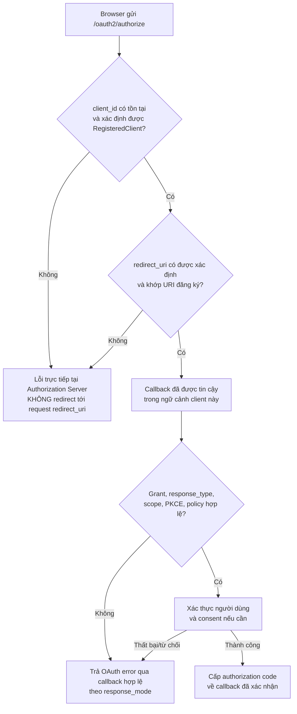

# Trả lỗi đúng ngữ cảnh và tránh redirect về URI không hợp lệ

## 1. Vấn đề: một lỗi có thể biến Authorization Server thành open redirector

Trong module **SPRING_SECURITY_OAUTH2_OIDC_AUTHORIZATION_SERVER**, chúng ta học cách thiết kế, cấu hình, bảo mật, kiểm thử và vận hành OAuth 2.0/OpenID Connect Authorization Server bằng **Spring Security và Spring Authorization Server trong Spring Boot**. Ở chương **Authorization Endpoint**, xử lý lỗi là một phần của **bảo mật giao thức**, không chỉ là việc chọn mã HTTP hay hiển thị thông báo.

Giả sử ứng dụng `portal-web` được đăng ký với callback:

```text
https://portal.example.com/login/oauth2/code/portal-web
```

Kẻ tấn công gửi trình duyệt đến:

```http
GET /oauth2/authorize?response_type=code
  &client_id=portal-web
  &redirect_uri=https%3A%2F%2Fattacker.example%2Fcollect
  &scope=openid%20profile
  &state=demo-state
```

Nếu Authorization Server phát hiện `redirect_uri` sai nhưng vẫn tạo HTTP 302 tới **URI do request đưa vào** và đính kèm `error=invalid_request`, server đã cho kẻ tấn công mượn domain đáng tin cậy để điều hướng nạn nhân tới trang độc hại. Nguy hiểm hơn, nếu cùng lỗi kiểm tra xảy ra ở đường **phát authorization code**, code hoặc token có thể bị lộ ra ngoài.

Quy tắc cốt lõi từ **RFC 6749 §3.1.2.4 và §4.1.2.1**: **khi thiếu, sai hoặc không khớp redirect URI, hoặc client ID thiếu/không hợp lệ, Authorization Server không được tự động redirect trình duyệt tới URI không hợp lệ**. **RFC 9700 §2.1** còn yêu cầu so khớp chính xác redirect URI đã đăng ký khi dùng luồng redirect (ngoại lệ giới hạn cho loopback/localhost native app).

Vì vậy, việc xử lý lỗi ở Authorization Endpoint có **hai ngữ cảnh tách biệt**:

- **Chưa có callback đáng tin cậy:** trả lỗi trực tiếp trên **origin của Authorization Server**, không có `Location` trỏ đến `redirect_uri` do request cung cấp.
- **Đã xác nhận client và callback:** có thể trả **OAuth/OIDC error response** về callback **đã xác nhận**, theo response mode hợp lệ và kèm `state` nếu request đã cung cấp.

Sau bài này, bạn sẽ thiết kế được thứ tự kiểm tra request, chọn đúng vị trí trả lỗi, hiểu các mã lỗi OAuth/OIDC, kiểm soát extension points trong Spring Authorization Server và tạo bộ kiểm thử ngăn open redirect.

## 2. Nắm đúng các vai trò và request liên quan

Authorization Endpoint là điểm **user-agent/browser** đi tới để xin quyền hoặc xác thực qua OIDC. Với Spring Authorization Server, đường dẫn mặc định thường là `/oauth2/authorize`, có thể được thay qua `AuthorizationServerSettings`.

| Thành phần | Vai trò tại Authorization Endpoint |
| --- | --- |
| **Resource Owner / End User** | Đăng nhập và đồng ý/từ chối cấp quyền khi được hỏi. |
| **OAuth2/OIDC Client** | Khởi tạo authorization request, đăng ký `client_id` và redirect URI, giữ state/PKCE verifier. |
| **Authorization Server** | Kiểm tra client, callback, grant/response type, scope, PKCE và phiên người dùng; phát code hoặc trả lỗi. |
| **RegisteredClientRepository** | Tra cứu metadata client: các redirect URI, grant types, scopes, `ClientSettings`. |
| **Resource Server** | Không nhận trực tiếp authorization error; nó bảo vệ API bằng access token trong một bước khác. |

Yêu cầu Authorization Code cơ bản:

```http
GET /oauth2/authorize?
    response_type=code
    &client_id=portal-web
    &redirect_uri=https%3A%2F%2Fportal.example.com%2Flogin%2Foauth2%2Fcode%2Fportal-web
    &scope=openid%20profile
    &state=RANDOM_BOUND_TO_BROWSER_TRANSACTION
    &code_challenge=BASE64URL_SHA256_VERIFIER
    &code_challenge_method=S256
```

Trong OIDC, `openid` cho biết yêu cầu xác thực danh tính, `nonce` có thể được yêu cầu/được dùng theo flow và chính sách. Với **public client**, PKCE là bắt buộc theo OAuth Security BCP; với confidential client dùng Authorization Code, PKCE cũng được khuyến nghị.

**Không được nhầm Authorization Endpoint với Token Endpoint**: lỗi lúc **browser authorization** có thể chuyển về callback hợp lệ; lỗi lúc **đổi authorization code lấy token** thường là phản hồi HTTP/JSON từ `/oauth2/token`, không phải một browser redirect tùy tiện.

## 3. Thứ tự kiểm tra: xác thực đích trả lời trước khi xử lý nội dung lỗi

Để tránh redirect sai, đừng bắt đầu bằng câu hỏi “lỗi thuộc loại gì?”. Hãy xác định **nơi được phép gửi kết quả** trước.



Sơ đồ là **mô hình quyết định bảo mật**, không phải cam kết về thứ tự gọi từng phương thức nội bộ trong tất cả phiên bản Spring. Điều không thay đổi là: **không có redirect ra khỏi Authorization Server nếu chưa có đích đáng tin cậy**.

### 3.1. Xác nhận `client_id`

1. Kiểm tra request có `client_id` hợp lệ về cấu trúc/độ dài theo chính sách.
2. Tra cứu `RegisteredClientRepository.findByClientId(clientId)`.
3. Nếu không tìm thấy, thiếu hoặc mâu thuẫn, **không** nhận URI bất kỳ từ request làm callback.
4. Nếu ứng dụng có registry quản lý trạng thái client (ACTIVE/SUSPENDED), kiểm tra chính sách này ở nơi xử lý giao thức phù hợp; bản thân `RegisteredClient` không có sẵn thuộc tính `enabled`.

Client ID là **định danh**, không phải secret và không chứng minh người gửi là chủ ứng dụng. Việc biết một client ID hợp lệ **không** cho phép kẻ tấn công chỉ định redirect URI mới.

### 3.2. Xác nhận `redirect_uri`

Đối với URI được gửi, Authorization Server phải xác định một redirect URI hợp lệ từ **tập URI đã đăng ký cho đúng client**. Tránh những cách kiểm tra yếu:

- Dùng `startsWith("https://portal.example.com")`: có thể chấp nhận `https://portal.example.com.attacker.example/...`.
- Dùng `endsWith("example.com")` tùy tiện: dễ bỏ qua origin, subdomain và dấu phân cách.
- Chỉ so hostname: bỏ qua scheme, port, path hoặc query.
- Cho phép wildcard `https://*.example.com/*` hoặc regex quá rộng mà không kiểm soát ownership.
- Tin `redirect_uri` từ header `Referer`, `Origin`, `Host` hoặc từ query parameter `next`/`return_to` thay cho registration.
- **Giải mã/chuẩn hóa URI nhiều lần** trước khi so khớp theo cách làm thay đổi giá trị gốc của request.

RFC 9700 yêu cầu **exact string matching** với URI đăng ký, ngoại trừ trường hợp giới hạn về cổng loopback/localhost của native app. Trong Spring, nên ưu tiên validator chuẩn và kiểm thử theo đúng phiên bản sử dụng. **Không tùy tiện tắt bước xác minh redirect URI để “làm được localhost”**; nếu cần native loopback, triển khai đúng trường hợp ngoại lệ của chuẩn và kiểm thử riêng.

### 3.3. Nếu thiếu `redirect_uri` thì sao?

Đừng đánh đồng **thiếu tham số** với **có tham số nhưng sai**. OAuth 2.0 có quy tắc liên quan đến một hoặc nhiều callback đã đăng ký; một số cấu hình có thể suy ra một callback duy nhất khi giao thức cho phép. Tuy nhiên **OIDC Authentication Request yêu cầu `redirect_uri`**. Dù thế nào, chỉ được tiếp tục khi đã xác định **một URI đáng tin cậy từ registration**, không chọn một URI do request chưa được kiểm tra hoặc tự dựng fallback có tham số người dùng.

## 4. Phải trả lỗi tại đâu? Ma trận quyết định

| Tình huống | Callback đáng tin? | Hướng xử lý đúng |
| --- | --- | --- |
| Thiếu `client_id` | Không | Trả trang lỗi HTTP trực tiếp tại AS; không tự động redirect. |
| `client_id` không tồn tại | Không | Trả lỗi trực tiếp; không dùng `redirect_uri` do request đưa vào. |
| `redirect_uri` không được đăng ký | Không | Trả lỗi trực tiếp; **không** đặt `Location` thành URI ấy. |
| `redirect_uri` có scheme/host/path/port sai | Không | Trả lỗi trực tiếp. |
| `redirect_uri` đúng nhưng `scope` ngoài quyền client | Có | OAuth error response `invalid_scope` về callback đã được xác minh. |
| `redirect_uri` đúng nhưng `response_type` bị từ chối/không hỗ trợ | Có | OAuth error response `unsupported_response_type` hoặc `unauthorized_client` theo nguyên nhân. |
| `redirect_uri` đúng nhưng request thiếu PKCE hợp lệ | Có | OAuth error phù hợp (thường `invalid_request`) về callback đã được xác minh. |
| Người dùng từ chối consent | Có | `access_denied` về callback đã được xác minh. |
| OIDC `prompt=none` nhưng cần login | Có | `login_required` (theo ngữ cảnh OIDC) về callback đã được xác minh. |
| Sự cố tạm thời phía Authorization Server | Có, nếu đã xác minh | Có thể trả `server_error`/`temporarily_unavailable` qua callback; không lộ chi tiết nội bộ. |
| Sự cố trước khi xác nhận được callback | Chưa xác định | Lỗi tại AS; không cố redirect để thông báo lỗi. |

**Trường “Callback đáng tin” là điều kiện tiên quyết**, không chỉ là một thông tin để hiển thị. Một handler tùy biến không được quyết định “đang có `redirect_uri` là có thể redirect”.

### 4.1. Trả lỗi trực tiếp tại Authorization Server

Khi không có callback hợp lệ, AS nên hiển thị thông điệp phù hợp với người dùng và trạng thái HTTP thích hợp (thường thuộc nhóm 4xx khi request sai). Ví dụ minh họa:

```http
HTTP/1.1 400 Bad Request
Content-Type: text/html; charset=UTF-8
Cache-Control: no-store
Referrer-Policy: no-referrer

<!doctype html>
<html lang="vi">
<head><meta charset="utf-8"><title>Không thể xử lý yêu cầu đăng nhập</title></head>
<body>
  <h1>Không thể tiếp tục đăng nhập</h1>
  <p>Ứng dụng đã gửi yêu cầu không hợp lệ. Vui lòng liên hệ quản trị ứng dụng.</p>
  <p>Mã hỗ trợ: REQ-12345</p>
</body>
</html>
```

Response ở trên minh họa **một trang lỗi an toàn do ứng dụng xây dựng**. Không chứa HTTP `Location` trỏ đến redirect URI trong request, không in raw authorization code/token/secret, không echo HTML chưa escape từ `redirect_uri` hoặc `state` và không hiển thị stack trace. Mã hỗ trợ chỉ để nối với log nội bộ đã che dữ liệu nhạy cảm.

Không cần bắt buộc mọi lỗi đều có một HTTP status giống nhau: có thể trả 400 cho request sai và 500/503 với lỗi máy chủ. **Tiêu chí an toàn chính là không chuyển trình duyệt tới đích chưa được tin cậy.**

### 4.2. Trả lỗi OAuth qua callback đã được xác minh

Nếu client và redirect URI **đã hợp lệ**, lỗi Authorization Code thường được đưa vào **query parameters** theo RFC 6749:

```http
HTTP/1.1 302 Found
Location: https://portal.example.com/login/oauth2/code/portal-web?error=access_denied&state=RANDOM_BOUND_TO_BROWSER_TRANSACTION
Cache-Control: no-store
```

Ví dụ chỉ minh họa response mode mặc định của Authorization Code. `error=access_denied` cho biết người dùng hoặc AS từ chối yêu cầu; **không có `code`**, và không nên gắn thêm token hoặc dữ liệu nhạy cảm.

Nếu client yêu cầu `state`, Authorization Server trả về chính xác giá trị tương ứng khi thực hiện authorization error redirect theo RFC. Client phải so sánh `state` với phiên đăng nhập đã tạo trước khi xử lý callback để ngăn login CSRF/response injection. `state` là dữ liệu không tin cậy khi hiển thị: không nhúng thẳng vào HTML, không dùng làm `Location`, không log quá mức; trong client nên sinh ngẫu nhiên, ràng buộc với browser session.

## 5. Mã lỗi OAuth 2.0 và OpenID Connect cần phân biệt

### 5.1. Mã lỗi thường gặp ở OAuth Authorization Endpoint

| `error` | Ý nghĩa | Ví dụ | Vị trí trả lời |
| --- | --- | --- | --- |
| `invalid_request` | Thiếu tham số bắt buộc, lặp tham số không hợp lệ, cấu trúc/syntax sai | Thiếu PKCE với public client, tham số malformed | Callback **chỉ nếu đã xác minh**; nếu lỗi định danh/redirect thì trả tại AS |
| `unauthorized_client` | Client không được phép dùng phương thức/flow này | Client chỉ có `client_credentials` nhưng xin `authorization_code` | Callback hợp lệ |
| `access_denied` | User hoặc AS từ chối cấp quyền | User chọn “Từ chối” ở consent | Callback hợp lệ |
| `unsupported_response_type` | AS không hỗ trợ loại response được yêu cầu | `response_type` không được hỗ trợ | Callback hợp lệ |
| `invalid_scope` | Scope sai, lạ hoặc ngoài phạm vi chính sách | Client xin `admin.write` chưa được đăng ký | Callback hợp lệ |
| `server_error` | Sự cố phía AS khiến request không hoàn tất được | Lỗi backend xử lý authorize | Callback hợp lệ nếu an toàn |
| `temporarily_unavailable` | AS tạm không phục vụ được | Bảo trì/quá tải có thể dự kiến | Callback hợp lệ nếu an toàn |

Các mã trên thuộc phản hồi OAuth Authorization Endpoint theo RFC 6749. **Không dùng `invalid_client` (thường gặp khi client authentication ở Token Endpoint) làm mã chung cho tất cả lỗi `/oauth2/authorize`.** Đặc biệt, nếu `client_id` không hợp lệ thì RFC yêu cầu **không tự động redirect đến URI không hợp lệ**, dù ứng dụng có muốn trả một mã OAuth cụ thể.

### 5.2. Mã lỗi bổ sung cho OIDC

OIDC Authentication Request có thể trả các mã lỗi bổ sung (khi callback đã xác minh):

| `error` | Khi nào phù hợp |
| --- | --- |
| `login_required` | `prompt=none` nhưng cần người dùng đăng nhập hoặc xác thực lại. |
| `interaction_required` | `prompt=none` nhưng vẫn cần một tương tác người dùng khác. |
| `consent_required` | `prompt=none` nhưng cần người dùng đồng ý cấp quyền. |
| `account_selection_required` | Cần người dùng chọn tài khoản/session. |
| `invalid_request_uri` | Tham số `request_uri` chứa nội dung không hợp lệ hoặc không sử dụng được trong profile hỗ trợ. |
| `invalid_request_object` | Request Object không hợp lệ trong profile hỗ trợ. |

Ví dụ:

```http
HTTP/1.1 302 Found
Location: https://portal.example.com/callback?error=login_required&state=xyz-session
```

Khi `prompt=none`, Authorization Server **không được hiển thị UI đăng nhập/consent để hoàn tất request đó**. Nếu không thể xử lý không tương tác, trả mã lỗi phù hợp qua callback an toàn. Đừng biến mọi OIDC error thành HTTP 500 hay redirect vòng lặp về trang login.

### 5.3. Trường trong error response

Trong OAuth authorization error response:

- `error`: **bắt buộc**, là mã lỗi chuẩn ASCII.
- `error_description`: **tùy chọn**, giải thích ngắn bằng ký tự cho phép; tuyệt đối không chứa stack trace, secret hay PII.
- `error_uri`: **tùy chọn**, liên kết tới tài liệu giải thích lỗi; phải là URI đáng tin cậy do hệ thống kiểm soát, không phải `redirect_uri` nhận từ request.
- `state`: **bắt buộc nếu authorization request đã chứa `state`**, phản hồi lại giá trị tương ứng trong lỗi redirect.

Client phải xử lý chính xác lỗi trong callback: so khớp state, kết thúc giao dịch login liên quan, hiển thị thông điệp người dùng dễ hiểu và ghi log có mã sự kiện mà không lộ dữ liệu nhạy cảm.

## 6. Phương thức trả kết quả: query, fragment, form_post

Không phải mọi loại response đều dùng query string giống nhau. Cần hiểu **response type**, **response mode** và **authorization request profile** đã được bật:

| Ngữ cảnh | Phương thức thường dùng | Lưu ý bảo mật |
| --- | --- | --- |
| **Authorization Code** (`response_type=code`) | Query parameters trên callback hợp lệ | Code và lỗi không được gửi tới redirect URI chưa xác minh; `state` phải được kiểm tra ở client. |
| **Implicit flow** (legacy) | Fragment theo RFC 6749 | Không khuyến nghị cho thiết kế mới; RFC 9700 ưu tiên Authorization Code + PKCE. |
| **OIDC Hybrid** | Theo response type/response mode đã thỏa thuận | Client và AS phải nhất quán với profile áp dụng, không tự giả định tất cả response đều ở query. |
| **`response_mode=form_post`** (nếu hỗ trợ) | HTML form tự submit POST đến callback đã xác minh | Đích POST vẫn phải được validate; tránh script/HTML injection, clickjacking và lưu response không an toàn. |
| **JARM/PAR/JAR** (nếu triển khai) | Theo profile mở rộng | Không tự chế serializer/error mode; tuân thủ validation, request binding và response profile tương ứng. |

Không cố “sửa” lỗi invalid redirect URI bằng cách đổi từ query sang fragment hoặc form_post: **cả ba đều có thể chuyển dữ liệu sang kẻ tấn công nếu đích không hợp lệ**.

Với `response_mode=form_post`, một lỗi có callback hợp lệ có thể được đưa vào hidden form parameters để browser POST tới client; handler phải cấu hình đúng profile. Không nên tự xuất một form chứa `action` lấy từ request chưa được xác minh.

## 7. Spring Authorization Server xử lý yêu cầu ở đâu?

Trong **Spring Authorization Server 1.5.x**, các extension point liên quan gồm:

- `OAuth2AuthorizationEndpointFilter` nhận request tại Authorization Endpoint và xử lý authorization request/consent.
- `OAuth2AuthorizationCodeRequestAuthenticationConverter` chuyển HTTP request thành đối tượng authentication yêu cầu authorization.
- `OAuth2AuthorizationCodeRequestAuthenticationProvider` kiểm tra request, client, redirect URI, scope, v.v.; khi validation thất bại có thể phát sinh `OAuth2AuthorizationCodeRequestAuthenticationException`.
- `OAuth2AuthorizationCodeRequestAuthenticationValidator` có validator mặc định cho `redirect_uri` và `scope`.
- `OAuth2AuthorizationEndpointConfigurer.authorizationEndpoint(...)` cho phép tùy chỉnh converter, provider, success handler, **`errorResponseHandler(AuthenticationFailureHandler)`**, và consent page.

Trong phiên bản khác, tên package hoặc API có thể thay đổi; dùng tài liệu đúng phiên bản Spring Security/Spring Authorization Server mà dự án đang chạy.

```mermaid
sequenceDiagram
    participant B as Browser
    participant F as OAuth2AuthorizationEndpointFilter
    participant P as AuthenticationProvider + Validators
    participant R as RegisteredClientRepository
    participant E as ErrorResponseHandler
    B->>F: GET /oauth2/authorize
    F->>P: Convert request / authenticate
    P->>R: Tìm RegisteredClient bằng client_id
    alt Client / callback không hợp lệ
        P-->>F: OAuth error / exception
        F->>E: Xử lý lỗi
        E-->>B: Lỗi tại AS; KHÔNG redirect sang callback sai
    else Callback đã xác minh nhưng scope/consent lỗi
        P-->>F: OAuth error / exception
        F->>E: Xử lý lỗi với đích đã xác minh
        E-->>B: Redirect error + state đến callback hợp lệ
    else Yêu cầu được chấp thuận
        P-->>F: Authorization result
        F-->>B: Redirect code về callback hợp lệ
    end
```

Đây là mô tả lớp trách nhiệm, không phải trace từng method call trong thư viện. **Handler tùy biến phải bảo toàn ranh giới an toàn**; đừng tự chép logic redirect bằng `request.getParameter("redirect_uri")`.

### 7.1. Cấu hình endpoint với mặc định an toàn

Ví dụ cấu hình Servlet SecurityFilterChain, chỉ minh họa chỗ dùng configurer:

```java
import org.springframework.context.annotation.Bean;
import org.springframework.core.annotation.Order;
import org.springframework.security.config.Customizer;
import org.springframework.security.config.annotation.web.builders.HttpSecurity;
import org.springframework.security.oauth2.server.authorization.config.annotation.web.configurers.OAuth2AuthorizationServerConfigurer;
import org.springframework.security.web.SecurityFilterChain;

@Bean
@Order(1)
SecurityFilterChain authorizationServerSecurityFilterChain(HttpSecurity http)
        throws Exception {

    OAuth2AuthorizationServerConfigurer authorizationServer =
            OAuth2AuthorizationServerConfigurer.authorizationServer();

    http
        .securityMatcher(authorizationServer.getEndpointsMatcher())
        .with(authorizationServer, as -> as
            .authorizationEndpoint(endpoint -> {
                // Giữ validator và error handler mặc định ở ví dụ này.
                // Chỉ cài errorResponseHandler(...) nếu đã kiểm thử
                // an toàn với client_id và redirect_uri không hợp lệ.
            })
            .oidc(Customizer.withDefaults()))
        .authorizeHttpRequests(authorize ->
            authorize.anyRequest().authenticated());

    return http.build();
}
```

Đoạn trên là **một phần cấu hình**, chưa có login filter chain thứ hai, user store, `RegisteredClientRepository`, signing keys, persistence và các bean cần thiết khác để chạy Authorization Server hoàn chỉnh. Với ứng dụng production, cần kiểm tra protocol endpoints và trang login thực tế. Một số phiên bản Spring Security 7.x có cú pháp configurer khác, phải đối chiếu tài liệu phiên bản.

### 7.2. Tùy chỉnh validation: giữ mặc định trước khi thêm luật mới

Spring Authorization Server cho phép đăng ký một `Consumer<OAuth2AuthorizationCodeRequestAuthenticationContext>` vào `OAuth2AuthorizationCodeRequestAuthenticationProvider.setAuthenticationValidator(...)`. Nếu tự thay validator, **phải giữ quy tắc kiểm tra redirect URI và scope chuẩn**.

Ví dụ mô tả cách nối các validator mặc định với một luật nghiệp vụ (các import được lược bỏ để tập trung vào cơ chế):

```java
Consumer<OAuth2AuthorizationCodeRequestAuthenticationContext> validator =
        OAuth2AuthorizationCodeRequestAuthenticationValidator
                .DEFAULT_REDIRECT_URI_VALIDATOR
                .andThen(OAuth2AuthorizationCodeRequestAuthenticationValidator
                        .DEFAULT_SCOPE_VALIDATOR)
                .andThen(context -> {
                    // Custom policy chạy sau kiểm tra redirect URI + scope.
                    RegisteredClient client = context.getRegisteredClient();
                    if (client == null) {
                        throw new OAuth2AuthorizationCodeRequestAuthenticationException(
                                new OAuth2Error(OAuth2ErrorCodes.INVALID_REQUEST),
                                context.getAuthentication());
                    }
                    // Ví dụ: tra cứu trạng thái lifecycle độc lập (nếu có),
                    // từ chối các yêu cầu từ client không còn ACTIVE.
                });

// Ở consumer của authorizationEndpoint.authenticationProviders(providers -> ...):
if (provider instanceof OAuth2AuthorizationCodeRequestAuthenticationProvider p) {
    p.setAuthenticationValidator(validator);
}
```

Đây là **đoạn minh họa extension point**, không phải đoạn copy-paste độc lập; cần đặt trong cấu hình providers, import các class và gọi policy service thực tế. Trong triển khai, không nên chỉ kiểm tra client null để coi là hoàn thành lifecycle policy. Cũng đừng tự tạo một custom validator cho redirect URI với so khớp yếu hơn mặc định. Nếu muốn thêm policy mới, kiểm tra qua HTTP cả request có callback đúng và sai.

### 7.3. Tùy chỉnh `errorResponseHandler`: điểm dễ tạo lỗ hổng

API cho phép cấu hình:

```java
authorizationServer.authorizationEndpoint(endpoint ->
        endpoint.errorResponseHandler(customAuthorizationErrorHandler));
```

`customAuthorizationErrorHandler` là một `AuthenticationFailureHandler` do ứng dụng tự xây. Không nên hiện thực nó bằng:

```java
// VÍ DỤ SAI - không sử dụng:
String callback = request.getParameter("redirect_uri");
response.sendRedirect(callback + "?error=invalid_request");
```

Đoạn sai mở đường cho **open redirect**, và nối chuỗi thủ công còn phá xử lý query/fragment, mã hóa ký tự và `state`. Khi thật sự cần handler tùy biến, một thiết kế an toàn phải:

1. Phân loại lỗi **trước** khi xác định có thể redirect, kiểm tra rằng client đã tìm thấy và callback **đã được xác minh theo registration**.
2. Nếu không có bằng chứng đích tin cậy, trả lỗi trực tiếp tại origin của AS, không phát header `Location` tới giá trị do request cung cấp.
3. Nếu có đích tin cậy, dùng builder/serializer tuân thủ **response mode** của flow, mã hóa tham số đúng chuẩn và phản hồi `state` phù hợp.
4. Không đưa stack trace, token, `client_secret`, session ID, PKCE verifier hoặc thông tin cá nhân vào `error_description` hoặc HTML.
5. Kiểm thử các biến thể URI độc hại, response mode, consent, OIDC `prompt=none` và lỗi hệ thống trước khi thay handler mặc định.

**Một ngoại lệ runtime cũng không cho phép bỏ qua bước xác minh callback**. Tránh đặt một `@ControllerAdvice` hoặc global error handler dùng `Referer`/`redirect_uri` của bất kỳ request nào làm URL redirect fallback.

## 8. Các dạng redirect nguy hiểm cần chặn

Giả sử client chỉ đăng ký:

```text
https://portal.example.com/oauth/callback
```

Các yêu cầu dưới đây **không được coi là hợp lệ** nếu chỉ dựa trên việc trông giống URI đã đăng ký:

| URI nhận được | Vấn đề |
| --- | --- |
| `https://attacker.example/callback` | Host hoàn toàn khác. |
| `https://portal.example.com.attacker.example/oauth/callback` | Prefix giống domain hợp lệ nhưng host thật là attacker. |
| `https://portal.example.com.evil.test/oauth/callback` | Lợi dụng `startsWith`. |
| `http://portal.example.com/oauth/callback` | Scheme khác HTTPS. |
| `https://portal.example.com:8443/oauth/callback` | Port khác. |
| `https://portal.example.com/oauth/callback/extra` | Path khác. |
| `https://portal.example.com/oauth/callback?next=https://attacker.example` | Query khác URI đã đăng ký, có thể thành open redirect ở client nếu `next` được dùng thiếu kiểm tra. |
| `https://portal.example.com/oauth/%63allback` | Encoding không giống chuỗi URI đã đăng ký; không “chữa” bằng normalize tùy tiện. |
| `https://user@attacker.example/oauth/callback` | Phần userinfo có thể đánh lừa người đọc; host thật là attacker. |
| `//attacker.example/collect` | Network-path reference; không được coi là callback đăng ký. |
| `javascript:...` hoặc `data:...` | Scheme không phù hợp cho web callback; có rủi ro thực thi mã. |
| `https://portal.example.com/oauth/callback#fragment` | Fragment không phải cách mở rộng tùy ý của redirect URI; cần tuân thủ quy tắc đăng ký và response mode. |

Ngoại lệ **loopback redirect port** cho native app là một trường hợp chuẩn hóa riêng được giới hạn và phải được thiết kế đúng theo RFC 8252/RFC 9700. Nó **không** cấp phép wildcard trên host, path hay port cho mọi web client.

### 8.1. Open redirect ở phía client cũng nguy hiểm

Ngay cả khi Authorization Server match exact `https://portal.example.com/oauth/callback`, nếu callback này lập tức redirect tới `?next=<untrusted>` thì code hoặc token có thể bị đưa sang bên ngoài do cơ chế redirect/fragment/browser. Phòng vệ cần phối hợp:

- AS kiểm tra URI đăng ký chính xác, không chuyển hướng theo input chưa tin cậy.
- Client callback **không** có open redirect và không nhúng script bên thứ ba trong response xử lý code/token.
- Client đối chiếu `state`, dùng PKCE, giữ token/code ngoài log và lịch sử không cần thiết.
- Sử dụng HTTPS, giới hạn redirect URI ở cả hai môi trường dev/prod.

## 9. Kịch bản cụ thể: cùng một client, ba lỗi khác ngữ cảnh

Giả sử:

```text
client_id: invoices-web
redirect_uri đã đăng ký: https://invoices.example.com/login/oauth2/code/invoices-web
grants: authorization_code
scopes: openid, profile, invoices.read
requireProofKey: true
```

### Kịch bản A — Redirect URI bị thay đổi

Request:

```http
GET /oauth2/authorize?response_type=code
  &client_id=invoices-web
  &redirect_uri=https%3A%2F%2Fevil.example%2Freceive
  &scope=openid%20profile
  &state=s1
```

**Kết quả mong đợi:** AS từ chối tại chính origin của mình. Không có header:

```text
Location: https://evil.example/receive?error=invalid_request&state=s1
```

Lý do: callback chưa hợp lệ, dù `client_id` có thật và scope nằm trong registration.

### Kịch bản B — Scope vượt quyền, callback đúng

Request:

```http
GET /oauth2/authorize?response_type=code
  &client_id=invoices-web
  &redirect_uri=https%3A%2F%2Finvoices.example.com%2Flogin%2Foauth2%2Fcode%2Finvoices-web
  &scope=openid%20invoices.admin
  &state=s2
  &code_challenge=VALID_S256_CHALLENGE
  &code_challenge_method=S256
```

**Kết quả mong đợi:** sau khi xác nhận callback, AS có thể redirect:

```http
HTTP/1.1 302 Found
Location: https://invoices.example.com/login/oauth2/code/invoices-web?error=invalid_scope&state=s2
```

Lý do: callback đáng tin nhưng scope yêu cầu không được client đăng ký/không được chính sách cho phép.

### Kịch bản C — Người dùng từ chối consent

Với request hợp lệ, người dùng chọn “Từ chối” ở consent screen.

**Kết quả mong đợi:**

```http
HTTP/1.1 302 Found
Location: https://invoices.example.com/login/oauth2/code/invoices-web?error=access_denied&state=s3
```

Lý do: client/redirect đã hợp lệ nhưng người dùng không cấp quyền. AS không tạo authorization code.

Ba kịch bản có thể đều là “authorization thất bại”, nhưng **đích phản hồi khác nhau**. Vì thế không viết một `catch (Exception e) { redirect(request.getParameter("redirect_uri")) }` cho tất cả lỗi.

## 10. Kiểm thử HTTP để phát hiện open redirect

### 10.1. Kiểm thử bằng curl trên môi trường test

Giả sử Authorization Server test chạy tại `https://auth.test.example`, bạn có thể gửi request **không tự động follow redirect**:

```bash
curl -isS --max-redirs 0 \
  'https://auth.test.example/oauth2/authorize?response_type=code&client_id=invoices-web&redirect_uri=https%3A%2F%2Fevil.example%2Fcollect&state=attack'
```

Kiểm tra:

- Không có HTTP `Location: https://evil.example/...`.
- Response vẫn thuộc AS; lỗi không tiết lộ secret/token/stack trace.
- Nếu Spring Security chuyển request tới login khi chưa xác thực, phải kiểm tra luồng **sau khi người dùng đã đăng nhập** hoặc dùng integration test với authentication/session phù hợp. Chỉ thấy HTTP 302 đến trang login không chứng minh validator đã chặn URI sai.

Tạo một request callback hợp lệ nhưng scope sai để xác nhận lỗi có thể quay về client:

```bash
curl -isS --max-redirs 0 \
  'https://auth.test.example/oauth2/authorize?response_type=code&client_id=invoices-web&redirect_uri=https%3A%2F%2Finvoices.example.com%2Flogin%2Foauth2%2Fcode%2Finvoices-web&scope=invoices.admin&state=good-state&code_challenge=VALID_S256_CHALLENGE&code_challenge_method=S256'
```

Trong test thực, sử dụng **code_challenge S256 hợp lệ** và phiên người dùng phù hợp; chuỗi placeholder ở ví dụ chỉ minh họa URL. Khi các bước xác thực và validation đã tới đúng chỗ, kết quả phải là lỗi `invalid_scope` theo response mode được hỗ trợ, không xuất code.

### 10.2. Ma trận kiểm thử bảo mật nên có

| Case | Request | Kết quả mong đợi |
| --- | --- | --- |
| T01 | Không có `client_id` | Không redirect tới URI do request cung cấp. |
| T02 | `client_id` không tồn tại | Không redirect tới callback tùy ý. |
| T03 | Client hợp lệ, `redirect_uri` sang host attacker | Từ chối tại AS, không có `Location` sang host attacker. |
| T04 | Host dạng `portal.example.com.attacker.test` | Không chấp nhận theo prefix. |
| T05 | URI đúng host nhưng scheme/port/path khác | Từ chối nếu không đăng ký đúng chuỗi (ngoại lệ native loopback được kiểm soát). |
| T06 | URI đã đăng ký, scope sai | Redirect `invalid_scope` về callback hợp lệ, state chính xác. |
| T07 | URI hợp lệ, response type bị cấm | `unauthorized_client` hoặc `unsupported_response_type` phù hợp. |
| T08 | URI hợp lệ, PKCE thiếu/sai | `invalid_request` hoặc từ chối theo provider; không cấp code. |
| T09 | Người dùng từ chối consent | `access_denied` về callback hợp lệ. |
| T10 | OIDC `prompt=none` nhưng chưa login | `login_required`/lỗi OIDC phù hợp, không UI tương tác cho request đó. |
| T11 | `state` chứa ký tự mã hóa cần thiết | Chỉ encode đúng, giữ giá trị logic và không biến thành redirect/HTML injection. |
| T12 | Duplicate `client_id`, `redirect_uri` hoặc tham số không hợp lệ | Từ chối yêu cầu mơ hồ; không chọn bản tham số có lợi cho attacker. |
| T13 | URI có percent encoding, userinfo, fragment, query lạ | Không chấp nhận nếu khác URI đăng ký theo tiêu chí chuẩn. |
| T14 | Callback hợp lệ nhưng có open redirect riêng của client | Client callback không forward code/token/state tới đích tùy ý. |
| T15 | Tùy chỉnh `errorResponseHandler` | Không làm giảm các kiểm soát trên; giữ response mode và error parameters đúng. |
| T16 | Nhiều SecurityFilterChain/proxy | Request đi đúng filter của Authorization Server, không có đường lỗi tùy biến bỏ qua validator. |
| T17 | `response_mode=form_post` được bật | Chỉ POST tới callback đã xác nhận, escape HTML đúng và giữ state. |
| T18 | PAR/JAR được bật | Nguồn redirect URI được ràng buộc với client/request đã xác thực; không xuất đích tùy ý. |

### 10.3. Ví dụ ý định kiểm thử trong Spring Boot

Có thể dùng `MockMvc` cùng các thành phần Authorization Server cấu hình cho môi trường test:

```java
// Pseudocode kiểm thử, không phải test hoàn chỉnh:
mockMvc.perform(get("/oauth2/authorize")
        .param("response_type", "code")
        .param("client_id", "invoices-web")
        .param("redirect_uri", "https://evil.example/collect")
        .param("state", "attempt-123"))
    .andExpect(result -> {
        String location = result.getResponse().getHeader("Location");
        assertThat(location)
            .doesNotStartWith("https://evil.example");
    });
```

**Điểm cần bổ sung khi triển khai test thật:** khởi tạo client registration, session xác thực, PKCE, SecurityFilterChain của AS và các bean phụ thuộc. Một test duy nhất như trên **chưa đủ**: nó có thể PASS chỉ vì request bị redirect về `/login` trước khi được kiểm tra URI. Hãy bổ sung case user đã xác thực, theo dõi endpoint xử lý thật và xác minh cả lỗi trả qua callback hợp lệ.

Với integration test, không tự động theo redirect khi đánh giá open redirect; kiểm tra **toàn bộ chuỗi Location** và từng hop khi cần.

## 11. Vận hành: trả lỗi đủ thông tin nhưng không rò rỉ dữ liệu

### 11.1. Người dùng, client và đội vận hành cần mức thông tin khác nhau

| Bên nhận | Dữ liệu phù hợp | Không nên đưa |
| --- | --- | --- |
| **Người dùng tại AS** | Thông báo trung tính, mã hỗ trợ, cách quay về ứng dụng an toàn | Raw URI attacker, stack trace, client secret, token, session |
| **Client qua callback hợp lệ** | `error`, `state`, `error_description` ngắn nếu cần, `error_uri` đáng tin cậy | Chi tiết DB, khóa ký, stack trace, thông tin người dùng khác |
| **Log/audit nội bộ** | Correlation ID, event type, nguyên nhân kỹ thuật đã phân loại, client ID hợp lệ khi thích hợp, thời điểm, outcome | Raw authorization code, PKCE verifier, access/refresh token, secret |

Các error page/callback nên có chính sách chống cache và giảm rủi ro lộ referrer thích hợp, đặc biệt khi URL mang tham số của giao thức. Nếu log cần ghi URI để điều tra, phải lọc/truncate phần nhạy cảm và tránh đưa raw query vào hệ thống giám sát ngoài ý muốn.

### 11.2. Không tạo vòng lặp login/error

Lỗi `invalid_redirect_uri` hay unknown client **không thể** tự sửa bằng cách đăng nhập lại. Nếu hệ thống gặp 302 vòng lặp giữa `/oauth2/authorize` và `/login`, cần xác định đường xử lý request ở đúng security chain, bảo vệ session, cookie và các validator. Đừng hiển thị giao diện login liên tiếp cho một request bị từ chối vĩnh viễn do client/callback sai.

Đối với OIDC `prompt=none`, browser không được bị kéo vào một luồng UI login; client nên xử lý `login_required` theo chiến lược interactive login thích hợp.

### 11.3. Kiểm tra reverse proxy và cấu hình issuer

Khi đặt Spring Boot sau ingress/reverse proxy:

- Công bố issuer, authorization endpoint và token endpoint theo **URL công khai được cấu hình**, tránh dựng URL từ `Host` không đáng tin cậy.
- Kiểm soát forwarded headers tại proxy tin cậy; không cho người dùng tùy ý ảnh hưởng `scheme`/`host` trong redirect.
- Đăng ký redirect URI theo domain thực của client, không dựa vào tên host nội bộ.
- Kiểm tra TLS termination, HSTS theo hạ tầng và sự nhất quán giữa staging/production.
- Thử cả đường browser authorization thực và backchannel token exchange.

Với nhiều tenant/issuer, việc xác định tenant từ request phải được xác thực; không coi mọi giá trị `tenant` hoặc `Host` người dùng đưa vào là nguồn tin để chọn bảng redirect URI hoặc domain trả lỗi.

## 12. Những hiểu lầm cần loại bỏ

| Nhầm lẫn | Cách hiểu đúng |
| --- | --- |
| “Có `redirect_uri` trong request nghĩa là phải redirect error tới đó.” | Chỉ redirect khi client và URI đã xác minh; nếu sai, trả lỗi ở AS. |
| “URI bắt đầu bằng domain đã đăng ký là an toàn.” | Prefix/suffix và regex lỏng có thể dẫn đến open redirect; dùng exact string matching theo chuẩn. |
| “Mọi lỗi ở Authorization Endpoint đều trả HTTP 400 JSON.” | Có lỗi phải trả tại AS; có lỗi OAuth/OIDC trả về callback hợp lệ theo response mode. |
| “Mọi lỗi đều trả 302 về login page.” | URI sai không được redirect tới URI sai; `prompt=none` không cho tương tác. |
| “`state` là địa chỉ trả về.” | `state` là dữ liệu liên kết giao dịch, không phải callback/URL điều hướng. |
| “Client ID hợp lệ thì có thể chọn bất kỳ callback.” | Callback vẫn phải khớp registration của **đúng client**. |
| “CORS hay HTTPS cho phép bỏ kiểm tra redirect URI.” | CORS và TLS giải quyết vấn đề khác; không thay OAuth redirect validation. |
| “Trả `error_description` bằng exception message giúp debug dễ hơn.” | Có thể lộ bí mật/nội bộ; chỉ dùng mô tả an toàn, log kỹ thuật riêng. |
| “Chỉ test 302 về `/login` là đủ chứng minh URI sai bị chặn.” | Cần test khi đã xác thực và đi qua Authorization Endpoint validation. |
| “Bật PAR/JAR rồi có thể dùng redirect URI tùy ý.” | Vẫn phải giữ các ràng buộc client/request theo profile và cấu hình. |
| “Thay `errorResponseHandler` chỉ ảnh hưởng giao diện.” | Có thể phá quy tắc redirect an toàn và response mode của giao thức. |

## 13. Checklist triển khai

- [ ] Client registration lưu **đúng tập redirect URI đã được phê duyệt**, phân tách môi trường dev/staging/prod.
- [ ] Authorization Endpoint xác minh `client_id`, redirect URI, response type/grant, scope và PKCE trước khi phát code.
- [ ] Callback sai/missing hoặc client sai **không** tạo `Location` trỏ đến input chưa được tin cậy.
- [ ] Lỗi scope/grant/consent trên callback hợp lệ trả `error` chuẩn và phản hồi `state` theo yêu cầu.
- [ ] OIDC `prompt=none` xử lý lỗi không tương tác chính xác; tránh login loop.
- [ ] Không thay validator mặc định bằng wildcard, prefix/suffix hoặc URI normalization tùy tiện.
- [ ] Custom `AuthenticationFailureHandler` không lấy `redirect_uri` trực tiếp làm đích, không nối chuỗi query thủ công.
- [ ] Query/fragment/form_post/JARM (nếu có) sử dụng đúng response mode và profile.
- [ ] Callback phía client xác minh `state`, dùng PKCE và không có open redirect.
- [ ] Error responses/log không lộ code/token/secret/PKCE verifier, stack trace hoặc PII.
- [ ] HTTP/integration tests bao phủ unknown client, malicious redirects, wrong path/port/scheme, duplicate params, invalid scope, deny consent và OIDC errors.
- [ ] Reverse proxy/issuer/forwarded headers được cấu hình tin cậy; các node cho kết quả nhất quán.

## 14. Tài liệu tham khảo

- [RFC 6749 — OAuth 2.0 Authorization Framework, §3.1.2 và §4.1.2.1](https://www.rfc-editor.org/rfc/rfc6749): kiểm tra callback và quy tắc trả authorization error.
- [RFC 9700 — Best Current Practice for OAuth 2.0 Security](https://www.rfc-editor.org/rfc/rfc9700): exact redirect URI matching, open redirector, authorization code và PKCE.
- [RFC 8252 — OAuth 2.0 for Native Apps](https://www.rfc-editor.org/rfc/rfc8252): redirect URI cho ứng dụng native và loopback.
- [RFC 9207 — OAuth 2.0 Authorization Server Issuer Identification](https://www.rfc-editor.org/rfc/rfc9207): định danh issuer trong authorization response, giảm nguy cơ mix-up khi profile hỗ trợ.
- [OpenID Connect Core 1.0 — Authentication Error Response](https://openid.net/specs/openid-connect-core-1_0.html): các lỗi `login_required`, `interaction_required`, `consent_required` và `account_selection_required`.
- [OpenID Connect Form Post Response Mode 1.0](https://openid.net/specs/oauth-v2-form-post-response-mode-1_0.html): cách trả authorization response/error bằng form POST khi được hỗ trợ.
- [Spring Authorization Server — Protocol Endpoints](https://docs.spring.io/spring-authorization-server/reference/protocol-endpoints.html): `OAuth2AuthorizationEndpointFilter`, converters, providers, `errorResponseHandler` và cách tùy chỉnh validation.
- [Spring Authorization Server 1.5.x — OAuth2AuthorizationEndpointConfigurer API](https://docs.spring.io/spring-authorization-server/docs/current/api/org/springframework/security/oauth2/server/authorization/config/annotation/web/configurers/OAuth2AuthorizationEndpointConfigurer.html): extension points cho Authorization Endpoint.
- [Spring Authorization Server 1.5.x — OAuth2AuthorizationCodeRequestAuthenticationValidator API](https://docs.spring.io/spring-authorization-server/docs/current/api/org/springframework/security/oauth2/server/authorization/authentication/OAuth2AuthorizationCodeRequestAuthenticationValidator.html): các validator mặc định về redirect URI và scope.

**Nguyên tắc quyết định:** lỗi tại Authorization Endpoint chỉ được chuyển về client sau khi Authorization Server có thể xác minh **đúng client và đúng callback**. Nếu chưa thể xác minh, hãy trả lỗi ngay trên Authorization Server. Sự phân biệt này giúp tuân thủ OAuth 2.0/OIDC, giữ khả năng chẩn đoán cho ứng dụng và ngăn Authorization Server trở thành open redirector.
