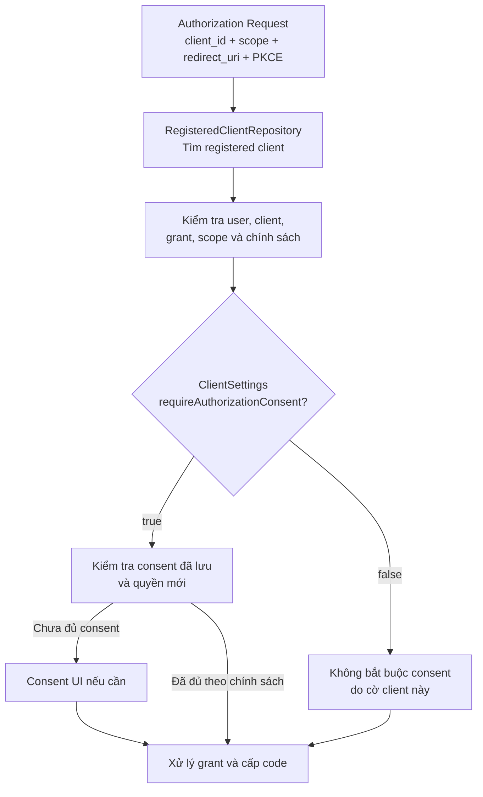
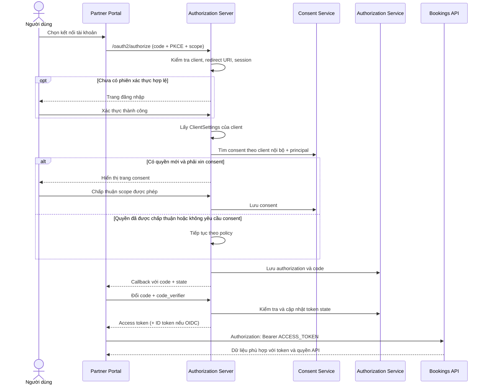

# Cấu hình requireAuthorizationConsent cho từng client

## 1. Bối cảnh: vì sao không áp dụng cùng một chính sách consent cho mọi client?

Trong một **OAuth 2.0/OpenID Connect (OIDC) Authorization Server** triển khai bằng **Spring Security** và **Spring Authorization Server** trên Spring Boot, mỗi OAuth client có quan hệ tin cậy và yêu cầu nghiệp vụ khác nhau.

Ví dụ, hệ thống đặt phòng có hai ứng dụng:

- **Partner Portal**: ứng dụng của đối tác cần đọc danh sách đặt phòng mà người dùng sở hữu. Người dùng phải biết đối tác đang xin quyền nào và có cơ hội chấp thuận hoặc từ chối.
- **Internal Booking Portal**: cổng nội bộ được tổ chức quản lý, chỉ sử dụng các scope và chính sách đã được phê duyệt. Doanh nghiệp có thể quyết định không hiện màn hình consent cho một số luồng đã được quản trị, để tránh làm gián đoạn trải nghiệm.

Hai client có thể cùng sử dụng **Authorization Code + PKCE**, cùng đăng nhập người dùng tại Authorization Server (AS), nhưng có **chính sách hiển thị consent khác nhau**. Spring Authorization Server giải quyết yêu cầu cơ bản này bằng cấu hình trên từng đối tượng `RegisteredClient`:

```java
ClientSettings.builder()
    .requireAuthorizationConsent(true)
    .build();
```

Với `true`, Authorization Server yêu cầu xử lý consent theo cơ chế của framework khi điều kiện thực tế cần hỏi người dùng. Với `false`, client không bị bắt buộc qua bước consent chỉ vì thuộc tính đó. **Đây không phải công tắc cấp quyền vô điều kiện**, cũng không thay thế xác thực người dùng, kiểm tra client, scope, PKCE hay chính sách tại Resource Server.

### Sau bài học, bạn có thể

1. Hiểu đúng ý nghĩa và phạm vi của `ClientSettings.requireAuthorizationConsent(...)`.
2. Cấu hình hai client có yêu cầu consent khác nhau trong cùng Authorization Server.
3. Giải thích lúc nào trang consent xuất hiện, được bỏ qua hoặc cần xuất hiện lại khi scope thay đổi.
4. Lưu, tra cứu và quản lý `OAuth2AuthorizationConsent` qua service thích hợp.
5. Phân biệt consent với authentication session, authorization grant và token đã phát hành.
6. Xây dựng trang consent tùy biến mà vẫn giữ các kiểm tra của OAuth/OIDC.
7. Đánh giá tác động khi đổi cờ consent ở client đang vận hành, kể cả persistence nhiều instance.
8. Kiểm thử các tình huống chấp thuận, từ chối, cấp thêm scope, thu hồi và lỗi bảo mật.

## 2. Phạm vi của `requireAuthorizationConsent`

Thuộc tính này được khai báo trong **`ClientSettings` của `RegisteredClient`**. Nó thể hiện yêu cầu chính sách cho **một client cụ thể**, được lưu và đọc cùng cấu hình registered client.

| Giá trị | Ý nghĩa thực tế | Không có nghĩa là |
|---|---|---|
| `true` | Client được cấu hình yêu cầu người dùng chấp thuận quyền theo cơ chế consent của AS. Những quyền mới hoặc chưa được chấp thuận có thể dẫn tới màn hình consent. | “Mỗi request đều phải hiện popup” hoặc “mọi scope của client đã được duyệt”. |
| `false` | AS không bắt buộc consent chỉ vì cờ này; luồng có thể tiến hành theo các kiểm tra khác. | “Client có quyền truy cập mọi dữ liệu”, “bỏ qua login”, hoặc “không bao giờ có consent theo bất kỳ yêu cầu/chính sách nào”. |

Các điều kiện thực tế như **scope yêu cầu**, consent đã lưu, chính sách provider, loại grant và các tham số OIDC (nếu hỗ trợ) vẫn ảnh hưởng hành vi. Một số scope có xử lý riêng theo giao thức/triển khai, vì vậy hãy kiểm thử phiên bản Spring Authorization Server đang dùng thay vì suy diễn rằng mọi scope luôn có một checkbox.

### 2.1. Đây là thiết lập theo client, không phải tham số do trình duyệt quyết định

Client không được tự gửi `requireAuthorizationConsent=false` trên `/oauth2/authorize` để tắt consent. Nguồn sự thật là cấu hình server-side mà AS lấy qua `RegisteredClientRepository`.



Sơ đồ là mô hình khái quát để giải thích **quyết định consent**; các bộ kiểm tra giao thức được thực hiện ở những bước cụ thể của pipeline. Nhánh `false` vẫn phải đi qua validation, login khi cần, kiểm tra scope, consent đặc thù nếu chính sách khác yêu cầu, và các điều kiện cấp quyền.

### 2.2. Consent không phải “có quyền” hay “không có quyền”

Nếu client được đăng ký `bookings.read` và người dùng chấp thuận `bookings.read`, API vẫn cần xác định người dùng có quyền đọc **đơn đặt phòng cụ thể** hay không. Scope trong access token cung cấp thông tin về phạm vi được cấp, còn quy tắc sở hữu và phân quyền tài nguyên thuộc Resource Server.

Ngay cả khi `requireAuthorizationConsent(false)`, client chỉ có thể yêu cầu grant, redirect URI và scope trong chính sách đã cho phép. Một cờ consent không cấp thêm bất kỳ scope nào cho `RegisteredClient`.

## 3. Consent trong luồng Authorization Code + PKCE

Một Authorization Request qua trình duyệt thường chứa:

```http
GET /oauth2/authorize?response_type=code&client_id=partner-portal
    &redirect_uri=https%3A%2F%2Fpartner.example.com%2Fcallback
    &scope=openid%20profile%20bookings.read
    &state=RANDOM_STATE
    &nonce=RANDOM_NONCE
    &code_challenge=DERIVED_CHALLENGE
    &code_challenge_method=S256
```

Đây là ví dụ được ngắt dòng để dễ đọc; URL thực tế cần được mã hóa đúng và dùng HTTPS. Client giữ `state`, `nonce` và `code_verifier` ở phía mình để kiểm tra callback và đổi authorization code.

Khi AS nhận request:

1. Xác minh `client_id`, redirect URI, response type, scope và các điều kiện cần thiết của grant.
2. Xác định người dùng đã đăng nhập tại AS hay chưa; nếu chưa, đi qua luồng user authentication.
3. Lấy `ClientSettings` của đúng `RegisteredClient` để xem yêu cầu consent.
4. Khi cần consent, tìm những authority đã được người dùng chấp thuận trước đó.
5. Nếu còn quyền phải xin, cho người dùng xem và xử lý consent.
6. Nếu yêu cầu hợp lệ, tạo authorization code, sau đó client đổi code bằng PKCE tại Token Endpoint.
7. Với OIDC, client xác minh ID token; với API, client dùng access token phù hợp.



Đoạn sequence minh họa một lượt cấp quyền thành công. Khi người dùng **từ chối**, AS không được xem quyền bị từ chối như đã chấp thuận; luồng có thể kết thúc bằng phản hồi lỗi OAuth phù hợp, thường có `access_denied`, theo cơ chế endpoint.

### 3.1. Consent không phải điều kiện đăng nhập

Một người dùng có thể đã đăng nhập tại AS nhưng chưa từng chấp thuận client. Ngược lại, consent có thể đã lưu trong database trong khi session đăng nhập đã hết hạn. Vì vậy:

- Có session hợp lệ **không tự bỏ qua consent mới** khi cờ yêu cầu.
- Có consent đã lưu **không tự bỏ qua login** nếu phiên không còn hợp lệ.
- Đăng nhập thành công **không tự phát hành token** khi authorization request chưa được kiểm tra và xử lý.

### 3.2. Consent không phải điều kiện refresh token

`requireAuthorizationConsent` gắn với xử lý yêu cầu ủy quyền qua endpoint thích hợp, đặc biệt Authorization Code Flow. Một client có refresh token hợp lệ thường có thể gửi grant `refresh_token` đến Token Endpoint mà không cần mở trình duyệt và hiện consent page mỗi lần refresh.

Nếu sản phẩm yêu cầu người dùng chấp thuận lại sau một thời gian hoặc khi quyền thay đổi, phải thiết kế chính sách hạn chế/thu hồi refresh token và tái ủy quyền phù hợp; không cho rằng bật `requireAuthorizationConsent(true)` sẽ tự giải quyết toàn bộ việc đó.

## 4. Tạo từng `RegisteredClient` với chính sách consent khác nhau

Spring Authorization Server quản lý client qua `RegisteredClientRepository`. Mỗi `RegisteredClient` chứa `ClientSettings` của chính nó, do đó có thể cấu hình hai client trong cùng ứng dụng mà không phải sửa global filter.

### 4.1. Ví dụ client đối tác cần consent

```java
RegisteredClient partnerPortal = RegisteredClient
    .withId(UUID.randomUUID().toString())
    .clientId("partner-portal")
    .clientSecret(passwordEncoder.encode(partnerSecretFromSecureStore))
    .clientAuthenticationMethod(
        ClientAuthenticationMethod.CLIENT_SECRET_BASIC)
    .authorizationGrantType(
        AuthorizationGrantType.AUTHORIZATION_CODE)
    .authorizationGrantType(
        AuthorizationGrantType.REFRESH_TOKEN)
    .redirectUri("https://partner.example.com/callback")
    .scope(OidcScopes.OPENID)
    .scope(OidcScopes.PROFILE)
    .scope("bookings.read")
    .clientSettings(ClientSettings.builder()
        .requireProofKey(true)
        .requireAuthorizationConsent(true)
        .build())
    .build();
```

Những giá trị then chốt:

- `requireAuthorizationConsent(true)` yêu cầu xử lý consent cho client `partner-portal`.
- `requireProofKey(true)` buộc Authorization Code Flow dùng PKCE; yêu cầu này **độc lập** với consent.
- `clientSecret` được cung cấp từ hệ thống quản lý bí mật phía server và được hash bằng encoder phù hợp.
- `redirectUri` phải khớp URI đã đăng ký theo quy tắc của Authorization Server.
- `scope(...)` chỉ là **những quyền client được phép xin**, chưa phải quyền đã được người dùng duyệt.

Đây là ví dụ **confidential client** chạy phần đổi code ở backend. Với SPA/mobile public client, nên dùng `ClientAuthenticationMethod.NONE` cùng PKCE và chính sách lưu token phù hợp; không nhúng client secret trong frontend.

### 4.2. Ví dụ client nội bộ không bắt buộc consent

```java
RegisteredClient internalPortal = RegisteredClient
    .withId(UUID.randomUUID().toString())
    .clientId("internal-booking-portal")
    .clientSecret(passwordEncoder.encode(internalSecretFromSecureStore))
    .clientAuthenticationMethod(
        ClientAuthenticationMethod.CLIENT_SECRET_BASIC)
    .authorizationGrantType(
        AuthorizationGrantType.AUTHORIZATION_CODE)
    .authorizationGrantType(
        AuthorizationGrantType.REFRESH_TOKEN)
    .redirectUri("https://internal.example.com/callback")
    .scope(OidcScopes.OPENID)
    .scope("bookings.read")
    .clientSettings(ClientSettings.builder()
        .requireProofKey(true)
        .requireAuthorizationConsent(false)
        .build())
    .build();
```

Client này **không bị bắt buộc hỏi consent bởi cờ cấu hình**, nhưng vẫn cần đăng nhập người dùng, kiểm tra authorization request, PKCE và các chính sách cấp quyền khác. Nếu tổ chức vẫn cần xác nhận quyền riêng tư hoặc đáp ứng yêu cầu pháp lý, không nên chọn `false` chỉ vì ứng dụng là “nội bộ”.

**Hai đối tượng có các cờ consent khác nhau**. Không tồn tại nhu cầu thay một biến toàn cục sau mỗi request để chuyển trạng thái theo `client_id`.

### 4.3. Đăng ký cả hai client trong repository

Nếu chỉ cần ví dụ học tập trên một instance:

```java
@Bean
RegisteredClientRepository registeredClientRepository(
        PasswordEncoder passwordEncoder) {

    RegisteredClient partner = createPartnerClient(passwordEncoder);
    RegisteredClient internal = createInternalClient(passwordEncoder);

    return new InMemoryRegisteredClientRepository(partner, internal);
}
```

`createPartnerClient(...)` và `createInternalClient(...)` ở đây đại diện hai đoạn tạo `RegisteredClient` phía trên, cần được triển khai với secret lấy từ nguồn an toàn. Đây là snippet minh họa cách nối repository, không phải class Spring Boot hoàn chỉnh; cần tránh khởi tạo secret thật dưới dạng chuỗi hard-code.

Với production, lựa chọn `JdbcRegisteredClientRepository` hoặc triển khai lưu trữ bền vững để đăng ký client nhất quán giữa nhiều node. Đồng thời vẫn phải cấu hình `OAuth2AuthorizationService`, `OAuth2AuthorizationConsentService`, JWK/issuer và các `SecurityFilterChain` thích hợp.

## 5. Hiểu ý nghĩa `ClientSettings`

`ClientSettings` chứa nhiều chính sách phía client. Trong chủ đề này cần phân biệt ít nhất hai cờ:

| Thuộc tính | Trả lời câu hỏi nào? | Ảnh hưởng |
|---|---|---|
| `requireAuthorizationConsent` | Authorization Server có phải yêu cầu user consent cho client theo cơ chế hỗ trợ không? | Quyết định cần tương tác với người dùng về quyền |
| `requireProofKey` | Client có bắt buộc cung cấp PKCE cho Authorization Code Flow không? | Ràng buộc code exchange với verifier của client |

Ví dụ:

```java
ClientSettings settings = ClientSettings.builder()
    .requireAuthorizationConsent(true)
    .requireProofKey(true)
    .build();
```

Không có quan hệ “bật consent thì PKCE được bật theo” hoặc ngược lại. **Consent là sự chấp thuận quyền; PKCE là cơ chế bảo vệ authorization code.** Cả hai nên được thiết kế độc lập theo rủi ro của client.

Ngoài ra, `TokenSettings` lại quản lý những vấn đề như access token TTL, refresh token TTL, token format và chính sách reuse refresh token. Thay đổi consent không tự thay đổi thời hạn token.

### 5.1. Giá trị mặc định và tính minh bạch cấu hình

Với API builder thông dụng, `requireAuthorizationConsent` thường không được bật nếu không khai báo, nhưng khi thiết kế bài học và cấu hình sản xuất, nên **ghi giá trị chủ đích một cách tường minh** cho từng client. Đừng phụ thuộc vào giả định mặc định khi di chuyển dữ liệu hoặc nâng cấp framework.

Đối với hệ thống có API quản trị client, nên hiển thị field `requireAuthorizationConsent` đã cấu hình trong DTO an toàn và đưa nó vào lịch sử thay đổi. Cần phân quyền khi sửa cờ này vì chuyển từ `true` sang `false` có thể thay đổi trải nghiệm và mức độ kiểm soát quyền của người dùng.

## 6. Mô hình lưu consent: `OAuth2AuthorizationConsent`

Khi AS lưu consent, Spring Authorization Server dùng mô hình `OAuth2AuthorizationConsent`. Ba thành phần cốt lõi:

| Trường | Ý nghĩa |
|---|---|
| `registeredClientId` | ID **nội bộ** của `RegisteredClient`, không mặc nhiên là `clientId` công khai |
| `principalName` | Định danh principal đã chấp thuận, từ ngữ cảnh xác thực đáng tin |
| `authorities` | Tập `GrantedAuthority` đã chấp thuận; scope thường biểu diễn dưới dạng `SCOPE_<scope>` |

Ví dụ logic:

```text
RegisteredClient:
  id       = "rc-partner-01"
  clientId = "partner-portal"
  ClientSettings.requireAuthorizationConsent = true

OAuth2AuthorizationConsent:
  registeredClientId = "rc-partner-01"
  principalName      = "user-42"
  authorities        = [
    "SCOPE_bookings.read",
    "SCOPE_profile"
  ]
```

Tập `authorities` là dữ liệu chấp thuận. Nó không phải access token, không phải `ROLE_ADMIN` và không chứng minh người dùng hiện có session đăng nhập hợp lệ.

### 6.1. Service lưu và truy vấn consent

Các phương thức chính của `OAuth2AuthorizationConsentService`:

```java
OAuth2AuthorizationConsent findById(
    String registeredClientId, String principalName);

void save(OAuth2AuthorizationConsent consent);

void remove(OAuth2AuthorizationConsent consent);
```

Ví dụ chỉ để **đọc trạng thái consent**, giả định `registeredClient` và `authenticatedUser` đã được xác minh từ server:

```java
OAuth2AuthorizationConsent consent =
    consentService.findById(
        registeredClient.getId(),
        authenticatedUser.getName());

boolean readApproved = consent != null
    && consent.getAuthorities().stream()
        .map(GrantedAuthority::getAuthority)
        .anyMatch("SCOPE_bookings.read"::equals);
```

Không gọi `findById(registeredClient.getClientId(), ...)` khi service cần internal ID. Cũng không lấy `principalName` từ form tùy ý của client rồi tin rằng người đó đã chấp thuận.

### 6.2. Xóa consent và các quyền đã cấp

`consentService.remove(consent)` chỉ xóa bản ghi consent. Nó **không tự động**:

- Hủy login session ở AS hoặc ứng dụng client.
- Thu hồi mọi access token đã ký đang còn hạn.
- Thu hồi refresh token đã phát hành.
- Xóa các bản ghi `OAuth2Authorization` liên quan.

Nếu sản phẩm có nút “Ngắt kết nối ứng dụng”, phải phối hợp xóa consent với **token revocation**, xử lý phiên nếu cần, và lựa chọn cơ chế chặn access token đang sống ở Resource Server. Đặc biệt, JWT tự xác minh có thể vẫn được API chấp nhận cho đến khi `exp` hoặc khi API có kiểm tra trạng thái thu hồi bổ sung.

## 7. Consent lần đầu, lần sau và khi yêu cầu thêm scope

Giả sử `partner-portal` được đăng ký các scope `profile`, `bookings.read` và `bookings.cancel`, có `requireAuthorizationConsent(true)`.

| Lượt cấp quyền | Scope yêu cầu | Consent đã lưu | Kỳ vọng |
|---|---|---|---|
| 1 | `bookings.read` | Chưa có | Cần chấp thuận theo chính sách |
| 2 | `bookings.read` | Đã duyệt `bookings.read` | Có thể bỏ qua màn hình consent nếu không có điều kiện hỏi lại |
| 3 | `bookings.read bookings.cancel` | Chỉ duyệt `bookings.read` | `bookings.cancel` phải được đánh giá như quyền mới |
| 4 | `bookings.read` | Consent đã bị xóa | Cần đánh giá lại; có thể hỏi consent |
| 5 | `bookings.read` | Đã duyệt nhưng AS yêu cầu hỏi lại | Hiển thị lại consent theo chính sách/param được hỗ trợ |
| 6 | `admin.superuser` | Không liên quan | Từ chối nếu client chưa được đăng ký hoặc chính sách không cho phép |

**Consent cũ không tự cấp scope mới.** Nếu user từng cho phép đọc dữ liệu nhưng client xin quyền hủy đặt phòng, Authorization Server không được coi đó là cùng một quyền.

### 7.1. Quy tắc giao của ba tập scope

Có thể hình dung ba tập:

- **Registered scopes**: client được phép xin theo `RegisteredClient.getScopes()`.
- **Requested scopes**: những scope có trong authorization request hiện tại.
- **Approved/consented scopes**: user đã chấp thuận hoặc được xử lý theo chính sách consent.

Tập **authorized scopes** của một authorization cụ thể chỉ được hình thành từ việc kiểm tra các tập trên cùng chính sách hệ thống. Không nên tự cấp union của toàn bộ registered scopes hoặc toàn bộ consent cũ.

Ví dụ:

```text
registered = {profile, bookings.read, bookings.cancel}
requested  = {bookings.read}
consented  = {profile, bookings.read}

authorized (minh họa) = {bookings.read}
```

Không có chuyện vì consent trước đó có `profile` mà access token mới, vốn chỉ yêu cầu `bookings.read`, tự động phải nhận `profile`.

### 7.2. Từ chối consent

Nếu user từ chối cấp quyền, server cần giữ quyết định đó và phản hồi qua giao thức thích hợp. Không coi nút “Từ chối” là login failure. Thông thường OAuth Authorization Endpoint có thể phản hồi `access_denied` khi phù hợp, với điều kiện redirect URI đã được xác minh và quy tắc redirect lỗi cho phép.

Không được tạo authorization code cho những quyền bị từ chối hoặc ghi chúng vào consent như đã duyệt.

## 8. Đăng ký `OAuth2AuthorizationConsentService` cho môi trường thật

Ví dụ đơn giản dùng bộ nhớ:

```java
@Bean
OAuth2AuthorizationConsentService consentService() {
    return new InMemoryOAuth2AuthorizationConsentService();
}
```

Cách này thuận tiện cho test/demo nhưng dữ liệu có thể mất sau restart và không được chia sẻ tự động giữa các node.

Trong môi trường cần lưu bền vững, Spring Authorization Server cung cấp giải pháp JDBC:

```java
@Bean
OAuth2AuthorizationConsentService consentService(
        JdbcOperations jdbcOperations,
        RegisteredClientRepository registeredClients) {

    return new JdbcOAuth2AuthorizationConsentService(
        jdbcOperations,
        registeredClients);
}
```

Để chạy được, ứng dụng cần:

1. DataSource và `JdbcOperations` được cấu hình.
2. Schema database cho consent tương thích với phiên bản Spring Authorization Server đang dùng.
3. `RegisteredClientRepository` và các service của Authorization Server được khai báo hợp lệ.
4. Migration, backup, phân quyền database và cơ chế bảo vệ dữ liệu.
5. Chính sách nhất quán giữa nhiều instance (kể cả registered client store, authorization state, session và khóa ký).

**Đừng nhầm repository client với consent service:** `RegisteredClientRepository` lưu `ClientSettings.requireAuthorizationConsent`; `OAuth2AuthorizationConsentService` lưu các quyền **người dùng đã duyệt**.

### 8.1. Điều gì xảy ra nếu không chia sẻ consent giữa nhiều node?

Giả sử node A và B cùng phục vụ `/oauth2/authorize`:

- Node A lưu consent sau lần người dùng chấp thuận.
- Request lần sau rơi vào node B.
- Nếu A/B dùng hai `InMemoryOAuth2AuthorizationConsentService` độc lập, B có thể không tìm được consent đã lưu và hỏi lại.
- Nếu cả hai đọc một kho consent chung, chúng có khả năng nhận cùng dữ liệu quyết định.

Lưu consent chung vẫn chưa đủ cho toàn bộ luồng: request cache/session tại AS, authorization code/token state, client registration và key material cũng cần cấu hình nhất quán.

### 8.2. Kết hợp consent với audit

Bản ghi consent phản ánh trạng thái quyền hiện tại. Audit lại phản ánh lịch sử ai làm gì, lúc nào. Không nên dùng một bảng consent thay thế mọi yêu cầu audit.

Một sự kiện audit có thể ghi: principal ID, registered client ID, scope được cấp hoặc rút, thời điểm, correlation ID và kết quả, **không ghi authorization code, access/refresh token, session cookie hoặc client secret**. Truy cập audit cũng phải phân quyền theo tenant và phạm vi quản trị.

## 9. Có cần trang consent riêng không?

Nếu giao diện consent do framework cung cấp và nội dung phù hợp, có thể bắt đầu với cơ chế mặc định. Nếu cần logo thương hiệu, mô tả scope dễ hiểu, chia nhóm quyền hoặc đa ngôn ngữ, Spring Authorization Server hỗ trợ cấu hình đường dẫn trang consent:

```java
OAuth2AuthorizationServerConfigurer authorizationServer =
    OAuth2AuthorizationServerConfigurer.authorizationServer();

http
    .securityMatcher(authorizationServer.getEndpointsMatcher())
    .with(authorizationServer, as -> as
        .authorizationEndpoint(endpoint -> endpoint
            .consentPage("/oauth2/consent")));
```

Đây là snippet **cấu hình điểm mở rộng**. Ứng dụng còn cần `SecurityFilterChain` và trang `GET /oauth2/consent` thực tế, cùng toàn bộ bean cho AS. Không dùng snippet trên độc lập như cấu hình chạy được toàn bộ server.

### 9.1. Trách nhiệm của trang consent tùy biến

Trang consent nên:

- Hiển thị tên client từ **registered client đáng tin cậy**, không tin nhãn do query tự khai.
- Hiển thị danh sách scope thực sự đang được yêu cầu và được phép.
- Mô tả quyền bằng ngôn ngữ dễ hiểu: ví dụ “Đọc lịch sử đặt phòng” thay cho `bookings.read`.
- Phân biệt quyền đã duyệt và quyền mới nếu phù hợp UX.
- Cho người dùng chấp thuận/từ chối theo contract được server hỗ trợ.
- Gắn quyết định với đúng `state`, `client_id`, phiên người dùng và authorization request.
- Chống giả mạo request và không tạo open redirect.

Một mẫu biểu diễn tối giản:

```text
Partner Portal muốn truy cập tài khoản của bạn.

[ ] Đọc lịch sử đặt phòng (bookings.read)
[ ] Xem thông tin hồ sơ (profile)

[Cho phép]    [Từ chối]
```

Đây chỉ là **hình dung giao diện**. Việc cho chọn từng scope phụ thuộc quy tắc và cơ chế của trang consent/Authorization Endpoint. Không tự thiết kế checkbox rồi cộng tất cả quyền từ form vào `OAuth2AuthorizationConsentService`.

### 9.2. Trang chỉ hiển thị, giao thức vẫn do AS xử lý

Một controller phục vụ GET có thể trả view từ Thymeleaf:

```java
@Controller
class ConsentPageController {

    @GetMapping("/oauth2/consent")
    String consentPage(Model model) {
        // Trong triển khai thật, lấy dữ liệu request đã được
        // kiểm tra và metadata client từ nguồn tin cậy.
        return "consent";
    }
}
```

Ví dụ cố ý chỉ cho thấy trách nhiệm **render view**. Controller thật cần truyền client, scope và state đã được kiểm tra theo mẫu/hướng dẫn phù hợp của phiên bản Spring Authorization Server.

Bước POST xác nhận consent phải được xử lý bởi pipeline Authorization Endpoint theo contract framework hoặc extension được thiết kế đủ kiểm tra. **Không nên tạo controller tự lưu consent rồi tự phát authorization code**: điều này có thể bỏ qua validation client/redirect, CSRF/session, PKCE và chính sách scope.

### 9.3. CSRF và ràng buộc với authorization request

Trang consent là thao tác có tác động tới quyền người dùng. Phải đánh giá chống CSRF và liên kết request với phiên/xác thực đúng cách. Với Spring Authorization Server, một số endpoint OAuth có quy tắc CSRF riêng theo configurer và request parameter như `state`; không tự giả định rằng một hidden `_csrf` do bạn thêm là đủ hoặc luôn được filter nhận.

Đối với UI riêng, hãy dùng contract và các cơ chế chống giả mạo thực sự được phiên bản đang dùng hỗ trợ. Kiểm tra cả trường hợp trình duyệt gửi form của user A trong session của user B và trường hợp request consent đã quá hạn.

## 10. Thay đổi `requireAuthorizationConsent` khi client đang hoạt động

Sau khi client được đưa vào production, thay đổi cờ này có thể ảnh hưởng sự đồng ý và trải nghiệm người dùng. Đừng xem nó như một chỉnh sửa metadata không rủi ro.

### 10.1. Đổi từ `false` sang `true`

Mục tiêu: một client trước đây không hỏi consent phải bắt đầu yêu cầu consent cho quyền chưa được ghi nhận.

Tác động cần dự liệu:

- Những authorization request tương lai sẽ đi qua quyết định consent mới.
- Nếu chưa từng lưu `OAuth2AuthorizationConsent`, người dùng có thể bắt đầu thấy trang consent.
- Những người đang dùng client có thể cần chấp thuận khi họ thực hiện một lượt authorization mới.
- Access token và refresh token đã phát hành **không tự bị thu hồi** chỉ vì cờ được bật.
- Refresh grant vẫn cần được kiểm soát riêng nếu muốn buộc tất cả phiên quay lại trang consent.

Vì vậy, nếu chính sách mới yêu cầu **mọi client token hiện tại phải được chấp thuận lại**, thay đổi cờ chưa đủ: cần thiết kế vòng đời refresh/revocation, thời hạn token và luồng tái ủy quyền.

### 10.2. Đổi từ `true` sang `false`

Mục tiêu: bỏ yêu cầu consent do cờ client đặt ra.

Tác động:

- Những request mới có thể bỏ qua màn hình hỏi consent theo cơ chế cờ này.
- Consent đã lưu **không tự bị xóa**.
- Chính sách bảo mật/pháp lý về quyền chia sẻ dữ liệu vẫn phải được xem xét.
- Không tự tăng registered scopes, không mở grant mới hoặc bỏ qua xác thực người dùng.
- Cần audit và phê duyệt thay đổi nếu client có quyền nhạy cảm.

Không nên để client tự đề xuất thay cờ sang `false` mà không qua xác thực quyền quản trị, vì thay đổi này có thể ảnh hưởng trải nghiệm minh bạch quyền của người dùng.

### 10.3. Cập nhật client phải giữ các thiết lập khác

Khi sửa `RegisteredClient` đã tồn tại, **đừng tái tạo client từ đầu chỉ để đổi một cờ**, vì có thể làm mất client ID, authentication method, grant, redirect URI, scope, token settings hoặc các cấu hình khác.

Một dạng cập nhật theo API builder hỗ trợ:

```java
RegisteredClient existing =
    registeredClientRepository.findByClientId("partner-portal");

if (existing == null) {
    throw new IllegalArgumentException("Unknown registered client");
}

ClientSettings changedSettings = ClientSettings
    .withSettings(existing.getClientSettings().getSettings())
    .requireAuthorizationConsent(false)
    .build();

RegisteredClient updated = RegisteredClient.from(existing)
    .clientSettings(changedSettings)
    .build();

registeredClientRepository.save(updated);
```

Mã minh họa cách bảo toàn giá trị khác trong `ClientSettings` và `RegisteredClient`; việc cập nhật client trong production cần thêm **authorization của operator, validation, revision/optimistic locking, audit, approval nếu cần và cache invalidation**. Kiểm tra API builder cụ thể tương thích với phiên bản Spring Authorization Server đang sử dụng.

### 10.4. Không dùng `clientId` làm khóa ownership duy nhất

`RegisteredClient` có `getId()` nội bộ và `getClientId()` giao thức. Service consent gắn với internal registered client ID. Khi thay thế bản ghi bằng một `RegisteredClient` mới mang ID khác, dữ liệu consent gắn với ID cũ có thể không còn được tìm ra như mong đợi.

Vì vậy, một thao tác sửa cờ nên bảo toàn ID nội bộ và thực hiện qua cơ chế update có kiểm soát. Nếu di chuyển/merge client, cần kế hoạch migration consent và authorization state phù hợp, không chỉ sao chép `clientId`.

## 11. Chọn giá trị nào cho từng nhóm client?

Không có bảng “mọi first-party client phải false, mọi third-party client phải true” áp dụng cho mọi hệ thống. Quyết định cần dựa trên quan hệ tin cậy, thông báo quyền, phạm vi dữ liệu và chính sách tổ chức.

| Tình huống | Quyết định có thể phù hợp | Điều cần xem xét |
|---|---|---|
| Ứng dụng đối tác đọc dữ liệu người dùng | `true` | Minh bạch scope, khả năng từ chối/rút quyền, audit |
| Ứng dụng nội bộ được quản lý tập trung | `false` hoặc `true` tùy chính sách | Không bỏ qua nghĩa vụ về quyền riêng tư và phân quyền |
| Ứng dụng xử lý dữ liệu nhạy cảm | Thường `true` cho luồng có user | Consent không thay thế step-up/MFA hoặc chính sách API |
| BFF cùng tổ chức và có trải nghiệm login thống nhất | Có thể `false` | Xác thực người dùng và quyền API vẫn bắt buộc |
| Client xin thêm scope sau khi dùng một thời gian | `true` giúp thể hiện incremental consent | Chính sách chỉ cấp scope mới khi được phép |
| Client Credentials machine-to-machine | Consent người dùng thường không liên quan | Không có End-User; dùng client auth và grant policy |

### 11.1. Consent có bảo đảm đáp ứng yêu cầu pháp lý không?

Không thể kết luận chỉ từ cờ `requireAuthorizationConsent(true)`. Một giao diện consent OAuth là **cơ chế kỹ thuật cấp quyền truy cập**, còn cơ sở pháp lý xử lý dữ liệu, retention, thông báo quyền riêng tư và quyền rút lại sự đồng ý có thể có những yêu cầu riêng.

Một sản phẩm có thể cần lưu dấu thời điểm và nội dung thông báo, purpose/version, điều kiện rút lại và chính sách xử lý dữ liệu. Nếu có yêu cầu như vậy, xây lớp quản trị/audit bổ sung; đừng cố nhồi tất cả ý nghĩa pháp lý vào `OAuth2AuthorizationConsent.getAuthorities()`.

## 12. Quan hệ với OpenID Connect 1.0

OIDC sử dụng OAuth để thực hiện authentication cho Relying Party. Một request OIDC có `scope` chứa `openid` và có thể thêm `profile`, `email` cùng scope API riêng.

Ví dụ:

```text
scope=openid profile email bookings.read
```

- `openid` báo hiệu yêu cầu OIDC.
- `profile`/`email` yêu cầu nhóm claim tiêu chuẩn, chịu sự kiểm soát dữ liệu, policy và scope.
- `bookings.read` là quyền API do hệ thống định nghĩa.

Đã chấp thuận một scope không bảo đảm mọi claim tương ứng đều tồn tại trong ID token; nhiều claim có thể được cung cấp qua UserInfo theo cơ chế và policy. RP phải kiểm tra chữ ký, issuer, audience, expiration và nonce khi áp dụng cho ID token.

### 12.1. `prompt=consent` và `requireAuthorizationConsent`

OIDC định nghĩa giá trị `prompt=consent` để yêu cầu OP đưa người dùng qua consent interaction. Đây là **tham số giao thức do RP yêu cầu**, khác với **cờ server-side của registered client**.

Khi cả hai cùng tồn tại, hành vi chính xác phụ thuộc hỗ trợ `prompt`, trạng thái phiên, scope và chính sách của OpenID Provider. Đặc biệt, `prompt=none` yêu cầu không hiển thị UI tương tác; nếu không thể hoàn thành do cần login/consent, provider phải phản hồi lỗi OIDC thích hợp theo quy tắc được hỗ trợ.

Vì vậy, không nên viết một filter tự kiểm tra `prompt` rồi bật/tắt consent mà bỏ qua endpoint logic. Kiểm thử các tham số OIDC trên phiên bản Spring Authorization Server đang triển khai.

## 13. Rủi ro bảo mật khi cấu hình sai consent

| Rủi ro | Ví dụ | Biện pháp |
|---|---|---|
| Bỏ qua consent ngoài chủ đích | Client nhạy cảm bị đổi `true` thành `false` | Quản trị client có phân quyền, approval và audit |
| Scope escalation | Form client tự thêm `bookings.cancel` | Kiểm tra scope đã đăng ký, scope request và quyền được duyệt tại AS |
| Consent của sai principal | Dùng `principalName` từ request | Lấy danh tính từ authentication tin cậy |
| Cross-tenant consent collision | Hai tenant dùng cùng principal string | Namespace principal và ràng buộc tenant phù hợp |
| Sai registered client key | Dùng public `clientId` thay internal ID | Dùng `registeredClient.getId()` khi truy cập consent service |
| Consent CSRF | Request giả mạo chấp thuận scope | Bảo vệ consent flow theo contract, session/state và chính sách CSRF |
| Consent UI giả danh client | Lấy tên ứng dụng từ query không tin cậy | Hiển thị metadata từ registered client store |
| Token tiếp tục sau khi rút consent | Chỉ xóa consent record | Phối hợp token revocation và cơ chế kiểm tra tại Resource Server |
| Permission vượt scope | Có `bookings.read` nên đọc mọi đặt phòng | Resource Server kiểm tra chủ sở hữu và quy tắc nghiệp vụ |
| Consent mất khi restart | Dùng in-memory trong production | Lưu JDBC/khả năng persistence bền vững |
| Consent lệch giữa các node | Mỗi AS node giữ state cục bộ | Kho dùng chung, consistency và cache invalidation |
| Lộ dữ liệu quản trị | Log request/response consent kèm token | Audit có redaction và phân quyền |

### 13.1. Không đặt logic bảo mật quan trọng ở frontend

Một trang consent có checkbox đẹp không tự bảo đảm bảo mật. Client và trình duyệt có thể gửi dữ liệu thay đổi. Quyết định cuối cùng phải được xác minh tại AS dựa trên:

1. **Đúng client** đã đăng ký và được phép.
2. **Đúng principal** đã xác thực.
3. **Đúng authorization request** còn hợp lệ.
4. **Đúng scope** có thể được cấp và đã được chấp thuận.
5. **Đúng điều kiện** PKCE/redirect/grant và những ràng buộc giao thức khác.

Không dùng JavaScript disabled checkbox để quyết định một scope bị từ chối; server phải kiểm tra request độc lập.

### 13.2. Không sửa filter nội bộ chỉ để đổi chính sách consent

Vì `requireAuthorizationConsent` đã là API cấu hình được hỗ trợ, không nên thay thế `OAuth2AuthorizationEndpointFilter` hoặc viết controller tự cấp authorization code để thực hiện nghiệp vụ “client A hỏi consent, client B không hỏi”.

Nếu yêu cầu vượt quá cờ hiện có, hãy đánh giá các điểm mở rộng công khai tại Authorization Endpoint, consent page, service và policy. Thay filter nội bộ có thể làm thiếu kiểm tra redirect URI, PKCE, session và OAuth error handling.

## 14. Kiểm thử cấu hình theo từng client

Một bài test tốt không chỉ xác minh getter trong `ClientSettings`. Phải chứng minh hành vi HTTP của **ít nhất hai client có cấu hình khác nhau** khi gửi Authorization Request hợp lệ.

### 14.1. Ma trận kiểm thử tích hợp

| Ca | Cấu hình/trạng thái | Kết quả mong đợi |
|---|---|---|
| A1 | `partner-portal` có `requireAuthorizationConsent(true)`, user chưa consent | Xác thực user nếu cần, sau đó yêu cầu consent phù hợp |
| A2 | A1, user từ chối | Không cấp quyền đã từ chối; lỗi OAuth phù hợp |
| A3 | `partner-portal`, user đã chấp thuận đủ scope | Có thể tiếp tục không hỏi lại, trừ khi policy/`prompt` yêu cầu |
| A4 | `partner-portal` xin scope mới | Đánh giá và yêu cầu chấp thuận quyền mới nếu cần |
| B1 | `internal-booking-portal` có `requireAuthorizationConsent(false)` | Không yêu cầu màn hình consent chỉ do cờ client |
| B2 | B1 nhưng chưa login | Vẫn phải xác thực user theo luồng phù hợp |
| B3 | B1 xin scope không đăng ký | Bị từ chối, không có chuyện “false thì mọi scope đều hợp lệ” |
| C1 | Đổi partner từ `false` sang `true` | Authorization request mới áp dụng policy mới |
| C2 | Đổi partner từ `true` sang `false` | Consent record cũ vẫn tồn tại nếu chưa xóa |
| D1 | Xóa consent rồi thử authorize | Client cần consent được đánh giá lại |
| D2 | Xóa consent rồi gọi API bằng access token cũ | Kết quả theo token validity/revocation policy, không mặc nhiên từ chối |
| E1 | Restart hoặc chuyển AS node | Consent hoạt động nhất quán với storage dùng chung |
| E2 | Gửi `code_verifier` sai | Token Endpoint từ chối dù đã consent |
| E3 | Dùng `redirect_uri` không được đăng ký | Authorization Request bị từ chối dù đã consent |
| E4 | Thay principal/tenant trong consent request | Không thể chấp thuận thay cho user/tenant khác |
| E5 | OIDC `prompt=consent` / `prompt=none` | Hành vi phù hợp với hỗ trợ và quy tắc OIDC của bản triển khai |

### 14.2. Test cấu hình Java ở mức đơn vị

Có thể kiểm tra hai `RegisteredClient` được xây dựng đúng:

```java
@Test
void clientsHaveDifferentConsentRequirements() {
    RegisteredClient partner = createPartnerClient(passwordEncoder);
    RegisteredClient internal = createInternalClient(passwordEncoder);

    assertThat(partner.getClientSettings()
        .isRequireAuthorizationConsent()).isTrue();

    assertThat(internal.getClientSettings()
        .isRequireAuthorizationConsent()).isFalse();

    assertThat(partner.getClientSettings()
        .isRequireProofKey()).isTrue();

    assertThat(internal.getClientSettings()
        .isRequireProofKey()).isTrue();
}
```

`createPartnerClient`, `createInternalClient` và `passwordEncoder` là thành phần minh họa từ test fixture. Test getter chỉ kiểm tra cấu hình, **không chứng minh UI hoặc protocol flow**; cần HTTP integration test với AS, login và consent service.

### 14.3. Integration test với trình duyệt hoặc MockMvc

Khi test Authorization Code + PKCE:

1. Đăng ký hai client với redirect URI, scope, secret/PKCE hợp lệ.
2. Tạo user đã xác thực (hoặc thực hiện login qua form).
3. Gửi `GET /oauth2/authorize` cho client `true`; xác minh có bước consent cần thiết.
4. Gửi form chấp thuận đúng contract; kiểm tra redirect có `code` và `state`.
5. Đổi code tại Token Endpoint với verifier; xác nhận phản hồi token hợp lệ.
6. Lặp lại với client `false`; xác nhận không phải đi qua consent do cờ client.
7. Xin scope mới cho client `true` và thử từ chối.
8. Kiểm tra database consent gắn với đúng registered client ID và principal.
9. Thử các nhánh CSRF/session hết hạn, redirect URI sai, code replay và multi-instance.

Tránh test chỉ bằng cách mock `OAuth2AuthorizationConsentService.save` rồi tuyên bố consent flow đã đúng: lỗi ở filter chain, request cache, form/state hay authorization policy có thể không xuất hiện trong unit test.

## 15. Gỡ lỗi khi consent không hiển thị hoặc hiển thị lặp lại

| Triệu chứng | Nguyên nhân có thể | Kiểm tra |
|---|---|---|
| Client `true` không thấy consent | Scope đã được chấp thuận hoặc policy/luồng không yêu cầu lại | Consent store, request scope, tham số OIDC, phiên bản framework |
| Client `false` vẫn thấy consent | OIDC `prompt=consent`, policy khác hoặc đã custom logic | Request thực tế, các hook của AS, consent page |
| Consent bị hỏi mỗi lần | In-memory mất dữ liệu, principal/client ID đổi, request scope luôn mới | Persistence, internal registered client ID, `principalName` |
| User chấp thuận xong quay lại login | Session/request cache mất hoặc chain sai | SecurityFilterChain, session cookie, reverse proxy |
| Submit consent trả lỗi/403 | Form state/CSRF sai, request hết hạn hoặc field thiếu | Form generated HTML và endpoint contract |
| Không phát authorization code sau consent | Client/redirect/grant/scope bị từ chối | OAuth error, validated registration, consent outcome |
| Consent bị lưu cho client khác | Dùng nhầm `clientId`/internal ID, cache hoặc mapping sai | `RegisteredClient.getId()` và consent key |
| Sau khi đổi cờ vẫn thấy hành vi cũ | Cache client cũ, nhiều node, cấu hình DB chưa cập nhật | RegisteredClientRepository, cache invalidation, revision |
| Xóa consent nhưng API vẫn nhận token | JWT còn hạn hoặc refresh token còn hợp lệ | Token revocation, introspection/RS policy |
| Consent page hiện tên client lạ | Lấy tên từ request query | Metadata trusted từ repository |

### 15.1. Quy trình chẩn đoán có thứ tự

Khi có bug, lần lượt trả lời:

1. **Client thực sự nào đang yêu cầu?** Đọc `client_id` và tra đúng `RegisteredClient`.
2. **Đang dùng settings nào?** Kiểm tra `isRequireAuthorizationConsent()` từ bản ghi hiện hành, không chỉ từ file cấu hình dự kiến.
3. **User nào đăng nhập?** `principalName` có ổn định, đúng tenant và đúng session không?
4. **Scope yêu cầu là gì?** Nó có nằm trong scope client được đăng ký và policy cho phép không?
5. **Consent đã lưu gồm quyền nào?** Tìm bằng internal registered client ID + principal.
6. **Request có tham số OIDC nào?** `prompt`, `max_age` và trạng thái login ảnh hưởng ra sao?
7. **Trang consent/submit có vào đúng endpoint không?** Các filter chain, state, CSRF và redirect có khớp không?
8. **Cấu hình có được chia sẻ giữa node không?** Client repository, consent store và session có nhất quán không?

Không ghi raw authorization code, access/refresh token, client secret hoặc session cookie vào log khi debug. Dùng request ID, client ID và các metadata đã được phân loại an toàn.

## 16. Checklist trước khi đưa consent policy vào production

- **Per-client:** Mỗi `RegisteredClient` có `requireAuthorizationConsent` được chọn có chủ đích và giải thích bằng chính sách?
- **PKCE:** Client Authorization Code có `requireProofKey` và các kiểm soát code/redirect URI phù hợp?
- **Identity:** Principal và tenant được xác định từ dữ liệu tin cậy; không để user consent nhầm client khác?
- **Scope:** Registered/requested/approved/authorized scopes được phân biệt và validate?
- **UI:** Tên client, mô tả quyền, chấp thuận/từ chối dễ hiểu; trang hoạt động trên nhiều thiết bị?
- **Privacy:** Consent UI phù hợp quy trình minh bạch và quản lý dữ liệu của sản phẩm?
- **Persistence:** `OAuth2AuthorizationConsentService` lưu bền vững và nhất quán khi restart hoặc scale-out?
- **Security:** CSRF, state, session, redirect URI, client authentication và PKCE vẫn hoạt động đúng?
- **Revocation:** Có đường rút consent; “ngắt kết nối ngay” có vô hiệu hóa token theo đúng yêu cầu?
- **Operations:** Thay đổi cờ trên client có audit, approval, revision và đồng bộ node?
- **Testing:** Đã thử ít nhất hai client `true/false`, consent lần đầu/lần sau, scope mới, từ chối, token cũ, multi-tenant?
- **Versioning:** Đã kiểm tra các hook/API của phiên bản Spring Authorization Server thực tế?

### Kiến thức cốt lõi

`ClientSettings.requireAuthorizationConsent(true|false)` là **cấu hình theo từng registered client** của Spring Authorization Server. Nó giúp định hướng lúc nào Authorization Server yêu cầu người dùng chấp thuận các scope trong luồng ủy quyền; trạng thái quyền đã chấp thuận được quản lý riêng qua `OAuth2AuthorizationConsentService`.

Bật consent không đồng nghĩa hiện màn hình ở mọi request; tắt consent không đồng nghĩa bỏ qua xác thực, grant, redirect, scope, PKCE hay phân quyền tại API. **Consent, session, authorization và token có vòng đời riêng**; thay cờ hoặc xóa consent không tự thu hồi credential đã phát hành. Một thiết kế an toàn cần cấu hình per-client rõ ràng, persistence đúng, UI không giả mạo, quản lý thay đổi có kiểm soát và kiểm thử qua toàn bộ luồng OAuth/OIDC.

## Tài liệu tham khảo

- [Spring Authorization Server — Core Model / Components](https://docs.spring.io/spring-authorization-server/reference/core-model-components.html)
- [Spring Authorization Server — Protocol Endpoints](https://docs.spring.io/spring-authorization-server/reference/protocol-endpoints.html)
- [Spring Authorization Server — How-to: Implement an Authorization Consent Page](https://docs.spring.io/spring-authorization-server/reference/guides/how-to-custom-consent-page.html)
- [Spring Authorization Server — Reference](https://docs.spring.io/spring-authorization-server/reference/)
- [Spring Security — Servlet Architecture](https://docs.spring.io/spring-security/reference/servlet/architecture.html)
- [RFC 6749 — The OAuth 2.0 Authorization Framework](https://www.rfc-editor.org/rfc/rfc6749)
- [RFC 7636 — Proof Key for Code Exchange](https://www.rfc-editor.org/rfc/rfc7636)
- [RFC 9700 — Best Current Practice for OAuth 2.0 Security](https://www.rfc-editor.org/rfc/rfc9700)
- [OpenID Connect Core 1.0](https://openid.net/specs/openid-connect-core-1_0.html)
