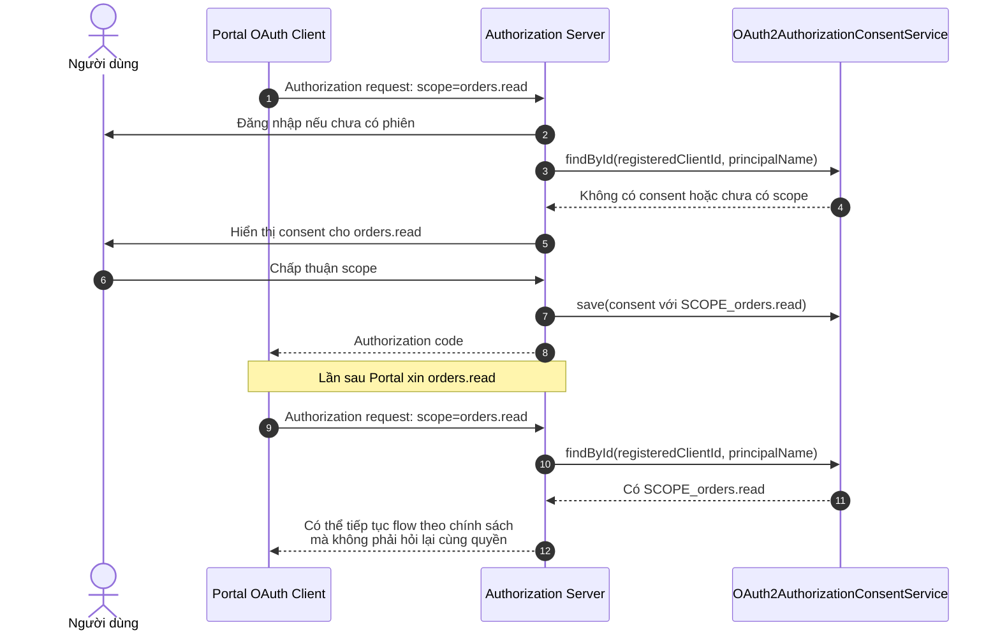
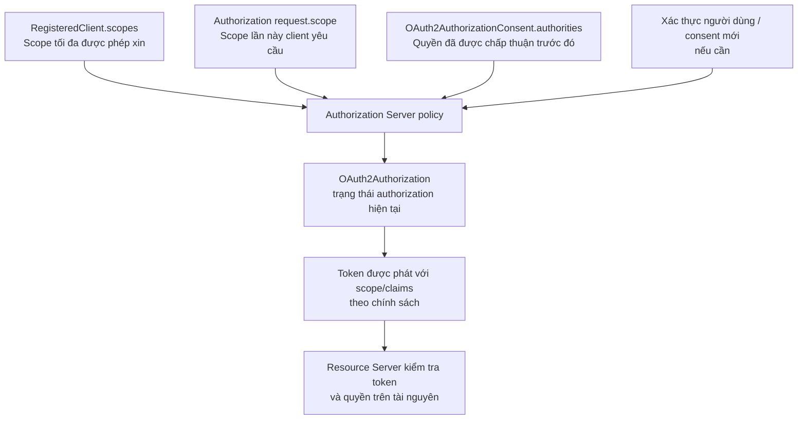
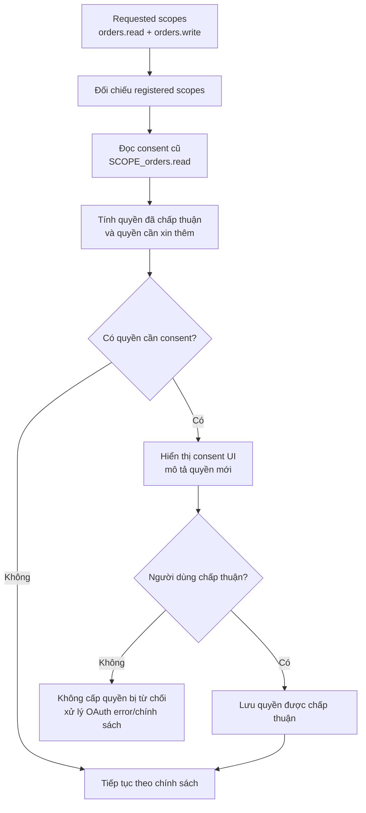

# Mô hình quyền đã cấp trong OAuth2AuthorizationConsent

Khi một người dùng đăng nhập và cho phép một ứng dụng đọc hồ sơ hoặc dữ liệu của mình, Authorization Server phải quyết định **những quyền nào đã được người dùng chấp thuận cho client đó** và có cần hiển thị lại màn hình đồng ý khi ứng dụng yêu cầu quyền trong lần đăng nhập tiếp theo không.

Trong **Spring Authorization Server**, đối tượng `OAuth2AuthorizationConsent` biểu diễn kết quả chấp thuận đã được lưu theo **một OAuth client đã đăng ký** và **một principal** (thường là tên định danh người dùng). Nó giữ tập `GrantedAuthority`, trong đó các scope OAuth2 đã được chấp thuận thường được biểu diễn dưới dạng authority có tiền tố `SCOPE_`.

Bài thuộc chương **Consent** của mô-đun **SPRING_SECURITY_OAUTH2_OIDC_AUTHORIZATION_SERVER**. Mục tiêu là hiểu, cấu hình, bảo mật, kiểm thử và vận hành phần quản lý quyền được chấp thuận trong OAuth 2.0/OpenID Connect Authorization Server bằng Spring Security và Spring Authorization Server trong Spring Boot. Trọng tâm là **mô hình dữ liệu và vòng đời consent**; các ví dụ về giao diện và filter chain chỉ nhằm làm rõ cách mô hình được sử dụng.

> **Nguyên tắc quan trọng:** Consent đã lưu thể hiện sự chấp thuận trước đó của principal đối với client. Nó **không đồng nghĩa** một access token hiện tại có toàn bộ các scope đã từng được chấp thuận, cũng **không thay thế** chính sách cho phép scope của client hoặc kiểm tra quyền tại Resource Server.

## 1. Bài toán: người dùng chấp thuận quyền một lần hay nhiều lần?

Giả sử hệ thống có ba thành phần:

- **Central Login** tại `https://login.example.com`: Spring Authorization Server xác thực người dùng, xử lý Authorization Code + PKCE và lưu consent.
- **Portal** tại `https://portal.example.com`: OAuth2/OIDC client có quyền xin các scope `openid`, `profile`, `orders.read` và `orders.write`.
- **Orders API**: Resource Server đọc access token, kiểm tra audience, scope và quyền đối với từng đơn hàng.

Ở lần đầu tiên, Portal xin `orders.read`. Sau khi đăng nhập, Central Login hiển thị quyền “Xem các đơn hàng được phép” để người dùng chấp thuận. Khi người dùng đồng ý, consent của cặp **Portal + người dùng đó** được ghi nhận. Vài ngày sau Portal chỉ xin lại `orders.read`: tùy chính sách client và trạng thái consent, máy chủ có thể không cần hỏi lại. Nhưng nếu Portal lần này xin thêm `orders.write`, quyền mới chưa được người dùng chấp thuận có thể cần được trình bày để xin consent.



Sơ đồ chỉ diễn tả logic consent. Việc có hiển thị màn hình hay không còn phụ thuộc `ClientSettings`, requested scopes, trạng thái đăng nhập, chính sách của Authorization Server và các tham số OIDC nếu được hỗ trợ.

## 2. Cấu trúc OAuth2AuthorizationConsent

`OAuth2AuthorizationConsent` là mô hình trung tâm cho **quyền đã được cấp phép/chấp thuận** trong Spring Authorization Server. Nó thường chứa ba thuộc tính:

| Thuộc tính | Kiểu dữ liệu | Ý nghĩa |
|---|---|---|
| `registeredClientId` | `String` | ID **nội bộ** của `RegisteredClient` đã được cấp consent |
| `principalName` | `String` | Tên định danh principal đã chấp thuận |
| `authorities` | `Set<GrantedAuthority>` | Các quyền đã được chấp thuận, trong đó scope thường dùng tiền tố `SCOPE_` |

Ví dụ trạng thái khái niệm:

```text
OAuth2AuthorizationConsent
  registeredClientId = "portal-registration-001"
  principalName      = "user-123"
  authorities        = {
      "SCOPE_orders.read",
      "SCOPE_profile"
  }
```

Ý nghĩa: principal `user-123` đã chấp thuận một tập quyền cho registered client có ID nội bộ `portal-registration-001`. **Không suy ra** mọi token được phát sau đó đều phải chứa hai scope trên; Authorization Server còn xét request hiện tại, các quyền client được phép yêu cầu và chính sách cấp token.

### 2.1. registeredClientId là ID nội bộ, không phải client_id

Trong `RegisteredClient` thường có hai giá trị:

```java
RegisteredClient portal = RegisteredClient.withId("portal-registration-001")
        .clientId("portal-bff")
        // Các trường registration khác...
        .build();
```

- `id` (trong ví dụ: `portal-registration-001`) là khóa định danh **nội bộ**, được dùng để liên kết dữ liệu authorization/consent với client đã đăng ký.
- `clientId` (trong ví dụ: `portal-bff`) là định danh **giao thức** mà client gửi tại `/oauth2/authorize` hoặc `/oauth2/token`.

`OAuth2AuthorizationConsentService.findById(...)` cần **registered client ID**, không nhận `client_id` như một tham số thay thế. Nếu truyền `portal-bff` trong khi kho dữ liệu lưu `portal-registration-001`, việc tra cứu thường không tìm ra consent tương ứng.

Trong production, phải giữ `RegisteredClient.id` ổn định. Việc tạo ID ngẫu nhiên mới mỗi lần khởi động có thể khiến consent cũ không còn gắn với registration đang sử dụng.

### 2.2. principalName phải phản ánh đúng danh tính đã xác thực

`principalName` thường lấy từ `Authentication.getName()` của người dùng đã đăng nhập. Nhưng không nên suy ra nó luôn là username hiển thị trên UI hoặc claim `sub` trong ID token; cách định danh phụ thuộc cơ chế xác thực được tích hợp.

Trong hệ thống thực, nên có **principal identifier ổn định và không tái sử dụng**. Nếu tổ chức cho phép đổi username hoặc có nhiều tenant cùng sở hữu username như `alex`, cần thiết kế mapping để consent của người này không bị dùng nhầm cho người khác.

Các trường hợp cần kiểm tra:

- Đổi email/username có làm `principalName` thay đổi và mất liên kết consent không?
- Nếu tài khoản bị xóa rồi tên cũ được dùng lại, consent cũ có bị áp nhầm?
- Hệ thống federation từ nhiều IdP có tạo principal identity duy nhất và ổn định không?
- Client đăng ký ở tenant khác có dùng chung ID/consent ngoài ý muốn không?

**Không lấy `principalName` trực tiếp từ query parameter hoặc input của client.** Principal phải được xác định từ danh tính đã xác thực và ranh giới tin cậy của Authorization Server.

### 2.3. authorities là các GrantedAuthority, không phải danh sách chuỗi trần

Model lưu `Set<GrantedAuthority>`. Mỗi `GrantedAuthority` có thể trả tên quyền qua `getAuthority()`. Với consent theo scope OAuth2, cách biểu diễn thường gặp là:

```java
new SimpleGrantedAuthority("SCOPE_orders.read")
new SimpleGrantedAuthority("SCOPE_profile")
```

Tiền tố `SCOPE_` có ý nghĩa: nó giúp phân biệt quyền kiểu scope với các authority khác mà ứng dụng có thể sử dụng.

| Giá trị `GrantedAuthority.getAuthority()` | Ý nghĩa trong mô hình consent |
|---|---|
| `SCOPE_orders.read` | Scope `orders.read` đã được chấp thuận |
| `SCOPE_orders.write` | Scope `orders.write` đã được chấp thuận |
| `SCOPE_profile` | Scope OIDC `profile` đã được chấp thuận |
| `ROLE_ADMIN` | Authority theo quy ước role; **không** mặc nhiên là scope `admin` |
| `orders.read` | Chuỗi authority không có tiền tố; **không** nên mặc định coi là scope được consent |

Model cho phép `GrantedAuthority` tổng quát, nhưng khi phục hồi danh sách **scope đã chấp thuận** cho luồng OAuth2, phải dùng quy ước scope mà Spring Authorization Server và chính sách của ứng dụng đang áp dụng. Đừng tự động xóa tiền tố từ mọi authority hoặc biến role của người dùng thành consent.

## 3. Ba lớp quyền phải tách rõ

Trong thiết kế Authorization Server, có ba tập quyền quan trọng:

1. **Registered scopes:** những scope `RegisteredClient` được phép yêu cầu.
2. **Consented scopes:** những scope principal đã chấp thuận trước đó cho client, được quản lý qua `OAuth2AuthorizationConsent`.
3. **Granted scopes cho một authorization/token:** những scope thực tế được chấp nhận cho request hiện tại và đưa vào authorization/token theo chính sách.

Ví dụ:

| Lớp | Nội dung |
|---|---|
| Scope đăng ký của Portal | `openid`, `profile`, `orders.read`, `orders.write` |
| Scope consent đang lưu | `profile`, `orders.read` |
| Scope yêu cầu lần này | `openid`, `orders.read` |
| Scope thực tế cấp trong lần này | Phụ thuộc chính sách; không tự thêm `orders.write` chỉ vì nó đã được đăng ký |

Trong một chính sách cho phép scope theo allowlist, scope được cấp không được vượt tập đăng ký và phải thỏa các điều kiện của authorization request/consent. `OAuth2AuthorizationConsent` **không đại diện cho một access token**, không có `accessTokenValue`, `expiresAt`, `jti` hoặc audience.



### 3.1. Consent không đồng nghĩa role người dùng

Giả sử nhân viên `user-123` có role `ROLE_EMPLOYEE` và đã consent scope `orders.read` cho Portal. Resource Server vẫn phải kiểm tra:

- Access token đúng issuer, chữ ký/trạng thái, thời hạn và audience của Orders API;
- Token có scope cần thiết, ví dụ authority `SCOPE_orders.read`;
- Người dùng có quyền đọc **đơn hàng cụ thể**, trong tenant và ngữ cảnh nghiệp vụ đang yêu cầu.

Không suy ra một người có role `ROLE_ADMIN` thì mọi client tự được consent toàn bộ scope, hoặc một client có consent `orders.read` thì người dùng được đọc mọi đơn trong hệ thống.

### 3.2. Consent khác OAuth2Authorization và phiên đăng nhập

| Đối tượng | Lưu trữ nội dung gì? | Vòng đời |
|---|---|---|
| `OAuth2AuthorizationConsent` | Quyền đã chấp thuận theo client + principal | Có thể tồn tại qua nhiều lần authorization, đến khi bị sửa/xóa theo chính sách |
| `OAuth2Authorization` | Trạng thái một authorization, code/token và metadata tương ứng | Phụ thuộc grant, token expiry/revocation và persistence |
| `RegisteredClient` | Client ID, grants, authentication methods, redirect URI, scopes, settings | Vòng đời đăng ký ứng dụng |
| `SecurityContext`/`HttpSession` | Danh tính đã xác thực và trạng thái phiên trình duyệt | Vòng đời đăng nhập/session |
| Access token | Quyền/claims cấp cho token cụ thể, dành cho Resource Server | TTL, hiệu lực và điều kiện xác minh riêng |

Nếu chỉ xóa consent, những **access token đã phát hành và còn hiệu lực** không nhất thiết bị vô hiệu ngay. Nếu chỉ logout phiên của Authorization Server, những quyền consent đã lưu cũng có thể còn tồn tại. Hai thao tác này khác nhau và phải được thiết kế cùng chính sách thu hồi quyền.

## 4. Tạo, đọc và lưu OAuth2AuthorizationConsent

Spring Authorization Server dùng builder để tạo `OAuth2AuthorizationConsent`. Mẫu sau minh họa cách lưu quyền đã chấp thuận cho một principal đã được xác thực.

```java
import org.springframework.security.core.authority.SimpleGrantedAuthority;
import org.springframework.security.oauth2.server.authorization.OAuth2AuthorizationConsent;

OAuth2AuthorizationConsent consent =
        OAuth2AuthorizationConsent.withId(
                registeredClient.getId(),  // ID nội bộ của RegisteredClient
                authentication.getName())  // Principal được xác thực
            .authority(new SimpleGrantedAuthority("SCOPE_orders.read"))
            .authority(new SimpleGrantedAuthority("SCOPE_profile"))
            .build();

authorizationConsentService.save(consent);
```

Đây là ví dụ **cách biểu diễn dữ liệu**, không phải lời khuyên cho client tự gửi `authentication.getName()` hoặc tự ghi consent. Trong luồng chuẩn, **Authorization Server** xác minh người dùng, client, request, scopes, kết quả consent và sử dụng service nội bộ để lưu. Nếu xây quy trình quản trị riêng, cần quyền quản trị/CSRF/kiểm toán phù hợp và không được tạo consent chỉ dựa trên request của một client bên ngoài.

### 4.1. Tra cứu consent theo cặp khóa

```java
OAuth2AuthorizationConsent saved =
        authorizationConsentService.findById(
                registeredClient.getId(),
                authentication.getName());

if (saved == null) {
    // Chưa lưu consent cho cặp client + principal.
}
```

Giá trị `null` có nghĩa chưa tìm thấy record tương ứng. Nhưng **record tồn tại** chưa có nghĩa mọi scope client sắp yêu cầu đều đã được đồng ý. Cần kiểm tra tập authority bên trong.

### 4.2. Chuyển authorities đã lưu thành tập scope

Ví dụ utility đọc các scope theo convention `SCOPE_`:

```java
import java.util.Set;
import java.util.stream.Collectors;

import org.springframework.security.core.GrantedAuthority;
import org.springframework.security.oauth2.server.authorization.OAuth2AuthorizationConsent;

static Set<String> approvedScopes(OAuth2AuthorizationConsent consent) {
    if (consent == null) {
        return Set.of();
    }

    return consent.getAuthorities().stream()
            .map(GrantedAuthority::getAuthority)
            .filter(authority -> authority != null &&
                    authority.startsWith("SCOPE_"))
            .map(authority -> authority.substring("SCOPE_".length()))
            .collect(Collectors.toUnmodifiableSet());
}
```

Giả sử consent có `SCOPE_orders.read` và `SCOPE_profile`, hàm trả tập `{orders.read, profile}`. Nếu consent chứa một authority không bắt đầu bằng `SCOPE_`, hàm không tự biến nó thành OAuth scope.

**Lưu ý:** Đây là cách đọc minh họa theo convention phổ biến, không phải lý do tự thay đổi cách Spring Authorization Server biểu diễn các authority trên consent. Khi custom scope/authority mapping, phải kiểm thử tích hợp với cơ chế authorization của phiên bản đang dùng.

### 4.3. Cập nhật quyền đã chấp thuận

Giả sử Portal trước đây được duyệt `orders.read`, nay người dùng chấp thuận thêm `orders.write`. Một ví dụ thao tác model là tạo bản cập nhật từ consent hiện có:

```java
OAuth2AuthorizationConsent existing =
        authorizationConsentService.findById(
                registeredClient.getId(), authentication.getName());

OAuth2AuthorizationConsent.Builder builder = existing != null
        ? OAuth2AuthorizationConsent.from(existing)
        : OAuth2AuthorizationConsent.withId(
                registeredClient.getId(), authentication.getName());

// Chỉ gọi khi người dùng thực sự chấp thuận scope mới và server đã
// xác minh scope này thuộc quyền của RegisteredClient.
builder.authority(new SimpleGrantedAuthority("SCOPE_orders.write"));

OAuth2AuthorizationConsent updated = builder.build();
authorizationConsentService.save(updated);
```

Đoạn trên cho thấy **cách cập nhật mô hình**. Nó không phải toàn bộ quy trình cấp quyền; giao diện và provider của Authorization Server phải xác minh client, principal, scope, tình trạng consent và đảm bảo người dùng thực sự đồng ý.

Không tự thêm `SCOPE_orders.write` chỉ vì Portal đăng ký scope đó. Registration là **quyền được xin**, không phải bằng chứng người dùng đã đồng ý.

## 5. OAuth2AuthorizationConsentService: cổng lưu trữ quyền đã cấp

`OAuth2AuthorizationConsentService` là interface quản lý consent đã lưu, gồm các thao tác điển hình:

| Phương thức | Mục đích |
|---|---|
| `save(OAuth2AuthorizationConsent consent)` | Lưu mới hoặc cập nhật consent tương ứng cặp client/principal |
| `findById(String registeredClientId, String principalName)` | Tìm consent theo cặp khóa |
| `remove(OAuth2AuthorizationConsent consent)` | Xóa consent đã lưu |

Ở phạm vi ứng dụng, các thao tác thường do **Spring Authorization Server** gọi khi xử lý luồng consent, hoặc một dịch vụ quản lý quyền nội bộ được phân quyền chặt chẽ gọi theo nhu cầu.

### 5.1. Lưu trong bộ nhớ khi học và kiểm thử

```java
import org.springframework.context.annotation.Bean;
import org.springframework.security.oauth2.server.authorization.OAuth2AuthorizationConsentService;
import org.springframework.security.oauth2.server.authorization.InMemoryOAuth2AuthorizationConsentService;

@Bean
OAuth2AuthorizationConsentService authorizationConsentService() {
    return new InMemoryOAuth2AuthorizationConsentService();
}
```

`InMemoryOAuth2AuthorizationConsentService` phù hợp demo hoặc unit/integration test có vòng đời ngắn. Khi restart tiến trình, consent trong bộ nhớ không còn. Nếu deploy nhiều instance mà mỗi instance có kho in-memory riêng, cùng người dùng/client có thể thấy trạng thái consent khác nhau tùy request được chuyển tới node nào.

**Không nên dùng kho in-memory độc lập làm nguồn consent chính cho production nhiều node.**

### 5.2. JDBC cho môi trường cần persistence

Spring Authorization Server có `JdbcOAuth2AuthorizationConsentService` lưu consent vào cơ sở dữ liệu qua JDBC:

```java
import org.springframework.context.annotation.Bean;
import org.springframework.jdbc.core.JdbcOperations;
import org.springframework.security.oauth2.server.authorization.OAuth2AuthorizationConsentService;
import org.springframework.security.oauth2.server.authorization.client.RegisteredClientRepository;
import org.springframework.security.oauth2.server.authorization.JdbcOAuth2AuthorizationConsentService;

@Bean
OAuth2AuthorizationConsentService authorizationConsentService(
        JdbcOperations jdbcOperations,
        RegisteredClientRepository registeredClients) {

    return new JdbcOAuth2AuthorizationConsentService(
            jdbcOperations, registeredClients);
}
```

Ví dụ giả định đã có `JdbcOperations`, `RegisteredClientRepository` và **schema consent phù hợp phiên bản thư viện**. Không tự suy ra Spring Boot sẽ tạo bảng consent khi thêm bean. Việc triển khai schema, migration, index, backup, quyền tài khoản DB và kiểm thử upgrade cần được quản lý như một phần release.

Trên thực tế, kho JDBC thường có thông tin tương đương:

```text
registered_client_id | principal_name | authorities
---------------------------------------------------------------
portal-registration-001 | user-123     | SCOPE_orders.read,SCOPE_profile
portal-registration-001 | user-456     | SCOPE_orders.read
reports-registration-1  | user-123     | SCOPE_reports.view
```

Bảng trên **chỉ minh họa ý nghĩa dữ liệu**, không phải SQL migration được cam kết dùng chung cho mọi phiên bản. Khi thiết kế index, cặp `registered_client_id + principal_name` là khóa tra cứu quan trọng; cần bảo đảm tính duy nhất và hành vi lưu/cập nhật phù hợp.

### 5.3. Khi nào viết consent service tùy chỉnh?

Một implementation tùy chỉnh có thể cần khi doanh nghiệp muốn:

- Lưu consent trong kho dữ liệu tập trung đã tồn tại;
- Tích hợp tenant isolation và xóa dữ liệu theo chính sách;
- Có audit trail, lịch sử phê duyệt, quy trình phê duyệt quản trị riêng;
- Mã hóa dữ liệu nhạy cảm, tách quyền đọc/ghi và quản trị backup;
- Hỗ trợ migration từ hệ thống OAuth2 cũ.

Tuy nhiên, interface consent service cơ bản chỉ thao tác trên **mô hình hiện tại**. Nếu cần lịch sử ai chấp thuận ở thời điểm nào, phiên bản điều khoản, nguồn thiết bị hoặc lý do thu hồi, nên thiết kế một **audit/history model riêng** thay vì tự kỳ vọng ba thuộc tính của `OAuth2AuthorizationConsent` chứa đủ thông tin đó.

## 6. Consent xuất hiện trong Authorization Code Flow ra sao?

### 6.1. Kiểm tra scope theo từng bước

Một request mẫu:

```http
GET /oauth2/authorize?response_type=code
    &client_id=portal-bff
    &redirect_uri=https%3A%2F%2Fportal.example.com%2Flogin%2Foauth2%2Fcode%2Fcentral
    &scope=openid%20profile%20orders.read
    &state=RANDOM_STATE
    &code_challenge=BASE64URL_CHALLENGE
    &code_challenge_method=S256 HTTP/1.1
Host: login.example.com
```

URL mẫu đã chia dòng để đọc; request thực tế cần encode một dòng. Quy trình:

1. Authorization Server xác minh request, `client_id`, `redirect_uri`, `response_type`, PKCE và các điều kiện đăng ký.
2. Nếu người dùng chưa xác thực, trình duyệt đến trang login.
3. Khi có principal, server tra cứu consent của **registered client ID + principal name**.
4. Server đối chiếu scope request với scope đăng ký, consent đã lưu và chính sách yêu cầu hỏi người dùng.
5. Nếu cần consent mới, server hiển thị trang chấp thuận và xử lý lựa chọn của người dùng.
6. Nếu được phép tiếp tục, server tạo authorization code và redirect về callback tin cậy.
7. Client đổi code ở token endpoint theo quy tắc client authentication/PKCE; Resource Server về sau kiểm tra token và quyền dữ liệu.

Việc hiển thị consent **không xảy ra với mọi OAuth grant**. Client Credentials chạy không có người dùng cuối; đó là client được cấp quyền bằng chính danh tính của workload, không dùng mô hình người dùng bấm “Cho phép” như Authorization Code.

### 6.2. requireAuthorizationConsent trong RegisteredClient

Tại Authorization Server, một client có thể được thiết lập:

```java
RegisteredClient portal = RegisteredClient.withId("portal-registration-001")
        .clientId("portal-bff")
        .clientAuthenticationMethod(
                ClientAuthenticationMethod.CLIENT_SECRET_BASIC)
        .authorizationGrantType(AuthorizationGrantType.AUTHORIZATION_CODE)
        .redirectUri(
                "https://portal.example.com/login/oauth2/code/central")
        .scope("orders.read")
        .scope("orders.write")
        .clientSettings(ClientSettings.builder()
                .requireProofKey(true)
                .requireAuthorizationConsent(true)
                .build())
        .build();
```

`requireAuthorizationConsent(true)` yêu cầu quy trình consent theo chính sách của client. Nhưng không nên diễn giải rằng **mỗi authorization request chắc chắn hiển thị màn hình đồng ý**, vì quyền đã lưu, scope yêu cầu và các tình huống giao thức có thể ảnh hưởng.

Ngược lại, `requireAuthorizationConsent(false)` không có nghĩa token được phát mà bỏ qua `redirect_uri`, client authentication, grant, scope, chính sách người dùng hoặc Resource Server validation. Nó chỉ thay đổi yêu cầu xin consent trong quy trình phù hợp.

### 6.3. Scope OIDC và consent

Các scope phổ biến:

| Scope | Mục đích | Gợi ý hiển thị |
|---|---|---|
| `openid` | Kích hoạt ngữ nghĩa đăng nhập OpenID Connect | “Xác nhận danh tính đăng nhập” |
| `profile` | Xin một số claim hồ sơ nếu chính sách cho phép | “Xem thông tin hồ sơ cơ bản” |
| `email` | Xin claim email nếu được phép | “Xem địa chỉ email” |
| `orders.read` | Đọc dữ liệu đơn hàng | “Xem các đơn hàng được phép” |
| `orders.write` | Thay đổi dữ liệu đơn hàng theo policy | “Tạo hoặc cập nhật đơn hàng được phép” |

Không suy ra mọi scope nhất thiết hiển thị nguyên văn trên consent screen, hoặc mọi scope đều được biểu diễn/lưu theo cùng quy tắc mặc định. Đặc biệt, scope `openid` có ngữ nghĩa giao thức riêng; hãy dựa trên behavior của phiên bản Spring Authorization Server được khóa và kiểm thử logic consent thực tế.

## 7. Incremental consent: yêu cầu thêm quyền ở lần sau

Một tình huống thông dụng:

- **Lần 1:** Portal yêu cầu `orders.read`; principal đồng ý. Consent lưu `SCOPE_orders.read`.
- **Lần 2:** Portal chỉ yêu cầu `orders.read`; consent có thể đủ để tiếp tục nếu không có yêu cầu hỏi lại từ policy.
- **Lần 3:** Portal muốn tính năng cập nhật đơn hàng nên yêu cầu `orders.read orders.write`. Scope `orders.write` chưa có trong consent; user cần được trình bày quyền mới theo chính sách.
- **Lần 4:** User từ chối `orders.write`. Server phải xử lý quyết định theo giao thức; không được lặng lẽ coi scope mới đã được chấp thuận.



Ví dụ tính tập scope cần xem xét thêm:

```java
Set<String> requestedScopes = Set.of("orders.read", "orders.write");
Set<String> previouslyApproved = approvedScopes(existingConsent);

Set<String> newlyRequested = new java.util.HashSet<>(requestedScopes);
newlyRequested.removeAll(previouslyApproved);
// newlyRequested = {"orders.write"}
```

Bước tính tập mới hữu ích cho giao diện, nhưng trước khi xử lý phải kiểm tra tất cả scope **có nằm trong allowlist của RegisteredClient** không. Không cho client tự đăng ký thêm scope thông qua giá trị form consent hoặc query string.

### 7.1. Consent đã chấp thuận không tự nâng quyền token

Giả sử consent đang lưu `orders.read` và `orders.write`. Portal đưa authorization request chỉ có `scope=orders.read`. Authorization Server **không nên tự phát token với `orders.write`** chỉ vì scope đó từng được consent. Token vẫn phải được giới hạn bởi grant/request, chính sách client và quy tắc cấp token.

Đặc biệt với dữ liệu nhiều tenant, consent là **quyết định về việc cho client xin quyền**, không là cam kết user sẽ luôn có quyền thao tác trên mọi bản ghi. Resource Server vẫn cần authorization theo tenant, role và trạng thái tài nguyên.

### 7.2. Khi client thay đổi tên hoặc policy

Nếu chỉ đổi tên hiển thị `clientName` nhưng vẫn giữ `RegisteredClient.id`, consent cũ có thể còn gắn đúng client. Nhưng nếu ứng dụng đổi chủ sở hữu, mục đích xử lý dữ liệu, redirect URI hoặc thêm scope nhạy cảm, chính sách sản phẩm nên đánh giá có cần xin consent lại hoặc xóa những quyền cũ không.

Đừng coi consent cũ là “giấy phép vĩnh viễn” cho mọi thay đổi của client. Quản trị client và thông báo người dùng cần phản ánh đúng thay đổi thực tế của ứng dụng.

## 8. Consent screen tùy chỉnh và quyền người dùng

Spring Authorization Server hỗ trợ cấu hình consent page cho Authorization Endpoint. Một cấu hình minh họa:

```java
OAuth2AuthorizationServerConfigurer authorizationServer =
        OAuth2AuthorizationServerConfigurer.authorizationServer();

http
    .securityMatcher(authorizationServer.getEndpointsMatcher())
    .with(authorizationServer, configurer -> configurer
        .authorizationEndpoint(endpoint ->
            endpoint.consentPage("/oauth2/consent")))
    .authorizeHttpRequests(authorize -> authorize
        .anyRequest().authenticated());
```

Ví dụ trên chỉ giới thiệu điểm tích hợp. Trong ứng dụng thực, cần cấu hình đầy đủ security filter chains, form login, registered clients, authorization/consent services, session, issuer và token generation. Nếu consent page là một route MVC `GET /oauth2/consent` nằm ngoài endpoint matcher giao thức, nó có thể được xử lý bởi **application security chain**. Đó là vấn đề về request routing, cần kiểm thử bằng HTTP thực tế.

### 8.1. Trang consent cần hiển thị thông tin gì?

Một màn hình có ích nên cho người dùng biết:

- **Tên ứng dụng và đơn vị sở hữu** đã đăng ký, nhưng tên hiển thị chỉ là metadata; việc tin cậy ứng dụng còn cần quy trình quản trị client.
- **Danh sách scope đang yêu cầu** và mô tả dễ hiểu, phân biệt xem dữ liệu và sửa dữ liệu.
- **Quyền đã chấp thuận trước đó** và quyền mới xin bổ sung, nếu hiển thị cần thiết.
- **Hành động đồng ý/từ chối** rõ ràng, không chọn sẵn mọi quyền nhạy cảm một cách gây hiểu nhầm.
- **Chính sách quyền riêng tư/thông tin hỗ trợ** nếu quy trình tổ chức yêu cầu.

Dữ liệu hiển thị trong UI phải được lấy từ **client registration và authorization context đã xác minh**. Không dùng trực tiếp tên ứng dụng hoặc danh sách scope do query của client gửi để hiển thị như dữ liệu đáng tin.

### 8.2. Xử lý submission một cách an toàn

Client hoặc trình duyệt không được có endpoint tùy ý gọi `authorizationConsentService.save(...)` để tạo quyền. Quy trình chuẩn cần xác minh:

1. Người dùng hiện tại đã được xác thực, session và principal không bị tráo;
2. Consent submission thuộc authorization request đang chờ, đúng client và transaction;
3. Mọi scope được chấp thuận nằm trong tập scope đã được yêu cầu và được đăng ký;
4. Có bảo vệ CSRF/correlation phù hợp với cơ chế form và endpoint thực tế;
5. Khi ghi xong mới tiếp tục quy trình authorization theo protocol.

Một số mẫu Spring Authorization Server gửi form consent đến `/oauth2/authorize` với `client_id`, `state` và danh sách scope được người dùng chọn. **Chi tiết form action và các field phải theo contract của phiên bản framework đang dùng**; đừng sao chép tùy tiện một controller tự cấp token trong `POST /oauth2/consent`.

Việc người dùng từ chối phải dẫn đến phản hồi lỗi theo giao thức, chẳng hạn `access_denied` khi callback đã được xác minh; không đưa code/token đến callback không hợp lệ.

## 9. Rút lại quyền consent và giới hạn của hành động thu hồi

Người dùng có thể muốn “Không cho Portal đọc đơn hàng nữa”. Thiết kế chức năng quản lý quyền cần phân biệt:

1. **Xóa consent record:** ngăn việc quyền đã chấp thuận trước đó tiếp tục được sử dụng như bằng chứng consent; những lần yêu cầu mới phải tuân theo chính sách consent hiện tại.
2. **Thu hồi hoặc làm mất hiệu lực authorization/token đã phát:** xử lý token/authorization tương ứng, có thể cần revocation, introspection hoặc TTL ngắn.
3. **Chặn truy cập tài nguyên:** Resource Server phải thực thi quyền nghiệp vụ và có thể có chính sách thu hồi truy cập ở lớp ứng dụng.

Ví dụ thao tác xóa record theo client/principal đã được xác định và ủy quyền:

```java
OAuth2AuthorizationConsent consent =
        authorizationConsentService.findById(
                registeredClient.getId(),
                principalNameFromAuthenticatedContext);

if (consent != null) {
    authorizationConsentService.remove(consent);
}
```

**Không tự khẳng định** xóa consent khiến access token JWT đã phát mất hiệu lực ngay tức thì. JWT tự chứa có thể tiếp tục được Resource Server chấp nhận đến hết hạn nếu không có lớp kiểm tra trạng thái/thu hồi khác. Opaque token qua introspection hoặc giải pháp kiểm tra trạng thái tập trung có đánh đổi vận hành riêng.

### 9.1. Thu hồi một scope thay vì toàn bộ consent

Nếu người dùng chỉ rút `orders.write` nhưng muốn giữ `orders.read`, ứng dụng có thể xây lại consent bằng tập authority còn được duyệt, rồi lưu thay thế theo chính sách.

Ví dụ xử lý model minh họa:

```java
OAuth2AuthorizationConsent existing =
        authorizationConsentService.findById(
                registeredClient.getId(), principalName);

if (existing != null) {
    OAuth2AuthorizationConsent.Builder remaining =
            OAuth2AuthorizationConsent.withId(
                    registeredClient.getId(), principalName);

    existing.getAuthorities().stream()
            .filter(authority ->
                    !authority.getAuthority().equals("SCOPE_orders.write"))
            .forEach(remaining::authority);

    OAuth2AuthorizationConsent updated = remaining.build();

    if (updated.getAuthorities().isEmpty()) {
        authorizationConsentService.remove(existing);
    } else {
        authorizationConsentService.save(updated);
    }
}
```

Đây là thuật toán minh họa cho **một yêu cầu rút quyền đã được xác thực và ủy quyền**. Với JDBC/concurrency, phải xem xét trạng thái mới nhất, transaction và xung đột ghi đồng thời; không mặc định read-modify-write trên dữ liệu cũ luôn an toàn.

### 9.2. Xóa tài khoản, xóa client và hết hạn quyền

Khi người dùng rời tổ chức, client bị vô hiệu hoặc quyền sử dụng dữ liệu thay đổi, hệ thống nên có chính sách dọn consent liên quan. Mô hình `OAuth2AuthorizationConsent` **không có trường hết hạn mặc định** như token `expiresAt`, vì vậy nếu doanh nghiệp đòi consent có hạn dùng, phải bổ sung chính sách, audit metadata hoặc lớp quản trị riêng.

Không đánh đồng thời hạn consent với TTL access token/refresh token. Mỗi đối tượng có vòng đời độc lập và cần quy trình thu hồi/khôi phục phù hợp.

## 10. Multi-tenant, đồng thời và tính nhất quán dữ liệu

### 10.1. Tách principal và client theo ranh giới tenant

Giả sử hai tenant cùng có người dùng tên `alex` và cùng một client ID hiển thị. Nếu `principalName` không phân biệt tenant hoặc `registeredClientId` bị tái sử dụng sai, cặp khóa consent có thể trùng và dẫn đến **áp quyền của tenant này cho tenant kia**.

Phòng tránh bằng cách dùng principal identifier ổn định, có ngữ cảnh tenant rõ ràng trong thiết kế danh tính (hoặc mapping), và quản lý registered client ID/issuer theo ranh giới đã định nghĩa. Không tự thay đổi `principalName` trên đường đi của giao thức mà không xem xét tương thích của `OAuth2AuthorizationService`, session và OIDC subject.

### 10.2. Tránh ghi đè consent khi có hai request song song

Ví dụ hai tab của cùng người dùng cùng lúc xin:

- Tab A: `orders.read`;
- Tab B: `orders.write`.

Nếu hai xử lý đều đọc record cũ rồi lưu toàn bộ tập quyền từ bản cũ, cập nhật cuối có thể **ghi đè** quyền mà tab kia vừa thêm hoặc rút. Với persistence dùng chung, cần chính sách transaction, serialization/locking hoặc merge an toàn theo nghiệp vụ.

Đây là lý do không nên tự viết custom consent service thiếu kiểm thử đồng thời. Trong môi trường nhiều node, cùng một kho dữ liệu và chiến lược consistency phải được áp dụng cho cả việc đọc và ghi consent.

### 10.3. Bảo vệ dữ liệu consent

Dữ liệu consent liên quan danh tính người dùng và hành vi cho phép ứng dụng truy cập dữ liệu. Cần:

- Giới hạn quyền đọc/ghi bảng consent theo nguyên tắc ít quyền nhất;
- Định kỳ backup và thử khôi phục theo mục tiêu vận hành;
- Có chính sách lưu giữ/xóa theo yêu cầu sản phẩm và pháp lý;
- Ghi audit đủ để điều tra thay đổi quyền mà không làm lộ token/secret;
- Không ghi nguyên cookie, authorization code, access/refresh token hoặc profile nhạy cảm vào audit.

## 11. Kiểm thử mô hình OAuth2AuthorizationConsent

Một bài test tốt phải kiểm tra cả **hợp đồng dữ liệu** và **hành vi cấp quyền của Authorization Server**.

### 11.1. Unit test hoặc service-level test

| Tình huống | Thao tác | Kết quả cần xác minh |
|---|---|---|
| Tạo consent mới | `save` consent cho client A/user X với `SCOPE_orders.read` | `findById(A, X)` trả quyền đúng |
| Tìm sai principal | `findById(A, Y)` | Không nhận consent của X |
| Tìm sai client | `findById(B, X)` | Không nhận consent của A |
| Đọc scope | Consent có `SCOPE_orders.read` và `ROLE_USER` | Chỉ `orders.read` được chuyển thành approved scope trong utility |
| Thêm scope có phê duyệt | Từ `orders.read` thêm `orders.write` | Record chứa quyền đúng theo policy |
| Rút một scope | Bỏ `SCOPE_orders.write` | Quyền khác vẫn còn |
| Xóa toàn bộ consent | `remove(consent)` | `findById(A, X)` trả `null` |
| Restart | JDBC lưu consent; khởi động lại server | Record vẫn còn; in-memory thì không |
| Hai cập nhật song song | Cùng principal/client, thay đổi phạm vi khác nhau | Không mất dữ liệu hoặc cấp nhầm quyền theo cơ chế concurrency được chọn |

Đối với service test thuần, có thể tạo `RegisteredClient` và `OAuth2AuthorizationConsent` cố định rồi lưu, đọc và so sánh `Set<GrantedAuthority>`. Không cần chạy toàn bộ OAuth flow chỉ để chứng minh các thao tác repository cơ bản.

### 11.2. Integration test Authorization Code + consent

| Kịch bản | Đầu vào | Kỳ vọng |
|---|---|---|
| Consent lần đầu | Client cần consent, user chưa duyệt `orders.read` | Hiển thị trang consent hoặc xử lý phù hợp với policy, không tự cấp vượt quyền |
| Chấp thuận scope hợp lệ | User duyệt `orders.read` | Consent service có `SCOPE_orders.read` |
| Xin lại quyền đã duyệt | Client yêu cầu lại `orders.read` | Hành vi đúng chính sách đã cấu hình, không hỏi lại vô cớ |
| Xin thêm quyền | Request `orders.read orders.write`, mới có `orders.read` | Phải xử lý `orders.write` như quyền cần duyệt |
| Người dùng từ chối | User không đồng ý scope yêu cầu | Không ghi quyền từ chối và không tự cấp code/token |
| Scope ngoài allowlist | Client tự gửi `orders.admin` | Authorization Server từ chối, không ghi consent quyền lạ |
| Principal khác | User Y đăng nhập cùng client | Không sử dụng consent của user X |
| Client khác | Cùng user nhưng application B | Không sử dụng consent của application A |
| Token scope | User đã consent hai scope nhưng request chỉ xin một | Không tự thêm scope không yêu cầu vào token |
| Revocation | Xóa consent trong khi access token cũ còn hạn | Consent mất; kiểm thử riêng hành vi token/revocation theo kiến trúc |
| Cluster | Consent được duyệt ở node A rồi đọc ở node B | Cùng trạng thái khi dùng persistence chia sẻ đúng |

**Không chỉ mock sẵn principal rồi kiểm tra HTTP 200.** Luồng end-to-end cần xác thực client, redirect URI, scope, login, consent UI, lưu consent, code exchange và token validation. Những test chỉ đọc entity giúp kiểm tra repository nhưng không chứng minh authorization endpoint đã dùng consent đúng.

### 11.3. Mẫu kiểm tra đọc/lưu trong integration test

```java
// Pseudocode có thể chuyển thành integration test với Spring context.
String clientIdInternal = registeredClient.getId();
String principalName = "user-123";

OAuth2AuthorizationConsent consent =
        OAuth2AuthorizationConsent.withId(
                        clientIdInternal, principalName)
                .authority(new SimpleGrantedAuthority("SCOPE_orders.read"))
                .build();

consentService.save(consent);

OAuth2AuthorizationConsent loaded =
        consentService.findById(clientIdInternal, principalName);

// Test assertion ví dụ:
// assertThat(loaded).isNotNull();
// assertThat(approvedScopes(loaded)).containsExactly("orders.read");

consentService.remove(loaded);

// assertThat(consentService.findById(clientIdInternal, principalName)).isNull();
```

Các biến `registeredClient` và `consentService` phải là fixture/bean thật trong test. `approvedScopes` là utility minh họa ở phần trước. Test ở đây phải dùng DB riêng nếu chọn JDBC, tránh xóa dữ liệu consent thật.

## 12. Lỗi thường gặp và cách chẩn đoán

| Triệu chứng | Nguyên nhân khả dĩ | Cách kiểm tra |
|---|---|---|
| Người dùng bị hỏi consent mỗi lần đăng nhập | Không lưu record, dùng in-memory qua restart, sai cặp khóa hoặc policy yêu cầu hỏi lại | Kiểm tra `findById`, client ID nội bộ, principal, settings |
| User A được xem quyền của user B | Principal mapping/tenant isolation sai | Xác minh `principalName`, identity provider và kho dữ liệu |
| Chấp thuận scope nhưng lần sau không nhận ra | Lưu authority `orders.read` thay vì `SCOPE_orders.read`, sai mapping | Kiểm tra `GrantedAuthority.getAuthority()` và convention |
| Scope đã được consent nhưng token không chứa | Request lần này không xin scope, grant/policy giới hạn | Đối chiếu requested/granted scopes, không mở rộng vô điều kiện |
| Scope ngoài registration vẫn được ghi | Controller custom tin dữ liệu form/query | Giới hạn consent vào registered/requested scopes đã xác minh |
| Sau restart mất consent | Dùng `InMemoryOAuth2AuthorizationConsentService` | Chuyển sang persistent store nếu cần |
| JDBC lỗi bảng hoặc cột | Chưa chạy migration/schema không tương thích | Đối chiếu schema theo phiên bản SAS, quyền DB |
| Khác node có trạng thái consent khác nhau | Các node dùng local store/DB khác nhau hoặc cache không đồng bộ | Kiểm tra cấu hình cluster/persistence |
| Xóa consent nhưng token cũ vẫn gọi được API | Consent không phải token revocation | Thiết kế thu hồi token/authorization/TTL riêng |
| Rút một scope rồi mất scope khác | Lỗi read-modify-write hoặc lưu đè khi đồng thời | Kiểm tra merge và transaction |
| Consent screen hiển thị scope không hiểu được | Thiếu danh mục metadata/mô tả scope | Quản trị nhãn/mô tả rõ ràng cho người dùng |
| Consent bị cấp cho client giả | Không kiểm tra client registration, redirect và authorization transaction | Dùng framework authorization pipeline, tránh endpoint ghi trực tiếp |

### 12.1. Quan sát hoạt động an toàn

Có thể ghi nhật ký/audit mức nghiệp vụ về **client ID, principal ID nội bộ, tên scope, loại hành động (grant/revoke), thời điểm và correlation ID**, theo chính sách bảo vệ dữ liệu. Không ghi access token, refresh token, authorization code, client secret hoặc cookie.

Những chỉ số hữu ích gồm tỷ lệ hiển thị consent, tỷ lệ từ chối, số lần scope mới được yêu cầu và lỗi DB khi lưu. Không dùng chỉ số “người dùng đã đồng ý” để suy ra người dùng có mọi quyền API hoặc đồng ý vĩnh viễn với mọi mục đích xử lý dữ liệu.

## 13. Tình huống thực hành: quyền đọc và sửa đơn hàng

Một tổ chức muốn Portal được đọc đơn hàng, nhưng chỉ bật chức năng sửa khi người dùng đã chấp thuận bổ sung.

**Cấu hình ban đầu:**

```text
RegisteredClient:
  id = portal-registration-001
  clientId = portal-bff
  scopes = {orders.read, orders.write}
  requireAuthorizationConsent = true

Principal:
  name = user-123

Consent ban đầu:
  authorities = {}
```

Bước triển khai đề xuất:

1. Portal gửi authorization request xin `orders.read`, dùng Authorization Code + PKCE.
2. Authorization Server xác định user và client; kiểm tra consent chưa có.
3. UI hiển thị mô tả “Xem đơn hàng được phép”; user chọn đồng ý.
4. Consent được lưu với `SCOPE_orders.read`. Portal chỉ nhận token theo request/policy đang có.
5. Khi user mở tính năng cập nhật, Portal gửi authorization request mới có `orders.write` theo thiết kế quyền bổ sung.
6. Authorization Server đối chiếu scope đăng ký và consent đã lưu, yêu cầu người dùng quyết định với quyền chưa chấp thuận.
7. Nếu user đồng ý, cập nhật consent; nếu từ chối, không thêm `SCOPE_orders.write`.
8. Orders API vẫn kiểm tra access token đúng audience, scope và quyền sửa từng đơn thuộc tenant.

**Tiêu chí nghiệm thu:** đăng nhập và consent lần đầu thành công, scope mới chỉ được lưu sau khi user chấp thuận, client không xin được scope ngoài allowlist, không chia sẻ consent giữa user/client, xóa consent không làm rò rỉ token, và chính sách thu hồi access token được kiểm thử riêng.

## 14. Câu hỏi tự đánh giá

1. Ba thuộc tính chính của `OAuth2AuthorizationConsent` là gì? Vì sao `registeredClientId` không được nhầm với `client_id`?
2. Vì sao `principalName` nên dùng định danh ổn định và được xác thực, đặc biệt trong hệ thống nhiều tenant?
3. Scope `orders.read` được biểu diễn thế nào trong `Set<GrantedAuthority>` khi theo quy ước của Spring Authorization Server?
4. Một authority `ROLE_ADMIN` trong consent có mặc nhiên tương đương scope `admin` không?
5. `OAuth2AuthorizationConsent` khác `OAuth2Authorization` ở chỗ nào?
6. Vì sao consent đã lưu `orders.write` không có nghĩa mọi access token về sau phải chứa scope đó?
7. Khi Portal yêu cầu scope mới chưa nằm trong consent cũ, cần kiểm tra những gì trước khi cho user bấm “Chấp thuận”?
8. `OAuth2AuthorizationConsentService` có những phương thức cơ bản nào và dùng cặp khóa nào để tra cứu?
9. Vì sao dùng `InMemoryOAuth2AuthorizationConsentService` có thể gây hiện tượng hỏi lại consent sau restart?
10. Khi xóa consent, vì sao token JWT đã phát có thể vẫn tiếp tục hoạt động?
11. Nếu hai request consent của cùng một user/client đến đồng thời, cần lưu ý xung đột nào?
12. Khi nào nên xây consent audit/history riêng thay vì thêm giả định vào model mặc định?

## 15. Tài liệu tham khảo

- [Spring Authorization Server — Core Model / Components](https://docs.spring.io/spring-authorization-server/reference/core-model-components.html): các model `OAuth2AuthorizationConsent`, `OAuth2Authorization`, `RegisteredClient` và service tương ứng.
- [Spring Authorization Server — Protocol Endpoints](https://docs.spring.io/spring-authorization-server/reference/protocol-endpoints.html): cách cấu hình Authorization Endpoint và consent page.
- [Spring Authorization Server — How-to: Customize the Authorization Consent Page](https://docs.spring.io/spring-authorization-server/reference/guides/how-to-custom-consent-page.html): tham khảo cách dựng giao diện consent.
- [RFC 6749 — OAuth 2.0](https://www.rfc-editor.org/rfc/rfc6749): authorization request, scope và consent của resource owner.
- [OpenID Connect Core 1.0](https://openid.net/specs/openid-connect-core-1_0.html): scope OIDC và các quy tắc liên quan đến xác thực người dùng.

**Ghi nhớ:** `OAuth2AuthorizationConsent` lưu **tập quyền người dùng đã chấp thuận cho một client**, xác định bằng cặp `registeredClientId` và `principalName`. Scope thường được lưu dưới dạng `GrantedAuthority("SCOPE_<scope>")`; `OAuth2AuthorizationConsentService` chịu trách nhiệm đọc, lưu và xóa dữ liệu đó. Để thiết kế Consent an toàn, cần tách rõ quyền đăng ký, quyền chấp thuận, scope của token hiện tại, quyền tại Resource Server và vòng đời thu hồi. Một hệ thống Spring Authorization Server vận hành tốt phải xử lý đúng consent mới, consent bổ sung, việc rút quyền, tính nhất quán dữ liệu và kiểm thử từ chối truy cập.
