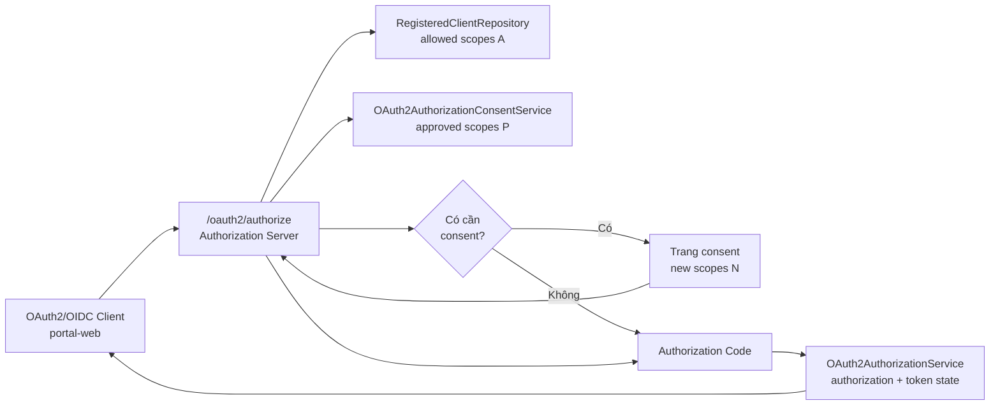

# Phân biệt scope mới với scope đã được chấp thuận

> **Chương: Consent.** Bài học thuộc module **SPRING_SECURITY_OAUTH2_OIDC_AUTHORIZATION_SERVER**, tập trung vào cách thiết kế, cấu hình, bảo mật, kiểm thử và vận hành OAuth 2.0/OpenID Connect Authorization Server với Spring Security và Spring Authorization Server trong Spring Boot. Mục tiêu là phân biệt **scope client đang yêu cầu**, **scope từng được người dùng đồng ý**, **scope mới cần xin phép** và **scope thực sự được cấp cho giao dịch hiện tại**.

## 1. Bối cảnh: cùng một người dùng, cùng một client, nhưng yêu cầu quyền có thể thay đổi

Trong OAuth 2.0 Authorization Code Flow, một ứng dụng (OAuth Client) gửi người dùng tới Authorization Server để xin quyền. Authorization Server xác thực người dùng, kiểm tra đăng ký client, đánh giá chính sách consent và có thể hiển thị trang thông báo những quyền ứng dụng đang xin. Khi người dùng chấp thuận, Authorization Server tiếp tục cấp authorization code; sau khi đổi code, client nhận access token với phạm vi được cấp theo giao thức và chính sách.

Ví dụ xuyên suốt:

- **Authorization Server / OpenID Provider:** `https://login.example.vn`, issuer `https://login.example.vn`.
- **Client:** ứng dụng `portal-web`, callback đã đăng ký `https://portal.example.vn/login/oauth2/code/portal`.
- **Người dùng:** `user-123`, đã xác thực tại Authorization Server.
- **Scope nghiệp vụ:** `orders.read` (đọc đơn hàng) và `orders.write` (thay đổi đơn hàng).
- **Scope OIDC:** `openid` (yêu cầu xác thực danh tính) và `profile` (yêu cầu một nhóm thông tin hồ sơ, tùy chính sách cung cấp claims).

Lần đầu, ứng dụng xin `openid profile orders.read`. Sau đó ứng dụng bổ sung tính năng chỉnh sửa đơn hàng và xin thêm `orders.write`. Ở lần thứ hai, nếu người dùng đã đồng ý các scope cũ, trang consent nên **làm nổi bật quyền mới** để họ hiểu điều gì thay đổi. Hệ thống không nên coi mọi scope trong đăng ký client là quyền người dùng đã đồng ý.

| Câu hỏi | Nơi có câu trả lời |
|---|---|
| Ứng dụng **được phép xin** những scope nào? | `RegisteredClient.getScopes()` |
| Ở **giao dịch hiện tại**, ứng dụng xin scope nào? | `scope` từ authorization request đã được xác minh |
| Người dùng **đã chấp thuận từ trước** những scope nào? | `OAuth2AuthorizationConsentService` → `OAuth2AuthorizationConsent.getScopes()` |
| Những scope nào **mới xuất hiện** trong yêu cầu, chưa được đồng ý? | Hiệu tập hợp: *requested scopes trừ previously approved scopes* |
| Token sau cùng có thể mang scope nào? | Phạm vi thực tế được cấp trong authorization, chịu giới hạn request, đăng ký, consent và policy |

**Consent là sự đồng ý của người dùng**, không phải cơ chế xác thực client hoặc thay thế kiểm tra quyền ở API. Một access token có scope `orders.write` vẫn phải được Resource Server kiểm tra cùng với issuer, audience, thời hạn, chủ thể và quy tắc nghiệp vụ liên quan.

## 2. Mô hình bốn tập hợp và phép so sánh đúng

Đặt:

- **A — Allowed:** Tập scope đã đăng ký cho client, lấy từ `RegisteredClient.getScopes()`.
- **R — Requested:** Tập scope client gửi trong authorization request hiện tại, sau khi parse và validate.
- **P — Previously approved:** Tập scope người dùng đã chấp thuận cho **đúng client** từ các lần trước, lấy từ consent service.
- **G — Granted now:** Tập scope thực tế được Authorization Server cấp cho giao dịch hiện tại, **không được suy trực tiếp** từ P hay A.

Sau khi request hợp lệ (về scope, client ID, redirect URI và các điều kiện khác):

```text
Mới cần xin consent     N = R \ P
Đã đồng ý, đang xin     E = R ∩ P
Đã đồng ý, không xin    O = P \ R
Scope xin ngoài đăng ký X = R \ A  → phải bị từ chối theo chính sách/chuẩn
```

Các công thức trên là **mô hình phân loại để trình bày và ra quyết định**. `G` phải do Authorization Server quyết định theo kết quả consent/authorization thật, không phải `G = A` hoặc tự động `G = P ∪ R`. Ngoài ra, có thể có những scope mang xử lý đặc biệt theo chính sách OIDC và triển khai framework; đừng xem hiệu tập hợp là thay thế toàn bộ validator giao thức.

### 2.1. Bảng minh họa

Giả sử đăng ký client cho phép:

```text
A = {openid, profile, orders.read, orders.write}
```

| Giao dịch | Người dùng đã đồng ý (P) | Client đang xin (R) | Đã đồng ý và đang xin (E) | Mới chưa đồng ý (N) |
|---|---|---|---|---|
| Lần đầu | `∅` | `openid, profile, orders.read` | `∅` | `openid, profile, orders.read` |
| Xin thêm quyền ghi | `openid, profile, orders.read` | `openid, profile, orders.read, orders.write` | `openid, profile, orders.read` | `orders.write` |
| Chỉ đọc đơn hàng | `openid, profile, orders.read` | `openid, orders.read` | `openid, orders.read` | `∅` |
| Xin một quyền khác chưa đăng ký | `openid, profile, orders.read` | `openid, payments.admin` | `openid` | `payments.admin`, nhưng **request không hợp lệ** vì `payments.admin ∉ A` |

Ở hàng cuối, không hiển thị `payments.admin` như một checkbox để người dùng “tự cấp” quyền. Client chưa được đăng ký scope này; Authorization Server phải **từ chối yêu cầu không hợp lệ** qua xử lý giao thức, thường là lỗi `invalid_scope`.

### 2.2. Các nhầm lẫn dễ gây lỗ hổng

1. **A khác P:** `RegisteredClient.scope("orders.write")` chỉ cho biết client *được phép yêu cầu*, chưa chứng minh người dùng đã đồng ý.
2. **P khác R:** consent lưu từ lần trước có thể có `profile`, nhưng request hiện tại chỉ xin `orders.read`; token không được mặc định mang toàn bộ scope từng đồng ý.
3. **N không luôn bằng mọi scope xuất hiện trên UI:** trang consent tùy biến có thể hiển thị cả quyền đã phê duyệt để tạo ngữ cảnh, nhưng phải phân biệt rõ “đã cho phép” và “đang yêu cầu thêm”.
4. **N không phải giấy phép để tự grant:** người dùng có thể bỏ chọn hoặc từ chối quyền mới; kết quả phụ thuộc xử lý thật tại authorization endpoint.
5. **Không có N không đồng nghĩa mọi thứ đều đủ:** có thể cần xác thực lại, consent lại vì chính sách mới, hoặc `prompt=consent` theo OIDC; các điều kiện này độc lập với phép so sánh tập hợp.

### 2.3. Phạm vi đã chấp thuận nhưng client không còn được đăng ký

Một record consent cũ có thể chứa `reports.export` trong khi quản trị viên đã gỡ scope đó khỏi `RegisteredClient`. Khi ấy `P` có thể rộng hơn `A`. Tuyệt đối không cấp quyền đã bị gỡ khỏi đăng ký chỉ vì consent còn lưu. Nên có quy trình rà soát/sửa consent cũ khi thay đổi client registration, và luôn giới hạn quyền cấp bởi **request hợp lệ, cấu hình client hiện hành và policy**.

## 3. Spring Authorization Server lưu consent ở đâu?

Spring Authorization Server biểu diễn sự chấp thuận bằng `OAuth2AuthorizationConsent`. Bản ghi gắn các `GrantedAuthority` được cấp với cặp:

- `registeredClientId` — **ID nội bộ** của `RegisteredClient` (ví dụ `registration-portal-web`), **không phải** chuỗi OAuth `client_id=portal-web`.
- `principalName` — danh tính principal của người dùng đang chấp thuận (ví dụ `user-123`), theo cơ chế authentication của hệ thống.

`OAuth2AuthorizationConsentService` là điểm truy xuất và lưu trữ, với các phương thức chính:

```java
OAuth2AuthorizationConsent findById(
        String registeredClientId, String principalName);

void save(OAuth2AuthorizationConsent authorizationConsent);

void remove(OAuth2AuthorizationConsent authorizationConsent);
```

Đây là các chữ ký cốt lõi để học tập. Trong Spring Authorization Server 1.5.x, hai implementation thường dùng là:

| Implementation | Phù hợp với | Giới hạn |
|---|---|---|
| `InMemoryOAuth2AuthorizationConsentService` | Demo, unit/integration test, một instance | Dữ liệu mất khi restart, không đồng bộ giữa các pod |
| `JdbcOAuth2AuthorizationConsentService` | Production có RDBMS và yêu cầu nhớ consent | Phải tạo schema tương thích phiên bản, vận hành DB, kiểm soát quyền và backup |

Spring Authorization Server có thể dùng in-memory consent service mặc định nếu chưa định nghĩa bean; production nhiều instance nên chọn persistence đồng bộ, vì kết quả consent cần nhất quán giữa các lần request.

### 3.1. `getScopes()` và `getAuthorities()`

`OAuth2AuthorizationConsent.getAuthorities()` trả tập `GrantedAuthority`, có thể đại diện scope hoặc authority khác. Builder `OAuth2AuthorizationConsent.Builder.scope("orders.read")` lưu scope dưới dạng authority có prefix `SCOPE_`, ví dụ `SCOPE_orders.read`. Trong các phiên bản Spring Authorization Server 1.5.x có `getScopes()`, phương thức này **trích đúng các scope** từ authorities.

Vì vậy, để so sánh với scope trong authorization request, ưu tiên:

```java
OAuth2AuthorizationConsent consent =
        consentService.findById(client.getId(), principalName);

Set<String> previouslyApprovedScopes =
        consent == null ? Set.of() : consent.getScopes();
```

Không lấy trực tiếp `getAuthorities().map(GrantedAuthority::getAuthority)` rồi so với `orders.read`, vì chuỗi authority có thể là `SCOPE_orders.read` hoặc loại authority khác. Nếu dự án dùng phiên bản API cũ không có `getScopes()`, chỉ xử lý authority có prefix `SCOPE_` theo đúng contract của phiên bản đó; **không giả định mọi authority đều là một scope**.

### 3.2. Consent không phải token store



`RegisteredClientRepository` lưu **cấu hình và chính sách của ứng dụng khách**. `OAuth2AuthorizationConsentService` lưu **quyết định đồng ý trước đây**. `OAuth2AuthorizationService` lưu **authorization và token state**. Ba trách nhiệm này khác nhau; xóa consent không tự động xóa một access token đang còn hạn.

## 4. Khai báo client bật consent trong Spring Boot

Ví dụ một confidential web client dùng Authorization Code + PKCE và OIDC. Mã sau tập trung vào đăng ký client, không phải một Authorization Server hoàn chỉnh:

```java
import org.springframework.security.oauth2.core.AuthorizationGrantType;
import org.springframework.security.oauth2.core.ClientAuthenticationMethod;
import org.springframework.security.oauth2.core.oidc.OidcScopes;
import org.springframework.security.oauth2.server.authorization.client.RegisteredClient;
import org.springframework.security.oauth2.server.authorization.settings.ClientSettings;

static RegisteredClient portalClient(
        String encodedClientSecret) {

    return RegisteredClient.withId("registration-portal-web")
            .clientId("portal-web")
            .clientName("Portal đơn hàng")
            .clientSecret(encodedClientSecret)
            .clientAuthenticationMethod(
                    ClientAuthenticationMethod.CLIENT_SECRET_BASIC)
            .authorizationGrantType(
                    AuthorizationGrantType.AUTHORIZATION_CODE)
            .redirectUri(
                    "https://portal.example.vn/login/oauth2/code/portal")
            .scope(OidcScopes.OPENID)
            .scope(OidcScopes.PROFILE)
            .scope("orders.read")
            .scope("orders.write")
            .clientSettings(ClientSettings.builder()
                    .requireProofKey(true)
                    .requireAuthorizationConsent(true)
                    .build())
            .build();
}
```

Ví dụ giả định `encodedClientSecret` đã được băm bằng `PasswordEncoder` an toàn (như chuỗi có prefix `{bcrypt}`); bí mật bản rõ phải được cấp qua secret store cho client, không hardcode vào bài hoặc repository. Phần ứng dụng khác cần đăng ký `RegisteredClientRepository`, `AuthorizationServerSettings`, các `SecurityFilterChain`, cơ chế xác thực người dùng và nguồn khóa ký/JWK khi dùng JWT/ID Token.

`requireAuthorizationConsent(true)` yêu cầu framework đánh giá sự đồng ý theo cơ chế của Authorization Server. Khi các scope đã được duyệt và không có điều kiện buộc hiển thị lại, luồng có thể đi qua mà không cần hiện trang consent. Đây **không** phải lời cam kết mọi request sẽ luôn hiện form, cũng không có nghĩa client được toàn quyền dùng tất cả scope trong đăng ký.

`requireProofKey(true)` buộc client dùng PKCE khi xin authorization code, giúp ràng buộc code với lần khởi tạo yêu cầu. PKCE, `state` và redirect URI hợp lệ vẫn cần được kiểm tra dù user đã consent trước đây.

### 4.1. Ví dụ authorization request

Lần đầu:

```http
GET /oauth2/authorize?response_type=code
    &client_id=portal-web
    &redirect_uri=https%3A%2F%2Fportal.example.vn%2Flogin%2Foauth2%2Fcode%2Fportal
    &scope=openid%20profile%20orders.read
    &state=STATE_RANDOM
    &nonce=NONCE_RANDOM
    &code_challenge=PKCE_CHALLENGE
    &code_challenge_method=S256
Host: login.example.vn
```

Lần sau, client muốn quyền bổ sung `orders.write`:

```http
GET /oauth2/authorize?response_type=code
    &client_id=portal-web
    &redirect_uri=https%3A%2F%2Fportal.example.vn%2Flogin%2Foauth2%2Fcode%2Fportal
    &scope=openid%20profile%20orders.read%20orders.write
    &state=NEW_STATE_RANDOM
    &nonce=NEW_NONCE_RANDOM
    &code_challenge=NEW_PKCE_CHALLENGE
    &code_challenge_method=S256
Host: login.example.vn
```

Các request trên được xuống dòng để dễ đọc; URL HTTP thật phải nối trên một dòng và mã hóa đúng. Giá trị `state`, `nonce` và PKCE phải được tạo **theo từng giao dịch**, có độ ngẫu nhiên và thuộc tính an toàn phù hợp. Không lưu các giá trị này trong log/tracking không cần thiết.

Khi consent đã lưu cho `openid, profile, orders.read`, yêu cầu thứ hai có:

```text
E (đã duyệt, đang xin): {openid, profile, orders.read}
N (mới cần xem xét):    {orders.write}
```

Trong thực tế, hành vi xử lý consent của scope đặc biệt như `openid` hoặc OIDC `prompt=consent` phải được kiểm chứng theo phiên bản framework; ví dụ trên mô tả **mô hình khái niệm** khi consent record lưu những scope tương ứng.

## 5. Tính scope mới bằng Java mà không cấp quyền vượt đăng ký

Mục tiêu của phép tính là giúp **hiển thị quyền mới** và quyết định xem cần đánh giá consent; đó **không phải** nơi tự phát authorization code hoặc cấp token.

Ví dụ dùng `OAuth2AuthorizationConsent.getScopes()` của Spring Authorization Server 1.5.x:

```java
import java.util.LinkedHashSet;
import java.util.Set;
import org.springframework.security.oauth2.server.authorization.OAuth2AuthorizationConsent;
import org.springframework.security.oauth2.server.authorization.OAuth2AuthorizationConsentService;
import org.springframework.security.oauth2.server.authorization.client.RegisteredClient;

record ScopeComparison(
        Set<String> requested,
        Set<String> previouslyApproved,
        Set<String> approvedAndRequested,
        Set<String> newlyRequested) {}

static ScopeComparison compareScopes(
        RegisteredClient client,
        String principalName,
        Set<String> requestedScopes,
        OAuth2AuthorizationConsentService consentService) {

    // Kiểm tra đăng ký client hiện tại trước mọi xử lý UI.
    if (!client.getScopes().containsAll(requestedScopes)) {
        throw new IllegalArgumentException("Invalid requested scope");
    }

    OAuth2AuthorizationConsent consent = consentService.findById(
            client.getId(), principalName);

    Set<String> previouslyApproved = consent == null
            ? Set.of()
            : consent.getScopes();

    Set<String> approvedAndRequested =
            new LinkedHashSet<>(requestedScopes);
    approvedAndRequested.retainAll(previouslyApproved);

    Set<String> newlyRequested =
            new LinkedHashSet<>(requestedScopes);
    newlyRequested.removeAll(previouslyApproved);

    return new ScopeComparison(
            Set.copyOf(requestedScopes),
            Set.copyOf(previouslyApproved),
            Set.copyOf(approvedAndRequested),
            Set.copyOf(newlyRequested));
}
```

Sử dụng từ một lớp controller/service nơi đã có `RegisteredClient`, `principalName` của **người đang xác thực**, tập scope của authorization request **đã được kiểm tra** và `OAuth2AuthorizationConsentService`. Các hàm xử lý ở authorization endpoint của framework vẫn là nơi xác thực giao thức cuối cùng.

**Đọc kết quả đúng cách:**

- `requested`: scope mà client xin cho **lần này**, không phải tất cả scope trong đăng ký.
- `previouslyApproved`: scope đã ghi nhớ ở những lần trước; có thể chứa scope **không được xin** lần này.
- `approvedAndRequested`: phần giao nhau `R ∩ P`, có thể hiển thị “bạn đã cho phép”.
- `newlyRequested`: `R \ P`, những quyền cần người dùng chú ý.
- Không có phép toán nào trên đây **tự tạo G**; G phụ thuộc quyết định consent, policy và validation của Authorization Server.

Trong endpoint công khai, không nên trả `IllegalArgumentException` nguyên văn về client như một lỗi giao thức. Đoạn trên là **hàm phân loại minh họa**; request sai scope phải được Authorization Server xử lý theo chuẩn OAuth2 (như `invalid_scope`) và không được redirect tới một `redirect_uri` chưa được xác minh.

### 5.1. Vì sao ưu tiên `client.getId()` thay vì `client.getClientId()`?

`OAuth2AuthorizationConsentService.findById(...)` nhận `registeredClientId`, là `RegisteredClient.getId()`. Ví dụ:

```text
RegisteredClient.id = "registration-portal-web"
RegisteredClient.clientId = "portal-web"
Principal.getName() = "user-123"
Consent key = ("registration-portal-web", "user-123")
```

Tra bằng chuỗi `"portal-web"` thay ID nội bộ có thể luôn trả `null` và khiến mọi request bị coi như chưa có consent. Cũng cần tránh chọn principal name từ query/body của trình duyệt; chỉ lấy từ authentication đáng tin tại server.

### 5.2. Làm gì với `Set<String>` và thứ tự hiển thị?

Một `Set` dùng để so sánh tập hợp; Java không mặc định bảo đảm thứ tự hiển thị đẹp cho tất cả implementation. Ở UI, có thể sắp xếp theo **mức rủi ro hoặc danh sách thứ tự do sản phẩm định nghĩa**, ví dụ hiển thị `orders.write` nổi bật hơn `profile`. Không nên dùng thứ tự scope do HTTP request tự gửi để xác định mức nhạy cảm hay thứ tự đồng ý.

## 6. Hiển thị trang consent: quyền cũ, quyền mới và lựa chọn của người dùng

Spring Authorization Server cho phép cấu hình một trang consent tùy biến qua `OAuth2AuthorizationEndpointConfigurer.consentPage("/oauth2/consent")`. Nếu không cấu hình đường dẫn này, framework có thể tạo trang consent mặc định. Khi dùng custom page, ứng dụng cần tự phục vụ `GET /oauth2/consent` và gửi lựa chọn qua **POST đến authorization endpoint** được cấu hình (thường là `/oauth2/authorize`).

Theo API cấu hình Spring Authorization Server 1.5.x, custom consent page thường nhận các query parameter:

- `client_id`: client đang xin quyền;
- `scope`: các scope trong authorization request;
- `state`: giá trị liên kết giao dịch consent với authorization request ở phía server.

Lớp server phải lấy thông tin client từ `RegisteredClientRepository` và người dùng từ authentication hiện hành. Trang consent là giao diện **hiển thị/thu thập quyết định**, không trực tiếp tự cấp quyền hoặc ghi consent dựa trên những scope tùy ý được POST.

### 6.1. Hiển thị rõ sự khác biệt

Một trang consent tốt cần giúp người dùng trả lời:

| Phần giao diện | Nội dung hiển thị |
|---|---|
| **Ứng dụng nào đang xin?** | Tên ứng dụng đáng tin từ đăng ký client, ví dụ “Portal đơn hàng” |
| **Bạn đã cho phép những gì?** | Các scope thuộc `R ∩ P`, diễn giải thân thiện; có thể thu gọn |
| **Ứng dụng đang xin thêm điều gì?** | Các scope thuộc `R \ P`, giải thích rõ quyền mới và mức ảnh hưởng |
| **Bạn có thể quyết định gì?** | Đồng ý những quyền có thể chọn, từ chối nếu không muốn cấp |
| **Làm sao quản lý lại quyền?** | Liên kết tới mục quản lý và thu hồi quyền truy cập, nếu sản phẩm cung cấp |

Ví dụ nội dung cho giao dịch xin thêm:

> **Portal đơn hàng muốn được cấp thêm quyền.** Bạn đã cho phép ứng dụng xem đơn hàng. Lần này ứng dụng còn muốn **thay đổi đơn hàng**. Bạn có thể đồng ý quyền bổ sung hoặc từ chối.

Bản dịch scope trên UI phải đến từ **dictionary do Authorization Server quản lý** như `orders.read → Xem đơn hàng`, `orders.write → Tạo/chỉnh sửa đơn hàng`. Không hiển thị raw scope name không rõ nghĩa, không chèn HTML/JavaScript từ `client_name` hay thông tin đăng ký động chưa được duyệt.

### 6.2. Cấu hình đường dẫn custom consent page

Ví dụ cấu hình trọng tâm (nằm trong bean filter chain dành cho Authorization Server):

```java
OAuth2AuthorizationServerConfigurer authorizationServer =
        OAuth2AuthorizationServerConfigurer.authorizationServer();

http.securityMatcher(authorizationServer.getEndpointsMatcher())
    .with(authorizationServer, server ->
        server.authorizationEndpoint(endpoint ->
            endpoint.consentPage("/oauth2/consent")))
    .authorizeHttpRequests(authorize ->
        authorize.anyRequest().authenticated());
```

Để trở thành cấu hình hoàn chỉnh còn cần xử lý login browser, security filter chain khác cho `GET /oauth2/consent`, authentication provider/user store, JWKSource (nếu ký JWT), issuer và repository. Nếu ứng dụng còn dùng OIDC, bật `server.oidc(...)` theo cấu hình OIDC phù hợp. Trang `GET /oauth2/consent` cần được phục vụ cho **người dùng đã xác thực**, không mở API quản lý consent dựa vào query tự do.

### 6.3. Ví dụ form Thymeleaf với nhóm scope mới

Giả sử controller đã tạo model an toàn với `clientName`, `clientId`, `state`, `approvedScopes` và `newScopes`. Các phần tử `newScopes` ở ví dụ là object gồm `code` và `description` do server xây dựng từ whitelist.

```html
<!doctype html>
<html lang="vi" xmlns:th="http://www.thymeleaf.org">
<head>
  <meta charset="UTF-8">
  <title>Xác nhận quyền truy cập</title>
</head>
<body>
  <main>
    <h1>Xác nhận quyền cho ứng dụng</h1>
    <p th:text="${clientName}">Ứng dụng</p>

    <section th:if="${!#lists.isEmpty(approvedScopes)}">
      <h2>Quyền bạn đã cho phép</h2>
      <ul>
        <li th:each="scope : ${approvedScopes}"
            th:text="${scope.description}">Quyền đã cấp</li>
      </ul>
    </section>

    <section>
      <h2>Quyền ứng dụng đang xin thêm</h2>
      <form th:action="@{/oauth2/authorize}" method="post">
        <input type="hidden" name="client_id" th:value="${clientId}">
        <input type="hidden" name="state" th:value="${state}">
        <input type="hidden"
               th:name="${_csrf.parameterName}"
               th:value="${_csrf.token}">

        <label th:each="scope : ${newScopes}">
          <input type="checkbox" name="scope"
                 th:value="${scope.code}">
          <span th:text="${scope.description}">Quyền bổ sung</span>
        </label>

        <button type="submit">Chấp thuận các quyền đã chọn</button>
      </form>
      <form th:action="@{/oauth2/authorize}" method="post">
        <input type="hidden" name="client_id" th:value="${clientId}">
        <input type="hidden" name="state" th:value="${state}">
        <input type="hidden"
               th:name="${_csrf.parameterName}"
               th:value="${_csrf.token}">
        <button type="submit">Từ chối</button>
      </form>
    </section>
  </main>
</body>
</html>
```

Đây là **sườn giao diện**, chưa đủ cho mọi trường hợp cần POST dữ liệu: một số phiên bản/cấu hình cần gửi đầy đủ các scope được người dùng đồng ý (gồm scope đã duyệt hoặc scope mặc định của OIDC) theo protocol handler và UI đã thiết kế. Hãy kiểm thử ca có consent cũ rồi xin thêm scope mới để xác minh server thực sự **giữ quyền cũ và chỉ thêm quyền được chọn**, cũng như không cấp scope đã bị bỏ chọn. Trong form trên, khi không chọn scope nào, đó là đường từ chối; hành vi/error cuối cùng phải được kiểm tra trên phiên bản framework thực tế.

Một số Thymeleaf/Spring Security setup có thể **tự chèn CSRF hidden input**; khi đã thêm thủ công như ví dụ thì kiểm tra HTML render để tránh gửi hai token không cần thiết. Ưu tiên một cơ chế CSRF thống nhất. `state` của OAuth2 giúp nối response consent với authorization request, **không tự thay thế CSRF token cho POST của ứng dụng**. Không tắt CSRF chỉ để form chạy qua.

### 6.4. Tránh làm mất quyền đã được đồng ý trong UI

Có hai chính sách giao diện thường gặp:

1. **Incremental consent:** chỉ hỏi người dùng về quyền mới; quyền đã đồng ý được hiển thị tham khảo. Authorization Server phải xử lý merge/quyền hiện tại đúng theo thiết kế.
2. **Re-consent toàn bộ request:** hiển thị lại tất cả scope đang xin và yêu cầu người dùng xác nhận, thường trong trường hợp đặc biệt hoặc `prompt=consent` (khi OIDC hỗ trợ). Cần phân biệt rõ quyền đã được duyệt và quyền mới, đặc biệt không auto-check một scope mới mang ảnh hưởng cao.

Tùy chọn UI không được thay đổi logic bảo mật của authorization endpoint. **Không cho JavaScript hoặc browser xác định “đã duyệt” bằng localStorage, cookie tự đặt hoặc hidden field**. Lịch sử duyệt phải đến từ consent service và chỉ được sử dụng sau khi server xác minh client, principal, request và trạng thái giao dịch.

## 7. Lưu và đọc lại consent đúng cách

### 7.1. Tạo mẫu consent trong bài kiểm thử/seed có kiểm soát

Code sau minh họa cách xây dựng consent cho **một principal** và **một RegisteredClient**, sử dụng `Builder.scope(...)`:

```java
import org.springframework.security.oauth2.server.authorization.OAuth2AuthorizationConsent;
import org.springframework.security.oauth2.server.authorization.OAuth2AuthorizationConsentService;
import org.springframework.security.oauth2.server.authorization.client.RegisteredClient;

static void seedTestConsent(
        RegisteredClient client,
        String principalName,
        OAuth2AuthorizationConsentService service) {

    OAuth2AuthorizationConsent consent = OAuth2AuthorizationConsent
            .withId(client.getId(), principalName)
            .scope("openid")
            .scope("profile")
            .scope("orders.read")
            .build();

    service.save(consent);
}
```

Đây là **test fixture**, không phải quy trình được phép tự động tạo consent thay người dùng ở production. Trong ứng dụng thật, **quyết định chấp thuận** phải đến từ luồng consent được xác thực, gắn với authorization transaction và chính sách rõ ràng. Không “seed tất cả scope” vào consent store để loại bỏ màn hình đồng ý, cũng không cho endpoint công khai gọi `service.save(...)` theo danh sách scope client gửi.

### 7.2. Cập nhật consent và hiểu vòng đời

Khi người dùng chọn thêm một scope, consent trước đây có thể được **cập nhật**. `OAuth2AuthorizationConsent` bất biến, nên quy trình quản trị hợp lệ có thể dùng `OAuth2AuthorizationConsent.from(existing)` để tạo builder, bổ sung/loại authority rồi `save(...)`. Tránh code tùy biến ghi đè consent thành “chỉ những scope được POST lần này” nếu ứng dụng mong muốn bảo toàn các quyền đã phê duyệt còn hiệu lực.

Tuy nhiên, **đừng tự merge mọi scope** từ request: chỉ merge những scope đã được phép theo client registration, đã được người dùng phê duyệt và còn hợp lệ theo policy. Đặc biệt, không biến `scope=orders.write` do browser tự chèn thành consent mới.

### 7.3. JDBC persistence

Bean ví dụ khi đã có `JdbcTemplate` và `RegisteredClientRepository`:

```java
@Bean
OAuth2AuthorizationConsentService authorizationConsentService(
        JdbcTemplate jdbcTemplate,
        RegisteredClientRepository registeredClientRepository) {
    return new JdbcOAuth2AuthorizationConsentService(
            jdbcTemplate, registeredClientRepository);
}
```

Các imports thuộc `org.springframework.security.oauth2.server.authorization`, `org.springframework.security.oauth2.server.authorization.client` và `org.springframework.jdbc.core`. Cần dùng SQL schema đúng phiên bản Spring Authorization Server và áp dụng bằng migration; service JDBC **không tự bảo đảm bảng đã tồn tại**. Mã này là một bean service, chưa bao gồm transaction/persistence toàn hệ thống.

Cần lưu ý:

- Đảm bảo các instance Authorization Server nhìn thấy cùng consent data, tránh node A hiển thị lại quyền đã duyệt ở node B.
- Sử dụng `RegisteredClient.id` nội bộ ổn định. Nếu xóa và tạo lại RegisteredClient với ID mới, consent cũ có thể không còn được tìm thấy, dù `client_id` vẫn giống.
- Thiết kế quyền DB, backup, encryption at rest, thời gian lưu và dữ liệu xóa theo chính sách tổ chức.
- Nếu cache consent, cần invalidation khi người dùng thu hồi quyền hoặc khi client registration thay đổi.
- Không ghi trực tiếp bảng consent để “cho phép mọi scope” trong production.

## 8. Scope mới, OIDC scope và `prompt=consent`

### 8.1. Consent và OIDC không hoàn toàn trùng nhau

Trong OpenID Connect, `openid` xác định yêu cầu xác thực OIDC; `profile`, `email` và `offline_access` có ngữ nghĩa bổ sung. Cần phân biệt:

- **Scope được đăng ký:** ứng dụng được phép xin một loại quyền/nhóm claim.
- **Consent cho scope:** sự đồng ý của người dùng theo chính sách; không bảo đảm tất cả thông tin của scope thực sự có sẵn.
- **Claim trong ID Token/UserInfo:** dữ liệu chỉ được phát hành nếu giao thức, scope, consent và mapper/policy cho phép.
- **Refresh token:** quyền phát refresh token còn phụ thuộc grant type, loại client và chính sách cấp token; có `offline_access` trong request không tự bảo đảm phát refresh token.

Một số framework/policy có thể coi `openid` là scope nền tảng được xử lý riêng trên consent page, thay vì checkbox thông thường. Mô hình `N = R \ P` vẫn hữu ích nhưng UI và protocol handler phải tuân theo hành vi OIDC thực tế; không cắt bỏ `openid` khỏi token request một cách máy móc vì không hiển thị nó.

### 8.2. `prompt=consent` và `prompt=none`

OIDC RP có thể gửi:

- `prompt=consent`: yêu cầu OP **hiển thị lại bước consent** theo ngữ nghĩa OIDC, kể cả khi scope đã được chấp thuận trước đó.
- `prompt=none`: cấm UI tương tác; nếu cần login hoặc consent không thể giải quyết im lặng, OP phải trả lỗi phù hợp như `login_required` hoặc `consent_required`, không tự bật một màn hình form.
- `prompt=login`: chủ yếu yêu cầu xác thực lại; nó không mặc nhiên có nghĩa phải xin lại toàn bộ consent.

Mức hỗ trợ và hành vi cụ thể ở Spring Authorization Server có thể khác theo phiên bản và cấu hình. Do đó, **kiểm thử request thật** với tổ hợp `prompt`, consent đã lưu/chưa lưu, session hiện có và scope mới. Không tự suy rằng `requireAuthorizationConsent(true)` tự động thực thi chính xác mọi trường hợp của `prompt=consent` hoặc `prompt=none`.

### 8.3. Đồng ý một phần và từ chối

OAuth2 cho phép người dùng cấp **một phần** các quyền được yêu cầu trong các trường hợp hỗ trợ. Ví dụ client xin `orders.read` và `orders.write`, nhưng người dùng chỉ chọn quyền đọc. Nếu policy và luồng cấp token hỗ trợ partial consent, access token phải thể hiện **quyền đã cấp** chứ không được tự động thêm `orders.write`.

Mặt khác, một client có thể **cần tất cả scope** để thực hiện tính năng; khi người dùng không đồng ý, RP cần xử lý thiếu quyền, thông báo rõ và không chạy một API nhạy cảm rồi chỉ dựa vào lỗi 403. Nếu người dùng từ chối toàn bộ, authorization flow phải kết thúc theo lỗi giao thức phù hợp (thường `access_denied`); không âm thầm phát token đủ scope ban đầu.

## 9. Thu hồi consent khác với thu hồi token

Một ứng dụng production nên có tính năng “Quản lý ứng dụng đã kết nối” cho người dùng. Nếu người dùng thu hồi quyền `orders.write` hoặc xóa toàn bộ consent của `portal-web`, cần phân biệt:

| Thao tác | Kết quả chính | Điều **không tự động** xảy ra |
|---|---|---|
| Xóa/update `OAuth2AuthorizationConsent` | Những authorization request **tương lai** được đánh giá lại theo quyền đã lưu mới | JWT access token đã phát chưa chắc bị vô hiệu ngay |
| Revoke access/refresh token qua cơ chế tương ứng | Token được hệ thống xử lý thu hồi theo định dạng và kiến trúc | Không nhất thiết xóa bản ghi consent |
| Gỡ scope khỏi `RegisteredClient` | Client không được yêu cầu scope đó nữa | Consent cũ hoặc token còn hạn không tự được dọn hết |
| Đăng xuất phiên OP/RP | Kết thúc phiên đăng nhập theo cơ chế thiết kế | Không mặc nhiên thu hồi tất cả token còn hạn |
| Xóa RegisteredClient | Hết đăng ký client theo chính sách | Không được giả định các token, consent và log liên quan tự xóa đồng bộ |

Muốn **thu hồi ngay** khả năng gọi API sau khi rút consent, cần thiết kế kết hợp revocation/introspection, thời hạn access token, kiểm tra trạng thái ở Resource Server hoặc một cơ chế chặn token phù hợp. Nếu access token là JWT được xác thực cục bộ, việc xóa consent trong database **không tự làm JWT đã ký mất hiệu lực** cho đến khi API có kiểm tra thu hồi riêng hoặc JWT hết hạn.

### 9.1. Đồng nhất principal và tenant

Consent phải được liên kết đúng với **định danh người dùng ổn định** và đúng client. Nếu hệ thống hỗ trợ multi-tenant, cần tránh hai tenant dùng cùng `principalName` và `registeredClientId` nhưng lại được hiểu là một phạm vi quyền. Tùy kiến trúc, có thể sử dụng định danh principal chứa tenant, tách issuer/registry hoặc custom service với isolation rõ ràng.

Không dùng email hiển thị hoặc tên người dùng có thể thay đổi làm khóa bảo mật mà không có chính sách di trú, tránh một người thừa hưởng consent của tài khoản khác khi tên/email được tái sử dụng.

## 10. Bảo vệ trang consent và dữ liệu phê duyệt

### 10.1. Đảm bảo tất cả các ranh giới tin cậy

- **Client registration:** chỉ scope, redirect URI, tên và metadata đã được quản trị/kiểm tra mới được dùng làm cơ sở cho consent.
- **Authenticated principal:** chỉ người dùng đã xác thực mới được quyết định thay đổi consent của chính họ; không lấy `principalName` từ query/form.
- **Authorization transaction:** liên kết `client_id`, `state`, requested scopes, redirect URI và subject với phiên request đang chờ; không chỉ dựa vào hidden input.
- **CSRF:** bảo vệ POST consent bằng CSRF token của ứng dụng, bên cạnh `state` của giao thức.
- **Output encoding:** hiển thị tên client, mô tả scope bằng text escaping (ví dụ Thymeleaf `th:text`); không dùng raw HTML từ dynamic registration hay query.
- **Request validation:** chỉ nhận lựa chọn hợp lệ cho requested scopes của giao dịch; mọi scope ngoài client registration hoặc không được xin phải bị từ chối/loại theo giao thức.
- **Audit và privacy:** ghi ai chấp thuận client nào, phạm vi và thời điểm nếu chính sách cho phép, nhưng không ghi password, access token, authorization code, đầy đủ cookie hoặc dữ liệu cá nhân không cần thiết.

Trang consent giúp bảo vệ người dùng khỏi **scope escalation** nhưng không thay authorization ở API. Resource Server vẫn phải kiểm tra token và chính sách quyền; không cho scope cũ vô tình tiếp tục cấp quyền sau khi quản trị viên đã gỡ scope.

### 10.2. Các tình huống dễ tấn công

| Rủi ro | Minh họa | Cách phòng vệ |
|---|---|---|
| **Scope injection** | Browser thêm `scope=admin` vào POST | Authorization endpoint chỉ chấp nhận lựa chọn thuộc request/registration đã xác thực |
| **Consent CSRF** | Trang khác ép người dùng đồng ý quyền mới | Session binding, CSRF token, SameSite cookie và xác nhận giao dịch |
| **Client impersonation** | Client giả có tên/logo giống ứng dụng chính thức | Provisioning kiểm soát metadata, xác thực client và hiển thị nguồn tin cậy |
| **Consent phishing** | UI gộp quyền ghi nhạy cảm vào nhãn mơ hồ | Mô tả dễ hiểu, tách quyền nhạy cảm, không pre-check quyền mới rủi ro cao |
| **Open redirect** | Dùng `returnUrl` tùy ý sau approve/deny | Redirect chỉ đến redirect URI đã đăng ký và được xác minh |
| **Cross-tenant consent leak** | Principal A thấy consent của người khác | Tách tenant và chọn principal đúng authentication |
| **Cached stale consent** | Đã thu hồi nhưng một pod còn cache cũ | Cache invalidation, nguồn dữ liệu chia sẻ, theo dõi version |
| **Token outlives consent** | Người dùng thu hồi hôm nay, access token JWT vẫn còn hạn | Thời hạn ngắn + cơ chế thu hồi/kiểm tra trạng thái theo yêu cầu |

## 11. Ma trận kiểm thử: phân biệt scope cũ và scope mới

Tạo các RegisteredClient, user và consent giả trong môi trường test riêng; không dùng credential production. Phần này giúp xác minh cả **hàm phân loại** và **kết quả authorization/token flow thật**.

| Ca | RegisteredClient allowed (A) | Previously approved (P) | Requested (R) | Kỳ vọng |
|---|---|---|---|---|
| Lần đầu | `read,write` | `∅` | `read` | `N={read}`, có thể yêu cầu consent |
| Cùng quyền lần 2 | `read,write` | `read` | `read` | `N=∅`; có thể bỏ qua consent nếu policy cho phép |
| Xin tăng quyền | `read,write` | `read` | `read,write` | `N={write}`; UI nêu rõ quyền mới |
| Chỉ xin ít quyền hơn | `read,write` | `read,write` | `read` | `N=∅`; token không tự chứa `write` |
| Chỉ xin quyền mới | `read,write` | `read` | `write` | `N={write}`, `read` không tự được thêm vào request |
| Scope ngoài đăng ký | `read` | `read` | `read,admin` | Từ chối `invalid_scope`, không hiển thị `admin` như quyền cấp được |
| Consent đã lưu nhưng client gỡ quyền | `read` | `read,write` | `read` | Không cấp `write`; cần rà soát consent cũ |
| User khác cùng client | `read,write` | User A đã duyệt `read` | User B xin `read` | User B không thừa hưởng consent User A |
| Client khác cùng người dùng | Client A và B có `read` | Consent cho A | Client B xin `read` | B không thừa hưởng consent của A |
| Đổi `RegisteredClient.id` | Client ID vẫn `portal-web` | Consent keyed bằng ID cũ | Xin `read` | Lookup bằng ID mới không ra consent cũ; cần migration phù hợp |
| Từ chối quyền mới | `read,write` | `read` | `read,write` | Không tự cấp `write`; RP xử lý kết quả thiếu quyền/lỗi |
| Consent lại theo policy | `read,write` | `read,write` | `read,write` | Nếu policy buộc re-consent, form vẫn hiển thị dù `N=∅` |
| Multi-instance | `read,write` | User vừa approve ở node A | Xin lại tại node B | Node B đọc được consent đã lưu từ storage chung |
| Thu hồi | `read,write` | Đã duyệt `read,write` rồi xóa consent | Xin lại `read` | Consent được hỏi lại theo policy, token cũ được xử lý riêng |
| `prompt=none` và scope mới | `read,write` | `read` | `read,write` | Không hiện UI; trả lỗi OIDC phù hợp khi cần tương tác |

### 11.1. Unit test có giá trị cho phép so sánh tập hợp

Giả sử `client` và `consentService` được khởi tạo trong test bằng repository in-memory, consent cũ được seed như ở mục 7:

```java
@Test
void detectsOnlyTheNewScope() {
    ScopeComparison result = compareScopes(
            client,
            "user-123",
            Set.of("openid", "profile", "orders.read", "orders.write"),
            consentService);

    assertEquals(Set.of("orders.write"), result.newlyRequested());
    assertEquals(
            Set.of("openid", "profile", "orders.read"),
            result.approvedAndRequested());
}
```

Thêm imports JUnit 5 và khởi tạo fixture tương ứng. Unit test này xác minh đúng **phân loại tập hợp**, chưa chứng minh giao diện consent, CSRF, validator, grant issuance hay token scopes đã đúng. Integration test cần kiểm tra authorization redirect → login → consent POST → authorization code → token response, bao gồm cả việc user từ chối quyền và ca bất hợp lệ.

### 11.2. Xử lý sự cố phổ biến

| Hiện tượng | Nguyên nhân cần kiểm tra | Hướng xử lý |
|---|---|---|
| Luôn hiện lại màn hình consent | Dùng in-memory qua restart/pod, tra bằng `clientId` thay `RegisteredClient.id`, hoặc sai principal | Kiểm tra key `(registeredClientId, principalName)` và persistence |
| Không hiện consent khi xin quyền mới | `requireAuthorizationConsent(false)`, policy tùy biến, consent bị seed thừa | Kiểm tra ClientSettings, predicate consent và consent store |
| Scope mới được cấp dù người dùng không chọn | Tự merge `R` hoặc `A` vào token/consent, tin hidden input | Để authorization endpoint kiểm soát selection, kiểm tra granted scopes cuối cùng |
| UI báo “quyền mới” cho scope đã duyệt | So sánh raw `getAuthorities()` có `SCOPE_` với scope string | Dùng `getScopes()` hoặc normalize đúng version |
| User B thấy quyền của A | Principal key thiếu tenant/user identity, cache không phân vùng | Dùng định danh principal ổn định và tách tenant |
| Sau restart mất consent | `InMemoryOAuth2AuthorizationConsentService` | Dùng JDBC hoặc service bền vững được quản trị |
| Sau revoke token vẫn gọi API được | Consent và access token có vòng đời độc lập | Thiết kế revocation/token status ở Resource Server |
| POST consent trả 403 | CSRF token sai/mất, cookie session lỗi hoặc filter chain sai | Kiểm tra form, CSRF, session, proxy và security matcher |
| `prompt=none` mở form consent | OIDC policy chưa được thực thi chuẩn theo phiên bản | Kiểm thử protocol, xử lý lỗi `consent_required` khi cần tương tác |

## 12. Checklist và câu hỏi tự kiểm tra

- [ ] Hiểu rõ `A`, `R`, `P`, `N` và `G`; không đồng nhất scope đăng ký với scope đã được duyệt.
- [ ] Tính `N = R \ P` và `E = R ∩ P` **sau khi kiểm tra** request và RegisteredClient.
- [ ] Lấy consent theo `RegisteredClient.id` và principal đáng tin; với multi-tenant có isolation rõ ràng.
- [ ] Dùng `OAuth2AuthorizationConsent.getScopes()` hoặc normalize đúng phiên bản; không so sánh raw `SCOPE_...` với scope string.
- [ ] Bật `requireAuthorizationConsent(true)` cho những client/chính sách cần consent và xác nhận hành vi thực của framework.
- [ ] Trang custom consent phân biệt quyền đã cho phép và quyền đang xin mới; nhãn quyền minh bạch.
- [ ] Không cho browser tự sửa lịch sử consent, tự thêm quyền hoặc chọn redirect URI sau approve/deny.
- [ ] Form consent dùng POST đến authorization endpoint, `client_id`/`state` đúng giao dịch, CSRF và session được bảo vệ.
- [ ] Production dùng consent service bền vững khi cần; tránh mất consent qua restart và không nhất quán giữa pod.
- [ ] Có quy trình revoke và hiểu revocation consent **khác** revocation token; Resource Server tiếp tục áp dụng authorization.
- [ ] Kiểm thử incremental consent, partial grant, từ chối, scope sai, scope bị gỡ, OIDC `prompt`, session và multi-instance.

**Câu hỏi tự kiểm tra:**

1. Nếu `A={read,write}`, `P={read}` và `R={read,write}`, `N` và `E` bằng gì?
2. Vì sao `RegisteredClient.getScopes()` không thể thay thế `OAuth2AuthorizationConsent.getScopes()`?
3. Tại sao phải dùng `RegisteredClient.getId()` để gọi `findById(...)` của consent service?
4. Người dùng từng duyệt `read,write` nhưng client chỉ xin `read` lần này. Token có được tự mang `write` không?
5. Vì sao không dùng hidden field `previouslyApprovedScopes` do browser gửi để quyết định scope đã consent?
6. Xóa consent có đồng nghĩa JWT access token còn hạn bị vô hiệu lập tức không?
7. Khi `prompt=none` nhưng ứng dụng muốn thêm một scope cần consent, OP nên xử lý ra sao?
8. Những test nào chứng minh không có scope escalation qua custom consent form?

## Tài liệu tham khảo

- [Spring Authorization Server — Core Model / Components](https://docs.spring.io/spring-authorization-server/reference/core-model-components.html): `OAuth2AuthorizationConsent` và `OAuth2AuthorizationConsentService`.
- [Spring Authorization Server — OAuth2AuthorizationConsent API](https://docs.spring.io/spring-authorization-server/reference/api/java/org/springframework/security/oauth2/server/authorization/OAuth2AuthorizationConsent.html): `getScopes()`, `getAuthorities()`, khóa định danh consent.
- [Spring Authorization Server — OAuth2AuthorizationConsent.Builder API](https://docs.spring.io/spring-authorization-server/reference/api/java/org/springframework/security/oauth2/server/authorization/OAuth2AuthorizationConsent.Builder.html): `scope(...)` và prefix `SCOPE_`.
- [Spring Authorization Server — OAuth2AuthorizationEndpointConfigurer API](https://docs.spring.io/spring-authorization-server/reference/api/java/org/springframework/security/oauth2/server/authorization/config/annotation/web/configurers/OAuth2AuthorizationEndpointConfigurer.html): custom consent page và yêu cầu POST.
- [Spring Authorization Server — OAuth2AuthorizationCodeRequestAuthenticationProvider API](https://docs.spring.io/spring-authorization-server/reference/api/java/org/springframework/security/oauth2/server/authorization/authentication/OAuth2AuthorizationCodeRequestAuthenticationProvider.html): chính sách đánh giá yêu cầu consent.
- [RFC 6749 — The OAuth 2.0 Authorization Framework](https://www.rfc-editor.org/rfc/rfc6749): authorization request, scope và authorization code.
- [RFC 9700 — Best Current Practice for OAuth 2.0 Security](https://www.rfc-editor.org/rfc/rfc9700): bảo vệ redirect URI, PKCE và authorization flow.
- [OpenID Connect Core 1.0](https://openid.net/specs/openid-connect-core-1_0.html): `openid`, `prompt`, consent và các yêu cầu OIDC.
