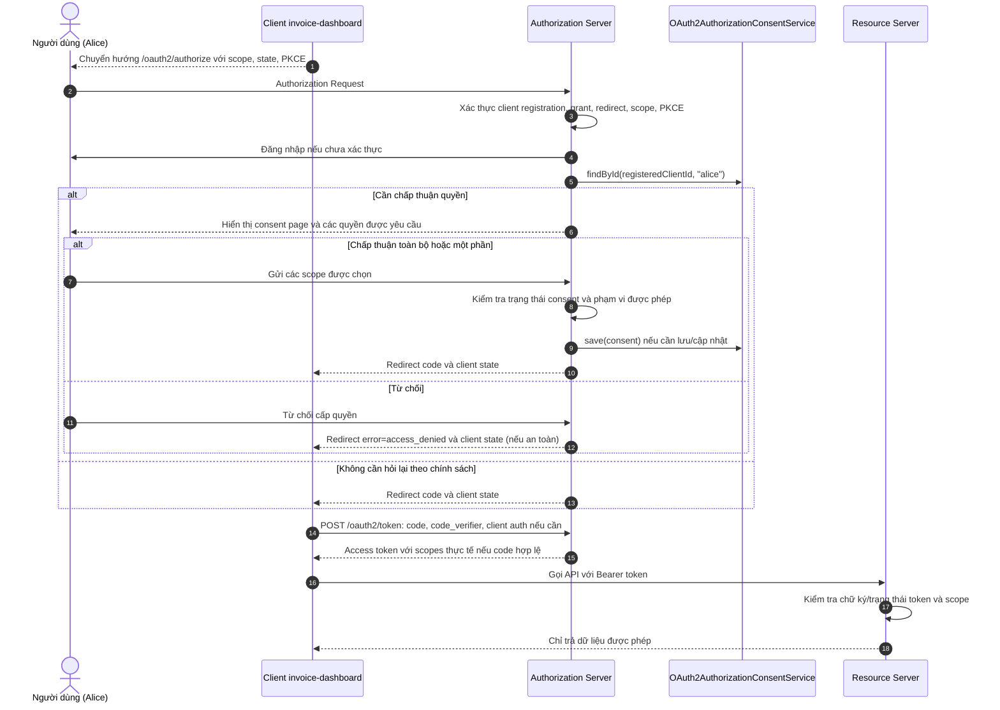

# Xử lý chấp thuận, từ chối và lựa chọn phạm vi quyền

## 1. Consent nằm ở đâu trong OAuth 2.0 / OpenID Connect?

Trong chương **Consent** của mô-đun **SPRING_SECURITY_OAUTH2_OIDC_AUTHORIZATION_SERVER**, một Authorization Server xây bằng **Spring Security**, **Spring Authorization Server** và **Spring Boot** cần trả lời ba câu hỏi trước khi cấp quyền truy cập tài nguyên của người dùng:

1. **Client có được đăng ký và được phép dùng luồng này không?**
2. **Người dùng đã được xác thực là ai?**
3. **Người dùng chấp thuận cho client thực hiện những quyền nào?**

Câu hỏi thứ ba là **authorization consent**: quyết định của Resource Owner cho phép hoặc từ chối một ứng dụng (client) truy cập tài nguyên theo các phạm vi quyền đã yêu cầu. Consent thường xuất hiện trong **Authorization Code Flow** khi ứng dụng xin quyền thay mặt người dùng.

Ví dụ: ứng dụng `invoice-dashboard` xin hai scope:

- `invoice.read`: xem danh sách và chi tiết hóa đơn;
- `invoice.export`: tải dữ liệu hóa đơn.

Người dùng Alice có thể đồng ý cho xem hóa đơn nhưng không muốn cho phép xuất dữ liệu. Authorization Server cần giữ đúng phạm vi được chấp thuận, thay vì mặc nhiên cấp mọi quyền mà client đã yêu cầu.

> **Phân biệt cốt lõi:** Đăng nhập chứng minh *người dùng là ai*. Consent thể hiện *người dùng chấp thuận quyền nào cho client*. Một ứng dụng đã được đăng ký và một người dùng đã đăng nhập vẫn chưa đủ để suy ra mọi scope đều được cấp.

### Mục tiêu của bài

Sau khi học, bạn có thể:

1. Phân biệt **chấp thuận toàn bộ**, **chỉ chấp thuận một phần** và **từ chối** authorization request.
2. Giải thích cách Spring Authorization Server sử dụng `RegisteredClient`, `OAuth2AuthorizationConsent`, `OAuth2AuthorizationConsentService` và `OAuth2Authorization`.
3. Bật yêu cầu consent cho client bằng `ClientSettings.requireAuthorizationConsent(true)`.
4. Thiết kế màn hình consent hiển thị quyền rõ ràng và gửi đúng các scope được người dùng chọn.
5. Phân biệt trạng thái đồng ý đã lưu với **scope thực tế trong access token** và quyền kiểm tra tại Resource Server.
6. Xây dựng kiểm thử cho luồng chấp thuận, từ chối, cấp quyền từng phần, đồng ý trước đó và việc thu hồi quyền.

## 2. Ba kết quả của một màn hình consent

Giả sử `RegisteredClient` cho phép `invoice.read` và `invoice.export`, client gửi:

```http
GET /oauth2/authorize?response_type=code&client_id=invoice-dashboard&redirect_uri=https%3A%2F%2Fdashboard.example.com%2Fcallback&scope=invoice.read%20invoice.export&state=CLIENT_STATE&code_challenge=PKCE_CHALLENGE&code_challenge_method=S256 HTTP/1.1
Host: auth.example.com
```

Các giá trị `CLIENT_STATE` và `PKCE_CHALLENGE` chỉ mang tính minh họa. Trong một request thật, client phải tạo `state` khó đoán, `code_verifier` an toàn và `code_challenge` PKCE hợp lệ.

| Quyết định | Người dùng chọn | Kết quả nghiệp vụ mong muốn | Hành vi cần kiểm tra |
| --- | --- | --- | --- |
| **Chấp thuận toàn bộ** | `invoice.read` và `invoice.export` | Client được phép hai scope đã yêu cầu | Authorization được cấp với tập quyền tương ứng |
| **Chấp thuận một phần** | Chỉ `invoice.read` | Client chỉ được quyền đọc hóa đơn | Authorization/token **không** có `invoice.export` |
| **Từ chối** | Không đồng ý cho ứng dụng truy cập | Không cấp authorization code hoặc token từ request này | Trả lỗi phù hợp, thường `access_denied` khi callback hợp lệ |

Trong triển khai Spring Authorization Server, consent model hỗ trợ việc người dùng cấp **một tập con** của các authority/scope đã yêu cầu. Tuy nhiên, sản phẩm cũng có thể có phạm vi quyền bắt buộc hoặc quy tắc riêng: nếu việc chọn một phần không đáp ứng điều kiện tối thiểu, Authorization Server phải từ chối hoặc giải thích rõ yêu cầu bổ sung. **Không tự phát token với scope không được duyệt.**

### Consent không đồng nghĩa với grant type

| Thuật ngữ | Vai trò |
| --- | --- |
| `authorization_code` | **Grant type** xác định cách client đổi authorization code lấy token |
| `response_type=code` | Giá trị request tại Authorization Endpoint để nhận code |
| `scope=invoice.read` | Quyền truy cập client **đề nghị** |
| Consent | Quyết định của Resource Owner đối với các quyền đề nghị |
| `OAuth2Authorization.authorizedScopes` | Các scope đã được cấp trong **authorization cụ thể** |
| `OAuth2AccessToken.scopes` | Tập scope gắn với **access token được phát hành** |

Với `client_credentials`, không có người dùng cuối tương tác tại màn hình consent của Authorization Code Flow. Client tự xác thực và nhận token theo quyền cấp cho ứng dụng. Không nên đem quy tắc consent của người dùng áp dụng máy móc cho service token.

## 3. Consent trong toàn bộ Authorization Code Flow



**Đọc sơ đồ đúng cách:** Nhánh từ chối **kết thúc yêu cầu**, nên client không có code hợp lệ để gửi token request. Các mũi tên gọi Token Endpoint và Resource Server chỉ áp dụng cho các nhánh **được cấp authorization code**.

Các bước logic:

1. Authorization Server xác minh client, `response_type=code`, redirect URI, scope và PKCE.
2. Người dùng đăng nhập, nếu phiên hiện tại chưa được xác thực.
3. AS xem chính sách `requireAuthorizationConsent` và thông tin chấp thuận đã lưu cho cặp client–principal.
4. Nếu còn quyền cần hỏi, AS hiển thị màn hình với danh tính client và mô tả từng quyền.
5. Người dùng chọn phạm vi, chấp thuận hoặc từ chối.
6. AS ràng buộc kết quả với **đúng request, đúng client và đúng phiên người dùng**, rồi xử lý authorization response.
7. Khi code được đổi thành token, scope đã cấp phải là nguồn giới hạn cho token. Resource Server kiểm tra quyền trực tiếp từ token/authorization policy.

**Thứ tự nội bộ** của filter, authentication provider, consent persistence và màn hình đăng nhập tùy phiên bản/cấu hình. Sơ đồ thể hiện hành vi nghiệp vụ, không phải trace từng method trong mã nguồn.

## 4. Hai lớp dữ liệu: consent đã lưu và authorization đang được cấp

Spring Authorization Server tách **quyết định chấp thuận được ghi nhớ** khỏi **một authorization cụ thể đã phát hành token**.

| Đối tượng | Đại diện cho | Vòng đời |
| --- | --- | --- |
| `RegisteredClient` | Danh tính và khả năng được phép của ứng dụng: grant type, redirect URI, scopes, consent policy | Tồn tại theo registration của client |
| `OAuth2AuthorizationConsent` | Các authority mà một Resource Owner đã chấp thuận cho một client | Có thể được sử dụng lại qua các authorization request sau |
| `OAuth2Authorization` | Một lần/phiên authorization và các token, scope đã cấp tương ứng | Gắn với grant cụ thể và vòng đời code/token |
| `OAuth2AccessToken` | Bằng chứng được sử dụng để truy cập API | Có hạn sử dụng, scopes và cơ chế thu hồi/kiểm tra riêng |

### 4.1. Cấu trúc `OAuth2AuthorizationConsent`

Về mặt dữ liệu, consent liên kết bởi:

```text
OAuth2AuthorizationConsent
  registeredClientId : String
  principalName      : String
  authorities        : Set<GrantedAuthority>
```

- **`registeredClientId`** là ID nội bộ của `RegisteredClient`, **khác** chuỗi `client_id` mà ứng dụng gửi qua HTTP.
- **`principalName`** nhận diện người dùng đã xác thực, chẳng hạn `alice`.
- **`authorities`** là các `GrantedAuthority` được cho phép. Chúng có thể biểu diễn scope (thường dưới dạng `SCOPE_invoice.read`) hoặc authority khác theo thiết kế/extension.

Consent thông thường gắn với **cặp client–người dùng**, không phải với một authorization code cụ thể. Vì thế, khi Alice quay lại sử dụng cùng client, server có thể tận dụng quyền đã đồng ý trước đó theo chính sách.

### 4.2. Vì sao `OAuth2AuthorizationConsent` và `OAuth2Authorization` khác nhau?

Giả sử Alice chấp thuận `invoice.read` ngày thứ Hai. Ngày thứ Ba ứng dụng xin lại scope đó. Consent service có thể còn bản ghi trước đó, trong khi authorization code và access token ngày thứ Hai đã hết hạn.

```text
Đăng ký client:
  RegisteredClient.scopes = {invoice.read, invoice.export}

Consent đã lưu cho (client, alice):
  authorities = {SCOPE_invoice.read}

Authorization của request mới:
  authorizedScopes = {invoice.read}

Access token tương ứng:
  scopes = {invoice.read}
```

Một consent đã lưu **không tự động tạo access token mới**. Token vẫn phải được cấp thông qua grant hợp lệ, sau khi các điều kiện xác thực và ủy quyền đều đạt.

**Ngược lại, xóa consent đã lưu không mặc nhiên xóa authorization/token đang tồn tại**. Nếu người dùng rút lại quyền và nghiệp vụ yêu cầu chặn truy cập ngay, còn cần thiết kế thu hồi token/authorization và cách Resource Server nhận biết việc thu hồi.

## 5. Bật màn hình consent trên `RegisteredClient`

Spring Authorization Server cho phép client yêu cầu người dùng chấp thuận bằng thuộc tính `ClientSettings.requireAuthorizationConsent(true)`. Ví dụ dưới đây đăng ký một confidential web client hỗ trợ Authorization Code và refresh token:

```java
package com.example.authserver;

import java.util.UUID;

import org.springframework.context.annotation.Bean;
import org.springframework.context.annotation.Configuration;
import org.springframework.security.crypto.password.PasswordEncoder;
import org.springframework.security.oauth2.core.AuthorizationGrantType;
import org.springframework.security.oauth2.core.ClientAuthenticationMethod;
import org.springframework.security.oauth2.server.authorization.client.InMemoryRegisteredClientRepository;
import org.springframework.security.oauth2.server.authorization.client.RegisteredClient;
import org.springframework.security.oauth2.server.authorization.client.RegisteredClientRepository;
import org.springframework.security.oauth2.server.authorization.settings.ClientSettings;

@Configuration
class DemoClientConfig {
    @Bean
    RegisteredClientRepository registeredClients(PasswordEncoder passwordEncoder) {
        RegisteredClient dashboard = RegisteredClient
                .withId(UUID.randomUUID().toString())
                .clientId("invoice-dashboard")
                .clientName("Bảng điều khiển hóa đơn")
                .clientSecret(passwordEncoder.encode("demo-secret-change-me"))
                .clientAuthenticationMethod(
                        ClientAuthenticationMethod.CLIENT_SECRET_BASIC)
                .authorizationGrantType(
                        AuthorizationGrantType.AUTHORIZATION_CODE)
                .authorizationGrantType(
                        AuthorizationGrantType.REFRESH_TOKEN)
                .redirectUri("https://dashboard.example.com/callback")
                .scope("invoice.read")
                .scope("invoice.export")
                .clientSettings(ClientSettings.builder()
                        .requireProofKey(true)
                        .requireAuthorizationConsent(true)
                        .build())
                .build();

        return new InMemoryRegisteredClientRepository(dashboard);
    }
}
```

**Đây là đoạn minh họa cấu hình client**, chưa phải một ứng dụng Spring Boot hoàn chỉnh. Authorization Server còn cần security filter chain, đăng nhập người dùng, JWK/signing key, issuer, các service lưu authorization, cơ chế cấu hình password encoder và những thành phần liên quan. Secret mẫu chỉ dùng cho bài học, không đưa vào source của môi trường thật.

### Vai trò từng cấu hình

| Thiết lập | Hiệu lực |
| --- | --- |
| `authorizationGrantType(AUTHORIZATION_CODE)` | Client có thể thực hiện Authorization Code Flow |
| `redirectUri(...)` | Đích callback được phép nhận code và trạng thái trả về |
| `scope(...)` | Những phạm vi client có quyền **yêu cầu** |
| `requireProofKey(true)` | Authorization request phải dùng PKCE phù hợp |
| `requireAuthorizationConsent(true)` | Authorization Server có thể yêu cầu người dùng chấp thuận các quyền cần consent |
| `clientName(...)` | Tên thân thiện để giao diện nhận diện ứng dụng, nếu được cấu hình |

Đặt `requireAuthorizationConsent(true)` **không có nghĩa mọi lần truy cập đều chắc chắn hiện màn hình**. Nếu cùng principal và client đã có consent hợp lệ cho những scope được xin, server có thể không cần hỏi lại tùy chính sách và cấu hình. Nếu client xin thêm quyền chưa được chấp thuận, màn hình có thể xuất hiện để người dùng quyết định phần quyền bổ sung.

**Cũng không nên suy rằng `requireAuthorizationConsent(false)` là “tắt authorization”.** Giá trị này chỉ ảnh hưởng yêu cầu hỏi chấp thuận người dùng; client vẫn phải hợp lệ về grant, redirect URI, scope, PKCE, authentication và chính sách bảo mật của server. Một tổ chức có thể cần consent riêng vì pháp lý hoặc đặc điểm dữ liệu ngay cả khi một số trường hợp được miễn prompt.

### Tình huống sau khi người dùng đã đồng ý

Giả sử consent đã lưu `SCOPE_invoice.read`. Trong lần tiếp theo:

- Client chỉ xin `invoice.read`: thường không phải hỏi lại cho scope đã được duyệt.
- Client xin `invoice.read invoice.export`: cần xét `invoice.export` chưa được duyệt; có thể yêu cầu consent bổ sung.
- Client xin `invoice.admin` không có trong `RegisteredClient.scopes`: **phải bị từ chối theo đăng ký/chính sách**, không được dùng giao diện consent để tự cấp quyền vượt registration.

Nếu người dùng đồng ý thêm `invoice.export`, consent service có thể cập nhật tập authority được lưu. Việc hợp nhất các authority đã chấp thuận và những gì thực sự được cấp trong từng authorization phụ thuộc logic xử lý của server; khi kiểm thử luôn đối chiếu cả consent record **và** token response.

## 6. `OAuth2AuthorizationConsentService`: đọc, lưu và xóa quyết định

Interface `OAuth2AuthorizationConsentService` cung cấp các thao tác chính:

| Phương thức | Công dụng |
| --- | --- |
| `findById(registeredClientId, principalName)` | Tra cứu consent đã lưu cho **một client nội bộ và principal** |
| `save(OAuth2AuthorizationConsent)` | Lưu mới hoặc cập nhật tập authority được chấp thuận |
| `remove(OAuth2AuthorizationConsent)` | Xóa consent đã lưu theo quyết định người dùng/chính sách |

Spring Authorization Server có hai triển khai phổ biến: `InMemoryOAuth2AuthorizationConsentService` cho phát triển/kiểm thử và `JdbcOAuth2AuthorizationConsentService` cho lưu trữ trong database qua JDBC.

### 6.1. Cấu hình in-memory trong bài lab

```java
import org.springframework.context.annotation.Bean;
import org.springframework.security.oauth2.server.authorization.InMemoryOAuth2AuthorizationConsentService;
import org.springframework.security.oauth2.server.authorization.OAuth2AuthorizationConsentService;

@Bean
OAuth2AuthorizationConsentService authorizationConsentService() {
    return new InMemoryOAuth2AuthorizationConsentService();
}
```

Consent lưu trong bộ nhớ bị mất khi ứng dụng khởi động lại; nếu có nhiều Authorization Server instance không chia sẻ state, người dùng có thể bị hỏi lại hoặc gặp tình trạng consent không nhất quán giữa các node.

### 6.2. Cấu hình JDBC khi cần lưu bền vững

```java
import org.springframework.context.annotation.Bean;
import org.springframework.jdbc.core.JdbcTemplate;
import org.springframework.security.oauth2.server.authorization.JdbcOAuth2AuthorizationConsentService;
import org.springframework.security.oauth2.server.authorization.OAuth2AuthorizationConsentService;
import org.springframework.security.oauth2.server.authorization.client.RegisteredClientRepository;

@Bean
OAuth2AuthorizationConsentService authorizationConsentService(
        JdbcTemplate jdbcTemplate,
        RegisteredClientRepository registeredClients) {
    return new JdbcOAuth2AuthorizationConsentService(
            jdbcTemplate, registeredClients);
}
```

Khi sử dụng JDBC, cần cấu hình DataSource, `JdbcTemplate`, repository client và tạo bảng `oauth2_authorization_consent` theo **SQL schema chính thức của phiên bản đang dùng**. Không suy tên cột hay cách serialize authority bằng việc nhìn interface Java. Trong hệ thống thật, cùng với consent, còn cần xem xét kho `RegisteredClientRepository`, `OAuth2AuthorizationService` và cấu hình chạy trên nhiều node.

### 6.3. Đọc consent và kiểm tra một authority đã được duyệt

```java
import org.springframework.security.core.authority.SimpleGrantedAuthority;
import org.springframework.security.oauth2.server.authorization.OAuth2AuthorizationConsent;
import org.springframework.security.oauth2.server.authorization.OAuth2AuthorizationConsentService;
import org.springframework.security.oauth2.server.authorization.client.RegisteredClient;

public boolean hasReadConsent(
        OAuth2AuthorizationConsentService consents,
        RegisteredClient client,
        String principalName) {

    OAuth2AuthorizationConsent consent =
            consents.findById(client.getId(), principalName);

    return consent != null && consent.getAuthorities().contains(
            new SimpleGrantedAuthority("SCOPE_invoice.read"));
}
```

Đoạn minh họa một phép tra cứu **trong hệ thống quản trị đáng tin cậy**. Nó **không thay thế** quy trình đánh giá authorization request, không chứng minh access token hiện có chứa scope, và không được công bố thành API cho bất kỳ người gọi nào hỏi tùy ý consent của người khác.

### 6.4. Tạo một bản ghi consent bằng API Java

Để hiểu dữ liệu được lưu, xem mô hình sau:

```java
import org.springframework.security.core.authority.SimpleGrantedAuthority;
import org.springframework.security.oauth2.server.authorization.OAuth2AuthorizationConsent;

OAuth2AuthorizationConsent consent = OAuth2AuthorizationConsent
        .withId(registeredClient.getId(), "alice")
        .authority(new SimpleGrantedAuthority("SCOPE_invoice.read"))
        .build();

// Chỉ gọi khi Alice đã thực sự chấp thuận qua luồng hợp lệ:
// authorizationConsentService.save(consent);
```

**Không được coi việc application tự gọi `save(...)` là bằng chứng Alice đã đồng ý.** Quyết định phải đến từ luồng consent được xác thực/ràng buộc đúng request và principal, hoặc chính sách khác được ủy quyền rõ ràng. Những authority không phải scope cũng có thể được mô hình hỗ trợ, nhưng quyền được cấp phải tuân thủ đăng ký client và chính sách của Authorization Server.

## 7. Thiết kế màn hình consent và luồng gửi quyết định

Spring Authorization Server có thể sinh **trang consent mặc định** khi cần hỏi người dùng. Khi muốn hiển thị giao diện theo ngôn ngữ, thương hiệu và mô tả quyền của sản phẩm, có thể cấu hình trang riêng bằng `OAuth2AuthorizationEndpointConfigurer.consentPage(...)`.

### 7.1. Cấu hình URI của trang consent tùy chỉnh

Ví dụ một phần SecurityFilterChain dành cho Authorization Server:

```java
import org.springframework.context.annotation.Bean;
import org.springframework.core.annotation.Order;
import org.springframework.security.config.annotation.web.builders.HttpSecurity;
import org.springframework.security.oauth2.server.authorization.config.annotation.web.configurers.OAuth2AuthorizationServerConfigurer;
import org.springframework.security.web.SecurityFilterChain;

@Bean
@Order(1)
SecurityFilterChain authorizationServerSecurityFilterChain(HttpSecurity http)
        throws Exception {
    OAuth2AuthorizationServerConfigurer as =
            OAuth2AuthorizationServerConfigurer.authorizationServer();

    http.securityMatcher(as.getEndpointsMatcher())
            .with(as, configurer -> configurer
                    .authorizationEndpoint(endpoint -> endpoint
                            .consentPage("/oauth2/consent")))
            .authorizeHttpRequests(authorize ->
                    authorize.anyRequest().authenticated());

    return http.build();
}
```

Đây **chỉ là phần định tuyến consent**; một Authorization Server hoàn chỉnh còn cần SecurityFilterChain xử lý đăng nhập, cơ chế chuyển người dùng chưa xác thực tới `/login`, đăng ký client, issuer, JWK/token service, các bean liên quan và cấu hình OIDC nếu cần. Nếu trang `GET /oauth2/consent` được Spring MVC phục vụ ngoài matcher endpoint của AS, cần bảo vệ route đó trong filter chain của ứng dụng.

Khi redirect tới trang consent tùy chỉnh, Spring Authorization Server có thể cung cấp các query parameter:

- `client_id`: định danh client đang xin quyền;
- `scope`: các scope liên quan tới authorization request mà consent page cần trình bày;
- `state`: **token trạng thái dành cho bước consent**, dùng để ràng buộc và chống yêu cầu giả mạo.

**Đặc biệt quan trọng:** `state` mà **Authorization Server đưa tới consent page** không nên được hiểu là bản sao tùy ý của `state` do **OAuth client** tạo lúc bắt đầu authorization request. Trong một triển khai Spring Authorization Server, consent state là giá trị dùng để AS liên kết đúng authorization đang chờ quyết định. Sau khi hoàn tất, callback tới client vẫn cần giữ `state` ban đầu của client. Không tự sinh, sửa hoặc thay consent state bằng client state.

### 7.2. Một biểu mẫu consent tối giản

Theo hợp đồng consent page của Spring Authorization Server, form gửi:

1. **HTTP POST** tới authorization endpoint, mặc định là `/oauth2/authorize`.
2. `client_id` được nhận từ luồng consent.
3. `state` của **consent request do server cấp**.
4. Các `scope` thực sự được người dùng đồng ý (các checkbox được đánh dấu).

Ví dụ giao diện **minh họa** bằng Thymeleaf. Các biến model như `clientId`, `consentState`, `requestedScopes` do controller phía server cung cấp sau khi xác minh registration, principal và dữ liệu request:

```html
<h1>Ứng dụng yêu cầu quyền truy cập</h1>
<p>
  <strong th:text="${clientDisplayName}">Tên ứng dụng</strong>
  muốn sử dụng các quyền sau.
</p>

<form method="post" th:action="@{/oauth2/authorize}">
  <input type="hidden" name="client_id" th:value="${clientId}">
  <input type="hidden" name="state" th:value="${consentState}">

  <div th:each="item : ${requestedScopes}">
    <input type="checkbox"
           name="scope"
           th:id="${item.value}"
           th:value="${item.value}">
    <label th:for="${item.value}"
           th:text="${item.description}">Mô tả quyền</label>
  </div>

  <button type="submit">Cho phép các quyền đã chọn</button>
</form>
```

Đây là **mảnh template thể hiện dữ liệu của consent**, chưa bao gồm logic controller, xử lý nhánh “Từ chối”, CSS, accessibility, trạng thái quyền đã được cấp trước đó và cấu hình CSRF tùy hệ thống. Không copy thành trang production mà không hoàn thiện những phần này.

**Ghi chú CSRF:** Spring Authorization Server ràng buộc POST consent với `state` do AS cấp. Nếu ứng dụng bổ sung lớp bảo vệ CSRF riêng cho endpoint/form liên quan, cần truyền và kiểm tra CSRF token đúng theo cấu hình Spring Security. Không nhầm `state` của OAuth client, consent state và `_csrf` của form là cùng một giá trị.

### 7.3. Biến tên scope kỹ thuật thành lời giải thích người dùng hiểu

Hiển thị mỗi tên scope kiểu `invoice.export` là chưa đủ khi quyền liên quan dữ liệu nhạy cảm. Giao diện nên dùng một từ điển mô tả **được kiểm soát tại server**:

| Scope | Nhãn hiển thị | Giải thích đề xuất |
| --- | --- | --- |
| `invoice.read` | Xem hóa đơn | Ứng dụng có thể đọc danh sách và chi tiết hóa đơn mà người dùng được phép xem |
| `invoice.export` | Xuất dữ liệu hóa đơn | Ứng dụng có thể tải dữ liệu hóa đơn ra khỏi hệ thống theo phạm vi được cấp |
| `profile.read` | Xem thông tin hồ sơ | Ứng dụng có thể đọc các trường hồ sơ đã định nghĩa trong chính sách |

Các mô tả này là ví dụ; phạm vi dữ liệu thực tế phải khớp hành vi API và chính sách của sản phẩm. Tránh nhãn chung chung như “Cho phép truy cập tài khoản của bạn” khi thực chất có quyền tải dữ liệu hoặc thực hiện hành động nhạy cảm.

Giao diện nên hiển thị rõ:

- **Ai đang xin quyền:** tên và nhận diện client được lấy từ registration đáng tin, không lấy nguyên văn tham số do người gọi tự cung cấp.
- **Ai đang cấp quyền:** tên tài khoản đã đăng nhập, nếu chính sách hiển thị cho phép.
- **Đang xin quyền gì:** mô tả, mức ảnh hưởng, quyền mới so với quyền đã cấp, thông tin quyền bắt buộc (nếu có).
- **Hai quyết định dễ phân biệt:** “Cho phép quyền đã chọn” và “Từ chối”, tránh đánh dấu sẵn những quyền nguy hiểm mà người dùng khó phát hiện.
- **Khả năng xem lại/rút quyền:** liên kết đến trang quản lý các ứng dụng đã được cho phép, nếu có trong sản phẩm.

### 7.4. Không tin dữ liệu của form theo mặc định

Một người dùng hoặc bên tấn công có thể chỉnh giá trị checkbox qua Developer Tools, thêm scope ngoài danh sách, thay `client_id`, gửi lại form cũ hoặc sửa `state`. Server phải kiểm tra:

1. Consent state tồn tại, còn hợp lệ, chưa bị dùng sai cách và trỏ tới authorization request đang chờ.
2. Phiên người dùng hiện tại là principal được ràng buộc với authorization request đó.
3. Client ID, redirect URI, grant, PKCE và scope ban đầu đều hợp lệ.
4. Scope được chọn là **tập con được phép** của scope thuộc request gốc và chính sách client; không chấp nhận quyền thêm từ phía trình duyệt.
5. Kết quả chỉ áp dụng cho đúng request, không phát token nếu yêu cầu đã bị từ chối hoặc mất trạng thái.

Việc template hiển thị hai checkbox không tạo ra biện pháp bảo mật. **Máy chủ mới là nơi kiểm soát phạm vi quyền cuối cùng.**

## 8. Xử lý chấp thuận toàn bộ, một phần và từ chối

### 8.1. Chấp thuận toàn bộ

Request ban đầu xin:

```text
scope = invoice.read invoice.export
```

Alice chọn cả hai checkbox. Form POST đưa các scope được chọn về authorization endpoint:

```http
POST /oauth2/authorize HTTP/1.1
Host: auth.example.com
Content-Type: application/x-www-form-urlencoded

client_id=invoice-dashboard&state=CONSENT_STATE&scope=invoice.read&scope=invoice.export
```

`CONSENT_STATE` là placeholder cho token consent state thực do AS gửi tới trang. Trình duyệt thật phải gửi kèm cookie/session và các dữ liệu bảo vệ phù hợp; ví dụ trên chỉ hiển thị cấu trúc body liên quan.

Sau khi AS kiểm tra hợp lệ, nó có thể cập nhật consent và cấp authorization code. Client đổi code tại token endpoint bằng PKCE verifier và client authentication thích hợp, sau đó access token có scope tương ứng.

### 8.2. Chấp thuận một phần

Alice chỉ chọn `invoice.read`:

```http
POST /oauth2/authorize HTTP/1.1
Host: auth.example.com
Content-Type: application/x-www-form-urlencoded

client_id=invoice-dashboard&state=CONSENT_STATE&scope=invoice.read
```

Mục tiêu bảo mật của luồng cấp quyền một phần:

```text
Requested scopes       = {invoice.read, invoice.export}
Approved scopes        = {invoice.read}
Authorization scopes   = {invoice.read}
Access token scopes    = {invoice.read}  // nếu token phát hành đúng quyền đã cấp
Missing scope          = invoice.export
```

Trong ứng dụng thật, kết quả có thể phụ thuộc scope đã đồng ý từ trước và quy tắc của AS. Nếu một scope là điều kiện bắt buộc để tiếp tục, hệ thống có thể phải từ chối authorization thay vì cấp một token không đáp ứng chính sách. Điều bất biến là **không được tự mở rộng token vượt quyền thực sự được phép**.

Ví dụ Resource Server:

```java
import org.springframework.http.HttpMethod;

// Đoạn minh họa quy tắc trong cấu hình SecurityFilterChain Resource Server:
http.authorizeHttpRequests(auth -> auth
        .requestMatchers(HttpMethod.POST, "/api/invoices/export")
            .hasAuthority("SCOPE_invoice.export")
        .requestMatchers(HttpMethod.GET, "/api/invoices/**")
            .hasAuthority("SCOPE_invoice.read")
        .anyRequest().authenticated());
```

Đoạn trên là **pseudocode cấu hình**, chưa tự chứa toàn bộ SecurityFilterChain và thứ tự matcher nên cần điều chỉnh trong dự án thật. Trong ví dụ, rule cụ thể `POST /api/invoices/export` cần được đặt trước matcher rộng hơn nếu route trùng nhau. Resource Server vẫn phải cấu hình Bearer token validation và kiểm tra issuer, audience, thời gian sống và chính sách cần thiết.

Người dùng đã chọn `invoice.read` thì yêu cầu xuất dữ liệu bằng token đó phải bị từ chối bởi API nếu thiếu `SCOPE_invoice.export`, bất kể client đã được đăng ký khả năng *xin* scope export.

### 8.3. Từ chối toàn bộ yêu cầu

Nút **“Từ chối”** phải là một nhánh có chủ đích của giao diện, có thể quan sát và kiểm thử. Khi người dùng từ chối:

1. Không phát authorization code hợp lệ từ yêu cầu đó.
2. Không ghi nhận những scope chưa chấp thuận thành consent mới.
3. Nếu `redirect_uri` đã được xác minh an toàn, trả thông tin lỗi theo quy tắc OAuth 2.0, thường `error=access_denied` và **OAuth client state ban đầu** để client đối chiếu.
4. Nếu không có callback an toàn hoặc request hỏng, xử lý lỗi tại Authorization Server, không tự redirect đến URI do browser gửi lên.

Ví dụ redirect lỗi:

```http
HTTP/1.1 302 Found
Location: https://dashboard.example.com/callback?error=access_denied&state=CLIENT_STATE
```

**Điểm triển khai:** Cách nút “Từ chối” được xử lý tùy trang consent và hành vi framework được sử dụng. Không giả định rằng gửi form với **không checkbox nào được chọn** luôn tương đương thao tác từ chối: một số ứng dụng có thể diễn giải khác hoặc có scope bắt buộc/đã duyệt trước. Hãy dùng đường xử lý từ chối được thiết kế, kiểm thử để xác nhận **không cấp code/token**, và không tin vào callback URL do client thao túng.

**Phân biệt:** Click “Từ chối” với **một authorization request mới** không mặc nhiên có nghĩa phải xóa tất cả consent đã được lưu từ các lần trước. Nếu sản phẩm muốn một hành động “Rút mọi quyền trước đây”, đó là chức năng quản trị riêng và cần chính sách thu hồi token.

### 8.4. Từ chối không có nghĩa token đã phát hành bị xóa

Giả sử Alice cho phép `invoice.read` ngày hôm qua, access token còn hạn, hôm nay cô ấy từ chối một request mới xin `invoice.export`. Việc từ chối request mới **không đủ** để kết luận access token cũ đã bị hủy. Nếu mong muốn “từ chối yêu cầu mới” đồng thời kết thúc truy cập trước đó, sản phẩm phải chủ động thực thi chính sách này và thông báo rõ cho người dùng.

## 9. Quản lý consent đã lưu, bổ sung quyền và rút quyền

Consent không chỉ được dùng tại thời điểm người dùng bấm “Cho phép”. Trong ứng dụng thật, cần quản lý **những quyền đã chấp thuận theo thời gian** và xử lý yêu cầu mở rộng hoặc rút quyền.

### 9.1. Chấp thuận quyền đã có và quyền bổ sung

Giả sử:

```text
T0: Alice đã cho phép invoice.read
    Consent = {SCOPE_invoice.read}

T1: invoice-dashboard xin invoice.read
    Không có scope mới cần hỏi, nếu chính sách cho phép dùng consent cũ.

T2: invoice-dashboard xin invoice.read + invoice.export
    invoice.export chưa được Alice duyệt.
    Nếu cần consent, hiển thị rõ quyền mới và cho Alice quyết định.

T3: Alice chỉ đồng ý invoice.read
    Không được tự cấp invoice.export.

T4: Alice đồng ý thêm invoice.export
    Consent có thể được cập nhật theo quyết định mới.
```

**Không hiểu consent như một “checkbox vĩnh viễn”** cho tất cả quyền của client. Khi client thay đổi chính sách quyền, tên, mục đích sử dụng hoặc phạm vi dữ liệu, có thể cần yêu cầu đồng ý lại theo quy định sản phẩm và pháp lý. Để tránh làm người dùng nhầm, giao diện nên phân biệt “quyền bạn đã cấp” và “quyền ứng dụng đang xin thêm”.

### 9.2. Xóa consent đã được lưu

Ở màn hình “Ứng dụng đã cấp quyền”, Alice có thể yêu cầu ngừng ghi nhớ chấp thuận của `invoice-dashboard`. Với quyền đã xác minh là chủ sở hữu consent, ứng dụng quản trị có thể gọi:

```java
import org.springframework.security.oauth2.server.authorization.OAuth2AuthorizationConsent;
import org.springframework.security.oauth2.server.authorization.OAuth2AuthorizationConsentService;
import org.springframework.security.oauth2.server.authorization.client.RegisteredClient;

public void removeConsentForCurrentUser(
        OAuth2AuthorizationConsentService consentService,
        RegisteredClient registeredClient,
        String authenticatedPrincipalName) {

    OAuth2AuthorizationConsent existing = consentService.findById(
            registeredClient.getId(), authenticatedPrincipalName);

    if (existing != null) {
        consentService.remove(existing);
    }
}
```

Trong một endpoint quản lý thật, **`authenticatedPrincipalName` phải lấy từ session/authentication đã được server xác minh**, không để caller tự gửi một tên bất kỳ để xóa consent của người khác. Tương tự, client phải được tra cứu từ repository đã tin cậy; thao tác cần authentication, authorization, CSRF protection cho hành động thay đổi trạng thái và audit phù hợp.

**Hậu quả của việc xóa consent:**

- Với authorization request mới, AS có thể phải yêu cầu người dùng chấp thuận lại.
- Consent lưu trước đó không còn được dùng làm căn cứ bỏ qua prompt.
- **Access token/refresh token đã cấp không tự bị thu hồi** chỉ nhờ `OAuth2AuthorizationConsentService.remove(...)`.
- Các phiên đã cấp token cần xử lý theo chính sách token lifecycle nếu người dùng mong muốn ngừng truy cập ngay.

### 9.3. Rút một scope thay vì toàn bộ consent

Nếu sản phẩm muốn Alice chỉ rút `invoice.export` nhưng giữ `invoice.read`, cần xây thao tác cập nhật tập authority:

```java
import org.springframework.security.core.GrantedAuthority;
import org.springframework.security.oauth2.server.authorization.OAuth2AuthorizationConsent;

OAuth2AuthorizationConsent previous =
        consentService.findById(client.getId(), principalName);

if (previous != null) {
    OAuth2AuthorizationConsent.Builder builder =
            OAuth2AuthorizationConsent.withId(client.getId(), principalName);

    for (GrantedAuthority authority : previous.getAuthorities()) {
        if (!"SCOPE_invoice.export".equals(authority.getAuthority())) {
            builder.authority(authority);
        }
    }

    // Khi không còn authority nào, chính sách có thể chọn remove(previous).
    // Nếu vẫn có authority, tạo consent mới và lưu bằng consentService.save(...).
}
```

Đây là **mẫu thuật toán thao tác tập authority**, cố ý chưa gọi `save`. Production cần quyết định cách xử lý consent rỗng, concurrent updates và audit; đặc biệt quan trọng là ràng buộc hành động với người dùng đã xác thực. Không bao giờ chỉ xóa một scope khỏi consent rồi tuyên bố đã thu hồi quyền của **mọi token hiện có**.

### 9.4. Consent revocation khác OAuth Token Revocation

| Hành động | Tác động trực tiếp | Chưa bảo đảm điều gì? |
| --- | --- | --- |
| `OAuth2AuthorizationConsentService.remove(...)` | Không còn bản ghi chấp thuận để tái sử dụng | Token cũ đã dừng hoạt động |
| Thay tập authority của consent | Lần authorization tới xét tập quyền đã được ghi nhớ mới | Access token JWT cũ bị thay scope |
| Revocation endpoint / cập nhật authorization | Token hoặc authorization bị đánh dấu vô hiệu theo chính sách | Mọi Resource Server xác minh JWT offline biết ngay trạng thái này |
| JWT access token hết `exp` | Token không còn hợp lệ theo thời hạn | Chấp thuận đã lưu tự bị xóa |

Khi cần ngừng truy cập ngay, Authorization Server và Resource Server phải phối hợp chính sách thu hồi: token sống ngắn, introspection, danh sách token bị từ chối hoặc cơ chế tương đương. Việc lựa chọn phụ thuộc tính sẵn sàng, độ trễ và mức độ bảo vệ API.

## 10. Bảo mật và trải nghiệm người dùng của consent

### 10.1. Ngăn prompt giả và phishing

Consent page phải chạy trên **origin tin cậy của Authorization Server**. Người dùng cần biết họ đang ở trang của AS, đang cấp quyền cho ứng dụng nào và các quyền sẽ ảnh hưởng đến dữ liệu gì. Không render `client_name` do request tự nhập; thông tin hiển thị phải đến từ `RegisteredClient` đã được duyệt hoặc hệ thống quản trị tin cậy.

Tránh chuyển người dùng qua nhiều domain lạ, liên kết ngoài không cần thiết hoặc nhãn khiến họ tưởng rằng “Đăng nhập” đồng nghĩa “Cho phép mọi quyền”. Nếu giao diện buộc phải thu thập thêm thông tin, cần tách bạch rõ đó là điều kiện gì và ai xử lý.

### 10.2. Ngăn XSS khi render scope, client name và tham số

Mọi giá trị có thể chịu ảnh hưởng của client/request phải được **HTML-escape** trước khi hiển thị. Dùng `th:text` thay cho nội suy HTML không kiểm soát, tránh đưa raw query string vào DOM, tránh truyền nội dung chưa kiểm tra sang JavaScript, và triển khai Content Security Policy phù hợp.

**Ghi chú bảo mật theo phiên bản:** Spring đã công bố cảnh báo XSS liên quan đến *default consent page* trong một số bản Spring Authorization Server và Spring Security năm 2026. Cần kiểm tra đúng nhánh phiên bản và dùng bản đã vá; nếu tự dựng consent page, vẫn phải review escaping và bảo vệ UI. Xem [thông báo Spring Authorization Server CVE-2026-59316](https://spring.io/security/cve-2026-59316/) và [thông báo Spring Security CVE-2026-47877](https://spring.io/security/cve-2026-47877/).

### 10.3. Bảo vệ trạng thái của consent

Các nguy cơ chính:

| Nguy cơ | Biện pháp |
| --- | --- |
| Thay `client_id` trong form | Kiểm tra consent state và đối chiếu client với request được lưu |
| Chèn scope chưa yêu cầu | Dùng server-side whitelist từ request/registration, không tin checkbox |
| Gửi lại consent state cũ | Ràng buộc state với phiên/authorization đang chờ, hạn dùng và kiểm tra replay |
| Dùng consent state của người khác | Ràng buộc với principal/phiên đăng nhập và ngăn session fixation |
| Lừa click “Cho phép” trong iframe | Dùng chính sách frame embedding/clickjacking và header phù hợp |
| CSRF với form/controller tùy chỉnh | Bảo vệ request thay đổi trạng thái, phối hợp consent state với cơ chế CSRF được cấu hình |
| Lộ thông tin qua log | Không log raw authorization code, token, consent state, client secret hoặc cookie |

**OAuth client state** được sinh khi client bắt đầu authorize và phải được client xác minh ở callback. **Consent state** của Spring Authorization Server liên kết màn hình đồng ý với authorization request đang chờ xử lý. **CSRF token của biểu mẫu ứng dụng** là một cơ chế bổ sung nếu cấu hình yêu cầu. Không được thay thế một cơ chế bằng cơ chế khác chỉ vì chúng cùng có tên “state/token”.

### 10.4. Nguyên tắc quyền tối thiểu và mô tả rõ mục đích

Một màn hình consent tốt không tự tăng quyền. Khi ứng dụng yêu cầu `invoice.export` nhưng người dùng chỉ cần xem hóa đơn, hãy để họ hiểu hậu quả của quyền export và chọn quyền phù hợp. Nếu sản phẩm muốn một scope bắt buộc, hãy thông báo rõ vì sao ứng dụng không thể tiếp tục khi người dùng không đồng ý; đừng dùng thiết kế giao diện gây hiểu nhầm hoặc đánh dấu ẩn.

Với scope mang đặc tính OIDC như `openid`, framework có quy tắc riêng cho scope phục vụ xác thực. **Không giả định mọi scope đều là checkbox tùy chọn như nhau**; phải giữ đúng hợp đồng giao thức và những scope/claim cần có theo OpenID Connect. Khi dùng `offline_access`, phải xem yêu cầu consent và chính sách phát refresh token của cấu hình OIDC cụ thể.

## 11. Kiểm thử chấp thuận, từ chối và lựa chọn phạm vi quyền

Một bài kiểm thử consent đầy đủ phải quan sát **ba tầng**: trạng thái UI/request, dữ liệu consent được lưu, và quyền thực tế trên token/API. Chỉ thấy trang consent được hiển thị chưa đủ chứng minh cơ chế cấp quyền đúng.

### 11.1. Ma trận kiểm thử chức năng và bảo mật

| Mã | Tình huống | Kết quả cần kiểm tra |
| --- | --- | --- |
| CONSENT-01 | Client hợp lệ, chưa có consent, yêu cầu `invoice.read` | Hiển thị quyền cần chấp thuận theo chính sách |
| CONSENT-02 | Người dùng chấp thuận toàn bộ scope yêu cầu | Authorization hợp lệ, token chỉ chứa scope được cấp |
| CONSENT-03 | Chọn `invoice.read` nhưng bỏ `invoice.export` | Token/API **không** cấp quyền export |
| CONSENT-04 | Người dùng bấm “Từ chối” | Không phát authorization code/token từ request đó; lỗi phù hợp |
| CONSENT-05 | Consent `invoice.read` đã lưu, client xin lại cùng scope | Có thể không hiện prompt lại theo chính sách |
| CONSENT-06 | Client xin thêm `invoice.export` chưa từng được duyệt | Yêu cầu chấp thuận quyền mới hoặc xử lý theo chính sách bổ sung |
| CONSENT-07 | Client xin scope không nằm trong registration | Từ chối; consent form không mở rộng quyền client |
| CONSENT-08 | Form POST chèn scope chưa có trong authorization request | Không được chấp thuận qua dữ liệu giả mạo |
| CONSENT-09 | Form POST dùng `client_id` khác request gốc | Không áp dụng quyết định cho client khác |
| CONSENT-10 | Consent state sai, hết hạn hoặc bị tái sử dụng | Từ chối; không cấp code |
| CONSENT-11 | Phiên Alice gửi consent state của Bob | Từ chối; không tạo chấp thuận nhầm principal |
| CONSENT-12 | Consent hợp lệ nhưng `redirect_uri` ban đầu không được đăng ký | Không redirect code tới URI không tin cậy |
| CONSENT-13 | Rút consent trong kho lưu rồi xin authorization mới | Không mặc nhiên tái dùng quyết định đã bị xóa |
| CONSENT-14 | Rút consent nhưng JWT trước đó còn hạn | Kết quả phản ánh chính sách thu hồi token riêng; không khẳng định token bị hủy tự động |
| CONSENT-15 | Chọn scope export nhưng token chỉ có read do chính sách server | Client phải dùng scope **thực tế được cấp**, không dùng giá trị checkbox làm quyết định API |
| CONSENT-16 | Gửi tên client hoặc scope chứa chuỗi HTML/script đặc biệt | Trang hiển thị an toàn, không thực thi script |
| CONSENT-17 | Khởi động lại AS sử dụng consent in-memory | Consent không còn; prompt có thể xuất hiện lại |
| CONSENT-18 | Chạy nhiều AS instance với consent JDBC dùng chung | Mọi node nhìn thấy cùng quyết định và cập nhật nhất quán |
| CONSENT-19 | Hai request đổi consent cùng client/principal gần đồng thời | Trạng thái cuối đáp ứng chính sách; không mất cập nhật nguy hiểm |
| CONSENT-20 | Yêu cầu OIDC `openid` và scope tùy chọn | ID Token và access token được cấp đúng theo OIDC và consent policy |

### 11.2. Kiểm chứng consent record sau lựa chọn một phần

Sau khi Alice chỉ đồng ý `invoice.read`, mã kiểm tra phía test có thể diễn giải như sau:

```java
OAuth2AuthorizationConsent saved =
        consentService.findById(registeredClient.getId(), "alice");

assertNotNull(saved);
assertTrue(saved.getAuthorities().contains(
        new SimpleGrantedAuthority("SCOPE_invoice.read")));
assertFalse(saved.getAuthorities().contains(
        new SimpleGrantedAuthority("SCOPE_invoice.export")));
```

Đây là **trích đoạn assertion JUnit 5**; khi sử dụng cần bổ sung imports và fixture phù hợp, bảo đảm test bắt đầu từ consent record rỗng, và thực hiện consent qua luồng hợp lệ trước khi đọc lại. Nếu Alice đã cho phép `invoice.export` từ lần trước, điều kiện `assertFalse` không còn phù hợp; test phải chủ động xóa fixture hoặc giải thích chính sách cập nhật consent.

Sau đó, đổi authorization code hợp lệ thành token và xác minh:

```text
Token response có thể có:
scope = "invoice.read"

GET /api/invoices/42
  Authorization: Bearer <access-token>
  -> thành công nếu quyền và các validator khác hợp lệ

POST /api/invoices/export
  Authorization: Bearer <access-token>
  -> từ chối khi thiếu SCOPE_invoice.export
```

Không chỉ decode JWT payload rồi đánh dấu kiểm thử “đạt”. Resource Server phải thực sự kiểm tra chữ ký, issuer, audience, hạn token và authority; token chứa claim tự tạo chưa được xác minh có thể là giả mạo.

### 11.3. Kiểm thử nhánh từ chối một cách chính xác

1. Tạo authorization request mới với `state` và PKCE hợp lệ, redirect URI được đăng ký.
2. Đăng nhập bằng principal thử nghiệm chưa chấp thuận các scope đang xin.
3. Mở màn hình consent và thực hiện hành động **“Từ chối”** riêng của UI.
4. Kiểm tra kết quả cuối cùng: lỗi giao thức phù hợp, không có authorization code hợp lệ cho request vừa bị từ chối.
5. Đảm bảo consent record không ghi thêm scope đã bị từ chối và không xuất hiện access token mới thuộc request đó.
6. Thử lại với một request mới, tránh dùng lại consent state/authorization state đã hoàn tất.

Kiểm tra riêng tình huống người dùng đã từng cấp `invoice.read` nhưng hôm nay từ chối thêm `invoice.export`. Kỳ vọng về việc giữ hay rút consent cũ phải dựa trên **chức năng UI được công bố**, không suy từ việc một thao tác “từ chối request mới” là xóa mọi quyền cũ.

### 11.4. Kiểm thử lỗi bảo mật với dữ liệu form

Các case nhạy cảm gồm:

- Thêm `scope=invoice.admin` vào body dù scope này không được đăng ký.
- Thay consent state bằng chuỗi của request khác.
- Gửi lại form consent sau khi authorization request đã hoàn tất hoặc hết hạn.
- Truy cập trang consent khi chưa đăng nhập.
- Đổi session từ Alice sang Bob giữa lúc mở màn hình và lúc POST.
- Gửi callback URI lạ ở request gốc rồi cố tiếp tục bằng form đúng.
- Render chuỗi chứa `<script>` từ nhãn không tin cậy; HTML phải được escape.
- Thay đổi scope request trong lúc consent page đang mở, kiểm tra state có ràng buộc với dữ liệu ban đầu hay không.

Các ca kiểm thử này nên thực hiện trong môi trường cách ly và sử dụng dữ liệu giả. Trong production, ngăn log chứa secret, code, token, state hoặc thông tin người dùng chi tiết; chỉ ghi kết quả đã phân loại và correlation ID phù hợp.

## 12. Những quyết định thiết kế thường gặp

### 12.1. Có nên hỏi lại quyền đã được đồng ý?

Không có một giao diện duy nhất phù hợp mọi ứng dụng. Một sản phẩm có thể ghi nhớ consent cho cùng cặp client–người dùng để giảm lặp prompt, nhưng phải cân nhắc độ nhạy cảm của dữ liệu và yêu cầu pháp lý. Với hành động có rủi ro cao, có thể cần xác thực lại hoặc xin chấp thuận theo từng giao dịch; đó là **chính sách bổ sung**, không tự có chỉ nhờ `requireAuthorizationConsent(true)`.

### 12.2. Có nên ép người dùng chọn tất cả quyền?

Nếu ứng dụng chỉ hoạt động khi có hai scope, giao diện phải giải thích rõ tính bắt buộc của từng scope và vì sao không thể tiếp tục khi thiếu một quyền. Với quyền tùy chọn, nên hỗ trợ lựa chọn từng phần. Dù chính sách nào, server không được cấp scope chưa được phép hoặc chưa đáp ứng căn cứ ủy quyền.

### 12.3. Điều gì xảy ra nếu client đổi tên?

Consent record liên kết với `registeredClientId` và principal, không phải chỉ với tên hiển thị. Nếu nhà phát triển đổi `clientName` hoặc mục đích sử dụng đáng kể, sản phẩm có thể cần xét lại chấp thuận trước đó và yêu cầu người dùng xác nhận lại. Không coi tên mới là bằng chứng đủ để tái sử dụng toàn bộ quyền cũ.

### 12.4. Có thể kiểm soát scope chỉ bằng frontend không?

Không. Checkbox chỉ là phương tiện thu thập quyết định. Authorization Server phải kiểm tra request/registration và lưu scope được cấp; Resource Server kiểm tra access token ở từng API. Bất kỳ cơ chế nào cấp quyền chỉ dựa trên trạng thái frontend đều có thể bị giả mạo.

### 12.5. Khi người dùng rút quyền, API có bị chặn ngay?

Không nhất thiết. Xóa consent chỉ thay đổi việc ghi nhớ quyền. Token cũ cần xử lý qua vòng đời token và chiến lược thu hồi phù hợp nếu mục tiêu là ngừng truy cập ngay. Cần nói rõ hành vi này trong UI quản lý quyền.

### 12.6. Checklist triển khai production

- [ ] Client đã đăng ký đúng grant type, redirect URI, scopes và chính sách PKCE.
- [ ] Trang consent hiển thị danh tính client từ dữ liệu đăng ký tin cậy.
- [ ] Các scope đều có mô tả dễ hiểu, tương ứng phạm vi dữ liệu API.
- [ ] Có lựa chọn chấp thuận từng phần khi sản phẩm và giao thức cho phép.
- [ ] Có hành động từ chối riêng, xử lý kết thúc request an toàn và không cấp code.
- [ ] Form POST sử dụng đúng `client_id`, **consent state** và scopes đã chọn.
- [ ] Consent state được ràng buộc với đúng principal, client và authorization request.
- [ ] Các scope do browser gửi lại được kiểm tra ở phía server.
- [ ] Dữ liệu hiển thị được escape, đã xem xét clickjacking/CSP và cập nhật bản vá bảo mật liên quan.
- [ ] Consent được lưu bền vững khi chạy nhiều instance và có quy trình thay đổi schema.
- [ ] Có màn hình quản lý/rút consent nếu sản phẩm yêu cầu, với authentication và audit thích hợp.
- [ ] Chính sách thu hồi token được định nghĩa riêng với việc xóa consent.
- [ ] Kiểm thử trường hợp yêu cầu quyền mới, từ chối, scope sai, state sai và stale session.
- [ ] Resource Server thực thi scope thực sự trong token, không tin quyền phía UI.

### Bản đồ ghi nhớ

```text
RegisteredClient (client được phép xin những scope nào?)
               |
               v
Authorization Request (scope client đề nghị)
               |
               v
Người dùng đã đăng nhập?
       | chưa
       +--> Xác thực người dùng
               |
               v
OAuth2AuthorizationConsentService
  findById(registeredClientId, principalName)
               |
               v
Chính sách có cần hỏi consent?
       | không
       +--> Tiếp tục xử lý authorization theo chính sách
       |
       | có
       v
Consent UI: hiển thị quyền, cho phép chọn phạm vi
       |
       +--> Chấp thuận toàn bộ
       |       -> Lưu/cập nhật consent -> cấp code phù hợp
       |
       +--> Chấp thuận một phần
       |       -> Chỉ cấp scope hợp lệ được cho phép
       |
       +--> Từ chối
               -> Không cấp code từ request đó
               -> Trả lỗi an toàn khi có callback hợp lệ

Sau khi có code:
  Token Endpoint -> access token với scope thực tế
  Resource Server -> kiểm tra token và scope ở API

Xóa consent đã lưu:
  -> thay đổi quyết định dùng cho request sau
  -> KHÔNG tự thu hồi token đã cấp trước đó
```

**Điểm cần ghi nhớ:** Consent là quyết định **có giới hạn, gắn với đúng client và người dùng**, được lưu dưới dạng `OAuth2AuthorizationConsent` khi cần. Authorization Server phải xử lý rõ chấp thuận, từ chối và cấp quyền một phần; Resource Server chỉ chấp nhận phạm vi quyền thực tế của token. Quản lý consent đúng còn đòi hỏi trang UI an toàn, ràng buộc state, lưu trữ phù hợp và chính sách thu hồi quyền minh bạch.

## Tài liệu chuẩn để đối chiếu

- [Spring Authorization Server — Core Model / Components](https://docs.spring.io/spring-authorization-server/reference/core-model-components.html): `OAuth2AuthorizationConsent`, `OAuth2AuthorizationConsentService`, `RegisteredClient` và `OAuth2Authorization`.
- [Spring Authorization Server — Protocol Endpoints](https://docs.spring.io/spring-authorization-server/reference/protocol-endpoints.html): Authorization Endpoint, consent converter/provider và tùy biến consent page.
- [Spring Authorization Server — OAuth2AuthorizationEndpointConfigurer API](https://docs.spring.io/spring-authorization-server/reference/api/java/org/springframework/security/oauth2/server/authorization/config/annotation/web/configurers/OAuth2AuthorizationEndpointConfigurer.html): yêu cầu HTTP POST, `client_id`, `state` và `scope` cho consent form.
- [RFC 6749 — The OAuth 2.0 Authorization Framework](https://www.rfc-editor.org/rfc/rfc6749): authorization request, scope và `access_denied`.
- [RFC 7009 — OAuth 2.0 Token Revocation](https://www.rfc-editor.org/rfc/rfc7009): thu hồi token, khác với xóa consent.
- [RFC 7662 — OAuth 2.0 Token Introspection](https://www.rfc-editor.org/rfc/rfc7662): xác minh trạng thái token khi cần.
- [OpenID Connect Core 1.0](https://openid.net/specs/openid-connect-core-1_0.html): yêu cầu scope `openid`, ID Token và những quy tắc consent liên quan.
- [Spring Security — OAuth 2.0 Resource Server](https://docs.spring.io/spring-security/reference/servlet/oauth2/resource-server/index.html): kiểm tra Bearer token và authority ở API.
