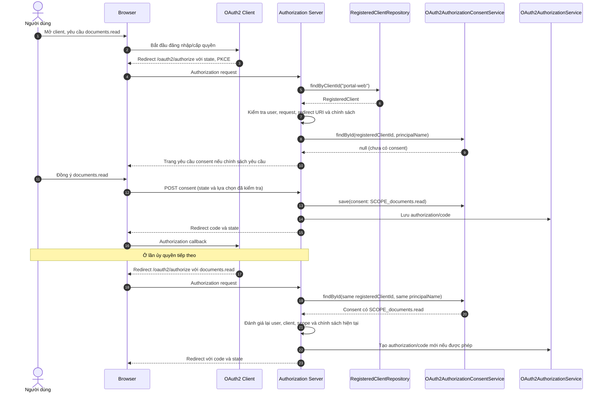

# Lưu consent và tra cứu consent trong các lần ủy quyền tiếp theo

Khi người dùng lần đầu cho phép một ứng dụng truy cập tài liệu, Authorization Server có thể yêu cầu họ xác nhận các quyền như `documents.read`. Ở những lần ủy quyền sau, nếu ứng dụng và người dùng vẫn là cặp chủ thể đó, các quyền đã được chấp thuận có thể được **tra cứu từ consent đã lưu**, nhờ vậy hệ thống tránh yêu cầu đồng ý lại không cần thiết. Nếu ứng dụng yêu cầu quyền mới như `documents.write`, Authorization Server cần đánh giá **phần quyền mới**, không ngầm xem sự đồng ý cũ là cho phép mọi scope.

Trong **Spring Security OAuth2/OIDC Authorization Server** xây dựng bằng Spring Boot và Spring Authorization Server, hai thành phần chính của cơ chế này là **`OAuth2AuthorizationConsent`** và **`OAuth2AuthorizationConsentService`**. Bài học thuộc chương **Consent** trình bày mô hình dữ liệu, luồng lưu và tra cứu, triển khai InMemory/JDBC, đồng ý tăng dần, thu hồi, kiểm soát bảo mật, vận hành nhiều instance và kiểm thử.

> **Phạm vi:** Consent của OAuth 2.0 là việc người dùng chấp thuận cấp một số quyền cho một OAuth2 Client. Nó **khác** việc người dùng đăng nhập, khác xác thực chính client, khác quyền nghiệp vụ do Resource Server kiểm tra và không mặc nhiên thay thế các yêu cầu đồng ý theo pháp luật về bảo vệ dữ liệu. Các ví dụ endpoint, DSL và bean dưới đây cần được đối chiếu với phiên bản Spring Authorization Server đang sử dụng.

## 1. Vì sao phải lưu consent?

Giả sử một cổng web `portal-web` được đăng ký tại `https://identity.example.com`, còn người dùng có mã định danh ổn định `user-42`:

1. **Lần đầu:** người dùng đăng nhập, ứng dụng yêu cầu `documents.read`, Authorization Server trình bày quyền cần cấp. Người dùng chấp thuận. AS lưu sự chấp thuận cho đúng **client và principal**, rồi hoàn tất luồng cấp authorization code.
2. **Lần sau, cùng quyền:** ứng dụng lại yêu cầu `documents.read`. AS có thể tìm consent trước đó và tiếp tục cấp code theo chính sách, khi các điều kiện đăng nhập, client, request và những yêu cầu khác đều thỏa.
3. **Lần sau, thêm quyền:** ứng dụng yêu cầu `documents.read documents.write`. AS không thể suy ra người dùng đã chấp thuận `documents.write` chỉ vì đã chấp thuận `documents.read`; cần xét consent bổ sung hoặc chính sách phù hợp.
4. **Người dùng thu hồi quyền:** AS xóa/sửa bản ghi consent. Lần ủy quyền mới phải xem lại trạng thái thực tế; đồng thời phải có chính sách riêng cho token và phiên đã được phát hành.

Việc lưu consent mang lại ba lợi ích: **nhớ quyết định có kiểm soát**, **giảm số lần tương tác không cần thiết** và **tạo cơ sở đối chiếu khi quyền được yêu cầu thay đổi**. Tuy nhiên, consent là một **đầu vào của quyết định cấp quyền**, không phải giấy phép vĩnh viễn tự động cho mọi request.

### 1.1. Phân biệt bốn quyết định thường bị gộp

| Quyết định | Câu hỏi | Thành phần liên quan |
|---|---|---|
| **User authentication** | Người dùng đã được xác thực, và phiên còn đủ điều kiện chưa? | Spring Security login/MFA, session/assurance policy |
| **Client authentication và registration** | Ứng dụng có hợp lệ, được dùng grant/redirect URI/scope này không? | `RegisteredClientRepository`, client authentication providers |
| **Authorization consent** | Người dùng đã chấp thuận những quyền nào cho client này? | `OAuth2AuthorizationConsentService` |
| **Token và quyền truy cập API** | Token có hợp lệ, còn hạn, dành cho API này và đủ quyền nghiệp vụ không? | `OAuth2AuthorizationService`, Resource Server |

Có consent đã lưu **không thay thế đăng nhập hoặc MFA**. Một user đã đồng ý tháng trước vẫn có thể cần đăng nhập lại hôm nay. Cũng không có nghĩa API buộc phải trả dữ liệu: Resource Server còn xét audience, scope, chủ thể và quyền trên từng tài nguyên.

## 2. Mô hình `OAuth2AuthorizationConsent`

Trong Spring Authorization Server, `OAuth2AuthorizationConsent` biểu diễn trạng thái consent của **một principal đối với một registered client**. Mô hình có các thành phần trọng tâm:

| Thuộc tính | Mục đích | Ví dụ |
|---|---|---|
| `registeredClientId` | **ID nội bộ** của `RegisteredClient` được consent áp dụng | `d5ac...` |
| `principalName` | Tên/định danh principal mà AS dùng để gắn consent | `user-42` |
| `authorities` | Tập `GrantedAuthority` được chấp thuận | `SCOPE_documents.read` |

**Khóa tra cứu là cặp `(registeredClientId, principalName)`**, không phải `(clientId, email)`. `registeredClientId` phải là giá trị `RegisteredClient.getId()`; `clientId` trong giao thức, ví dụ `portal-web`, là một trường khác.

Một bản ghi minh họa:

```text
RegisteredClient.id       = "d5ac-auth-server-internal-id"
RegisteredClient.clientId = "portal-web"
Authentication.getName()  = "user-42"

OAuth2AuthorizationConsent:
  registeredClientId = "d5ac-auth-server-internal-id"
  principalName      = "user-42"
  authorities        = ["SCOPE_documents.read", "SCOPE_profile"]
```

### 2.1. Scope được biểu diễn bằng GrantedAuthority

Trong cơ chế consent thông dụng của Spring Authorization Server, các scope được phê duyệt được lưu dưới dạng authority có tiền tố **`SCOPE_`**. Ví dụ:

```java
new SimpleGrantedAuthority("SCOPE_documents.read")
```

`authorities` có kiểu tập `GrantedAuthority`; không phải một chuỗi JSON chứa toàn bộ request, cũng không phải danh sách quyền của user trong hệ thống nghiệp vụ. Khi kiểm tra scope, cần xét đúng quy ước mapping này; **không được đồng nhất `ROLE_ADMIN` với scope `documents.read`**.

### 2.2. Vì sao principalName phải ổn định?

Spring dùng `principalName` để tra consent. Nếu đăng nhập trước dùng `alice@example.com` nhưng lần sau `Authentication.getName()` chuyển thành `alice`, lookup có thể không tìm thấy sự chấp thuận cũ. Email, tên hiển thị hoặc username có thể thay đổi hoặc được tái sử dụng, vì vậy nên có **định danh nội bộ ổn định, duy nhất trong phạm vi cần thiết** làm principal name.

Nếu AS phục vụ nhiều tenant, không để hai người thuộc các tenant khác nhau có cùng `principalName` trong cùng không gian khóa mà không có chiến lược cách ly. Có thể dùng subject được phân vùng theo tenant hoặc cách tổ chức dữ liệu khác được kiểm soát; quan trọng là nhất quán giữa đăng nhập, lưu consent, truy vấn và xóa quyền.

### 2.3. Consent không lưu sẵn mọi ngữ cảnh pháp lý

Mô hình mặc định tập trung vào client, principal và authorities. Nó **không phải** hệ thống đầy đủ cho lịch sử phiên bản điều khoản, thời điểm đồng ý, mục đích xử lý dữ liệu, chữ ký điện tử hoặc biên bản kiểm toán. Nếu sản phẩm cần những thông tin đó, nên thiết kế audit/consent-management bổ sung, không ép metadata tùy ý vào một authority như `SCOPE_terms_v7_accepted_at_...` rồi mặc nhận hợp lệ.

## 3. Hợp đồng của `OAuth2AuthorizationConsentService`

Spring Authorization Server cung cấp một interface lưu và tra cứu consent:

```java
public interface OAuth2AuthorizationConsentService {
    void save(OAuth2AuthorizationConsent authorizationConsent);

    void remove(OAuth2AuthorizationConsent authorizationConsent);

    OAuth2AuthorizationConsent findById(
        String registeredClientId,
        String principalName);
}
```

Các phương thức có ý nghĩa:

| Phương thức | Đầu vào | Kết quả/hành động |
|---|---|---|
| `save(consent)` | Đối tượng `OAuth2AuthorizationConsent` hợp lệ | Lưu trạng thái consent theo semantics của implementation |
| `findById(registeredClientId, principalName)` | Hai phần của khóa định danh | Trả `OAuth2AuthorizationConsent` hoặc **`null` nếu chưa có** |
| `remove(consent)` | Consent cần loại bỏ | Xóa bản ghi consent tương ứng trong storage |

Đây là interface **persistence**, không phải HTTP endpoint để mọi client tùy ý gọi, và không mặc nhiên cung cấp:

- API tìm consent theo email, client name hoặc mọi user;
- chức năng ghi lịch sử phê duyệt đầy đủ;
- thời hạn tự động của từng scope;
- API xóa đúng một scope hoặc thu hồi mọi token đã phát hành;
- kiểm soát quyền quản trị/audit truy cập consent.

Nếu cần các khả năng đó, phải thiết kế thêm tầng nghiệp vụ và kiểm tra quyền thích hợp.

### 3.1. Tra cứu đúng khóa

```java
RegisteredClient client = registeredClientRepository
    .findByClientId("portal-web");

if (client == null) {
    throw new IllegalStateException("Client registration not found");
}

String principalName = authenticatedUser.getName();
OAuth2AuthorizationConsent consent = authorizationConsentService.findById(
    client.getId(),
    principalName
);

if (consent == null) {
    // Chưa có bản ghi consent cho cặp registeredClientId/principalName.
}
```

`authenticatedUser` là một biến minh họa đại diện cho principal được Spring Security xác thực. Đừng dùng `client.getClientId()` làm tham số thứ nhất, và đừng dùng `request.getParameter("userId")` làm nguồn danh tính đáng tin cậy.

### 3.2. Tạo bản ghi consent có scope được chấp thuận

```java
OAuth2AuthorizationConsent consent = OAuth2AuthorizationConsent.withId(
        client.getId(),
        principalName)
    .authority(new SimpleGrantedAuthority("SCOPE_documents.read"))
    .build();

authorizationConsentService.save(consent);
```

Đây là **ví dụ thao tác dữ liệu trong một lớp dịch vụ đã được bảo vệ**. Không gọi đoạn code này chỉ vì frontend gửi `approved=true`. Trong flow sản phẩm, **authorization endpoint và các provider của Spring Authorization Server** cần xác minh user/session, client, authorization request, scope và quyết định consent thực sự trước khi ghi.

### 3.3. Cập nhật hoặc bổ sung scope

Giả sử consent đã có `documents.read` và sau một yêu cầu hợp lệ người dùng đồng ý thêm `documents.write`:

```java
OAuth2AuthorizationConsent existing = authorizationConsentService.findById(
    client.getId(), principalName);

OAuth2AuthorizationConsent.Builder builder = existing == null
    ? OAuth2AuthorizationConsent.withId(client.getId(), principalName)
    : OAuth2AuthorizationConsent.from(existing);

OAuth2AuthorizationConsent updated = builder
    .authority(new SimpleGrantedAuthority("SCOPE_documents.write"))
    .build();

authorizationConsentService.save(updated);
```

Ví dụ chỉ minh họa **gộp quyền đã được đồng ý**; người dùng phải thực sự phê duyệt scope mới trong authorization transaction được kiểm tra. Nếu muốn thay vì gộp là **giảm quyền**, cần tái tạo consent chỉ với những authorities được giữ lại hoặc xóa toàn bộ, theo semantics của implementation và yêu cầu nghiệp vụ.

**Không mặc định `save` tự hợp nhất scopes.** Đối tượng được truyền vào cần chứa trạng thái authorities cuối cùng mà bạn muốn lưu. Logic cập nhật đồng thời phải được bảo vệ trước trường hợp hai giao dịch ghi đè lẫn nhau.

## 4. Luồng đầu tiên và luồng sau khi đã có consent



**Điểm cần phân biệt:** Mỗi lần cấp authorization code vẫn là một giao dịch OAuth riêng và phải đáp ứng chính sách hiện tại. Consent lưu trước đó có thể **giảm nhu cầu hiện lại màn hình đồng ý**, nhưng không có nghĩa AS bỏ qua bước kiểm tra client, phiên người dùng, MFA, redirect URI, PKCE hoặc điều kiện phát hành code.

### 4.1. Khi nào AS thường hỏi lại?

| Yêu cầu | Consent hiện có | Kết quả thường mong đợi khi client yêu cầu consent |
|---|---|---|
| `documents.read` | Không có | Hiển thị quyền cần chấp thuận |
| `documents.read` | Đã có `documents.read` | Có thể bỏ qua màn hình consent nếu policy cho phép |
| `documents.read documents.write` | Chỉ có `documents.read` | Cần xem xét quyền mới `documents.write` |
| `documents.read` | Consent đã bị xóa | Hỏi lại theo policy |
| `documents.read` | Có consent, nhưng user chưa đăng nhập | Vẫn yêu cầu login trước authorization |
| `documents.read` | Có consent, client/redirect URI không còn hợp lệ | AS phải từ chối request theo quy tắc giao thức |

Với OpenID Connect, các hành vi liên quan `openid`, `offline_access`, `prompt=consent`, `prompt=none` và chính sách claim có thể có quy tắc đặc thù. Không áp dụng một công thức “đã có consent thì luôn skip” cho mọi request OIDC; cần kiểm tra phiên bản thư viện, cấu hình OP và hợp đồng với Relying Party.

## 5. Cấu hình Spring Authorization Server để yêu cầu consent

Trong `RegisteredClient`, cấu hình `ClientSettings.requireAuthorizationConsent(true)` cho biết client cần luồng consent theo cơ chế Spring Authorization Server:

```java
RegisteredClient portal = RegisteredClient.withId(
        "registered-client-portal-internal-id")
    .clientId("portal-web")
    .clientSecret(passwordEncoder.encode(secretFromSecureStore))
    .clientAuthenticationMethod(
        ClientAuthenticationMethod.CLIENT_SECRET_BASIC)
    .authorizationGrantType(
        AuthorizationGrantType.AUTHORIZATION_CODE)
    .authorizationGrantType(
        AuthorizationGrantType.REFRESH_TOKEN)
    .redirectUri(
        "https://portal.example.com/login/oauth2/code/company")
    .scope(OidcScopes.OPENID)
    .scope(OidcScopes.PROFILE)
    .scope("documents.read")
    .scope("documents.write")
    .clientSettings(ClientSettings.builder()
        .requireProofKey(true)
        .requireAuthorizationConsent(true)
        .build())
    .build();
```

`secretFromSecureStore` là một biến minh họa; không hardcode hoặc ghi raw secret vào log. Để chạy đầy đủ còn cần đăng ký `RegisteredClientRepository`, cấu hình issuer, keys/JWK, security filter chain, user authentication và persistence authorization/consent.

### 5.1. Ý nghĩa của requireAuthorizationConsent

- `true`: Authorization Server có thể yêu cầu người dùng phê duyệt quyền trong authorization flow; consent lưu trước đó được dùng để xét các quyền đã được chấp thuận.
- `false`: cấu hình mặc định không bắt buộc hiển thị consent theo cờ này; AS vẫn phải tuân thủ mọi chính sách bảo mật và yêu cầu khác của giao thức.
- Nó **không tự triển khai giao diện quản trị quyền**, không tự bảo đảm user đã hiểu nội dung scope và không tự tạo bảng database.
- Nó **không thay cho** validation grant/redirect URI, user login/MFA hoặc policy API.

Không nên tắt consent cho một client không đáng tin chỉ để loại bỏ màn hình chấp thuận. Với những client nội bộ hoặc bên thứ nhất, quyết định có cần consent phải được đánh giá theo trust model, loại quyền và yêu cầu sản phẩm, không theo sự thuận tiện UI đơn thuần.

### 5.2. Consent và Authorization Code + PKCE

Giả sử client gửi:

```http
GET /oauth2/authorize?response_type=code&client_id=portal-web&redirect_uri=https%3A%2F%2Fportal.example.com%2Flogin%2Foauth2%2Fcode%2Fcompany&scope=openid%20profile%20documents.read&state=STATE_RANDOM&code_challenge=PKCE_CHALLENGE&code_challenge_method=S256&nonce=NONCE_RANDOM HTTP/1.1
Host: identity.example.com
```

AS cần xử lý request hợp lệ, đăng nhập người dùng, xác minh consent theo policy và sau đó mới cấp authorization code. **Consent khác PKCE:** PKCE liên kết code với `code_verifier` để chống đổi code trái phép; consent là quyết định về quyền. Có consent không cho phép bỏ PKCE hoặc sử dụng code nhiều lần.

## 6. Triển khai InMemoryOAuth2AuthorizationConsentService

Spring Authorization Server cung cấp `InMemoryOAuth2AuthorizationConsentService`, phù hợp bài học, ứng dụng thử nghiệm hoặc các trường hợp có chủ đích dùng dữ liệu trong bộ nhớ:

```java
@Bean
OAuth2AuthorizationConsentService authorizationConsentService() {
    return new InMemoryOAuth2AuthorizationConsentService();
}
```

Khi tích hợp, Spring Authorization Server nhận bean service và sử dụng nó trong flow consent. Không cần tự gọi `save` từ controller chỉ để thay thế logic tiêu chuẩn. Nếu cùng ứng dụng định nghĩa nhiều bean cùng kiểu mà không xác định rõ cách injection, cần kiểm tra cấu hình để endpoint sử dụng đúng service được chọn.

**Giới hạn InMemory:**

- Dữ liệu consent mất khi tiến trình AS khởi động lại.
- Hai instance AS có thể có consent khác nhau nếu mỗi node giữ bộ nhớ riêng.
- Không có sẵn lịch sử phê duyệt, query phân trang, cơ chế backup hoặc thu hồi đồng bộ.
- Việc seed consent cứng trong code có thể vô tình coi quyền chưa được người dùng đồng ý là đã cho phép.

Đối với hệ thống phục vụ nhiều người dùng, cần nhớ consent qua restart và hỗ trợ nhiều AS node, nên cân nhắc lưu trữ bền vững dùng chung.

### 6.1. Ví dụ tra cứu bằng service InMemory

```java
RegisteredClient client = registeredClientRepository
    .findByClientId("portal-web");
String principalName = "user-42"; // Chỉ làm ví dụ dữ liệu thử nghiệm.

OAuth2AuthorizationConsent first = consentService.findById(
    client.getId(), principalName);
// first == null nếu chưa lưu.

OAuth2AuthorizationConsent saved = OAuth2AuthorizationConsent.withId(
        client.getId(), principalName)
    .authority(new SimpleGrantedAuthority("SCOPE_documents.read"))
    .build();

consentService.save(saved);

OAuth2AuthorizationConsent second = consentService.findById(
    client.getId(), principalName);
// second != null, có authority SCOPE_documents.read.
```

Đoạn code diễn giải hợp đồng persistence; trong sản phẩm thực, phải dùng subject đã xác thực và consent được chấp thuận thật. Không lấy principalName tùy ý từ HTTP request để cấp consent cho tài khoản khác.

## 7. Triển khai JdbcOAuth2AuthorizationConsentService

Để lưu consent bền vững, Spring Authorization Server cung cấp `JdbcOAuth2AuthorizationConsentService` dựa trên `JdbcOperations` và `RegisteredClientRepository`:

```java
@Bean
OAuth2AuthorizationConsentService authorizationConsentService(
        JdbcTemplate jdbcTemplate,
        RegisteredClientRepository registeredClientRepository) {

    return new JdbcOAuth2AuthorizationConsentService(
        jdbcTemplate, registeredClientRepository);
}
```

Bean trên chỉ cung cấp cách truy cập DB; ứng dụng còn cần datasource, schema phù hợp phiên bản Spring Authorization Server, migrations và các quyền DB tối thiểu. **Tạo bean không tự tạo bảng**.

### 7.1. Mô hình bảng tiêu biểu

Schema tham khảo của Spring Authorization Server thường có bảng **`oauth2_authorization_consent`**, khóa ghép từ `registered_client_id` và `principal_name`; cột `authorities` biểu diễn tập quyền đã chấp thuận.

| Cột (tên phổ biến) | Ý nghĩa | Lưu ý |
|---|---|---|
| `registered_client_id` | ID nội bộ của registered client | Liên kết registration; cần ổn định qua các lần deploy |
| `principal_name` | Principal đã xác thực | Không lấy từ input chưa tin cậy; cần unique theo phạm vi tenant |
| `authorities` | Các authorities consent đã được lưu | Phải round-trip đầy đủ theo mapper chính thức |

Minh họa một truy vấn logic:

```sql
SELECT registered_client_id, principal_name, authorities
FROM oauth2_authorization_consent
WHERE registered_client_id = ?
  AND principal_name = ?;
```

**Không copy cấu trúc bảng tự suy đoán vào production.** Hãy dùng schema SQL tham khảo và mapper JDBC tương thích đúng **version Spring Authorization Server**, triển khai thay đổi bằng Flyway/Liquibase hoặc quy trình migration tương đương. Nếu thay đổi cách mã hóa/mapping authorities hoặc dùng custom store, phải kiểm thử đọc/ghi hai chiều.

### 7.2. Vì sao cần ID client nội bộ ổn định?

Consent lưu theo `registered_client_id`. Nếu lần khởi động nào cũng dựng lại cùng `clientId=portal-web` bằng `UUID.randomUUID()` mới trong khi DB authorization/consent giữ dữ liệu cũ, bản ghi consent trước đó không còn khớp ID nội bộ. **Giữ nguyên `RegisteredClient.id` khi cập nhật registration**, kể cả khi đổi tên hiển thị, scope được phép hoặc credential.

### 7.3. Vấn đề đồng thời và giao dịch

Hai request đồng thời có thể ghi thêm hai scope khác nhau cho cùng cặp khóa:

1. Request A đọc consent có `documents.read`.
2. Request B cũng đọc cùng trạng thái.
3. A thêm `documents.write` rồi lưu.
4. B thêm `reports.read` dựa trên bản ghi cũ rồi lưu.
5. Nếu mỗi lần `save` ghi đè toàn bộ tập authorities, cập nhật của A có thể bị mất.

Tùy implementation, cần thiết kế **transaction, optimistic locking/serialization hoặc thao tác merge nguyên tử** khi yêu cầu có nhiều authorization request song song. Repository mặc định không cung cấp một API atomic `addScopeIfAbsent`. Có thể cần bổ sung lớp persistence riêng nếu trường hợp này quan trọng.

Với môi trường nhiều node, tất cả instance AS nên đọc/ghi cùng nguồn dữ liệu hoặc có cơ chế consistency được kiểm chứng. Không cache consent vô thời hạn khi hệ thống hỗ trợ thu hồi hoặc thay đổi quyền.

## 8. Màn hình consent, xử lý form và lưu dữ liệu

Spring Authorization Server có luồng authorization consent; nếu cần giao diện tùy chỉnh, cấu hình authorization endpoint bằng phương thức như `consentPage("/oauth2/consent")` trên configurer tương ứng:

```java
@Bean
@Order(1)
SecurityFilterChain authorizationServerChain(HttpSecurity http)
        throws Exception {

    OAuth2AuthorizationServerConfigurer authorizationServer =
        OAuth2AuthorizationServerConfigurer.authorizationServer();

    http.securityMatcher(authorizationServer.getEndpointsMatcher())
        .with(authorizationServer, server -> server
            .oidc(Customizer.withDefaults())
            .authorizationEndpoint(endpoint ->
                endpoint.consentPage("/oauth2/consent")))
        .authorizeHttpRequests(auth ->
            auth.anyRequest().authenticated());

    return http.build();
}
```

Khung mã minh họa điểm cấu hình; không phải một Authorization Server hoàn chỉnh. Cần chain đăng nhập, bean đăng ký client, authorization/consent services, JWK/issuer và controller/view cho trang consent tùy chỉnh, đồng thời kiểm tra API DSL tương ứng với version đang dùng.

### 8.1. Form consent minh họa

Với custom page, form thường gửi lựa chọn người dùng đến authorization endpoint. Ví dụ **HTML có placeholder, chỉ để thấy dữ liệu**:

```html
<form method="post" action="/oauth2/authorize">
  <input type="hidden" name="client_id" value="portal-web">
  <input type="hidden" name="state" value="STATE_FROM_PENDING_REQUEST">
  <input type="hidden" name="_csrf" value="CSRF_TOKEN_FROM_SERVER">

  <label>
    <input type="checkbox" name="scope" value="documents.read">
    Đọc tài liệu
  </label>
  <label>
    <input type="checkbox" name="scope" value="documents.write">
    Chỉnh sửa tài liệu
  </label>
  <button type="submit">Đồng ý các quyền đã chọn</button>
</form>
```

Trang thực tế cần render **CSRF token từ Spring Security**, state/transaction được AS liên kết, danh sách scopes hợp lệ và tên client đáng tin cậy; HTML trên không có cơ chế render/bảo vệ nên không thể đưa nguyên trạng vào production.

### 8.2. Các kiểm tra không được bỏ qua

**Không tin các checkbox, hidden field hoặc URL chỉ vì trang do AS hiển thị.** Một request giả có thể chèn scope bất kỳ hoặc đổi client ID. Authorization Server phải:

1. Liên kết form với authorization transaction đã kiểm tra và phiên của principal hiện tại.
2. Xác minh client/redirect URI và tập scope **được yêu cầu và được đăng ký**, không nhận thêm scope ngoài yêu cầu hợp lệ.
3. Kiểm tra CSRF cho POST consent; không bỏ CSRF chỉ để form hoạt động.
4. Đảm bảo **chỉ những scope thực sự được phê duyệt** được ghi vào consent.
5. Không phát authorization code cho những scope chưa được chấp thuận khi chính sách yêu cầu consent.
6. Không cho người dùng A ghi consent thay người dùng B bằng việc sửa `principalName`.
7. Kiểm tra dữ liệu mô tả scope/ứng dụng được escape để tránh XSS hoặc nội dung lừa người dùng.

Nút **Từ chối** cần có hành vi tường minh tương ứng; với request đã xác minh redirect URI, authorization endpoint có thể trả `error=access_denied` qua redirect theo hợp đồng OAuth. Không gọi `save` khi người dùng từ chối.

### 8.3. UX của đồng ý theo từng scope

Trên consent page, hiển thị mô tả gần với tác động thực tế: “Đọc tài liệu do bạn có quyền xem”, “Chỉnh sửa tài liệu được phép”. Tránh nhãn chung chung như “Quyền cơ bản” cho scope có thể làm thay đổi dữ liệu. Cho biết **ứng dụng nào** yêu cầu, quyền nào **đã cấp**, quyền nào **mới**, và cung cấp lựa chọn rõ ràng nếu policy cho phép.

Phần consent UI giúp user hiểu phạm vi ủy quyền nhưng vẫn phải thực thi policy phía server. Không cho client tự định nghĩa mọi nhãn quyền theo cách gây hiểu sai về thực tế API.

## 9. Đồng ý tăng dần khi client xin thêm scope

**Incremental consent** nghĩa là client chỉ cần hỏi thêm các quyền chưa được phê duyệt, thay vì mặc nhiên cấp lại hoặc bắt người dùng đồng ý toàn bộ từ đầu.

Giả sử:

```text
Registered scopes:
  documents.read, documents.write, reports.read

Requested scopes (lần 1):
  documents.read
Saved consent:
  SCOPE_documents.read

Requested scopes (lần 2):
  documents.read, reports.read

Previously approved for this request:
  documents.read
New scope needing evaluation:
  reports.read
```

### 9.1. Tính phần scope còn thiếu

Để minh họa cách đọc dữ liệu, giả sử request đã vượt qua các bước xác minh client và scope cho phép:

```java
Set<String> requestedScopes = Set.of(
    "documents.read", "reports.read");

OAuth2AuthorizationConsent consent = authorizationConsentService.findById(
    registeredClient.getId(), authentication.getName());

Set<String> approvedScopes = consent == null
    ? Set.of()
    : consent.getAuthorities().stream()
        .map(GrantedAuthority::getAuthority)
        .filter(authority -> authority.startsWith("SCOPE_"))
        .map(authority -> authority.substring("SCOPE_".length()))
        .collect(Collectors.toSet());

Set<String> missingScopes = new HashSet<>(requestedScopes);
missingScopes.removeAll(approvedScopes);
```

Đoạn code chỉ giúp hiểu mô hình; nó chưa xác định điều kiện hiện consent cho từng scope OIDC và **không thay thế provider mặc định của Spring Authorization Server**. Các imports và biến `registeredClient`/`authentication` cần được xác lập trong ứng dụng thực. Trong sản phẩm, phải xét thêm client settings, prompt/chính sách OIDC, consent đã bị thu hồi, phiên user và các yêu cầu buộc hỏi lại.

### 9.2. Không “tự động mở rộng” consent

Ví dụ client từng được chấp thuận `documents.read` rồi được quản trị viên thêm `documents.write` vào `RegisteredClient.scopes`. Điều đó chỉ có nghĩa AS **có thể cho client yêu cầu** `documents.write`. **Nó không phải bằng chứng người dùng đã đồng ý cấp scope mới.**

Khi người dùng chọn chỉ chấp thuận một phần các scope được yêu cầu, Authorization Server phải xử lý đúng phạm vi được phê duyệt và hợp đồng với client; tuyệt đối không gắn toàn bộ requested scopes vào consent vì thấy client registration cho phép chúng.

### 9.3. Khi cần hỏi lại quyền cũ

Consent đã lưu có thể không còn đủ khi:

- Người dùng thu hồi quyền trước đó.
- Mục đích sử dụng dữ liệu/điều khoản hoặc chính sách nội bộ thay đổi.
- Client bổ sung scope nhạy cảm hoặc yêu cầu quyền cao hơn.
- OIDC yêu cầu tương tác phù hợp, chẳng hạn `prompt=consent`, theo tính năng OP hỗ trợ.
- Phạm vi consent có TTL theo custom policy (mô hình mặc định không có thời hạn per-scope).
- Tài khoản/client bị hạn chế hoặc request cần step-up authentication/MFA.

Không dựa duy nhất vào sự hiện diện của một bản ghi DB để quyết định “không cần tương tác”.

## 10. Consent, OpenID Connect và những ngoại lệ

Trong OIDC, ứng dụng có thể yêu cầu `openid`, `profile`, `email` và các claim/ scope khác. OP xác thực người dùng và phát hành ID Token theo flow phù hợp; đồng thời có thể cần consent cho quyền truy cập UserInfo, refresh token hoặc dữ liệu của người dùng.

| Tình huống OIDC | Vấn đề cần lưu ý |
|---|---|
| `openid` | Kích hoạt một yêu cầu OIDC; không đồng nghĩa “mọi thông tin cá nhân đã được user đồng ý công khai” |
| `profile`/`email` | Cần xem scope/claim thực tế AS tiết lộ, trình bày rõ quyền khi chính sách yêu cầu consent |
| `offline_access` | Liên quan quyền truy cập khi người dùng không hiện diện; cần tuân thủ OIDC rules/consent policy, không mặc nhiên cấp refresh token |
| `prompt=consent` | RP yêu cầu OP thực hiện consent interaction; cần kiểm tra hỗ trợ và chính sách của OP |
| `prompt=none` | OP không được tương tác với user; nếu cần consent chưa có, có thể phải trả lỗi OIDC như `consent_required`, không hiển thị UI |
| User đã consent nhưng chưa đăng nhập | OP vẫn phải hoàn tất authentication trước khi cấp kết quả |

Các chi tiết này phụ thuộc **đặc tả OIDC và tính năng của phiên bản triển khai**, vì thế không nên khẳng định mọi biến thể `prompt` hoặc `offline_access` tự động có đầy đủ hành vi chỉ vì bật `.oidc(Customizer.withDefaults())`.

Consent không phải bằng chứng rằng chủ thể đã đạt mức MFA cao. Nếu AS yêu cầu xác thực bổ sung cho scope nhạy cảm, vẫn phải kiểm tra assurance thực tế trước khi cấp code. Nếu ID Token có `acr`/`amr`/`auth_time`, các claim phải phản ánh sự kiện xác thực đã xảy ra, không được tạo từ cờ consent.

## 11. Thu hồi consent và tác động tới token đã cấp

Người dùng có thể muốn rút quyền khỏi một ứng dụng. Theo hợp đồng repository, có thể xóa bản ghi:

```java
OAuth2AuthorizationConsent existing = authorizationConsentService.findById(
    registeredClient.getId(), principalName);

if (existing != null) {
    authorizationConsentService.remove(existing);
}
```

Đoạn code phải nằm sau **xác thực/ủy quyền hành động thu hồi**, không cho một request tự khai client ID và user ID để xóa quyền của người khác. UI quản lý quyền thường cần cho người dùng xem các client đã chấp thuận, nhưng interface `OAuth2AuthorizationConsentService` **không có API liệt kê toàn bộ consent**: chức năng đó cần tầng truy vấn riêng có kiểm soát hoặc custom repository.

### 11.1. Xóa consent khác với revoke token

| Hành động | Tác động chính | Điều không tự xảy ra |
|---|---|---|
| `authorizationConsentService.remove(...)` | Xóa consent lưu cho các lần authorization về sau | Không bảo đảm mọi token/code đã cấp lập tức vô hiệu |
| Gỡ một authority khỏi consent rồi lưu | Thu hẹp các quyền đã ghi nhận | Không tự sửa access token đã phát hành |
| Revocation endpoint/token service | Yêu cầu thu hồi token theo loại token và cơ chế hỗ trợ | Không mặc nhiên xóa toàn bộ consent của user |
| Rút quyền ở Resource Server | API không cho thao tác/tài nguyên nhất định | Không tự thay bản ghi consent tại AS |
| Xóa client registration | Client không còn metadata như trước | Không tự vô hiệu hóa tức thời mọi JWT đã phát hành |

Access token JWT ký tự chứa quyền có thể vẫn được Resource Server chấp nhận tới khi hết hạn nếu không có cơ chế kiểm tra trạng thái thu hồi hoặc policy bổ sung. Refresh token cũng cần xử lý riêng: tùy triển khai, chỉ xóa consent **không bảo đảm** refresh token đang tồn tại bị thu hồi hoặc scope ở lần refresh tiếp theo tự giảm.

Với hành động “Ngừng cấp quyền cho ứng dụng”, quy trình sản phẩm thường phải **kết hợp quản lý consent với quản lý authorization/token**:

1. Xác minh người dùng hoặc quản trị viên thực hiện hành động có quyền phù hợp.
2. Xóa/thu hẹp consent của đúng cặp principal và registered client.
3. Tìm và thu hồi authorization/refresh token liên quan theo chính sách và storage của hệ thống.
4. Xem xét thời hạn access token JWT, introspection/denylist hoặc các biện pháp hạn chế tức thời khi threat model yêu cầu.
5. Ghi audit và phản ánh trạng thái mới trong giao diện quản lý quyền.

**Không hứa với người dùng “quyền đã chấm dứt ngay” nếu hệ thống vẫn có access token hợp lệ chưa được vô hiệu hóa.** Thông điệp sản phẩm cần nhất quán với hành vi thực tế.

### 11.2. Thu hồi một scope thay vì tất cả

Service chỉ có `remove(consent)` cho toàn bản ghi. Nếu chỉ rút `documents.write` nhưng giữ `documents.read`, có thể tái dựng consent mới với các authorities còn được phép rồi `save` theo mô hình dữ liệu. Đừng vô ý làm rơi các authorities khác khi cập nhật; ngược lại, đừng giữ lại authority đã bị user thu hồi.

Để thực hiện đúng trong hệ thống đồng thời, cần kiểm soát thứ tự/cạnh tranh giữa hành động user thu hồi và một authorization request khác vừa thêm scope, tránh hành động thu hồi bị bản ghi cũ ghi đè trở lại.

## 12. Tích hợp với ba loại persistence khác

Trong Spring Authorization Server, các thành phần có tên gần nhau nhưng phục vụ mục đích khác nhau:

| Repository/service | Lưu gì? | Truy vấn điển hình |
|---|---|---|
| `RegisteredClientRepository` | Metadata client: client ID, grant, scope, redirect, phương thức auth | `findByClientId(clientId)` |
| `OAuth2AuthorizationConsentService` | Consent của **principal với registered client** | `findById(registeredClientId, principalName)` |
| `OAuth2AuthorizationService` | Authorization, authorization code và token/metadata liên quan | `findById(...)` hoặc `findByToken(...)` |
| User store/identity provider | Thông tin người dùng, đăng nhập và MFA | Theo user ID/username của hệ thống |

Consent là dữ liệu **theo cặp user-client**; authorization/token là dữ liệu **theo từng lần cấp quyền hoặc grant**. Cùng người dùng và client có thể tạo nhiều authorization/token theo thời gian nhưng một consent record tổng hợp các authorities đã được đồng ý.

Nếu dùng JDBC production, cần lập migration cho cả **registered client**, **authorization** và **authorization consent** theo schema tương thích phiên bản; không chỉ tạo bảng consent. Giữ ID client nội bộ và tên principal nhất quán giữa các service.

## 13. Tự triển khai consent service khi nào?

Các trường hợp thường cần custom `OAuth2AuthorizationConsentService`:

- Đã có kho quyền/consent dùng chung trong tổ chức.
- Cần tách tenant hoặc tuân thủ mô hình phân vùng dữ liệu riêng.
- Cần lịch sử consent có phiên bản, thời hạn, lý do cấp/rút quyền.
- Muốn chính sách lưu quyền phức tạp hoặc đồng bộ consent giữa nhiều dịch vụ.
- Cần giao diện quản lý, lọc và tìm consent mà API mặc định không cung cấp.

Một bản phác thảo:

```java
public final class CustomConsentService
        implements OAuth2AuthorizationConsentService {

    private final ConsentStore store;
    private final ConsentMapper mapper;

    @Override
    public void save(OAuth2AuthorizationConsent consent) {
        store.upsert(mapper.toRecord(consent));
    }

    @Override
    public void remove(OAuth2AuthorizationConsent consent) {
        store.delete(consent.getRegisteredClientId(),
                     consent.getPrincipalName());
    }

    @Override
    public OAuth2AuthorizationConsent findById(
            String registeredClientId, String principalName) {
        ConsentRecord record =
            store.findById(registeredClientId, principalName);
        return record == null ? null : mapper.toConsent(record);
    }
}
```

`ConsentStore`, `ConsentMapper`, `ConsentRecord` là **kiểu minh họa do dự án tự thiết kế**; đoạn mã không phải class có thể chạy ngay. Tầng dữ liệu cần bảo đảm tính duy nhất của khóa ghép, mapping đầy đủ authorities, nhất quán khi update và xử lý lỗi DB.

### 13.1. Những bất biến cần giữ trong custom service

1. **Khóa đúng:** một record cho cặp `registeredClientId` và `principalName` trong đúng phạm vi tenant.
2. **Không làm biến dạng authorities:** đọc/ghi bảo toàn các quyền đã chấp thuận, không biến tên role thành scope theo suy đoán.
3. **Không rò rỉ dữ liệu giữa chủ thể:** không tra cứu dựa trên user ID do client gửi mà không xác minh.
4. **Phân biệt không tìm thấy và lỗi hạ tầng:** `null` vì chưa consent khác với database outage; outage không được thành “coi như đã consent”.
5. **Atomicity:** tránh lost update khi hai request bổ sung/rút scope đồng thời.
6. **Không log dữ liệu nhạy cảm:** lưu audit actor, hành động, scope và correlation ID trong giới hạn cần thiết, không log token, OTP hay PII dư thừa.
7. **Thực thi lifecycle:** deletion, export, retention và phân vùng dữ liệu theo chính sách áp dụng.

### 13.2. Cache consent và vấn đề dữ liệu cũ

Cache có thể giảm độ trễ nhưng cũng làm tăng rủi ro **consent đã thu hồi vẫn được đọc như còn hợp lệ**. Với cache:

- Đặt khóa bằng **cả** registered client ID và principal name, bổ sung tenant boundary nếu cần.
- Invalidate khi lưu/thay/thu hồi consent.
- Với nhiều AS node, dùng cơ chế phát tán invalidation hoặc consistency phù hợp.
- Không cache `null` quá lâu nếu user có thể vừa chấp thuận quyền.
- Xác minh cache không tồn tại vô thời hạn khi chính sách/revocation thay đổi.

Consent là dữ liệu nhạy cảm về **mối quan hệ giữa người dùng và ứng dụng**, dù không chứa token hoặc mật khẩu. Phân quyền đọc DB, mã hóa lưu trữ và log retention vẫn quan trọng.

## 14. Kiểm thử repository và toàn bộ authorization flow

Kiểm thử cần bao phủ **hợp đồng persistence** lẫn **quyết định thực tế khi có hoặc thiếu consent**. Unit test của `OAuth2AuthorizationConsentService` chưa thể chứng minh authorization endpoint sử dụng đúng dữ liệu đó.

### 14.1. Unit test save/find/remove

Ví dụ với implementation in-memory:

```java
@Test
void consentCanBeSavedReadAndRemoved() {
    OAuth2AuthorizationConsentService service =
        new InMemoryOAuth2AuthorizationConsentService();

    OAuth2AuthorizationConsent consent = OAuth2AuthorizationConsent.withId(
            "registered-client-123", "user-42")
        .authority(new SimpleGrantedAuthority("SCOPE_documents.read"))
        .build();

    assertThat(service.findById("registered-client-123", "user-42"))
        .isNull();

    service.save(consent);
    OAuth2AuthorizationConsent found =
        service.findById("registered-client-123", "user-42");

    assertThat(found).isNotNull();
    assertThat(found.getAuthorities()).contains(
        new SimpleGrantedAuthority("SCOPE_documents.read"));

    service.remove(consent);
    assertThat(service.findById("registered-client-123", "user-42"))
        .isNull();
}
```

Đoạn test giả định JUnit và AssertJ đã được import. Nó chứng minh lưu/đọc/xóa của service, **chưa chứng minh đã có sự đồng ý thật từ người dùng**; authorization endpoint mới chịu trách nhiệm kiểm tra yêu cầu OAuth.

### 14.2. Ma trận tích hợp theo hành vi

| Kịch bản | Kết quả cần xác minh |
|---|---|
| Consent chưa có và client yêu cầu | User nhận giao diện xin quyền theo policy, chưa phát code trước chấp thuận |
| User đồng ý scope hợp lệ | Service lưu đúng cặp registeredClientId/principalName và authorities được duyệt |
| User từ chối consent | Không ghi consent mới, không cấp code cho quyền bị từ chối; lỗi authorization phù hợp |
| Lặp lại cùng client/user/scope | Service tìm được consent; có thể không cần hiện lại trang theo policy |
| Đổi sang user khác | Không tái sử dụng consent của user cũ |
| Đổi sang client khác | Không tái sử dụng consent của client cũ |
| Scope mới chưa có | Không tự chấp thuận; xử lý incremental consent theo policy |
| Client yêu cầu scope không đăng ký | Không cấp scope vượt registration ngay cả khi form bị sửa |
| Submit consent giả hoặc không có CSRF | Không lưu consent và không phát code |
| Redirect URI bị thay | Không redirect code tới URI không được phép |
| Consent bị xóa | Luồng authorization tiếp theo đánh giá consent từ trạng thái mới |
| Revocation consent nhưng token cũ còn | Kiểm thử riêng cơ chế thu hồi token; không giả định xóa consent là đủ |
| Consent DB lỗi hoặc timeout | Không cấp quyền dựa trên bản ghi chưa xác minh; phản hồi lỗi an toàn |
| Nhiều node và restart | Consent được đọc nhất quán từ storage chung |
| Hai tab đồng thời chấp thuận scope khác nhau | Không làm mất đồng ý hoặc làm sống lại quyền đã thu hồi |
| OIDC `prompt=none` nhưng cần consent | Trả lỗi OIDC phù hợp, không tự hiển thị màn hình tương tác |

### 14.3. Kịch bản end-to-end mẫu

```text
Given:
  - RegisteredClient "portal-web" có requireAuthorizationConsent(true).
  - User "user-42" có phiên xác thực hợp lệ.
  - Chưa có consent cho cặp (registeredClientId của portal-web, user-42).

When:
  - Client gửi authorization_code request với scope documents.read.
Then:
  - Authorization Server hiển thị bước consent.
  - Chưa có authorization code phát hành trước khi user quyết định.

When:
  - User đồng ý documents.read qua form hợp lệ, có CSRF/state tương ứng.
Then:
  - Service lưu SCOPE_documents.read cho đúng cặp khóa.
  - Authorization endpoint hoàn tất flow, redirect code + state.

When:
  - User thực hiện authorization request mới, cùng client và scope.
Then:
  - Consent trước đó được tìm thấy; trang consent có thể được bỏ qua theo policy.
  - User authentication, client, PKCE và consent policy vẫn được kiểm tra.

When:
  - Client yêu cầu thêm documents.write.
Then:
  - Quyền mới chưa được coi là đã chấp thuận.
  - Cần xử lý consent bổ sung hoặc từ chối theo policy.
```

Trong automation test với Spring Security, có thể dùng MockMvc và các fixture đăng nhập/registered client; điều quan trọng là **đi qua filter chain của Authorization Server**, không chỉ tự tạo `OAuth2AuthorizationConsent` rồi khẳng định toàn bộ flow an toàn.

### 14.4. Kiểm thử JDBC khi nâng cấp

Test round-trip cho các scope có dấu chấm/gạch dưới, nhiều authorities, principal có Unicode theo chính sách nhận diện, dữ liệu client ID ổn định, migration schema, mất kết nối DB và thao tác đồng thời. Kiểm tra giới hạn chiều dài cột authorities và khả năng storage giữ đủ dữ liệu trên cả môi trường staging/production; không giả định mặc định một schema phù hợp mọi loại DB.

## 15. Quan sát vận hành và quyền riêng tư

Consent liên quan đến việc người dùng tin tưởng ứng dụng. Nên có khả năng kiểm tra ai đã chấp thuận quyền nào và khi nào theo yêu cầu sản phẩm, nhưng phải tránh thu thập quá mức.

| Event/metric | Ý nghĩa | Điều phải bảo vệ |
|---|---|---|
| `consent_required` | User/client/request cần giao diện chấp thuận | Không log authorization code hoặc token |
| `consent_approved` | Các scope được user phê duyệt | Chỉ lưu scope/actor phù hợp; tránh payload nhạy cảm |
| `consent_denied` | User từ chối quyền | Không đánh dấu là đã được cấp |
| `consent_found`/`consent_missing` | Tỷ lệ reuse hoặc yêu cầu consent mới | Không biến metric thành danh sách công khai user-client |
| `consent_revoked` | Quyền được rút khỏi storage | Đồng bộ với cơ chế token revocation |
| DB/cache read/write error | Tính sẵn sàng consent service | Không fail-open khi không xác minh được consent |

**Không log raw request có token, session cookie, OTP, client secret hoặc authorization code** để chẩn đoán lỗi consent. Có thể ghi correlation ID, loại event, mã client được phép lưu, scope ở mức cần thiết và timestamp theo chính sách truy cập dữ liệu.

### 15.1. Dữ liệu consent có thể tiết lộ điều gì?

Dù chỉ lưu ID client/user và scope, nó có thể tiết lộ **người dùng sử dụng những ứng dụng gì** và có thể quan tâm tới dữ liệu nào. Vì thế bảng consent cần phân quyền, retention, backup/restore, chính sách xóa/export dữ liệu và quản trị truy cập đúng mức. Một bản ghi consent không nên bị dùng làm nguồn phân tích người dùng không có mục đích được phép.

### 15.2. Di trú dữ liệu khi thay danh tính hoặc client registration

- Nếu thay `RegisteredClient.id`, cần kế hoạch di trú reference của consent/authorization.
- Nếu đổi cách tạo `Authentication.getName()`, cần ánh xạ/migrate principal name có kiểm soát.
- Nếu chuyển từ InMemory sang JDBC, không thể giả định dữ liệu in-memory cũ tự được lưu; cần quy trình chuyển đổi hoặc yêu cầu consent lại theo chính sách.
- Nếu đổi semantics scope, phải rà soát consent cũ có còn đúng nghĩa hay cần user xác nhận lại.

Các thay đổi này nên được thử trên staging với dữ liệu giả lập trước khi áp dụng trên cụm nhiều node.

## 16. Những lỗi thiết kế dễ gặp

| Nhận định/cách làm sai | Hậu quả | Cách xử lý |
|---|---|---|
| Dùng `clientId` thay `RegisteredClient.id` khi `findById` | Không tìm consent đã lưu | Tra cứu theo ID **nội bộ** đúng |
| Dùng email/tên hiển thị làm principal không ổn định | Đổi email mất consent hoặc nhầm user | Dùng subject ổn định, duy nhất và đúng tenant |
| Đã consent scope A nên tự coi scope B cũng được | Cấp quyền vượt ý chí người dùng | Incremental consent cho scope mới |
| `save` một consent chỉ có scope mới rồi làm rơi scope cũ | Mất trạng thái đã chấp thuận | Dùng builder từ consent hiện có hoặc merge có kiểm soát |
| Chỉ cấu hình `requireAuthorizationConsent(true)`, không lưu service bền vững | Consent lại sau restart/nhiều node | Chọn JDBC/custom shared storage khi cần |
| Consent page tin toàn bộ input hidden/checkbox | User có thể gửi scope/client giả | Xác minh transaction, scope registration, principal, CSRF |
| Consent được lưu nên bỏ qua login/MFA | Cấp code khi user chưa đủ assurance | Kiểm tra user authentication cho mỗi flow |
| Xóa consent là mọi access token mất hiệu lực ngay | Token cũ có thể tiếp tục gọi API | Thiết kế revocation/token lifetime riêng |
| User A dùng consent của user B do tìm sai khóa | Rò rỉ quyền giữa tài khoản | Khóa ghép, principal binding và tenant isolation |
| Cache consent không invalidation | Chấp nhận quyết định đã bị rút quyền | Invalidate khi thay/xóa, nhất quán nhiều node |
| Tự coi consent là hồ sơ pháp lý đầy đủ | Thiếu lịch sử, mục đích và quy trình compliance | Xây consent-management/audit riêng khi cần |
| Lỗi DB được xử lý như “đã consent” | Fail-open và cấp quyền không kiểm chứng | Từ chối an toàn khi không xác minh được trạng thái |

## 17. Checklist trước khi đưa vào production

1. **Client registration đúng:** `requireAuthorizationConsent` phù hợp trust model, scope/redirect URI/grant đã giới hạn?
2. **Định danh consent ổn định:** dùng `RegisteredClient.id` và một principalName đáng tin cậy, không trùng giữa tenants?
3. **Lưu trữ bền vững:** chọn InMemory/JDBC/custom đúng yêu cầu restart, backup, migration và multi-node?
4. **Consent page rõ ràng:** hiển thị app và ý nghĩa scope; chỉ lưu những quyền user thực sự chọn?
5. **Kiểm tra form phía server:** request/CSRF/state, client, requested/allowed scopes, identity binding được xác minh?
6. **Incremental consent:** quyền mới cần xin thêm, quyền cũ không bị tự mở rộng hoặc ghi đè sai?
7. **OIDC và policy:** `prompt=none`, `prompt=consent`, `offline_access`, login/MFA và required consent có hành vi được kiểm chứng?
8. **Thu hồi có tác động thực:** UI xóa consent kết hợp chính sách authorization/token/refresh-token revocation phù hợp?
9. **Đồng thời và cache:** nhiều tab/nhiều node không gây mất cập nhật hoặc “hồi sinh” scope đã rút?
10. **Quan sát và bảo mật:** audit được kiểm soát, không log token/secret, quyền truy cập dữ liệu consent được giới hạn?
11. **Kiểm thử đủ hai lớp:** đã test `save/findById/remove` và authorization flow qua filter chain cho lần đầu/lần sau/scope mới/revocation?
12. **Migration bền vững:** đổi client ID nội bộ hoặc username/subject có kế hoạch giữ liên kết dữ liệu?

## 18. Tổng kết

**`OAuth2AuthorizationConsent`** lưu quyền mà một principal đã chấp thuận cho **một registered client**, trong khi **`OAuth2AuthorizationConsentService`** cung cấp các thao tác `save`, `remove` và `findById(registeredClientId, principalName)`. Khi Authorization Server xử lý các lần ủy quyền tiếp theo, consent đã lưu có thể giúp tránh hỏi lại những scope đã phê duyệt, nhưng các điều kiện đăng nhập, MFA, tính hợp lệ client, scope và consent policy vẫn phải được kiểm tra.

**`InMemoryOAuth2AuthorizationConsentService`** phù hợp học tập và thử nghiệm; **`JdbcOAuth2AuthorizationConsentService`** phù hợp hơn với yêu cầu dữ liệu bền vững và nhiều AS instance khi đã có schema/migration đúng. Một hệ thống an toàn còn phải xử lý incremental consent, đồng thời ghi/xóa quyền, cách ly tenant, audit và cơ chế thu hồi token khi user rút quyền.

Hiểu rõ ranh giới consent và token là nền tảng để thiết kế, cấu hình, bảo mật, kiểm thử và vận hành **Spring Security OAuth2/OIDC Authorization Server** trên Spring Boot một cách nhất quán và có thể kiểm chứng.

## 19. Tài liệu tham khảo

- [Spring Authorization Server Reference](https://docs.spring.io/spring-authorization-server/reference/): `OAuth2AuthorizationConsent`, `OAuth2AuthorizationConsentService`, RegisteredClient và cấu hình consent.
- [Spring Security Reference](https://docs.spring.io/spring-security/reference/): authentication, CSRF, OAuth2 Client và Resource Server.
- [RFC 6749 — OAuth 2.0 Authorization Framework](https://www.rfc-editor.org/rfc/rfc6749): authorization code, scope và quyền của resource owner.
- [RFC 9700 — OAuth 2.0 Security Best Current Practice](https://www.rfc-editor.org/rfc/rfc9700): khuyến nghị bảo mật và rủi ro OAuth2.
- [RFC 7009 — OAuth 2.0 Token Revocation](https://www.rfc-editor.org/rfc/rfc7009): thu hồi token là chức năng riêng với lưu consent.
- [RFC 7662 — OAuth 2.0 Token Introspection](https://www.rfc-editor.org/rfc/rfc7662): tra cứu trạng thái token tại Resource Server khi dùng cơ chế phù hợp.
- [OpenID Connect Core 1.0](https://openid.net/specs/openid-connect-core-1_0.html): consent, `prompt`, `offline_access` và các quyền OIDC.
