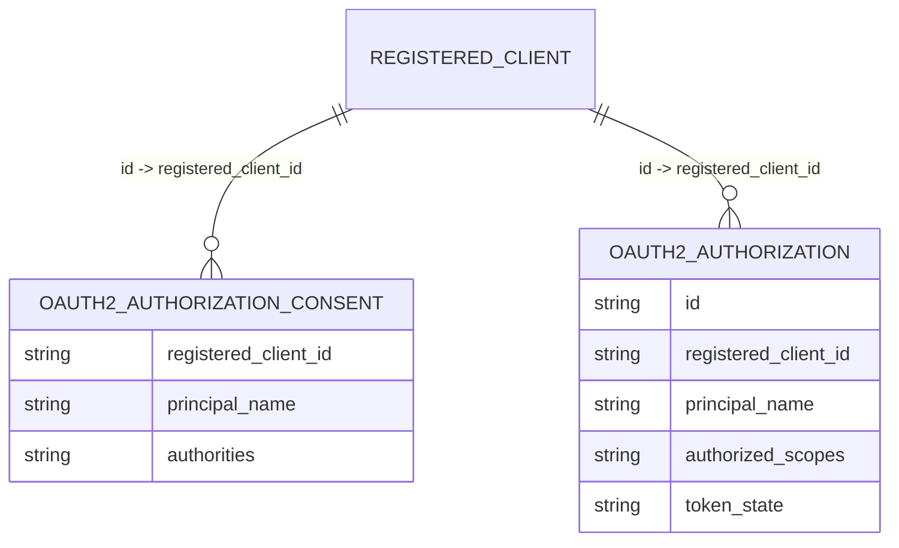
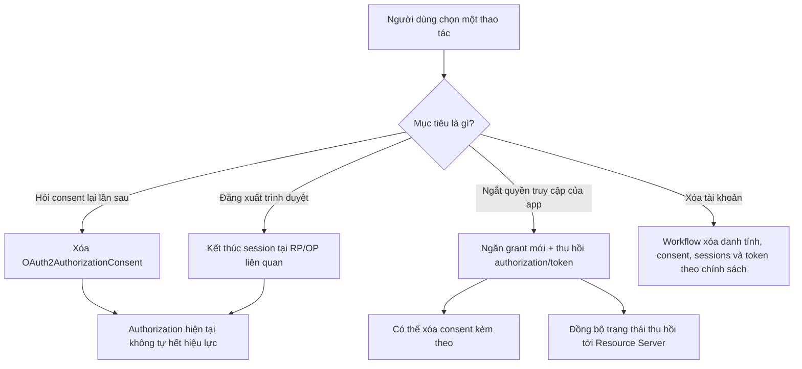
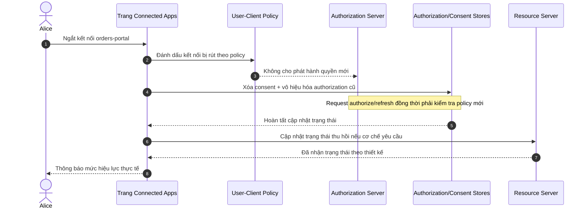

# Thu hồi consent và xác định tác động đến các authorization hiện có

## 1. Tình huống: người dùng bấm “Ngắt kết nối ứng dụng”

Một Authorization Server triển khai bằng **Spring Boot**, **Spring Security** và **Spring Authorization Server (SAS)** cho phép ứng dụng `orders-portal` xin các scope `orders.read` và `orders.write`. Người dùng Alice đã đăng nhập, chấp thuận hai scope và client nhận được access token, có thể cả refresh token theo cấu hình.

Vài ngày sau, Alice mở trang **Ứng dụng đã kết nối** và bấm **Thu hồi quyền đã chấp thuận**. Câu hỏi không chỉ là xóa một dòng trong cơ sở dữ liệu: access token đã được phát hành có còn dùng được không? Refresh token có thể xin access token mới không? Lần đăng nhập sau có hiển thị consent trở lại không? API đang xác minh JWT offline có nhận biết việc thu hồi ngay không?

Điểm cốt lõi của bài học thuộc chương **Consent**:

> **Thu hồi bản ghi consent, thu hồi authorization/token và kết thúc phiên đăng nhập là những thao tác khác nhau.** Tùy mục đích sản phẩm, có thể cần thực hiện phối hợp nhiều thao tác, nhưng không được mặc định rằng gọi `OAuth2AuthorizationConsentService.remove(...)` sẽ vô hiệu hóa mọi token hiện có.

Bài này hướng dẫn xác định ranh giới dữ liệu, xây quy trình rút consent, lựa chọn chính sách đối với authorization đã cấp, xử lý refresh token/JWT và thiết kế kiểm thử bảo mật cho một Authorization Server thực tế.

## 2. Phân biệt consent, authorization, token và phiên đăng nhập

| Đối tượng | Thành phần SAS / Spring Security | Chứa gì? | Điều gì xảy ra khi xóa riêng đối tượng đó? |
| --- | --- | --- | --- |
| **Client registration** | `RegisteredClient`, `RegisteredClientRepository` | Danh tính client, grants, scopes, redirect URI, cài đặt consent | Sửa/xóa client tác động khả năng đăng ký và xử lý yêu cầu tiếp theo; không tự đảm bảo JWT đã phát hành mất hiệu lực tại API |
| **Consent đã lưu** | `OAuth2AuthorizationConsent`, `OAuth2AuthorizationConsentService` | Các authority/scope người dùng đã chấp thuận cho client | Xóa ký ức consent; không tự xóa `OAuth2Authorization` hoặc access/refresh token đang tồn tại |
| **Authorization đang lưu** | `OAuth2Authorization`, `OAuth2AuthorizationService` | Client liên quan, principal, authorized scopes, mã và token, metadata/trạng thái | Xóa/vô hiệu hóa có thể chặn việc tái sử dụng mã/refresh và introspection dựa trên trạng thái; JWT đang được API xác minh offline cần xử lý riêng |
| **Access token** | `OAuth2AccessToken` bên trong authorization hoặc token response | Quyền gọi Resource Server đến thời hạn/điều kiện áp dụng | Việc API còn chấp nhận token phụ thuộc định dạng token và cách API kiểm tra hiệu lực |
| **Refresh token** | `OAuth2RefreshToken` / trạng thái authorization | Credential để xin token mới khi được phép | Nếu còn dùng được, có thể tiếp tục tạo access token theo quy tắc refresh; chỉ xóa consent không mặc nhiên khóa đường này |
| **Phiên đăng nhập** | `SecurityContext`, session, cookies, IdP/RP session | Người dùng đã xác thực trên trình duyệt hoặc ứng dụng | Thu hồi consent không tự đăng xuất người dùng khỏi AS hay các client khác |

### 2.1. Consent không phải một access token

Trong SAS, một consent thường được định danh bởi cặp:

```text
(registeredClientId, principalName)
```

Ví dụ:

```text
RegisteredClient:
  id       = "UUID-CLIENT-A"
  clientId = "orders-portal"

OAuth2AuthorizationConsent:
  registeredClientId = "UUID-CLIENT-A"
  principalName      = "alice-sub-17"
  authorities        = ["SCOPE_orders.read", "SCOPE_orders.write"]
```

**`registeredClientId` là `RegisteredClient.id` nội bộ**, không phải `client_id` mà ứng dụng gửi trong OAuth request. `principalName` phải khớp định danh người dùng mà cơ chế xác thực của AS sử dụng. Trong hệ thống đa tenant, nên dùng định danh người dùng ổn định và không mơ hồ giữa các tenant thay vì chỉ dựa vào một tên đăng nhập có thể trùng.

`authorities` là tập `GrantedAuthority`; SAS thường dùng dạng `SCOPE_orders.read` cho các scope đã chấp thuận. Không suy rằng toàn bộ authority đều là scope hoặc được phép xóa tùy tiện. Một consent được lưu có thể được sử dụng lại cho **nhiều lần authorization tiếp theo** của cùng client và principal.

### 2.2. Authorization và consent có quan hệ nhưng độc lập về vòng đời



Đây là mô hình logic rút gọn. `OAuth2AuthorizationConsent` gắn với **client + principal**, còn `OAuth2Authorization` có ID riêng và lưu trạng thái từng ủy quyền/cấp token theo cách của flow. Một client và một người dùng có thể có **nhiều authorization** liên quan nhưng chỉ có một bản ghi consent tổng hợp trong kho consent tiêu chuẩn.

## 3. Thu hồi consent thực chất làm gì?

`OAuth2AuthorizationConsentService` trong dòng Spring Authorization Server 1.x có những thao tác cốt lõi:

```java
public interface OAuth2AuthorizationConsentService {
    void save(OAuth2AuthorizationConsent authorizationConsent);
    void remove(OAuth2AuthorizationConsent authorizationConsent);
    OAuth2AuthorizationConsent findById(
            String registeredClientId, String principalName);
}
```

Quy trình rút toàn bộ consent của một người dùng với một client:

1. Xác thực người dùng thực hiện thao tác quản lý kết nối.
2. Xác định `RegisteredClient` từ `client_id` được chọn; lấy **`RegisteredClient.id`**.
3. Tra consent bằng `findById(registeredClient.getId(), principalName)`.
4. Nếu tồn tại, gọi `remove(existingConsent)`.
5. Quyết định riêng liệu có thu hồi authorization/token hiện có theo **chính sách sản phẩm** hay không.
6. Ghi audit, phản hồi kết quả và thể hiện rõ hiệu lực thu hồi trong giao diện.

**Kết quả trực tiếp của bước 4:** bản ghi consent đã lưu bị xóa theo semantics của service. Những authorization/code/token hiện có không bị tự động xóa chỉ vì đã gọi phương thức này.

### 3.1. Ví dụ Java: chỉ xóa consent của người dùng đang đăng nhập

```java
@Service
public class ConsentManagementService {
    private final RegisteredClientRepository registeredClients;
    private final OAuth2AuthorizationConsentService consents;

    public ConsentManagementService(
            RegisteredClientRepository registeredClients,
            OAuth2AuthorizationConsentService consents) {
        this.registeredClients = registeredClients;
        this.consents = consents;
    }

    public void revokeStoredConsent(String principalName, String clientId) {
        RegisteredClient client = registeredClients.findByClientId(clientId);
        if (client == null) {
            return; // Idempotent; chính sách lỗi có thể khác theo sản phẩm.
        }

        OAuth2AuthorizationConsent consent =
                consents.findById(client.getId(), principalName);
        if (consent != null) {
            consents.remove(consent);
        }
    }
}
```

Ở tầng web, principal phải lấy từ **ngữ cảnh xác thực tin cậy của request**, ví dụ `Authentication.getName()` sau khi ứng dụng đã thống nhất định danh ổn định:

```java
@RestController
@RequestMapping("/account/connected-apps")
public class ConnectedAppsController {
    private final ConsentManagementService service;

    public ConnectedAppsController(ConsentManagementService service) {
        this.service = service;
    }

    @DeleteMapping("/{clientId}/consent")
    public ResponseEntity<Void> revokeConsent(
            @PathVariable String clientId,
            Authentication authentication) {
        service.revokeStoredConsent(authentication.getName(), clientId);
        return ResponseEntity.noContent().build();
    }
}
```

Ví dụ giả định endpoint đã được bảo vệ bằng Spring Security (chỉ người dùng đã xác thực được gọi), có **bảo vệ CSRF** khi sử dụng cookie session, kiểm tra tenant và giới hạn truy cập phù hợp. Không dùng tham số `principalName` do trình duyệt gửi để tùy ý xóa consent của người khác. Đoạn mã này **chỉ xóa consent**; không được đặt nhãn API là “revoke all tokens” nếu chưa triển khai phần đó.

### 3.2. Vì sao nên bảo đảm tính idempotent?

Người dùng có thể bấm hai lần hoặc trình duyệt gửi lại request. Nếu consent đã bị xóa, thao tác rút consent tiếp theo nên không tạo ra lỗi nghiệp vụ không cần thiết. Có thể phản hồi `204 No Content` trong cả trường hợp bản ghi đã biến mất; UI không nhất thiết được biết một `client_id` có tồn tại trong hệ thống hay không.

Idempotent ở đây chỉ mô tả kết quả của hành động xóa consent; **không** thay cho xử lý race condition khi cùng lúc có authorization request mới đang ghi lại consent.

## 4. Lần xin authorization tiếp theo diễn ra thế nào?

Giả sử client đã đăng ký `orders.read`, `orders.write` và có `ClientSettings.requireAuthorizationConsent(true)`.

| Trạng thái consent trước request | Scope client xin | Hành vi cần kỳ vọng/kiểm thử |
| --- | --- | --- |
| Chưa lưu consent | `orders.read` | Yêu cầu mới có thể cần hiển thị trang consent theo chính sách đã bật |
| Đã đồng ý `orders.read` | `orders.read` | Có thể dùng consent đã lưu để không hỏi lại nếu chính sách cho phép |
| Đã đồng ý `orders.read` | `orders.read orders.write` | Có thể yêu cầu chấp thuận phần scope mới |
| Vừa xóa toàn bộ consent | `orders.read` | Lần authorization mới có thể hiện trang consent trở lại |
| Client `requireAuthorizationConsent(false)` | `orders.read` | Xóa consent **không đảm bảo** sẽ xuất hiện trang hỏi lại |
| Client xin scope chưa được đăng ký | `orders.admin` | Phải bị từ chối theo chính sách kiểm tra scope, không đưa vào consent để người dùng “cho phép” |

Điều kiện “hỏi lại” phụ thuộc version SAS, cấu hình client, cách triển khai trang consent, principal và trạng thái authorization. **Thu hồi consent không tự chặn một client khỏi việc yêu cầu lại quyền**. Nếu sản phẩm cần cấm client xin lại quyền trong một thời gian, phải lưu **trạng thái từ chối/block** riêng và thực thi nó trong policy ở authorization endpoint.

### 4.1. Consent đã rút khác với block client

- **Rút consent:** xóa quyết định đã chấp thuận trước đây; client có thể xin consent mới.
- **Từ chối lần yêu cầu hiện tại:** không chấp thuận một authorization request đang chạy.
- **Chặn client:** chính sách server không cho client tiếp tục được cấp quyền/token (hoặc hạn chế theo principal), dù request khác hợp lệ.
- **Thu hồi token:** ngăn token đã cấp được sử dụng hoặc được làm mới theo mức bảo đảm thiết kế.

UI cần dùng đúng từ ngữ; không gộp bốn hành động khác nhau vào nút “Xóa” mà thiếu mô tả hậu quả.

## 5. Tác động đến authorization và token đã cấp

### 5.1. Xóa consent không có nghĩa xóa OAuth2Authorization

`OAuth2AuthorizationConsentService.remove(consent)` làm việc trên kho consent. Nó không tự gọi `OAuth2AuthorizationService.remove(authorization)`, không tự gọi token revocation endpoint và không thay đổi cookie phiên đăng nhập.

Ví dụ:

```text
T0  Alice đồng ý orders.read.
T1  AS cấp access token A (hết hạn T1 + 10 phút)
    và refresh token R (theo chính sách).
T2  Alice xóa consent đối với orders-portal.
T3  Client tiếp tục gửi A tới orders-api.
T4  Client thử dùng R đổi access token mới.
```

Nếu chỉ làm thao tác ở T2:

- Ở T3, **A có thể vẫn được chấp nhận** nếu API kiểm tra token hợp lệ theo chữ ký/thời gian/trạng thái và không biết việc consent đã bị xóa.
- Ở T4, **R có thể vẫn được chấp nhận** theo `OAuth2Authorization`, client và refresh-token policy; không nên giả định refresh grant tự tra lại consent vừa bị xóa.
- Nếu client quay lại authorization endpoint để xin **một authorization mới**, việc có cần consent hay không được xét theo chính sách consent và trạng thái lúc đó.

Do vậy, khi sản phẩm hứa “ngắt kết nối tức thì”, chỉ xóa consent là chưa đủ.

### 5.2. Phân biệt access token JWT và opaque/reference token

| Cơ chế API kiểm tra token | Sau khi xóa consent đơn thuần | Sau khi authorization/token bị thu hồi tại AS |
| --- | --- | --- |
| **JWT ký số, Resource Server tự xác minh offline** | JWT có thể hợp lệ đến `exp` | API vẫn có thể chấp nhận JWT đến `exp` nếu không có kiểm tra trạng thái bổ sung |
| **Opaque token, Resource Server gọi introspection** | Thường vẫn active nếu authorization/token còn hiệu lực | Introspection có thể phản ánh token inactive sau khi trạng thái được cập nhật và cache nhất quán |
| **JWT nhưng API có kiểm tra trạng thái/denylist/token version** | Phụ thuộc policy riêng có truy vấn trạng thái consent/authorization hay không | Có thể vô hiệu hóa nhanh hơn nếu tất cả API thực thi cơ chế kiểm tra và cập nhật kịp thời |
| **API dùng cache kết quả introspection** | Phụ thuộc TTL cache | Có thể tiếp tục chấp nhận đến khi cache hết hạn nếu không invalidate |

Không đánh đồng **access token được ký hợp lệ** với **sự đồng ý vẫn còn hiệu lực**. Nếu không có kênh đưa thông tin thu hồi tới Resource Server, kiểm tra chữ ký offline không thể tự biết người dùng vừa bấm nút thu hồi consent.

### 5.3. Refresh token là rủi ro duy trì quyền sau khi đã rút consent

Nếu policy yêu cầu “không còn truy cập được nữa”, cần xem xét **thu hồi refresh token trước hoặc cùng lúc với authorization liên quan**. Nếu chỉ đợi access token hết hạn nhưng vẫn cho refresh, client có thể liên tục đổi access token mới.

Cần kiểm tra:

1. Refresh token thuộc client và principal nào, có ràng buộc đúng authorization không?
2. Refresh token có hiệu lực đến khi nào, có rotation hay reuse không?
3. Có thể có **nhiều authorization/refresh token** cho cùng principal và client không?
4. Có request refresh đang chạy đồng thời với thao tác thu hồi không?
5. Sau thu hồi, API có cần từ chối ngay JWT đang còn hạn không?

**Bỏ consent mà giữ refresh token** có thể phù hợp với một thao tác mang nghĩa “quên chấp thuận để hỏi lại lần sau”; nhưng không phù hợp nếu UI cam kết ngắt quyền truy cập đang hoạt động.

## 6. Ba mức chính sách thu hồi cần chọn rõ ràng

| Chính sách | Hành động tối thiểu | Điều có thể còn hiệu lực | Trường hợp dùng |
| --- | --- | --- | --- |
| **A. Quên consent đã lưu** | `OAuth2AuthorizationConsentService.remove` | Authorization hiện có, access token, refresh token và session | Người dùng muốn thấy lại màn hình consent ở lần xin quyền mới |
| **B. Ngắt kết nối client** | Xóa consent **và** vô hiệu hóa/loại bỏ authorization, code, refresh token liên quan; xử lý access token theo thiết kế | JWT offline có thể còn hiệu lực nếu API không kiểm tra thu hồi | Trang “Connected Apps” với lời hứa ngừng cấp và làm mới quyền cho client |
| **C. Thu hồi một số scope** | Cập nhật consent còn lại, ràng buộc policy cho grant mới và xử lý authorization/token có chứa scope đã rút | Token cũ có scope bị thu hồi nếu không vô hiệu hóa hoặc kiểm tra thêm | Người dùng giữ `orders.read` nhưng rút `orders.write` |

Tùy hệ thống, “thu hồi quyền” có thể cần hiệu lực ngay ở **mọi Resource Server**, hoặc chỉ bảo đảm **không cấp token mới** và để access token ngắn hạn tự hết hạn. Những cam kết này phải được mô tả rõ trong thiết kế sản phẩm và tài liệu vận hành.

### 6.1. Mô hình hóa các hành động riêng trong service

```text
forgetSavedConsent(user, client)
    -> xóa OAuth2AuthorizationConsent

disconnectClient(user, client)
    -> đặt trạng thái ngắt kết nối / chặn cấp mới theo policy
    -> xóa consent
    -> xác định và vô hiệu hóa authorization liên quan
    -> bảo đảm Resource Server biết trạng thái thu hồi theo SLA

withdrawScopes(user, client, scopes)
    -> cập nhật consent còn lại
    -> kiểm tra grant đang hoạt động / token mang scopes bị rút
    -> áp dụng chính sách phát hành token và revocation
```

Đây là **pseudocode quy trình**, không phải API SAS có sẵn với các tên method trên. SAS cung cấp các building block; ứng dụng phải tổ chức workflow và data access thích hợp.

## 7. Tìm và thu hồi các OAuth2Authorization hiện có

`OAuth2AuthorizationService` trong SAS 1.x có các thao tác cơ bản như:

```java
void save(OAuth2Authorization authorization);
void remove(OAuth2Authorization authorization);
OAuth2Authorization findById(String id);
OAuth2Authorization findByToken(String token, OAuth2TokenType tokenType);
```

Hợp đồng này **không cung cấp một `findAllByPrincipalNameAndRegisteredClientId(...)` tiêu chuẩn** để lấy hàng loạt authorization của một người dùng. Vì vậy, tính năng “ngắt kết nối toàn bộ” cần một **cách truy vấn có kiểm soát** do ứng dụng xây dựng hoặc một chỉ mục được duy trì cùng kho authorization.

### 7.1. Khóa dùng để tìm đúng dữ liệu

Một truy vấn nghiệp vụ thường cần cả hai điều kiện:

```text
OAuth2Authorization.registeredClientId == RegisteredClient.id
OAuth2Authorization.principalName      == currentPrincipalName
```

Không chỉ tra theo `client_id` của request rồi xóa mọi authorization của client, vì như vậy có thể làm mất token của **những người dùng khác**. Không cho caller truyền tùy ý `principalName` của một tài khoản khác.

Với schema JDBC tham khảo của SAS 1.x, có thể thiết kế truy vấn nội bộ tương tự:

```sql
SELECT id
FROM oauth2_authorization
WHERE registered_client_id = :registered_client_id
  AND principal_name = :principal_name
ORDER BY id;
```

Đây là **SQL minh họa**, cần kiểm tra schema và kiểu tham số thực tế của phiên bản/dialect, chính sách tenant, phân trang, transaction và index. Với dữ liệu lớn, không tải toàn bộ token vào RAM hoặc log; chỉ lấy ID cần thiết để truy lại `OAuth2Authorization` theo service.

### 7.2. Mẫu xử lý theo danh sách authorization đã xác thực quyền

```java
// Pseudocode: authorizationIndex là abstraction do ứng dụng triển khai.
void revokeAuthorizationsFor(String principalName, RegisteredClient client) {
    for (String authorizationId : authorizationIndex.findIds(
            client.getId(), principalName)) {

        OAuth2Authorization authorization =
                authorizationService.findById(authorizationId);

        if (authorization != null
                && client.getId().equals(authorization.getRegisteredClientId())
                && principalName.equals(authorization.getPrincipalName())) {
            authorizationService.remove(authorization);
        }
    }
}
```

Đoạn mã minh họa ý tưởng **kiểm tra lại đối tượng đã tải**, ngăn dùng ID từ chỉ mục sai để thu hồi dữ liệu ngoài phạm vi. `authorizationIndex` **không phải class mặc định của SAS**. Việc `remove` phù hợp hay cần vô hiệu hóa từng token phụ thuộc chính sách giữ lịch sử, audit và loại token; với production cần xem xét giữ metadata không nhạy cảm để điều tra thay vì xóa vĩnh viễn mọi dấu vết.

### 7.3. Dùng token revocation endpoint khi thích hợp

OAuth 2.0 Token Revocation (RFC 7009) cho phép client gửi token cần thu hồi đến endpoint như `/oauth2/revoke`, kèm **client authentication theo quy tắc áp dụng**. Endpoint này chủ yếu dành cho client sở hữu token và được server kiểm tra; **trình duyệt người dùng không thể giả danh một confidential client để gọi endpoint**.

Trong tính năng “Ngắt kết nối” của chủ tài khoản, backend đáng tin cậy thường phải thực hiện hành động quản trị authorization/token với quyền hạn phù hợp; không phát client secret cho frontend và không yêu cầu người dùng gửi raw access/refresh token của ứng dụng khác. Nếu cần thu hồi nhiều token, phải tìm đúng toàn bộ authorization tương ứng.

### 7.4. Xử lý authorization code chưa được đổi

Nếu người dùng rút consent ngay sau khi AS phát hành authorization code nhưng trước khi client đổi code, **authorization code có thể vẫn còn hiệu lực** nếu chưa thu hồi authorization lưu trạng thái đó. Policy “ngắt kết nối” cần tính cả mã chưa đổi và các request authorization đang chạy; chỉ tìm refresh token sẽ bỏ sót trường hợp này.

## 8. Thu hồi từng scope thay vì toàn bộ consent

Giả sử Alice muốn giữ quyền đọc `orders.read` nhưng rút `orders.write`. Consent ban đầu chứa:

```text
SCOPE_orders.read
SCOPE_orders.write
```

Ứng dụng có thể tạo lại consent chỉ với các authority còn được cho phép, hoặc xóa consent nếu không còn gì để lưu. Ví dụ dưới đây minh họa **chỉ cập nhật dữ liệu consent**, chưa bao gồm việc thu hồi các authorization/token mang scope đã rút:

```java
void removeConsentedScopes(
        String principalName, RegisteredClient client, Set<String> revokedScopes) {

    OAuth2AuthorizationConsent existing =
            consentService.findById(client.getId(), principalName);
    if (existing == null) {
        return;
    }

    List<GrantedAuthority> remaining = existing.getAuthorities().stream()
            .filter(authority -> {
                String value = authority.getAuthority();
                if (!value.startsWith("SCOPE_")) {
                    return true; // Bảo toàn authority không thuộc phạm vi scope.
                }
                String scopeName = value.substring("SCOPE_".length());
                return !revokedScopes.contains(scopeName);
            })
            .toList();

    if (remaining.isEmpty()) {
        consentService.remove(existing);
        return;
    }

    OAuth2AuthorizationConsent.Builder updated =
            OAuth2AuthorizationConsent.withId(client.getId(), principalName);
    remaining.forEach(updated::authority);
    consentService.save(updated.build());
}
```

**Giới hạn cần lưu ý:**

- `revokedScopes` phải được chuẩn hóa và xác minh hợp lệ; caller chỉ được rút quyền của **chính mình** trong phạm vi client được quản lý.
- Không được tự xoá các authority không phải scope nếu policy chưa xác định ý nghĩa của chúng.
- Đọc → sửa → lưu có rủi ro **lost update** nếu một consent request khác được xử lý đồng thời; với JDBC/JPA cần transaction/locking hoặc chiến lược đồng bộ phù hợp.
- Một số `OAuth2Authorization` hiện có có thể chứa `authorizedScopes` bao gồm `orders.write`. **Cập nhật consent không tự sửa các authorization ấy**.
- Nếu muốn bảo đảm `orders.write` không còn dùng được, cần xử lý token đang mang scope đó, kiểm soát refresh grant và thực thi quyền tương ứng ở API.

### 8.1. Khi nào nên thu hồi toàn bộ authorization thay vì cắt scope?

Nếu một authorization mang cả `orders.read` lẫn `orders.write`, không thể giả định sửa consent sẽ biến một JWT đã ký chứa hai scope thành JWT chỉ có `orders.read`. JWT cũ không thể bị sửa tại chỗ mà vẫn giữ chữ ký hợp lệ.

Một chính sách dễ kiểm soát là **thu hồi authorization/token có scope bị rút** rồi yêu cầu client xin token mới chỉ với scope còn được phép. Nếu sản phẩm đòi hỏi thu hồi từng scope mà vẫn giữ các kết nối khác, phải thiết kế chi tiết cách liên kết từng authorization và phạm vi được cấp.

## 9. Thu hồi consent khác logout và account deletion



**Logout** nhằm kết thúc phiên xác thực của người dùng ở một hoặc nhiều ứng dụng. **Consent** là quyết định cho phép một client xin quyền. **Token revocation** tác động credential đã phát hành. **Account deletion** là workflow lớn hơn, còn phải xử lý retention, audit và những yêu cầu dữ liệu liên quan.

Nút “Đăng xuất” không nên ngầm thực hiện “xóa mọi consent” trừ khi chính sách sản phẩm đã xác định; ngược lại, nút “Ngắt kết nối ứng dụng” không nên hứa đã đăng xuất khỏi tất cả thiết bị nếu chỉ xóa consent.

## 10. Thiết kế workflow ngắt kết nối an toàn

### 10.1. Các bước xử lý đề xuất

1. **Xác thực người dùng:** lấy subject ổn định từ `Authentication`; với thao tác nhạy cảm có thể yêu cầu xác thực lại.
2. **Kiểm tra quyền và tenant:** người dùng chỉ được thao tác với consent/authorization của họ và client được phép quản lý trong tenant/issuer tương ứng.
3. **Xác định `RegisteredClient.id`:** tra bằng `client_id`, kiểm tra client hợp lệ và chính sách quản trị.
4. **Đặt trạng thái ngắt kết nối:** nếu yêu cầu ngừng cấp quyền ngay, cân nhắc một trạng thái policy theo user–client để chặn các lần xin quyền/refresh song song.
5. **Rút consent:** gọi `consentService.remove` hoặc cập nhật consent khi chỉ rút một phần.
6. **Thu hồi authorization:** lấy đúng các bản ghi có `registeredClientId` và `principalName` tương ứng; vô hiệu hóa mã/refresh/access token theo chính sách.
7. **Đồng bộ Resource Server:** xác định cách JWT, opaque token, cache introspection hoặc denylist phản ánh thay đổi.
8. **Ghi audit và phản hồi:** ghi ai rút quyền, client nào, thời điểm, trạng thái và các lỗi còn tồn đọng; tránh lưu token/secret vào log.

Nếu consent service, authorization service và policy store dùng các kho khác nhau, **một transaction DB không tự bảo đảm atomicity xuyên kho**. Khi một bước thất bại, cần có cơ chế retry/idempotency, trạng thái đang xử lý, thông báo phù hợp và giám sát. Không trả lời “đã ngắt hoàn toàn” trước khi các điều kiện mà hệ thống cam kết được thực thi.

### 10.2. Race condition cần giải quyết



Sơ đồ là **một phương án nghiệp vụ**, không phải chuỗi API sẵn có của SAS. Nếu policy chỉ được kiểm tra khi authorize nhưng không tại refresh grant, client có thể refresh đồng thời với thao tác thu hồi. Cần bảo đảm mọi đường phát hành token liên quan đều áp dụng policy, hoặc có cơ chế đồng bộ/khóa hợp lý để thu hồi không bị “thua” request đang xử lý.

### 10.3. Giao diện phải thể hiện đúng mức hiệu lực

Ví dụ nội dung giao diện theo hai chức năng tách biệt:

| Chức năng | Thông điệp nên công bố |
| --- | --- |
| **Xóa quyền đã ghi nhớ** | “Lần cấp quyền tiếp theo có thể cần bạn chấp thuận lại, tùy chính sách của ứng dụng.” |
| **Ngắt kết nối ứng dụng** | “Ứng dụng sẽ không được cấp quyền mới; quyền truy cập của token đang còn hiệu lực sẽ kết thúc theo chính sách thu hồi của hệ thống.” |

Nếu production cam kết thời gian hiệu lực tối đa, hãy nêu con số dựa trên TTL token và cơ chế đồng bộ thật, không đưa số ước đoán khi chưa đo kiểm.

## 11. Lưu trữ, cache và vận hành

### 11.1. InMemory và JDBC

SAS có những implementation như `InMemoryOAuth2AuthorizationConsentService` và `JdbcOAuth2AuthorizationConsentService` trong dòng 1.x. Hệ thống nhiều instance cần kho đủ bền vững và chính sách đồng bộ cache thích hợp; nếu một instance lưu consent trong memory riêng, lần rút consent tại instance A chưa chắc được instance B nhìn thấy.

Khi dùng JDBC, cần xem xét schema chính thức theo version, index tra cứu `registered_client_id` + `principal_name`, transaction khi cập nhật consent và cơ chế migration. Kho authorization cũng cần bền vững nếu muốn quản lý refresh token và trạng thái code qua restart.

### 11.2. Audit không được lưu raw token

Một bản ghi audit hữu ích có thể gồm:

```text
action: CONSENT_REVOKED
principal_ref: stable internal identifier
registered_client_id: internal client id
client_id: orders-portal
revoked_scopes: [orders.write]
actor_type: END_USER
result: SUCCESS / PARTIAL_FAILURE
correlation_id: ...
event_time: ...
```

Không ghi access token, refresh token, client secret, authorization code, raw ID token hoặc nội dung JWT assertion vào audit/log. Với hệ thống có yêu cầu bảo vệ dữ liệu cá nhân, cũng cần hạn chế việc ghi tên người dùng và thông tin client không cần thiết.

### 11.3. Điểm cần giám sát

- Số sự kiện rút consent và ngắt kết nối theo client/tenant.
- Số authorization/token được xử lý, số trường hợp thất bại và cần retry.
- Các lần refresh/authorize diễn ra sau thời điểm rút quyền.
- Introspection vẫn báo `active` sau khi token được đánh dấu thu hồi.
- JWT vẫn được API chấp nhận sau thời hạn cam kết ngắt quyền.
- Sai lệch cache giữa các instance và lỗi kết nối tới kho consent/authorization.

## 12. Ma trận kiểm thử tác động thực tế

| Trường hợp kiểm thử | Kỳ vọng cần chứng minh |
| --- | --- |
| Xóa consent tồn tại | `findById(registeredClientId, principalName)` trả `null` sau khi xóa |
| Xóa consent đã xóa trước đó | Idempotent; không tạo authorization/token mới |
| Một user có consent với hai client | Rút consent của client A không xóa consent của client B |
| Hai user cùng chấp thuận một client | Rút consent của Alice không làm mất consent của Bob |
| `client_id` khác `RegisteredClient.id` | Hệ thống vẫn tìm đúng consent bằng internal ID |
| Client yêu cầu consent, chưa có consent | Authorization request mới hiển thị consent theo policy |
| Client không yêu cầu consent | Không hứa xuất hiện màn hình consent chỉ vì xóa bản ghi |
| Rút `orders.write` nhưng giữ `orders.read` | Consent còn đúng các authority còn lại, không xóa authority khác |
| Xóa consent nhưng giữ token | Test xác nhận access/refresh token có thể **vẫn hợp lệ**, tránh hiểu sai tác dụng |
| “Ngắt kết nối” có thu hồi authorization | Authorization/code/refresh phù hợp bị vô hiệu hóa hoặc không còn được tìm thấy theo thiết kế |
| JWT offline sau revoke | Đo khoảng thời gian/API còn chấp nhận, so với SLA thu hồi đã đặt |
| Opaque token qua introspection | Sau vô hiệu hóa, introspection trả inactive theo cơ chế và cache đã cấu hình |
| Refresh ngay trước/sau disconnect | Không có đường tạo access token mới sau thời điểm policy chặn quyền có hiệu lực |
| Client xin lại consent sau disconnect | Hành vi được thiết kế rõ: được xin lại hoặc bị block |
| Authorization code chưa đổi khi disconnect | Không còn đổi được token nếu chính sách ngắt kết nối yêu cầu |
| Consent và authorization trên nhiều instance | Mọi instance thấy cập nhật đúng sau thời gian đồng bộ cam kết |
| Đồng thời rút/đồng ý lại consent | Không mất cập nhật hoặc tạo lại consent trái chính sách |
| Client/tenant khác có tên người dùng giống nhau | Không rút nhầm consent/authorization của người khác |
| API rút consent thiếu đăng nhập/CSRF token | Bị chặn theo cơ chế auth và CSRF của ứng dụng |
| Policy/DB lỗi giữa workflow | Trạng thái được ghi nhận đúng, có retry/alert và không báo thành công giả |
| Log request/response | Không xuất hiện raw code, token hoặc secret |

### 12.1. Ví dụ kiểm thử service xóa consent

```java
@Test
void removesOnlyTheCurrentUsersConsentForTheChosenClient() {
    RegisteredClient client = registeredClients.findByClientId("orders-portal");
    assertThat(client).isNotNull();

    service.revokeStoredConsent("alice-sub-17", "orders-portal");

    assertThat(consents.findById(client.getId(), "alice-sub-17")).isNull();
    assertThat(consents.findById(client.getId(), "bob-sub-23")).isNotNull();
}
```

Đây là minh họa dùng AssertJ và yêu cầu fixture tạo sẵn consent cho Alice/Bob. Nó chứng minh **tính đúng đắn của thao tác xóa consent**, không kiểm tra hiệu lực token. Với chính sách “disconnect”, cần thêm integration test end-to-end đối với token endpoint và Resource Server.

### 12.2. Kịch bản HTTP kiểm thử ngắt kết nối

1. Đăng ký client `orders-portal`, cho Alice chấp thuận `orders.read`, phát hành access/refresh token.
2. Xác nhận API chấp nhận access token trước khi rút quyền.
3. Gọi endpoint quản lý bằng **phiên Alice đã xác thực** và CSRF token hợp lệ nếu dùng cookie.
4. Kiểm tra bản ghi consent không còn.
5. Nếu chỉ thực hiện **quên consent**, quan sát và ghi nhận rằng token cũ có thể vẫn được chấp nhận.
6. Nếu thực hiện **disconnect**, xác nhận refresh/code không thể tạo quyền mới; introspection/API phản ánh revoke đúng SLA.
7. Cho Bob làm cùng luồng để chứng minh dữ liệu Bob không bị ảnh hưởng.
8. Thử request authorize/refresh đồng thời lúc rút consent để đánh giá race condition.

Chỉ quan sát HTTP 204 của endpoint quản lý chưa đủ chứng minh access token tại API đã mất hiệu lực.

## 13. Lỗi thiết kế thường gặp

### 13.1. “Xóa consent nghĩa là xóa mọi token”

Sai. Hai service lưu hai nhóm dữ liệu khác nhau. Phải quyết định và thực hiện token/authorization revocation riêng khi sản phẩm yêu cầu.

### 13.2. “Refresh Token Grant luôn kiểm tra lại consent”

Không nên mặc định như vậy. Cần kiểm chứng provider/grant của phiên bản đang dùng. Nếu policy yêu cầu ngắt kết nối, cần chặn hoặc vô hiệu hóa refresh token liên quan.

### 13.3. “Một JWT đã ký không thể bị thu hồi”

JWT có thể bị **từ chối theo chính sách thu hồi bổ sung**; điểm khó là một Resource Server chỉ xác minh chữ ký và `exp` không tự biết trạng thái revoke. Có thể dùng denylist, token version, reference token/introspection hoặc TTL ngắn theo yêu cầu.

### 13.4. “Xóa consent là logout khỏi mọi ứng dụng”

Không. Session RP/OP, token và consent có vòng đời khác nhau. Single logout là một tính năng riêng.

### 13.5. Xóa authorization theo `client_id` mà không lọc user

Rủi ro thu hồi dữ liệu người khác. Cần tra đúng `RegisteredClient.id` và `principalName` tin cậy, xác nhận tenant, kiểm tra lại từng bản ghi.

### 13.6. Chỉ thay consent nhưng không cập nhật quyền của các authorization cũ

Nếu rút `orders.write`, token cũ chứa `orders.write` vẫn có thể truy cập API. Cần thiết kế revoke tương ứng và kiểm tra phía Resource Server.

### 13.7. Thêm policy chỉ ở authorization endpoint

Client có refresh token hoặc mã đang hiệu lực có thể nhận token mà không đi qua màn hình consent mới. Cần kiểm soát tất cả luồng cấp token phù hợp với chính sách disconnect.

### 13.8. Dùng danh sách token từ frontend làm nguồn sự thật

Người dùng không thể biết hết token đã cấp cho một client ở các thiết bị/session khác. Backend cần truy xuất authorization trong kho đáng tin và thực thi quyền chủ thể.

## 14. Bài tập phân tích tình huống

Hệ thống có:

```text
Client: orders-portal
Registered scopes: orders.read, orders.write
Principal: alice-sub-17

Stored consent: SCOPE_orders.read, SCOPE_orders.write

OAuth2Authorization #A:
  authorizedScopes = {orders.read, orders.write}
  accessToken = JWT, exp trong 15 phút
  refreshToken = còn hạn 7 ngày

OAuth2Authorization #B:
  authorizedScopes = {orders.read}
  accessToken = opaque, exp trong 5 phút
```

Alice bấm **Thu hồi quyền ghi**, nhưng vẫn muốn ứng dụng đọc đơn hàng.

Hãy giải quyết các câu hỏi:

1. Cập nhật `OAuth2AuthorizationConsent` thế nào để giữ `SCOPE_orders.read` và bỏ `SCOPE_orders.write`?
2. Việc cập nhật consent có sửa các JWT đã cấp của authorization #A không?
3. Nếu #A còn refresh token, cần thay đổi gì để client không nhận lại token chứa `orders.write`?
4. Có thể tiếp tục giữ #B không? Điều kiện ở Resource Server để bảo đảm quyền chỉ đọc là gì?
5. Nếu sản phẩm hứa “quyền ghi mất hiệu lực ngay”, JWT của #A phải được Resource Server xử lý theo cơ chế nào?
6. Cách tìm các authorization của Alice và `orders-portal` an toàn, khi `OAuth2AuthorizationService` không có API liệt kê theo user?
7. Cần kiểm thử gì khi Alice đồng thời bấm thu hồi quyền và client đang refresh token?

**Gợi ý:** tạo consent chỉ còn `SCOPE_orders.read`, xác định các authorization mang quyền ghi để xử lý; không thể chỉnh nội dung JWT #A đã ký tại chỗ. Có thể cần revoke #A và phát hành lại quyền chỉ đọc khi client xin phép hợp lệ. #B có thể tiếp tục theo policy nếu chỉ có quyền đọc và token thực sự ràng buộc đúng API/người dùng. Để bảo đảm hiệu lực ngay, Resource Server phải kiểm tra trạng thái revoke ngoài chữ ký JWT hoặc áp dụng cơ chế tương đương. Mọi truy vấn và cập nhật phải gắn đúng client nội bộ, principal, tenant và transaction/race policy.

## 15. Checklist triển khai production

1. **Định nghĩa chức năng:** phân biệt xóa consent đã lưu, rút một scope, ngắt kết nối và logout; mô tả mức hiệu lực token đúng thực tế.
2. **Định danh:** dùng `RegisteredClient.id` và subject/principal tin cậy; kiểm soát tenant và không nhận principal tùy ý từ request.
3. **Đúng kho dữ liệu:** consent service, authorization service và index tìm authorization có tính bền vững; migration và cache nhất quán.
4. **Quyền cấp mới:** khi cần disconnect, chặn authorization/grant mới trong mọi đường cấp quyền liên quan, gồm refresh.
5. **Token đang còn hạn:** xác định xử lý JWT/opaque token, introspection cache, authorization code và refresh token.
6. **Bảo mật web:** quản trị kết nối bắt buộc đăng nhập, phân quyền, bảo vệ CSRF và có thể yêu cầu xác thực lại.
7. **Cạnh tranh:** kiểm thử race giữa withdraw/consent/authorize/refresh; có transaction hoặc xử lý nhất quán và retry phù hợp.
8. **Quan sát và audit:** ghi sự kiện thu hồi có kiểm soát; không log token/code/secret và không thông báo thành công quá mức bảo đảm.
9. **Kiểm thử end-to-end:** xác minh ảnh hưởng thực tế tại AS và Resource Server, nhiều client, nhiều người dùng, nhiều instance.

## 16. Tài liệu cần đối chiếu

- [Spring Authorization Server — Core Model Components](https://docs.spring.io/spring-authorization-server/reference/core-model-components.html): `OAuth2AuthorizationConsent`, `OAuth2Authorization` và các service liên quan.
- [Spring Authorization Server — Protocol Endpoints](https://docs.spring.io/spring-authorization-server/reference/protocol-endpoints.html): Authorization Endpoint, Consent, Token Revocation/Introspection và các provider.
- [Spring Security — OAuth 2.0 Resource Server](https://docs.spring.io/spring-security/reference/servlet/oauth2/resource-server/index.html): xác minh JWT/opaque access token và kiểm soát quyền API.
- [RFC 6749 — OAuth 2.0](https://www.rfc-editor.org/rfc/rfc6749): Authorization Grant, scope và refresh token.
- [RFC 7009 — OAuth 2.0 Token Revocation](https://www.rfc-editor.org/rfc/rfc7009): cơ chế thu hồi token.
- [RFC 7662 — OAuth 2.0 Token Introspection](https://www.rfc-editor.org/rfc/rfc7662): cách Resource Server kiểm tra trạng thái token.
- [RFC 9700 — OAuth 2.0 Security Best Current Practice](https://www.rfc-editor.org/rfc/rfc9700): các khuyến nghị bảo mật hiện đại.
- [OpenID Connect RP-Initiated Logout](https://openid.net/specs/openid-connect-rpinitiated-1_0.html): phân biệt kết thúc phiên đăng nhập với quản lý consent/token.

**Ghi nhớ:** `OAuth2AuthorizationConsentService.remove` **rút quyết định chấp thuận đã lưu**, còn `OAuth2AuthorizationService` và cơ chế revocation quyết định khả năng dùng lại authorization, authorization code và refresh token. Access token JWT có thể tiếp tục được Resource Server chấp nhận đến khi hết hạn nếu API không thực hiện kiểm tra thu hồi. Một chức năng “Ngắt kết nối ứng dụng” đáng tin cần xác định rõ mức hiệu lực, giới hạn chính xác user–client–scope, xử lý đồng thời các luồng cấp token và kiểm thử hành vi thực tế tại cả Authorization Server lẫn Resource Server.
