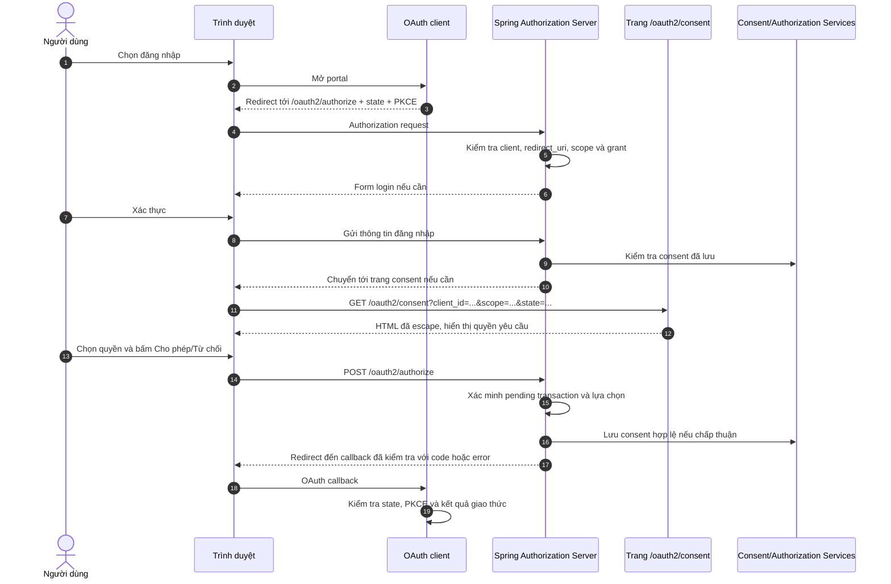
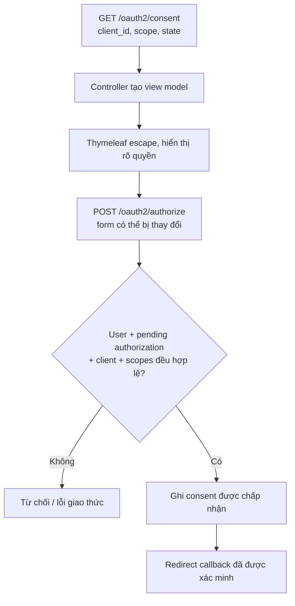
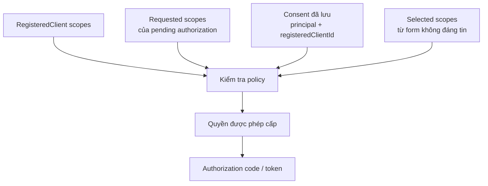

# Bảo vệ form consent, tham số điều hướng và nội dung hiển thị

Trong OAuth 2.0/OpenID Connect (OIDC), **authorization consent** là bước người dùng quyết định có cho một OAuth client sử dụng những quyền được yêu cầu hay không. Khi dùng Spring Authorization Server, bạn có thể thay giao diện consent mặc định bằng trang do ứng dụng Spring Boot tự render. Trang này đọc thông tin client, các scopes đang xin và trạng thái giao dịch, rồi cho người dùng lựa chọn. Vì nó chạy trên domain của Authorization Server và có liên quan trực tiếp đến quyền được cấp, đây là một thành phần bảo mật quan trọng.

Bài thuộc chương **Consent** của module **SPRING_SECURITY_OAUTH2_OIDC_AUTHORIZATION_SERVER**, với mục tiêu học cách thiết kế, cấu hình, bảo mật, kiểm thử và vận hành Spring Authorization Server trong Spring Boot. Trọng tâm là bảo vệ **form consent**, **tham số điều hướng** và **nội dung hiển thị** trước CSRF, sửa hidden field, cấp quyền vượt scope, XSS, clickjacking và open redirect.

**Mục tiêu học tập:**

- Phân biệt giao diện xin consent với quyết định cấp quyền thực sự của Authorization Server.
- Hiểu vì sao `client_id`, `state` và `scope` trong query/hidden input đều là dữ liệu có thể bị sửa và phải được liên kết với pending authorization.
- Cấu hình trang consent tùy biến trong Spring Authorization Server, xây model hiển thị từ `RegisteredClientRepository` và `OAuth2AuthorizationConsentService`.
- Sử dụng Thymeleaf escaping và các header bảo mật để ngăn XSS, clickjacking và rò rỉ dữ liệu.
- Thiết kế lựa chọn **Cho phép / Từ chối** cùng điều hướng sau consent sao cho không biến Authorization Server thành open redirect.
- Viết kiểm thử cho scope tampering, CSRF, state replay, nhiều tab, logout giữa chừng và các lỗi hiển thị.

## 1. Luồng consent và ranh giới tin cậy

Xét hệ thống gồm Authorization Server `https://login.example.com`, client `orders-portal` tại `https://portal.example.com`, callback đã đăng ký `https://portal.example.com/login/oauth2/code/sas` và API `https://api.example.com`.



Màn hình consent chỉ có nhiệm vụ **giúp người dùng hiểu và thể hiện lựa chọn**. Nó không có quyền tự tạo authorization code, access token hay ghi trực tiếp mọi scope từ form vào cơ sở dữ liệu. Quyết định cuối cùng thuộc **Authorization Endpoint** cùng các service và validator của Spring Authorization Server.

**Không phải lần đăng nhập nào cũng hiện consent page.** Chính sách `RegisteredClient.clientSettings.requireAuthorizationConsent`, những scopes đã được user chấp thuận, loại scope và quy tắc OIDC có thể ảnh hưởng đến việc AS có cần hỏi lại hay không.

## 2. Mỗi tham số trên form có thể bị thay đổi

Trình duyệt do người dùng kiểm soát: có thể sửa URL, DOM, checkbox, hidden input, gửi POST bằng script hoặc HTTP client. Kẻ tấn công cũng có thể gửi nạn nhân một đường dẫn GET chứa `client_id`, `scope` hoặc `state` tự đặt.

| Dữ liệu | Cách sử dụng | Không được suy luận |
| --- | --- | --- |
| `client_id` | Tra registered client và đối chiếu với transaction đang chờ. | Có `client_id` nghĩa là request do client chính chủ tạo. |
| `state` trên trang consent | Được AS dùng để liên kết thao tác đồng ý với pending authorization theo cách framework triển khai. | Hidden state là bằng chứng cấp quyền tự thân hoặc thay mọi CSRF token. |
| `scope` GET | Gợi ý quyền cần hiển thị, phải đối chiếu với scope giao dịch và registration. | Query có quyền nào thì quyền đó được cấp. |
| `scope` POST (checkbox) | Thể hiện quyền người dùng đã chọn; AS phải giới hạn theo giao dịch. | Thêm checkbox qua DevTools được phép mở rộng quyền. |
| `redirect_uri` | AS lấy từ authorization request đã xác minh và so khớp với callback đăng ký. | Được phép lấy địa chỉ chuyển hướng tùy ý từ form consent. |
| `client_name`, `logo_uri`, link chính sách | Metadata đã đăng ký và quản trị; cần xác thực nguồn, escape và kiểm soát URL. | Nội dung từ query hay từ dynamic registration đều an toàn để render HTML. |
| `next`, `returnUrl`, `continue` | Chỉ được dùng nếu đã giới hạn thành route nội bộ an toàn. | Đường dẫn gửi lên là nơi có thể redirect sau đồng ý/từ chối. |
| CSRF token | Có hiệu lực khi **server-side CSRF validation** thực sự kiểm tra nó. | Chỉ cần xuất hiện trong hidden input là form đã chống CSRF. |

Phân biệt **OAuth client `state`** dùng để liên kết callback với request ban đầu của client, **state của pending consent** do AS quản lý, và **CSRF token của phiên HTTP**. Chúng có liên quan đến chống giả mạo nhưng không mặc nhiên có cùng giá trị hay thay thế nhau.



**Kiểm tra ở GET không thay thế kiểm tra ở POST.** User có thể mở trang trong một tab, hết hạn phiên, thay đổi chính sách client hoặc sửa body request trước khi submit.

## 3. Cấu hình trang consent tùy biến trong Spring Authorization Server

Các ví dụ sau dành cho **Spring Boot 3.x tương thích Spring Authorization Server 1.x**. Để render Thymeleaf, cần dependency `spring-boot-starter-thymeleaf`, ngoài dependency Spring Security và Spring Authorization Server. API giữa các dòng phiên bản có thể khác nhau; đối chiếu tài liệu của phiên bản đã chọn.

### 3.1. Chính sách consent trên từng RegisteredClient

```java
RegisteredClient portal = RegisteredClient.withId("portal-internal-id")
    .clientId("orders-portal")
    .clientAuthenticationMethod(ClientAuthenticationMethod.CLIENT_SECRET_BASIC)
    .authorizationGrantType(AuthorizationGrantType.AUTHORIZATION_CODE)
    .redirectUri("https://portal.example.com/login/oauth2/code/sas")
    .scope(OidcScopes.OPENID)
    .scope("orders.read")
    .scope("orders.write")
    .clientSettings(ClientSettings.builder()
        .requireProofKey(true)
        .requireAuthorizationConsent(true)
        .build())
    .build();
```

Đây chỉ là đoạn đăng ký client. Ứng dụng hoàn chỉnh còn phải cấu hình secret, kho registration, khóa ký, người dùng và SecurityFilterChain. `requireAuthorizationConsent(true)` là chính sách hỏi người dùng; việc ghi consent cụ thể thuộc `OAuth2AuthorizationConsentService`, còn phát code/token thuộc các thành phần giao thức khác.

### 3.2. Thiết lập consentPage và hai filter chains

```java
package com.example.authserver.config;

import org.springframework.context.annotation.Bean;
import org.springframework.context.annotation.Configuration;
import org.springframework.core.annotation.Order;
import org.springframework.http.MediaType;
import org.springframework.security.config.Customizer;
import org.springframework.security.config.annotation.web.builders.HttpSecurity;
import org.springframework.security.oauth2.server.authorization.config.annotation.web.configurers.OAuth2AuthorizationServerConfigurer;
import org.springframework.security.web.SecurityFilterChain;
import org.springframework.security.web.authentication.LoginUrlAuthenticationEntryPoint;
import org.springframework.security.web.util.matcher.MediaTypeRequestMatcher;

@Configuration(proxyBeanMethods = false)
public class ConsentSecurityConfig {

    @Bean
    @Order(1)
    SecurityFilterChain authorizationServerChain(HttpSecurity http)
            throws Exception {

        OAuth2AuthorizationServerConfigurer asConfigurer =
            OAuth2AuthorizationServerConfigurer.authorizationServer();

        http.securityMatcher(asConfigurer.getEndpointsMatcher())
            .with(asConfigurer, as -> as
                .authorizationEndpoint(endpoint ->
                    endpoint.consentPage("/oauth2/consent"))
                .oidc(Customizer.withDefaults()))
            .authorizeHttpRequests(authorize ->
                authorize.anyRequest().authenticated())
            .exceptionHandling(exceptions ->
                exceptions.defaultAuthenticationEntryPointFor(
                    new LoginUrlAuthenticationEntryPoint("/login"),
                    new MediaTypeRequestMatcher(MediaType.TEXT_HTML)));

        return http.build();
    }

    @Bean
    @Order(2)
    SecurityFilterChain applicationChain(HttpSecurity http)
            throws Exception {

        http.authorizeHttpRequests(authorize -> authorize
                .requestMatchers("/oauth2/consent").authenticated()
                .anyRequest().authenticated())
            .formLogin(Customizer.withDefaults())
            .headers(headers -> headers
                .frameOptions(frame -> frame.deny())
                .contentSecurityPolicy(csp -> csp.policyDirectives(
                    "frame-ancestors 'none'; object-src 'none'; base-uri 'none'")));

        return http.build();
    }
}
```

Ở đây `GET /oauth2/consent` là trang MVC thuộc chain ứng dụng (thường sau khi đăng nhập), còn **`POST /oauth2/authorize`** vẫn thuộc chain xử lý giao thức của Authorization Server. Không viết một endpoint cấp code tùy biến chỉ để làm giao diện đẹp hơn.

`frameOptions(DENY)` và CSP `frame-ancestors 'none'` giúp chống clickjacking bằng cách ngăn trang consent bị nhúng trong iframe. Cấu hình này chưa phải toàn bộ Authorization Server, và CSP cần được hoàn chỉnh/kiểm thử khi có script, style hoặc resource bên ngoài.

## 4. Tạo dữ liệu hiển thị từ đăng ký client

Một trang consent cần hiển thị **tên client được đăng ký** và **ý nghĩa scopes**, không lấy trực tiếp tên hoặc đoạn HTML do request khai.

Controller sau dùng Spring MVC với Java 17 và chỉ **render view**. Nó không tự ghi consent, không phát token, không dùng query `returnUrl` để redirect.

```java
package com.example.authserver.web;

import java.security.Principal;
import java.util.Arrays;
import java.util.LinkedHashSet;
import java.util.List;
import java.util.Map;
import java.util.Set;
import java.util.stream.Collectors;

import org.springframework.http.HttpStatus;
import org.springframework.security.core.GrantedAuthority;
import org.springframework.security.oauth2.server.authorization.OAuth2AuthorizationConsent;
import org.springframework.security.oauth2.server.authorization.OAuth2AuthorizationConsentService;
import org.springframework.security.oauth2.server.authorization.client.RegisteredClient;
import org.springframework.security.oauth2.server.authorization.client.RegisteredClientRepository;
import org.springframework.stereotype.Controller;
import org.springframework.ui.Model;
import org.springframework.web.bind.annotation.GetMapping;
import org.springframework.web.bind.annotation.RequestParam;
import org.springframework.web.server.ResponseStatusException;

@Controller
public class ConsentPageController {

    private static final Map<String, String> SCOPE_LABELS = Map.of(
        "profile", "Xem thông tin hồ sơ cơ bản",
        "orders.read", "Xem danh sách và chi tiết đơn hàng",
        "orders.write", "Tạo hoặc cập nhật đơn hàng"
    );

    private final RegisteredClientRepository clients;
    private final OAuth2AuthorizationConsentService consents;

    public ConsentPageController(
            RegisteredClientRepository clients,
            OAuth2AuthorizationConsentService consents) {
        this.clients = clients;
        this.consents = consents;
    }

    @GetMapping("/oauth2/consent")
    public String consent(
            Principal principal,
            @RequestParam("client_id") String clientId,
            @RequestParam("scope") String scope,
            @RequestParam("state") String state,
            Model model) {

        if (principal == null) {
            throw new ResponseStatusException(HttpStatus.UNAUTHORIZED);
        }

        RegisteredClient client = clients.findByClientId(clientId);
        if (client == null) {
            throw new ResponseStatusException(HttpStatus.BAD_REQUEST);
        }

        Set<String> requested = Arrays.stream(scope.trim().split("\\s+"))
            .filter(value -> !value.isBlank())
            .collect(Collectors.toCollection(LinkedHashSet::new));

        if (requested.isEmpty()
                || !client.getScopes().containsAll(requested)) {
            throw new ResponseStatusException(HttpStatus.BAD_REQUEST);
        }

        OAuth2AuthorizationConsent previous =
            consents.findById(client.getId(), principal.getName());

        Set<String> approved = previous == null
            ? Set.of()
            : previous.getAuthorities().stream()
                .map(GrantedAuthority::getAuthority)
                .filter(value -> value.startsWith("SCOPE_"))
                .map(value -> value.substring("SCOPE_".length()))
                .collect(Collectors.toSet());

        List<Map<String, String>> pending = requested.stream()
            .filter(value -> !approved.contains(value))
            .map(value -> Map.of(
                "code", value,
                "label", SCOPE_LABELS.getOrDefault(
                    value, "Quyền được yêu cầu: " + value)))
            .toList();

        String displayName = client.getClientName();
        if (displayName == null || displayName.isBlank()) {
            displayName = client.getClientId();
        }

        model.addAttribute("clientName", displayName);
        model.addAttribute("clientId", client.getClientId());
        model.addAttribute("state", state);
        model.addAttribute("pendingScopes", pending);
        model.addAttribute("approvedScopes", approved);

        return "consent";
    }
}
```

**Giới hạn của ví dụ GET:** nó kiểm tra client đã đăng ký và requested scopes là tập con của scopes đăng ký, nhưng chưa tự chứng minh `state` là pending authorization hợp lệ của user hiện tại. Spring Authorization Endpoint cần thực hiện kiểm tra này khi nhận POST. Trong hệ thống thật, nên bổ sung kiểm tra transaction phía server trước cả khi hiển thị GET để ngăn việc tạo **màn hình xin consent giả** từ tham số truy vấn do attacker tự dựng.

Đặc biệt, `client.getClientName()` phải đến từ registration được quản trị; nếu hệ thống cho client bên thứ ba tự đặt tên trong dynamic registration, cần kiểm duyệt nhãn/đơn vị sở hữu. `OAuth2AuthorizationConsentService.findById(...)` dùng **registered client ID nội bộ và principal**, khác với `client_id` công khai ở URL.

## 5. Template Thymeleaf: escaping, checkbox và hidden input

Tạo `src/main/resources/templates/consent.html` với các trường cần thiết. Các biểu thức Thymeleaf phải được escape khi render. Sử dụng `th:text`, không dùng `th:utext` với dữ liệu bên ngoài.

```html
<!doctype html>
<html lang="vi" xmlns:th="http://www.thymeleaf.org">
<head>
  <meta charset="UTF-8">
  <meta name="viewport" content="width=device-width, initial-scale=1">
  <title>Xác nhận cấp quyền</title>
</head>
<body>
  <main>
    <h1>Xác nhận cấp quyền</h1>

    <p>
      Ứng dụng <strong th:text="${clientName}">Tên ứng dụng</strong>
      đang yêu cầu các quyền sau:
    </p>

    <form method="post" th:action="@{/oauth2/authorize}">
      <input type="hidden" name="client_id" th:value="${clientId}">
      <input type="hidden" name="state" th:value="${state}">

      <fieldset>
        <legend>Chọn quyền bạn đồng ý cấp</legend>
        <div th:each="item, iter : ${pendingScopes}">
          <input type="checkbox" name="scope"
                 th:id="${'scope-' + iter.index}"
                 th:value="${item.code}">
          <label th:for="${'scope-' + iter.index}"
                 th:text="${item.label}">Mô tả quyền</label>
        </div>
      </fieldset>

      <button type="submit">Cho phép các quyền đã chọn</button>
    </form>

    <section>
      <h2>Quyền đã chấp thuận trước đây</h2>
      <ul>
        <li th:each="scope : ${approvedScopes}"
            th:text="${scope}">Quyền đã cấp</li>
      </ul>
    </section>
  </main>
</body>
</html>
```

### 5.1. Vì sao th:text quan trọng?

Thymeleaf `th:text` escape dữ liệu khi chèn vào text node. Nếu tên ứng dụng bị đặt thành:

```text
Ứng dụng 
```

trình duyệt phải hiển thị nguyên văn chuỗi này như **chữ**, không tạo một phần tử ảnh và thực thi event handler. Ngược lại, `th:utext` hoặc `innerHTML` với dữ liệu không tin cậy có thể gây XSS ngay trên origin của Authorization Server.

`th:value` escape cú pháp thuộc tính HTML, nhưng không biến scope, state hoặc client ID thành giá trị đáng tin. Một hidden field như:

```html
<input type="hidden" name="client_id" th:value="${clientId}">
<input type="hidden" name="state" th:value="${state}">
```

vẫn có thể bị sửa qua DevTools hoặc một HTTP POST tự tạo. AS phải đối chiếu user, pending authorization, client, request scopes và các điều kiện cấp quyền khi xử lý POST.

### 5.2. Phải có lựa chọn Từ chối

Người dùng phải có cách **không chấp thuận**; tránh thiết kế buộc họ phải bấm Cho phép để thoát màn hình. Trong một số mẫu custom consent page, việc gửi giao dịch **không có scope mới được chấp thuận** biểu thị từ chối. Ví dụ form mô tả ý tưởng:

```html
<form method="post" th:action="@{/oauth2/authorize}">
  <input type="hidden" name="client_id" th:value="${clientId}">
  <input type="hidden" name="state" th:value="${state}">
  <!-- Không gửi scope mới. -->
  <button type="submit">Từ chối</button>
</form>
```

**Cần kiểm tra với đúng bản Spring Authorization Server đang dùng.** Endpoint có thể trả `access_denied` hoặc một lỗi consent theo triển khai; không tự thêm `approved=false` rồi giả định framework hiểu. Kiểm thử phải chứng minh: không ghi thêm consent, không phát code/token cho giao dịch bị từ chối và chỉ phản hồi về callback **đã xác minh**.

### 5.3. Không đưa redirect_uri tự do vào form

Form consent không cần nhận một `redirect_uri` hoặc `returnUrl` mới để quyết định `Location`. AS phải lấy callback từ authorization transaction đã được kiểm tra trước đó. Nếu UI có nút “Trợ giúp” hay “Quay về trang chủ”, chỉ dùng một đường dẫn nội bộ cố định hoặc route ID trong allowlist do server quản lý.

## 6. CSRF, OAuth state và session cookie

**CSRF** xảy ra khi một trang bên ngoài khiến trình duyệt đang đăng nhập vào AS gửi request thay đổi trạng thái mà user không có chủ ý. Cookie phiên có thể được gửi tự động, nên chỉ kiểm tra đã đăng nhập là chưa đủ.

| Cơ chế | Vai trò chính | Không thay thế |
| --- | --- | --- |
| OAuth `state` từ client | Client đối chiếu callback với request đăng nhập ban đầu. | CSRF validation cho những form tùy biến tại AS. |
| Pending authorization/consent state | AS ràng buộc lựa chọn user với request, client và scope đang chờ. | Mọi kiểm tra HTTP/session trong các endpoint khác. |
| Spring Security CSRF token | Chứng minh POST thuộc giao dịch/phiên được bảo vệ khi filter thực sự validate nó. | Client registration, pending state và phạm vi quyền. |
| Cookie `SameSite` | Hạn chế một số kiểu request cross-site mang cookie. | CSRF protection trong tất cả trường hợp. |

### 6.1. Hidden CSRF token chưa chắc được kiểm tra

Trong ứng dụng Spring MVC + Thymeleaf, `th:action` có thể khiến Spring Security chèn hidden CSRF token thông qua `RequestDataValueProcessor` nếu cơ chế phù hợp được bật. Nhưng các endpoint OAuth có thể có **ngoại lệ CSRF** theo filter chain. Do đó:

1. Kiểm tra matcher và filter chain thực sự áp dụng cho **POST `/oauth2/authorize`**.
2. Nếu bạn tạo endpoint custom POST riêng để ghi consent, phải bảo vệ nó bằng CSRF token được server xác minh hoặc cơ chế ràng buộc request tương đương đã kiểm thử.
3. Không tắt CSRF toàn ứng dụng chỉ vì token endpoint dùng POST. Đặc thù giao thức OAuth và form login/consent cần chính sách riêng.
4. Thử POST thiếu token, token giả, POST cross-site và state không hợp lệ bằng một phiên đã đăng nhập. Chỉ kết luận an toàn khi **không thể tạo consent ngoài ý người dùng**.

Khi không dùng cơ chế tự chèn token của Thymeleaf, một hidden CSRF field có thể được render như sau; chỉ có tác dụng nếu server đang **kiểm tra** token tương ứng:

```html
<input type="hidden" th:if="${_csrf != null}"
       th:name="${_csrf.parameterName}"
       th:value="${_csrf.token}">
```

Không chèn token hai lần một cách máy móc hoặc dựa vào `state` để miễn trừ các validation khác.

### 6.2. Cookie và phiên đăng nhập

Ở Authorization Server public, cookie cần `Secure` với HTTPS, `HttpOnly` và `SameSite` phù hợp với luồng OAuth/OIDC. `SameSite=Lax` có thể giúp ở nhiều trường hợp nhưng không ngăn mọi CSRF; một số luồng redirect/form post có yêu cầu cookie khác. Kiểm thử với trình duyệt thực tế.

Nếu phiên hết hạn trước khi user bấm Cho phép, consent POST phải bị từ chối hoặc yêu cầu xác thực lại đúng chính sách. Không xem một `state` còn trong HTML cũ là lý do bỏ qua xác thực.

## 7. Scope tampering: không tin checkbox và quyền tự khai

Giả sử AS chỉ yêu cầu consent `orders.read`. Trình duyệt có thể sửa form để gửi thêm `orders.write`:

```http
POST /oauth2/authorize HTTP/1.1
Host: login.example.com
Content-Type: application/x-www-form-urlencoded

client_id=orders-portal&state=PENDING_STATE&scope=orders.read&scope=orders.write
```

Dù `orders.write` có trong registration, nó **không mặc nhiên thuộc scope được yêu cầu trong pending transaction**. AS cần đối chiếu đồng thời:

- **Registered scopes**: các scopes client được đăng ký có thể yêu cầu.
- **Requested scopes**: scopes trong authorization request đã được xác minh.
- **Existing consent**: scopes trước đây đã được principal chấp thuận.
- **Selected scopes**: lựa chọn hiện tại gửi từ form, cần kiểm tra tập con hợp lệ.
- **Policy/issued scopes**: quyền cuối cùng AS có thể cấp theo cả chính sách server và lựa chọn hợp lệ.



**Không** dùng controller POST tùy biến gọi `OAuth2AuthorizationConsentService.save(...)` trực tiếp với mọi `scope` do request cung cấp. Nếu phải bổ sung kiểm tra, dùng extension point phù hợp của Spring Authorization Server và giữ nguyên các ràng buộc chuẩn.

`OAuth2AuthorizationConsentService` lưu quyền đã chấp thuận theo **registered client ID nội bộ** và **principal name**. Consent có thể khiến user không phải duyệt lại, nhưng nó không đồng nghĩa access token hiện có vô hạn hoặc API không cần kiểm tra audience, scope và quyền đối tượng.

## 8. Bảo vệ tên ứng dụng, logo, link và mô tả scope

Vì consent page được hiển thị trên domain đáng tin của Authorization Server, lỗi XSS hoặc phishing ở đây có thể ảnh hưởng trực tiếp đến luồng cấp quyền.

| Nội dung | Rủi ro | Biện pháp |
| --- | --- | --- |
| Tên client | Stored/reflected XSS; giả danh ứng dụng uy tín. | Lấy từ registration quản trị; `th:text`; duyệt tên chủ sở hữu. |
| Mô tả scope | HTML độc hại, nội dung mơ hồ hoặc che giấu quyền ghi/xóa. | Mapping mô tả do server duyệt; escape; không lấy trực tiếp HTML từ query. |
| `logo_uri` | Tracking, ảnh từ host lạ, SVG nguy hiểm. | Chỉ nguồn HTTPS được duyệt; CSP; cân nhắc proxy ảnh hoặc bỏ logo. |
| `policy_uri`/`tos_uri` | Link phishing, scheme `javascript:`, tabnabbing. | URL allowlist, `https`, `rel="noopener noreferrer"` khi mở tab mới. |
| Thông báo lỗi | Reflected XSS, rò rỉ stack trace. | Thông báo có kiểm soát, escape và hạn chế chi tiết. |
| `next`/`continue` | Open redirect sau khi đồng ý hoặc từ chối. | Route nội bộ do server định nghĩa. |

**Escape không đồng nghĩa URL an toàn.** Một URL `javascript:...` đặt vào `href` có thể nguy hiểm dù đã escape cú pháp thuộc tính. Phải validate scheme, hostname và nguồn URL, rồi mới render liên kết; hạn chế nội dung nhúng từ client metadata.

Giao diện cũng cần thể hiện **quyền đọc khác quyền ghi**, quyền mới khác quyền đã chấp thuận. Không âm thầm chọn trước mọi scope mới, không dùng nút có nhãn gây nhầm lẫn hoặc tự diễn giải `orders.write` thành “chỉ xem”. Scope là ranh giới quyền kỹ thuật; Resource Server vẫn phải kiểm tra quyền trên từng tài nguyên.

## 9. Ngăn open redirect từ tham số điều hướng

Phản ví dụ:

```java
// KHÔNG triển khai: attacker điều khiển đích chuyển hướng.
String returnUrl = request.getParameter("returnUrl");
response.sendRedirect(returnUrl);
```

Một URL như `https://login.example.com/oauth2/consent?returnUrl=https://attacker.example` có thể khiến domain AS trở thành công cụ phishing nếu controller dùng trực tiếp tham số này.

Đối với **phản hồi OAuth**, AS phải dùng `redirect_uri` từ authorization transaction đã được xác minh với `RegisteredClient.redirectUris`, không dùng `returnUrl` hay callback mới từ consent form. Nếu callback chưa hợp lệ, **không redirect ngay cả lỗi giao thức** đến URI đó.

Đối với **điều hướng giao diện nội bộ** (trang trợ giúp/trang chủ), dùng route ID từ allowlist:

```java
private static String safeInternalRoute(String routeId) {
    if ("help".equals(routeId)) {
        return "/help";
    }
    if ("home".equals(routeId)) {
        return "/home";
    }
    return "/";
}
```

Hàm này không quyết định OAuth callback và không được sử dụng để cấp quyền. Tránh chấp nhận các biến thể `//attacker.example`, `%2F%2Fattacker.example`, backslash, userinfo `@` hoặc URL tuyệt đối làm đường dẫn nội bộ.

## 10. Clickjacking, CSP, cache và nguồn tài nguyên

Clickjacking khiến người dùng tưởng bấm nút ở trang khác trong khi đang bấm **Cho phép** trên consent page bị che trong iframe. Cần kiểm tra `X-Frame-Options: DENY` hoặc CSP `frame-ancestors 'none'` trên response thật của trang consent.

Ví dụ cấu hình header cho SecurityFilterChain phục vụ trang:

```java
http.headers(headers -> headers
    .frameOptions(frame -> frame.deny())
    .contentSecurityPolicy(csp -> csp.policyDirectives(
        "default-src 'self'; " +
        "script-src 'self'; " +
        "style-src 'self'; " +
        "object-src 'none'; " +
        "base-uri 'none'; " +
        "form-action 'self'; " +
        "frame-ancestors 'none'")));
```

Điều chỉnh CSP theo resource thực sự cần dùng, hạn chế tối đa JavaScript bên thứ ba. Ưu tiên trang consent server-rendered, form đơn giản, không dùng `innerHTML` hoặc thư viện UI không được kiểm soát.

Với dữ liệu giao dịch trên URL, nên xét `Referrer-Policy: no-referrer` để tránh lộ `state` sang trang bên ngoài và `Cache-Control: no-store` để ngăn proxy/CDN cache nội dung riêng của user. Không log authorization code, token, cookie, CSRF token, hoặc state nhạy cảm. Header bảo mật là lớp phòng vệ bổ sung; **không** thay việc kiểm tra transaction/CSRF/scope.

## 11. Nhiều tab, session timeout và thay đổi policy

**Hai tab cùng đăng nhập:** tab A xin `orders.read`, tab B xin `orders.write`. Nếu code tùy biến dùng một biến session `pendingScopes` bị ghi đè giữa hai tab, việc bấm Cho phép ở A có thể làm cấp quyền của B. Mỗi consent phải ràng buộc với **pending authorization riêng**; thử tráo `state` giữa hai tab và xác nhận không cấp quyền sai.

**Session hết hạn:** một form được render khi user còn đăng nhập không được phép gửi POST thành công sau khi phiên đã hết hạn. Cần xác thực lại hoặc tạo giao dịch mới theo chính sách.

**Admin thay scopes khi user đang đọc:** dù trang GET hiển thị scope cũ, AS phải kiểm tra chính sách hiện tại ở POST. Đừng giả định UI đã render là nguồn chân lý cuối cùng.

**Nhiều instance:** `RegisteredClientRepository`, `OAuth2AuthorizationService` và `OAuth2AuthorizationConsentService` cần lưu trữ/phân phối trạng thái phù hợp để các instance xử lý giao dịch nhất quán. Kho in-memory có thể mất consent và pending authorization sau restart hoặc giữa các instance.

**Thu hồi consent:** xóa consent đã lưu không tự thu hồi tất cả JWT access token đã cấp trước đó. Nếu cần vô hiệu ngay, thiết kế thêm thu hồi token/introspection/kiểm tra quyền động theo yêu cầu.

## 12. Ma trận kiểm thử bảo mật

| Kịch bản | Kết quả an toàn mong đợi |
| --- | --- |
| User chưa xác thực mở trang consent | Chuyển sang login hoặc từ chối, không lộ dữ liệu user khác. |
| Query chứa `client_id` không tồn tại | Không hiển thị như app hợp lệ; không thể cấp consent. |
| Client B dùng `state` của transaction client A | Không cấp quyền cho B từ trạng thái A. |
| `state` sai, hết hạn, thuộc user khác | Không ghi consent hoặc cấp code/token. |
| `scope` GET không thuộc registration | Controller/AS từ chối hiển thị như scope hợp lệ. |
| POST thêm scope ngoài pending request | Không cấp scope mới chỉ vì xuất hiện trong checkbox. |
| Thay hidden `client_id` sau render | AS đối chiếu với pending transaction và từ chối. |
| Thiếu/giả CSRF token ở nơi yêu cầu | Không tạo consent trái phép; xác minh đúng filter matcher. |
| POST cross-site bằng cookie AS đã đăng nhập | Không chấp thuận ngoài ý user. |
| Tên client là `` | Hiển thị như text, không chạy JavaScript. |
| Scope description chứa HTML/script | Escape; không chèn HTML chưa duyệt. |
| `returnUrl=https://attacker.example` | Không có `Location` tới attacker. |
| `next=//attacker.example` và bản URL-encoded | Không vượt qua route allowlist. |
| Consent page bị nhúng trong iframe | Bị từ chối theo `frame-ancestors`/X-Frame-Options. |
| User từ chối | Không ghi thêm consent và không phát code/token của giao dịch đó. |
| User chỉ chọn `orders.read` | Không tự cấp `orders.write`. |
| Hai tab tráo trạng thái | Không ghép scopes của tab A với tab B. |
| Phiên hết hạn trước POST | Không ghi consent; login lại hoặc trả lỗi. |
| Callback ban đầu không nằm trong registration | Không gửi code **hoặc lỗi** tới callback lạ. |
| Thay scopes/registration giữa GET và POST | Server kiểm tra lại policy hiện hành. |

### 12.1. Kiểm tra ở đúng phía chịu trách nhiệm

**View test:** dùng tên client chứa HTML hoặc Unicode dễ gây nhầm lẫn, assert output được escape, metadata link được duyệt, form không có redirect tùy ý, có header CSP/frame và cache phù hợp.

**Protocol integration test:** tạo authorization request thật, xác thực user, mở consent page và submit quyền được phép. Kiểm tra code chỉ đi tới callback đúng, consent lưu cho đúng principal/client. Lặp lại với scopes lạ, state sai, client bị tráo và nút từ chối.

**CSRF test:** dùng một phiên đã xác thực, thử POST không có CSRF token hoặc token không khớp theo đúng cấu hình đang chạy; nếu protocol endpoint được miễn CSRF, kiểm tra transaction binding có ngăn cấp quyền trái ý user và bổ sung bảo vệ cho endpoint tùy biến.

**Browser test:** kiểm tra iframe, URL tuyệt đối và protocol-relative link, XSS, hành vi nút Từ chối, tab đồng thời và cookie cross-site. Đừng chỉ assert HTTP status, vì Spring có thể trả OAuth error hoặc chuyển tới login tùy điểm xử lý.

## 13. Troubleshooting

**Bấm Cho phép rồi quay lại consent mãi:** xác nhận form POST đúng `/oauth2/authorize`, `client_id`/`state` khớp, scope được gửi đúng và `OAuth2AuthorizationConsentService` lưu trạng thái cho đúng registered client ID và principal. Kho in-memory/nhiều instance có thể khiến consent không nhất quán.

**POST trả 403:** kiểm tra CSRF token, matcher, filter chain và session, không bỏ bảo vệ toàn hệ thống chỉ để POST thành công.

**Checkbox có scope nhưng token không có quyền đó:** phân biệt registered scopes, requested scopes, granted scopes và policy. Form không thể tự tăng quyền token; kiểm tra giao dịch trước khi kết luận lỗi UI.

**Tên client hiển thị như HTML:** tìm `th:utext`, `innerHTML` hoặc việc nối chuỗi HTML từ dữ liệu không tin cậy; chuyển sang `th:text` và metadata đã được duyệt.

**Từ chối rồi bị chuyển sang host lạ:** tìm các `returnUrl`/`next`/`continue` dùng trực tiếp trong `sendRedirect` hoặc JavaScript. OAuth callback phải được lấy từ AS transaction hợp lệ, các navigation route UI phải có allowlist.

**Proxy tạo form action sai host:** kiểm tra public issuer, `th:action="@{/oauth2/authorize}"`, context path và forwarded headers của proxy tin cậy. Không tin header `X-Forwarded-Host` do Internet tự gửi.

## 14. Bài tập áp dụng

Authorization Server phục vụ ba clients:

| Client | Loại ứng dụng | Scopes |
| --- | --- | --- |
| `employee-portal` | Backend web nội bộ | `profile`, `employees.read` |
| `partner-reports` | Web client của đối tác | `profile`, `reports.read`, `reports.export` |
| `mobile-customer` | Ứng dụng native public | `openid`, `orders.read` |

Tại consent page của `partner-reports`, attacker thử thêm checkbox `admin.write`, sửa hidden `client_id` thành `employee-portal` và gắn `returnUrl=https://attacker.example`.

Tự trả lời:

1. Vì sao query/hidden inputs không phải nguồn xác thực client hoặc cấp scope đáng tin?
2. Spring Authorization Server cần đối chiếu những dữ liệu nào trước khi lưu consent?
3. `state` được dùng ở đâu và khác CSRF token của form ra sao?
4. Tên app, mô tả scope và logo cần lấy từ đâu? Dùng `th:text` có thay được URL validation không?
5. Nếu chỉ chọn `reports.read`, response và authorization state cần phản ánh lựa chọn thế nào?
6. Khi user từ chối, AS có được dùng `returnUrl` để tạo `Location` không?
7. Một access token JWT đã cấp có lập tức mất hiệu lực khi user rút consent không?
8. Cần thử những gì để phát hiện XSS, clickjacking, scope tampering, state swap giữa hai tab và CSRF?

**Gợi ý:** form chỉ truyền **ý định** của user. AS phải kiểm tra registered client, pending authorization, principal và scopes trước khi cấp quyền; view phải escape, liên kết phải được duyệt và callback OAuth phải được kiểm tra riêng.

## 15. Checklist trước khi vận hành

- [ ] `requireAuthorizationConsent` được cấu hình đúng từng registered client, consent service lưu trạng thái phù hợp.
- [ ] `GET /oauth2/consent` yêu cầu người dùng đã xác thực, hiển thị tên client và scope từ nguồn tin cậy.
- [ ] Không coi query/hidden field là nguồn quyền; `POST /oauth2/authorize` xác minh pending transaction, client, user và scope.
- [ ] Đã phân biệt OAuth state, consent transaction và CSRF token; có test xác minh bảo vệ trên endpoint thật.
- [ ] HTML dùng escaping (`th:text`/`th:value`), không render raw HTML từ client metadata/request.
- [ ] Có đường Từ chối hoạt động theo phiên bản AS và không cấp code/token khi user từ chối.
- [ ] Nút điều hướng dùng route allowlist; callback OAuth đến URI đã đăng ký, không từ `returnUrl` tự do.
- [ ] Tên, logo, policy link và scope descriptions có quy trình quản trị/kiểm duyệt.
- [ ] Đã cấu hình/kiểm tra HTTPS, cookie, CSP, X-Frame-Options, Referrer-Policy, Cache-Control.
- [ ] Đã thử XSS, CSRF, scope tampering, state replay, hai tab đồng thời, hết phiên và đổi policy.
- [ ] Không ghi authorization code, token, cookie, CSRF token hoặc state nhạy cảm vào log.
- [ ] Các instance chia sẻ client, authorization và consent state cần thiết cho tính nhất quán.

**Ghi nhớ:** Trang consent là **giao diện hiển thị quyền và nhận lựa chọn**, còn Spring Authorization Server là bên **xác thực giao dịch và cấp quyền**. Bảo vệ form hiệu quả đòi hỏi kết hợp kiểm tra phía server, CSRF, escaping, CSP, quản lý phiên và chuyển hướng an toàn. Một hidden field có thể bị sửa, một scope được hiển thị chưa chắc được phép cấp, và một URL nằm trên domain đăng nhập chưa chắc là đích redirect được tin cậy.

**Tài liệu tham khảo:**

- [Spring Authorization Server — Customize the Authorization Consent Page](https://docs.spring.io/spring-authorization-server/reference/guides/how-to-custom-consent-page.html): cấu hình `consentPage(...)` và ví dụ controller/template.
- [Spring Authorization Server — Protocol Endpoints](https://docs.spring.io/spring-authorization-server/reference/protocol-endpoints.html): Authorization Endpoint và các điểm mở rộng.
- [Spring Authorization Server — Core Model and Components](https://docs.spring.io/spring-authorization-server/reference/core-model-components.html): `RegisteredClient`, `ClientSettings` và `OAuth2AuthorizationConsentService`.
- [Spring Security — CSRF Protection](https://docs.spring.io/spring-security/reference/servlet/exploits/csrf.html): token, filter chain và Thymeleaf integration.
- [RFC 6749 — OAuth 2.0](https://www.rfc-editor.org/rfc/rfc6749.html): authorization request/response, scope và `state`.
- [RFC 9700 — OAuth 2.0 Security Best Current Practice](https://www.rfc-editor.org/rfc/rfc9700.html): bảo vệ authorization flow và redirect.
- [OpenID Connect Core 1.0](https://openid.net/specs/openid-connect-core-1_0.html): authentication request, consent và ID token validation.

