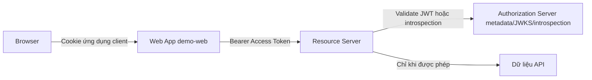

# Toàn bộ chuỗi authorize, login, consent, callback và token

## 1. Mục tiêu: theo dõi một giao dịch OAuth 2.0/OIDC từ đầu đến cuối

Trong chương **Authorization Code và PKCE** của module **SPRING_SECURITY_OAUTH2_OIDC_AUTHORIZATION_SERVER**, chúng ta học cách thiết kế, cấu hình, bảo mật, kiểm thử và vận hành **OAuth 2.0/OpenID Connect Authorization Server** bằng Spring Security và Spring Authorization Server trong ứng dụng Spring Boot. Chủ đề của bài là **toàn bộ chuỗi từ lúc ứng dụng bắt đầu đăng nhập đến khi nhận được token**:

```text
Client bắt đầu yêu cầu
  → /oauth2/authorize
  → Login tại Authorization Server
  → Consent nếu cần
  → Authorization Code + redirect callback
  → Client kiểm tra state và đổi code + PKCE verifier
  → /oauth2/token
  → Access Token (+ ID Token/Refresh Token khi đủ điều kiện)
```

Một endpoint hoạt động riêng lẻ chưa chứng minh toàn bộ giao thức đúng. Chuỗi này chỉ an toàn khi **danh tính người dùng**, **danh tính client**, **quyền người dùng đồng ý**, **authorization code**, **redirect URI**, **`state`** và **PKCE** được ràng buộc chính xác qua nhiều HTTP request.

Sau bài này, người học có thể:

- Xác định trách nhiệm của browser, OAuth client, Authorization Server và Resource Server trong luồng Authorization Code với PKCE.
- Giải thích cách Spring Security giữ trạng thái đăng nhập/CSRF tại Authorization Server và cách OAuth client giữ trạng thái giao dịch của chính nó.
- Theo dõi `GET /oauth2/authorize`, chuyển tới login, consent, `302` callback và `POST /oauth2/token` với đúng tham số.
- Phân biệt authorization code, `state`, `code_verifier`, `code_challenge`, Access Token, ID Token và Refresh Token.
- Cấu hình ví dụ Spring Authorization Server và Spring Security OAuth2 Client để quan sát một vòng đăng nhập.
- Phân tích các trường hợp lỗi và thiết kế kịch bản kiểm thử đầu cuối, kể cả code bị dùng lại, sai PKCE, redirect sai, consent bị từ chối và nhiều instance.

### 1.1. Điều kiện và giả định

Ví dụ sử dụng **Authorization Code Flow**, bật **PKCE S256** và thêm phạm vi `openid` để minh họa OpenID Connect. Không dùng Implicit Grant hay Resource Owner Password Credentials Grant. Những cấu hình, mật khẩu và URL `localhost`/loopback dưới đây **chỉ dùng môi trường phát triển**. Khi triển khai công khai cần HTTPS, khóa ký bền vững, client secret được bảo vệ và kho authorization/consent thích hợp.

Đối với một luồng OAuth 2.0 thuần, nếu không yêu cầu `openid`, có thể không có ID Token; điều đó không ngăn client nhận Access Token khi grant thành công.

## 2. Các vai trò và hai loại đăng nhập cần phân biệt

| Thành phần | Ví dụ | Việc chịu trách nhiệm |
| --- | --- | --- |
| **Resource Owner / End User** | Người dùng `dev.user` | Đăng nhập và quyết định cấp các quyền được yêu cầu. |
| **User Agent** | Trình duyệt | Đi theo các `302 Location`, gửi cookie và hiển thị login/consent. |
| **OAuth Client / OIDC Relying Party** | Web app `demo-web` tại `http://127.0.0.1:8081` | Tạo yêu cầu, lưu `state` và PKCE verifier, nhận callback, đổi code lấy token, quản lý phiên ứng dụng. |
| **Authorization Server / OpenID Provider** | Spring Authorization Server tại `http://localhost:9000` | Xác thực user/client, xử lý consent, phát hành code và token, công bố metadata/JWKS. |
| **Resource Server** | API bảo vệ tại `https://api.example.com` | Xác minh Access Token và quyết định cho phép truy cập tài nguyên. |

Resource Server xuất hiện ở cuối để minh họa cách dùng Access Token, **không bắt buộc có một API riêng để quan sát callback và token exchange** trong bài thực hành.

Có **hai loại xác thực khác nhau**: người dùng xác thực với Authorization Server (ví dụ form login + session cookie), còn OAuth client có thể tự xác thực ở token endpoint (ví dụ `client_secret_basic` hoặc `private_key_jwt`). PKCE không tự biến public client thành confidential client và cũng không thay mật khẩu đăng nhập của người dùng.

### 2.1. Sơ đồ tổng thể

```mermaid
sequenceDiagram
    autonumber
    actor U as Người dùng
    participant B as Browser
    participant C as OAuth Client :8081
    participant AS as Authorization Server :9000
    participant DB as Authorization/Consent Store
    U->>B: Mở trang cần đăng nhập
    B->>C: GET /whoami
    C-->>B: 302 đến yêu cầu authorize
    Note over C: Tạo state, verifier; tính S256 challenge
    B->>AS: GET /oauth2/authorize?...code_challenge=S256...
    AS-->>B: 302 /login khi chưa có phiên
    B->>AS: GET /login
    AS-->>B: Login form + CSRF token
    U->>B: Nhập username/password
    B->>AS: POST /login qua HTTPS (môi trường thật)
    AS-->>B: Session cookie + tiếp tục authorize
    B->>AS: Tiếp tục yêu cầu ủy quyền
    AS->>DB: Kiểm tra client, login, consent
    opt Cần người dùng chấp thuận
        AS-->>B: Consent UI
        U->>B: Đồng ý các scope được phép
        B->>AS: POST consent + CSRF
        AS->>DB: Lưu consent khi phù hợp
    end
    AS->>DB: Lưu authorization code + PKCE challenge
    AS-->>B: 302 redirect_uri?code=...&state=...
    B->>C: GET /login/oauth2/code/demo-web?code=...&state=...
    C->>C: So khớp state, lấy verifier đúng giao dịch
    C->>AS: POST /oauth2/token + code + verifier + client authentication
    AS->>DB: Kiểm tra code: còn hạn, chưa dùng, đúng client/redirect/PKCE
    AS-->>C: Access Token (+ ID Token/Refresh Token nếu có)
    C-->>B: Thiết lập phiên ứng dụng / điều hướng trang
```

Sơ đồ mô tả luồng logic: cách Spring Security lưu và khôi phục request sau login, URL của consent UI và loại cookie tùy phiên bản và cấu hình. Không nên suy ra mọi bước đều là một endpoint hoặc một trang bắt buộc giống nhau trong mọi ứng dụng.

## 3. Dữ liệu nào đi cùng giao dịch?

Một Authorization Code Flow an toàn liên quan đến các giá trị dễ nhầm:

| Giá trị | Bên sinh | Xuất hiện ở đâu? | Mục đích |
| --- | --- | --- | --- |
| `client_id` | Được đăng ký trước | Authorize/token request | Xác định client. Không phải bí mật. |
| `redirect_uri` | Được đăng ký trước | Authorize, token request khi cần, redirect response | Chỉ cho phép callback phù hợp với client/transaction. |
| `state` | Client | Authorize request và redirect response | Ràng buộc response về đúng giao dịch do client tạo, giảm CSRF/nhầm phiên. |
| `code_verifier` | Client, ngẫu nhiên cho từng giao dịch | **Token request** | Bí mật một lần dùng để chứng minh quyền đổi code. |
| `code_challenge` | Client tính từ verifier | **Authorize request** | Dấu ràng buộc được lưu với authorization code. |
| `code_challenge_method` | Client chọn | Authorize request | Mô tả phép biến đổi verifier, ưu tiên `S256`. |
| `nonce` | OIDC client, khi dùng | Authorize request, ID Token | Ràng buộc ID Token với yêu cầu xác thực; không thay thế PKCE. |
| `session cookie` của AS | Authorization Server | Browser ↔ AS | Giữ trạng thái đăng nhập user tại AS. |
| **Authorization code** | Authorization Server | Redirect callback, sau đó token request | Credential ngắn hạn, dùng một lần để đổi token. |
| Access Token | Authorization Server | Token response; sau đó Resource Server | Cấp quyền truy cập tài nguyên trong phạm vi được phép. |
| ID Token | OpenID Provider | Token response trong flow OIDC | Client kiểm tra kết quả xác thực user. |
| Refresh Token | Authorization Server, khi được phép | Token response và refresh request | Xin Access Token mới theo chính sách mà không lặp full login mỗi lần. |

`state`, `code_verifier` và `nonce` nên được sinh bằng bộ ngẫu nhiên mật mã, có vòng đời và nơi lưu tương ứng với giao dịch. **Không đặt `code_verifier` vào URL authorize, callback, log, analytics hay `state`**.

## 4. Bước 1 — Client khởi tạo authorize request

### 4.1. Tại sao browser đi tới Authorization Endpoint?

Ứng dụng `demo-web` cần xác thực người dùng hoặc xin quyền, nhưng OAuth client không nên nhận trực tiếp mật khẩu của người dùng để đăng nhập thay Authorization Server. Thay vào đó, client khởi tạo **authorization request** và yêu cầu browser điều hướng đến Authorization Server.

Ví dụ một yêu cầu có PKCE:

```http
GET /oauth2/authorize?response_type=code&client_id=demo-web&redirect_uri=http%3A%2F%2F127.0.0.1%3A8081%2Flogin%2Foauth2%2Fcode%2Fdemo-web&scope=openid%20profile%20api.read&state=<random-state>&code_challenge=<base64url-sha256-verifier>&code_challenge_method=S256 HTTP/1.1
Host: localhost:9000
```

Đây là URL minh họa đã rút gọn; trong thực tế phải URL-encode từng giá trị đúng cách.

| Tham số | Ý nghĩa và điều kiện |
| --- | --- |
| `response_type=code` | Chọn Authorization Code Flow. Client phải được đăng ký dùng `authorization_code`. |
| `client_id=demo-web` | Chọn `RegisteredClient` tương ứng. |
| `redirect_uri` | Callback phải phù hợp URI đã đăng ký, không thể do người dùng tùy ý thay đổi. |
| `scope=openid profile api.read` | Yêu cầu OIDC và quyền API; server giới hạn bằng đăng ký client và consent/chính sách. |
| `state` | Client phải lưu trước redirect để so khớp lúc callback. |
| `code_challenge` | Giá trị tính từ `code_verifier`, được ràng buộc với authorization code. |
| `code_challenge_method=S256` | Chọn `BASE64URL(SHA256(ASCII(code_verifier)))`. |

### 4.2. Sinh PKCE S256

Theo RFC 7636, verifier dài **43–128 ký tự**, gồm chữ cái Latin, chữ số, `-`, `.`, `_` và `~`. Với `S256`:

```text
code_challenge = BASE64URL_NO_PADDING(SHA256(ASCII(code_verifier)))
```

Client nên sinh ít nhất 256 bit entropy (ví dụ 32 byte từ CSPRNG), mã hóa Base64URL không padding thành verifier 43 ký tự, rồi tính challenge. Cặp giá trị chuẩn dùng để kiểm tra công thức:

```text
code_verifier  = dBjftJeZ4CVP-mB92K27uhbUJU1p1r_wW1gFWFOEjXk
code_challenge = E9Melhoa2OwvFrEMTJguCHaoeK1t8URWbuGJSstw-cM
method         = S256
```

Cặp trên là **test vector công khai**, chỉ phục vụ kiểm tra, không dùng làm verifier trong phiên thật.

RFC 7636 định nghĩa `plain` với `code_challenge=code_verifier` và quy định **nếu có challenge nhưng thiếu method thì mặc định là `plain`**. Hệ thống nên dùng `S256`; nếu policy chỉ cho phép `S256`, phải chủ động từ chối `plain` hoặc thiếu method thay vì âm thầm suy thành `S256`. Một số API như `ClientSettings.requireProofKey(true)` yêu cầu PKCE nhưng không nên mặc nhiên suy chúng **cũng** enforce S256-only ở mọi phiên bản.

### 4.3. Lưu trạng thái trước khi redirect

OAuth client phải nhớ ít nhất `state`, `code_verifier` và đường đi sau login, gắn với giao dịch cụ thể. Đối với web app/BFF, có thể lưu trong session server; với browser client, thư viện OAuth/OIDC xử lý lưu trạng thái theo thiết kế bảo mật của nó.

Nếu người dùng mở hai tab cùng khởi tạo login, **hai verifier phải được gắn với hai state riêng**. Một biến toàn cục kiểu `currentVerifier` dễ bị ghi đè, khiến code thuộc yêu cầu A lại được đổi bằng verifier của yêu cầu B.

## 5. Bước 2 — Authorization Server tiếp nhận và kiểm tra authorize

### 5.1. Các kiểm tra trước khi tiếp tục

Spring Authorization Server thường dùng `OAuth2AuthorizationEndpointFilter`, converter và authentication provider/validator để xử lý request. Những phép kiểm tra logic quan trọng:

1. `client_id` có trỏ tới một `RegisteredClient` hợp lệ không?
2. Client có được dùng `authorization_code` và response type yêu cầu không?
3. `redirect_uri` có phù hợp địa chỉ đã đăng ký không? Nếu sai, **không redirect sang URI chưa xác minh**.
4. Các scope có hợp lệ và không vượt quyền đăng ký không?
5. Với client bắt buộc PKCE, có `code_challenge` và method hỗ trợ/phù hợp chính sách không?
6. Request có các tham số bị lặp, cú pháp sai hoặc giá trị nhập nhằng cần từ chối không?
7. User đã đăng nhập chưa, có cần consent hay yêu cầu xác thực lại không?

Trước khi phát hành code, challenge/method được kiểm tra theo chính sách rồi lưu/ràng buộc với giao dịch. **Authorization Endpoint không yêu cầu `code_verifier`**; verifier được gửi về sau trong token request.

### 5.2. AuthorizationServerContext và SecurityContext

Authorization Server cần biết **issuer hiện hành** để xử lý metadata/token nhất quán; Spring Authorization Server sử dụng `AuthorizationServerSettings` và ngữ cảnh của request. Nhưng việc người dùng đã đăng nhập hay chưa là trách nhiệm của Spring Security `Authentication`/`SecurityContext`. Hai ngữ cảnh này khác nhau:

- **Authorization Server issuer**: server nào phát hành token và nhận request.
- **Principal/User authentication**: người dùng nào đang thực hiện ủy quyền.
- **Registered client**: ứng dụng nào yêu cầu quyền.

Một request có issuer hợp lệ và client đã đăng ký vẫn chưa đủ để phát hành authorization code nếu yêu cầu đăng nhập/consent chưa hoàn tất.

## 6. Bước 3 — Login tại Authorization Server

### 6.1. Chưa đăng nhập thì chuyện gì xảy ra?

Khi browser gọi `/oauth2/authorize` mà chưa có user `Authentication` phù hợp, Spring Security có thể chuyển sang form login, ví dụ:

```http
HTTP/1.1 302 Found
Location: http://localhost:9000/login
```

Ứng dụng thực tế có thể dùng trang login riêng, SSO, MFA hoặc federation. Việc quay lại authorization request sau login thường dựa trên cơ chế lưu/phục hồi request của Spring Security hoặc trạng thái giao thức đang xử lý, tùy phiên bản/cấu hình. Không tự giả định server sẽ luôn tiếp tục đúng một URL nếu đã tùy biến `RequestCache`, entry point hoặc success handler.

### 6.2. Tài khoản người dùng, phiên và cookie

Với form login, user gửi credential qua HTTPS đến Authorization Server:

```http
POST /login HTTP/1.1
Host: auth.example.com
Content-Type: application/x-www-form-urlencoded
Cookie: JSESSIONID=<browser-session-id>

username=dev.user&password=<password>&_csrf=<csrf-token>
```

Ví dụ chỉ mô tả định dạng form; body phải được URL-encode và thực tế token CSRF có thể được gửi bằng tên/trường/header tùy `CsrfTokenRepository`, cấu hình trang login và phiên bản. Không dùng `password` trong trace công khai.

Spring Security có thể xác minh tài khoản qua `UserDetailsService`, `AuthenticationProvider` hoặc phương thức khác rồi lưu/khôi phục `Authentication` qua phiên và `SecurityContextRepository`. Trình duyệt gửi session cookie của Authorization Server trên những request sau. **Cookie phiên đăng nhập không phải Access Token**.

Cookie cần `Secure`, `HttpOnly` và `SameSite` phù hợp trong production. Form login và những thao tác dựa trên session phải được bảo vệ CSRF. Việc OAuth protocol sử dụng redirect **không phải lý do tắt CSRF toàn ứng dụng**.

### 6.3. Sau login, user quay lại authorize

Sau khi xác thực thành công, browser quay về luồng ủy quyền đang chờ. Authorization Server tiếp tục dựa trên yêu cầu gốc đã được giữ an toàn; các thông số client, redirect, scope, `state` và PKCE không được để bên thứ ba thay đổi trong lúc chuyển tới/trở về login.

Người dùng đã login ở Authorization Server không có nghĩa **OAuth client cũng đã có phiên ứng dụng**. Client chỉ thiết lập/khôi phục trạng thái đăng nhập của nó sau khi xử lý callback và nhận/kiểm tra token phù hợp.

## 7. Bước 4 — Consent và phạm vi được cấp

### 7.1. Khi nào consent xuất hiện?

Authorization Server có thể yêu cầu người dùng xác nhận **client nào** đang xin **những scope nào**, ví dụ:

```text
Client: demo-web
Requested scopes:
  openid
  profile
  api.read
```

Trong Spring Authorization Server, `ClientSettings.requireAuthorizationConsent(true)` có thể dùng để yêu cầu consent theo policy; việc màn hình có hiện ra hay không còn phụ thuộc scope, consent đã lưu, protocol và cơ chế ứng dụng. Không nên nghĩ rằng **mỗi request authorize luôn hiện consent**, kể cả khi user từng đồng ý và cấu hình cho phép tái sử dụng consent.

### 7.2. Authentication không đồng nghĩa với consent

**Login** trả lời: *người dùng là ai?* **Consent** trả lời: *người dùng cho phép client nhận những quyền gì?* Người dùng có thể đăng nhập thành công nhưng từ chối scope `api.read` hoặc từ chối toàn bộ yêu cầu. Khi đó server không được tiếp tục như thể người dùng đã phê duyệt tất cả.

Mô hình `OAuth2AuthorizationConsent` và `OAuth2AuthorizationConsentService` liên quan đến việc lưu/truy xuất consent theo user/client. Các scope được cấp phải phù hợp với client registration, request và consent/policy thực tế.

### 7.3. Consent form và bảo vệ request

Consent page là tương tác browser nên cần kiểm tra session, CSRF và chống nhầm giao dịch. Không nên tự tạo một form chỉ nhận `client_id` và danh sách scope từ browser rồi tin ngay mà không đối chiếu authorization request được server lưu.

Quá trình xử lý consent trong Spring Authorization Server có thể đi qua `OAuth2AuthorizationConsentAuthenticationProvider` và mô hình consent riêng. URL và hình thức trang consent (mặc định hay tùy biến) phụ thuộc cấu hình; code dự án không nên hardcode chi tiết nội bộ của một phiên bản thư viện như một quy tắc của chuẩn OAuth.

### 7.4. Consent bị từ chối

Khi người dùng từ chối authorization, server có thể trả lỗi OAuth `access_denied` theo quy tắc giao thức, đi kèm `state` của yêu cầu ban đầu nếu có và nếu có callback đã được xác minh. Client phải xử lý **error callback** chứ không chỉ dự đoán luôn có `code`.

Không redirect tới `redirect_uri` chưa được đăng ký/xác minh, kể cả khi đó là đường dẫn mà request gửi tới trong tình huống lỗi.

## 8. Bước 5 — Phát hành authorization code và callback

### 8.1. Authorization code được tạo khi nào?

Sau khi client/request hợp lệ, người dùng được xác thực và consent được đáp ứng theo chính sách, Authorization Server phát hành **authorization code ngắn hạn, khó đoán và sử dụng một lần**. Trạng thái liên quan thường được lưu qua `OAuth2AuthorizationService`:

```text
registered client: demo-web
principal: dev.user
redirect URI: http://127.0.0.1:8081/login/oauth2/code/demo-web
approved scopes: openid, profile, api.read
code: <random-one-time-code>
code challenge: <S256-challenge>
code challenge method: S256
code expiry: <short-expiry>
```

Đây là mô hình logic để học; không phải schema database cụ thể của mọi phiên bản Spring Authorization Server. `TokenSettings.authorizationCodeTimeToLive(...)` có thể cấu hình TTL, ví dụ 3 phút.

### 8.2. Trình duyệt nhận redirect

Authorization Server gửi `302 Location` về **redirect URI đã đăng ký**, chứa code và `state`:

```http
HTTP/1.1 302 Found
Location: http://127.0.0.1:8081/login/oauth2/code/demo-web?code=<authorization-code>&state=<original-state>
Cache-Control: no-store
```

Trong OAuth Authorization Code Flow mặc định, browser **nhìn thấy code** trong URL callback; đây là nguyên nhân code cần ngắn hạn, chỉ dùng một lần và có PKCE. Token chưa được gửi ở bước này.

Client phải kiểm tra `state` trả về **khớp yêu cầu đang chờ**. Nếu `state` không khớp, thiếu hoặc giao dịch đã hết hạn, client phải từ chối và không tùy tiện đổi code.

### 8.3. Callback không phải token endpoint

Callback `/login/oauth2/code/demo-web` thuộc **OAuth client**, không thuộc Authorization Server. Khi browser gọi callback:

1. Client tìm giao dịch đã lưu bằng `state`/session theo thư viện của mình.
2. Client xác nhận callback, error parameters, `state` và các điều kiện liên kết.
3. Client lấy **`code_verifier` đã tạo trước khi redirect**, gắn đúng với giao dịch đó.
4. Client gửi token request trực tiếp tới Authorization Server để đổi code.
5. Chỉ sau khi token response được xác minh/xử lý thành công, client mới coi giao dịch login hoàn tất.

Một URL callback mở được trong browser chưa chứng minh token exchange thành công. Ngược lại, nếu chưa có ứng dụng chạy ở port callback, browser có thể báo không kết nối được mặc dù Authorization Server đã tạo code và redirect đúng; khi đó luồng đầu cuối **chưa hoàn thành**.

## 9. Bước 6 — Đổi code tại Token Endpoint

### 9.1. Token request gồm những gì?

Với **confidential client** `demo-web` đã đăng ký `client_secret_basic` và PKCE, backend client gửi một request kiểu:

```http
POST /oauth2/token HTTP/1.1
Host: auth.example.com
Authorization: Basic <base64-of-client-id-and-secret>
Content-Type: application/x-www-form-urlencoded

grant_type=authorization_code&
code=<authorization-code>&
redirect_uri=https%3A%2F%2Fclient.example.com%2Flogin%2Foauth2%2Fcode%2Fdemo-web&
code_verifier=<original-code-verifier>
```

Ở môi trường local, URI trong body phải khớp với giá trị thực sự đã dùng lúc authorize (`http://127.0.0.1:8081/login/oauth2/code/demo-web` trong ví dụ). `Authorization: Basic` mang client credentials được mã hóa cú pháp bằng Base64, **không phải mã hóa bí mật**; endpoint token thực tế phải dùng HTTPS.

Đối với **public client**, không có client secret đáng tin cậy để gửi theo `client_secret_basic`; client dùng phương thức `none` và gửi `client_id` theo quy tắc áp dụng. PKCE vẫn bắt buộc theo thiết kế bảo mật của flow.

### 9.2. Những điều kiện token endpoint kiểm tra

Spring Authorization Server thường dùng `OAuth2TokenEndpointFilter` và provider xử lý `authorization_code`. Những kiểm tra quan trọng:

- Client có được phép dùng grant, đã xác thực theo phương thức đăng ký hoặc được nhận dạng như public client hợp lệ không?
- Authorization code có tồn tại, còn hạn và **chưa từng được dùng** không?
- Code có thuộc **đúng client** và authorization request trước đó không?
- `redirect_uri` (khi áp dụng) có khớp với giao dịch gốc không?
- Có `code_verifier` hợp lệ, tính lại `code_challenge` theo **method đã lưu** và khớp challenge ban đầu không?
- Authorization/consent/user state có đáp ứng yêu cầu của grant/token issuance không?

Với PKCE `S256`:

```text
expected = stored code_challenge from authorization request
actual   = BASE64URL_NO_PADDING(SHA256(ASCII(code_verifier)))

actual == expected  → tiếp tục kiểm tra và có thể cấp token
actual != expected  → từ chối
```

Không được cho client **chọn lại `code_challenge_method` ở token request** để đổi cách tính đã gắn với code. Không biến code thành credential tái sử dụng nhiều lần, kể cả request đổi code đến đồng thời.

### 9.3. Token response

Khi thành công, ví dụ token endpoint trả:

```json
{
  "access_token": "<signed-jwt-or-opaque-access-token>",
  "token_type": "Bearer",
  "expires_in": 900,
  "refresh_token": "<refresh-token-if-issued>",
  "scope": "openid profile api.read",
  "id_token": "<signed-id-token-if-oidc>"
}
```

`expires_in` tính bằng giây và phụ thuộc chính sách `TokenSettings` của client. `id_token` chỉ được phát hành khi luồng OIDC và điều kiện tương ứng được đáp ứng. `refresh_token` phụ thuộc grant, loại client và chính sách; không phải response nào cũng có.

Phân biệt:

| Token | Bên sử dụng chính | Lưu ý |
| --- | --- | --- |
| **Access Token** | Resource Server/API | Xác minh issuer, chữ ký hoặc introspection, audience, scope và thời hạn. |
| **ID Token** | OAuth/OIDC client | Xác minh chữ ký, `iss`, `aud` (client ID), `exp` và `nonce` khi áp dụng. Không dùng làm Bearer Token cho API. |
| **Refresh Token** | OAuth client ↔ Authorization Server | Bảo vệ như credential bí mật; có rotation/revocation theo chính sách. |

Đối với JWT Access Token, decode Base64URL **không chứng minh chữ ký hợp lệ**. Resource Server phải thực hiện xác minh cryptographic và các claims/phân quyền cần thiết. Một Authorization Server phát JWT không tự động làm API chấp nhận đúng token; API cần cấu hình riêng.

## 10. Bước 7 — Client tạo phiên của mình và gọi API

Nếu thực hiện OIDC login, ứng dụng `demo-web` có thể dùng ID Token và thông tin user cần thiết để thiết lập `Authentication`/session ứng dụng, tùy Spring Security OAuth2 Client. Đây là **phiên của client**, khác phiên đăng nhập tại Authorization Server.



Với kiến trúc backend-for-frontend, backend có thể giữ token và browser chỉ giữ session cookie ứng dụng, giảm việc lưu Access Token trong JavaScript. Với SPA thuần, thiết kế lưu token và gọi API khác và cần cân nhắc rủi ro XSS, CORS, PKCE và refresh token. Dù kiểu client nào, không nên đặt Access Token, Refresh Token hoặc client secret trong URL.

## 11. Cấu hình Spring Authorization Server mẫu

### 11.1. Mô hình hai ứng dụng

Để kiểm chứng đầu cuối, ta chạy **hai ứng dụng Spring Boot độc lập**:

| Ứng dụng | Cổng | Vai trò |
| --- | --- | --- |
| `authorization-server` | `9000` | Đăng nhập user, consent, authorize, token, OIDC discovery, ký ID Token. |
| `demo-web` | `8081` | OAuth/OIDC client backend: tạo state/PKCE, nhận callback và đổi token. |

Sử dụng các dependency tương thích với cùng dòng Spring Boot/Spring Security/Spring Authorization Server. Với dòng Spring Boot 3.x, Authorization Server thường dùng starter `spring-boot-starter-oauth2-authorization-server` cùng `spring-boot-starter-security` và `spring-boot-starter-web`; client dùng `spring-boot-starter-oauth2-client` và web/security.

### 11.2. Cấu hình Authorization Server (môi trường dev)

Ví dụ sau áp dụng cho các phiên bản Spring Authorization Server 1.x/Spring Security 6.x hỗ trợ `OAuth2AuthorizationServerConfigurer.authorizationServer()` và `HttpSecurity.with(...)`. Đặt trong một class `@Configuration`, profile `dev`, và **không thêm trùng bean** nếu dự án đã cấu hình các thành phần tương ứng.

```java
package com.example.authserver;

import java.security.KeyPair;
import java.security.KeyPairGenerator;
import java.security.interfaces.RSAPrivateKey;
import java.security.interfaces.RSAPublicKey;
import java.time.Duration;
import java.util.UUID;

import com.nimbusds.jose.jwk.JWKSet;
import com.nimbusds.jose.jwk.RSAKey;
import com.nimbusds.jose.jwk.source.JWKSource;
import com.nimbusds.jose.proc.SecurityContext;
import org.springframework.context.annotation.Bean;
import org.springframework.context.annotation.Configuration;
import org.springframework.context.annotation.Profile;
import org.springframework.core.annotation.Order;
import org.springframework.http.MediaType;
import org.springframework.security.config.Customizer;
import org.springframework.security.config.annotation.web.builders.HttpSecurity;
import org.springframework.security.config.annotation.web.configuration.EnableWebSecurity;
import org.springframework.security.core.userdetails.User;
import org.springframework.security.core.userdetails.UserDetailsService;
import org.springframework.security.crypto.factory.PasswordEncoderFactories;
import org.springframework.security.crypto.password.PasswordEncoder;
import org.springframework.security.oauth2.core.AuthorizationGrantType;
import org.springframework.security.oauth2.core.ClientAuthenticationMethod;
import org.springframework.security.oauth2.core.oidc.OidcScopes;
import org.springframework.security.oauth2.jwt.JwtDecoder;
import org.springframework.security.oauth2.server.authorization.client.InMemoryRegisteredClientRepository;
import org.springframework.security.oauth2.server.authorization.client.RegisteredClient;
import org.springframework.security.oauth2.server.authorization.client.RegisteredClientRepository;
import org.springframework.security.oauth2.server.authorization.config.annotation.web.configuration.OAuth2AuthorizationServerConfiguration;
import org.springframework.security.oauth2.server.authorization.config.annotation.web.configurers.OAuth2AuthorizationServerConfigurer;
import org.springframework.security.oauth2.server.authorization.settings.AuthorizationServerSettings;
import org.springframework.security.oauth2.server.authorization.settings.ClientSettings;
import org.springframework.security.oauth2.server.authorization.settings.TokenSettings;
import org.springframework.security.provisioning.InMemoryUserDetailsManager;
import org.springframework.security.web.SecurityFilterChain;
import org.springframework.security.web.authentication.LoginUrlAuthenticationEntryPoint;
import org.springframework.security.web.util.matcher.MediaTypeRequestMatcher;

@Configuration(proxyBeanMethods = false)
@EnableWebSecurity
@Profile("dev")
public class DevAuthorizationServerConfig {

    @Bean
    @Order(1)
    SecurityFilterChain authorizationServerChain(HttpSecurity http) throws Exception {
        OAuth2AuthorizationServerConfigurer configurer =
                OAuth2AuthorizationServerConfigurer.authorizationServer();

        http.securityMatcher(configurer.getEndpointsMatcher())
                .with(configurer, server -> server.oidc(Customizer.withDefaults()))
                .authorizeHttpRequests(authorize -> authorize.anyRequest().authenticated())
                .exceptionHandling(ex -> ex.defaultAuthenticationEntryPointFor(
                        new LoginUrlAuthenticationEntryPoint("/login"),
                        new MediaTypeRequestMatcher(MediaType.TEXT_HTML)));
        return http.build();
    }

    @Bean
    @Order(2)
    SecurityFilterChain applicationChain(HttpSecurity http) throws Exception {
        http.authorizeHttpRequests(authorize -> authorize.anyRequest().authenticated())
                .formLogin(Customizer.withDefaults());
        return http.build();
    }

    @Bean
    PasswordEncoder passwordEncoder() {
        return PasswordEncoderFactories.createDelegatingPasswordEncoder();
    }

    @Bean
    UserDetailsService users(PasswordEncoder encoder) {
        return new InMemoryUserDetailsManager(
                User.withUsername("dev.user")
                        .password(encoder.encode("dev-pass-only-123"))
                        .roles("USER")
                        .build());
    }

    @Bean
    RegisteredClientRepository clients(PasswordEncoder encoder) {
        RegisteredClient demoWeb = RegisteredClient.withId(UUID.randomUUID().toString())
                .clientId("demo-web")
                .clientSecret(encoder.encode("dev-client-secret-only-123"))
                .clientAuthenticationMethod(ClientAuthenticationMethod.CLIENT_SECRET_BASIC)
                .authorizationGrantType(AuthorizationGrantType.AUTHORIZATION_CODE)
                .authorizationGrantType(AuthorizationGrantType.REFRESH_TOKEN)
                .redirectUri("http://127.0.0.1:8081/login/oauth2/code/demo-web")
                .scope(OidcScopes.OPENID)
                .scope(OidcScopes.PROFILE)
                .scope("api.read")
                .clientSettings(ClientSettings.builder()
                        .requireProofKey(true)
                        .requireAuthorizationConsent(true)
                        .build())
                .tokenSettings(TokenSettings.builder()
                        .authorizationCodeTimeToLive(Duration.ofMinutes(3))
                        .accessTokenTimeToLive(Duration.ofMinutes(15))
                        .refreshTokenTimeToLive(Duration.ofHours(8))
                        .reuseRefreshTokens(false)
                        .build())
                .build();
        return new InMemoryRegisteredClientRepository(demoWeb);
    }

    @Bean
    AuthorizationServerSettings authorizationServerSettings() {
        return AuthorizationServerSettings.builder()
                .issuer("http://localhost:9000")
                .build();
    }

    @Bean
    JWKSource<SecurityContext> jwkSource() {
        try {
            KeyPairGenerator generator = KeyPairGenerator.getInstance("RSA");
            generator.initialize(2048);
            KeyPair pair = generator.generateKeyPair();
            RSAKey rsa = new RSAKey.Builder((RSAPublicKey) pair.getPublic())
                    .privateKey((RSAPrivateKey) pair.getPrivate())
                    .keyID(UUID.randomUUID().toString())
                    .build();
            JWKSet keySet = new JWKSet(rsa);
            return (selector, context) -> selector.select(keySet);
        } catch (Exception exception) {
            throw new IllegalStateException("Cannot create demo signing key", exception);
        }
    }

    @Bean
    JwtDecoder jwtDecoder(JWKSource<SecurityContext> source) {
        return OAuth2AuthorizationServerConfiguration.jwtDecoder(source);
    }
}
```

Chạy trên port `9000`, ví dụ `application-dev.yml`:

```yaml
server:
  port: 9000
```

Đoạn code bao gồm **hai `SecurityFilterChain`**: chain ưu tiên cao cho endpoint giao thức và chain tiếp theo cho form login. `requireAuthorizationConsent(true)` giúp quan sát consent nếu điều kiện yêu cầu. Bean `JwtDecoder` và JWK cho phép các chức năng OIDC cần thiết hoạt động.

**Chỉ dành cho dev:** user/password và client secret được đặt cố định để học. Cặp RSA mới được tạo mỗi lần restart làm token cũ có thể không xác minh được nữa. In-memory authorization/consent không bền vững qua restart và không phù hợp nhiều node. Khi chạy production, dùng HTTPS, secret management, keystore/KMS và persistence phù hợp.

### 11.3. Client sử dụng Spring Security OAuth2 Login và PKCE

Đây là ứng dụng **khác** chạy ở port `8081` với các starter web, security và oauth2-client. File cấu hình client:

```yaml
server:
  port: 8081

spring:
  security:
    oauth2:
      client:
        registration:
          demo-web:
            provider: local-as
            client-id: demo-web
            client-secret: dev-client-secret-only-123
            client-authentication-method: client_secret_basic
            authorization-grant-type: authorization_code
            redirect-uri: http://127.0.0.1:8081/login/oauth2/code/demo-web
            scope:
              - openid
              - profile
              - api.read
        provider:
          local-as:
            issuer-uri: http://localhost:9000
```

Lưu ý client trong ví dụ là **confidential backend**, vì vậy secret chỉ có ở server `demo-web`. Không đưa secret này vào trang HTML, JavaScript hoặc ứng dụng mobile. Spring Security OAuth2 Client có thể dùng OIDC Discovery khi `issuer-uri` được khai báo và Authorization Server bật OIDC. Khởi động Authorization Server trước để client có thể truy xuất metadata.

Với một confidential client cần PKCE, hãy yêu cầu OAuth2 Client tạo `code_challenge`/`code_verifier` rõ ràng. Một cách được Spring Security 6.x hỗ trợ là `OAuth2AuthorizationRequestCustomizers.withPkce()`:

```java
package com.example.demoweb;

import org.springframework.context.annotation.Bean;
import org.springframework.context.annotation.Configuration;
import org.springframework.security.config.annotation.web.builders.HttpSecurity;
import org.springframework.security.oauth2.client.registration.ClientRegistrationRepository;
import org.springframework.security.oauth2.client.web.DefaultOAuth2AuthorizationRequestResolver;
import org.springframework.security.oauth2.client.web.OAuth2AuthorizationRequestCustomizers;
import org.springframework.security.web.SecurityFilterChain;

@Configuration(proxyBeanMethods = false)
public class DemoWebSecurityConfig {

    @Bean
    SecurityFilterChain clientChain(
            HttpSecurity http,
            ClientRegistrationRepository registrations) throws Exception {

        DefaultOAuth2AuthorizationRequestResolver resolver =
                new DefaultOAuth2AuthorizationRequestResolver(
                        registrations, "/oauth2/authorization");
        resolver.setAuthorizationRequestCustomizer(
                OAuth2AuthorizationRequestCustomizers.withPkce());

        http.authorizeHttpRequests(auth -> auth
                        .requestMatchers("/error").permitAll()
                        .anyRequest().authenticated())
                .oauth2Login(oauth -> oauth.authorizationEndpoint(endpoint ->
                        endpoint.authorizationRequestResolver(resolver)));

        return http.build();
    }
}
```

`withPkce()` yêu cầu Spring Security Client tạo verifier mới, tính S256 challenge và lưu verifier với trạng thái authorization request để dùng khi đổi code. Nếu đang dùng dòng Spring Security khác, kiểm tra API hỗ trợ của phiên bản đó. Khi test, cần quan sát thật trong request authorize có `code_challenge_method=S256`, không chỉ đoán từ việc đã thêm dependency OAuth2 Client.

Thêm endpoint để xem người dùng đã được xác thực phía client:

```java
package com.example.demoweb;

import java.util.Map;
import org.springframework.security.core.annotation.AuthenticationPrincipal;
import org.springframework.security.oauth2.core.oidc.user.OidcUser;
import org.springframework.web.bind.annotation.GetMapping;
import org.springframework.web.bind.annotation.RestController;

@RestController
public class WhoAmIController {

    @GetMapping("/whoami")
    public Map<String, String> whoami(@AuthenticationPrincipal OidcUser user) {
        return Map.of("subject", user.getSubject());
    }
}
```

Khi browser mở `http://127.0.0.1:8081/whoami` và chưa login, web app sẽ yêu cầu OAuth2 login theo cấu hình. Nếu màn login mặc định hiển thị link lựa chọn, bấm `demo-web` hoặc truy cập trực tiếp `http://127.0.0.1:8081/oauth2/authorization/demo-web` để bắt đầu flow. Sau callback thành công, vào lại `/whoami` sẽ thấy `subject` của người dùng trong OIDC ID Token.

**Không truy cập client bằng `http://localhost:8081` nếu đã đăng ký callback `http://127.0.0.1:8081/...` và chính sách yêu cầu URI khớp chính xác.** Tên host khác có thể làm lệch callback hoặc phiên/cookie; ở đây ví dụ dùng `127.0.0.1` nhất quán cho client và `localhost` cho Authorization Server.

## 12. Thực hành từng bước và xác minh kết quả

### 12.1. Khởi động hai ứng dụng

Với Maven Wrapper, mỗi ứng dụng ở thư mục riêng và chạy bằng profile phù hợp. Ví dụ PowerShell trên Windows:

```powershell
# Trong thư mục dự án Authorization Server:
$env:SPRING_PROFILES_ACTIVE = 'dev'
.\mvnw.cmd spring-boot:run
```

Sau khi Authorization Server chạy tại `9000`, khởi động `demo-web` tại `8081` bằng lệnh tương ứng trong terminal khác. Đảm bảo không có bean trùng lặp từ các cấu hình ví dụ trước.

Kiểm tra endpoint OIDC Discovery và public JWKS:

```powershell
curl.exe -i http://localhost:9000/.well-known/openid-configuration
curl.exe -i http://localhost:9000/oauth2/jwks
```

Discovery nên công bố `issuer=http://localhost:9000`, authorization endpoint, token endpoint và `jwks_uri` phù hợp với cấu hình thực. JWKS chỉ công bố phần khóa công khai, không trả private key.

### 12.2. Quan sát trình tự trong Network/DevTools

Mở một cửa sổ trình duyệt mới hoặc private window trong môi trường test, rồi điều hướng:

```text
http://127.0.0.1:8081/whoami
```

Ở Network tab của trình duyệt, theo dõi:

1. Request phía client dẫn tới OAuth2 authorization.
2. `GET http://localhost:9000/oauth2/authorize` gồm `response_type=code`, `client_id=demo-web`, `redirect_uri`, `state` và `code_challenge_method=S256`.
3. Chuyển sang `/login` nếu user chưa đăng nhập tại Authorization Server.
4. Nhập `dev.user` / `dev-pass-only-123` trên trang đăng nhập dev; kiểm tra request login có CSRF protection phù hợp.
5. Nếu có consent, chỉ chấp thuận những scope hợp lệ được yêu cầu.
6. Server trả `302` tới `http://127.0.0.1:8081/login/oauth2/code/demo-web` kèm `code` và `state`.
7. Backend client gửi **server-to-server** `POST /oauth2/token` kèm code, `code_verifier` và client authentication. Request này **không nhất thiết xuất hiện trong browser DevTools**, vì nó chạy từ backend client tới Authorization Server.
8. Client lưu authentication/session rồi phản hồi `/whoami` với subject.

Nếu trình duyệt không nhìn thấy token request, **đó có thể là hành vi bình thường** của backend OAuth2 Client. Theo dõi log server được lọc bí mật, HTTP tracing phù hợp trong môi trường test hoặc test harness để xác minh giao dịch backend.

### 12.3. Tự dựng token request để đọc rõ tham số

Trong bài thực hành thủ công, có thể thay ứng dụng OAuth2 Client bằng trình duyệt và `curl.exe` để quan sát chi tiết exchange. Cần giữ cặp verifier/challenge phù hợp, lưu `state` và dùng **authorization code mới chưa được đổi**. Ví dụ dùng test vector RFC 7636 và URL callback đã đăng ký ở môi trường dev; ở production không lấy code bằng cách sao chép từ thanh địa chỉ.

```powershell
$verifier = 'dBjftJeZ4CVP-mB92K27uhbUJU1p1r_wW1gFWFOEjXk'
$challenge = 'E9Melhoa2OwvFrEMTJguCHaoeK1t8URWbuGJSstw-cM'
$state = [guid]::NewGuid().ToString('N')
$redirect = [uri]::EscapeDataString(
    'http://127.0.0.1:8081/login/oauth2/code/demo-web')
$url = 'http://localhost:9000/oauth2/authorize' +
    '?response_type=code&client_id=demo-web' +
    "&redirect_uri=$redirect" +
    '&scope=openid%20profile%20api.read' +
    "&state=$state" +
    "&code_challenge=$challenge&code_challenge_method=S256"
Start-Process $url
```

Khi consent/login hoàn tất, **client đang chạy có thể tự nhận callback và tiêu thụ code trước**, khiến việc copy code đem đổi lại bị từ chối. Để thử hoàn toàn thủ công, hãy tắt client demo ở port `8081` trong môi trường local trước khi bắt đầu flow thử này; browser có thể báo callback không kết nối được nhưng URL redirect vẫn chứa code. Kiểm tra `state` khớp với biến `$state` trước khi gửi request token.

Sau đó:

```powershell
$code = '<fresh-code-from-local-callback>'

curl.exe -sS -X POST 'http://localhost:9000/oauth2/token' -u 'demo-web:dev-client-secret-only-123' -H 'Content-Type: application/x-www-form-urlencoded' --data-urlencode 'grant_type=authorization_code' --data-urlencode "code=$code" --data-urlencode 'redirect_uri=http://127.0.0.1:8081/login/oauth2/code/demo-web' --data-urlencode "code_verifier=$verifier"
```

`curl.exe -u` dùng HTTP Basic client authentication. Client `demo-web` là confidential client nên nó có thể lưu client secret ở backend; không dùng secret giả lập trong JavaScript. `code` hết hạn nhanh và dùng một lần, nên cần thực hiện thao tác trước khi code hết hạn.

### 12.4. Kiểm tra Access Token và ID Token

Trong môi trường test, quan sát `token_type`, `expires_in`, scopes và sự xuất hiện của ID Token khi `openid` được cấp. Nếu Access Token là JWT, giải mã để **quan sát** claims nhưng vẫn cần xác minh chữ ký qua thư viện đáng tin cậy khi thực sự quyết định quyền truy cập. Với ID Token, OIDC client phải kiểm tra `iss`, `aud`, `exp`, chữ ký và `nonce` khi áp dụng.

Không gọi API bằng ID Token chỉ vì cả hai token đều là JWT. Resource Server cần Access Token hợp lệ và chính sách scope/audience của API.

## 13. Lỗi thường gặp theo từng chặng

| Chặng | Triệu chứng | Nguyên nhân cần xem xét |
| --- | --- | --- |
| Khởi tạo client | `/oauth2/authorization/demo-web` không tồn tại hoặc 404 | OAuth2 Client starter/registration chưa đúng; ứng dụng client không bật `oauth2Login`. |
| Discovery | Client không đọc được `/.well-known/openid-configuration` | OIDC chưa bật, sai issuer, server chưa chạy hoặc URL/metadata không nhất quán. |
| Authorize | `invalid_request` khi thiếu `code_challenge` | Server yêu cầu PKCE nhưng client chưa sinh challenge; phải bật `withPkce()` hoặc chức năng tương đương. |
| Authorize | `invalid_request` vì `code_challenge_method` không hợp lệ | Method không hỗ trợ, cú pháp sai hoặc policy S256-only từ chối `plain`. |
| Authorize | Redirect URI invalid | Host, port, path hoặc scheme không khớp URI đã đăng ký. |
| Login | Lặp chuyển hướng `/login` | Sai security chain, authentication/session không được duy trì, request cache/success handler tùy biến lỗi. |
| Login | POST form bị 403 | CSRF token/cookie/session sai hoặc cấu hình CSRF không phù hợp. |
| Consent | Không thấy consent UI | `requireAuthorizationConsent`/consent đã lưu/scopes/config không đáp ứng điều kiện; không phải mọi luồng đều hiển thị trang. |
| Consent | User từ chối | Callback có thể nhận `error=access_denied`; client phải xử lý error callback. |
| Callback | `state` không khớp | Sai session, mất giao dịch, trộn các tab hoặc callback không thuộc yêu cầu client đã tạo. |
| Callback | Browser 404/connection refused | Web app không lắng nghe tại redirect URI, hoặc callback path không do client OAuth2 Login xử lý. |
| Token | `invalid_client` | Client secret/phương thức xác thực sai hoặc client chưa được đăng ký. |
| Token | `invalid_grant` | Code hết hạn/đã dùng, sai client, sai redirect URI hoặc `code_verifier` không khớp. |
| Token | Không có `id_token` | Thiếu `scope=openid`, OIDC chưa bật hoặc flow/registration không đáp ứng điều kiện. |
| Resource Server | `Invalid issuer` hoặc JWT invalid | Issuer công khai sai, key/JWKS khác, clock skew hoặc token chưa qua validation phù hợp. |

**Không tắt PKCE, CSRF hay kiểm tra issuer để làm một ca lỗi “đi qua”.** Cần đọc request, cấu hình client, server, callback và các mã lỗi OAuth theo thứ tự để tìm nguyên nhân thật.

### 13.1. Phân biệt lỗi trước và sau khi đã có callback an toàn

Nếu `redirect_uri` không được đăng ký hoặc không đáng tin, Authorization Server **không được dùng chính URI đó để phản hồi lỗi**. Nếu client và callback đã được xác minh, server có thể trả lỗi OAuth thông qua redirect với `error` và `state` theo giao thức. Client phải xử lý cả response thành công (`code`) và response lỗi (`error`).

### 13.2. Khi nào `invalid_grant` có thể gây nhầm?

`invalid_grant` có thể xảy ra với nhiều nguyên nhân. Nếu muốn kiểm tra PKCE, hãy tạo **code mới** cho từng trường hợp rồi thay đúng `code_verifier`, vì code đã dùng hoặc hết hạn cũng trả lỗi tương tự. Chỉ nhìn error code không đủ chứng minh lý do cụ thể; quan sát log server đã được lọc thông tin nhạy cảm trong môi trường kiểm thử.

## 14. Bảo mật và vận hành toàn chuỗi

### 14.1. Bảo vệ trên từng ranh giới

| Ranh giới | Điều cần bảo vệ |
| --- | --- |
| Browser → Authorization Server | HTTPS, đăng nhập, session cookie, CSRF, redirect URI, consent. |
| OAuth client → Authorization Endpoint | `state`, PKCE, client registration và scopes. |
| Authorization Server → Callback client | Code ngắn hạn, `state` đúng giao dịch, callback đã đăng ký, tránh lộ URL/code qua log và referrer. |
| OAuth client → Token Endpoint | TLS, client authentication khi cần, code dùng một lần, PKCE verifier, đúng redirect URI. |
| Authorization Server → Resource Server | JWT/JWKS hoặc introspection, issuer/audience, TTL và quyền truy cập. |
| Authorization Server storage | Authorization code, refresh token, user/consent state và khóa ký theo đúng vòng đời. |

PKCE giúp bảo vệ authorization code bị chặn nhưng **không thay thế HTTPS**, không tự chống XSS toàn ứng dụng, không tự xác thực user/client hay kiểm tra đúng audience của Access Token.

### 14.2. Trạng thái phân tán khi chạy nhiều node

Trong ứng dụng nhiều instance, login session, authorization request đang chờ, consent, authorization code và khóa ký cần chính sách đồng bộ/phân vùng phù hợp. Nếu node A phát code nhưng node B không đọc được authorization state, token exchange thất bại. Nếu hai node giữ khóa ký khác nhau, ID Token/JWT Access Token được tạo ở một node có thể không xác minh được ở node khác.

Sử dụng persistence/service chung khi phù hợp; đảm bảo cập nhật code **chỉ dùng một lần** có ngữ nghĩa nguyên tử; có chiến lược key rotation, issuer HTTPS thống nhất và kiểm thử tuyến đường load balancer thực tế. Sticky session không phải giải pháp tổng quát thay cho việc thiết kế đúng state ở các lớp liên quan.

### 14.3. Refresh Token và logout

Authorization Code Flow thành công có thể cung cấp Refresh Token cho client đủ điều kiện. Khi Access Token hết hạn, client có thể dùng `grant_type=refresh_token` để xin token mới theo chính sách; đây là luồng **tiếp theo**, không phải bước bắt buộc trong lần authorize đầu.

Logout ứng dụng client, logout khỏi phiên Authorization Server, revocation Refresh Token, và vô hiệu hóa Access Token đang còn hiệu lực là **những nhiệm vụ khác nhau**. Một JWT self-contained có thể tiếp tục được API chấp nhận đến `exp` nếu không có cơ chế trạng thái bổ sung.

### 14.4. Logging và quan sát an toàn

Không ghi raw `code`, `code_verifier`, Access Token, ID Token, Refresh Token, client secret, session cookie hay thông tin đăng nhập vào logs. Theo dõi các chỉ số/nhãn như:

- số lượng request authorize, login thành công/thất bại, consent đã chấp thuận/từ chối;
- số lượng token grant thành công, `invalid_client`, `invalid_grant`;
- độ trễ callback/token exchange, tình trạng key/JWKS/discovery;
- correlation ID và client ID đã được xác minh.

Không dùng `code_challenge` hoặc token làm correlation ID lâu dài; dùng định danh quan sát riêng để không tạo ràng buộc dữ liệu không cần thiết.

## 15. Bài tập và ma trận kiểm thử đầu cuối

### 15.1. Kiểm thử từng tuyến đường

| Trường hợp | Cách tạo | Kỳ vọng |
| --- | --- | --- |
| Happy path | Browser chưa đăng nhập, client có PKCE đúng, user đồng ý. | Code được trả về callback; backend đổi code và lập phiên người dùng. |
| Đã có session ở AS | Mở flow mới trong cùng browser. | Có thể bỏ qua login tùy chính sách, vẫn kiểm tra client/consent/PKCE. |
| Consent mới | Xin thêm scope được phép nhưng chưa consent. | Người dùng được hỏi/chính sách xét lại scope. |
| Từ chối consent | User chọn từ chối. | Không cấp code cho yêu cầu bị từ chối; client xử lý error callback. |
| Thiếu challenge | Client bắt buộc PKCE nhưng bỏ `code_challenge`. | Authorization Endpoint từ chối. |
| Sai method | Gửi method không hỗ trợ hoặc `plain` khi policy chỉ cho `S256`. | Authorization Endpoint từ chối. |
| Sai `state` | Callback bị thay state. | Client từ chối, không đổi code. |
| Sai verifier | Code mới nhưng gửi verifier khác. | Token Endpoint từ chối, thường `invalid_grant`. |
| Dùng lại code | Đổi một code thành công rồi gửi lại. | Token Endpoint từ chối. |
| Code hết hạn | Đợi quá `authorizationCodeTimeToLive` rồi đổi. | Token Endpoint từ chối. |
| Sai redirect URI | Gửi URI không đăng ký lúc authorize. | Server từ chối, không redirect tới URI tùy ý. |
| Sai client secret | Confidential client gửi secret sai. | Token Endpoint từ chối `invalid_client`. |
| Scope vượt đăng ký | Xin một scope không được phép. | Không cấp quyền vượt policy. |
| Nhiều tab | Bắt đầu hai flows đồng thời. | Mỗi code gắn đúng `state` và verifier riêng. |
| Nhiều instance | Phát code ở node A, đổi ở node B. | Authorization state và PKCE được chia sẻ chính xác. |
| JWT sai issuer/audience | Gọi API bằng token không khớp policy. | Resource Server từ chối. |

### 15.2. Bài tập A — Vẽ lại chuỗi bằng sequence diagram

Vẽ một sequence diagram có Browser, Client, Authorization Server, Authorization Store và Resource Server. Chỉ rõ **nơi tạo** verifier, **nơi lưu** challenge, **nơi kiểm tra** `state`, **nơi kiểm tra** verifier và **nơi dùng** Access Token. Đánh dấu hai thời điểm user authentication và client authentication khác nhau.

### 15.3. Bài tập B — Login và consent

Cho hai user thử nghiệm và client xin `openid profile api.read`. Thử một browser chưa đăng nhập, một browser đã có session và một lần user từ chối consent. Giải thích vì sao **đăng nhập thành công chưa bảo đảm consent thành công**.

### 15.4. Bài tập C — Code và PKCE

Tạo một verifier bằng `SecureRandom`, tính `S256` challenge, chạy authorize, nhận code mới rồi đổi token. Sau đó làm lại với verifier sai và chứng minh token không được cấp. Không dùng lại code cũ để kiểm tra case sai verifier.

### 15.5. Bài tập D — Client backend và browser

Theo dõi Browser DevTools của app backend. Giải thích tại sao nhìn thấy request authorize/callback nhưng **có thể không thấy token exchange**; token request chạy giữa hai server. Mô tả vị trí thích hợp lưu client secret và token trong mô hình BFF.

### 15.6. Bài tập E — Hai node

Giả định Spring Authorization Server chạy hai instance sau load balancer. Hãy đề xuất cách lưu authorization/consent/login state, cơ chế một lần của code và chiến lược quản lý signing key để giao dịch không thất bại khi request chuyển node.

### Checklist hoàn thành

- [ ] Có thể kể đúng thứ tự authorize → login → consent → callback → token.
- [ ] Xác định được Browser, Client, Authorization Server và Resource Server ở từng request.
- [ ] Biết `state` và PKCE verifier được tạo **trước khi redirect** và lưu theo từng giao dịch.
- [ ] Hiểu login của người dùng tại Authorization Server khác client authentication tại token endpoint.
- [ ] Biết lúc nào consent được yêu cầu và xử lý từ chối consent.
- [ ] Giải thích được code ngắn hạn, một lần, gắn client, redirect URI và challenge/method.
- [ ] Kiểm tra `state` tại client trước token exchange; dùng verifier tại Token Endpoint.
- [ ] Phân biệt Access Token, ID Token và Refresh Token trong response.
- [ ] Chạy được ví dụ hai ứng dụng hoặc mô tả chính xác kết nối giữa chúng.
- [ ] Thiết kế được happy path và các test từ chối điển hình.
- [ ] Biết vận hành an toàn với HTTPS, session, CSRF, kho trạng thái chia sẻ và khóa ký.

## 16. Tài liệu tham khảo

- [Spring Authorization Server Reference](https://docs.spring.io/spring-authorization-server/reference/) — kiến trúc và cấu hình Authorization Server, authorization endpoint, token endpoint, client/consent/authorization models.
- [Spring Authorization Server: Protocol Endpoints](https://docs.spring.io/spring-authorization-server/reference/protocol-endpoints.html) — các filter/provider cho `/oauth2/authorize`, `/oauth2/token` và OIDC.
- [Spring Authorization Server: PKCE Guide](https://docs.spring.io/spring-authorization-server/reference/guides/how-to-pkce.html) — đăng ký public client và cấu hình `requireProofKey`.
- [Spring Security OAuth2 Login](https://docs.spring.io/spring-security/reference/servlet/oauth2/login/index.html) — OAuth2 Client khởi tạo request, callback và phiên đăng nhập của ứng dụng.
- [RFC 6749 — OAuth 2.0 Authorization Framework](https://www.rfc-editor.org/rfc/rfc6749) — authorization code grant, redirect, token request và error response.
- [RFC 7636 — Proof Key for Code Exchange](https://www.rfc-editor.org/rfc/rfc7636) — `code_verifier`, `code_challenge`, `S256` và ràng buộc code.
- [RFC 9700 — Best Current Practice for OAuth 2.0 Security](https://www.rfc-editor.org/rfc/rfc9700) — hướng dẫn hiện đại bảo vệ các luồng OAuth.
- [OpenID Connect Core 1.0](https://openid.net/specs/openid-connect-core-1_0.html) — `openid`, ID Token, nonce và những điều kiện xác minh của OIDC.
- [OpenID Connect Discovery 1.0](https://openid.net/specs/openid-connect-discovery-1_0.html) — issuer và metadata mà client dùng để biết endpoint, JWKS.

**Kết quả quan trọng:** luồng **authorize → login → consent → callback → token** là một giao dịch nhiều chặng. Authorization Server phải giữ đúng người dùng, client, quyền được cấp và ràng buộc PKCE với authorization code; OAuth client phải kiểm tra callback/`state`, bảo vệ verifier và thực hiện token exchange an toàn. Chỉ khi các chặng đó nhất quán, token nhận được mới có ý nghĩa trong hệ thống OAuth 2.0/OIDC.
