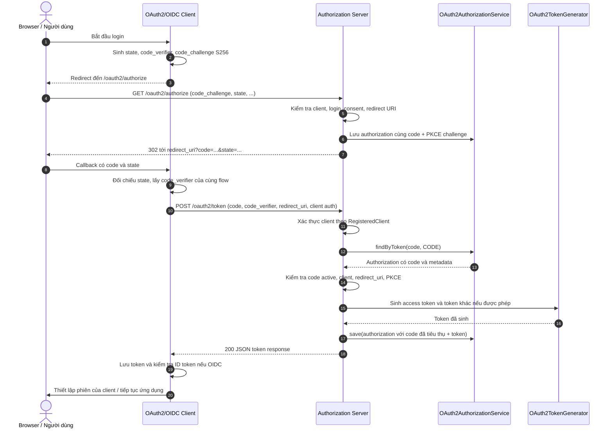
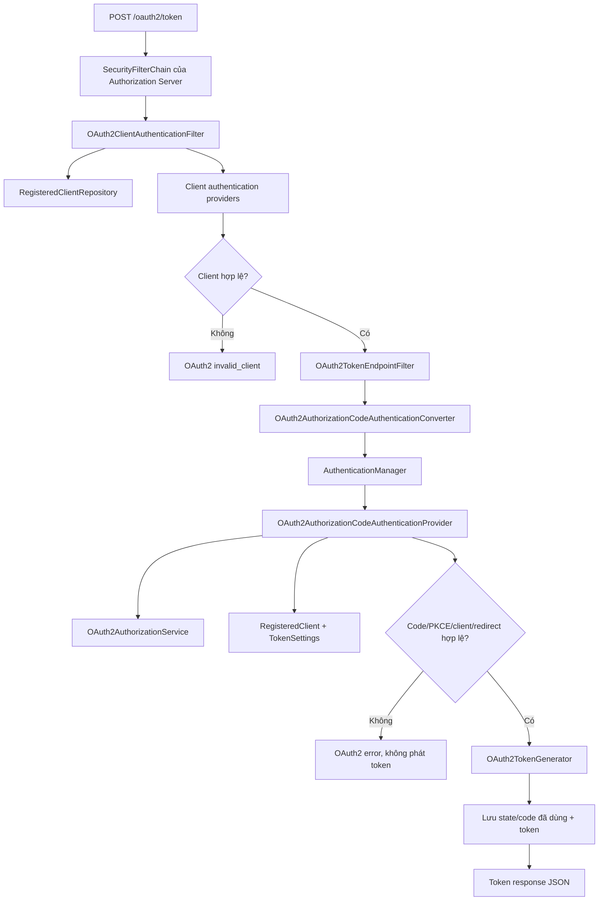
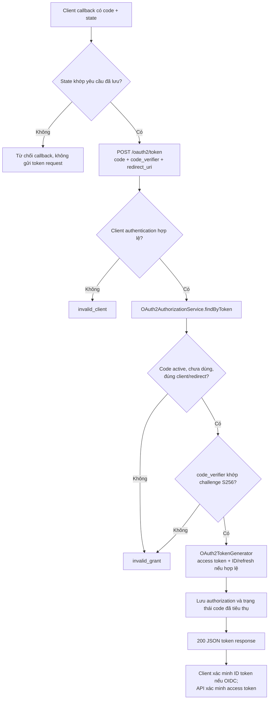

# Trao đổi authorization code lấy token tại Token Endpoint

## 1. Mục tiêu và phạm vi

Trong chương **Authorization Code và PKCE** của module **SPRING_SECURITY_OAUTH2_OIDC_AUTHORIZATION_SERVER**, bước trao đổi **authorization code** tại **Token Endpoint** là điểm chuyển tiếp từ tương tác qua trình duyệt sang yêu cầu cấp token theo giao thức OAuth 2.0/OpenID Connect (OIDC). Với ứng dụng **Spring Boot** sử dụng **Spring Security** và **Spring Authorization Server (SAS)**, đây là một trong những bước cần thiết nhất để thiết kế, cấu hình, bảo mật, kiểm thử và vận hành Authorization Server đúng cách.

Sau khi hoàn thành bài học, bạn có thể:

- Giải thích vì sao **authorization code chưa phải access token**, và vì sao code phải được đổi tại `/oauth2/token`.
- Tạo request `grant_type=authorization_code` từ client, bao gồm `code`, `redirect_uri`, `code_verifier` và thông tin xác thực client khi thích hợp.
- Theo dõi việc SAS xác thực client, truy xuất authorization, kiểm tra PKCE, thời hạn và trạng thái sử dụng một lần của code.
- Phân biệt cách gửi request của **confidential client** và **public client**.
- Hiểu cách `OAuth2TokenGenerator` phát access token, ID token OIDC và refresh token theo điều kiện.
- Đọc token response thành công, lỗi `invalid_grant`/`invalid_client` và các lỗi tương quan.
- Thiết kế kiểm thử end-to-end, kiểm thử replay, kiểm thử nhiều instance và quan sát mà không làm lộ mã hoặc token.

**Phạm vi:** Bài tập trung vào Token Endpoint với **Authorization Code Grant + PKCE (S256)**. Bước cấp code tại Authorization Endpoint đã phải thành công trước khi thực hiện trao đổi. Ví dụ hướng tới API phổ biến của Spring Authorization Server 1.x, Spring Security 6.x và Spring Boot 3.x; khi áp dụng phải đối chiếu phiên bản phụ thuộc thực tế, đặc biệt nếu dùng các phiên bản Spring mới hơn.

## 2. Phân biệt Authorization Endpoint và Token Endpoint

Authorization Code Flow có hai lời gọi giao thức với trách nhiệm khác nhau.

| Nội dung | Authorization Endpoint | Token Endpoint |
| --- | --- | --- |
| Đường dẫn thường dùng | `GET /oauth2/authorize` | `POST /oauth2/token` |
| Ai gửi request? | Browser thay mặt client qua điều hướng | Chính OAuth2 client qua HTTP request |
| Dữ liệu chính | `response_type=code`, `client_id`, `redirect_uri`, `scope`, `state`, `code_challenge` | `grant_type=authorization_code`, `code`, `redirect_uri`, `code_verifier`, client authentication nếu cần |
| Xác thực cần thiết | Người dùng tương tác đăng nhập; client được nhận diện theo registered client | Client được xác thực nếu là confidential; code/PKCE được kiểm tra |
| Trạng thái cần truy xuất | Client, consent, session người dùng, authorization | Authorization code đã phát hành, client binding, PKCE và token state |
| Kết quả thành công | Redirect đến client mang **code** và `state` | JSON token response chứa **access token** và các token khác nếu được cấp |
| Rủi ro cần kiểm soát | Redirect URI, login/consent, CSRF, rò code qua URL | Code replay, code interception, giả mạo client, sai PKCE, rò token |

**Điểm cốt lõi:** AS không nên cấp access token cho browser trong response chuẩn của `response_type=code`. Client chỉ nhận **code** qua callback; bước đổi code ở `/oauth2/token` kiểm tra các ràng buộc mà browser redirect không thể tự đảm bảo.

## 3. Sơ đồ toàn bộ quá trình đổi code

Giả sử client `portal-web` đã đăng ký ở AS `https://auth.example.com` và muốn đăng nhập người dùng rồi gọi API.



Sơ đồ thể hiện trách nhiệm và hành vi mong muốn; thứ tự lời gọi nội bộ cụ thể có thể khác giữa phiên bản SAS. Điều quan trọng là **authorization code phải gắn với dữ liệu được lưu từ authorize request**, và token chỉ được phát hành khi các kiểm tra của grant thành công.

### 3.1. Đối tượng nào giữ bí mật gì?

| Đối tượng | Giữ / sử dụng | Không nên làm |
| --- | --- | --- |
| Browser | Mang redirect response với `code`, `state` | Lưu access/refresh token trong URL hoặc gửi code đến domain không được đăng ký |
| Client | Lưu `state`, `code_verifier` đúng phiên và token đã nhận | Ghép verifier của flow khác hoặc chấp nhận callback không kiểm tra state |
| Authorization Server | Giữ authorization state, challenge, cấu hình client, khóa ký | Trả token khi code sai/hết hạn/đã dùng hoặc bỏ qua PKCE |
| Resource Server | Nhận access token từ client, xác thực token và quyền | Nhận ID token hoặc authorization code thay access token |

**`state`** bảo vệ ràng buộc callback ở phía client; **PKCE** bảo vệ quá trình **đổi code** bằng bằng chứng sở hữu verifier. Hai cơ chế xử lý những rủi ro khác nhau và nên được dùng cùng nhau.

## 4. Những dữ liệu client phải chuẩn bị từ trước

Token Endpoint chỉ nhận code hợp lệ nếu authorization request ban đầu đã tạo đủ ràng buộc.

### 4.1. `code_verifier` và `code_challenge`

PKCE (RFC 7636) định nghĩa `code_verifier` là chuỗi ngẫu nhiên có độ dài **43–128 ký tự**, sử dụng các ký tự không cần percent-encode gồm chữ cái, chữ số, `-`, `.`, `_` và `~`. Client giữ verifier trong ngữ cảnh đã liên kết với authorization request.

Với phương thức **S256**:

```text
code_challenge = BASE64URL-ENCODE(SHA256(ASCII(code_verifier)))
```

Trong đó BASE64URL không dùng dấu `=` padding. Client gửi **challenge** trong authorize request, rồi gửi **verifier** trong token request.

Một ví dụ mô tả, giá trị đã được rút gọn:

```text
Authorization request:
  code_challenge=GENERATED_S256_CHALLENGE
  code_challenge_method=S256

Token request sau callback:
  code_verifier=ORIGINAL_RANDOM_VERIFIER
```

Không gửi verifier ở authorize request và không tạo verifier mới lúc callback: giá trị mới sẽ không khớp challenge đã lưu trên AS.

### 4.2. `state` và OIDC `nonce`

- **`state`:** client sinh giá trị khó đoán, lưu cùng yêu cầu authorize và xác minh khi nhận callback. Nếu callback có `state` sai hoặc thiếu trái mong đợi, client phải từ chối **trước khi gọi Token Endpoint**.
- **`nonce`:** client OIDC có thể gửi trong authorize request; giá trị này được đối chiếu với claim `nonce` trong ID token theo yêu cầu OIDC. Không gửi `nonce` thay `code_verifier` trong token request.
- **`redirect_uri`:** client dùng callback URI khớp với URI đã gửi trong authorize request và được AS đăng ký. Nếu request authorize có `redirect_uri`, token request phải giữ giá trị đó theo quy tắc giao thức.

Client nên lưu các thông tin trên gắn với từng **phiên yêu cầu authorization**; ứng dụng có thể có hai tab đăng nhập đồng thời. Một biến global dùng chung cho mọi tab dễ làm trộn `state` và `code_verifier`.

### 4.3. Authorization code thuộc phiên nào?

Code do AS phát hành liên kết với:

- `RegisteredClient` phù hợp và grant `authorization_code`.
- Principal và scopes được cấp.
- Thời điểm phát hành/hết hạn và trạng thái sử dụng.
- `redirect_uri` và ràng buộc PKCE liên quan.
- Các attributes cần thiết khác cho giao thức, chẳng hạn ngữ cảnh OIDC.

Vì vậy, **một code nhận từ client A không thể dùng tùy ý bởi client B**. Ngay cả khi chuỗi code bị lộ, các ràng buộc vẫn phải được xác minh tại Token Endpoint.

## 5. HTTP request trao đổi authorization code

### 5.1. Confidential client với `client_secret_basic`

Một backend client có thể giữ bí mật và đăng ký:

```java
.clientAuthenticationMethod(
        ClientAuthenticationMethod.CLIENT_SECRET_BASIC)
.authorizationGrantType(
        AuthorizationGrantType.AUTHORIZATION_CODE)
.clientSettings(ClientSettings.builder()
        .requireProofKey(true)
        .build())
```

Sau khi callback được kiểm tra, client gửi **HTTP POST** tới token endpoint với content type `application/x-www-form-urlencoded`.

Ví dụ trên môi trường HTTPS:

```http
POST /oauth2/token HTTP/1.1
Host: auth.example.com
Content-Type: application/x-www-form-urlencoded
Authorization: Basic <BASE64_ENCODED_CLIENT_CREDENTIALS>
Accept: application/json

grant_type=authorization_code&code=ONE_TIME_CODE&redirect_uri=https%3A%2F%2Fportal.example.com%2Flogin%2Foauth2%2Fcode%2Fportal-web&code_verifier=ORIGINAL_CODE_VERIFIER
```

HTTP Basic được tạo từ client credentials theo quy tắc của OAuth 2.0; chỉ Base64 hóa **không** phải mã hóa bảo mật. Client secret cần được chuyển qua **TLS**, và thư viện OAuth2 client thường xử lý form encoding/Basic encoding chính xác. Đừng tự xây Authorization header bằng chuỗi ghép tùy tiện khi ID/secret chứa ký tự đặc biệt.

| Trường | Bắt buộc trong trường hợp nào? | Mục đích |
| --- | --- | --- |
| `grant_type=authorization_code` | Luôn cho grant này | Chọn provider xử lý code exchange |
| `code` | Luôn | Credential một lần từ authorization response |
| `redirect_uri` | Khi đã dùng trong authorize request; theo yêu cầu ràng buộc của grant | AS đối chiếu với redirect URI đã gắn với code |
| `code_verifier` | Với code có PKCE; bắt buộc khi client/policy yêu cầu PKCE | Chứng minh sở hữu verifier tương ứng challenge |
| `Authorization: Basic ...` | Với confidential client đăng ký `client_secret_basic` | Xác thực client |
| `client_id` trong body | Với public client hoặc cách xác thực mà giao thức yêu cầu | Xác định client; không thay thế secret nếu client confidential |

Không gửi `code_challenge` thay `code_verifier` ở Token Endpoint. `state` và `nonce` không phải các tham số đổi code tiêu chuẩn; chúng được xử lý ở client/luồng OIDC theo mục đích riêng.

### 5.2. Public client không có client secret

Với SPA, native/mobile app hoặc client không thể giữ secret, đăng ký `ClientAuthenticationMethod.NONE` và yêu cầu PKCE:

```java
.clientAuthenticationMethod(ClientAuthenticationMethod.NONE)
.authorizationGrantType(AuthorizationGrantType.AUTHORIZATION_CODE)
.clientSettings(ClientSettings.builder()
        .requireProofKey(true)
        .build())
```

Request đổi code khi đó có thể là:

```http
POST /oauth2/token HTTP/1.1
Host: auth.example.com
Content-Type: application/x-www-form-urlencoded

grant_type=authorization_code&client_id=mobile-app&code=ONE_TIME_CODE&redirect_uri=com.example.app%3A%2Fcallback&code_verifier=ORIGINAL_CODE_VERIFIER
```

`client_id` không phải credential bí mật. Public client không nên nhúng một `client_secret` vào source rồi xem như confidential client. Khi dùng redirect URI cho native client, phải áp dụng profile URI và quy tắc đăng ký phù hợp; URI ở trên chỉ là minh họa hình thức.

**PKCE không thay thế mọi biện pháp xác thực client.** Nó chứng minh request đổi code có verifier gắn với authorize request; khi client là confidential, AS vẫn phải xác thực client theo phương thức đã đăng ký.

## 6. Token Endpoint của Spring Authorization Server xử lý ở đâu?

Trong SAS, các lớp Spring Security hợp tác để nhận, xác thực và xử lý code exchange.



Sơ đồ mô tả đường xử lý khái niệm, không cam kết thứ tự gọi chính xác bên trong từng version/framework.

| Thành phần | Vai trò |
| --- | --- |
| `OAuth2ClientAuthenticationFilter` | Tách yêu cầu xác thực client trước khi grant được xử lý; lựa chọn phương thức Basic, POST, private-key JWT hoặc none theo cấu hình. |
| `RegisteredClientRepository` | Tra cứu client và kiểm tra method, grant type, scope/redirect/token settings đã đăng ký. |
| `OAuth2TokenEndpointFilter` | Nhận token request, chuyển thành authentication request và trả token response hoặc OAuth error. |
| `OAuth2AuthorizationCodeAuthenticationConverter` | Chuyển form request `grant_type=authorization_code` và các tham số thành authentication token phù hợp. |
| `OAuth2AuthorizationCodeAuthenticationProvider` | Kiểm tra code và các ràng buộc grant trước khi phát token. |
| `OAuth2AuthorizationService` | Tìm authorization theo code, đọc trạng thái và lưu authorization khi code được tiêu thụ/token đã phát hành. |
| `OAuth2TokenGenerator<?>` | Sinh access token, refresh token và ID token trong những trường hợp được phép. |
| `AuthorizationServerSettings` | Định nghĩa đường dẫn token endpoint, issuer và các endpoint liên quan. |

**Phân biệt tên:** `OAuth2AuthorizationCodeRequestAuthenticationProvider` xử lý **authorization request** khi phát code tại `/oauth2/authorize`. `OAuth2AuthorizationCodeAuthenticationProvider` xử lý **token request** khi đổi code tại `/oauth2/token`. Nhầm hai provider dễ dẫn đến gắn custom logic sai chặng giao thức.

## 7. Kiểm tra code, client, redirect và PKCE tại Token Endpoint

### 7.1. Tìm authorization theo code

Provider tra authorization đã lưu qua interface:

```java
OAuth2Authorization authorization =
        authorizationService.findByToken(
                codeValue,
                new OAuth2TokenType(OAuth2ParameterNames.CODE));
```

Sau đó có thể xem token code:

```java
OAuth2Authorization.Token<OAuth2AuthorizationCode> code =
        authorization == null
                ? null
                : authorization.getToken(OAuth2AuthorizationCode.class);
```

`findByToken` có thể trả `null` khi không tìm thấy code. Nếu có bản ghi, việc `code != null` **chưa đủ**: token cần còn hạn, chưa bị invalidated và phải thỏa đầy đủ điều kiện grant. SAS provider chuẩn xử lý các kiểm tra này; không tạo token bằng một controller chỉ gọi `findByToken` rồi phát JWT.

### 7.2. Những điều kiện phải kiểm tra

| Điều kiện | Vì sao quan trọng? | Khi sai |
| --- | --- | --- |
| Code tồn tại và đúng loại | Không trao đổi chuỗi tùy ý/loại token khác | Từ chối theo lỗi grant |
| Code còn hạn | Chống sử dụng credential cũ | Từ chối `invalid_grant` hoặc lỗi tương ứng |
| Code chưa được dùng/invalidated | Chống replay | Từ chối, không cấp token bổ sung |
| Client hiện tại khớp client gắn với authorization | Ngăn client B dùng code của client A | Từ chối |
| Registered client cho phép `authorization_code` | Không cấp grant ngoài đăng ký | Từ chối |
| `redirect_uri` phù hợp yêu cầu authorize | Ngăn tráo callback/flow | Từ chối |
| `code_verifier` tương ứng challenge và method | Chống code interception/injection | Từ chối |
| Client authentication hợp lệ nếu client confidential | Xác thực bên đang thực hiện token request | Từ chối `invalid_client` |
| Cấu hình issuer, token policy và persistence hợp lệ | Không phát token sai cấu hình hoặc mất state | Không phát token khi không thể hoàn tất |

Token endpoint phải xác thực **đúng client**. Một request mang đúng code và verifier nhưng gửi bằng client khác không được nhận token.

### 7.3. Kiểm tra PKCE S256

Nếu authorization request đã lưu:

```text
code_challenge_method = S256
code_challenge = EXPECTED_CHALLENGE
```

thì ở token request SAS so sánh thử thách đã lưu với giá trị tính từ verifier đã nhận:

```text
expected = BASE64URL(SHA256(ASCII(code_verifier)))
valid = expected equals stored code_challenge
```

Việc so sánh cần được xử lý bởi thư viện/provider đã được kiểm thử để tránh lỗi chuỗi/encoding và rò rỉ do triển khai tự phát. Không thay `S256` bằng `plain` để “chữa” request sai. Không chấp nhận verifier trống, verifier bị thay hoặc verifier của phiên khác.

**Ví dụ đúng:** Client sinh `V1`, gửi `SHA256(V1)` ở authorize và `V1` ở token request. **Ví dụ sai:** Client sinh `V2` lúc callback và dùng `V2`, dù `state` của callback đúng thì PKCE vẫn không khớp.

### 7.4. Việc dùng một lần được xử lý như thế nào?

Authorization code là credential **một lần**. Sau khi đổi code thành công, SAS cập nhật authorization state để code không thể tiếp tục được dùng như một code active. Lần cố gắng đổi lại cùng code phải bị từ chối. Việc phát hiện sử dụng lại có thể làm framework vô hiệu hóa token liên quan theo quy tắc triển khai; không nên tự viết lại để bỏ qua kiểm tra replay.

**Lưu ý về concurrency:** `findByToken` và `save` của `OAuth2AuthorizationService` là thao tác riêng ở API storage. Trong hệ thống có request đồng thời và nhiều instance, cần kiểm thử thực tế về single-use và nhất quán. Khi tự triển khai repository/provider, có thể cần transaction, locking hoặc cơ chế “consume code atomically” để tránh hai request cùng nhìn thấy code active. Không giả định một store tùy chỉnh chỉ dùng `HashMap` hoặc CRUD đơn giản bảo đảm nguyên tử trong mọi môi trường.

## 8. Phát hành token sau khi code hợp lệ

### 8.1. Vai trò `OAuth2TokenGenerator`

Sau khi kiểm tra grant thành công, SAS xây dựng ngữ cảnh phát token từ registered client, principal, authorized scopes, authorization và token type. Tùy cấu hình, `OAuth2TokenGenerator<?>` phối hợp các generator:

- **`JwtGenerator`:** tạo JWT khi token format/chức năng yêu cầu (chẳng hạn ID token OIDC và JWT access token).
- **`OAuth2AccessTokenGenerator`:** tạo access token dạng opaque/reference tùy lựa chọn token format.
- **`OAuth2RefreshTokenGenerator`:** tạo refresh token nếu grant/client/policy cho phép.

Các thành phần có thể được SAS cấu hình mặc định hoặc được ứng dụng tự cung cấp. Nếu tự thay `OAuth2TokenGenerator`, phải bảo đảm không vô tình mất khả năng sinh ID token, access token hoặc refresh token mà flow yêu cầu.

### 8.2. Access token và Resource Server

Access token cho phép client gọi API trong phạm vi đã cấp. Một access token có thể là JWT hoặc opaque, tùy `TokenSettings` và hệ thống.

- Với **JWT**, Resource Server xác minh chữ ký, `iss`, `exp`, **`aud`** phù hợp API và quyền (`scope`/`authority`). Không chỉ kiểm tra chữ ký.
- Với **opaque token**, Resource Server thường sử dụng introspection hoặc cơ chế kiểm tra token status tương ứng.
- Access token **không** được dùng làm bằng chứng ID token OIDC cho client và không được đưa vào URL callback authorize.
- `scope` thực tế trong token response có thể phản ánh scopes đã được cấp; không tự giả định tất cả scopes client yêu cầu đều được cấp.

### 8.3. ID token khi dùng OpenID Connect

Nếu client sử dụng OIDC, đã yêu cầu scope `openid` và tính năng OIDC được bật/cấu hình, token response từ Authorization Code Flow thông thường có **ID token**. Client xác minh chữ ký và các claim, ít nhất `iss`, `aud`, `exp` và các điều kiện phù hợp; khi sử dụng `nonce`, phải xác minh nó theo flow.

ID token có đối tượng nhận là **OIDC Client/Relying Party**, không dùng thay access token để gọi API. Không chia sẻ ID token bừa bãi cho Resource Server hoặc bên thứ ba.

### 8.4. Refresh token có điều kiện

Refresh token **không được bảo đảm luôn xuất hiện**. SAS xét client registration, grant type được cho phép, loại client và token policy. Ví dụ confidential client có thể đăng ký `AuthorizationGrantType.REFRESH_TOKEN`; không đồng nghĩa mọi public client sẽ được cấp refresh token trong tất cả version/cấu hình.

Token endpoint trả refresh token khi được phép; client cần lưu an toàn và áp chính sách rotation/revocation. Tránh gửi refresh token qua browser redirect hoặc lưu ở nơi JavaScript không đáng tin cậy có thể đọc.

## 9. Token response thành công

Với grant thành công, Token Endpoint thường trả HTTP `200 OK` và JSON theo OAuth 2.0.

```http
HTTP/1.1 200 OK
Content-Type: application/json;charset=UTF-8
Cache-Control: no-store
Pragma: no-cache

{
  "access_token": "<ACCESS_TOKEN_VALUE>",
  "token_type": "Bearer",
  "expires_in": 300,
  "scope": "openid profile",
  "id_token": "<OIDC_ID_TOKEN_IF_ISSUED>",
  "refresh_token": "<REFRESH_TOKEN_IF_ISSUED>"
}
```

Đây là **response minh họa** cho trường hợp OIDC có cấp ID token và refresh token; các trường tùy chọn có thể **không xuất hiện**. Giá trị trong dấu góc là placeholder, không phải token có thể sử dụng.

| Trường | Ý nghĩa |
| --- | --- |
| `access_token` | Credential để client truy cập Resource Server |
| `token_type` | Cách sử dụng access token, thường là `Bearer` |
| `expires_in` | Số giây access token còn hiệu lực tại thời điểm trả response |
| `scope` | Scopes được cấp, khi cần phản ánh khác scope request hoặc theo giao thức |
| `id_token` | OIDC identity token nếu `openid` được xử lý và đủ điều kiện |
| `refresh_token` | Token dùng xin access token mới khi grant/policy cho phép |

### 9.1. Client xử lý response như thế nào?

Với một backend web client:

1. Nhận JSON qua kênh HTTPS và kiểm tra HTTP status, content type và trường bắt buộc.
2. Kiểm tra ID token theo OIDC nếu đã thực hiện OIDC login; không dùng `access_token` để suy danh tính từ những claim không thuộc contract.
3. Lưu token trong storage dành cho backend, hạn chế quyền truy cập, đặt TTL/rotation phù hợp.
4. Tạo session của **ứng dụng client** nếu cần; session client khác session login của Authorization Server.
5. Gọi Resource Server với `Authorization: Bearer <access_token>` và xử lý 401/403 đúng ý nghĩa.

Nếu Token Endpoint lỗi hoặc timeout, client không được tự bỏ qua PKCE để thử lại bằng grant yếu hơn. Cách phục hồi phụ thuộc việc code đã được tiêu thụ hay chưa; khi không chắc chắn, khởi tạo authorization flow mới thường là an toàn nhất.

### 9.2. Tránh đưa token vào log

Bất kỳ trường token nào trong JSON response đều là credential nhạy cảm. Không bật logging full response body cho `/oauth2/token` trong production. Khi cần chẩn đoán, log correlation ID, grant type, nhóm lỗi, latency và client ID đã được cho phép; không ghi raw `code`, `code_verifier`, `client_secret`, `access_token`, `id_token` hoặc `refresh_token`.

## 10. Phản hồi lỗi tại Token Endpoint

### 10.1. Các lỗi quan trọng

| Lỗi OAuth2 | Nguyên nhân điển hình | Hướng xử lý đúng |
| --- | --- | --- |
| `invalid_client` | Client không tồn tại, secret sai, phương thức xác thực client sai hoặc credential hết hiệu lực | Kiểm tra `RegisteredClient` và cơ chế client authentication; không hạ bảo mật |
| `invalid_grant` | Code sai, hết hạn, đã sử dụng, gắn sai client hoặc PKCE/redirect không hợp lệ | Bắt đầu flow mới; tìm nguyên nhân ở code/PKCE/client/redirect |
| `unsupported_grant_type` | `grant_type` không được server hỗ trợ | Client phải gửi đúng `authorization_code` |
| `invalid_request` | Thiếu tham số, lặp tham số không hợp lệ, form content/type sai | Xem lại request format và những field bắt buộc |
| `unauthorized_client` | Client không được phép sử dụng grant đã chọn | Kiểm tra `authorizationGrantTypes` trong registered client |
| `invalid_scope` | Scope không được phép hoặc không hợp lệ khi grant áp dụng | Không tự cấp rộng hơn scopes đã được phê duyệt |
| `server_error` / HTTP 5xx | Sự cố nội bộ, DB/KMS/token generator không sẵn sàng | Xử lý sự cố hạ tầng, không in secrets/stacktrace cho client |

Trạng thái HTTP có thể khác theo lỗi và xử lý provider. Ví dụ lỗi client authentication có thể mang HTTP 401 và header phù hợp, trong khi `invalid_grant` thường được trả trong error JSON kèm 400. Việc kiểm thử nên đối chiếu quy tắc OAuth2 và hành vi phiên bản SAS đang triển khai.

### 10.2. Ví dụ lỗi code không hợp lệ

```http
HTTP/1.1 400 Bad Request
Content-Type: application/json;charset=UTF-8
Cache-Control: no-store
Pragma: no-cache

{
  "error": "invalid_grant"
}
```

Không trả `code_verifier`, raw code hoặc chi tiết “code thuộc về user X/client Y” trong `error_description` công khai. Diễn giải quá cụ thể có thể làm lộ dữ liệu cấp quyền và hỗ trợ tấn công đoán thông tin.

### 10.3. Không nhầm lỗi callback với lỗi token exchange

- **Authorization Endpoint** có thể redirect lỗi về callback đã được xác minh.
- **Token Endpoint** trả **HTTP response JSON** cho client đang gửi POST; không redirect browser kèm access token hoặc OAuth error.
- `state mismatch` là lỗi client phải phát hiện tại callback, trước token request.
- Sai `code_verifier` hoặc code hết hạn là lỗi thuộc token exchange.

Nếu `/oauth2/token` lại trả HTML login form cho backend client, cần kiểm tra security filter chain, matcher và authentication entry point: request có thể đang bị route sai hoặc cấu hình security không phù hợp.

## 11. Ví dụ Spring Authorization Server: kết nối các thành phần

Các ví dụ sau minh họa wiring quan trọng. Chúng không thay thế cấu hình đầy đủ của AS: ứng dụng vẫn cần người dùng/đăng nhập, authorization consent nếu dùng, signing key/JWK, repository và các dependency tương ứng.

### 11.1. Security filter chain

```java
@Configuration(proxyBeanMethods = false)
@EnableWebSecurity
class AuthorizationServerConfig {

    @Bean
    @Order(1)
    SecurityFilterChain authorizationServerChain(HttpSecurity http)
            throws Exception {

        OAuth2AuthorizationServerConfigurer as =
                OAuth2AuthorizationServerConfigurer.authorizationServer();

        http
            .securityMatcher(as.getEndpointsMatcher())
            .with(as, configurer ->
                    configurer.oidc(Customizer.withDefaults()))
            .authorizeHttpRequests(authorize ->
                    authorize.anyRequest().authenticated())
            .exceptionHandling(exceptions ->
                    exceptions.defaultAuthenticationEntryPointFor(
                            new LoginUrlAuthenticationEntryPoint("/login"),
                            new MediaTypeRequestMatcher(MediaType.TEXT_HTML)))
            .oauth2ResourceServer(oauth2 ->
                    oauth2.jwt(Customizer.withDefaults()));

        return http.build();
    }

    @Bean
    @Order(2)
    SecurityFilterChain applicationChain(HttpSecurity http)
            throws Exception {

        http.authorizeHttpRequests(authorize ->
                    authorize.anyRequest().authenticated())
            .formLogin(Customizer.withDefaults());

        return http.build();
    }

    @Bean
    AuthorizationServerSettings authorizationServerSettings() {
        return AuthorizationServerSettings.builder()
                .issuer("http://localhost:9000")
                .build();
    }
}
```

`as.getEndpointsMatcher()` giúp route `/oauth2/token` tới chain của SAS. Authorization Server xử lý client authentication và grant theo provider chuẩn; không cần tự viết controller `@PostMapping("/oauth2/token")`.

Trong bản ví dụ local, `http://localhost:9000` là issuer và cổng 9000 cần được cấu hình trong Spring Boot. Khi dùng production, issuer phải là HTTPS public URL ổn định, khớp metadata và `iss` của token.

### 11.2. Registered client với Authorization Code + PKCE

```java
@Bean
PasswordEncoder passwordEncoder() {
    return new BCryptPasswordEncoder();
}

@Bean
RegisteredClientRepository registeredClientRepository(
        PasswordEncoder encoder,
        @Value("${LOCAL_CLIENT_SECRET}") String rawSecret) {

    RegisteredClient client = RegisteredClient
            .withId("portal-web-local-001")
            .clientId("portal-web")
            .clientSecret(encoder.encode(rawSecret))
            .clientAuthenticationMethod(
                    ClientAuthenticationMethod.CLIENT_SECRET_BASIC)
            .authorizationGrantType(
                    AuthorizationGrantType.AUTHORIZATION_CODE)
            .authorizationGrantType(
                    AuthorizationGrantType.REFRESH_TOKEN)
            .redirectUri(
                    "http://127.0.0.1:8080/login/oauth2/code/portal-web")
            .scope(OidcScopes.OPENID)
            .scope(OidcScopes.PROFILE)
            .clientSettings(ClientSettings.builder()
                    .requireProofKey(true)
                    .requireAuthorizationConsent(true)
                    .build())
            .tokenSettings(TokenSettings.builder()
                    .authorizationCodeTimeToLive(Duration.ofMinutes(2))
                    .accessTokenTimeToLive(Duration.ofMinutes(5))
                    .build())
            .build();

    return new InMemoryRegisteredClientRepository(client);
}

@Bean
OAuth2AuthorizationService authorizationService() {
    return new InMemoryOAuth2AuthorizationService();
}

@Bean
OAuth2AuthorizationConsentService authorizationConsentService() {
    return new InMemoryOAuth2AuthorizationConsentService();
}
```

Đặt các `@Bean` này trong một class `@Configuration` riêng, và chỉ cung cấp **một implementation** cho mỗi service. Ví dụ đăng ký client `portal-web` là confidential client nên cần secret; raw secret phải đến từ biến môi trường/secret manager và không có trong source.

Với OIDC (`openid`), cần tiếp tục cấu hình signing key/JWKSource và JwtDecoder phù hợp. Ví dụ này cố ý tập trung vào registration, PKCE và state store của code exchange.

### 11.3. Thay lưu trữ in-memory bằng JDBC

Khi triển khai nhiều AS instance hoặc cần authorization state tồn tại qua restart, thay in-memory service:

```java
@Bean
OAuth2AuthorizationService authorizationService(
        JdbcTemplate jdbcTemplate,
        RegisteredClientRepository registeredClientRepository) {

    return new JdbcOAuth2AuthorizationService(
            jdbcTemplate, registeredClientRepository);
}
```

Đây là **phương án thay thế bean in-memory**, không đăng ký đồng thời cả hai mà không có cơ chế chọn rõ ràng. Cần schema đúng phiên bản SAS, database connection và registered client repository phù hợp.

Với nhiều node, phải chia sẻ dữ liệu authorization; đồng thời đồng bộ **issuer**, signing keys, và browser login session theo kiến trúc. Sử dụng JDBC chung cho authorization không tự giải quyết mọi race condition của code exchange khi có hai POST đồng thời; cần integration test phù hợp.

## 12. Thực hành local bằng PowerShell và curl

### 12.1. Chuẩn bị môi trường

Giả sử:

```text
Authorization Server: http://localhost:9000
OAuth2 client ID:      portal-web
OAuth2 redirect URI:  http://127.0.0.1:8080/login/oauth2/code/portal-web
Client method:         client_secret_basic
Code challenge method: S256
```

Các giá trị local chỉ phục vụ học tập trên loopback. Khi trao đổi credentials qua mạng thực, phải dùng HTTPS.

### 12.2. Sinh PKCE verifier, challenge và state

Trên Windows PowerShell:

```powershell
$bytes = New-Object byte[] 32
$rng = [System.Security.Cryptography.RandomNumberGenerator]::Create()
try {
    $rng.GetBytes($bytes)
} finally {
    $rng.Dispose()
}

$verifier = [Convert]::ToBase64String($bytes).
    TrimEnd('=').Replace('+','-').Replace('/','_')

$sha256 = [System.Security.Cryptography.SHA256]::Create()
try {
    $hash = $sha256.ComputeHash(
        [System.Text.Encoding]::ASCII.GetBytes($verifier))
} finally {
    $sha256.Dispose()
}

$challenge = [Convert]::ToBase64String($hash).
    TrimEnd('=').Replace('+','-').Replace('/','_')

$state = [guid]::NewGuid().ToString("N")
$nonce = [guid]::NewGuid().ToString("N")
```

`$verifier` dài khoảng 43 ký tự Base64URL, phù hợp giới hạn PKCE. Dùng cùng biến `$verifier` ở lần đổi code; không khởi tạo lại khi callback.

Với hệ thống production, client library nên tự quản lý `state`/PKCE theo phiên request, có lưu trữ tách biệt giữa những login flow đồng thời. Đoạn PowerShell chỉ giúp quan sát cách tính.

### 12.3. Khởi tạo authorize request

```powershell
$redirectUri = "http://127.0.0.1:8080/login/oauth2/code/portal-web"
$redirect = [uri]::EscapeDataString($redirectUri)

$authorizeUrl =
    "http://localhost:9000/oauth2/authorize" +
    "?response_type=code" +
    "&client_id=portal-web" +
    "&redirect_uri=$redirect" +
    "&scope=openid%20profile" +
    "&state=$state" +
    "&nonce=$nonce" +
    "&code_challenge=$challenge" +
    "&code_challenge_method=S256"

Start-Process $authorizeUrl
```

Đăng nhập và consent theo cấu hình. Browser được redirect tới callback của client chứa code và state. **Chỉ sử dụng authorization code từ chính request vừa tạo**, kiểm tra state trùng biến `$state`.

Nếu ứng dụng tại `127.0.0.1:8080` chưa chạy, browser có thể báo không kết nối được; vẫn có thể quan sát redirect URI trong thanh địa chỉ **trong môi trường kiểm thử riêng**, nhưng không sao chép raw code ra log hoặc dịch vụ ngoài. Với client thực, callback và xử lý state/token nên do thư viện client đảm nhiệm.

### 12.4. Đổi code bằng `curl.exe`

Trong **cùng phiên PowerShell** vẫn có `$verifier`:

```powershell
$code = Read-Host "Authorization code from valid callback"

curl.exe --user portal-web --data-urlencode "grant_type=authorization_code" --data-urlencode "code=$code" --data-urlencode "redirect_uri=$redirectUri" --data-urlencode "code_verifier=$verifier" http://localhost:9000/oauth2/token
```

`curl.exe --user portal-web` không cung cấp mật khẩu trên command line; curl có thể yêu cầu nhập client secret qua prompt. Cách này tránh đưa secret vào shell history, nhưng response có thể in raw token ra terminal; chỉ dùng trong lab cô lập, không lưu/chia sẻ output. Dùng HTTPS cho môi trường không phải loopback.

**Điều kiện thành công:** code vừa nhận, chưa dùng/hết hạn; secret khớp `portal-web`; `redirect_uri` đúng giá trị authorization request; verifier khớp challenge S256; server có token generator và signing key nếu phát JWT/OIDC ID token.

### 12.5. Thử lỗi một cách có kiểm soát

Có thể tạo **một authorization flow mới cho mỗi testcase**:

1. Dùng verifier sai và kỳ vọng `invalid_grant`.
2. Dùng đúng verifier nhưng sửa redirect URI, kỳ vọng request bị từ chối.
3. Dùng client secret sai, kỳ vọng `invalid_client`.
4. Đổi code hợp lệ thành công, sau đó thử lại cùng code, kỳ vọng bị từ chối.
5. Chờ code hết hạn rồi thử trao đổi, kỳ vọng không cấp token.
6. Gửi yêu cầu thiếu `grant_type` hoặc thiếu `code`, kỳ vọng lỗi request phù hợp.
7. Cố gắng dùng client ID khác code gắn với `portal-web`, kỳ vọng bị từ chối.

Không giải quyết bằng cách tăng thời hạn code vô hạn, tắt PKCE hoặc bỏ qua client authentication để test vượt qua. Với bài kiểm thử automation, nên tạo fixture riêng và khống chế thời gian thay vì phụ thuộc việc người kiểm thử chờ lâu.

## 13. Kiểm thử tự động và ma trận bảo mật

### 13.1. Ma trận thành công/thất bại

| Kịch bản | Điều kiện | Kết quả mong đợi |
| --- | --- | --- |
| Authorization Code + PKCE thành công | Code đúng, client đúng, verifier và redirect URI đúng | Token Endpoint trả access token; OIDC ID token và refresh token tùy điều kiện |
| Code không tồn tại | Chuỗi bất kỳ chưa được phát hành | `invalid_grant`; không phát token |
| Code đã hết hạn | Qua `authorizationCodeTimeToLive` | Bị từ chối, không cấp token |
| Code đã sử dụng | Lặp lại POST sau lần đổi thành công | Bị từ chối theo single-use |
| PKCE verifier sai | Không khớp challenge | Bị từ chối, không cấp token |
| PKCE verifier thiếu | Client có `requireProofKey(true)` hoặc code gắn challenge | Bị từ chối |
| `redirect_uri` khác | Không trùng URI gắn với authorize request | Bị từ chối |
| Client authentication sai | Secret/method không khớp registered client | `invalid_client` hoặc lỗi xác thực phù hợp |
| Client khác đổi code | `client_id` không khớp authorization | Không cấp token |
| Grant không được phép | Client không đăng ký `authorization_code` | Không cấp token |
| OIDC scope `openid` | OIDC bật, grant hợp lệ | ID token được phát theo quy tắc OIDC |
| Không yêu cầu `openid` | OAuth2 flow thông thường | Không mặc nhiên phát ID token |
| Refresh token không được phép | Client/policy không thỏa | Response không có refresh token |
| Token store lỗi | Không thể đọc/ghi state | Không trả token thành công giả |
| Hai POST dùng cùng code đồng thời | Concurrency/replay | Không chấp nhận việc sử dụng code trái với chính sách single-use |
| Nhiều instance AS | Phát code ở node A, đổi tại B | Hoạt động khi storage/session/issuer/keys được cấu hình phù hợp |

### 13.2. Test logic PKCE riêng

PKCE nên có unit test xác minh quy tắc **S256** và xử lý input không hợp lệ. Ví dụ dùng test vector công khai trong RFC 7636:

```text
code_verifier:
dBjftJeZ4CVP-mB92K27uhbUJU1p1r_wW1gFWFOEjXk

S256 code_challenge:
E9Melhoa2OwvFrEMTJguCHaoeK1t8URWbuGJSstw-cM
```

Code mẫu kiểm tra phép biến đổi trong Java:

```java
String verifier = "dBjftJeZ4CVP-mB92K27uhbUJU1p1r_wW1gFWFOEjXk";

byte[] sha = MessageDigest.getInstance("SHA-256")
        .digest(verifier.getBytes(StandardCharsets.US_ASCII));

String challenge = Base64.getUrlEncoder()
        .withoutPadding()
        .encodeToString(sha);

assertEquals(
        "E9Melhoa2OwvFrEMTJguCHaoeK1t8URWbuGJSstw-cM",
        challenge);
```

Đây là test của phép tính PKCE, **không thay thế** test provider/token endpoint thực. Với service có custom logic, nên kiểm thử thêm verifier sai charset, độ dài nhỏ hơn 43 hoặc lớn hơn 128, khác challenge, khác method và các giá trị trùng/lặp field.

### 13.3. Integration test qua Spring Security / MockMvc

Thay vì chỉ mock `OAuth2TokenGenerator` rồi kết luận Token Endpoint an toàn, hãy chạy ít nhất một flow có:

- `RegisteredClientRepository` chứa confidential client yêu cầu PKCE.
- `OAuth2AuthorizationService` và consent store phù hợp.
- Authorization code được tạo qua authorize flow hoặc fixture được xây đúng ngữ nghĩa.
- Request `POST /oauth2/token` với content type form và Basic client authentication.
- Xác minh token response và authorization state sau khi trao đổi.
- Các test lỗi cho code replay, sai verifier, sai client và redirect URI.

Có thể sử dụng Spring Security Test/MockMvc cho lớp filter, còn JDBC persistence và race condition nên kiểm tra bằng integration test với database thật hoặc Testcontainers. Kết quả kiểm thử phụ thuộc version SAS vì cách converter/provider và nội dung lỗi có thể thay đổi.

### 13.4. Kiểm thử token ở client và API

Ngay cả khi Token Endpoint trả HTTP 200, cần xác minh:

- OIDC client kiểm tra ID token `iss`, `aud`, chữ ký, `exp` và `nonce` khi áp dụng.
- Resource Server kiểm tra access token theo định dạng/token type, issuer, audience, expiry và authority/scope.
- Token response không chứa scope ngoài quyền.
- Token được lưu với TTL/rotation phù hợp và không xuất hiện trong URL/log.
- Logout khỏi Authorization Server **không tự động** làm JWT access token còn hạn bị từ chối ở API nếu API chỉ kiểm tra offline.

## 14. Vận hành Token Endpoint an toàn

### 14.1. Những chỉ số quan trọng

| Điểm quan sát | Tín hiệu hữu ích | Dữ liệu phải tránh |
| --- | --- | --- |
| `/oauth2/token` | Request count, latency P50/P95/P99, tỷ lệ lỗi theo grant/client đã làm sạch | Raw code, `code_verifier`, Basic Authorization header, response token |
| Client authentication | `invalid_client`, tỷ lệ thất bại tăng bất thường | Client secret, password hash |
| Authorization store | Lookup/save latency, DB connection lỗi, số code hết hạn | Raw token/code và toàn bộ authorization |
| Token generation | Lỗi ký JWT/JWK, KMS không sẵn sàng, thời gian sinh token | Private keys, token body |
| PKCE validation | Số lỗi request invalid/replay theo nhóm | Verifier/challenge gốc nếu không cần thiết |
| Multi-instance | Độ ổn định khi đổi code khác node, lỗi persistence | Raw session ID, full callback URL |

Nên dùng **correlation ID** không chứa credential để nối request và sự kiện qua các thành phần. Không dùng authorization code hay access token làm correlation ID.

### 14.2. Reverse proxy, issuer và HTTPS

- Token Endpoint và Authorization Endpoint cần HTTPS khi triển khai qua mạng thực.
- `AuthorizationServerSettings.issuer` phải khớp URL public và claim `iss` trong token/metadata.
- Proxy phải xử lý trusted forwarded headers và không để client Internet tự giả mạo scheme/host.
- Cấu hình endpoint path trong gateway phải đồng nhất với discovery metadata và URL được client sử dụng.
- Nếu client chạy ở container, `localhost` từ container chỉ loopback container đó; cần tên mạng đúng nhưng vẫn giữ issuer được xác minh nhất quán.

### 14.3. Sự cố thường gặp

| Hiện tượng | Nguyên nhân khả dĩ | Điều cần kiểm tra |
| --- | --- | --- |
| `POST /oauth2/token` trả HTML login | Token request vào sai `SecurityFilterChain` hoặc auth entry point | Matcher, order, client authentication filter và token endpoint config |
| `invalid_client` | Secret sai, method không được đăng ký, credential hết hạn | `RegisteredClient`, `PasswordEncoder`, cách gửi Basic/POST |
| `invalid_grant` sau callback hợp lệ | Verifier mất, redirect URI khác, code hết hạn/đã dùng hoặc token request qua node không đọc được store | Correlation ID, request state, PKCE, `OAuth2AuthorizationService` |
| Client tạo challenge mới sau callback | Không giữ `code_verifier` của flow ban đầu | Lưu PKCE verifier gắn với `state`, giữ qua redirect |
| Token endpoint trả 404 | Token endpoint path đổi hoặc chain không khớp | `AuthorizationServerSettings`, `getEndpointsMatcher()`, gateway |
| Token không ký được | `JWKSource`/signing key không có hoặc sai cấu hình | JWKSource, `kid`, algorithm, provider/KMS |
| Có access token nhưng không có ID token | Chưa bật OIDC, thiếu `openid` hoặc config OIDC không đúng | OIDC configurer, registered scopes, token generator |
| Không có refresh token | Grant/client/policy không cho phép | `RegisteredClient`, `TokenSettings` và loại client |
| Code được nhận ở A, đổi tại B thất bại | Authorization store in-memory riêng từng node | JDBC/shared store, consistency, session và issuer |
| JWT bị API từ chối | Sai issuer/audience/key/clock hoặc quyền | Resource Server validation và JWKS/discovery |
| Gặp lỗi ngắt mạng sau token response | Không biết code đã được tiêu thụ chưa | Không giả định retry luôn an toàn; bắt đầu flow mới khi cần |

## 15. Checklist triển khai

- [ ] Client lưu `state` và `code_verifier` riêng theo từng authorization flow.
- [ ] Authorization Endpoint đã cấp code đúng client, scope, redirect URI và PKCE S256.
- [ ] Client kiểm tra `state` trước khi gửi code tới Token Endpoint.
- [ ] Request đổi code dùng `POST /oauth2/token` và `Content-Type: application/x-www-form-urlencoded`.
- [ ] Có `grant_type=authorization_code`, `code`, `code_verifier` và `redirect_uri` theo yêu cầu.
- [ ] Confidential client xác thực đúng method; public client không giả giữ shared secret.
- [ ] SAS kiểm tra code tồn tại, active, chưa dùng, gắn đúng client và redirect URI.
- [ ] PKCE S256 được kiểm tra bằng verifier gốc, không fallback sang cơ chế yếu.
- [ ] Code bị tiêu thụ sau khi đổi thành công; replay bị từ chối.
- [ ] Token response có access token và chỉ thêm ID/refresh token khi đủ điều kiện.
- [ ] Client/API xác minh token đúng vai trò và audience/scope.
- [ ] Không log code, verifier, secret, token hoặc private signing key.
- [ ] Khi chạy nhiều instance, authorization store được chia sẻ và các thành phần thống nhất issuer/keys.
- [ ] Đã kiểm thử cả lỗi code expired, reuse, redirect mismatch, PKCE mismatch, client authentication và lỗi database.
- [ ] Có giám sát latency, lỗi token generator, lỗi store và TLS/proxy setup.

## 16. Bản đồ ghi nhớ



Trao đổi authorization code tại Token Endpoint là **bước xác minh cuối cùng trước khi cấp token**: AS phải đối chiếu code với authorization đã lưu, xác thực đúng client, kiểm tra redirect URI và `code_verifier`, từ chối code hết hạn/đã sử dụng, rồi phát hành các token phù hợp. Spring Authorization Server triển khai các kiểm tra giao thức thông qua filter/provider/service; Spring Security cung cấp lớp bảo mật HTTP và client authentication. Khi giữ đúng ranh giới này, Authorization Code + PKCE có thể vận hành an toàn từ môi trường Spring Boot local đến hệ thống OAuth2/OIDC nhiều instance.
