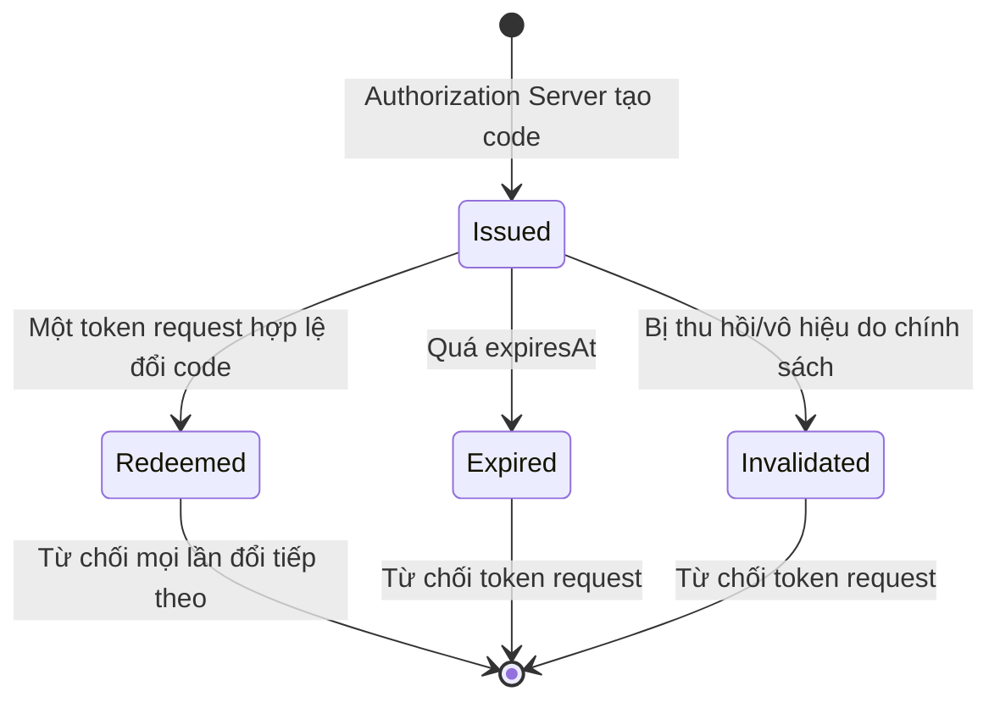
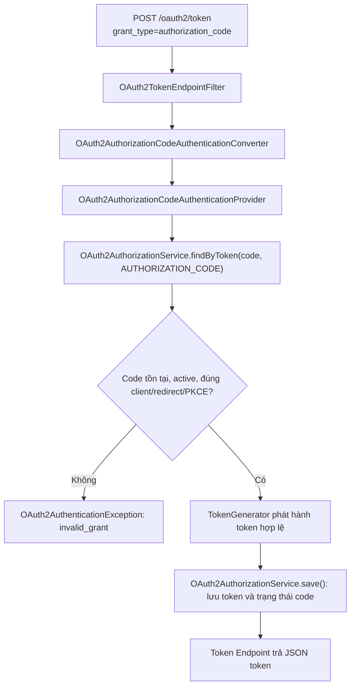

# Thời hạn code và nguyên tắc chỉ sử dụng một lần

## 1. Mục tiêu bài học

Trong chương **Authorization Code và PKCE** của module `SPRING_SECURITY_OAUTH2_OIDC_AUTHORIZATION_SERVER`, chúng ta tìm hiểu cách **Authorization Code chỉ có hiệu lực trong một khoảng thời gian ngắn và chỉ được đổi lấy token một lần**. Đây là yêu cầu thiết yếu khi thiết kế, cấu hình, bảo mật, kiểm thử và vận hành một **OAuth 2.0/OpenID Connect Authorization Server bằng Spring Security và Spring Authorization Server trong ứng dụng Spring Boot**.

Ví dụ, người dùng truy cập ứng dụng web `portal.example.com`, ứng dụng chuyển browser đến Authorization Server `auth.example.com`, người dùng đăng nhập và đồng ý cấp quyền. Authorization Server trả về một `code` qua redirect. Client gửi code đó đến Token Endpoint để nhận Access Token, có thể kèm Refresh Token và ID Token theo grant, scope và chính sách phát hành.

Code là một **thông tin ủy quyền tạm thời**, đi qua kênh chuyển hướng của browser. Nếu code bị lộ nhưng vẫn có thể được sử dụng lâu dài hoặc nhiều lần, người khác có thêm cơ hội đổi nó lấy token. Vì thế, hai ràng buộc **ngắn hạn** và **một lần** phải được thực thi ở phía Authorization Server, không dựa vào sự tự giác của client.

Sau bài này, bạn có thể:

1. Phân biệt thời điểm tạo code, thời điểm code hết hạn và thời điểm code bị đánh dấu đã sử dụng.
2. Giải thích tại sao `code` không phải Access Token và tại sao PKCE không thay thế giới hạn thời gian hay chống tái sử dụng.
3. Cấu hình `TokenSettings.authorizationCodeTimeToLive(...)` cho `RegisteredClient` trong Spring Authorization Server.
4. Mô tả cách `OAuth2AuthorizationService` và `OAuth2AuthorizationCodeAuthenticationProvider` tham gia kiểm tra code.
5. Phân tích lỗi `invalid_grant`, trường hợp request lặp và các yêu cầu kiểm thử trong hệ thống nhiều instance.

## 2. Authorization Code được tạo và sử dụng ở đâu?

**Authorization Code** là kết quả trung gian của Authorization Code Grant, được Authorization Server phát hành sau khi yêu cầu ủy quyền đạt các điều kiện cần thiết. Code được chuyển đến `redirect_uri` của client thông qua trình duyệt và **được đổi tại Token Endpoint**, thường qua một yêu cầu POST back channel.

```mermaid
sequenceDiagram
    autonumber
    actor U as Người dùng
    participant B as Browser
    participant C as Client (backend/BFF)
    participant AS as Authorization Server
    participant DB as OAuth2AuthorizationService
    U->>C: Chọn đăng nhập
    C-->>B: Redirect tới /oauth2/authorize (state, PKCE)
    B->>AS: GET /oauth2/authorize
    AS->>U: Đăng nhập và consent nếu cần
    AS->>DB: Lưu authorization và code có issuedAt/expiresAt
    AS-->>B: 302 redirect_uri?code=...&state=...
    B->>C: Callback mang code và state
    C->>C: Kiểm tra state; lấy code_verifier đã giữ
    C->>AS: POST /oauth2/token, grant_type=authorization_code
    AS->>DB: Tra code, kiểm tra hiệu lực và ràng buộc
    AS->>AS: Kiểm tra client, redirect URI, PKCE
    AS->>DB: Ghi trạng thái code đã sử dụng và token phát hành
    AS-->>C: Access Token (+ token khác nếu đủ điều kiện)
```

**Không nhầm ba mốc thời gian:** người dùng bắt đầu đăng nhập, người dùng hoàn tất đăng nhập/consent, và Authorization Server **thực sự phát hành code** có thể cách nhau nhiều giây hoặc phút. **Thời hạn của code bắt đầu từ thời điểm code được phát hành**, không bắt đầu khi client lần đầu mở trang đăng nhập. Nếu user mất năm phút để nhập MFA trước khi code được tạo, năm phút đó không tự làm code mới phát hành hết hạn.

### 2.1. Code, token và session khác nhau như thế nào?

| Giá trị | Ai giữ/sử dụng? | Giới hạn vòng đời | Dùng để gọi API? |
| --- | --- | --- | --- |
| **Authorization Code** | Client nhận qua callback, gửi đến AS một lần | Hết hạn nhanh hoặc bị vô hiệu sau khi đổi | **Không** |
| **Access Token** | Client trình cho Resource Server | Có TTL và chính sách thu hồi riêng | **Có**, khi hợp lệ và đúng quyền |
| **Refresh Token** | Client gửi đến AS khi cần token mới | TTL/rotation/thu hồi riêng | **Không** |
| **ID Token** | OIDC Client dùng xác minh kết quả đăng nhập | Thời hạn riêng của ID Token | **Không**, không dùng thay Access Token |
| **HTTP session** | Browser và ứng dụng/Authorization Server duy trì trạng thái đăng nhập | Chính sách session độc lập | Không phải OAuth2 Bearer Token |

Code đã dùng không thể trở thành “Refresh Token thứ hai”. Khi cần Access Token mới, client sử dụng Refresh Token nếu được cấp, hoặc bắt đầu lại một authorization flow hợp lệ.

## 3. Quy tắc chuẩn: sống ngắn và chỉ đổi một lần

RFC 6749 quy định Authorization Code **phải có thời hạn ngắn**. RFC khuyến nghị tuổi thọ tối đa **10 phút** cho code; đây là **giá trị khuyến nghị**, không phải đề xuất để luôn cấu hình đúng 10 phút. Một hệ thống có thể đặt 2–5 phút hoặc một giá trị khác phù hợp với rủi ro, độ trễ mạng và hành vi của client.

RFC 6749 cũng nêu:

- Client **không được dùng một Authorization Code quá một lần**.
- Nếu Authorization Code được dùng nhiều hơn một lần, Authorization Server **phải từ chối yêu cầu** và **nên thu hồi các token đã cấp dựa trên code đó**.

Điểm thứ hai có ý nghĩa đặc biệt: **trả `invalid_grant` cho lần đổi thứ hai** là hành vi bắt buộc của cơ chế single use; việc thu hồi token đã cấp là một biện pháp giảm thiểu bổ sung được RFC khuyến nghị. Khi dùng một thư viện/kiến trúc cụ thể, phải kiểm thử cơ chế thu hồi thực tế, nhất là với JWT Access Token đã được Resource Server kiểm tra offline.

### 3.1. Mô hình trạng thái của code



Đây là **mô hình logic**. Một triển khai có thể giữ bản ghi code trong kho dữ liệu và đánh dấu `invalidated` thay vì xóa ngay. Việc code vẫn xuất hiện trong database **không đồng nghĩa nó còn hiệu lực**.

Về mặt kiểm tra, tại thời điểm `t`, code chỉ có thể được xem là ứng viên hợp lệ nếu:

```text
t < expiresAt
AND code chưa bị invalidated
AND code gắn với đúng authorization và client
AND redirect_uri / PKCE / grant và các điều kiện liên quan hợp lệ
```

Các điều kiện không được thực hiện bằng cách so sánh mỗi chuỗi code từ request với giá trị đã lưu rồi cấp token. Code còn cần được kiểm tra trạng thái và các ràng buộc giao thức.

### 3.2. Ví dụ dòng thời gian

Giả sử code `c-123` được phát hành lúc **10:00:00** với TTL **3 phút**:

| Thời điểm | Sự kiện | Kết quả mong đợi |
| --- | --- | --- |
| 09:55:00 | Người dùng bắt đầu đăng nhập | **Chưa có code**, TTL chưa bắt đầu |
| 10:00:00 | AS phát hành `c-123` | Code có thể được đổi, `expiresAt=10:03:00` |
| 10:00:20 | Client đổi `c-123` thành công | Code được đánh dấu đã dùng |
| 10:00:21 | Client gửi lại chính code đó | **Từ chối** dù chưa tới 10:03 |
| 10:03:00 hoặc sau đó | Nếu code chưa từng được dùng | **Từ chối** do code đã hết hạn |

Hai quy tắc độc lập: **code chưa hết hạn vẫn không thể dùng lần hai**; **code chưa sử dụng vẫn không thể đổi khi đã hết hạn**. Không được “gia hạn” code chỉ vì user vẫn đang đăng nhập tại Authorization Server.

## 4. Các ràng buộc cần kiểm tra khi đổi code

Một Authorization Code **không có giá trị tự do cho mọi client**. Khi yêu cầu token đến `POST /oauth2/token`, Authorization Server phải xác minh những điều kiện liên quan đến giao dịch đã lưu.

| Kiểm tra | Lý do | Ví dụ sai |
| --- | --- | --- |
| Code tồn tại và được AS phát hành | Không chấp nhận giá trị tự tạo hoặc giả mạo | `code=random-string` |
| Code còn hạn | Giới hạn thời gian kẻ tấn công có thể lợi dụng code bị lộ | `expiresAt` đã qua |
| Code chưa dùng/chưa invalidated | Ngăn replay và double redemption | Gửi lại code vừa đổi |
| Code thuộc đúng client | Không dùng code cấp cho ứng dụng A để lấy token cho B | `client_id=B` với code của A |
| `redirect_uri` phù hợp giao dịch ban đầu | Ngăn tráo callback và giữ ràng buộc authorization request | URI ở token request khác URI đã dùng khi xin code |
| PKCE verifier phù hợp challenge đã lưu | Ràng buộc việc đổi code với bên đã khởi tạo yêu cầu | `code_verifier` sai hoặc thiếu khi bắt buộc |
| Client authentication phù hợp | Xác minh confidential client; public client dùng phương thức của nó | Secret sai, method không được đăng ký |
| Scope/grant/authorization state được phép | Không nâng quyền qua bước đổi code | Xin token vượt scope đã cấp |

**Việc code có thời hạn ngắn không làm PKCE trở nên tùy chọn.** PKCE bảo vệ khi code bị chặn hoặc bị tiêm vào một giao dịch không hợp lệ. TTL giới hạn cửa sổ thời gian; single use ngăn phát lại; PKCE ràng buộc việc đổi code với `code_verifier` mà client giữ. Đây là **ba lớp bảo vệ bổ trợ**.

### 4.1. PKCE đi cùng vòng đời code

```text
Client tạo code_verifier ngẫu nhiên có entropy cao
code_challenge = BASE64URL(SHA256(ASCII(code_verifier)))

Authorization Request: code_challenge + code_challenge_method=S256
Authorization Server: lưu thông tin PKCE cùng authorization

Token Request: authorization code + code_verifier
Authorization Server: kiểm tra verifier trước khi cấp token
```

`code_verifier` **không được đưa vào authorization URL**. Trong Authorization Code Flow, `state` do client kiểm tra tại callback; `code_verifier` được AS kiểm tra tại Token Endpoint. Chúng có trách nhiệm khác nhau.

## 5. Cấu hình TTL của Authorization Code trong Spring Authorization Server

Trong Spring Authorization Server, TTL của Authorization Code được cấu hình qua **`TokenSettings.authorizationCodeTimeToLive(Duration)`**, thường nằm trong `RegisteredClient`. Điều này cho phép đặt TTL khác nhau theo loại client hoặc chính sách ứng dụng.

Ví dụ một confidential web client với Authorization Code + PKCE:

```java
import java.time.Duration;
import java.util.UUID;

import org.springframework.context.annotation.Bean;
import org.springframework.context.annotation.Configuration;
import org.springframework.security.oauth2.core.AuthorizationGrantType;
import org.springframework.security.oauth2.core.ClientAuthenticationMethod;
import org.springframework.security.oauth2.core.oidc.OidcScopes;
import org.springframework.security.oauth2.server.authorization.client.InMemoryRegisteredClientRepository;
import org.springframework.security.oauth2.server.authorization.client.RegisteredClient;
import org.springframework.security.oauth2.server.authorization.client.RegisteredClientRepository;
import org.springframework.security.oauth2.server.authorization.settings.ClientSettings;
import org.springframework.security.oauth2.server.authorization.settings.TokenSettings;

@Configuration(proxyBeanMethods = false)
class ClientRegistrationConfiguration {

    @Bean
    RegisteredClientRepository registeredClientRepository() {
        RegisteredClient portal = RegisteredClient.withId(UUID.randomUUID().toString())
                .clientId("portal-web")
                .clientSecret("{bcrypt}<hash-generated-from-test-secret>")
                .clientAuthenticationMethod(ClientAuthenticationMethod.CLIENT_SECRET_BASIC)
                .authorizationGrantType(AuthorizationGrantType.AUTHORIZATION_CODE)
                .authorizationGrantType(AuthorizationGrantType.REFRESH_TOKEN)
                .redirectUri("https://portal.example.com/callback")
                .scope(OidcScopes.OPENID)
                .scope("orders.read")
                .clientSettings(ClientSettings.builder()
                        .requireProofKey(true)
                        .requireAuthorizationConsent(true)
                        .build())
                .tokenSettings(TokenSettings.builder()
                        .authorizationCodeTimeToLive(Duration.ofMinutes(3))
                        .accessTokenTimeToLive(Duration.ofMinutes(10))
                        .refreshTokenTimeToLive(Duration.ofHours(8))
                        .reuseRefreshTokens(false)
                        .build())
                .build();

        return new InMemoryRegisteredClientRepository(portal);
    }
}
```

**Những điểm cần đọc đúng:**

1. `authorizationCodeTimeToLive(Duration.ofMinutes(3))` điều khiển **code**, không phải Access Token.
2. `accessTokenTimeToLive(...)` và `refreshTokenTimeToLive(...)` là hai chính sách **khác**.
3. `requireProofKey(true)` yêu cầu PKCE; nó **không tự đặt TTL hoặc cho phép đổi code nhiều lần**.
4. `requireAuthorizationConsent(true)` có thể khiến người dùng phải xác nhận quyền trước khi AS phát hành code. TTL code chỉ chạy sau khi code được tạo.
5. `clientSecret("{bcrypt}<hash-generated-from-test-secret>")` chỉ là **placeholder mô tả định dạng**, không phải BCrypt hash hợp lệ để chạy thử. Phải lưu hash BCrypt được sinh từ secret test thực, và phải giữ secret thô ở client backend bằng cơ chế quản lý bí mật phù hợp.
6. `InMemoryRegisteredClientRepository` thích hợp minh họa local; production cần kho client và authorization bền vững, quản lý ID ổn định và chính sách chia sẻ trạng thái giữa các node.

Ví dụ có scope `openid` để thể hiện khả năng OIDC; nếu muốn thực hiện OIDC thực tế, ứng dụng còn phải bật cấu hình OIDC, JWT/JWK, xác thực người dùng và các bean cần thiết. **Chỉ khai báo RegisteredClient không tạo thành một Authorization Server chạy được.**

### 5.1. Nên đặt TTL bao nhiêu?

TTL phải đủ ngắn để giảm rủi ro khi code lộ nhưng đủ thời gian cho **browser hoàn tất redirect về callback** và **client gửi token request**. Đánh giá độ trễ thực tế của gateway, client backend, thiết bị và môi trường mạng; không lấy thời gian người dùng nhập mật khẩu/MFA làm cơ sở trực tiếp cho TTL code vì code thường chỉ được tạo sau các bước đó.

| Tình huống | Cân nhắc |
| --- | --- |
| Web backend/BFF trong cùng khu vực mạng | Có thể đặt vài phút nếu end-to-end redirect/token exchange ổn định |
| Native app qua system browser | Cân nhắc thời gian chuyển control giữa browser và ứng dụng, nhưng vẫn giữ TTL ngắn và PKCE |
| Hệ thống nhiều proxy hoặc độ trễ cao | Đo phân phối latency thực tế; không “sửa” mọi lỗi bằng cách tăng TTL lên hàng giờ |
| Client có nguy cơ lộ callback/code | Siết redirect URI, HTTPS, PKCE, xử lý callback an toàn; TTL chỉ là một lớp bảo vệ |

Không cấu hình thời hạn quá ngắn khiến client thường xuyên nhận `invalid_grant` trong điều kiện bình thường; cũng không để code sống lâu nhằm “hỗ trợ người dùng đăng nhập chậm”. Luồng đăng nhập chậm cần được xử lý bằng session/login và chính sách timeout tương ứng.

### 5.2. Chính sách TTL có hiệu lực theo client

Spring Authorization Server dùng `TokenSettings` của `RegisteredClient` để xác định thời hạn khi phát hành code. Nếu `portal-web` có TTL 3 phút còn `mobile-app` có TTL 2 phút, code từ mỗi client cần tuân theo cấu hình riêng tại **thời điểm phát hành**.

Không nên suy luận rằng thay TTL của registration sẽ **gia hạn hồi tố** tất cả code đã phát hành. Code thường được lưu với `issuedAt` và `expiresAt` cụ thể; khi thay đổi cấu hình, phải kiểm tra ý nghĩa với code đang tồn tại và chính sách rollout của hệ thống.

## 6. Spring Authorization Server kiểm tra “single use” như thế nào?

Trong luồng chuẩn, `OAuth2AuthorizationCodeRequestAuthenticationProvider` liên quan đến **yêu cầu xin code** tại Authorization Endpoint. Khi client đem code đến **Token Endpoint**, thành phần trung tâm là **`OAuth2AuthorizationCodeAuthenticationProvider`**. Hai provider có tên gần giống nhau nhưng chạy ở hai giai đoạn khác nhau.



`OAuth2AuthorizationService` cung cấp việc tra cứu và lưu đối tượng `OAuth2Authorization`. Trong mô hình Spring Authorization Server, trạng thái của một token được biểu diễn qua metadata; API `OAuth2Authorization.Token` có các kiểm tra như `isExpired()`, `isInvalidated()` và `isActive()`. Sau khi đổi code thành công, code được làm mất hiệu lực để không thể đổi lần tiếp theo.

Không cần **và không nên** viết `AuthenticationProvider` tùy chỉnh chỉ để có TTL/single use cơ bản: dùng cơ chế chuẩn của Spring Authorization Server, sau đó kiểm thử cách trạng thái được lưu trong hạ tầng đã chọn.

### 6.1. Minh họa kiểm tra trạng thái code trong ứng dụng chẩn đoán

Nếu một đoạn mã kiểm tra **đối tượng `OAuth2Authorization` đã được truy xuất hợp lệ**:

```java
import org.springframework.security.oauth2.server.authorization.OAuth2Authorization;
import org.springframework.security.oauth2.server.authorization.token.OAuth2AuthorizationCode;

// authorization là kết quả từ OAuth2AuthorizationService,
// không phải dữ liệu do browser tự gửi.
OAuth2Authorization.Token<OAuth2AuthorizationCode> codeHolder =
        authorization.getToken(OAuth2AuthorizationCode.class);

if (codeHolder != null) {
    boolean expired = codeHolder.isExpired();
    boolean invalidated = codeHolder.isInvalidated();
    boolean active = codeHolder.isActive();
    // Chỉ ghi trạng thái/tổng số lỗi, không log codeHolder.getToken().getTokenValue().
}
```

Đoạn này dành cho hiểu cấu trúc trạng thái; **không thay thế validation trong provider chuẩn**. Một code còn active vẫn phải thỏa client binding, redirect URI, PKCE và các điều kiện grant khác. Ở các phiên bản khác nhau, tên package/API có thể thay đổi; đối chiếu Javadoc đang sử dụng.

### 6.2. In-memory và JDBC khác nhau ở khả năng lưu trạng thái

| Lưu trữ | Điểm phù hợp | Rủi ro cần xét |
| --- | --- | --- |
| `InMemoryOAuth2AuthorizationService` | Demo hoặc test đơn node | Code/authorization mất sau restart; không chia sẻ giữa nhiều JVM |
| `JdbcOAuth2AuthorizationService` | Ứng dụng SQL cần trạng thái bền vững | Cần schema, giao dịch và chiến lược xử lý concurrency phù hợp |
| Kho tùy chỉnh | Hạ tầng đặc thù, HA hoặc giới hạn hiệu năng | Phải giữ đúng semantics code hết hạn, single use, tra cứu và lưu atomically |

**Kho dữ liệu bền vững không tự chứng minh chống double redemption đồng thời.** Khi hai request dùng cùng code đến hai node gần như cùng thời điểm, một thiết kế kiểu “cả hai đọc `active` → cả hai phát token → cùng ghi `invalidated`” có thể gây lỗi nếu cập nhật trạng thái không được phối hợp đúng. Khi triển khai multi-instance, cần kiểm tra hành vi thực tế của phiên bản Spring Authorization Server, cách transaction/locking của storage và có kiểm thử concurrency. Nếu tự viết `OAuth2AuthorizationService`, hãy thiết kế ràng buộc dùng-một-lần theo thao tác tranh chấp an toàn hoặc cơ chế đồng bộ phù hợp.

## 7. Yêu cầu HTTP: đổi code một lần, dùng lại bị từ chối

Giả sử client nhận `code=c-example` (placeholder, không phải giá trị thật) và đã giữ `code_verifier` từ khi tạo PKCE. Với **confidential web client**, yêu cầu đổi code có thể như sau:

```http
POST /oauth2/token HTTP/1.1
Host: auth.example.com
Content-Type: application/x-www-form-urlencoded
Authorization: Basic <base64-client-id-and-secret>

grant_type=authorization_code&
code=<fresh-authorization-code>&
redirect_uri=https%3A%2F%2Fportal.example.com%2Fcallback&
code_verifier=<original-pkce-verifier>
```

Nếu mọi điều kiện hợp lệ, Token Endpoint trả response dạng:

```json
{
  "access_token": "<new-access-token>",
  "token_type": "Bearer",
  "expires_in": 600,
  "scope": "openid orders.read",
  "id_token": "<id-token-if-oidc>"
}
```

Đây là **ví dụ minh họa**: `id_token` chỉ được phát hành khi yêu cầu và cấu hình OIDC hợp lệ; `refresh_token` có thể có hoặc không, tùy chính sách. Một phản hồi Access Token thành công **không khiến Authorization Code còn có thể đổi thêm lần nữa**.

Nếu client gửi lại chính code với request tương đương:

```http
POST /oauth2/token HTTP/1.1
Host: auth.example.com
Content-Type: application/x-www-form-urlencoded
Authorization: Basic <base64-client-id-and-secret>

grant_type=authorization_code&
code=<the-same-already-redeemed-code>&
redirect_uri=https%3A%2F%2Fportal.example.com%2Fcallback&
code_verifier=<original-pkce-verifier>
```

Thì kết quả mong đợi là **không cấp thêm token**, thường với lỗi:

```http
HTTP/1.1 400 Bad Request
Content-Type: application/json

{
  "error": "invalid_grant"
}
```

`invalid_grant` cũng có thể xảy ra vì code hết hạn, code không tồn tại, không đúng client, redirect URI hoặc PKCE; **mã lỗi này không cho biết chắc một nguyên nhân duy nhất**. Không đưa raw code/secret/verifier vào `error_description` hoặc log để giải thích lỗi cho client.

### 7.1. Public client thì khác ở điểm nào?

Một SPA hoặc native app thường là **public client**, dùng `ClientAuthenticationMethod.NONE` và Authorization Code + PKCE. Public client gửi `client_id` tại Token Endpoint theo profile phù hợp, không nhúng `client_secret` vào JavaScript hay gói cài đặt.

```http
POST /oauth2/token HTTP/1.1
Host: auth.example.com
Content-Type: application/x-www-form-urlencoded

grant_type=authorization_code&
client_id=mobile-public-client&
code=<fresh-authorization-code>&
redirect_uri=com.example.app%3A%2Foauth2redirect&
code_verifier=<original-pkce-verifier>
```

**Single use và TTL vẫn bắt buộc** cho public client. PKCE đặc biệt quan trọng ở loại client không thể giữ bí mật tĩnh, nhưng không phải lý do để kéo dài tuổi thọ code hoặc cho phép đổi nhiều lần.

## 8. Điều gì xảy ra khi mạng lỗi sau lần đổi đầu tiên?

Đây là tình huống thực tế dễ gây nhầm lẫn:

1. Client gửi `POST /oauth2/token` với code hợp lệ.
2. Authorization Server xử lý thành công, phát hành token, lưu trạng thái code đã dùng.
3. Mạng lỗi trước khi response tới client.
4. Client không biết request đầu tiên có thành công không và gửi lại cùng code.
5. Authorization Server trả `invalid_grant`, bởi code đã được sử dụng.

**Không nên đổi sang cơ chế “code có thể dùng lại nếu retry”** để khắc phục lỗi mạng. Điều đó phá vỡ tính chất single use. Client cần xử lý kết quả không chắc chắn một cách an toàn: nếu không nhận được token, khởi động lại flow ủy quyền hợp lệ hoặc dùng cơ chế khôi phục phiên được thiết kế riêng; tránh vòng lặp retry cùng code.

Từ phía server, nếu phát hiện code bị replay, nên có **tín hiệu giám sát an toàn** (mã lỗi, client ID, correlation ID, thời gian), rà soát việc thu hồi token đã cấp theo chuẩn và khả năng thực tế của hệ thống. Không được mặc định rằng JWT Access Token đã phát hành trước đó bị vô hiệu tức thì chỉ vì lần thứ hai trả `invalid_grant`.

### 8.1. Khi client gửi token request trùng nhau do lập trình

Ví dụ, một callback endpoint bị gọi hai lần, hoặc hai thread cùng xử lý URL callback và cùng đem code đổi token. Nếu phía client không đánh dấu một giao dịch đã được xử lý, có thể xuất hiện một request thành công và một request `invalid_grant`.

Client cần:

- Gắn callback với transaction/`state` do chính nó tạo và chỉ xử lý một lần theo ứng dụng.
- Kiểm soát race condition ở callback handler, đặc biệt ở backend nhiều instance.
- Không chạy lại cùng giao dịch chỉ vì người dùng refresh trang callback.
- Không lưu nguyên code trong analytics, access log hoặc thông điệp lỗi.

**Client-side deduplication hỗ trợ trải nghiệm và giảm retry thừa; kiểm soát single use quyết định cuối cùng vẫn phải ở Authorization Server.**

## 9. Code hết hạn: nguyên nhân, cách xử lý và clock skew

### 9.1. Tại sao code có thể hết hạn dù người dùng vừa đăng nhập?

- Browser nhận code nhưng ứng dụng điều hướng qua nhiều trang trước khi callback backend gửi Token Endpoint request.
- Một proxy hoặc service queue trì hoãn callback/tác vụ token exchange lâu hơn TTL.
- Client lưu code rồi cố đổi sau khi người dùng mở lại tab cũ.
- Client gặp lỗi 5xx và retry cùng code quá muộn.
- Các node Authorization Server có đồng hồ chênh lệch, hoặc sử dụng kho dữ liệu/clock không nhất quán.

Người dùng vừa đăng nhập **không gia hạn một code đã được phát hành trước đó**. Nếu code hết hạn, client cần bắt đầu giao dịch authorization mới. Thêm vài giờ vào TTL code thường là giải pháp sai cho các lỗi luồng xử lý của client.

### 9.2. Quy tắc thời gian

Code có `issuedAt` và `expiresAt` khi được phát hành. Tại thời điểm kiểm tra, code không còn active khi quá hạn theo quy tắc của thư viện. Một code mới phải được tạo từ **giao dịch ủy quyền hợp lệ mới**; client không được tự sửa timestamp hoặc yêu cầu AS tăng `expiresAt` của code đã phát hành.

Trong cụm nhiều instance, cần đồng bộ thời gian (NTP hoặc hạ tầng tương đương) và giám sát clock drift. Không đưa ra “clock skew 30 phút” chỉ để tránh lỗi code hết hạn; sai lệch lớn làm yếu ý nghĩa của TTL ngắn.

### 9.3. Cách chẩn đoán không làm rò rỉ code

Nên thu thập:

| Dữ liệu chẩn đoán | Có nên ghi? | Ghi chú |
| --- | --- | --- |
| Client ID/issuer, loại grant, endpoint | Có, theo chính sách quyền truy cập log | Giúp phân loại request |
| Mã lỗi OAuth2 và correlation ID | Có | Có thể liên kết sự kiện giữa gateway, AS và client |
| Độ trễ từ phát hành code đến token request | Có, dạng chỉ số hoặc bucket | Không gắn raw code vào metric labels |
| Trạng thái expired/invalidated (không kèm giá trị code) | Có, trong log nội bộ được kiểm soát | Cần chính sách retention |
| Giá trị `code`, `code_verifier`, client secret, token | **Không** | Dữ liệu nhạy cảm; tránh cả URL request đầy đủ |

OAuth2 thường dùng `invalid_grant` chung cho nhiều trường hợp để hạn chế tiết lộ thông tin giao dịch; log nội bộ có thể hỗ trợ chẩn đoán chi tiết hơn mà vẫn không đưa bí mật ra ngoài.

## 10. Kiểm thử thời hạn code và single use

Chúng ta cần kiểm tra cả việc **cấu hình TTL có hiệu lực** và **Token Endpoint từ chối code không còn hợp lệ**.

### 10.1. Test cấu hình TokenSettings

Ví dụ JUnit 5 xác nhận giá trị mà ứng dụng định dùng:

```java
import static org.junit.jupiter.api.Assertions.assertEquals;

import java.time.Duration;

import org.junit.jupiter.api.Test;
import org.springframework.security.oauth2.server.authorization.settings.TokenSettings;

class AuthorizationCodeTtlSettingsTest {

    @Test
    void codeTtlIsThreeMinutes() {
        TokenSettings settings = TokenSettings.builder()
                .authorizationCodeTimeToLive(Duration.ofMinutes(3))
                .build();

        assertEquals(Duration.ofMinutes(3),
                settings.getAuthorizationCodeTimeToLive());
    }
}
```

Test này chỉ xác minh **builder và property**, chưa chứng minh một `RegisteredClient` đã sử dụng settings đó, càng chưa chứng minh code hết hạn hoặc không thể dùng hai lần. Với dự án thật, nên kiểm tra settings trên `RegisteredClient` được lấy ra từ repository đang chạy.

### 10.2. Integration test một code, hai lần đổi

Chuẩn bị môi trường test có Authorization Server hoạt động, client đã đăng ký, trạng thái user và redirect URI hợp lệ. Trình tự:

1. Client tạo `state`, `code_verifier`, `code_challenge` (`S256`); mở Authorization Endpoint.
2. Hoàn tất login và consent nếu cần; nhận **một code mới** ở callback. Không sử dụng code viết cứng trong fixture.
3. Gửi `POST /oauth2/token` với code, đúng client, redirect URI và verifier. **Kỳ vọng 200 và token response hợp lệ.**
4. Gửi lại **đúng code ấy** với cùng ràng buộc. **Kỳ vọng lỗi `invalid_grant`; không nhận token mới.**
5. Thử request đồng thời dùng cùng code trên nhiều node (nếu có cụm); **chỉ tối đa một lần đổi thành công**.
6. Kiểm tra token đã phát hành và chính sách thu hồi khi replay theo yêu cầu bảo mật của hệ thống.

Hai request kiểm thử với confidential client (chỉ dùng dữ liệu test):

```bash
# Lần 1: yêu cầu hợp lệ với code mới nhận và verifier gốc.
curl -i -X POST 'https://auth-test.example.com/oauth2/token' \
  -u 'portal-web:<test-client-secret>' \
  -H 'Content-Type: application/x-www-form-urlencoded' \
  --data-urlencode 'grant_type=authorization_code' \
  --data-urlencode 'code=<fresh-code-from-callback>' \
  --data-urlencode 'redirect_uri=https://portal.example.com/callback' \
  --data-urlencode 'code_verifier=<original-verifier>'

# Lần 2: dùng CHÍNH code đã đổi; kỳ vọng invalid_grant.
curl -i -X POST 'https://auth-test.example.com/oauth2/token' \
  -u 'portal-web:<test-client-secret>' \
  -H 'Content-Type: application/x-www-form-urlencoded' \
  --data-urlencode 'grant_type=authorization_code' \
  --data-urlencode 'code=<same-code-as-first-request>' \
  --data-urlencode 'redirect_uri=https://portal.example.com/callback' \
  --data-urlencode 'code_verifier=<original-verifier>'
```

Các giá trị `<...>` là placeholder. Tránh nhập secret thật trực tiếp trên shell dùng chung hoặc để token/code xuất hiện trong transcript, history, log CI. Trong test tự động, giữ chúng trong test fixtures an toàn, không in ra console.

### 10.3. Kiểm thử hết hạn mà không đợi bằng sleep

Không nên viết test bằng cách `Thread.sleep(180_000)` rồi kiểm tra code: test chậm, dễ bất ổn và chỉ kiểm tra một thời điểm. Nên ưu tiên một trong các chiến lược kiểm thử được hỗ trợ bởi kiến trúc đang dùng:

- **Kiểm soát thời gian** qua `Clock` hoặc cơ chế time abstraction khi phiên bản/thành phần đang dùng cho phép.
- **Fixture authorization hết hạn** trong một kho test cách ly, rồi gửi token request và kiểm tra `invalid_grant`. Phải chắc fixture phản ánh đúng schema/metadata token của phiên bản Spring Authorization Server.
- **Integration test ngắn** với TTL nhỏ hợp lệ nếu không có khả năng kiểm soát thời gian, chỉ khi có lý do và test không trở nên flaky.

Những mốc cần kiểm tra:

| Ca kiểm thử | Kỳ vọng |
| --- | --- |
| Code chưa hết hạn, chưa dùng và mọi ràng buộc hợp lệ | Được đổi **một lần** |
| Code còn hạn nhưng đã đổi thành công | `invalid_grant` |
| Code đã hết hạn nhưng chưa sử dụng | `invalid_grant` |
| Code không có trong `OAuth2AuthorizationService` | `invalid_grant` |
| Code cấp cho client A, đem đổi bằng client B | Bị từ chối |
| Code đúng nhưng `redirect_uri` sai | `invalid_grant` hoặc lỗi giao thức phù hợp |
| Code đúng nhưng `code_verifier` sai | Bị từ chối, không phát token |
| Hai node đổi cùng một code gần như đồng thời | Tối đa một token exchange thành công |
| Restart hoặc failover trong lúc code còn hạn | Hành vi nhất quán với chính sách lưu trữ đã chọn |

Để kiểm chứng end-to-end với `MockMvc`, cần thực hiện login/consent hoặc setup security context và nhận code hợp lệ trước khi POST token. **Mock một chuỗi `code` tự chọn rồi kiểm tra `invalid_grant` chỉ chứng minh server từ chối code không tồn tại; không chứng minh one-time use.**

## 11. Những sai lầm thường gặp trong ứng dụng Spring

### 11.1. Dùng sai thuộc tính TTL

Đặt `accessTokenTimeToLive(Duration.ofMinutes(3))` không thay đổi TTL của Authorization Code. Phải dùng `authorizationCodeTimeToLive` đúng chỗ và kiểm tra `TokenSettings` thực tế trên client.

### 11.2. Cấp lại token khi code đã dùng

Một custom `AuthenticationProvider` lấy code và tự cấp JWT mà không kiểm tra trạng thái có thể vô tình cho phép replay. Nếu nghiệp vụ không thật sự cần grant tùy chỉnh, **giữ provider chuẩn** và đăng ký client/TokenSettings đúng. Nếu bắt buộc tự viết provider, kiểm tra code còn active và bảo đảm thao tác consume an toàn trước concurrency.

### 11.3. Xóa code ngay khi chuyển hướng thành công

Nếu xóa/vô hiệu code ngay ở bước gửi redirect `/oauth2/authorize`, client chưa kịp đổi code tại Token Endpoint đã nhận `invalid_grant`. Điều cần bảo đảm là code còn hiệu lực **trong khoảng TTL để được đổi một lần**, sau đó hết hạn hoặc bị vô hiệu.

### 11.4. Tăng TTL code lên hàng giờ để hỗ trợ form login

TTL code **không giải quyết** thời gian người dùng đi qua login hoặc consent trước khi code được cấp. Kéo dài TTL có thể tăng rủi ro code bị lộ. Xử lý trải nghiệm đăng nhập bằng session, callback, cookie, MFA và mô hình redirect phù hợp.

### 11.5. Không nhận biết code đã đổi khi callback chạy lại

Một nút reload ở callback hoặc retry tự động có thể làm token request thứ hai bị `invalid_grant`. Đừng yêu cầu Authorization Server nới single use; sửa xử lý callback để chỉ thực hiện token exchange một lần và quản lý transaction state.

### 11.6. Nhiều instance không đồng bộ trạng thái

Hai node dùng `InMemoryOAuth2AuthorizationService` riêng sẽ không có cùng dữ liệu authorization. Code phát ở node A có thể không được node B tìm thấy. Dùng kho dùng chung phù hợp, đồng bộ key/issuer và kiểm chứng concurrency; không giả định sticky session đủ giải quyết trạng thái authorization.

### 11.7. Dùng code làm Access Token hoặc lưu trong URL quá lâu

Code có trong URL callback, nhưng **không phải Bearer Token cho Resource Server**. Trang callback nên đổi code sớm qua kênh phù hợp, loại bỏ tham số nhạy cảm khỏi URL khi thiết kế cho phép và tránh tải tài nguyên bên thứ ba có thể nhận Referrer chứa code. Dùng HTTPS, chính sách `Referrer-Policy` thích hợp, kiểm soát log và tránh lưu code trong localStorage hay analytics.

## 12. Xử lý replay trong vận hành và phản ứng sự cố

Nếu xuất hiện nhiều `invalid_grant` vì code reuse, không kết luận ngay có tấn công: có thể là callback bị xử lý lặp, client retry sau timeout hoặc hai instance cạnh tranh. Tuy nhiên, **replay một code đã cấp là tín hiệu cần điều tra**, nhất là khi đi kèm địa chỉ mạng bất thường, client không nhận dạng được hoặc phát sinh sau việc lộ callback.

Một quy trình vận hành có thể gồm:

1. **Phân loại nguyên nhân** bằng correlation ID, client, grant, thời điểm phát hành/đổi code và loại lỗi (không ghi raw code).
2. **Xác minh số lần cấp token thành công** từ cùng giao dịch, bao gồm các request đồng thời.
3. **Xem xét thu hồi token** gắn với code bị replay theo yêu cầu RFC 6749, chính sách an ninh và cơ chế hỗ trợ thực tế.
4. **Kiểm tra ảnh hưởng đến JWT Access Token** đã cấp: chữ ký và `exp` vẫn có thể hợp lệ dù Refresh Token/code bị thu hồi; cần chiến lược revoke/denylist/introspection nếu yêu cầu vô hiệu gần thời gian thực.
5. **Sửa nguyên nhân**, như lỗi retry client, session/callback, thiếu trạng thái dùng chung hoặc cấu hình PKCE/redirect URI.
6. **Bổ sung kiểm thử** để ngăn tái diễn, kể cả bài test race condition ở Token Endpoint.

Đối với một Authorization Server dùng cho nhiều ứng dụng, nên đo độ trễ cấp code → đổi code theo phân phối (ví dụ P50/P95/P99), tỷ lệ `invalid_grant` và số giao dịch callback trùng. Dùng số liệu đó để quyết định TTL thay vì mở rộng thời hạn thiếu căn cứ.

## 13. Checklist thiết kế, kiểm thử và vận hành

1. **Code TTL ngắn:** cấu hình `TokenSettings.authorizationCodeTimeToLive` theo client và xác minh giá trị hiệu lực từ repository.
2. **Single use bắt buộc:** một code cấp token tối đa một lần, mọi lần đổi tiếp theo bị từ chối.
3. **Không bỏ PKCE:** dùng Authorization Code + PKCE `S256`, đặc biệt với public clients; ràng buộc verifier và challenge đúng giao dịch.
4. **Giữ client binding:** xác thực client theo phương thức đăng ký, kiểm tra `redirect_uri`, grant và ràng buộc code.
5. **Giữ trạng thái:** `OAuth2AuthorizationService` phải bảo đảm lưu/đọc code đúng giữa các node và qua restart theo chính sách.
6. **Kiểm thử expired/redeemed:** test code mới, code hết hạn, code dùng lần hai, sai client, sai verifier, và đồng thời trên nhiều node.
7. **Không làm rò rỉ code:** dùng HTTPS; không log raw code, verifier, access/refresh token hoặc secret; giảm lưu code trong URL/hệ thống phân tích.
8. **Theo dõi replay:** có correlation ID, mã lỗi, thống kê code reuse và quy trình xử lý token đã cấp khi phát hiện reuse.
9. **Không nhầm TTL với login session:** giờ hết hạn code tính từ lúc phát hành code, không phải lúc user mở trang login.
10. **Review sau nâng cấp:** khi đổi phiên bản Spring Authorization Server hoặc storage, thử lại thời hạn, invalidation và concurrency.

## 14. Bài tập và câu hỏi tự đánh giá

**Bài tập A — Tính thời hạn:** client bắt đầu authorization lúc 09:50, user hoàn tất MFA lúc 10:02, code được tạo lúc 10:03 với TTL 2 phút. Hỏi tại 10:04:30 code có thể còn đổi được không, và tại 10:05:01 thì sao? Tính trong trường hợp code chưa dùng và không bị thu hồi.

**Bài tập B — Cấu hình:** tạo hai `RegisteredClient` thử nghiệm: web client có TTL code 3 phút và native client có TTL code 2 phút. Cả hai dùng Authorization Code + PKCE; kiểm tra `getAuthorizationCodeTimeToLive()` của từng client.

**Bài tập C — Replay:** chạy đầy đủ Authorization Code Flow nhận một code thật trong môi trường test, gọi Token Endpoint hai lần bằng cùng code; giải thích vì sao lần thứ hai phải thất bại dù chưa hết TTL.

**Bài tập D — Race condition:** mô phỏng hai Token Endpoint request đồng thời từ hai instance; kiểm tra tối đa một lần thành công, rồi đề xuất cải tiến nếu kho lưu trữ tùy chỉnh cho phép cả hai phát token.

**Bài tập E — Mất response:** server xử lý thành công token request nhưng client timeout trước khi nhận response. Vì sao việc retry cùng code dẫn tới `invalid_grant`? Client nên khôi phục giao dịch bằng cách nào để vẫn tuân thủ single use?

**Câu hỏi ôn tập:**

1. RFC 6749 khuyến nghị thời hạn tối đa bao nhiêu phút cho Authorization Code?
2. TTL code bắt đầu lúc user mở trang đăng nhập hay lúc AS tạo code?
3. Sự khác biệt giữa `isExpired()`, `isInvalidated()` và `isActive()` của token metadata là gì?
4. Vì sao `code_verifier` đúng vẫn không cho phép đổi code đã dùng?
5. `OAuth2AuthorizationCodeRequestAuthenticationProvider` khác `OAuth2AuthorizationCodeAuthenticationProvider` ở giai đoạn nào?
6. Vì sao `invalid_grant` không tự chứng minh có tấn công replay?
7. Nếu thay TTL code cho client hôm nay, code đã phát hành hôm qua có tự được gia hạn không?
8. Vì sao hệ thống nhiều node cần kiểm thử thao tác dùng-một-lần đồng thời dù đã dùng JDBC?
9. Vì sao không được tự động retry code sau khi mạng timeout mà không biết request đầu tiên đã thành công chưa?
10. Khi phát hiện code reuse, RFC yêu cầu và khuyến nghị xử lý ra sao?

## 15. Tài liệu tham khảo

- [RFC 6749 — OAuth 2.0 Authorization Framework, Authorization Code](https://www.rfc-editor.org/rfc/rfc6749#section-4.1.2)
- [RFC 6749 — Authorization Code Grant, Access Token Request](https://www.rfc-editor.org/rfc/rfc6749#section-4.1.3)
- [RFC 7636 — Proof Key for Code Exchange (PKCE)](https://www.rfc-editor.org/rfc/rfc7636)
- [RFC 9700 — Best Current Practice for OAuth 2.0 Security](https://www.rfc-editor.org/rfc/rfc9700)
- [Spring Authorization Server — Core Model Components](https://docs.spring.io/spring-authorization-server/reference/core-model-components.html)
- [Spring Authorization Server — Protocol Endpoints](https://docs.spring.io/spring-authorization-server/reference/protocol-endpoints.html)
- [Spring Authorization Server — Configuration Model](https://docs.spring.io/spring-authorization-server/reference/configuration-model.html)
- [Spring Security — OAuth2 Login](https://docs.spring.io/spring-security/reference/servlet/oauth2/login/index.html)

**Ghi nhớ:** Authorization Code được phát hành với **thời hạn ngắn**, được **ràng buộc với client, redirect URI và PKCE**, và chỉ được đổi **một lần**. Trong Spring Authorization Server, `TokenSettings.authorizationCodeTimeToLive` đặt thời hạn phát hành; Token Endpoint cùng `OAuth2AuthorizationService` kiểm soát trạng thái. Hãy kiểm thử cả code hết hạn, code đã đổi và hai request đồng thời trước khi đưa Authorization Server vào môi trường nhiều instance.
