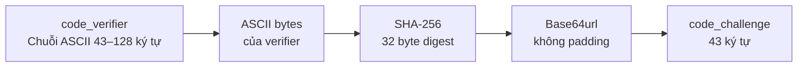

# Tạo code_verifier và code_challenge theo phương thức S256

## 1. Bối cảnh và mục tiêu

Trong luồng **Authorization Code** của OAuth 2.0/OpenID Connect (OIDC), Authorization Server gửi một **authorization code** về client qua trình duyệt. Nếu kẻ tấn công chặn được code rồi đổi code tại Token Endpoint, họ có thể lấy access token thay client hợp lệ. **PKCE (Proof Key for Code Exchange)** được chuẩn hóa trong [RFC 7636](https://www.rfc-editor.org/rfc/rfc7636) để giảm nguy cơ này.

PKCE bổ sung hai giá trị liên quan nhưng dùng ở hai thời điểm:

- `code_verifier`: chuỗi ngẫu nhiên, khó đoán, do client tạo và **giữ lại** để chứng minh mình là bên đã bắt đầu authorization request.
- `code_challenge`: giá trị dẫn xuất từ verifier, được gửi cho Authorization Server ngay trong authorization request.
- `code_challenge_method=S256`: chỉ rõ challenge được tạo bằng **SHA-256**, sau đó mã hóa **Base64url không padding**.

Khi client đổi code lấy token, nó trình ra verifier. Authorization Server tính lại challenge từ verifier đó và so với challenge đã gắn với authorization code. Bên chỉ lấy được code thường **không có verifier** nên không hoàn tất bước đổi code.

Bài thuộc chương **Authorization Code và PKCE**, trong chương trình học thiết kế, cấu hình, bảo mật, kiểm thử và vận hành OAuth 2.0/OIDC Authorization Server bằng **Spring Security**, **Spring Authorization Server** và Spring Boot.

Sau bài này, bạn có thể:

1. Nêu chính xác định dạng, độ dài, entropy và vòng đời của `code_verifier`.
2. Tính `code_challenge` bằng phương thức **S256** theo RFC 7636.
3. Tạo cặp verifier/challenge an toàn bằng Java và Web Crypto API.
4. Chèn challenge vào Authorization Request, giữ verifier đến Token Request.
5. Cấu hình Spring Authorization Server bắt buộc PKCE cho một `RegisteredClient`.
6. Phân biệt vai trò PKCE, `state`, `nonce`, client authentication và redirect URI.
7. Viết test với vector chính thức và nhận diện các lỗi triển khai thường gặp.

## 2. PKCE giải quyết vấn đề gì?

Authorization Code Flow cơ bản có hai bước quan trọng:

1. Client đưa trình duyệt tới Authorization Endpoint; sau khi người dùng đăng nhập và cho phép, Authorization Server trả **authorization code** qua redirect URI đã đăng ký.
2. Client gửi code tới Token Endpoint để đổi lấy token.

Authorization code đi qua **front channel** (trình duyệt), nơi tồn tại nguy cơ rò rỉ qua thành phần nhận callback không an toàn, ứng dụng khác chiếm URI scheme, lỗi xử lý URL hoặc mã độc. PKCE gắn code với một bí mật ngắn hạn chỉ client khởi tạo request giữ.

```mermaid
sequenceDiagram
    participant C as OAuth Client
    participant B as Trình duyệt
    participant AS as Authorization Server

    C->>C: Tạo verifier ngẫu nhiên và challenge S256
    C->>C: Lưu verifier theo transaction/state
    C->>B: Bắt đầu authorization redirect
    B->>AS: /oauth2/authorize?code_challenge=...&code_challenge_method=S256
    AS->>AS: Lưu challenge và method gắn với authorization code
    AS-->>B: Redirect mang authorization code
    B-->>C: Gửi callback chứa code, state
    C->>C: Kiểm tra state, tìm lại verifier
    C->>AS: POST /oauth2/token: code + code_verifier
    AS->>AS: S256(verifier) == challenge đã lưu?
    alt Khớp và các kiểm tra khác đều hợp lệ
        AS-->>C: Access token (+ ID token nếu là OIDC)
    else Không khớp / code không hợp lệ
        AS-->>C: OAuth error; không phát token
    end
```

**PKCE không mã hóa authorization code và không làm code trở nên vô dụng trong mọi trường hợp bị lộ.** Nó bảo vệ trường hợp bên tấn công chặn được code nhưng không có verifier của cùng giao dịch. Nếu cả code lẫn verifier bị đánh cắp, PKCE không còn bảo vệ riêng được cặp dữ liệu đó.

### 2.1. Ai cần PKCE?

PKCE đặc biệt quan trọng với **public client**, ví dụ ứng dụng native hoặc ứng dụng trình duyệt không giữ được client secret an toàn. Thiết kế OAuth hiện đại cũng khuyến nghị Authorization Code + PKCE cho **confidential client**, như backend web/BFF.

| Loại client | Giữ client secret an toàn? | PKCE |
|---|---|---|
| Native/mobile app | Thông thường **không** | Bắt buộc theo thiết kế an toàn hiện đại |
| SPA chạy JavaScript trong browser | **Không** | Cần PKCE và đánh giá thêm rủi ro token/XSS |
| Backend web/BFF | Có thể | Nên sử dụng bên cạnh client authentication |
| Dịch vụ dùng Client Credentials | Không dùng Authorization Code Flow | PKCE không áp dụng cho grant này |

**PKCE không thay thế client authentication.** Confidential client vẫn phải xác thực bằng phương thức đã đăng ký, ví dụ `client_secret_basic` hoặc `private_key_jwt`.

## 3. `code_verifier`: quy tắc chính xác theo RFC 7636

`code_verifier` là chuỗi có **entropy cao**, mới cho từng authorization request, tuân theo cú pháp:

```abnf
code-verifier = 43*128unreserved
unreserved = ALPHA / DIGIT / "-" / "." / "_" / "~"
```

Nói cách khác:

| Quy tắc | Giá trị |
|---|---|
| Độ dài | Từ **43 đến 128 ký tự** |
| Ký tự hợp lệ | Chữ cái ASCII `A-Z`, `a-z`; chữ số `0-9`; `-`, `.`, `_`, `~` |
| Entropy | Đủ khó đoán; RFC khuyến nghị tạo từ bộ sinh số ngẫu nhiên mật mã |
| Vòng đời | Một verifier **mới cho mỗi lượt authorization** |
| Bảo mật | Giữ ở client, chỉ gửi khi đổi code tại Token Endpoint |
| Encoding để tính S256 | **ASCII bytes của chuỗi verifier** |

Một cách tạo đơn giản và đúng RFC là **sinh 32 byte ngẫu nhiên bằng CSPRNG rồi Base64url không padding**. Đầu ra thường có **43 ký tự** và mang 256 bit entropy trước khi mã hóa.

```text
32 byte ngẫu nhiên (256 bit)
            |
            v
BASE64URL(không padding)
            |
            v
code_verifier dài 43 ký tự
```

Ví dụ verifier hợp lệ từ RFC 7636:

```text
dBjftJeZ4CVP-mB92K27uhbUJU1p1r_wW1gFWFOEjXk
```

Giá trị này phục vụ **test vector**, không được dùng làm verifier cố định trong ứng dụng thật.

### 3.1. Những verifier không đạt yêu cầu

| Ví dụ | Vấn đề |
|---|---|
| `123456` | Quá ngắn và dễ đoán |
| `user-42-session` | Gắn với dữ liệu có thể dự đoán, quá ngắn |
| `UUID.randomUUID().toString()` đơn lẻ | Dạng UUID thông dụng chỉ 36 ký tự, không đủ giới hạn 43; entropy cũng không như khuyến nghị 32 byte |
| Chuỗi chứa `+`, `/`, `=` | Không thuộc bộ ký tự `unreserved` cho verifier |
| Chuỗi chứa khoảng trắng hoặc ký tự Unicode | Không đúng cú pháp `unreserved` |
| Một hằng số dùng lại cho mọi request | Mất tính bí mật và tính độc lập của từng giao dịch |
| `Math.random()` hoặc timestamp | Không phải nguồn ngẫu nhiên mật mã thích hợp |

**Độ dài không đồng nghĩa entropy.** Một chuỗi 100 ký tự `a` vẫn không an toàn. Tạo verifier từ CSPRNG là yêu cầu cốt lõi; không ghép timestamp, user ID, tên client hay một chuỗi tự nghĩ là “trông ngẫu nhiên”.

## 4. `code_challenge` với phương thức S256 được tính như thế nào?

RFC 7636 định nghĩa:

```text
code_challenge = BASE64URL-ENCODE(
    SHA256(ASCII(code_verifier))
)
```

Quy trình từng bước:

1. Lấy **chuỗi verifier hoàn chỉnh** đã tạo ở bước trước.
2. Chuyển các ký tự verifier thành **byte ASCII** (các ký tự hợp lệ đều thuộc ASCII).
3. Tính **SHA-256** trên các byte của **chuỗi verifier**.
4. Nhận digest 32 byte.
5. Mã hóa digest sang **Base64url**.
6. **Bỏ dấu padding `=`** để có `code_challenge`.

Đối với SHA-256, challenge tạo bằng Base64url không padding của digest 32 byte có độ dài **43 ký tự**.



### 4.1. Khác Base64 thông thường ở đâu?

Base64url là biến thể dùng được trong URL và form:

| Base64 chuẩn | Base64url |
|---|---|
| `+` | `-` |
| `/` | `_` |
| Có thể có `=` padding | Với PKCE S256: **không có padding** |

Đừng gọi `Base64.getEncoder()` rồi giữ nguyên `+`, `/`, `=` và giả định kết quả đã là challenge hợp lệ. Trong Java, nên dùng trực tiếp `Base64.getUrlEncoder().withoutPadding()`.

**Không dùng SHA-256 của 32 byte ngẫu nhiên ban đầu để tạo challenge.** Theo RFC, đầu vào phép hash là **ASCII của chuỗi verifier sau khi Base64url**. Đây là lỗi tinh vi khiến PKCE không khớp dù verifier tự nó hợp lệ.

### 4.2. Vector kiểm tra chính thức từ RFC 7636

RFC 7636 Appendix B cung cấp cặp giá trị để kiểm tra hàm S256:

```text
code_verifier:
dBjftJeZ4CVP-mB92K27uhbUJU1p1r_wW1gFWFOEjXk

code_challenge (S256):
E9Melhoa2OwvFrEMTJguCHaoeK1t8URWbuGJSstw-cM
```

Nếu chương trình của bạn không tạo chính xác challenge trên từ verifier tương ứng, cần kiểm tra lại thứ tự các bước, phép hash, encoding và padding.

## 5. Java: sinh verifier và challenge an toàn

Ứng dụng Spring Boot có thể dùng **JDK** mà không cần thêm thư viện mã hóa riêng. Ví dụ dưới đây dành cho Java 17 trở lên.

```java
import java.nio.charset.StandardCharsets;
import java.security.MessageDigest;
import java.security.NoSuchAlgorithmException;
import java.security.SecureRandom;
import java.util.Base64;
import java.util.regex.Pattern;

public final class PkceUtil {

    private static final SecureRandom SECURE_RANDOM = new SecureRandom();

    private static final Pattern VERIFIER_PATTERN =
        Pattern.compile("[A-Za-z0-9._~-]{43,128}");

    private PkceUtil() {
    }

    public record PkcePair(String verifier, String challenge) {
    }

    public static PkcePair generate() {
        byte[] randomBytes = new byte[32]; // 256-bit entropy
        SECURE_RANDOM.nextBytes(randomBytes);

        String verifier = Base64.getUrlEncoder()
            .withoutPadding()
            .encodeToString(randomBytes);

        return new PkcePair(verifier, s256(verifier));
    }

    public static String s256(String verifier) {
        if (verifier == null ||
                !VERIFIER_PATTERN.matcher(verifier).matches()) {
            throw new IllegalArgumentException(
                "PKCE verifier must be 43-128 unreserved ASCII characters");
        }

        try {
            byte[] ascii = verifier.getBytes(StandardCharsets.US_ASCII);
            byte[] digest = MessageDigest.getInstance("SHA-256")
                .digest(ascii);

            return Base64.getUrlEncoder()
                .withoutPadding()
                .encodeToString(digest);
        } catch (NoSuchAlgorithmException exception) {
            throw new IllegalStateException(
                "SHA-256 is unavailable", exception);
        }
    }
}
```

**Lý do từng lựa chọn:**

- `SecureRandom` tạo byte không thể dự đoán thực tế với cấu hình JDK phù hợp.
- `new byte[32]` cung cấp 256 bit entropy; Base64url không padding tạo chuỗi verifier dài 43 ký tự.
- Pattern xác minh cả độ dài 43–128 và tập ký tự `unreserved` trước khi tính hash.
- `StandardCharsets.US_ASCII` phản ánh chính xác công thức trong RFC.
- `MessageDigest.getInstance("SHA-256")` tính digest 32 byte.
- `getUrlEncoder().withoutPadding()` tạo kết quả không có `+`, `/` và `=`.

`SecureRandom` dùng chung ở đây để lấy byte ngẫu nhiên cho mỗi lần gọi; **không chia sẻ verifier đã sinh** giữa người dùng hoặc giữa các authorization transaction. Tài khoản người dùng, client ID và thời gian không nên được trộn vào verifier như một “bí mật” tự xây.

### 5.1. Cách sử dụng

```java
PkceUtil.PkcePair pkce = PkceUtil.generate();

String verifier = pkce.verifier();   // Giữ kín ở client
String challenge = pkce.challenge(); // Gửi tới Authorization Endpoint

// Không log verifier hoặc lưu nó trong URL/cookie truy cập được tự do.
```

Với backend web/BFF, nên lưu verifier **phía máy chủ theo từng yêu cầu authorization** trong một session/transaction store an toàn có TTL. Không ghi verifier vào access log, URL redirect hay query string.

### 5.2. Vì sao không tự hash verifier trước khi lưu?

Client cần **giá trị verifier ban đầu** khi gửi `POST /oauth2/token`. Nếu chỉ lưu SHA-256(verifier) rồi xóa verifier, client không thể hoàn tất Token Request đúng theo PKCE. Có thể dùng một cơ chế lưu trữ được bảo vệ hoặc mã hóa phù hợp, nhưng khi gửi Token Request phải lấy lại **verifier nguyên bản** của đúng giao dịch.

### 5.3. Lưu ý với phiên bản Java

`record` yêu cầu Java hiện đại (Java 16+, thông dụng là Java 17+ cho các nhánh Spring Boot 3). Nếu dự án dùng phiên bản Java cũ hơn, có thể thay `record PkcePair` bằng một class bất biến với hai trường `final`. Công thức PKCE vẫn không thay đổi.

## 6. Web Crypto API: tạo S256 cho public client trên trình duyệt

Một ứng dụng browser public client có thể tạo verifier bằng **`crypto.getRandomValues`** và tạo digest bằng **`crypto.subtle.digest`**. Ví dụ:

```javascript
function base64url(bytes) {
  const binary = String.fromCharCode(...bytes);

  return btoa(binary)
    .replace(/\+/g, "-")
    .replace(/\//g, "_")
    .replace(/=+$/g, "");
}

async function createPkcePair() {
  const randomBytes = new Uint8Array(32);
  crypto.getRandomValues(randomBytes);

  const verifier = base64url(randomBytes);
  const asciiBytes = new TextEncoder().encode(verifier);

  const hashBuffer = await crypto.subtle.digest("SHA-256", asciiBytes);
  const challenge = base64url(new Uint8Array(hashBuffer));

  return { verifier, challenge, method: "S256" };
}
```

Ví dụ trên sử dụng các API trình duyệt thông dụng trong **secure context (HTTPS hoặc môi trường phát triển được coi là an toàn)**. `TextEncoder` tạo cùng byte ASCII vì verifier chỉ chứa ký tự ASCII hợp lệ. Không thay `crypto.getRandomValues` bằng `Math.random()`.

Đối với SPA, cần cân nhắc rủi ro **XSS** và cách token/verifier được lưu. Lưu verifier trong `localStorage` dài hạn làm tăng bề mặt truy cập từ JavaScript; có thể sử dụng một transaction store ngắn hạn thích hợp với kiến trúc, gắn theo `state`, hoặc chọn mô hình **backend-for-frontend (BFF)** để giữ token và verifier ở backend.

**Đây là ví dụ tạo cặp PKCE**, chưa phải OAuth client hoàn chỉnh. Một client còn phải tạo `state`, xử lý redirect, bảo vệ transaction state, xác minh callback và thực hiện code exchange đúng grant.

## 7. Đưa challenge vào Authorization Request

Client khởi tạo lượt ủy quyền bằng cách:

1. Tạo cặp `(verifier, challenge)`.
2. Tạo `state` ngẫu nhiên để ràng buộc callback vào request và chống các tấn công liên quan CSRF.
3. Nếu dùng OIDC và cần nonce, tạo thêm `nonce` độc lập để ràng buộc ID token.
4. Lưu `verifier` **theo `state`/authorization transaction**, với TTL phù hợp.
5. Đưa **challenge**, không phải verifier, vào `/oauth2/authorize`.

Ví dụ request cho public client:

```http
GET /oauth2/authorize?response_type=code&client_id=booking-spa
    &redirect_uri=https%3A%2F%2Fapp.example.com%2Fcallback
    &scope=openid%20profile%20bookings.read
    &state=RANDOM_STATE
    &nonce=RANDOM_NONCE
    &code_challenge=E9Melhoa2OwvFrEMTJguCHaoeK1t8URWbuGJSstw-cM
    &code_challenge_method=S256
```

Challenge trong request này là **vector cố định chỉ để đọc và kiểm thử**. Trong sản phẩm thực, phải tạo giá trị mới cho từng request bằng verifier mới. Các dòng được ngắt cho dễ nhìn; URL thực tế phải được URL-encode chính xác.

| Tham số | Mục đích |
|---|---|
| `response_type=code` | Yêu cầu Authorization Code Flow |
| `client_id` | Định danh OAuth client đã đăng ký |
| `redirect_uri` | Đích callback được phép theo registration |
| `scope` | Các quyền và yêu cầu OIDC như `openid` |
| `state` | Gắn callback với transaction, phòng ngừa CSRF/mix-up theo thiết kế |
| `nonce` | Ràng buộc ID token với authentication request OIDC khi dùng |
| `code_challenge` | Giá trị S256 đã dẫn xuất từ verifier |
| `code_challenge_method=S256` | Chọn phép biến đổi challenge theo RFC 7636 |

**Không đưa `code_verifier` vào Authorization Request.** Nếu gửi verifier ở bước này, nó có thể lộ cùng kênh với authorization code và làm suy giảm mục đích bảo vệ của PKCE.

### 7.1. Một `state` không nên dùng chung một verifier cho mọi tab

Hai tab trình duyệt có thể cùng khởi tạo login gần như đồng thời:

```text
Tab A: state=A1, verifier=VA, challenge=S256(VA)
Tab B: state=B2, verifier=VB, challenge=S256(VB)
```

Khi callback cho tab A về trước, client phải dùng **VA**, không phải verifier được lưu gần nhất (VB). Một biến toàn cục kiểu “lastPkceVerifier” dễ gây lỗi `invalid_grant` và có thể tạo nhầm lẫn transaction.

Giữ bản ghi theo từng giao dịch, ví dụ:

```text
state A1 -> verifier VA, redirect metadata, createdAt
state B2 -> verifier VB, redirect metadata, createdAt
```

Xóa bản ghi sau khi dùng thành công hoặc khi transaction hết hạn; tránh tái sử dụng verifier khi retry. Nếu callback không có `state` mong đợi, không nên lấy một verifier bất kỳ rồi thử đổi code.

## 8. Gửi verifier tại Token Endpoint

Sau khi người dùng hoàn thành xác thực/consent, Authorization Server redirect về callback chứa authorization code và `state`. Client:

1. Kiểm tra `state` đúng với request đã khởi tạo.
2. Tìm verifier đúng với transaction.
3. Gửi `code`, `code_verifier` và các tham số Token Request bắt buộc.
4. Chỉ khi Token Request thành công, xử lý access token, ID token (nếu OIDC) và refresh token (nếu được cấp).

Ví dụ **public client** không có client secret:

```http
POST /oauth2/token
Content-Type: application/x-www-form-urlencoded

grant_type=authorization_code&client_id=booking-spa&code=AUTHORIZATION_CODE&redirect_uri=https%3A%2F%2Fapp.example.com%2Fcallback&code_verifier=dBjftJeZ4CVP-mB92K27uhbUJU1p1r_wW1gFWFOEjXk
```

Đây là dữ liệu minh họa; authorization code thực tế phải được Authorization Server phát hành từ **authorization request chứa challenge tương ứng**. Không thể dùng verifier của vector RFC với một code bất kỳ.

Với **confidential backend client**, Token Request còn phải có **client authentication** đã đăng ký, ví dụ `client_secret_basic` qua HTTP Basic, đồng thời gửi verifier trong body. PKCE không cho phép bỏ qua xác thực client bí mật.

### 8.1. Authorization Server xác minh như thế nào?

Khi nhận yêu cầu đổi code, AS phải kiểm tra các điều kiện của OAuth trước và trong quá trình đổi code:

- Authorization code có tồn tại, còn hạn, chưa bị sử dụng và thuộc đúng client?
- Client được xác thực hoặc nhận diện đúng theo loại client và registration?
- `redirect_uri` có khớp với giá trị liên kết authorization request theo quy tắc áp dụng?
- Authorization gốc có `code_challenge` và `code_challenge_method` nào?
- Token Request có verifier hợp lệ, đúng định dạng và đúng code?
- `BASE64URL(SHA256(ASCII(verifier)))` có khớp challenge đã lưu khi method là `S256`?
- Các yêu cầu grant, token policy, scope và trạng thái khác có hợp lệ?

Khi verifier không khớp, server **không phát token** và trả OAuth error phù hợp, thường là `invalid_grant` cho code không còn hợp lệ để đổi. Tên error cụ thể cho tham số sai/thiếu phụ thuộc quy tắc giao thức và phiên bản triển khai; test nên xác minh mã lỗi phù hợp, không suy diễn rằng mọi trường hợp đều nhận cùng error.

### 8.2. Cần liên kết challenge với code

AS phải lưu challenge/method gắn với **authorization cụ thể** được tạo khi xử lý request. Không lưu một challenge toàn cục cho mọi client hoặc chỉ tra theo user ID.

```text
Authorization:
  registeredClientId = rc-123
  authorizationCode  = CODE_X
  codeChallenge      = CHALLENGE_X
  codeChallengeMethod= S256

Token Request:
  code_verifier      = VERIFIER_X

Điều kiện PKCE:
  S256(VERIFIER_X) == CHALLENGE_X
```

Nếu code đã dùng, không được phát token thêm ở lần đổi thứ hai ngay cả khi verifier đúng. PKCE cần kết hợp tính **single-use** và thời hạn ngắn của authorization code.

## 9. Cấu hình Spring Authorization Server yêu cầu PKCE

Với Spring Authorization Server, yêu cầu PKCE cho client Authorization Code có thể khai báo trong `ClientSettings`:

```java
RegisteredClient publicClient = RegisteredClient
    .withId(UUID.randomUUID().toString())
    .clientId("booking-spa")
    .clientAuthenticationMethod(ClientAuthenticationMethod.NONE)
    .authorizationGrantType(AuthorizationGrantType.AUTHORIZATION_CODE)
    .redirectUri("https://app.example.com/callback")
    .scope(OidcScopes.OPENID)
    .scope("bookings.read")
    .clientSettings(ClientSettings.builder()
        .requireProofKey(true)
        .build())
    .build();
```

Ý nghĩa:

- `ClientAuthenticationMethod.NONE`: client công khai không giữ bí mật dùng chung an toàn.
- `AuthorizationGrantType.AUTHORIZATION_CODE`: dùng luồng qua Authorization Endpoint.
- `requireProofKey(true)`: yêu cầu client đáp ứng PKCE cho Authorization Code Flow.
- `redirectUri`: callback phải được đăng ký chính xác.
- `openid`: scope dành cho OIDC khi OpenID Provider đã được bật và cấu hình đầy đủ.

Trong thực tế cần thêm `RegisteredClientRepository`, `OAuth2AuthorizationService`, khóa ký/issuer, login/consent và `SecurityFilterChain` tương ứng. Đây là **đoạn mô tả cấu hình client**, không phải một Authorization Server chạy hoàn chỉnh.

### 9.1. Vì sao chỉ `requireProofKey(true)` chưa phải toàn bộ chính sách?

Cờ này nhắc framework thực thi điều kiện PKCE thích hợp cho client. Một hệ thống còn phải kiểm tra:

- Có chấp nhận `code_challenge_method=plain` không? Với chính sách chỉ dùng **S256**, cấu hình/đường kiểm tra phải thực sự **từ chối `plain` hoặc method thiếu**.
- `redirect_uri`, scope, consent và trạng thái người dùng có hợp lệ không?
- Client secret hoặc private key JWT có được xác minh cho confidential client?
- Authorization code được lưu với challenge/method và chỉ đổi một lần không?
- Authorization Server có tránh ghi `code_verifier` vào log không?

**Không giả định `requireProofKey(true)` đồng nghĩa với “server chỉ chấp nhận S256”.** Theo RFC 7636, `plain` tồn tại như một phương thức khác và khi không gửi `code_challenge_method` thì mặc định theo đặc tả là `plain`. Nếu baseline bảo mật yêu cầu **S256-only**, cần kiểm tra và thực thi điều kiện riêng bằng các điểm mở rộng được hỗ trợ của phiên bản Spring Authorization Server, kèm integration test chứng minh request `plain` bị từ chối.

### 9.2. Spring Security OAuth2 Client có thể hỗ trợ tạo PKCE

Khi ứng dụng **Spring Security OAuth2 Client** đóng vai client/Relying Party, các thành phần OAuth2 Client có thể tự sinh verifier/challenge theo cấu hình và loại client. Với confidential client, đừng mặc nhiên cho rằng PKCE luôn được bật trong mọi phiên bản/cấu hình.

Một điểm mở rộng công khai được Spring Security cung cấp là tùy biến authorization request resolver. Cấu trúc minh họa:

```java
DefaultOAuth2AuthorizationRequestResolver resolver =
    new DefaultOAuth2AuthorizationRequestResolver(
        clientRegistrationRepository,
        "/oauth2/authorization");

resolver.setAuthorizationRequestCustomizer(
    OAuth2AuthorizationRequestCustomizers.withPkce());

http.oauth2Login(oauth2 -> oauth2
    .authorizationEndpoint(endpoint -> endpoint
        .authorizationRequestResolver(resolver)));
```

Đoạn code cần nằm trong cấu hình `SecurityFilterChain` của **client application**, với `ClientRegistrationRepository` và các import phù hợp. Trước khi áp dụng, đối chiếu API với phiên bản Spring Security trong dự án. Framework cũng phải lưu OAuth2 Authorization Request chứa PKCE attributes theo cách cho phép lấy verifier tại callback; hãy giữ repository/transaction state an toàn.

**Không tự viết filter ở Authorization Server để tạo verifier thay client.** PKCE yêu cầu client nắm giữ verifier từ lúc bắt đầu authorization request.

## 10. Khi nào dùng S256 và vì sao tránh `plain`?

RFC 7636 định nghĩa hai phương thức phổ biến:

```text
plain:
  code_challenge = code_verifier

S256:
  code_challenge = BASE64URL(SHA256(ASCII(code_verifier)))
```

Với `plain`, giá trị ở Authorization Request bằng chính verifier. Điều này giảm khả năng bảo vệ khi request ở front channel bị quan sát hoặc rò rỉ. `S256` tránh để lộ verifier gốc qua authorization request và là lựa chọn cần ưu tiên cho client mới.

| Khía cạnh | `plain` | `S256` |
|---|---|---|
| Challenge được tạo | Bản sao trực tiếp của verifier | SHA-256(verifier) rồi Base64url |
| Verifier xuất hiện trên front channel? | Có, dưới dạng challenge | Không; chỉ có giá trị dẫn xuất |
| Bảo vệ khi attacker nhìn thấy authorization request | Yếu hơn | Tốt hơn |
| Khuyến nghị thiết kế mới | Tránh sử dụng | **Ưu tiên/bắt buộc theo baseline hiện đại** |

Nếu một client nói “không thể dùng SHA-256”, cần xem xét nguyên nhân cụ thể trước khi hạ yêu cầu. SHA-256 và Base64url là cơ chế tiêu chuẩn, có sẵn trong JDK và Web Crypto. Hạ từ S256 xuống `plain` không nên trở thành giải pháp chữa lỗi tích hợp thông thường.

### 10.1. Chống PKCE downgrade

Khi AS thực thi chính sách S256-only:

1. Yêu cầu có `code_challenge` hợp lệ.
2. Yêu cầu `code_challenge_method=S256` tường minh.
3. Từ chối `plain`, method thiếu hoặc method không được hỗ trợ.
4. Lưu method thực tế với authorization code.
5. Không cho Token Request thay đổi method hoặc challenge đã liên kết với code.

Không chấp nhận một Token Request tự khai lại `code_challenge_method=S256` để ghi đè dữ liệu của authorization gốc; phương pháp biến đổi phải được chốt khi AS nhận authorization request.

## 11. PKCE khác `state`, `nonce` và xác thực client thế nào?

Nhiều tích hợp gặp lỗi vì coi PKCE là “đã đủ an toàn” cho mọi vấn đề của OAuth/OIDC. Các cơ chế này giải quyết các rủi ro khác nhau:

| Cơ chế | Được tạo/sử dụng bởi | Mục tiêu chính |
|---|---|---|
| **PKCE verifier/challenge** | OAuth client tạo; AS xác minh khi đổi code | Ngăn bên chỉ đánh cắp code đổi code lấy token |
| **`state`** | Client tạo và kiểm tra khi nhận authorization response | Liên kết callback với yêu cầu gốc, giảm CSRF và nhầm lẫn transaction |
| **`nonce`** | OIDC RP tạo; kiểm tra trong ID token khi sử dụng | Liên kết ID token với authentication request, chống phát lại trong trường hợp áp dụng |
| **Client authentication** | Confidential client và AS | Chứng minh danh tính client tại endpoint cần xác thực |
| **Redirect URI validation** | AS | Ngăn chuyển authorization response tới đích chưa được đăng ký |
| **TLS** | Các bên giao tiếp | Bảo vệ dữ liệu khi truyền, bao gồm Token Request chứa verifier |

PKCE không thay thế `state` một cách phổ quát; việc dùng `state`/các bảo vệ CSRF tùy vào client, framework và phân tích an toàn của flow. Với OIDC, nếu có `nonce` trong request, RP phải đối chiếu claim tương ứng trong ID token theo quy tắc giao thức.

**Ví dụ sai:** Vì dùng PKCE, client bỏ kiểm tra `state` rồi nhận mọi callback chứa `code`. Đây là cách mở ra rủi ro request mix-up hoặc login CSRF trong cấu hình không có cơ chế tương đương.

### 11.1. PKCE không xử lý mọi kiểu đánh cắp

PKCE không tự bảo vệ khi:

- Có XSS tại SPA khiến attacker đọc được verifier trong bộ nhớ hoặc nơi lưu.
- Access token hay refresh token đã phát hành bị đánh cắp.
- Client secret/khóa riêng của confidential client bị lộ.
- Redirect URI bị cấu hình hoặc xác minh sai nghiêm trọng.
- Authorization Server/Token Endpoint bị triển khai bỏ qua validation.
- Cả authorization code và verifier của cùng transaction cùng bị lộ.

Do đó, cần phối hợp PKCE với bảo vệ browser, TLS, ràng buộc redirect, session, cookie, token storage và kiểm thử các endpoint.

## 12. Những lỗi triển khai thường gặp

| Lỗi | Hệ quả | Cách sửa |
|---|---|---|
| Tạo verifier 36 ký tự bằng UUID string | Không đạt độ dài `43–128` | Sinh 32 byte CSPRNG rồi Base64url không padding |
| Sử dụng `Math.random()` hoặc timestamp | Dễ dự đoán | Dùng `SecureRandom`/`crypto.getRandomValues` |
| Dùng Base64 thường thay Base64url | Chứa ký tự sai `+`, `/`, `=` | Dùng URL-safe encoder bỏ padding |
| Hash raw random bytes trước khi Base64url | Challenge không bằng S256(verifier) | Hash **ASCII của chuỗi verifier** |
| Hash hai lần | Không khớp challenge | Chỉ một SHA-256 theo RFC |
| Gửi verifier trong `/authorize` | Làm lộ bí mật qua front channel | Chỉ gửi challenge ở `/authorize` |
| Gửi challenge thay verifier trong `/token` | `invalid_grant` | Dùng verifier ban đầu |
| Dùng verifier khác cho cùng code | Không khớp challenge | Gắn transaction bằng `state` |
| Giữ một biến verifier toàn cục | Lỗi khi mở nhiều tab/flow song song | Lưu riêng từng authorization transaction |
| Reuse verifier qua nhiều authorization | Giảm tính độc lập, gây nhầm lẫn | Sinh mới mỗi request |
| Không gửi `code_challenge_method` | RFC mặc định `plain`; có thể bị từ chối | Gửi `S256` tường minh |
| Cho phép `plain` dù policy S256-only | Không thực thi baseline | Từ chối method thiếu/sai/`plain` |
| Bỏ client authentication vì đã có PKCE | Confidential client không được xác thực | Giữ đúng phương thức client auth |
| Logging verifier/authorization code | Tạo cơ hội lộ cặp chứng minh | Redact request body và callback |
| Không kiểm tra `state` hoặc redirect URI | Có thể gặp CSRF/open redirect/mix-up | Xác minh đầy đủ từng lớp |
| Token Endpoint chấp nhận code hai lần | Replay authorization code | Bảo đảm code chỉ dùng một lần |

### 12.1. Dấu hiệu trong log và cách chẩn đoán

Khi server trả `invalid_grant` sau khi đổi code, đừng ngay lập tức kết luận verifier sai. Các nguyên nhân thường là:

1. Authorization code hết hạn hoặc đã được sử dụng.
2. Code được phát hành cho client khác.
3. `redirect_uri` ở Token Request không phù hợp với authorization gốc.
4. Client sử dụng verifier thuộc một tab/transaction khác.
5. Challenge tạo sai vì Base64url, hash hoặc charset.
6. Authorization Server không lưu hoặc không đọc được authorization giữa các instance.
7. Client bị đổi cấu hình hoặc policy token/grant thay đổi.

Hãy dùng **correlation ID, client ID đã che thông tin nhạy cảm, transaction ID và loại lỗi** để chẩn đoán; không log raw code/verifier để “dễ so sánh”. Nếu cần test cặp cụ thể, dùng **vector RFC trong môi trường test**, không lấy credential đang hoạt động từ production.

## 13. Kiểm thử hàm S256 bằng vector RFC

Một test đơn vị đầu tiên phải xác nhận công thức chuẩn. Ví dụ với JUnit 5:

```java
import static org.junit.jupiter.api.Assertions.*;

import org.junit.jupiter.api.Test;

class PkceUtilTest {

    @Test
    void s256MatchesRfc7636AppendixB() {
        String verifier =
            "dBjftJeZ4CVP-mB92K27uhbUJU1p1r_wW1gFWFOEjXk";

        String expected =
            "E9Melhoa2OwvFrEMTJguCHaoeK1t8URWbuGJSstw-cM";

        assertEquals(expected, PkceUtil.s256(verifier));
    }

    @Test
    void generatedPairHasValidShapeAndMatchingChallenge() {
        PkceUtil.PkcePair pair = PkceUtil.generate();

        assertTrue(pair.verifier()
            .matches("[A-Za-z0-9._~-]{43,128}"));

        assertTrue(pair.challenge()
            .matches("[A-Za-z0-9_-]{43}"));

        assertEquals(PkceUtil.s256(pair.verifier()),
            pair.challenge());
    }

    @Test
    void invalidVerifierIsRejected() {
        assertThrows(IllegalArgumentException.class,
            () -> PkceUtil.s256("too-short"));
    }
}
```

Test trên xác minh hàm S256 và shape của cặp sinh ra. Nó **không chứng minh bằng thống kê rằng CSPRNG là ngẫu nhiên hoàn hảo**, cũng không thay thế kiểm thử HTTP của Authorization Server. Để kiểm tra verifier không bị reuse, có thể sinh nhiều cặp và kiểm tra không trùng trong một lượt test phù hợp, nhưng không dựa vào test đó làm bằng chứng chính cho entropy.

## 14. Kiểm thử tích hợp Authorization Server với PKCE

Đối với Spring Authorization Server, cần ít nhất các trường hợp sau:

| Trường hợp | Authorization Request / Token Request | Kết quả mong đợi |
|---|---|---|
| **S256 đúng** | Challenge đúng, method `S256`; verifier khớp | Token Request thành công khi các điều kiện khác hợp lệ |
| **Thiếu challenge** | Client có `requireProofKey(true)` nhưng không gửi challenge | AS từ chối request không đáp ứng PKCE |
| **Method `plain`** | Baseline chỉ chấp nhận S256 | AS từ chối theo chính sách S256-only |
| **Method không hỗ trợ** | `code_challenge_method=unknown` | Từ chối yêu cầu |
| **Verifier sai** | Đổi code với verifier của transaction khác | Không phát token |
| **Thiếu verifier** | Đổi code đã ràng buộc PKCE nhưng bỏ `code_verifier` | Không phát token |
| **Verifier quá ngắn/chứa ký tự sai** | `code_verifier=abc` hoặc có `+` | Từ chối |
| **Code đã dùng** | Đổi cùng code hai lần | Chỉ lần đầu có thể thành công |
| **Code hết hạn** | Chờ sau TTL của authorization code | Không phát token |
| **Sai client** | Client B đổi code của client A | Từ chối |
| **Redirect URI sai** | Token Request không khớp yêu cầu gốc | Từ chối |
| **Nhiều tab** | Hai `state` và hai verifier riêng | Mỗi callback lấy đúng verifier |
| **Khác node** | Authorize ở node A, token ở node B | Thành công khi authorization state được chia sẻ đúng |
| **Sai `state`** | Callback mang giá trị khác transaction | Client từ chối callback trước khi đổi code |
| **Confidential client + PKCE** | Đúng verifier nhưng sai client secret | Từ chối dù PKCE đúng |
| **Public client** | Không có secret, gửi client ID và verifier đúng | Hoạt động theo registration và policy |
| **Không log bí mật** | Kiểm tra hệ thống trace/log | Không chứa code/verifier/token thô |

Một số kiểm thử cần client thực hiện đầy đủ login/consent. Nếu dùng `MockMvc`, test cũng cần bảo toàn session, cookie và request cache; nếu kiểm thử qua HTTP thật, cần thiết lập TLS/redirect đúng như triển khai mục tiêu.

### 14.1. Phân lớp lỗi để không sửa nhầm chỗ

- **Lỗi trước khi phát code:** kiểm tra Authorization Endpoint, client registration, redirect URI, challenge/method, login/consent.
- **Lỗi tại Token Endpoint:** kiểm tra code state, client authentication, verifier, redirect URI, thời hạn, token policy.
- **Lỗi sau khi phát token:** kiểm tra RP/Resource Server, chữ ký và claims của token, audience/scope; không mặc định do PKCE.

Nếu làm đúng công thức nhưng Token Endpoint từ chối, hãy kiểm tra **cùng một authorization transaction** có được dùng từ đầu đến cuối không. Sai transaction là một nguồn lỗi rất phổ biến khi người dùng mở nhiều tab hoặc session bị mất.

## 15. Vận hành và bảo mật PKCE trong Spring Boot

### 15.1. Tài sản cần bảo vệ

| Dữ liệu | Xuất hiện ở đâu? | Cách bảo vệ |
|---|---|---|
| `code_verifier` | Transaction state tại client, Token Request body | Không đưa vào URL/log; TTL ngắn; xóa sau khi dùng |
| `code_challenge` | Authorization Request và authorization state tại AS | Gắn đúng với code/method; không bị thay bằng input Token Request |
| Authorization code | Redirect callback, token exchange | Ngắn hạn, chỉ dùng một lần, không log |
| `state` | Authorization Request/Response | Sinh ngẫu nhiên, kiểm tra ở callback, gắn transaction |
| `nonce` (OIDC) | Authentication Request, ID token | Kiểm tra theo giao thức khi gửi nonce |
| Client credential | Token Endpoint nếu confidential client | Bí mật chỉ lưu ở backend, quản lý/rotate phù hợp |
| Access/refresh token | Client và Resource Server/AS theo kiến trúc | TLS, secure storage, TTL/revocation và logging redaction |

### 15.2. Dữ liệu nhiều instance

Authorization Server nhiều node phải đọc được authorization state chứa challenge và method. Ví dụ:

1. Node A nhận `/oauth2/authorize` và lưu authorization code với challenge.
2. Token Request được load balancer đưa tới node B.
3. Node B phải tra được code/challenge trong một `OAuth2AuthorizationService` dùng chung hoặc cơ chế state nhất quán.
4. Nếu A/B chỉ dùng in-memory authorization store riêng, code exchange có thể thất bại dù verifier đúng.

**`OAuth2AuthorizationConsentService` và HTTP session là những lớp khác**. Việc chỉ chia sẻ consent hoặc session chưa đảm bảo node B tra được authorization code/challenge. Với production thường cần persistence bền vững, quản lý khóa thống nhất và chính sách xử lý hết hạn token/code.

### 15.3. Không giữ verifier vô thời hạn

Ở client, verifier là bí mật chỉ dùng cho một authorization transaction. Sau khi callback được xử lý hoặc transaction hết hạn:

- Xóa verifier và metadata không còn cần thiết.
- Không tái sử dụng cho lần login mới.
- Không giữ trong URL, browser history, analytics event hoặc log.
- Khi callback thiếu `state` hợp lệ, từ chối thay vì tìm verifier ngẫu nhiên.
- Thiết kế cơ chế timeout/retry để yêu cầu hết hạn tạo **một cặp PKCE mới**.

Nếu dùng library chuẩn như Spring Security OAuth2 Client, hãy để framework giữ verifier với authorization request theo hợp đồng của nó và chỉ tùy biến khi có yêu cầu rõ ràng.

## 16. Tổng kết và checklist áp dụng

Trước khi đưa Authorization Code + PKCE vào môi trường thật, hãy xác nhận:

1. Client dùng **Authorization Code** và đã cấu hình `requireProofKey(true)` khi áp dụng.
2. Mỗi authorization transaction tạo **32 byte từ CSPRNG** để sinh verifier.
3. Verifier dài **43–128 ký tự**, chỉ chứa ký tự `unreserved` theo RFC.
4. `code_challenge = BASE64URL(SHA256(ASCII(code_verifier)))`, **không padding**.
5. Authorization Request gửi `code_challenge` và `code_challenge_method=S256`, không gửi verifier.
6. Client lưu verifier theo **đúng transaction/state** và giữ kín tới Token Request.
7. Client kiểm tra `state` trước khi đổi code, dùng `nonce` đúng khi yêu cầu OIDC.
8. Token Request gửi **verifier ban đầu**; confidential client vẫn xác thực client.
9. AS gắn challenge/method với code, code có TTL ngắn và chỉ dùng một lần.
10. Có test vector RFC, test verifier sai, code replay, nhiều tab và S256-only.
11. Log/traces/audit không chứa code/verifier/token hoặc client secret.
12. Multi-instance chia sẻ authorization state và quản lý khóa/session phù hợp.

**Quy tắc cần nhớ:** `code_verifier` là bí mật ngẫu nhiên thuộc về **một lượt authorization của client**; `code_challenge` là dấu vết dẫn xuất được gửi trước cho Authorization Server. Với phương thức **S256**, chỉ client giữ verifier ban đầu mới có thể chứng minh rằng code đang được đổi thuộc đúng yêu cầu đã khởi tạo, với điều kiện các kiểm tra OAuth khác đều hợp lệ.

## Tài liệu tham khảo

- [RFC 7636 — Proof Key for Code Exchange by OAuth Public Clients](https://www.rfc-editor.org/rfc/rfc7636)
- [RFC 7636, Appendix B — Example for the S256 code_challenge_method](https://www.rfc-editor.org/rfc/rfc7636#appendix-B)
- [RFC 6749 — The OAuth 2.0 Authorization Framework](https://www.rfc-editor.org/rfc/rfc6749)
- [RFC 9700 — Best Current Practice for OAuth 2.0 Security](https://www.rfc-editor.org/rfc/rfc9700)
- [RFC 8252 — OAuth 2.0 for Native Apps](https://www.rfc-editor.org/rfc/rfc8252)
- [OpenID Connect Core 1.0](https://openid.net/specs/openid-connect-core-1_0.html)
- [Spring Authorization Server — Core Model / Components](https://docs.spring.io/spring-authorization-server/reference/core-model-components.html)
- [Spring Authorization Server — Protocol Endpoints](https://docs.spring.io/spring-authorization-server/reference/protocol-endpoints.html)
- [Spring Security — OAuth 2.0 Client](https://docs.spring.io/spring-security/reference/servlet/oauth2/client/index.html)
