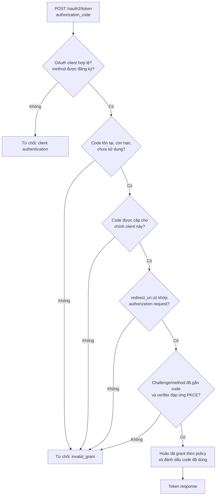

# Xác minh PKCE tại bước đổi code và xử lý verifier không hợp lệ

Trong **Authorization Code Flow**, OAuth 2.0/OpenID Connect (OIDC) client nhận một **authorization code** qua trình duyệt rồi gửi code đến **Token Endpoint** để đổi lấy token. Đối với public client, nếu kẻ tấn công lấy được code nhưng không có một ràng buộc bổ sung, họ có thể thử đổi code đó thành access token. **Proof Key for Code Exchange (PKCE)** giải quyết nguy cơ này bằng cách ràng buộc code với một bí mật ngắn hạn do **chính client** tạo cho từng giao dịch: `code_verifier`.

Điểm quyết định của PKCE nằm ở request **`POST /oauth2/token`**: Authorization Server nhận `code_verifier`, áp dụng phép biến đổi đã được khai báo ở bước authorize và đối chiếu kết quả với `code_challenge` gắn với authorization code. Một verifier thiếu, sai, không đúng định dạng hoặc không thuộc giao dịch đó phải khiến server từ chối cấp token.

Bài thuộc chương **Authorization Code và PKCE** của mô-đun **SPRING_SECURITY_OAUTH2_OIDC_AUTHORIZATION_SERVER**. Trong lộ trình thiết kế, cấu hình, bảo mật, kiểm thử và vận hành OAuth 2.0/OIDC Authorization Server bằng **Spring Security** và **Spring Authorization Server** trên Spring Boot, bài này tập trung vào **đường xác minh PKCE ở Token Endpoint**, xử lý lỗi và các kiểm thử bảo mật cần có. Ví dụ API hướng đến họ Spring Authorization Server 1.x/Spring Security 6.x; khi áp dụng với phiên bản khác phải kiểm tra tương thích.

## 1. PKCE bảo vệ bước đổi authorization code như thế nào?

### 1.1. Hai giai đoạn trong cùng một giao dịch

Khi bắt đầu Authorization Code Flow:

1. Client tạo `code_verifier` mới bằng bộ sinh ngẫu nhiên an toàn mật mã.
2. Client tính `code_challenge` từ verifier, thường dùng `S256`.
3. Client chuyển trình duyệt đến `/oauth2/authorize`, gửi challenge và `code_challenge_method=S256`.
4. Authorization Server kiểm tra authorization request, xác thực người dùng, xử lý consent và phát **authorization code** gắn với challenge/method.
5. Client nhận code qua redirect URI, kiểm tra `state` rồi gọi `/oauth2/token`, gửi **code và verifier gốc**.
6. Authorization Server kiểm tra code, client, redirect URI và PKCE; chỉ cấp token nếu toàn bộ điều kiện được đáp ứng.

```mermaid
sequenceDiagram
    autonumber
    actor U as Người dùng
    participant C as OAuth Client
    participant AS as Authorization Server
    participant Attacker as Kẻ có code bị lộ

    C->>C: Sinh verifier riêng cho giao dịch
    C->>C: challenge = BASE64URL(SHA256(ASCII(verifier)))
    C->>AS: GET /oauth2/authorize + challenge + S256 + state
    AS->>U: Xác thực / consent nếu cần
    AS->>AS: Lưu code gắn client, redirect, challenge
    AS-->>C: 302 callback?code=CODE&state=STATE
    C->>C: So khớp state và lấy verifier đã lưu

    par Code bị kẻ khác lấy
        Attacker->>AS: POST /oauth2/token + CODE + verifier sai
        AS-->>Attacker: OAuth error; không phát token
    and Client hợp lệ
        C->>AS: POST /oauth2/token + CODE + verifier đúng
        AS-->>C: Token response nếu code còn hiệu lực
    end
```

Hai nhánh cuối chỉ minh họa hai tình huống **độc lập**. Trong kiểm thử thực tế, không dùng cùng một authorization code để đồng thời kỳ vọng cả request thành công và thất bại: code chỉ dùng **một lần**, việc request sai có làm thay đổi trạng thái code hay không phụ thuộc đường xử lý và triển khai. Mỗi test nên tạo một code mới.

### 1.2. Điều gì được giữ bí mật?

| Giá trị | Có thể xuất hiện ở đâu? | Tính chất |
|---|---|---|
| `client_id` | Authorization request, token request | Công khai, không phải credential |
| `code_challenge` | Query của `/oauth2/authorize` | Giá trị dẫn xuất có thể công khai |
| `code_challenge_method` | Authorization request | Tên phép biến đổi; khuyến nghị `S256` |
| `authorization_code` | Redirect callback, token request | Có thời hạn ngắn, dùng một lần; cần tránh lộ |
| `code_verifier` | Trạng thái giao dịch ở client và **token request** | Bí mật ngắn hạn của giao dịch; không đưa vào authorize URL |
| `state` | Authorization request và callback | Dùng để client liên kết response với request đã tạo |
| `client_secret` | Token endpoint của confidential client | Credential dài hạn của client; public client không có |

Không được gửi `code_verifier` ở `/oauth2/authorize`. Nếu đưa cả verifier và challenge vào URL, kẻ quan sát authorization request có thể biết giá trị cần dùng để đổi code, làm suy yếu PKCE.

### 1.3. PKCE không thay client authentication hoặc state

**PKCE** chứng minh người đổi code giữ verifier tương ứng với challenge. Với **confidential client**, Token Endpoint còn có thể yêu cầu `client_secret_basic`, `private_key_jwt` hay phương thức client authentication khác đã đăng ký. Với **public client**, `ClientAuthenticationMethod.NONE` nghĩa là không dùng secret, nên PKCE đặc biệt cần thiết.

**`state`** lại được **client** dùng để so khớp callback; thông thường không phải dữ liệu mà Token Endpoint dùng thay PKCE. **OIDC `nonce`** dùng để client liên kết ID token với yêu cầu đăng nhập; nó cũng không thay thế PKCE. Một hệ thống an toàn cần nhiều kiểm tra với mục đích khác nhau.

## 2. Thuật toán S256 và điều kiện hợp lệ của verifier

### 2.1. Công thức bắt buộc hiểu

Theo RFC 7636, với `code_challenge_method=S256`:

```text
code_challenge = BASE64URL-ENCODE(SHA256(ASCII(code_verifier)))
```

Ở bước đổi code, Authorization Server phải tính lại phép biến đổi với **verifier nhận từ token request** rồi đối chiếu với **challenge được lưu kèm code**:

```text
computed = BASE64URL-ENCODE(SHA256(ASCII(received_code_verifier)))

Nếu computed == original_code_challenge:
    PKCE verification thành công
Ngược lại:
    Từ chối token request
```

`BASE64URL-ENCODE` ở đây là Base64URL **không có padding `=`**. Các ký tự `+` và `/` của Base64 thường phải được thay bằng `-` và `_` theo Base64URL. Không nên dùng mã hóa Base64 thường, Base64 có padding hoặc hex-encoded SHA-256 thay cho định dạng quy định.

### 2.2. Định dạng code_verifier

Theo RFC 7636, `code_verifier` là chuỗi:

- **43 đến 128 ký tự**;
- Chỉ chứa ký tự ASCII không cần escape: chữ cái `A-Z`, `a-z`, chữ số `0-9` và `-`, `.`, `_`, `~`;
- Có entropy cao; cách được khuyến nghị là dùng **32 byte ngẫu nhiên mật mã**, sau đó Base64URL không padding thành 43 ký tự.

Ví dụ biểu thức mô tả cú pháp:

```text
^[A-Za-z0-9._~-]{43,128}$
```

Biểu thức này kiểm tra **cú pháp**, không đo được entropy. Một chuỗi 43 ký tự `a` lặp lại có thể phù hợp cú pháp nhưng **không an toàn**. Trách nhiệm tạo verifier ngẫu nhiên khó đoán nằm ở client; server vẫn cần kiểm tra yêu cầu giao thức và binding.

### 2.3. Vì sao chọn S256 thay cho plain?

RFC 7636 mô tả hai phương thức `S256` và `plain`. Với `plain`, challenge chính là verifier; nếu kẻ tấn công nhìn thấy request authorize, họ có thể biết luôn giá trị dùng tại token endpoint. `S256` làm cho việc suy ngược verifier từ challenge trở nên không khả thi về mặt tính toán khi verifier đủ entropy.

Trong triển khai hiện đại, **chọn S256**. Spring Authorization Server có thể yêu cầu **có PKCE** qua `requireProofKey(true)`, nhưng không nên khẳng định rằng flag này tự động có nghĩa server đã bật chính sách **chỉ cho phép S256** trong mọi phiên bản. Nếu chính sách bảo mật yêu cầu từ chối `plain`, cần xác minh hành vi của phiên bản hoặc tùy chỉnh validation và có test riêng.

### 2.4. Mã Java tạo verifier và challenge ở phía client

Đây là mã **phía OAuth client hoặc công cụ kiểm thử**, không phải logic Token Endpoint cần viết lại ở Authorization Server:

```java
import java.nio.charset.StandardCharsets;
import java.security.MessageDigest;
import java.security.SecureRandom;
import java.util.Base64;

public final class PkceClientValues {
    private static final SecureRandom RANDOM = new SecureRandom();

    private PkceClientValues() {
    }

    public static String newVerifier() {
        byte[] random = new byte[32];
        RANDOM.nextBytes(random);
        return Base64.getUrlEncoder()
                .withoutPadding()
                .encodeToString(random); // 43 ký tự Base64URL
    }

    public static String s256Challenge(String verifier) throws Exception {
        byte[] digest = MessageDigest.getInstance("SHA-256")
                .digest(verifier.getBytes(StandardCharsets.US_ASCII));
        return Base64.getUrlEncoder()
                .withoutPadding()
                .encodeToString(digest);
    }
}
```

Ứng dụng gọi `newVerifier()` **cho mỗi authorization request**, lưu verifier với transaction tương ứng và chỉ gửi challenge qua URL. Với JavaScript, có thể sử dụng `crypto.getRandomValues` và `crypto.subtle.digest("SHA-256", ...)`; không sử dụng `Math.random()` hoặc timestamp.

## 3. Token Endpoint nhận những tham số nào?

Khi client đã có code và hoàn thành kiểm tra callback, nó gửi **`POST /oauth2/token`** với form URL-encoded.

### 3.1. Public client dùng none + PKCE

Ví dụ public SPA với `client_id=dashboard-spa`:

```http
POST /oauth2/token HTTP/1.1
Host: login.example.com
Content-Type: application/x-www-form-urlencoded

grant_type=authorization_code&client_id=dashboard-spa&code=AUTH_CODE&redirect_uri=https%3A%2F%2Fdashboard.example.com%2Foauth%2Fcallback&code_verifier=ORIGINAL_VERIFIER
```

Đây là minh họa, `AUTH_CODE` và `ORIGINAL_VERIFIER` phải được lấy từ cùng một giao dịch thật. Public client không gửi `client_secret` hoặc HTTP Basic với secret tự nhúng trong JavaScript.

### 3.2. Confidential client vẫn cần xác thực client

Ví dụ Portal BFF dùng `client_secret_basic`, đã bật PKCE:

```http
POST /oauth2/token HTTP/1.1
Host: login.example.com
Authorization: Basic <base64(client_id:client_secret)>
Content-Type: application/x-www-form-urlencoded

grant_type=authorization_code&code=AUTH_CODE&redirect_uri=https%3A%2F%2Fportal.example.com%2Flogin%2Foauth2%2Fcode%2Fcentral&code_verifier=ORIGINAL_VERIFIER
```

Với confidential client, `client_id` được xác định từ phương thức xác thực tương ứng; cách gửi client ID ở request thực tế phụ thuộc phương thức client authentication đã đăng ký. **Đúng secret nhưng sai verifier vẫn phải bị từ chối**, bởi hai phép kiểm tra có mục đích độc lập.

### 3.3. Những điều Token Endpoint không cần nhận

Ở bước đổi code:

- **Không gửi `code_challenge` mới** để thay challenge ban đầu; server phải dùng challenge đã gắn với code.
- **Không gửi `code_challenge_method` mới** để đổi từ `S256` sang `plain`; method phải được quyết định ở authorization request.
- **Không gửi `state` như một cách thay thế code verifier**; state được client kiểm tra tại callback.
- **Không gửi `scope` mới để mở rộng quyền** của authorization code; quyền phát token bị giới hạn bởi authorization đã được cấp và policy.
- **Không dùng `redirect_uri` khác** với URI gắn với code nếu URI đó được gửi ở authorization request và yêu cầu phải khớp.
- **Không gửi mật khẩu người dùng** đến token endpoint để “vượt qua PKCE”.

## 4. Authorization Server kiểm tra gì khi nhận code và verifier?

Về mặt khái niệm, Token Endpoint không chỉ so một cặp chuỗi. Nó phải xác minh **toàn bộ authorization grant**.



Đây là sơ đồ **kiểm tra logic**, không cam kết thứ tự chính xác từng filter/provider hoặc mã lỗi cho mọi trường hợp. Spring Authorization Server xử lý những bước này qua **OAuth2 Token Endpoint**, `AuthenticationManager` và các `AuthenticationProvider` tương ứng. Nên sử dụng cơ chế có sẵn thay vì viết một endpoint đổi code riêng.

### 4.1. Code phải gắn với client và authorization ban đầu

Authorization code được cấp trong ngữ cảnh:

- `registeredClientId`/OAuth client đã gửi authorization request;
- Resource owner/`principal` đã xác thực và quyền được chấp thuận nếu có;
- `redirect_uri` đã được chấp nhận;
- `code_challenge` và `code_challenge_method` nếu dùng PKCE;
- thời hạn hiệu lực, trạng thái chưa bị sử dụng và các tham số authorization liên quan.

Khi đổi code, token endpoint phải tra code trong kho authorization và kiểm tra nó thuộc **đúng client**, không chỉ dựa vào code có vẻ là chuỗi ngẫu nhiên. Nếu một code cấp cho client A được client B đem đổi, yêu cầu phải bị từ chối dù B có secret hoặc verifier khác.

### 4.2. Server không lưu code_verifier ban đầu

Trong PKCE, client giữ `code_verifier`; Authorization Server giữ **challenge và method** liên kết với authorization request/code. Nếu hệ thống tự yêu cầu client gửi cả verifier ở bước authorize để server lưu plain text, đã làm sai mục tiêu PKCE.

Ở bước token, server dùng verifier nhận được để tính challenge và đối chiếu với bản đã lưu. Tại API bảo vệ tài nguyên, không cần giữ `code_verifier`: sau khi code đổi thành token, PKCE đã hoàn thành nhiệm vụ.

### 4.3. Vì sao không được tin một challenge mới do client gửi?

Kẻ tấn công đã lấy được code có thể tự tạo verifier của mình và gửi challenge tương ứng **tại token request**. Nếu server đối chiếu theo challenge do kẻ đó vừa cung cấp, kiểm tra luôn thành công, mất toàn bộ binding. Vì vậy nguồn sự thật phải là **challenge đã được lưu khi phát code**.

### 4.4. Code một lần và các yêu cầu cạnh tranh

Authorization code thường có TTL rất ngắn và chỉ dùng một lần. Hai request đổi cùng code đến gần như đồng thời phải được xử lý sao cho **không thể cấp hai bộ token trái với chính sách**. Khi chạy nhiều node Authorization Server, kho `OAuth2AuthorizationService`, transactional behavior và xử lý tranh chấp phải đủ nhất quán.

Một request sai verifier có thể ảnh hưởng đến khả năng dùng lại code tùy đường xử lý. Không thiết kế client theo giả định có thể thử hàng trăm verifier với cùng một code; khi gặp lỗi PKCE, nên **hủy giao dịch và khởi tạo lại Authorization Code Flow**.

## 5. Spring Authorization Server xử lý PKCE ở đâu?

### 5.1. Các thành phần trong đường đi

Trong kiến trúc Servlet của Spring Authorization Server, quá trình tổng quát gồm:

1. **`OAuth2AuthorizationEndpointFilter`** nhận authorization request ở `/oauth2/authorize`.
2. Các provider của authorization request xác minh client, redirect URI, response type và tham số PKCE/consent theo cấu hình.
3. `OAuth2AuthorizationService` lưu trạng thái authorization, bao gồm code và dữ liệu request cần thiết cho việc xác minh về sau.
4. **`OAuth2TokenEndpointFilter`** nhận `POST /oauth2/token`, chuyển đổi tham số thành authentication token tương ứng.
5. `OAuth2ClientAuthenticationFilter` và các provider liên quan xử lý client authentication (bao gồm `none` đối với public client theo điều kiện hợp lệ).
6. **`OAuth2AuthorizationCodeAuthenticationProvider`** thực hiện các kiểm tra cấp token dựa trên authorization code, bao gồm PKCE khi code có challenge đã được đăng ký.
7. Khi mọi kiểm tra thành công, token generator phát token theo chính sách và authorization được cập nhật.

Tên filter/provider và việc chúng được gọi theo thứ tự cụ thể phụ thuộc phiên bản/cấu hình. Không viết kiểm tra tùy biến bằng cách dựa vào vị trí thứ tự trong bảng trên; sử dụng **Spring Authorization Server configurer** để cài các thành phần được hỗ trợ.

### 5.2. Những bean liên quan

| Thành phần Spring | Vai trò |
|---|---|
| `RegisteredClientRepository` | Quy định client được phép dùng grant/auth method, redirect URI, scope, PKCE |
| `RegisteredClient` | Định nghĩa thông tin của từng OAuth client |
| `ClientSettings.requireProofKey` | Yêu cầu authorization request thực hiện PKCE |
| `OAuth2AuthorizationService` | Lưu/truy vấn authorization code và thông tin ràng buộc |
| `OAuth2AuthorizationEndpointFilter` | Đầu vào authorization request |
| `OAuth2TokenEndpointFilter` | Đầu vào token request |
| `OAuth2AuthorizationCodeAuthenticationProvider` | Thực thi validation và phát token cho code grant |
| `OAuth2TokenGenerator` | Phát access/refresh/ID token theo chính sách và flow |

Nếu `OAuth2AuthorizationService` được lưu in-memory theo từng node riêng biệt, code cấp trên node A có thể không tìm thấy khi request đổi code đến node B. Production cần persistence/đồng bộ phù hợp, đồng thời bảo vệ dữ liệu authorization và quản lý TTL/cleanup.

## 6. Cấu hình RegisteredClient yêu cầu PKCE

Cấu hình chính sách PKCE nằm ở **client registration**, không phải trong một controller tự viết:

```java
package example.authserver.config;

import java.time.Duration;

import org.springframework.context.annotation.Bean;
import org.springframework.context.annotation.Configuration;
import org.springframework.security.oauth2.core.AuthorizationGrantType;
import org.springframework.security.oauth2.core.ClientAuthenticationMethod;
import org.springframework.security.oauth2.core.oidc.OidcScopes;
import org.springframework.security.oauth2.server.authorization.client.RegisteredClient;
import org.springframework.security.oauth2.server.authorization.client.RegisteredClientRepository;
import org.springframework.security.oauth2.server.authorization.client.InMemoryRegisteredClientRepository;
import org.springframework.security.oauth2.server.authorization.settings.ClientSettings;
import org.springframework.security.oauth2.server.authorization.settings.TokenSettings;

@Configuration(proxyBeanMethods = false)
public class PublicClientPkceConfig {

    @Bean
    RegisteredClientRepository registeredClientRepository() {
        RegisteredClient spa = RegisteredClient.withId("dashboard-spa-id")
                .clientId("dashboard-spa")
                .clientAuthenticationMethod(ClientAuthenticationMethod.NONE)
                .authorizationGrantType(AuthorizationGrantType.AUTHORIZATION_CODE)
                .redirectUri("https://dashboard.example.com/oauth/callback")
                .scope(OidcScopes.OPENID)
                .scope("orders.read")
                .clientSettings(ClientSettings.builder()
                        .requireProofKey(true)
                        .requireAuthorizationConsent(true)
                        .build())
                .tokenSettings(TokenSettings.builder()
                        .accessTokenTimeToLive(Duration.ofMinutes(5))
                        .build())
                .build();

        return new InMemoryRegisteredClientRepository(spa);
    }
}
```

Ở đây:

- `ClientAuthenticationMethod.NONE` thể hiện public client **không có secret**. Đổi code vẫn phải có `client_id`, code, redirect binding và verifier đúng.
- `AuthorizationGrantType.AUTHORIZATION_CODE` chỉ cho phép grant tương tác phù hợp; không bật `CLIENT_CREDENTIALS` cho một SPA không thể xác thực workload.
- `requireProofKey(true)` yêu cầu PKCE với authorization code, nên request không gửi challenge thích hợp phải bị từ chối.
- `requireAuthorizationConsent(true)` thêm quy trình consent theo chính sách; consent **không thay thế** PKCE.
- `redirectUri(...)` là callback được đăng ký chính xác. PKCE **không cho phép** bỏ qua redirect URI validation.
- `TokenSettings` và TTL chỉ minh họa, không bảo đảm mọi tính năng OAuth/OIDC đã sẵn sàng.

### 6.1. Confidential client có thể bật PKCE như thế nào?

Một Portal BFF giữ client secret phía server có thể đăng ký:

```java
RegisteredClient portal = RegisteredClient.withId("portal-bff-id")
        .clientId("portal-bff")
        .clientSecret(passwordEncoder.encode(portalSecret))
        .clientAuthenticationMethod(
                ClientAuthenticationMethod.CLIENT_SECRET_BASIC)
        .authorizationGrantType(AuthorizationGrantType.AUTHORIZATION_CODE)
        .authorizationGrantType(AuthorizationGrantType.REFRESH_TOKEN)
        .redirectUri("https://portal.example.com/login/oauth2/code/central")
        .scope(OidcScopes.OPENID)
        .scope("orders.read")
        .clientSettings(ClientSettings.builder()
                .requireProofKey(true)
                .build())
        .build();
```

Đoạn mã giả định `portalSecret` từ secret manager và bean `PasswordEncoder` đã có. Với confidential client, **client authentication** và **PKCE** là hai kiểm tra bổ sung nhau. Nếu code đã gắn challenge S256, việc gửi đúng `client_secret` nhưng thiếu `code_verifier` không được bỏ qua ràng buộc PKCE.

**Chú ý:** `InMemoryRegisteredClientRepository` phù hợp thử nghiệm. Trong production, cần `RegisteredClientRepository` bền vững, quản lý secret/ID/redirect URI theo môi trường. Không ghi secret vào mã nguồn, log hoặc URL.

### 6.2. SecurityFilterChain cho Token Endpoint

Cấu hình Spring Authorization Server cần chain dành cho giao thức:

```java
@Bean
@Order(1)
SecurityFilterChain authorizationServerSecurityFilterChain(
        HttpSecurity http) throws Exception {
    OAuth2AuthorizationServerConfigurer as =
            OAuth2AuthorizationServerConfigurer.authorizationServer();

    http
        .securityMatcher(as.getEndpointsMatcher())
        .with(as, configurer -> configurer
            .oidc(Customizer.withDefaults()))
        .authorizeHttpRequests(authorize -> authorize
            .anyRequest().authenticated())
        .exceptionHandling(exceptions -> exceptions
            .defaultAuthenticationEntryPointFor(
                new LoginUrlAuthenticationEntryPoint("/login"),
                new MediaTypeRequestMatcher(MediaType.TEXT_HTML)))
        .oauth2ResourceServer(oauth2 -> oauth2
            .jwt(Customizer.withDefaults()));
    return http.build();
}

@Bean
@Order(2)
SecurityFilterChain applicationSecurityFilterChain(
        HttpSecurity http) throws Exception {
    http.authorizeHttpRequests(authorize -> authorize
            .anyRequest().authenticated())
        .formLogin(Customizer.withDefaults());
    return http.build();
}
```

Các import và bean khác (issuer settings, `JWKSource`, `JwtDecoder` khi cần, kho authorization/consent, user authentication) đã được lược bỏ. Ví dụ chỉ minh họa **đúng ranh giới**: `/oauth2/token` được xử lý bởi protocol chain, không được rơi vào form login chain rồi nhận redirect HTML.

Không triển khai một `@PostMapping("/oauth2/token")` tùy tiện chỉ để tự kiểm tra `MessageDigest`. Spring Authorization Server có sẵn cơ chế xử lý OAuth grant, token lifecycle và lỗi giao thức; tự thay thế dễ bỏ qua binding client, redirect URI, code một lần và các quy tắc khác.

## 7. Xử lý verifier không hợp lệ ở Token Endpoint

### 7.1. Các dạng lỗi cần phân biệt

| Trường hợp | Ví dụ | Kết quả bảo mật bắt buộc |
|---|---|---|
| Thiếu `code_verifier` | Code đã gắn challenge nhưng token request không gửi verifier | Không cấp token |
| Verifier sai | Một verifier ngẫu nhiên khác với giao dịch ban đầu | Không cấp token |
| Verifier bị sửa | Thay một ký tự trước khi gửi | Không cấp token |
| Verifier quá ngắn | 20 ký tự | Không chấp nhận verifier sai cú pháp |
| Verifier quá dài | 129 ký tự | Không chấp nhận |
| Chứa ký tự không hợp lệ | Dấu cách, Unicode ngoài tập cho phép, dấu `+` hoặc `/` | Không chấp nhận |
| Gửi digest thay vì verifier | Truyền `code_challenge` vào `code_verifier` | Tính lại S256 không khớp; từ chối |
| Dùng verifier của tab khác | Code A nhưng verifier của giao dịch B | Không cấp token |
| Dùng sai method | Challenge tạo bằng S256, client tính/gửi theo giả định plain | Không vượt qua kiểm tra |
| Gửi challenge mới tại token endpoint | Kèm challenge của verifier do attacker tạo | Server phải dùng challenge **đã lưu** |
| Client khác đổi code | Code cấp cho client A nhưng B gửi request | Từ chối theo client binding |
| Code hết hạn/đã dùng | Verifier đúng nhưng code không còn hiệu lực | Từ chối |
| Redirect URI sai | Khác redirect URI gắn với authorization code | Từ chối |

### 7.2. Lỗi giao thức thường gặp

Khi kiểm tra PKCE **không khớp** trong luồng Authorization Code, OAuth2 thường phản hồi lỗi kiểu **`invalid_grant`**. Ví dụ minh họa:

```http
HTTP/1.1 400 Bad Request
Content-Type: application/json
Cache-Control: no-store
Pragma: no-cache

{
  "error": "invalid_grant"
}
```

Đây là response **minh họa**, không phải cam kết về mọi trường và mã HTTP trong tất cả phiên bản. Request thiếu tham số, sai cú pháp hoặc không hợp lệ tại các bước khác có thể trả `invalid_request` hoặc lỗi OAuth khác; client authentication sai có thể trả `invalid_client`. Nội dung `error_description` và mã lỗi cụ thể cần kiểm tra theo phiên bản Spring Authorization Server và vị trí validation.

**Điều bắt buộc:** Không có token response thành công khi verifier sai. Không redirect machine client sang trang `/login` hay xuất HTML stack trace tại Token Endpoint.

### 7.3. Không làm lộ verifier hoặc thông tin kiểm chứng qua lỗi

Không đưa những dữ liệu sau vào `error_description`, HTTP headers hoặc server logs:

- Authorization code gốc;
- `code_verifier` nhận được;
- `code_challenge` gắn với code nếu log có thể truy cập rộng;
- Client secret/client assertion;
- Access/refresh/ID token hoặc nội dung nhạy cảm của token.

Một thông báo chung như `invalid_grant` đủ cho client biết giao dịch không thể tiếp tục. Log nội bộ có thể ghi **loại lỗi, client ID đã xác minh, endpoint, request/correlation ID** và metadata ít nhạy cảm để điều tra, với chính sách bảo vệ log thích hợp.

### 7.4. Hành vi phía client khi nhận invalid_grant

Khi token exchange thất bại do verifier sai/thiếu:

1. **Không thử các verifier khác** với cùng code.
2. Dọn trạng thái giao dịch tạm (`code`, `state`, `code_verifier`, `nonce`).
3. Không tạo session đăng nhập client hoặc sử dụng token giả định.
4. Khởi tạo **Authorization Code Flow mới** nếu người dùng muốn thử lại.
5. Nếu lỗi lặp lại, kiểm tra generator PKCE, storage transaction, callback handling, redirect URI và đồng hồ, không tắt `requireProofKey(true)` để lách lỗi.

Retry có thể phù hợp cho lỗi mạng **trước khi biết request đã tới server hay chưa**, nhưng vì authorization code dùng một lần nên client cần xử lý trạng thái không chắc chắn một cách thận trọng; không biến retry tự động thành phép dò verifier.

## 8. Các lỗi phổ biến trong hiện thực PKCE phía client

### 8.1. Gửi challenge thay cho verifier

Sai:

```text
Authorize: code_challenge = BASE64URL(SHA256(verifier))
Token:    code_verifier  = code_challenge  // SAI
```

Đúng:

```text
Authorize: code_challenge = BASE64URL(SHA256(verifier))
Token:    code_verifier  = verifier       // ĐÚNG
```

Vì Token Endpoint băm **giá trị nhận ở `code_verifier`**, nếu truyền digest thay verifier thì server băm thêm lần nữa, không khớp challenge ban đầu.

### 8.2. Mỗi request tạo lại verifier

Một lỗi khác:

```javascript
// Sai: mỗi lần gọi hàm lại sinh verifier mới.
async function exchangeCode(code) {
  const verifier = createCodeVerifier(); // Không phải verifier của authorize.
  return tokenRequest({ code, code_verifier: verifier });
}
```

Client phải **lưu verifier gốc cùng authorization transaction** khi tạo authorization URL, sau đó lấy lại đúng giá trị ở callback. Không dùng một biến toàn cục bị ghi đè nếu có nhiều tab hoặc nhiều request đăng nhập song song.

### 8.3. Mã hóa S256 sai

Các lỗi thường gặp:

- Hash dạng hex thay vì Base64URL của **32-byte SHA-256 digest**.
- Dùng Base64 thường có ký tự `+`, `/` và padding `=`.
- Băm chuỗi đã URL-encode thay vì verifier gốc.
- Gửi chuỗi có dấu cách, CRLF hoặc bị trim/nối ngoài ý muốn.
- Đọc sai encoding từ storage hoặc double URL-encode body.
- Tự viết bộ sinh verifier dùng nguồn ngẫu nhiên dự đoán được.

Nếu lỗi xảy ra, kiểm tra **thuật toán ở client** bằng test vector RFC 7636 và log trong môi trường test chỉ những thông tin không nhạy cảm. Không in verifier trong production để so thủ công.

### 8.4. Dùng sai transaction khi có nhiều tab

Ví dụ Portal phát hai yêu cầu:

| Transaction | `state` | `code_verifier` | `code_challenge` |
|---|---|---|---|
| Tab A | `state-A` | `verifier-A` | `S256(verifier-A)` |
| Tab B | `state-B` | `verifier-B` | `S256(verifier-B)` |

Khi callback A đến, client phải lấy verifier A từ trạng thái gắn với state A. Nếu lưu duy nhất một `currentVerifier` và tab B ghi đè nó, token request của A sẽ nhận `invalid_grant`. Phải quản lý nhiều giao dịch độc lập, hết hạn và dọn sạch sau khi dùng.

## 9. Khi nào PKCE bị từ chối ở Authorization Endpoint?

Với `ClientSettings.requireProofKey(true)`, client phải gửi PKCE trong **authorization request**, trước khi có code. Các trường hợp như thiếu `code_challenge`, `code_challenge_method` không được hỗ trợ hoặc challenge sai định dạng có thể bị từ chối ngay tại `/oauth2/authorize` theo chính sách/phiên bản.

Điều này khác với lỗi **verifier ở Token Endpoint**:

| Giai đoạn | Tham số | Tình huống lỗi | Hệ quả |
|---|---|---|---|
| `GET /oauth2/authorize` | `code_challenge`, `code_challenge_method` | Thiếu hoặc không được hỗ trợ khi client yêu cầu PKCE | Không nên cấp authorization code |
| `POST /oauth2/token` | `code_verifier` | Thiếu, sai cú pháp hoặc không khớp challenge đã lưu | Không phát token |
| `POST /oauth2/token` | `code`, `client_id`, `redirect_uri` | Code không còn hợp lệ hoặc không thuộc client/redirect đúng | Không phát token |
| Callback của OAuth client | `state` | State sai hoặc thiếu theo policy client | Client phải dừng trước khi đổi code |

**Không chuyển phần kiểm tra PKCE về phía OAuth client rồi bỏ server validation.** Client có thể bị sửa hoặc có bug; Authorization Server phải là bên xác minh binding ở Token Endpoint.

### 9.1. Trường hợp không có challenge trong bản ghi code

Nếu client được cấu hình `requireProofKey(true)` nhưng authorization request không có challenge hợp lệ, server phải từ chối ở bước authorize theo chính sách. Nếu vì một lỗi lưu trữ hoặc triển khai mà code vẫn xuất hiện không có challenge, **Token Endpoint không được “tự bổ sung challenge” từ request mới**. Phải xử lý theo trạng thái grant và chính sách đã lưu; với public client, không được mở lối cấp token bằng cách bỏ PKCE.

Với confidential client trong một cấu hình lịch sử không yêu cầu PKCE, có thể tồn tại authorization code không gắn challenge; hành vi xử lý phải đúng chính sách đã đăng ký tại thời điểm phát code. Khi nâng cấp yêu cầu PKCE, cần kiểm thử chuyển tiếp và tránh thay đổi gây bất ngờ đối với authorization đang chờ.

## 10. Thực hành với curl: đúng verifier và sai verifier

### 10.1. Tạo hai giá trị PKCE ở phía client

Một script hoặc OAuth client tạo `code_verifier` và challenge theo S256. Ví dụ Java đã trình bày ở mục 2.4. Ghi nhớ:

```text
code_verifier  = <43-128 ký tự, entropy cao>
code_challenge = BASE64URL(SHA256(ASCII(code_verifier)))
method         = S256
```

Không đưa verifier vào authorization URL; giữ nó ở client cho bước token.

### 10.2. Bắt đầu authorization request

```bash
curl --get --include "https://login.example.com/oauth2/authorize" \
  --data-urlencode "response_type=code" \
  --data-urlencode "client_id=dashboard-spa" \
  --data-urlencode "redirect_uri=https://dashboard.example.com/oauth/callback" \
  --data-urlencode "scope=openid orders.read" \
  --data-urlencode "state=$OAUTH_STATE" \
  --data-urlencode "code_challenge=$CODE_CHALLENGE" \
  --data-urlencode "code_challenge_method=S256"
```

Lệnh giả định có biến `OAUTH_STATE` và `CODE_CHALLENGE` được sinh an toàn; nó không tự làm bước login/consent. Trong thử nghiệm thực tế, trình duyệt phải hoàn tất các bước đó để client nhận authorization code.

### 10.3. Đổi code với verifier đúng

Sau khi có code và state được xác minh:

```bash
curl --request POST "https://login.example.com/oauth2/token" \
  --header "Content-Type: application/x-www-form-urlencoded" \
  --data-urlencode "grant_type=authorization_code" \
  --data-urlencode "client_id=dashboard-spa" \
  --data-urlencode "code=$AUTHORIZATION_CODE" \
  --data-urlencode "redirect_uri=https://dashboard.example.com/oauth/callback" \
  --data-urlencode "code_verifier=$CODE_VERIFIER"
```

Đây là ví dụ dành cho **public client** `none`, nên không có client secret. Khi mọi kiểm tra hợp lệ, server có thể trả:

```json
{
  "access_token": "<example-access-token>",
  "token_type": "Bearer",
  "expires_in": 300,
  "scope": "openid orders.read",
  "id_token": "<example-id-token>"
}
```

`id_token` chỉ xuất hiện nếu yêu cầu và cấu hình OIDC đáp ứng điều kiện. `access_token` có thể là JWT hoặc opaque token theo chính sách, không nhất thiết có cấu trúc giống ID token.

### 10.4. Kiểm tra verifier sai

Để kiểm thử âm tính, **xin một authorization code mới** với challenge của verifier A. Khi token exchange, gửi verifier B được tạo độc lập:

```bash
curl --request POST "https://login.example.com/oauth2/token" \
  --header "Content-Type: application/x-www-form-urlencoded" \
  --data-urlencode "grant_type=authorization_code" \
  --data-urlencode "client_id=dashboard-spa" \
  --data-urlencode "code=$FRESH_AUTHORIZATION_CODE" \
  --data-urlencode "redirect_uri=https://dashboard.example.com/oauth/callback" \
  --data-urlencode "code_verifier=$WRONG_CODE_VERIFIER"
```

Kết quả cần chứng minh: **không có access token/ID token/refresh token được cấp**; response phản ánh OAuth error phù hợp, thông thường `invalid_grant` đối với verifier không khớp. Dùng code mới cho từng case; không chia sẻ token hoặc verifier thật qua hệ thống lưu log không an toàn.

### 10.5. Thử trường hợp thiếu verifier

Tạo một code mới có challenge rồi gửi token request **không có `code_verifier`**. Kết quả phải bị từ chối. Mã lỗi có thể phụ thuộc version/đường validation; test nên khẳng định chính xác behavior sau khi kiểm chứng phiên bản, đồng thời luôn khẳng định **không cấp token**.

## 11. Ma trận kiểm thử bảo mật PKCE

Một bộ kiểm thử thực tế cần đi qua Authorization Endpoint, login/consent, lưu code và Token Endpoint. Test chỉ mock `Authentication` hoặc cắt bỏ Token Endpoint **không chứng minh** PKCE đã được kiểm tra.

| Test | Điều kiện | Kỳ vọng |
|---|---|---|
| S256 thành công | Client đăng ký, challenge/verifier đúng, code còn hạn | Cấp token theo policy |
| Authorization thiếu challenge | `requireProofKey(true)` | Từ chối authorization request |
| Authorization method không được hỗ trợ | Method lạ, ví dụ `XYZ` | Từ chối |
| Policy chỉ cho S256 | Gửi `plain` | Từ chối nếu policy được cấu hình hỗ trợ |
| Token thiếu verifier | Code đã gắn S256 challenge | Không cấp token |
| Token verifier không khớp | Dùng verifier ngẫu nhiên khác | Không cấp token |
| Verifier quá ngắn | Dưới 43 ký tự | Từ chối |
| Verifier quá dài | Trên 128 ký tự | Từ chối |
| Ký tự không hợp lệ | Có `+`, `/`, dấu cách hoặc Unicode ngoài tập cho phép | Từ chối |
| Verifier là challenge | Client gửi digest thay vì verifier | Không khớp, từ chối |
| Sai case | Thay chữ hoa/chữ thường trong verifier | Không khớp, từ chối |
| Tab A/B tráo verifier | Code của A, verifier của B | Không cấp token |
| Code của client A đổi bởi B | Client khác cố dùng code | Không cấp token |
| Sai redirect URI khi đổi code | URI khác URI gắn với code | Không cấp token |
| Code hết hạn | Verifier đúng nhưng code quá hạn | Không cấp token |
| Code đã dùng | Gửi lại code sau lần thành công | Không cấp token lần sau |
| Hai request đổi cùng code | Gửi đồng thời từ hai kết nối | Không cấp nhiều token vượt chính sách một lần |
| Confidential client secret đúng, verifier sai | Có client authentication nhưng PKCE không khớp | Không cấp token |
| Confidential client secret sai, verifier đúng | PKCE đúng nhưng client authentication sai | Không cấp token |
| Scope không hợp lệ | Token request muốn thêm scope chưa được cấp | Không được mở rộng quyền |
| State callback sai | OAuth client nhận state không khớp | Client không gửi token request |
| OIDC nonce sai | ID token nonce không khớp giao dịch | Client từ chối đăng nhập |
| Resource Server sai audience | Token đúng PKCE nhưng dành cho API khác | API từ chối theo chính sách |

### 11.1. Kiểm thử theo hai lớp

**Lớp protocol/Authorization Server:** Tạo client và phiên hợp lệ, chạy authorize và token exchange thật; kiểm tra `invalid_grant`/lỗi tương ứng, không cấp token, cập nhật trạng thái code và phản ứng khi request đồng thời. Với `MockMvc` hoặc HTTP integration test, nên giữ session/cookie và chạy đủ login/consent khi kịch bản yêu cầu.

**Lớp OAuth client:** Kiểm tra CSPRNG, định dạng verifier, hàm S256, transaction storage, `state`, đồng bộ callback và cách dọn verifier sau lỗi. Client bị lỗi tạo/chuyển verifier là nguyên nhân phổ biến của `invalid_grant` dù máy chủ hoạt động đúng.

### 11.2. Dùng test vector RFC 7636

RFC 7636 có **test vector cho S256** để kiểm tra thuật toán:

```text
code_verifier:
dBjftJeZ4CVP-mB92K27uhbUJU1p1r_wW1gFWFOEjXk

expected code_challenge (S256):
E9Melhoa2OwvFrEMTJguCHaoeK1t8URWbuGJSstw-cM
```

Nếu helper tính S256 của client không trả đúng challenge trên, thường có lỗi ở SHA-256, ký tự đầu vào hoặc Base64URL không padding. Vector chỉ kiểm tra phép biến đổi, **không chứng minh** server đã lưu và ràng buộc challenge đúng authorization code; vẫn cần integration test giao thức.

### 11.3. Pseudocode cho test đổi code

```java
// Pseudocode mô tả intent; helper authorizeAndLogin()
// phải chạy flow thật và trả code gắn với challenge đã gửi.
String verifier = PkceClientValues.newVerifier();
String challenge = PkceClientValues.s256Challenge(verifier);

String code = authorizeAndLogin(
        "dashboard-spa", redirectUri, challenge, "S256");

// Test case âm tính dùng một verifier khác.
String wrongVerifier = PkceClientValues.newVerifier();

TokenResponse response = exchangeAuthorizationCode(
        "dashboard-spa", code, redirectUri, wrongVerifier);

assertThat(response.isSuccess()).isFalse();
assertThat(response.getAccessToken()).isNull();

// Không tái sử dụng code này cho happy path; tạo flow mới.
```

Tên helper chỉ mang ý nghĩa minh họa; chúng không thuộc API mặc định của Spring Authorization Server. Khi hiện thực test, dùng client HTTP/MockMvc thực với session và registered client test, tránh tự mô phỏng token provider thay vì kiểm tra nó.

## 12. Hướng dẫn chẩn đoán lỗi verifier khi vận hành

| Triệu chứng | Nguyên nhân khả dĩ | Cách kiểm tra |
|---|---|---|
| Mọi request trả `invalid_grant` | Client băm/sinh verifier sai, mất verifier khi callback hoặc redirect mismatch | Đối chiếu RFC vector, transaction state, redirect URI |
| Chỉ lỗi khi mở nhiều tab | Biến verifier toàn cục bị ghi đè | Lưu verifier theo từng `state`/transaction |
| Lỗi sau reload SPA | Verifier chỉ ở memory và biến mất | Thiết kế storage giao dịch ngắn hạn phù hợp, kiểm tra XSS |
| Gửi challenge thay verifier | Nhầm `code_challenge` với `code_verifier` | Kiểm tra code frontend; chỉ gửi verifier gốc ở token endpoint |
| Lỗi khi dùng thư viện Base64 | Dùng Base64 có padding/`+`/`/` | Base64URL no-padding |
| Chỉ một số ký tự làm lỗi | URL encode/form encode sai | Dùng form encoder chính xác, tránh double-encoding |
| Lỗi sau deploy nhiều node | Authorization code/challenge không có trong node nhận token | Dùng kho authorization chia sẻ bền vững |
| Lỗi sau restart | Kho code in-memory bị mất | Dùng persistence phù hợp, không mong code còn hợp lệ sau restart |
| Client confidential vẫn lỗi PKCE | Client secret đúng nhưng thiếu/sai verifier | Xem `requireProofKey` và challenge gắn code |
| Token endpoint trả HTML login | Request vào sai SecurityFilterChain hoặc entry point sai | Kiểm tra protocol matcher và @Order |
| Verifier nằm trong log | HTTP logging, tracing, APM ghi body | Redact body `code_verifier`/code/token |
| Test flaky, lúc qua lúc không | Code dùng lại, race condition, trạng thái test không tách | Code mới mỗi case, isolation, kiểm tra concurrency |
| Lỗi sau thay đổi OAuth client library | Library đổi cách lưu PKCE/redirect handling | Chạy regression test Authorization Code+PKCE |

### 12.1. Có nên log giá trị verifier để debug?

**Không log verifier thật trong môi trường production.** Verifier là bí mật ngắn hạn có thể dùng để đổi authorization code tương ứng. Không ghi cả challenge và code gốc vào log chung vì có thể làm tăng khả năng tái hiện giao dịch.

Thay vào đó, log an toàn:

- `client_id` khi đã được xác minh và correlation/request ID;
- thời gian, loại lỗi token endpoint và nhóm nguyên nhân như missing verifier, invalid format, PKCE mismatch;
- loại grant, status code, latency, thời gian sống code (nếu không làm lộ giá trị nhạy cảm);
- cảnh báo khi lỗi tăng đột biến sau triển khai.

Tránh log raw request body/headers tại `/oauth2/token`; giá trị client secret, authorization code, verifier và token có thể xuất hiện trong đó.

### 12.2. Xử lý sự cố lặp lại

Nếu một client bỗng có tỷ lệ `invalid_grant` cao:

1. Xác định loại client, phiên bản client library và thời điểm deploy.
2. Xác minh server vẫn phát code với challenge/method đúng chính sách.
3. Kiểm tra client có tạo verifier một lần cho mỗi authorize request và khôi phục đúng ở callback.
4. Đối chiếu thuật toán với test vector RFC 7636 bằng **dữ liệu test**.
5. Xác minh `redirect_uri`, `client_id`, issuer, route qua proxy và kho authorization chia sẻ.
6. Chạy lại luồng với code mới; không tháo PKCE hoặc nới rộng redirect URI như một biện pháp sửa tạm.

## 13. Bảo mật bổ sung ngoài PKCE

PKCE chỉ bảo vệ một chặng của Authorization Code Flow. Hệ thống production vẫn cần:

| Biện pháp | Vấn đề được giải quyết |
|---|---|
| `state` ngẫu nhiên và callback validation | Chống response injection/CSRF và gắn giao dịch |
| Redirect URI chính xác, không wildcard/open redirect | Giảm nguy cơ code bị đưa sang địa chỉ không tin cậy |
| HTTPS cho authorize/token/callback | Giảm lộ code, verifier và token trên đường truyền |
| OIDC ID token validation | Chữ ký, issuer, audience, expiry, nonce theo profile |
| Client authentication cho confidential client | Chứng minh danh tính client tại token endpoint |
| Thời hạn code ngắn, một lần | Giảm cửa sổ sử dụng code bị lộ |
| Token TTL, audience, scope | Giảm quyền và phạm vi sử dụng token |
| Resource Server authorization | Bảo vệ tenant và đối tượng dữ liệu |
| XSS/CSP/token storage tại SPA | Giảm lộ verifier/token do script độc hại |
| Audit, rate limiting và giám sát | Phát hiện lạm dụng và lỗi triển khai |

PKCE không làm public client có khả năng giữ client secret, không chứng minh bản cài đặt app là độc nhất và không bảo vệ chống XSS khi script độc hại cùng origin có thể đọc verifier/token.

## 14. Checklist trước khi triển khai

1. **Client registration:** dùng `authorization_code`; public client `none`, confidential client authentication phù hợp; bật `requireProofKey(true)` khi cần.
2. **S256:** client tạo verifier 43–128 ký tự đủ entropy, biến đổi đúng Base64URL(SHA256(ASCII(verifier))), ưu tiên/kiểm tra chính sách S256.
3. **Authorization request:** gửi challenge và method, không gửi verifier; `redirect_uri` được đăng ký chính xác; `state`/`nonce` được xử lý đúng.
4. **Lưu authorization:** code gắn client, redirect, challenge, method, chủ thể và TTL theo mô hình lưu trữ an toàn.
5. **Token request:** gửi `code_verifier` gốc, đúng client và redirect; client secret chỉ xuất hiện ở confidential client qua phương thức đúng.
6. **Verification:** không tin challenge mới tại token endpoint; từ chối code/verifier thiếu hoặc sai và không cấp token.
7. **Lỗi:** response theo OAuth2, không HTML login, không lộ code/verifier/secret/token trong body hay log.
8. **Một lần:** code không được đổi thành công nhiều lần, kể cả đồng thời trên nhiều node.
9. **Kiểm thử:** test vector S256, missing/wrong/malformed verifier, cross-tab, cross-client, redirect mismatch, replay và proxy/HA.
10. **Vận hành:** theo dõi lỗi theo client/correlation ID, quản lý khóa/issuer/authorization store nhất quán, không tắt PKCE khi gặp lỗi.

### 14.1. Tình huống thực hành

**Dashboard SPA** đăng ký `ClientAuthenticationMethod.NONE`, `authorization_code`, `requireProofKey(true)`, callback HTTPS xác định. Một developer phát hiện khi mở hai cửa sổ login, cửa sổ đầu luôn nhận `invalid_grant`. Giả thuyết có khả năng là client lưu một verifier toàn cục nên verifier của cửa sổ sau ghi đè verifier đầu. Cách sửa là **lưu trạng thái mỗi giao dịch theo state**, lấy lại đúng verifier ở callback, và kiểm thử hai luồng song song với code độc lập. Không tắt PKCE và không chuyển sang client secret đặt trong JavaScript.

**Portal BFF** dùng `client_secret_basic` + PKCE. Khi token request bị từ chối dù secret đúng, kiểm tra `code_verifier`, code binding và redirect URI. Không nên cho phép bypass PKCE đối với confidential client chỉ vì đã chứng minh client secret.

## 15. Câu hỏi tự đánh giá

1. Khi bắt đầu Authorization Code Flow, client gửi `code_challenge` hay `code_verifier` tới Authorization Endpoint?
2. Tại Token Endpoint, vì sao server phải dùng challenge **đã lưu cùng code** mà không dùng challenge mới do client cung cấp?
3. `S256` tính challenge thế nào? Vì sao Base64URL không padding khác Base64 thường?
4. Dải độ dài và bộ ký tự hợp lệ của `code_verifier` theo RFC 7636 là gì? Vì sao đúng regex chưa đủ an toàn?
5. Một confidential client gửi secret đúng nhưng verifier sai có nên được cấp token không?
6. `state`, `nonce` và PKCE bảo vệ những bước khác nhau nào?
7. Vì sao lưu verifier vào biến toàn cục khiến login ở hai tab có thể thất bại?
8. Khi verifier không khớp, lỗi OAuth2 thường gặp là gì? Vì sao không nên hiển thị verifier trong error response?
9. Vì sao authorization code chỉ được đổi một lần và cần kiểm tra đồng thời trong hệ thống nhiều node?
10. Một test chỉ gọi helper SHA-256 có chứng minh Authorization Server xử lý PKCE đúng không? Cần test giao thức gì thêm?
11. Nếu Token Endpoint trả redirect HTML đến `/login`, nên kiểm tra cấu hình nào trong Spring Security?
12. Sau khi PKCE thành công, Orders API cần xác minh những yếu tố nào trước khi trả dữ liệu?

## 16. Tài liệu nền tảng

- [RFC 7636 — Proof Key for Code Exchange](https://www.rfc-editor.org/rfc/rfc7636): mô tả `code_verifier`, `code_challenge`, `S256` và kiểm tra ở Token Endpoint; mục 4.6 nói về verification.
- [RFC 6749 — OAuth 2.0](https://www.rfc-editor.org/rfc/rfc6749): Authorization Code Grant, Token Endpoint và các mã lỗi như `invalid_grant`.
- [RFC 9700 — OAuth 2.0 Security Best Current Practice](https://www.rfc-editor.org/rfc/rfc9700): khuyến nghị bảo mật hiện đại về PKCE và Authorization Code Flow.
- [Spring Authorization Server — Core Model](https://docs.spring.io/spring-authorization-server/reference/core-model-components.html): `RegisteredClient`, `ClientSettings` và `OAuth2AuthorizationService`.
- [Spring Authorization Server — SPA with PKCE](https://docs.spring.io/spring-authorization-server/reference/guides/how-to-pkce.html): cấu hình public client dùng `none` và PKCE.
- [Spring Authorization Server — Protocol Endpoints](https://docs.spring.io/spring-authorization-server/reference/protocol-endpoints.html): cấu hình Authorization Endpoint/Token Endpoint và các extension points.

**Ghi nhớ:** Ở bước đổi authorization code, Spring Authorization Server phải xác minh `code_verifier` nhận tại `/oauth2/token` với `code_challenge` và method **đã gắn với code từ yêu cầu authorize**. Verifier thiếu, sai hoặc không đúng chính sách phải khiến token request thất bại; một client secret hợp lệ không được bỏ qua PKCE. Tích hợp đúng `RegisteredClient`, nguồn lưu authorization, callback/redirect binding và các kiểm thử âm tính giúp phòng chặn bắt code mà vẫn giữ được tính nhất quán của OAuth2/OIDC trên Spring Boot.
