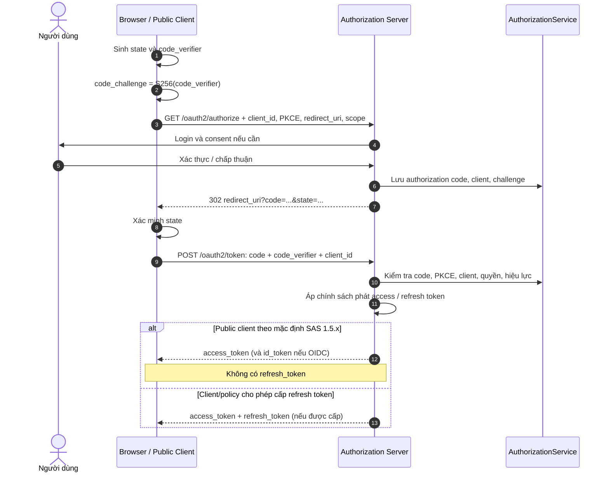
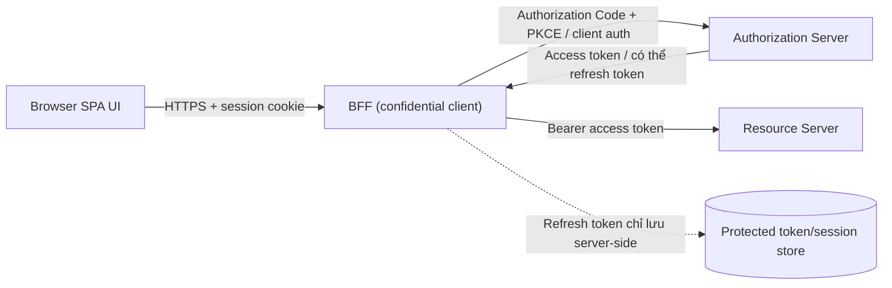

# Client public, khả năng cấp refresh token và giới hạn theo cấu hình, phiên bản

## 1. Bài toán: PKCE thành công nhưng không có refresh token

Giả sử một ứng dụng **Single Page Application (SPA)** sử dụng **Authorization Code + PKCE** để đăng nhập qua Spring Authorization Server. Trình duyệt được chuyển tới Authorization Endpoint, người dùng đăng nhập, client nhận authorization code và gửi `code_verifier` tới Token Endpoint. Máy chủ trả về `access_token`, có thể kèm `id_token` nếu sử dụng OpenID Connect (OIDC), nhưng **không có `refresh_token`**.

Nhiều nhóm phát triển cho rằng đó là lỗi vì client đã bật PKCE hoặc đã thêm `AuthorizationGrantType.REFRESH_TOKEN` vào cấu hình. Thực tế, cần phân biệt ba lớp quyết định độc lập:

1. **Giao thức OAuth 2.0** cho phép Authorization Server phát hành refresh token theo chính sách, nhưng không cam kết mọi authorization code exchange đều có refresh token.
2. **Đặc tính public client**: SPA/mobile không thể giữ bí mật dài hạn như backend được kiểm soát. PKCE bảo vệ **authorization code exchange**, không biến public client thành confidential client.
3. **Hành vi của phiên bản Spring Authorization Server**: hướng dẫn chính thức của **Spring Authorization Server 1.5.8** nêu rõ máy chủ **không phát hành refresh token cho public client** trong luồng cấu hình được hướng dẫn. Vì vậy không nên suy luận chỉ từ grant type hay `TokenSettings`. Những dòng Spring Security/Authorization Server khác cần được kiểm chứng trên đúng artifact, phiên bản và cấu hình đang dùng.

Bài thuộc chương **Authorization Code và PKCE** trong module `SPRING_SECURITY_OAUTH2_OIDC_AUTHORIZATION_SERVER`. Mục tiêu là học cách **thiết kế, cấu hình, bảo mật, kiểm thử và vận hành OAuth 2.0/OpenID Connect Authorization Server** bằng Spring Security và Spring Authorization Server trong ứng dụng Spring Boot, đặc biệt khi quyết định **có cấp refresh token cho public client hay không**.

### Mục tiêu học tập

Sau bài học, bạn sẽ:

- Phân biệt `public client`, `confidential client`, PKCE, refresh token và phiên đăng nhập của người dùng.
- Giải thích được tại sao đăng ký `refresh_token` grant hoặc đặt `refreshTokenTimeToLive` **không đồng nghĩa** chắc chắn nhận refresh token.
- Cấu hình `RegisteredClient`, `ClientSettings`, `TokenSettings` cho những tình huống phù hợp với Spring Authorization Server 1.x.
- So sánh mô hình **SPA thuần**, **native application** và **Backend for Frontend (BFF)** khi cần duy trì phiên dài hạn.
- Thiết kế kiểm thử phân biệt **giới hạn framework**, **chính sách phát token** và **lỗi giao thức/cấu hình**.

> **Lưu ý phiên bản:** Các ví dụ API tập trung vào **Spring Authorization Server 1.x**, đặc biệt hướng dẫn chính thức 1.5.8. Không coi một phát biểu về bản 1.x là bảo đảm cho mọi bản Spring Security 7.x hoặc các Authorization Server khác. Khi nâng cấp, phải đọc reference guide/release notes và **chạy kiểm thử xác nhận token response**.

## 2. Ba đối tượng phải phân biệt

| Đối tượng | Bản chất | Chức năng |
| --- | --- | --- |
| **Authorization code** | Mã ngắn hạn, dùng một lần, gắn với giao dịch ủy quyền | Cho phép client đổi lấy token tại Token Endpoint |
| **Access token** | Credential trình cho Resource Server | Truy cập API theo issuer, audience, scope, thời hạn và quyền |
| **Refresh token** | Credential dùng tại Token Endpoint để xin access token mới | Tiếp tục quyền được cấp mà không cần lặp lại toàn bộ tương tác người dùng, khi chính sách cho phép |

Trong OIDC còn có **ID token** để client xác minh thông tin đăng nhập người dùng. **ID token không thay thế access token** khi gọi API, cũng không phải refresh token.

Authorization code và refresh token đều là credential quan trọng, nhưng thời gian sống và nơi sử dụng khác nhau. Authorization code thường chỉ tồn tại vài phút và chỉ đổi **một lần**; refresh token có thể tồn tại lâu hơn, thường cần cơ chế lưu giữ, thu hồi, xoay vòng và phát hiện sử dụng lại.

### 2.1. Public client không có credential bí mật đáng tin

**Public client** là ứng dụng không thể bảo mật client secret khỏi người dùng hoặc người sở hữu thiết bị: SPA chạy JavaScript, ứng dụng mobile hoặc desktop phân phối đến máy người dùng. Trong Spring Authorization Server, kiểu đăng ký thường dùng:

```java
.clientAuthenticationMethod(ClientAuthenticationMethod.NONE)
```

`client_id` vẫn dùng để nhận diện cấu hình client, nhưng nó **không phải bí mật** và không chứng minh rằng request thật sự xuất phát từ bản ứng dụng không bị sửa đổi.

**Confidential client** là backend có khả năng bảo vệ credential: một dịch vụ web chạy phía server, BFF hoặc ứng dụng máy chủ. Nó có thể dùng `client_secret_basic`, `private_key_jwt` hoặc phương thức xác thực phù hợp khác tại Token Endpoint. Bản chất client được xác định bởi **ranh giới tin cậy**, không chỉ bởi việc ứng dụng có giao diện web.

### 2.2. PKCE giải quyết đúng vấn đề nào?

PKCE (**Proof Key for Code Exchange**, RFC 7636) dùng cặp:

- `code_verifier`: giá trị ngẫu nhiên mới cho từng giao dịch, client giữ cho tới lúc đổi code.
- `code_challenge`: giá trị công khai tính từ verifier, thường bằng `BASE64URL(SHA256(ASCII(code_verifier)))`.

Client gửi `code_challenge` với `code_challenge_method=S256` trong yêu cầu ủy quyền; khi đổi code, client gửi `code_verifier` và Authorization Server kiểm tra nó khớp với challenge đã gắn vào code.

**PKCE bảo vệ việc đổi authorization code**, không xác thực một public client bằng bí mật dài hạn và không tự động bảo vệ **refresh token đã phát hành** khỏi bị trộm trên thiết bị. Refresh token là một quyết định cấp credential **khác**, có rủi ro và chính sách vòng đời riêng.

## 3. Luồng Authorization Code + PKCE và điểm có thể phát refresh token



**Điểm quan trọng:** Kiểm tra PKCE thành công **không phải lệnh bắt buộc phát refresh token**. Máy chủ có thể cấp access token mà không cấp refresh token. Khi refresh token không có trong phản hồi, client không được giả định rằng chỉ cần gọi `grant_type=refresh_token` sau đó là có token mới.

### 3.1. Phản hồi công khai không có refresh token

Ví dụ minh họa của một lượt Authorization Code + PKCE hợp lệ:

```http
HTTP/1.1 200 OK
Content-Type: application/json
Cache-Control: no-store
Pragma: no-cache

{
  "access_token": "ACCESS_TOKEN_EXAMPLE",
  "token_type": "Bearer",
  "expires_in": 300,
  "scope": "orders.read"
}
```

Nếu yêu cầu là OIDC với scope `openid`, response có thể có thêm `id_token`. **Không hiện diện `refresh_token` là tình huống hợp lệ** và là hành vi được hướng dẫn của Spring Authorization Server 1.5.8 đối với public client.

### 3.2. Phản hồi của confidential client khi có refresh token

Ví dụ khi **máy chủ thực sự cấp** refresh token:

```http
HTTP/1.1 200 OK
Content-Type: application/json
Cache-Control: no-store
Pragma: no-cache

{
  "access_token": "ACCESS_TOKEN_EXAMPLE",
  "token_type": "Bearer",
  "expires_in": 300,
  "refresh_token": "REFRESH_TOKEN_EXAMPLE",
  "scope": "orders.read"
}
```

Đây không phải cam kết rằng mọi confidential client đều được cấp refresh token. Quyết định còn phụ thuộc grant type, policy, loại client, phiên bản và xử lý token grant. Ví dụ **Client Credentials Grant** thông thường không được cấp refresh token vì client có thể xác thực lại để lấy access token.

## 4. Phân biệt quyền theo chuẩn và mặc định của Spring Authorization Server

### 4.1. Chuẩn OAuth không bắt buộc mọi client phải có refresh token

Theo RFC 6749, phản hồi token của Authorization Code Flow **có thể** chứa `refresh_token`. Nó là giá trị tùy chọn, không phải dữ liệu bắt buộc như `access_token` khi cấp token thành công. Authorization Server có quyền quyết định theo loại client và chính sách bảo mật.

Nếu một hệ thống OAuth khác cấp refresh token cho public client, điều đó **không có nghĩa** Spring Authorization Server 1.5.x phải cấp như vậy. Ngược lại, việc Spring Authorization Server 1.5.x không cấp theo mặc định cũng không có nghĩa giao thức OAuth **cấm tuyệt đối** public client sử dụng refresh token.

### 4.2. Hành vi chính thức ở Spring Authorization Server 1.5.8

Hướng dẫn **How-to: Authenticate using a Single Page Application with PKCE** của Spring Authorization Server **1.5.8** nêu rõ rằng bản triển khai này **không cấp refresh token cho public client** và gợi ý kiến trúc **Backend for Frontend (BFF)** thay vì phơi bày một public client thuần nếu bài toán cần duy trì phiên theo cách đó.

Trong ngữ cảnh này:

- Đăng ký `ClientAuthenticationMethod.NONE` xác định client công khai.
- `ClientSettings.requireProofKey(true)` yêu cầu PKCE cho Authorization Code Flow.
- Việc thêm `AuthorizationGrantType.REFRESH_TOKEN` vào `RegisteredClient` **không tự sửa hành vi của token issuance provider mặc định**.
- `TokenSettings.refreshTokenTimeToLive(...)` và `reuseRefreshTokens(...)` có ý nghĩa khi **có refresh token được phát hành**; chúng không phải công tắc `issueRefreshTokenForPublicClients(true)`.

Hãy xác minh bằng test thực tế trên bộ dependency cụ thể, vì default và phạm vi hỗ trợ trong các dòng Spring Security/Spring Authorization Server có thể tiến hóa.

### 4.3. Phân biệt Spring Authorization Server 1.x và Spring Security 7.x

| Điểm so sánh | Spring Authorization Server 1.5.x | Spring Security 7.x hoặc dòng khác |
| --- | --- | --- |
| Hướng dẫn SPA + PKCE | Có tài liệu riêng, minh họa `none` và `requireProofKey(true)` | Đọc đúng reference guide tương ứng |
| Refresh token cho public client | Hướng dẫn 1.5.8 ghi rõ **không phát hành** | **Không suy đoán**; xác minh tài liệu và token response của phiên bản chạy |
| Builder `RegisteredClient` | Có `ClientSettings` và `TokenSettings` | Kiểm tra API/package cụ thể của bản sử dụng |
| Yêu cầu PKCE | Cấu hình tường minh `requireProofKey(true)` để tránh dựa vào default | Giá trị mặc định có thể khác theo dòng; kiểm tra cụ thể |
| Thay đổi hành vi phát token | Có thể cần extension được thiết kế và kiểm thử chuyên sâu | Không mặc định rằng nâng cấp giữ nguyên implementation hoặc behavior |

**Kết luận thực dụng:** Trong review thiết kế, ghi rõ **artifact, phiên bản, loại client và test phát hành refresh token**. Không ghi mơ hồ rằng “Spring hỗ trợ refresh token cho public client” chỉ vì có một method trong `TokenSettings`.

## 5. Cấu hình public client bằng RegisteredClient

Ví dụ **Spring Authorization Server 1.x** để hỗ trợ SPA dùng Authorization Code + PKCE:

```java
@Bean
RegisteredClientRepository registeredClientRepository() {
    RegisteredClient spa = RegisteredClient.withId(
                    UUID.randomUUID().toString())
            .clientId("orders-spa")
            .clientAuthenticationMethod(ClientAuthenticationMethod.NONE)
            .authorizationGrantType(AuthorizationGrantType.AUTHORIZATION_CODE)
            .redirectUri("https://orders.example.com/callback")
            .scope("orders.read")
            .clientSettings(ClientSettings.builder()
                    .requireProofKey(true)
                    .requireAuthorizationConsent(true)
                    .build())
            .build();

    return new InMemoryRegisteredClientRepository(spa);
}
```

Các import đã lược bỏ để tập trung vào policy. `InMemoryRegisteredClientRepository` chỉ phù hợp ví dụ/test; production cần repository bền vững và chính sách quản trị client. Redirect URI phải là URI thực sự được phép và sử dụng HTTPS trong môi trường triển khai.

Điểm cần hiểu:

1. `ClientAuthenticationMethod.NONE`: không có secret đáng tin được dùng để xác thực client.
2. `AuthorizationGrantType.AUTHORIZATION_CODE`: cho phép authorization code flow, không dùng `password` hay implicit flow.
3. `requireProofKey(true)`: yêu cầu `code_challenge`/`code_verifier` hợp lệ; ưu tiên `S256`, giảm nguy cơ code interception và downgrade.
4. Không thêm `REFRESH_TOKEN` nếu ứng dụng không được cấp hoặc không sử dụng refresh token theo policy.

**Đây không phải một mẹo để có refresh token:** thêm đoạn sau vào client công khai không bảo đảm behavior khác:

```java
// CHỈ LÀ ĐĂNG KÝ GRANT: không ép SAS 1.5.x cấp refresh token cho public client.
.authorizationGrantType(AuthorizationGrantType.REFRESH_TOKEN)
```

Việc grant được phép và việc token **có được phát hành** là hai điều kiện riêng biệt.

## 6. Cấu hình TokenSettings: phạm vi điều khiển thực sự

`TokenSettings` chứa các thiết lập thời gian sống, định dạng và cách tái sử dụng token. Ví dụ:

```java
TokenSettings tokenSettings = TokenSettings.builder()
        .authorizationCodeTimeToLive(Duration.ofMinutes(5))
        .accessTokenTimeToLive(Duration.ofMinutes(10))
        .refreshTokenTimeToLive(Duration.ofHours(1))
        .reuseRefreshTokens(false)
        .build();
```

Ý nghĩa:

| Cấu hình | Tác dụng | Điều nó **không** làm |
| --- | --- | --- |
| `authorizationCodeTimeToLive(...)` | Giới hạn thời gian đổi code | Không cấp refresh token |
| `accessTokenTimeToLive(...)` | Giới hạn hiệu lực access token | Không thay thế chính sách cấp refresh token |
| `refreshTokenTimeToLive(...)` | Đặt TTL **cho refresh token nếu được phát hành** | Không buộc provider phát refresh token cho public client |
| `reuseRefreshTokens(true)` | Sử dụng lại refresh token trong response refresh theo logic hỗ trợ | Không ngăn replay, không tự phát token mới |
| `reuseRefreshTokens(false)` | Yêu cầu refresh token rotation theo implementation hỗ trợ | Không vượt qua điều kiện quyết định **có phát hành token ban đầu** |

Ở Spring Authorization Server 1.5.8, `TokenSettings` API có `refreshTokenTimeToLive` và `reuseRefreshTokens`, nhưng các tham số này không phải công tắc bỏ giới hạn của public client. `reuseRefreshTokens` liên quan hành vi sau khi refresh token đã được cấp và được sử dụng trong grant thích hợp.

Không dùng các giá trị TTL ở trên làm quy chuẩn cho mọi môi trường. Chọn TTL dựa trên rủi ro, thời gian phiên, tính nhạy cảm của API, khả năng thu hồi và chính sách an ninh của tổ chức.

### 6.1. Vì sao rotation quan trọng nhưng chưa đủ?

Nếu một refresh token là bearer credential và bị đánh cắp, kẻ tấn công có thể thử đổi nó lấy access token mới. **Refresh token rotation** cấp refresh token kế tiếp và làm mất hiệu lực token cũ sau mỗi lần sử dụng hợp lệ; khi token cũ bị dùng lại, hệ thống có thể phát hiện replay và thu hồi chuỗi token theo chính sách.

Nhưng rotation còn cần:

- Lưu state token/chuỗi token nhất quán, tốt nhất ở kho bền vững.
- Xử lý **đua tranh đồng thời** giữa hai lần refresh gần nhau và retry sau mất mạng.
- Chính sách phát hiện dùng lại token cũ và thu hồi authorization/token family phù hợp.
- Giám sát, audit và quy trình ứng phó khi credential bị lộ.

**Chỉ đặt `reuseRefreshTokens(false)` không tự chứng minh** toàn bộ chính sách phát hiện replay, thu hồi token family hoặc concurrency-safe implementation đã được đáp ứng. Kiểm thử đúng phiên bản và storage đang dùng.

## 7. Vậy khi nào confidential client có thể nhận refresh token?

Ví dụ một **backend web/BFF** có thể giữ secret trong môi trường máy chủ. RegisteredClient minh họa:

```java
RegisteredClient bff = RegisteredClient.withId(UUID.randomUUID().toString())
        .clientId("orders-bff")
        // Giá trị đã được PasswordEncoder mã hóa từ secret manager.
        .clientSecret(encodedClientSecret)
        .clientAuthenticationMethod(
                ClientAuthenticationMethod.CLIENT_SECRET_BASIC)
        .authorizationGrantType(AuthorizationGrantType.AUTHORIZATION_CODE)
        .authorizationGrantType(AuthorizationGrantType.REFRESH_TOKEN)
        .redirectUri("https://orders.example.com/login/oauth2/code/orders-bff")
        .scope("orders.read")
        .clientSettings(ClientSettings.builder()
                .requireProofKey(true)
                .requireAuthorizationConsent(true)
                .build())
        .tokenSettings(TokenSettings.builder()
                .accessTokenTimeToLive(Duration.ofMinutes(10))
                .refreshTokenTimeToLive(Duration.ofHours(1))
                .reuseRefreshTokens(false)
                .build())
        .build();
```

Trong code, `encodedClientSecret` là biến đã được cấp từ hệ thống quản lý bí mật và mã hóa bằng `PasswordEncoder`; **không** đưa raw secret vào mã nguồn. Không dùng `{noop}` trong production.

Với client này, điều kiện cần bao gồm:

1. Có cấu hình hỗ trợ `authorization_code` và `refresh_token` grant.
2. BFF thực hiện client authentication đúng phương thức đăng ký.
3. Người dùng đã thực hiện authorization flow hợp lệ, bao gồm PKCE khi chính sách yêu cầu.
4. Authorization Server cho phép phát refresh token cho loại client và policy tương ứng.
5. Token persistence, TTL và rotation được cấu hình/kiểm thử phù hợp.

Ngay cả trong trường hợp này, **không hứa chắc** mọi code exchange đều có refresh token. Phải xem token response thực sự và chính sách của authorization server.

### 7.1. BFF giữ token ở đâu?

BFF có thể lưu `access_token` và `refresh_token` **phía server**, chỉ gửi cho browser một **session cookie** được bảo vệ. Browser gọi API qua BFF hoặc proxy đã được kiểm soát thay vì giữ refresh token trực tiếp trong JavaScript.



Ưu điểm: giảm phơi bày refresh token cho JavaScript/XSS và tận dụng khả năng xác thực client của backend. Chi phí: quản lý session, CSRF khi dùng cookie, lưu trữ token, scale nhiều node, logout/revocation và bảo vệ backend. **BFF không loại bỏ XSS hay mọi dạng tấn công**, nhưng giảm tác động của việc lộ token trên trình duyệt.

## 8. Nếu SPA không có refresh token, duy trì phiên như thế nào?

Có nhiều hướng thiết kế, không có một lựa chọn đúng cho mọi hệ thống:

| Giải pháp | Phù hợp | Cần chú ý |
| --- | --- | --- |
| **Authorization Code + PKCE lặp lại khi cần** | SPA không được cấp refresh token | Người dùng có thể cần redirect tương tác lại; phụ thuộc session tại Authorization Server |
| **BFF dùng confidential client** | Sản phẩm cần duy trì phiên dài hơn và quản lý token an toàn phía server | Cookie/session/CSRF, scaling, refresh token bảo vệ tại backend |
| **Public client được cấp refresh token bởi AS khác có chính sách hỗ trợ** | Authorization Server đáp ứng yêu cầu an toàn và khả năng quản lý token | Rotation hoặc sender constraint, bảo vệ storage, replay/revocation |
| **Native app có bảo vệ riêng ở hệ điều hành** | Ứng dụng mobile/desktop được thiết kế theo best practice | Secure storage giúp giảm rủi ro nhưng client vẫn là public, không có secret đảm bảo |

### 8.1. Authorization request mới không có nghĩa luôn hiện form

Khi access token hết hạn, SPA có thể mở lại Authorization Code + PKCE. Nếu người dùng vẫn còn session tại Authorization Server và chính sách cho phép, login có thể được bỏ qua. Nhưng cần chuẩn bị cho:

- Session ở Authorization Server đã hết hạn hoặc bị thu hồi.
- Chính sách MFA/reauthentication hoặc consent mới.
- Cookies bị chặn trong ngữ cảnh bên thứ ba; **silent iframe** không phải giải pháp bền vững.
- `prompt=none` của OIDC không thể hoàn tất nếu không được phép tương tác; máy chủ có thể trả `login_required` hoặc `interaction_required` theo điều kiện.

Không tự động chạy một vòng redirect vô tận nếu request lại không thành công. UI nên phân biệt token hết hạn, người dùng đã đăng xuất, mạng lỗi và yêu cầu đăng nhập lại.

### 8.2. CORS không phải công tắc cấp refresh token

Với SPA ở origin khác, Token Endpoint có thể cần **CORS** cho browser gọi `POST /oauth2/token`. Cấu hình CORS chỉ quyết định trình duyệt có được truy cập HTTP response hay không; nó **không** làm public client trở thành confidential và không thay đổi chính sách phát hành refresh token.

Phải giới hạn allowed origins chính xác, tránh dùng wildcard cộng credential bừa bãi; vẫn cần TLS, redirect URI đã đăng ký, PKCE và kiểm tra scope.

## 9. Giao thức refresh token hoạt động ra sao nếu máy chủ cấp token?

Nếu client thực sự nhận refresh token, nó có thể dùng `grant_type=refresh_token` tại Token Endpoint theo chính sách. Với **confidential client** sử dụng Basic:

```http
POST /oauth2/token HTTP/1.1
Host: auth.example.com
Authorization: Basic <BASE64_CLIENT_CREDENTIALS>
Content-Type: application/x-www-form-urlencoded

grant_type=refresh_token&
refresh_token=REFRESH_TOKEN_EXAMPLE
```

Máy chủ phải kiểm tra:

1. Client đã được đăng ký và được xác thực phù hợp.
2. Refresh token tồn tại, còn hiệu lực, chưa bị thu hồi và có liên kết với client tương ứng.
3. Client được phép `refresh_token` grant theo registration và chính sách.
4. Scope mới (nếu có) không vượt quá phạm vi đã được cấp.
5. Áp chính sách TTL, rotation/reuse, cập nhật trạng thái token và trả phản hồi phù hợp.

Ví dụ response khi rotation được bật:

```json
{
  "access_token": "NEW_ACCESS_TOKEN",
  "token_type": "Bearer",
  "expires_in": 600,
  "refresh_token": "NEW_REFRESH_TOKEN",
  "scope": "orders.read"
}
```

Không sử dụng ví dụ này để suy ra public client trên Spring Authorization Server 1.5.x có thể làm như vậy. Nếu máy chủ **không phát refresh token ban đầu**, không tồn tại credential hợp lệ để thực hiện request refresh.

### 9.1. Refresh token có phải client credential không?

Refresh token gắn với **authorization đã cấp**, không phải mật khẩu đăng ký của client. Với confidential client, token endpoint vẫn có thể yêu cầu **client authentication**. Với public client, nếu implementation có hỗ trợ refresh token, phải dùng chính sách xác thực/liên kết và bảo vệ phù hợp cho loại client đó; không tạo secret giả trong JavaScript để “đáp ứng” kiểm tra.

**PKCE của lần cấp authorization code trước không tự xác thực refresh token request sau này**. Tại refresh grant, hệ thống cần kiểm tra refresh token, client binding, trạng thái/rotation và các chính sách an toàn riêng.

## 10. Nếu muốn thay mặc định phát refresh token cho public client

**Đây là quyết định thiết kế bảo mật, không phải chỉ sửa một dòng cấu hình.** Với Spring Authorization Server 1.5.x, đăng ký refresh grant hoặc thay TTL không phải extension được tài liệu mô tả như cách bật tính năng này.

Nếu nghiệp vụ thực sự bắt buộc, hãy thực hiện phân tích và đánh giá trước khi thay đổi pipeline:

- Xác minh framework/version đang dùng có **điểm mở rộng chính thức** đáp ứng hành vi mong muốn hay không. Không giả định provider mặc định sẽ thay đổi vì bạn cung cấp `TokenSettings` mới.
- Thiết kế cách **ràng buộc refresh token với client/grant/authorization** và giới hạn thời gian sống, scope.
- Theo OAuth 2.0 Security Best Current Practice (RFC 9700), với public client được cấp refresh token phải có biện pháp phát hiện replay như **refresh token rotation** hoặc **sender-constrained refresh tokens** theo yêu cầu áp dụng.
- Quy định cách lưu token trên thiết bị, chống XSS/exfiltration, logout/revocation, phát hiện reuse và xử lý các request refresh đồng thời.
- Thêm integration/security tests cho token family, lỗi mạng, retry, race condition, token bị đánh cắp và khôi phục phiên.

Nếu phải tùy biến `AuthenticationProvider`, `OAuth2TokenGenerator` hoặc token endpoint, cần hiểu rõ **điểm quyết định cấp refresh token** và vòng đời `OAuth2Authorization`. Thay `OAuth2TokenCustomizer` để thêm JWT claim **không phải** cách bật phát refresh token. Tự tạo controller `/oauth2/token` bỏ qua provider của framework có nguy cơ bỏ mất client validation, PKCE, token binding và error handling chuẩn.

**Khuyến nghị kiến trúc:** Với SPA thuần chạy trên Spring Authorization Server 1.5.x, trước khi tự viết custom grant/refresh logic, nên đánh giá **BFF** hoặc hướng re-authorization an toàn. Chỉ mở rộng refresh token cho public client nếu có yêu cầu rõ ràng và đủ khả năng vận hành vòng đời token an toàn.

## 11. Những nhầm lẫn phổ biến

| Nhận định | Đúng hay sai? | Giải thích |
| --- | --- | --- |
| “Có PKCE thì máy chủ phải cấp refresh token.” | **Sai** | PKCE bảo vệ code exchange; phát refresh token là chính sách riêng |
| “Thêm `AuthorizationGrantType.REFRESH_TOKEN` là xong.” | **Sai** | Chỉ cho phép grant khi token tồn tại và policy cho phép, không ép cấp token ban đầu |
| “Đặt `reuseRefreshTokens(false)` sẽ bật refresh token cho SPA.” | **Sai** | Rotation chỉ có ý nghĩa khi refresh token được cấp |
| “Public client phải có client secret để refresh.” | **Sai như một quy tắc phổ quát** | Client không thể giữ secret an toàn; implementation có hỗ trợ refresh cho public hay không là chuyện khác |
| “OAuth 2.0 cấm tuyệt đối refresh token cho public client.” | **Sai** | OAuth cho phép theo điều kiện/chính sách; bảo vệ token phù hợp là bắt buộc |
| “SAS 1.5.8 mặc định cấp refresh token cho SPA dùng `none`.” | **Sai** | Hướng dẫn chính thức nói không phát hành |
| “Nếu không có refresh token thì luôn phải nhập lại password.” | **Sai** | Re-authorization có thể dùng session còn hiệu lực, nhưng không bảo đảm luôn im lặng |
| “ID token có thể dùng thay refresh token.” | **Sai** | ID token phục vụ authentication context của OIDC client |
| “JWT access token có hạn dài thay thế refresh token an toàn hơn.” | **Không mặc định đúng** | Access token bị lộ có thể dùng cho tới khi hết hạn; TTL dài làm tăng rủi ro |
| “BFF làm cho trình duyệt không bao giờ bị tấn công.” | **Sai** | BFF giảm phơi bày token nhưng vẫn cần CSRF/XSS/session hardening |

## 12. Ma trận kiểm thử theo client, grant và phiên bản

Trước tiên cố định **dependency versions** của Spring Boot/Spring Security/Spring Authorization Server, ghi lại cấu hình `RegisteredClient` và không sử dụng token thật trong log.

| Ca thử | Thiết lập | Kết quả cần quan sát |
| --- | --- | --- |
| **Public PKCE chuẩn** | `none` + `authorization_code` + `requireProofKey(true)` | Code hợp lệ đổi được access token |
| **Không có refresh token ở SAS 1.5.x** | Public client như hướng dẫn chính thức | Token response **không có** `refresh_token` |
| **Thêm refresh grant cho public** | Public + `refresh_token` grant + PKCE | Không suy luận đã được cấp; xác minh response không đổi theo hành vi mặc định |
| **Đổi TokenSettings trên public** | `reuseRefreshTokens(false)`, TTL mới | Test chứng minh không tự bật phát refresh token |
| **Code exchange sai PKCE** | `code_verifier` sai hoặc thiếu | Không cấp access/refresh token |
| **PKCE downgrade** | Client bắt buộc PKCE nhưng authorization request thiếu challenge | Authorization request bị từ chối theo policy |
| **Confidential client hợp lệ** | Basic/private-key JWT + authorization code + refresh grant | Quan sát có/không `refresh_token` theo policy thực tế |
| **Confidential client không cho refresh grant** | Bỏ `REFRESH_TOKEN` khỏi registration | Không thể refresh thành công khi grant không được phép |
| **Refresh token rotation** | Client được cấp token, `reuseRefreshTokens(false)` | Token mới/old token được xử lý theo policy và implementation |
| **Sử dụng lại refresh token cũ** | Dùng token cũ sau khi đã rotate | Quan sát phát hiện replay/thu hồi theo thiết kế thực tế, không tự giả định |
| **Hai refresh request đồng thời** | Gửi gần đồng thời cùng token | Không cấp token trái policy; xử lý race/retry xác định |
| **Refresh token hết hạn/đã thu hồi** | Dùng token không còn hiệu lực | `invalid_grant` hoặc lỗi giao thức phù hợp, không cấp token mới |
| **Sai client khi refresh** | Client B dùng token gắn với A | Từ chối; không lộ token của A |
| **Scope mở rộng trái phép** | Dùng refresh token xin scope mới vượt quyền | Không cấp scope vượt phạm vi authorization |
| **Access token hết hạn ở SPA không refresh** | SPA dùng lại Authorization Code + PKCE | Chuyển hướng đăng nhập/khôi phục session theo policy, không vòng lặp |
| **OIDC `prompt=none`** | Không có session đủ điều kiện | Không ép login UI; phản hồi lỗi OIDC phù hợp nếu hỗ trợ |
| **Nâng cấp phiên bản** | Chạy cùng test suite trước/sau upgrade | Phát hiện thay đổi default PKCE, refresh issuance, error response và rotation |

### 12.1. Phân biệt lỗi ở đâu?

- `invalid_request`: tham số thiếu/sai định dạng, request không hợp lệ theo giao thức.
- `invalid_client`: xác thực client thất bại hoặc phương thức không hợp lệ.
- `invalid_grant`: code, refresh token, redirect URI/PKCE binding hoặc grant credential không hợp lệ theo ngữ cảnh.
- `unauthorized_client`: client không được phép dùng grant type liên quan.
- `invalid_scope`: scope không hợp lệ hoặc vượt phạm vi được phép.

Không dự đoán mã lỗi chỉ từ việc response thiếu `refresh_token`: nếu response **200 có access token** nhưng không có refresh token, đó không phải `invalid_grant`. Cần xem đúng **bước xử lý và chính sách**.

### 12.2. Đọc token response bằng kiểm thử HTTP

Trong test, phải đọc **toàn bộ JSON** từ `POST /oauth2/token` và kiểm tra field hiện diện/không hiện diện. Một kiểm tra cho public client Spring Authorization Server 1.5.x có thể thể hiện:

```java
// Pseudocode theo phong cách integration test:
assertThat(tokenResponse.statusCode()).isEqualTo(200);
assertThat(tokenResponse.json().get("access_token")).isNotNull();
assertThat(tokenResponse.json().has("refresh_token")).isFalse();

// Đây không phải câu lệnh JUnit hoàn chỉnh; kết quả phụ thuộc
// đúng phiên bản SAS và public-client policy đang kiểm thử.
```

Một test khác dành cho **confidential client** cần khởi tạo đầy đủ code exchange và quan sát xem refresh token có được cấp theo registration/policy hay không, sau đó mới kiểm tra rotation và refresh grant.

## 13. Vận hành và lựa chọn sản phẩm

### 13.1. Các yếu tố phải ghi lại

Trước khi đưa sản phẩm vào production, bản quyết định kiến trúc nên nêu:

| Thông tin | Ví dụ |
| --- | --- |
| Client type | `public SPA`, `native` hoặc `confidential BFF` |
| Authentication method | `none` / `client_secret_basic` / `private_key_jwt` |
| Authorized grant types | `authorization_code`, có/không `refresh_token` |
| PKCE policy | `S256`, `requireProofKey(true)` |
| Spring artifact/version | Spring Authorization Server 1.5.x hoặc Spring Security phiên bản cụ thể |
| Observed token response | Có hay không có `refresh_token` qua integration test |
| Token settings | TTL, rotation/reuse và storage |
| Session renewal strategy | BFF refresh, re-authorization hoặc cơ chế hỗ trợ khác |
| Threat model | XSS, token theft, replay, session fixation, device compromise |
| Logout/revocation | Thu hồi token, xóa session, điều kiện đăng nhập lại |

### 13.2. Kiểm soát observability

Không log raw `refresh_token`, `access_token`, authorization code, `code_verifier`, client secret hoặc `Authorization` header. Có thể ghi correlation ID, ID client đã giảm/ẩn danh theo policy, loại grant, sự kiện issuance/refresh/revoke, kết quả xác thực và timestamp.

Nếu có refresh token, giám sát tốc độ refresh bất thường, reuse/replay, nhiều IP/thiết bị trái ngữ cảnh và các lần thất bại `invalid_grant`. Nếu SPA không có refresh token, giám sát lỗi lặp authorization redirect, `login_required` và trải nghiệm hết hạn phiên.

### 13.3. Sự kiện nâng cấp framework

Khi nâng cấp Spring Boot/Spring Security/Authorization Server:

1. Ghi lại phiên bản hiện tại và phiên bản đích.
2. Xem lại reference guide cho `ClientAuthenticationMethod.NONE`, `requireProofKey`, `TokenSettings` và refresh token policy.
3. Chạy integration test cấp code/đổi token cho **public và confidential clients**.
4. Chạy test refresh rotation/reuse nếu hệ thống đang cấp refresh token.
5. Đánh giá các thay đổi về storage, token TTL, CORS, OIDC và lỗi giao thức trước khi phát hành.

Không xem việc nâng cấp từ một API package sang API khác là chỉ đổi import: default policy và khả năng hỗ trợ endpoint có thể thay đổi.

## 14. Tình huống kiến trúc tổng hợp

**Bối cảnh:** Một tổ chức có `orders-spa` chạy tại `https://orders.example.com`. Người dùng muốn thao tác nhiều giờ và đội phát triển muốn tránh đăng nhập liên tục.

**Phương án A — Public SPA + PKCE:** đăng ký `none` và `requireProofKey(true)`. Theo hành vi Spring Authorization Server 1.5.8 được tài liệu hướng dẫn, code exchange cấp access token nhưng không cấp refresh token. Khi token hết hạn, SPA khởi tạo authorization request mới; nếu session của Authorization Server còn hợp lệ, có thể không cần nhập password. Thiết kế phải xử lý session hết hạn và `prompt=none` thất bại.

**Phương án B — BFF confidential:** browser giữ session cookie; BFF mới là OAuth2 Client. Nó lưu token phía server, dùng client authentication và PKCE, có thể đăng ký refresh grant theo policy. Nếu Authorization Server cấp refresh token cho BFF, backend xử lý refresh mà browser không nhận refresh token trực tiếp. Phải quản lý CSRF, session store, token rotation, logout và revocation.

**Phương án C — Tùy biến public refresh token:** chỉ xét khi BFF không phù hợp và có yêu cầu nghiệp vụ/threat model rõ ràng. Trước khi thay provider hoặc token generator, phải đánh giá compatibility, rotation/sender constraint, storage, replay, concurrency, token revocation và test của phiên bản đang chạy.

Để đưa ra quyết định, trả lời:

- Có thật sự cần refresh token trong browser không, hay chỉ cần trải nghiệm phiên dài hơn?
- Nhóm có khả năng vận hành BFF và secret manager không?
- Với public client, có khả năng bảo vệ token và phát hiện replay theo yêu cầu RFC 9700 không?
- Tác động khi access token/refresh token bị đánh cắp là gì?
- Có chứng cứ integration test về hành vi của **phiên bản framework cụ thể** không?

## 15. Ghi nhớ

**Bốn nguyên tắc:**

1. **Public client + PKCE ≠ quyền đương nhiên nhận refresh token.** PKCE ràng buộc authorization code với verifier, không bảo đảm issuance.
2. **`AuthorizationGrantType.REFRESH_TOKEN` và `TokenSettings` là điều kiện/cài đặt, không phải mệnh lệnh bắt provider cấp refresh token.**
3. **Spring Authorization Server 1.5.8 hướng dẫn rằng public client không được cấp refresh token**; hành vi của bản khác phải đối chiếu tài liệu và test.
4. **Nếu cần giữ token/phiên lâu hơn, ưu tiên đánh giá BFF hoặc re-authorization** trước khi mở rộng phát refresh token cho public client.

Trong thực tế, lựa chọn an toàn phụ thuộc **ranh giới tin cậy**, **vòng đời token**, **khả năng phát hiện replay** và **kiểm thử theo phiên bản** — không chỉ một cờ trong cấu hình Spring.

### Tài liệu tham khảo

- [Spring Authorization Server 1.5.8 — SPA with PKCE How-to](https://docs.spring.io/spring-authorization-server/reference/guides/how-to-pkce.html)
- [Spring Authorization Server — Core Model Components](https://docs.spring.io/spring-authorization-server/reference/core-model-components.html)
- [Spring Authorization Server — TokenSettings.Builder API](https://docs.spring.io/spring-authorization-server/reference/api/java/org/springframework/security/oauth2/server/authorization/settings/TokenSettings.Builder.html)
- [Spring Security — Authorization Server Core Model Components](https://docs.spring.io/spring-security/reference/servlet/oauth2/authorization-server/core-model-components.html)
- [Spring Security — OAuth 2.0 Client Authorization Grants](https://docs.spring.io/spring-security/reference/servlet/oauth2/client/authorization-grants.html)
- [RFC 6749 — OAuth 2.0 Authorization Framework](https://www.rfc-editor.org/rfc/rfc6749)
- [RFC 7636 — Proof Key for Code Exchange](https://www.rfc-editor.org/rfc/rfc7636)
- [RFC 9700 — Best Current Practice for OAuth 2.0 Security](https://www.rfc-editor.org/rfc/rfc9700)
- [OpenID Connect Core 1.0](https://openid.net/specs/openid-connect-core-1_0.html)
