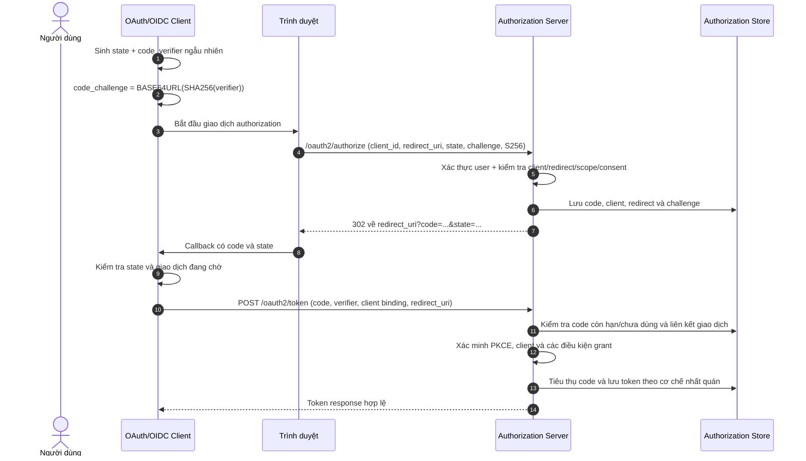
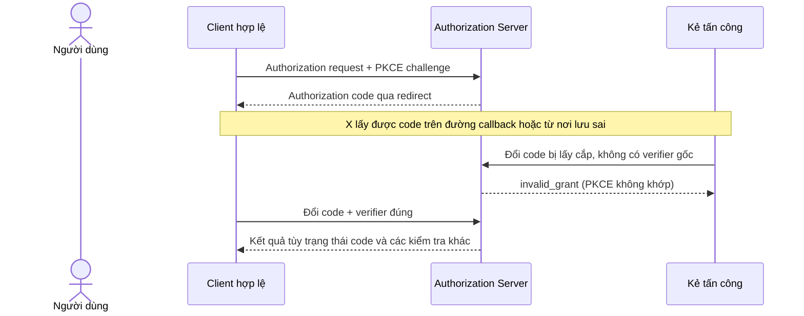
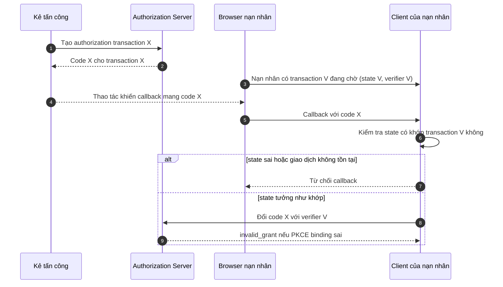
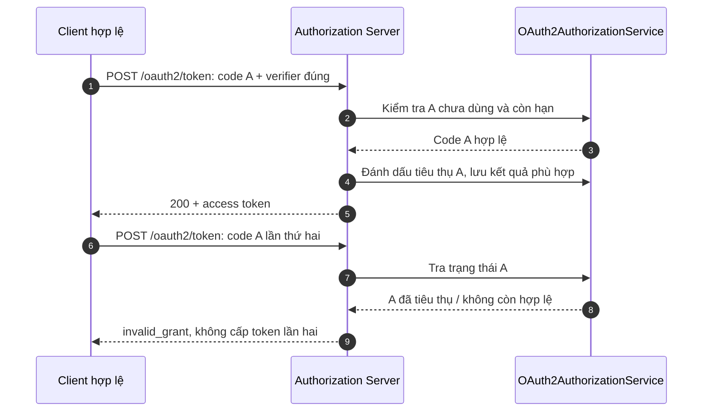

# Phát hiện code interception, code injection và authorization code replay

## 1. Mục tiêu: hiểu ba kiểu tấn công vào Authorization Code Flow

Trong OAuth 2.0 Authorization Code Flow, **authorization code** là giá trị ngắn hạn được Authorization Server phát hành sau khi xử lý yêu cầu ủy quyền. Client nhận code qua một URI chuyển hướng đã đăng ký, sau đó gửi code đến token endpoint để xin access token. Khi dùng OpenID Connect (OIDC), token response còn có thể chứa ID token.

Việc code chỉ có thời hạn ngắn **không đủ** để ngăn kẻ tấn công sử dụng code bị đánh cắp, đưa code của một luồng khác vào callback hoặc gửi lại code đã được đổi. Đó là ba nhóm rủi ro cần nhận diện:

1. **Code interception**: kẻ tấn công lấy được authorization code **trước khi client hợp lệ đổi code**.
2. **Code injection**: kẻ tấn công đưa một authorization code **không thuộc giao dịch đăng nhập/ủy quyền hiện tại** vào callback của client.
3. **Authorization code replay**: code đã được sử dụng hoặc xử lý rồi lại được đưa tới token endpoint.

Trong ứng dụng Spring Boot dùng **Spring Security** và **Spring Authorization Server (SAS)**, các biện pháp quan trọng gồm **Authorization Code + PKCE (`S256`)**, ràng buộc `state` với phiên giao dịch ở client, redirect URI chính xác, code ngắn hạn và chỉ dùng một lần, kiểm tra client tại token endpoint, cùng cơ chế ghi nhận bất thường an toàn.

Bài thuộc chương **Authorization Code và PKCE** này hướng tới khả năng thiết kế, cấu hình, kiểm thử và vận hành luồng chống ba kiểu tấn công. Người học cần phân biệt được từng tình huống, cơ chế chặn ở **client** và **Authorization Server**, giới hạn của thông tin quan sát được, cũng như phản ứng sau khi phát hiện sự cố.

> **Ranh giới phiên bản:** Ví dụ API Java minh họa mô hình Spring Authorization Server 1.x / Spring Security 6.x. Với các phiên bản Spring Security tích hợp Authorization Server mới hơn, đối chiếu cấu hình và Javadoc thực tế. Bài sử dụng các quy tắc OAuth 2.0/PKCE và nguyên lý bảo mật có thể áp dụng độc lập phiên bản framework.

## 2. Luồng hợp lệ và nơi code có thể bị can thiệp

Một client web hoặc mobile hiện đại nên dùng Authorization Code Flow kết hợp **Proof Key for Code Exchange (PKCE)**. Mỗi yêu cầu authorization cần một cặp `code_verifier`/`code_challenge` mới; client giữ `code_verifier` để xuất trình **chỉ khi đổi code**.



Luồng có các ranh giới tin cậy riêng:

| Vị trí | Dữ liệu đáng chú ý | Ai chịu trách nhiệm bảo vệ? |
| --- | --- | --- |
| Trước authorization request | `state`, `code_verifier`, `nonce` nếu OIDC cần | Client và thư viện OAuth/OIDC |
| Authorization endpoint | `client_id`, `redirect_uri`, scope, `code_challenge`, phương thức PKCE | SAS và cấu hình `RegisteredClient` |
| Chuyển hướng qua browser/OS | `code`, `state`, đích callback | AS kiểm tra redirect; client bảo vệ callback; browser/OS có vai trò truyền dữ liệu |
| Token endpoint | Authorization code, `code_verifier`, client authentication (nếu áp dụng) | SAS, provider tương ứng và kho authorization |
| Sau khi cấp token | Access/refresh token, phiên đăng nhập | Client, AS, Resource Server và chính sách quản lý phiên |

**Không nhầm ba loại token:** `authorization_code` là bằng chứng ngắn hạn để đổi token; `access_token` dùng gọi Resource Server; `id_token` (OIDC) dùng client xác minh kết quả đăng nhập. Code không được gửi tới Resource Server như Bearer access token.

## 3. Bản đồ nhanh: interception, injection và replay

| Kiểu tấn công | Kẻ tấn công có gì hoặc làm gì? | Mục tiêu | Biện pháp chặn chính | Dấu hiệu cần điều tra |
| --- | --- | --- | --- | --- |
| **Code interception** | Lấy được **code mới chưa được đổi** từ callback, redirect hoặc ứng dụng khác | Đổi code trước client hợp lệ | PKCE `S256`, ràng buộc client/redirect, HTTPS, callback an toàn | `invalid_grant` do verifier không khớp, lỗi bất thường quanh callback, code biến mất trước lần đổi hợp lệ |
| **Code injection** | Chèn một code từ **giao dịch khác** vào callback của nạn nhân | Gây login CSRF/session confusion hoặc đổi sai danh tính | `state` gắn giao dịch, PKCE **mỗi giao dịch**, kiểm tra issuer/nonce khi OIDC | Callback có state lạ/hết hạn, verifier không khớp với code nhận được |
| **Code replay** | Dùng lại **cùng một code** ở token endpoint sau khi nó đã được tiêu thụ | Xin token lần nữa hoặc khai thác xử lý thiếu nguyên tử | Code một lần, TTL ngắn, cập nhật trạng thái nguyên tử, ràng buộc client | Một code được xử lý nhiều lần; `invalid_grant`, tranh chấp giao dịch |

Không thể kết luận “đã bị tấn công” chỉ từ một lỗi `invalid_grant`. Những lỗi tương tự cũng có thể do trình duyệt mở callback hai lần, client retry sau timeout, đồng hồ lệch, server restart mất trạng thái hoặc sai `code_verifier`. Phát hiện hiệu quả cần **nhiều tín hiệu và ngữ cảnh**, đồng thời giữ bí mật code/verifier.

## 4. Code interception: chiếm code trước client hợp lệ

### 4.1. Kịch bản tấn công

Giả sử người dùng mở ứng dụng mobile, app sử dụng custom URI scheme để nhận redirect. Một ứng dụng độc hại trên cùng thiết bị có thể cố đăng ký scheme tương tự, khiến authorization code được chuyển đến app không mong muốn. Trên web, code cũng có thể lộ qua callback quá rộng, open redirect, lịch sử URL, log proxy, thành phần phân tích URL hoặc đoạn script độc hại.



PKCE làm code bị lấy cắp **không đủ** để đổi token, miễn là kẻ tấn công **không biết `code_verifier`** và server bắt buộc kiểm tra PKCE đúng cách. Với confidential client, client authentication là lớp bảo vệ bổ sung, nhưng không thay thế PKCE.

Nếu kẻ tấn công kiểm soát chính client, có XSS đọc được nơi lưu verifier, chiếm session hoặc lấy cả verifier, PKCE có thể không còn bảo vệ được. Vì vậy PKCE không thay thế phòng chống XSS, bảo vệ ứng dụng gốc, lưu trữ token hợp lý và hardening môi trường thiết bị.

### 4.2. Các đường rò rỉ cần kiểm tra

- **Native app:** custom scheme bị app khác chiếm; ưu tiên system browser và redirect phù hợp RFC 8252; dùng verified HTTPS app links/universal links khi khả thi; với loopback redirect cần tuân thủ quy tắc port của native app.
- **Web callback:** endpoint callback có open redirect hoặc nhúng script bên thứ ba; trang chứa code trong URL quá lâu.
- **Log/telemetry:** reverse proxy, APM, web analytics hoặc debug trace thu thập query `code` và `state` nguyên văn.
- **Browser history / Referrer:** callback chuyển sang trang ngoài kèm URL nhạy cảm hoặc nội dung bên thứ ba; cần chính sách referrer và dọn URL sau khi xử lý.
- **Redirect URI registration:** allowlist quá rộng, wildcard domain/path, URI không thuộc quyền quản lý client hoặc cấu hình HTTP ngoài mục đích development/native.

**PKCE phòng việc đổi code bị lấy cắp; nó không làm code trở thành dữ liệu vô hại để log.** Authorization code vẫn phải được xử lý như credential ngắn hạn.

### 4.3. Dấu hiệu phát hiện và hạn chế suy luận

Ở token endpoint, một code chưa bị dùng nhưng có `code_verifier` không khớp có thể biểu hiện qua `invalid_grant`. Đây là tín hiệu hữu ích để điều tra interception, nhưng cũng rất thường gặp khi ứng dụng đánh mất transaction state hoặc phát sinh verifier mới giữa chừng.

Nếu kẻ tấn công **không gửi request đổi code** hoặc chỉ sao chép code mà không dùng, AS không thể biết code đã bị lộ chỉ từ log token endpoint. Cần kiểm tra log rò rỉ và giám sát phía client/proxy, đặc biệt sau khi có dấu hiệu bất thường.

## 5. Code injection: code hợp lệ nhưng không thuộc giao dịch hiện tại

### 5.1. Code injection khác interception thế nào?

Với code interception, kẻ tấn công **lấy code của giao dịch nạn nhân**. Với code injection, kẻ tấn công **đưa một code từ giao dịch khác** vào callback mà nạn nhân đang xử lý.

Ví dụ một kẻ tấn công bắt đầu đăng nhập bằng tài khoản của chính mình rồi tìm cách khiến browser của nạn nhân truy cập callback của ứng dụng với code của người tấn công. Nếu client không xác minh giao dịch, client có thể đăng nhập nạn nhân dưới danh tính của kẻ tấn công hoặc gắn nhầm dữ liệu/phiên. Đây là một dạng rủi ro **login CSRF / session confusion**; hậu quả phụ thuộc kiến trúc client và cách sử dụng kết quả đăng nhập.



Sơ đồ mô tả các lớp bảo vệ độc lập. `state` cần được **sinh ngẫu nhiên, lưu cùng giao dịch đang chờ và kiểm tra chính xác ở callback**. Chỉ kiểm tra rằng tham số `state` “có tồn tại” là không đủ. `code_verifier` cũng phải gắn với cùng một giao dịch; nếu client tái sử dụng verifier cho nhiều lần authorization, lợi ích chống injection bị giảm.

### 5.2. Vai trò của state, PKCE, nonce và issuer

| Cơ chế | Bảo vệ trực tiếp điều gì? | Không nên dùng thay cho |
| --- | --- | --- |
| `state` | Liên kết callback với authorization transaction và phiên/trạng thái client, giảm login CSRF | PKCE hoặc xác minh token |
| PKCE `S256` | Ràng buộc code với verifier chỉ client khởi tạo giao dịch biết | `state`, validation `iss`, kiểm tra redirect |
| `nonce` của OIDC | Ràng buộc kết quả OIDC/ID token với yêu cầu và giảm replay/mix-up của ID token theo luồng áp dụng | `state` hoặc PKCE tại token endpoint |
| `iss` / issuer binding | Xác định Authorization Server nào phát hành phản hồi/token, quan trọng khi client tích hợp nhiều AS | Kiểm tra `state` và xác minh chữ ký/audience/expiry |
| Exact `redirect_uri` | Chặn chuyển code tới callback chưa đăng ký | PKCE hoặc client authentication |

Trong OIDC Authorization Code Flow, client phải xác minh ID token theo quy tắc OIDC: issuer, audience, thời hạn, chữ ký và `nonce` nếu đã gửi; **`nonce` không tự chứng minh authorization code được tạo cho transaction đang chờ**. Nếu một client tích hợp nhiều Authorization Server, cần ràng buộc issuer được kỳ vọng và cân nhắc cơ chế theo RFC 9207 để phòng authorization server mix-up. Không tin issuer chỉ vì callback tự khai trong query.

### 5.3. Những phản mẫu nguy hiểm

```text
BAD: Chỉ cần có ?code=... là client đổi code ngay.
BAD: Nếu state sai, tự tạo session mới và tiếp tục.
BAD: Cả ứng dụng dùng một code_verifier cố định.
BAD: Lấy verifier gần nhất trong cache chung, không gắn theo transaction.
BAD: Hai người dùng/tenant dùng chung một trạng thái OAuth toàn cục.
BAD: Đổi code ở token endpoint của issuer được lấy trực tiếp từ callback.
```

Khi client nhận callback không có giao dịch đang chờ, `state` không khớp hoặc giao dịch đã hết hạn, nên **từ chối an toàn** và khởi động lại luồng đăng nhập hợp lệ nếu người dùng yêu cầu. Không tự chuyển sang “login không có state” để cải thiện tỷ lệ thành công.

## 6. Authorization code replay: dùng lại một code

Theo OAuth 2.0, một authorization code **chỉ được sử dụng một lần**. Sau khi token endpoint tiêu thụ thành công, yêu cầu dùng lại cùng code phải bị từ chối. RFC 6749 cũng quy định khi quan sát code đã dùng lại, Authorization Server **nên thu hồi các token đã được cấp dựa trên code đó nếu có thể**, vì đó có thể là dấu hiệu rò rỉ code.

### 6.1. Kịch bản hợp lệ và replay



Replay có thể do tấn công, nhưng cũng có thể do **retry sau timeout**: token response đầu tiên đến client chậm, client tưởng thất bại và gửi lại cùng code. Token endpoint không được cấp thêm token chỉ vì request đến lần hai có cùng verifier.

Nếu hệ thống có nhiều instance, kiểm tra “chưa dùng” và đánh dấu “đã dùng” phải có semantics đủ mạnh để **hai request đồng thời** không cùng tiêu thụ một code và phát hành hai bộ token. Cần kiểm tra transaction/locking/optimistic concurrency của persistence thực tế; không giả định thao tác đọc rồi ghi đơn giản là nguyên tử.

### 6.2. Trạng thái authorization code cần bảo vệ

Code cần được liên kết với:

- client đã được đăng ký và sử dụng grant thích hợp;
- `redirect_uri` thuộc authorization request;
- PKCE challenge và phương thức `S256`, nếu yêu cầu;
- thời điểm phát hành/hết hạn;
- trạng thái đã dùng/chưa dùng, authorization và principal liên quan;
- các điều kiện cấp quyền khác như scope và consent.

`OAuth2Authorization` và `OAuth2AuthorizationService` cung cấp mô hình/kho trạng thái cần thiết trong SAS. Kết quả xử lý phụ thuộc phiên bản, repository và storage. Với triển khai nhiều instance, cần kho dùng chung bền vững; lưu riêng mỗi instance trong memory có thể gây sai lệch trạng thái code sau restart/chuyển node.

### 6.3. Phản ứng khi phát hiện replay

Thao tác tối thiểu là **từ chối** request dùng lại code bằng lỗi giao thức phù hợp, thường `invalid_grant`. Tùy chính sách rủi ro và khả năng truy vết, hệ thống có thể bổ sung:

1. Ghi sự kiện bảo mật với correlation ID, client ID, trạng thái code và thời gian, **không ghi code thô**.
2. Kiểm tra có token nào được cấp từ code đó và liệu cần thu hồi access/refresh token tương ứng.
3. Phân tích nguyên nhân do retry hợp lệ, callback bị gọi lặp, ứng dụng mở nhiều tab hay hành vi đáng ngờ.
4. Theo dõi lặp lại trên cùng client, user, thiết bị hoặc mạng trong cửa sổ thời gian hữu ích.
5. Khi cần, tạm chặn client/phiên có dấu hiệu bị chiếm và yêu cầu bắt đầu authorization mới.

Không trả chi tiết nội bộ như “code này đã được cấp token số X cho Alice” cho caller; việc phân biệt code không tồn tại, hết hạn hoặc đã dùng có thể giúp kẻ tấn công thu thập thông tin.

## 7. Cấu hình SAS: buộc PKCE, giới hạn thời hạn code

Một `RegisteredClient` dành cho public client có thể được đăng ký như sau (API minh họa cho SAS 1.x):

```java
RegisteredClient portal = RegisteredClient.withId(stableInternalClientId)
        .clientId("orders-portal")
        .clientName("Orders Portal")
        .clientAuthenticationMethod(ClientAuthenticationMethod.NONE)
        .authorizationGrantType(AuthorizationGrantType.AUTHORIZATION_CODE)
        .redirectUri("https://portal.example.com/login/oauth2/code/portal")
        .scope(OidcScopes.OPENID)
        .scope("orders.read")
        .clientSettings(ClientSettings.builder()
                .requireProofKey(true)
                .requireAuthorizationConsent(true)
                .build())
        .tokenSettings(TokenSettings.builder()
                .authorizationCodeTimeToLive(Duration.ofMinutes(3))
                .build())
        .build();
```

Ý nghĩa:

- `requireProofKey(true)`: yêu cầu PKCE cho client. Đây là cấu hình quan trọng, kể cả khi client đã dùng cơ chế nhận diện khác.
- `ClientAuthenticationMethod.NONE`: client public không giữ secret; **không có nghĩa code được đổi mà thiếu verifier**, hoặc code của client khác được chấp nhận.
- Redirect URI cố định: code chỉ quay về callback đã đăng ký; server không chấp nhận host/path tùy ý.
- TTL ba phút là **giá trị minh họa**, phải được lựa chọn phù hợp UX, độ trễ, chính sách an ninh và khả năng vận hành.
- `requireAuthorizationConsent(true)` liên quan quyết định chấp thuận của user, không thay thế PKCE hay quy tắc code một lần.

`stableInternalClientId` được tạo và lưu bền vững một lần. Đoạn code chỉ minh họa cấu hình client; một Authorization Server hoàn chỉnh còn cần `RegisteredClientRepository`, `OAuth2AuthorizationService`, consent service, khóa ký/token generator, login chain, issuer và endpoint configuration. Những thành phần này phải được triển khai nhất quán trong Spring Boot.

### 7.1. Các lớp xử lý liên quan

| Thành phần SAS | Nhiệm vụ trong Authorization Code Flow |
| --- | --- |
| `OAuth2AuthorizationEndpointFilter` | Nhận authorization request tại endpoint tương ứng |
| `OAuth2AuthorizationCodeRequestAuthenticationProvider` | Kiểm tra request, client, redirect URI, PKCE, scope và trạng thái cần thiết |
| `OAuth2TokenEndpointFilter` | Nhận yêu cầu đổi code tại token endpoint |
| `OAuth2AuthorizationCodeAuthenticationProvider` | Kiểm tra code, client, redirect URI, PKCE, thời hạn/trạng thái trước khi cấp token |
| `OAuth2ClientAuthenticationFilter` | Xử lý client authentication theo phương thức được đăng ký |
| `OAuth2AuthorizationService` | Lưu/tra trạng thái authorization và code/token liên quan |
| `OAuth2TokenGenerator` | Tạo token sau khi grant được xác minh |

Không thay `OAuth2AuthorizationCodeAuthenticationProvider` bằng custom provider chỉ kiểm tra code “có tồn tại”. Cần giữ toàn bộ logic ràng buộc client, PKCE, single-use, expiry và các kiểm tra bổ sung của phiên bản đang dùng.

## 8. Client phải tạo và giữ PKCE transaction thế nào?

Theo RFC 7636, `code_verifier` là một chuỗi độ dài **43–128 ký tự** từ tập ký tự unreserved hợp lệ. Đối với `S256`, client tính:

```text
code_challenge = BASE64URL-ENCODE(SHA256(ASCII(code_verifier)))
```

Trong mỗi lần bắt đầu authorization, cần tạo **verifier mới có entropy cao**; `state` cũng phải ngẫu nhiên và gắn với cùng transaction.

### 8.1. Ví dụ tạo challenge bằng Java

```java
import java.nio.charset.StandardCharsets;
import java.security.MessageDigest;
import java.security.NoSuchAlgorithmException;
import java.security.SecureRandom;
import java.util.Base64;

record PkcePair(String verifier, String challenge) {}

final class PkceSupport {
    private static final SecureRandom RNG = new SecureRandom();

    static PkcePair create() {
        byte[] randomness = new byte[32];
        RNG.nextBytes(randomness);

        String verifier = Base64.getUrlEncoder()
                .withoutPadding()
                .encodeToString(randomness);

        try {
            byte[] digest = MessageDigest.getInstance("SHA-256")
                    .digest(verifier.getBytes(StandardCharsets.US_ASCII));
            String challenge = Base64.getUrlEncoder()
                    .withoutPadding()
                    .encodeToString(digest);
            return new PkcePair(verifier, challenge);
        } catch (NoSuchAlgorithmException ex) {
            throw new IllegalStateException("SHA-256 unavailable", ex);
        }
    }
}
```

Ví dụ tạo một verifier Base64URL dài 43 ký tự từ 32 byte ngẫu nhiên, phù hợp giới hạn độ dài trong RFC 7636. Không gửi `verifier` qua authorization endpoint; chỉ gửi `challenge` và `code_challenge_method=S256`. Chỉ gửi `verifier` tới token endpoint sau khi callback hợp lệ.

**Lưu trữ transaction:** ứng dụng backend thường giữ verifier/state phía server trong session hoặc một kho ngắn hạn ràng buộc browser/user; SPA dùng thư viện OAuth/OIDC uy tín để quản lý transaction, tránh rò rỉ qua XSS/log. Mỗi callback phải khớp đúng transaction đã tạo, không dùng biến toàn cục “verifier mới nhất” chung cho nhiều tab hoặc người dùng.

### 8.2. Request mẫu và thứ tự kiểm tra phía client

```http
GET /oauth2/authorize?response_type=code
  &client_id=orders-portal
  &redirect_uri=https%3A%2F%2Fportal.example.com%2Flogin%2Foauth2%2Fcode%2Fportal
  &scope=openid%20orders.read
  &state=RANDOM_STATE_FOR_THIS_TRANSACTION
  &code_challenge=CHALLENGE_FROM_VERIFIER
  &code_challenge_method=S256
```

Khi nhận callback:

1. Xác minh request callback có đúng **URI/registration** đang chờ xử lý.
2. Kiểm tra `state` nhận được bằng với `state` đã lưu cho một transaction còn hạn; nếu sai hoặc thiếu phải từ chối.
3. Xác định chính xác `code_verifier` của **transaction đó**, không sinh lại verifier mới.
4. Kiểm tra issuer nếu client dùng nhiều Authorization Server và giao thức hỗ trợ issuer identification; khi OIDC, chuẩn bị xác minh ID token theo đúng issuer/audience/nonce.
5. Đổi code đúng một lần tại token endpoint phù hợp; sau thành công, xóa transaction ngắn hạn và loại bỏ code khỏi URL hiển thị/lịch sử khi thích hợp.

Token request mẫu:

```http
POST /oauth2/token HTTP/1.1
Host: auth.example.com
Content-Type: application/x-www-form-urlencoded

grant_type=authorization_code
&client_id=orders-portal
&code=AUTHORIZATION_CODE
&redirect_uri=https%3A%2F%2Fportal.example.com%2Flogin%2Foauth2%2Fcode%2Fportal
&code_verifier=VERIFIER_FOR_THIS_TRANSACTION
```

Các giá trị `RANDOM_*`, `CHALLENGE_*`, `AUTHORIZATION_CODE` và `VERIFIER_*` chỉ là **placeholder**. Confidential client còn cần client authentication theo cơ chế đã đăng ký; public client dùng `none` vẫn chịu kiểm tra PKCE/grant/redirect.

## 9. Kiểm soát nào thuộc Authorization Server, kiểm soát nào thuộc client?

| Điều kiện | Authorization Server (SAS) | OAuth/OIDC Client |
| --- | --- | --- |
| Redirect URI chính xác | Đối chiếu URI với `RegisteredClient.redirectUris` và ràng buộc code | Cấu hình callback cố định; không dùng open redirect |
| PKCE bắt buộc | Yêu cầu challenge, phương thức an toàn; kiểm tra verifier tại token endpoint | Tạo verifier mới, giữ kín, liên kết đúng transaction |
| Code có thời hạn ngắn | Đặt TTL và kiểm tra thời điểm | Không cache code lâu hoặc cố đổi code đã hết hạn |
| Code chỉ dùng một lần | Trạng thái authorization nhất quán; từ chối lần đổi thứ hai | Chỉ gửi token request một lần; xử lý timeout bằng flow mới |
| Client binding | Kiểm tra code thuộc client được nhận diện/xác thực phù hợp | Sử dụng đúng client registration và credential |
| State/login CSRF | Bảo toàn/phản hồi `state` theo giao thức | Tạo, lưu, đối chiếu và tiêu thụ `state` cho transaction |
| OIDC ID token/nonce | Phát hành theo hồ sơ OIDC khi được bật | Kiểm tra issuer, audience, signature, expiry, nonce khi dùng |
| API authorization | Phát token với scope/claims hợp lệ | Resource Server kiểm tra token, audience, scope và quyền dữ liệu |
| Phát hiện bất thường | Telemetry lỗi, trạng thái code, kiểm soát việc cấp token | Theo dõi callback lạ, lỗi state, hành vi retry |

**Điều quan trọng:** SAS không thể tự sửa một OAuth client bỏ qua `state`, dùng verifier cố định hoặc lưu dữ liệu PKCE trong nơi kẻ tấn công dễ đọc. Client và AS phải cùng tuân thủ hợp đồng.

## 10. Thiết kế cơ chế phát hiện và quan sát an toàn

### 10.1. Lỗi OAuth không đủ để gắn nhãn tấn công

`invalid_grant` ở token endpoint có thể xuất hiện vì:

- code chưa tồn tại, đã hết hạn hoặc đã bị dùng;
- `code_verifier` không khớp `code_challenge`;
- code không gắn với client/redirect URI hợp lệ trong request;
- transaction đã bị xóa, mất persistence hoặc bị nhiều request cạnh tranh;
- cấu hình giữa client và AS không nhất quán.

Vì vậy, `invalid_grant` là **dấu hiệu để điều tra**, không phải bằng chứng độc lập của interception hay replay. Cần thêm phân loại nguyên nhân **nội bộ**, metadata request đã giảm thiểu dữ liệu nhạy cảm và các tương quan theo thời gian.

### 10.2. Gợi ý sự kiện có cấu trúc

Ví dụ cấu trúc sự kiện **nội bộ**:

```json
{
  "event": "authorization_code_exchange_rejected",
  "reason_category": "PKCE_MISMATCH",
  "client_id": "orders-portal",
  "request_id": "req-7f0e",
  "authorization_ref": "internal-nonsecret-ref",
  "time": "2026-11-16T10:00:00Z"
}
```

Các nhãn `PKCE_MISMATCH`, `CODE_ALREADY_CONSUMED`, `CODE_EXPIRED`, `CLIENT_BINDING_FAILED`, `REDIRECT_URI_MISMATCH` là ví dụ về **phân loại do ứng dụng quan sát/triển khai**, không phải mã lỗi OAuth chuẩn mà SAS bắt buộc xuất ra mặc định. Giao diện client nên nhận mã lỗi giao thức phù hợp như `invalid_grant`; không trả toàn bộ lý do nội bộ.

**Tuyệt đối không ghi** raw authorization code, code verifier, client secret, access/refresh token, ID token hoặc URL callback chứa code vào event/log. Nếu cần đối chiếu nhiều request cùng code, dùng khóa tham chiếu authorization nội bộ đã kiểm soát quyền truy cập hoặc một dấu vết được thiết kế tránh lộ credential. Đặt retention/đặc quyền xem log theo chính sách bảo mật.

### 10.3. Chỉ số và tín hiệu nên theo dõi

| Tín hiệu | Có thể chỉ ra | Cần loại trừ trước khi kết luận |
| --- | --- | --- |
| `invalid_grant` tăng đột biến theo `client_id` | Sai PKCE, code hết hạn, replay hoặc thay đổi client | Deployment lỗi, callback nhân đôi, retry mất kiểm soát |
| Callback thiếu/sai `state` ở client | Code injection/login CSRF hoặc transaction mất trạng thái | Cookie/session không đồng bộ, mở nhiều tab, browser privacy settings |
| Nhiều yêu cầu đổi cùng authorization code | Replay hoặc client retry sau timeout | Network timeout, double-submit, autosubmit callback |
| Verifier mismatch tăng ở một phiên bản app | Code interception hoặc bug lưu transaction | Sinh lại verifier tại callback, cache theo user sai |
| Token request từ nhiều node cạnh tranh | Lỗ hổng single-use trong persistence hoặc retry | Retry/load balancer và transaction DB |
| Code lộ trong proxy/APM log | Nguy cơ interception, rò rỉ credential | Đánh giá ai có quyền đọc log và độ rộng lộ lọt |
| Tỷ lệ lỗi tập trung ở một redirect URI | Cấu hình sai hoặc callback bị lạm dụng | Thay URL, proxy header, path/trailing slash |

Không tự động khóa toàn bộ người dùng chỉ vì một vài `invalid_grant` riêng lẻ; có thể tạo denial of service bằng cách cố tình gây lỗi. Nên có ngưỡng/rate limit theo ngữ cảnh, phân tách lỗi cấu hình với tín hiệu tấn công và phương án khắc phục không gây gián đoạn không cần thiết.

## 11. Ma trận kiểm thử ba nhóm tấn công

Các ca kiểm thử nên thực hiện theo **HTTP endpoint và persistence thực**, kể cả nhiều instance khi hệ thống dự kiến chạy phân tán.

| Ca kiểm thử | Cách tạo tình huống hợp lệ trong môi trường test | Kỳ vọng |
| --- | --- | --- |
| Code + PKCE hợp lệ | Client xin code với challenge `S256`, đổi bằng verifier tương ứng | Nhận token một lần, code không còn dùng lại được |
| **Interception: chỉ biết code** | Dùng code hợp lệ với verifier khác hoặc không có verifier | `invalid_grant`, không cấp token |
| Interception: client khác đổi code | Client B thử đổi code cấp cho client A | Bị từ chối do client binding |
| Interception: redirect URI sai | Token request dùng URI khác URI đã ràng buộc | Bị từ chối theo quy tắc giao thức |
| Authorization không có PKCE khi bắt buộc | Client cấu hình `requireProofKey(true)` nhưng không gửi challenge | Authorization request bị từ chối |
| PKCE downgrade | Đề nghị phương thức không được chấp nhận, bỏ `code_challenge_method` trái chính sách hoặc `plain` khi policy chỉ cho `S256` | Từ chối thay vì tự hạ bảo vệ |
| **Injection: state sai** | Client đang chờ transaction A, callback nhận state của transaction B | Client từ chối trước token request |
| Injection: không có transaction | Callback có code nhưng client chưa bắt đầu login | Client từ chối, không tự tạo transaction |
| Injection: code từ transaction khác | Callback A nhận code của B, state giả định không chặn | PKCE verifier của A không khớp code B; AS từ chối |
| Injection: issuer khác | Client tích hợp nhiều AS, callback/token có issuer không như kỳ vọng | Client từ chối theo issuer binding |
| OIDC nonce sai | Client kiểm tra ID token có nonce không khớp transaction | Client từ chối kết quả đăng nhập |
| **Replay: đổi code hai lần tuần tự** | Token endpoint nhận cùng code hai lần | Lần đầu thành công; lần sau `invalid_grant`, không cấp thêm token |
| Replay: đổi đồng thời | Hai request cùng code từ hai worker/node | Tối đa một lần được cấp quyền theo single-use; không có hai token response thành công |
| Replay sau restart | Code đã đổi, restart một node rồi thử lại | Vẫn bị từ chối nếu persistence bền vững |
| Code hết hạn | Đợi quá TTL được cấu hình trong môi trường test | Từ chối, không tạo token |
| Client retry khi timeout | Gửi lại code sau token response bị mất | Không tạo thêm quyền; client khởi tạo authorization mới |
| Chống lộ credential | Bật logging/telemetry test khi chạy các ca trên | Không có code/verifier/token/secret trong log |

### 11.1. Kiểm thử code một lần phải bao gồm concurrency

Test tuần tự rất quan trọng nhưng chưa đủ để chứng minh khả năng single-use trong môi trường phân tán. Với hai request song song:

```text
Node A: đọc code hợp lệ
Node B: đọc code hợp lệ
Node A: tiêu thụ code và cấp token
Node B: phải thất bại vì code đã được tiêu thụ
```

Nếu cả hai trả token thành công, cần điều tra transaction boundary và cơ chế đồng bộ/kho trạng thái. Hãy kiểm thử trên loại DB và repository có đặc tính giống production, vì implementation in-memory có thể che giấu race condition của triển khai tùy biến.

### 11.2. Kiểm thử phía client quan trọng ngang token endpoint

Client phải có test cho:

- Mỗi authorization transaction sinh `state` và verifier riêng; callback phải tìm đúng transaction.
- Callback không có state, state sai hoặc đã dùng bị từ chối **trước khi** token request được gửi.
- Khi có nhiều tab, các transaction không đè verifier của nhau.
- Có cơ chế dọn code khỏi URL và hạn chế gửi referrer nhạy cảm sang tài nguyên bên ngoài.
- Với OIDC, ID token được xác minh issuer/audience/nonce theo hồ sơ phù hợp.
- Sau lỗi không có logic “fallback” tự bỏ PKCE hoặc cho phép login không có `state`.

## 12. Chẩn đoán lỗi trong Spring Authorization Server

### 12.1. Nhận diện đúng bước lỗi

| Bước | Thành phần liên quan trong SAS | Dấu hiệu | Hướng kiểm tra |
| --- | --- | --- | --- |
| Yêu cầu code | Authorization Endpoint / `OAuth2AuthorizationCodeRequestAuthenticationProvider` | Thiếu PKCE, redirect URI sai, scope/grant không phù hợp | `RegisteredClient`, client settings, URI, `code_challenge` |
| Trình duyệt quay về callback | **OAuth/OIDC client**, không phải riêng SAS | State/transaction lạ, callback bị gọi hai lần | Session, state, verifier storage, CSRF và nhiều tab |
| Đổi code | Token Endpoint / `OAuth2AuthorizationCodeAuthenticationProvider` | `invalid_grant` | Code còn hạn/chưa dùng, PKCE, redirect, client binding |
| Token đã cấp | `OAuth2AuthorizationService`, token generator, Resource Server | API từ chối token hoặc vẫn chấp nhận token đáng lẽ bị thu hồi | Persistence, issuer/audience, JWT/opaque validation, revocation |

Đừng suy luận rằng mọi `invalid_grant` đều đến từ `code_verifier` sai. Cần quan sát nguyên nhân nội bộ có kiểm soát và kiểm thử tái hiện trước khi thay cấu hình bảo mật.

### 12.2. Các lỗi tích hợp phổ biến và cách khắc phục

**Lỗi 1 — client tạo lại verifier khi nhận callback.** Challenge ở authorization request được tính từ verifier A; client lại sinh verifier B ở callback nên token endpoint từ chối. Sửa bằng cách lưu verifier A cùng state/transaction và chỉ tiêu thụ sau khi callback hợp lệ.

**Lỗi 2 — dùng chung state/verifier cho nhiều người dùng hoặc tab.** Callback có thể lấy nhầm verifier hoặc tự chấp nhận code không thuộc transaction. Sửa bằng trạng thái gắn với browser session và một định danh transaction ngẫu nhiên; tránh biến toàn cục.

**Lỗi 3 — bỏ PKCE để “chữa invalid_grant”.** Tắt `requireProofKey` làm mất lớp bảo vệ interception. Sửa ở client transaction state, endpoint và encoding; giữ PKCE.

**Lỗi 4 — không giới hạn redirect URI.** Một callback được ghép từ input chưa được phê duyệt có thể gây code leakage. Dùng allowlist URI chính xác và chặn open redirect tại client.

**Lỗi 5 — retry code sau timeout.** Code đã đổi có thể không đổi lần hai dù response đầu tiên thất lạc. Xây cơ chế client hiển thị lỗi và khởi tạo authorization mới; không sửa server để cho phép tái sử dụng code.

**Lỗi 6 — mỗi node giữ authorization riêng trong memory.** Token endpoint trên node B không biết code do node A cấp, hoặc restart mất trạng thái. Dùng kho authorization bền vững/dùng chung và cấu hình triển khai thích hợp.

**Lỗi 7 — log URL chứa code.** Người có quyền đọc log có thể tiếp cận credential. Che tham số, giảm thời hạn lưu và kiểm soát truy cập dữ liệu log.

## 13. Quy trình xử lý khi nghi ngờ xảy ra tấn công

Một runbook thực tế nên trả lời theo thứ tự:

1. **Xác nhận phạm vi:** client nào, redirect URI nào, issuer nào, thời gian nào, môi trường và phiên bản triển khai nào có dấu hiệu bất thường?
2. **Xác định loại sự kiện:** code chưa đổi bị lộ, code từ transaction khác được đưa vào callback, hay code đã sử dụng bị gửi lại? Phân biệt với timeout và bug.
3. **Khoanh vùng credential:** kiểm tra có access/refresh token được cấp từ authorization liên quan không, thời hạn và Resource Server nào có thể chấp nhận.
4. **Ngăn phát hành quyền tiếp theo khi cần:** sửa lỗ hổng callback/log, kiểm soát client registration, rate limiting hợp lý; đánh giá tạm khóa session/client có rủi ro.
5. **Thu hồi theo chính sách:** vô hiệu hóa authorization/refresh token và áp dụng cơ chế kiểm tra revocation tại API nếu phải ngừng token đã phát hành ngay. JWT offline không tự mất hiệu lực chỉ vì xóa một bản ghi.
6. **Khắc phục nguyên nhân:** khôi phục PKCE/state, loại bỏ open redirect, cấu hình persistence/concurrency và điều chỉnh client SDK.
7. **Kiểm chứng:** chạy lại các test interception, injection, replay, xác nhận log không chứa code/token; lưu audit và tài liệu sự cố.

Không nên công bố cho client chi tiết rằng code có tồn tại hay được người dùng nào sử dụng. Trả mã lỗi OAuth phù hợp, giữ lý do phân loại trong hệ thống quan sát có phân quyền.

## 14. Bài tập tình huống tích hợp

Một hệ thống gồm `auth.example.com` (SAS), `portal.example.com` (Spring Security OAuth2 Client) và `api.example.com` (Resource Server). Portal dùng Authorization Code + PKCE `S256` và lưu transaction trong session. Sau một đợt triển khai, nhóm thấy:

- 09:00: nhiều `invalid_grant` sau callback, chủ yếu từ người dùng mở hai tab.
- 09:05: một số callback chứa `state` không tìm thấy trong session.
- 09:10: một code được gửi đến token endpoint hai lần; lần đầu thành công, lần sau lỗi.
- 09:15: phát hiện reverse proxy đang log nguyên query string của callback.
- 09:20: một nhóm user dùng app mobile custom URI scheme có lỗi redirect không ổn định.

Hãy phân tích:

1. Sự kiện nào gợi ý lỗi lưu transaction client, sự kiện nào có thể là replay và sự kiện nào tạo nguy cơ interception?
2. Tại sao không nên tự động gắn nhãn mọi `invalid_grant` là tấn công?
3. Thiết kế lại cách lưu `state`, `code_verifier` theo mỗi authorization transaction để nhiều tab không đè nhau.
4. Với code gửi hai lần, AS phải phản hồi thế nào? Có cần xem xét token đã cấp ở lần đầu không?
5. Nêu biện pháp giảm rò rỉ code từ proxy và cách chọn redirect URI native app theo RFC 8252.
6. Đề xuất ít nhất sáu ca kiểm thử âm: verifier sai, state sai, code từ transaction khác, replay tuần tự, replay đồng thời, callback lạ.

**Gợi ý:** mở nhiều tab thường làm lộ bug kiểu “lưu một verifier mới nhất”, state lạ có thể do mất session hoặc injection, code gửi hai lần có thể do retry, proxy log là một kênh rò rỉ cần xử lý ngay. Khi token đã được cấp từ code bị replay, đánh giá thu hồi theo mức rủi ro, giữ nhật ký điều tra đã che dữ liệu nhạy cảm. Với native client, cân nhắc verified app links/universal links hoặc cơ chế loopback phù hợp và vẫn giữ PKCE.

## 15. Checklist đưa Authorization Code + PKCE vào production

1. **Client registration:** Authorization Code Grant được đăng ký; redirect URI cụ thể và HTTPS cho web production; `requireProofKey(true)` theo chính sách.
2. **PKCE:** mỗi transaction có verifier ngẫu nhiên riêng, độ dài hợp lệ, challenge `S256`, không rò verifier vào authorization request hoặc log.
3. **State:** gắn transaction với browser/session, kiểm tra trước token exchange, xử lý nhiều tab và làm sạch trạng thái sau thành công/lỗi.
4. **OIDC:** issuer, audience, chữ ký, thời hạn ID token và `nonce` (khi áp dụng) được kiểm chứng ở client.
5. **Authorization code:** TTL ngắn hợp lý, chỉ dùng một lần; token endpoint xác minh code, client binding, redirect URI và PKCE.
6. **Persistence:** authorization store dùng chung/bền vững cho nhiều instance; cơ chế cập nhật code đã dùng ngăn race condition.
7. **Callback:** chặn open redirect, không nhúng tài nguyên bên thứ ba không kiểm soát, không lưu code trong URL lâu hơn cần thiết.
8. **Observability:** theo dõi `invalid_grant`, mismatch, replay, callback state lỗi bằng sự kiện phân loại nội bộ; không log raw code/verifier/token/secret.
9. **Incident response:** có phương án thu hồi authorization/refresh token và xử lý JWT đã cấp phù hợp SLA bảo mật.
10. **Kiểm thử:** chạy đủ interception/injection/replay, timeout/retry, hai tab, nhiều node và restart trước khi triển khai.

## 16. Tài liệu chuẩn và tài liệu Spring để đối chiếu

- [RFC 6749 — The OAuth 2.0 Authorization Framework](https://www.rfc-editor.org/rfc/rfc6749): Authorization Code Grant, ràng buộc client/redirect và yêu cầu code dùng một lần.
- [RFC 7636 — Proof Key for Code Exchange](https://www.rfc-editor.org/rfc/rfc7636): `code_verifier`, `code_challenge`, `S256` và threat model code interception.
- [RFC 9700 — Best Current Practice for OAuth 2.0 Security](https://www.rfc-editor.org/rfc/rfc9700): PKCE, chống code injection, chính sách redirect URI và hardening hiện đại.
- [RFC 8252 — OAuth 2.0 for Native Apps](https://www.rfc-editor.org/rfc/rfc8252): system browser, redirect URI của native apps và rủi ro custom scheme.
- [RFC 9207 — OAuth 2.0 Authorization Server Issuer Identification](https://www.rfc-editor.org/rfc/rfc9207): phòng authorization server mix-up khi client tích hợp nhiều Authorization Server.
- [OpenID Connect Core 1.0](https://openid.net/specs/openid-connect-core-1_0.html): `nonce`, kiểm tra ID token và các ràng buộc OIDC.
- [Spring Authorization Server — Protocol Endpoints](https://docs.spring.io/spring-authorization-server/reference/protocol-endpoints.html): Authorization Endpoint/Token Endpoint, `OAuth2AuthorizationCodeRequestAuthenticationProvider` và `OAuth2AuthorizationCodeAuthenticationProvider`.
- [Spring Authorization Server — Core Model Components](https://docs.spring.io/spring-authorization-server/reference/core-model-components.html): `RegisteredClient`, `OAuth2Authorization`, `OAuth2AuthorizationService` và `TokenSettings`.
- [Spring Security — OAuth2 Login](https://docs.spring.io/spring-security/reference/servlet/oauth2/login/core.html): OAuth2 Client registration, authorization request và callback.

**Ghi nhớ:** code interception là **lấy code của một giao dịch**, code injection là **đưa code của giao dịch khác vào callback**, còn authorization code replay là **dùng lại code đã được xử lý**. PKCE `S256`, `state` gắn transaction, redirect URI chính xác, client binding, TTL và tính dùng một lần bổ trợ lẫn nhau. Muốn phát hiện an toàn, phải quan sát cả callback của client và token endpoint của SAS, phân biệt tín hiệu tấn công với lỗi vận hành, và không để chính công cụ logging làm rò rỉ code hoặc verifier.
