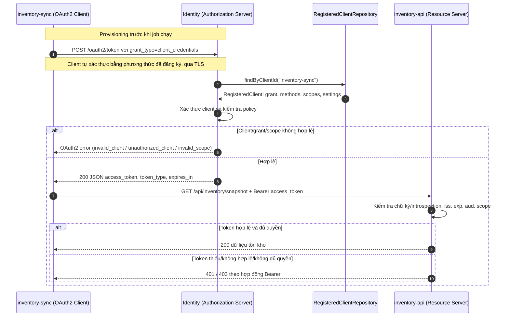

# Kịch bản cấp quyền cho dịch vụ không có người dùng

Trong kiến trúc microservices, tác vụ theo lịch, worker xử lý hàng đợi hoặc chương trình tích hợp hệ thống, một dịch vụ thường cần gọi API của dịch vụ khác **mà không có người dùng đang thao tác**. Ví dụ, dịch vụ `inventory-sync` chạy mỗi đêm, đọc dữ liệu tồn kho từ `inventory-api` và tạo báo cáo. Việc chuyển hướng trình duyệt sang trang đăng nhập hay xin người dùng bấm “Đồng ý” không phù hợp với công việc này.

**OAuth 2.0 Client Credentials grant** giải quyết tình huống đó: một **confidential client** xác thực chính mình với **Authorization Server (AS)**, yêu cầu quyền truy cập đã được phép, rồi nhận **access token** để gọi **Resource Server**. Token thể hiện quyền được cấp cho **ứng dụng/dịch vụ**, không phải quyền của một người dùng vừa đăng nhập.

Bài học thuộc chương **Client Credentials** của module **SPRING_SECURITY_OAUTH2_OIDC_AUTHORIZATION_SERVER** giúp thiết kế, cấu hình, bảo mật, kiểm thử và vận hành luồng machine-to-machine (M2M) bằng **Spring Security và Spring Authorization Server trong ứng dụng Spring Boot**. Nội dung bao gồm vai trò các thành phần, token request/response, cấu hình server/client/API, mô hình danh tính dịch vụ, scope/audience, lỗi thường gặp, bảo vệ credential và kiểm thử tích hợp.

> **Nguyên tắc nền tảng:** `client_credentials` xác thực **client** và cấp quyền cho **client**. Nó **không xác thực người dùng cuối**, không tạo phiên đăng nhập OIDC của người dùng, không có authorization code và không có bước user consent trong chính grant này.

## 1. Bài toán: dịch vụ cần gọi API khi không có người dùng

Giả sử tổ chức có ba thành phần:

- **`inventory-sync`:** ứng dụng Spring Boot chạy nền, định kỳ yêu cầu dữ liệu tồn kho.
- **`identity.example.com`:** Spring Authorization Server, quản lý client được đăng ký, xác thực chúng và phát hành token.
- **`inventory-api`:** Resource Server có endpoint `GET /api/inventory/snapshot` chỉ dành cho client được phép đọc.

Khi chạy lúc 02:00, không ai ngồi trước trình duyệt để đăng nhập. `inventory-sync` cần lấy token theo cấu hình đã cấp cho chính ứng dụng rồi gọi API.

| Thành phần | Vai trò OAuth 2.0 | Trách nhiệm |
|---|---|---|
| `inventory-sync` | **OAuth2 Client**, thường là confidential client | Giữ credential, yêu cầu access token, gọi API |
| `identity.example.com` | **Authorization Server** | Tra cứu registered client, xác thực client, kiểm tra grant/scope, phát hành token |
| `inventory-api` | **Resource Server** | Xác minh access token và quyền API trước khi trả dữ liệu |
| Người dùng cuối | **Không hiện diện trong grant này** | Không được giả định có login session, consent hay MFA của người dùng |

### 1.1. Những kịch bản phù hợp

| Kịch bản | Vì sao phù hợp với Client Credentials? | Quyền ví dụ |
|---|---|---|
| Worker đồng bộ dữ liệu | Chạy tự động, cần quyền của dịch vụ | `inventory.read` |
| Job tổng hợp báo cáo | Chạy theo lịch, không thao tác thay một người cụ thể | `reports.generate` |
| Backend trao đổi với dịch vụ hạ tầng | Hai backend đã được đăng ký và quản lý | `metrics.write` |
| Consumer xử lý hàng đợi | Tác vụ nền nhận message rồi gọi API nghiệp vụ | `orders.process` |
| Hệ thống đối tác gọi API kỹ thuật | Tổ chức cấp định danh/credential riêng cho đối tác | `catalog.read` |
| Một microservice gọi microservice khác theo quyền riêng | Quyền thuộc workload có danh tính riêng | `pricing.read` |

Sử dụng Client Credentials **không có nghĩa mọi tác vụ nền đều được dùng quyền rộng**. Mỗi workload cần danh tính và phạm vi tối thiểu, tài nguyên đích rõ ràng, vòng đời credential có kiểm soát.

### 1.2. Khi nào Client Credentials không phù hợp?

Nếu một ứng dụng đang thực hiện hành động **thay mặt một người dùng cụ thể**, chẳng hạn “nhân viên A phê duyệt hợp đồng B”, Resource Server thường cần biết **ai đã thực hiện hành động** và người đó có quyền gì. Dùng token `client_credentials` rồi tự thêm header `X-User-Id: alice` không phải bằng chứng ủy quyền của người dùng.

Trong tình huống có user và yêu cầu ủy quyền thay mặt họ, nên đánh giá **Authorization Code + PKCE**, token delegation hoặc **OAuth 2.0 Token Exchange** khi hệ thống thực sự hỗ trợ và trust model cho phép. Không biến Client Credentials thành “đăng nhập giả” cho một tài khoản kỹ thuật có quyền người dùng.

## 2. Client Credentials grant hoạt động như thế nào?

RFC 6749 $4.4 quy định **Client Credentials** cho các **confidential clients**. Client xác thực với token endpoint và dùng credential của chính mình làm authorization grant để xin access token. Trong flow này:

1. **Trước khi chạy**, quản trị viên hoặc quy trình provisioning đăng ký client và quyền được phép tại AS.
2. **Khi cần token**, client tạo HTTP POST trực tiếp đến token endpoint với `grant_type=client_credentials`.
3. **AS xác thực client** theo phương thức đã đăng ký, ví dụ `client_secret_basic`, `private_key_jwt` hoặc mTLS nếu hỗ trợ.
4. **AS kiểm tra quyền**: client có được sử dụng grant không, những scope nào được phép và token được phát cho API nào.
5. **AS phát hành access token** khi mọi điều kiện hợp lệ.
6. **Client gọi Resource Server** bằng Bearer access token; RS tự xác minh token, audience, scope và các quy tắc nghiệp vụ.

Trong mô hình chuẩn này **không có** authorization endpoint redirect, browser callback, authorization code, PKCE, login page, user consent hoặc OIDC ID Token.

### 2.1. Sơ đồ end-to-end



**Khác biệt so với Authorization Code:** Client Credentials chỉ cần **token endpoint** của AS và API đích; không gửi người dùng tới `/oauth2/authorize`. Việc gọi token endpoint cũng không đồng nghĩa được quyền gọi mọi API: Resource Server phải kiểm tra **token dành cho ai và được làm gì**.

## 3. HTTP request và response của Client Credentials

### 3.1. Client gửi token request qua HTTPS

Một confidential client dùng `client_secret_basic` có thể gửi:

```http
POST /oauth2/token HTTP/1.1
Host: identity.example.com
Authorization: Basic <REDACTED_BASE64_CLIENT_CREDENTIALS>
Content-Type: application/x-www-form-urlencoded
Accept: application/json

grant_type=client_credentials&scope=inventory.read
```

Phần `Authorization: Basic ...` chứa biểu diễn đã encode của client ID và secret. **Base64 không phải mã hóa bảo mật**; phải dùng HTTPS và chặn ghi credential vào log. Theo RFC 6749, giá trị client ID/secret phải được mã hóa form URL-encoded theo đúng quy tắc trước khi tạo Basic credential, nhất là khi chứa các ký tự đặc biệt.

Client có thể dùng phương thức xác thực khác nếu AS và registration của client hỗ trợ. **`client_secret_post`** đặt `client_id`/`client_secret` trong body `application/x-www-form-urlencoded`; không gửi cả Basic lẫn form credential trong cùng token request.

### 3.2. Phản hồi token thành công

Ví dụ:

```http
HTTP/1.1 200 OK
Content-Type: application/json;charset=UTF-8
Cache-Control: no-store
Pragma: no-cache

{
  "access_token": "REDACTED_ACCESS_TOKEN",
  "token_type": "Bearer",
  "expires_in": 600,
  "scope": "inventory.read"
}
```

Các giá trị đều là **placeholder**, không phải credential có hiệu lực. Trong OAuth 2.0 token success response, `access_token` và `token_type` là thành phần quan trọng/bắt buộc; `expires_in` và `scope` có điều kiện/tùy trường hợp theo chuẩn. Dịch vụ thường nên dựa vào thời hạn token do AS trả và policy của mình để quản lý việc lấy lại token.

**Theo RFC 6749 $4.4.3, refresh token SHOULD NOT được cấp cho Client Credentials grant.** Vì client vẫn sở hữu phương thức xác thực của chính nó, khi access token hết hạn, thông thường nó **yêu cầu access token mới bằng `client_credentials`**, thay vì bắt buộc phải có refresh token.

### 3.3. Phản hồi lỗi

Nếu client không thể xác thực:

```http
HTTP/1.1 401 Unauthorized
Content-Type: application/json;charset=UTF-8
WWW-Authenticate: Basic realm="oauth2"
Cache-Control: no-store
Pragma: no-cache

{
  "error": "invalid_client"
}
```

Ví dụ này áp dụng cho lỗi client authentication **khi client đã thử HTTP Basic**; status/header thật phụ thuộc phương thức được dùng và quy tắc token endpoint. Lỗi grant hoặc scope sai thường dùng OAuth2 JSON error với status thích hợp, chẳng hạn `unauthorized_client` hoặc `invalid_scope`. Đừng coi mọi lỗi token request là `invalid_client`.

## 4. Token thể hiện danh tính và quyền của dịch vụ

Access token được phát cho Client Credentials đại diện cho **quyền truy cập của ứng dụng**. Nó có thể là **JWT ký số** hoặc **opaque token** tùy chính sách AS; lựa chọn này không thay đổi ý nghĩa không có người dùng cuối.

### 4.1. Phân biệt các thuộc tính token

| Thuộc tính | Vai trò | Điều cần nhớ |
|---|---|---|
| `iss` | Issuer của token | RS phải chỉ tin issuer được phép |
| `sub` | Chủ thể của token | Trong nhiều triển khai Client Credentials, là định danh client; **không được giả định là user ID** |
| `client_id` | Client gắn với token, nếu profile/AS phát claim này | Hữu ích để nhận diện workload; không được client tự khai mà không kiểm chứng |
| `aud` | Resource Server/API đích dự kiến | RS cần kiểm tra token **dành cho chính API đó** |
| `scope`/`scp` | Các quyền được AS cấp theo profile đã thỏa thuận | Không mặc nhiên là quyền đọc/sửa mọi bản ghi |
| `exp`, `iat`, `nbf` | Thời hạn và mốc hiệu lực token | RS kiểm tra thời gian có hiệu lực; chống dùng token quá hạn |
| `jti` | ID token nếu AS phát hành | Có thể hỗ trợ quan sát hoặc cơ chế thu hồi theo thiết kế |

Ví dụ **payload JWT minh họa**, chưa ký:

```json
{
  "iss": "https://identity.example.com",
  "sub": "inventory-sync",
  "client_id": "inventory-sync",
  "aud": ["inventory-api"],
  "scope": "inventory.read",
  "iat": 1794850000,
  "exp": 1794850600
}
```

**Không mặc định Spring Authorization Server luôn phát hành chính xác mọi claim trong ví dụ.** Cấu trúc access token phụ thuộc phiên bản, token format, customizer và profile được áp dụng. Đặc biệt, nếu API cần `aud=inventory-api` thì phải **thiết kế và kiểm thử việc AS phát audience phù hợp**, đồng thời cấu hình Resource Server **xác minh audience**.

### 4.2. Không có ID Token và UserInfo cho danh tính người dùng

OIDC thêm lớp xác thực **người dùng cuối**, với ID Token dành cho Relying Party. Client Credentials không có tương tác xác thực resource owner, nên **không phải OIDC login flow** và không mong đợi ID Token chứa thông tin người dùng.

Nếu AS đồng thời là OpenID Provider, việc bật OIDC **không biến** yêu cầu `client_credentials` thành đăng nhập OIDC. Cũng không được dùng access token của dịch vụ để khẳng định một nhân viên đã login hoặc đã đồng ý một scope.

### 4.3. Client ID khác người dùng và service account

Một tổ chức có thể gọi danh tính M2M là “service account”, nhưng trong kiến trúc OAuth nên phân biệt:

- **OAuth Client Identity:** định danh của ứng dụng tại AS, ví dụ `inventory-sync`.
- **Workload Identity:** danh tính của quá trình/container/pod/host cụ thể, có thể được chứng minh bằng chứng chỉ, khóa hoặc cơ chế liên kết workload.
- **End-user Identity:** người dùng thực có phiên xác thực và quyền nghiệp vụ riêng.

Quyền của client cần gắn với workload và mục đích truy cập. Dùng một client ID/secret duy nhất cho tất cả dịch vụ làm mất khả năng thu hồi và audit theo từng thành phần.

## 5. Scope, audience và quyền ở Resource Server

**Scope** mô tả phạm vi quyền client có thể được cấp; **audience** xác định tài nguyên dự kiến nhận token; **authorization nghiệp vụ** quyết định client có được tác động lên dữ liệu cụ thể hay không.

| Kiểm tra | Ví dụ | Hệ quả nếu bỏ qua |
|---|---|---|
| Issuer | Chỉ tin `https://identity.example.com` | Chấp nhận token từ AS không tin cậy |
| Chữ ký hoặc introspection | JWT ký bởi khóa tin cậy hoặc opaque token còn active | Tin token giả mạo/đã bị vô hiệu |
| Thời hạn | `exp` chưa qua, `nbf` hợp lệ nếu có | Chấp nhận token quá hạn/chưa hiệu lực |
| Audience | `aud` chứa `inventory-api` | Token dành cho API A bị tái sử dụng ở API B |
| Scope | Có `inventory.read` | Client được phép gọi endpoint vượt scope |
| Quyền nghiệp vụ | Chỉ được đọc kho thuộc tenant/đơn vị được cấp | Lộ dữ liệu chéo tenant dù có scope hợp lệ |

### 5.1. Scope không tự động là RBAC/ABAC nghiệp vụ

Token có `inventory.read` chỉ nói rằng AS đã cấp phạm vi này. Nếu API lưu dữ liệu của nhiều khách hàng, RS còn phải kiểm tra client được phép đọc **tenant nào**, kho nào và loại bản ghi nào. Một authorization rule dựa trên `SCOPE_inventory.read` là cần thiết nhưng có thể chưa đủ.

**Không chấp nhận** tenant ID, username hoặc role do client gửi trong header như bằng chứng đã được AS cấp. Nếu cần token riêng cho từng tenant hoặc resource, phải có thiết kế identity/authorization và chính sách phát hành tương ứng.

### 5.2. Audience cần được cấp và kiểm tra rõ ràng

Ví dụ hai API cùng dùng một issuer:

```text
Access token A:
  aud = inventory-api
  scope = inventory.read

Access token B:
  aud = billing-api
  scope = invoices.read
```

`billing-api` phải từ chối token A ngay cả khi chữ ký, issuer và thời hạn hợp lệ. Hệ thống không nên coi “được cùng AS ký” là “có quyền tới mọi Resource Server”.

Nếu AS chưa có cơ chế quản lý audience cho client hoặc request, cần thiết kế token customization và policy cho từng client/resource. **Không để client tự đặt một trường `aud` tùy ý mà AS chấp nhận không kiểm tra**.

## 6. Cấu hình client_credentials trong Spring Authorization Server

Spring Authorization Server lưu metadata client bằng `RegisteredClientRepository`. Để cấp token theo Client Credentials grant, client phải được đăng ký với grant tương ứng và phương thức xác thực phù hợp.

### 6.1. Đăng ký confidential client trong RegisteredClient

Ví dụ về phần đăng ký client `inventory-sync`:

```java
@Bean
RegisteredClientRepository registeredClientRepository(
        PasswordEncoder passwordEncoder) {

    String rawSecret = System.getenv("INVENTORY_SYNC_CLIENT_SECRET");
    if (rawSecret == null || rawSecret.isBlank()) {
        throw new IllegalStateException(
            "Missing INVENTORY_SYNC_CLIENT_SECRET");
    }

    RegisteredClient worker = RegisteredClient.withId(
            "inventory-sync-internal-id")
        .clientId("inventory-sync")
        .clientName("Inventory Synchronization Worker")
        .clientSecret(passwordEncoder.encode(rawSecret))
        .clientAuthenticationMethod(
            ClientAuthenticationMethod.CLIENT_SECRET_BASIC)
        .authorizationGrantType(
            AuthorizationGrantType.CLIENT_CREDENTIALS)
        .scope("inventory.read")
        .tokenSettings(TokenSettings.builder()
            .accessTokenTimeToLive(Duration.ofMinutes(10))
            .accessTokenFormat(OAuth2TokenFormat.SELF_CONTAINED)
            .build())
        .build();

    return new InMemoryRegisteredClientRepository(worker);
}

@Bean
PasswordEncoder passwordEncoder() {
    return PasswordEncoderFactories.createDelegatingPasswordEncoder();
}
```

Đây là **minh họa đăng ký client**, lược bỏ imports và cấu hình Authorization Server hoàn chỉnh. Các ý quan trọng:

- `clientId("inventory-sync")` là định danh của ứng dụng trong OAuth, **không phải tài khoản người dùng**.
- `clientSecret(...)` phải chứa giá trị đã được mã hóa một chiều theo encoder mà client authentication provider dùng. Secret gốc phải được nạp và quản lý an toàn, không lưu trong source code.
- `CLIENT_SECRET_BASIC` tương ứng HTTP Basic; có thể thay bằng phương thức mạnh hơn khi hỗ trợ.
- `CLIENT_CREDENTIALS` **chỉ cho phép grant này**. Không cần `redirectUri(...)`, `AUTHORIZATION_CODE`, `REFRESH_TOKEN` hoặc scope `openid` cho kịch bản M2M đang xét.
- `scope("inventory.read")` giới hạn scope AS có thể cấp trong ví dụ.
- `SELF_CONTAINED` thường dùng JWT access token nếu AS được cấu hình ký token; `REFERENCE` là lựa chọn token opaque/reference khi hệ thống hỗ trợ. Resource Server phải dùng phương thức xác minh đúng loại token.
- `"inventory-sync-internal-id"` là ID nội bộ minh họa; production cần giá trị duy nhất và **ổn định** nếu lưu authorization/registration lâu dài.

Không tạo lại registration với ID/secret khác mỗi khi khởi động production. Với nhiều instance hoặc persistence qua restart, cân nhắc `JdbcRegisteredClientRepository`, migration schema phù hợp phiên bản và quy trình provisioning/rotation.

### 6.2. Authorization Server cần những thành phần nào?

Ngoài `RegisteredClientRepository`, ứng dụng phát token cần cấu hình:

| Thành phần | Trách nhiệm |
|---|---|
| `SecurityFilterChain` dành cho AS | Bảo vệ/định tuyến các protocol endpoints |
| `AuthorizationServerSettings` | Issuer và đường dẫn endpoint được công bố |
| `JWKSource<SecurityContext>` hoặc cơ chế ký phù hợp | Ký JWT access token và công bố khóa công khai khi áp dụng |
| `OAuth2AuthorizationService` | Lưu authorization/token metadata theo triển khai |
| `OAuth2TokenGenerator` | Phát hành token theo chính sách và định dạng |
| `RegisteredClientRepository` | Lưu/tra cứu registered clients |
| Client authentication converter/provider | Xác thực client theo phương thức đã đăng ký |

Một khung cấu hình endpoint dành cho các phiên bản hỗ trợ DSL hiện đại:

```java
@Bean
@Order(1)
SecurityFilterChain authorizationServerChain(HttpSecurity http)
        throws Exception {

    OAuth2AuthorizationServerConfigurer authorizationServer =
        OAuth2AuthorizationServerConfigurer.authorizationServer();

    http.securityMatcher(authorizationServer.getEndpointsMatcher())
        .with(authorizationServer, Customizer.withDefaults())
        .authorizeHttpRequests(auth ->
            auth.anyRequest().authenticated());

    return http.build();
}
```

Đây là **bộ khung định tuyến endpoint**, không phải source chạy độc lập; còn cần những bean/hạ tầng ở bảng trên và cấu hình theo phiên bản. Client Credentials **không cần đăng nhập người dùng** tại token endpoint. Không cấu hình token request thất bại chuyển sang trang HTML login; machine client cần phản hồi OAuth2 error có thể phân tích.

### 6.3. Bật OIDC có cần thiết không?

Không bắt buộc. **Client Credentials là OAuth 2.0**, không phải OIDC Authorization Code login. AS có thể hỗ trợ đồng thời OAuth 2.0 và OIDC cho các client khác, nhưng client M2M này không cần UserInfo hoặc ID Token để gọi API. Tránh thêm `openid` một cách máy móc vào scope của job nền.

## 7. Gắn audience vào JWT access token bằng token customizer

Đối với hệ thống có nhiều API, nên định nghĩa rõ token của `inventory-sync` dành cho `inventory-api`. Trong Spring Authorization Server, có thể tùy chỉnh JWT access token bằng `OAuth2TokenCustomizer<JwtEncodingContext>`, nếu token thực tế được phát hành ở định dạng JWT:

```java
@Bean
OAuth2TokenCustomizer<JwtEncodingContext> audienceCustomizer() {
    return context -> {
        if (!OAuth2TokenType.ACCESS_TOKEN.equals(context.getTokenType())) {
            return;
        }

        RegisteredClient client = context.getRegisteredClient();
        if ("inventory-sync".equals(client.getClientId())) {
            context.getClaims().audience(List.of("inventory-api"));
        }
    };
}
```

Code này **chỉ minh họa cấu hình audience cho một client đã xác định**, lược bỏ imports và các bean ký JWT. Một hệ thống thật cần mapping **client → các Resource Server được phép nhận token** từ cấu hình tin cậy, validation chính sách, audit thay đổi và tests. Không suy ra audience chỉ từ query tùy ý của client.

Nếu dự án đã có `OAuth2TokenCustomizer<JwtEncodingContext>` để thêm claim khác, phải **phối hợp/ghép các trách nhiệm tùy biến** đúng cách để không làm mất các claim đang dùng. Với opaque token, profile/nguồn metadata introspection phải được thiết kế tương đương; JWT customizer ở trên không phải cơ chế cấp audience cho mọi loại token.

**Resource Server phải từ chối token sai audience**. Việc AS cấp claim `aud` chỉ là một phía của hợp đồng; phía RS cũng cần validator đúng.

## 8. Cấu hình Resource Server xác minh token và quyền

Giả sử `inventory-api` là một Spring Boot Resource Server nhận JWT access token do `identity.example.com` phát hành.

### 8.1. Cấu hình issuer

```yaml
spring:
  security:
    oauth2:
      resourceserver:
        jwt:
          issuer-uri: https://identity.example.com
```

Cấu hình `issuer-uri` cho phép Spring Security lấy thông tin issuer/keys và xây dựng quá trình xác minh JWT theo cơ chế phù hợp. **Chỉ cấu hình issuer không bảo đảm mọi yêu cầu audience đã được kiểm tra cho API**; hãy khai báo audience validator rõ ràng nếu API yêu cầu `aud=inventory-api`.

### 8.2. Phân quyền theo scope

```java
@Bean
SecurityFilterChain inventoryApiSecurity(HttpSecurity http)
        throws Exception {

    http.securityMatcher("/api/**")
        .authorizeHttpRequests(auth -> auth
            .requestMatchers(
                HttpMethod.GET, "/api/inventory/**")
                .hasAuthority("SCOPE_inventory.read")
            .anyRequest().denyAll())
        .oauth2ResourceServer(oauth2 ->
            oauth2.jwt(Customizer.withDefaults()));

    return http.build();
}
```

Trong cấu hình JWT mặc định phổ biến, Spring ánh xạ scope claim sang authority có tiền tố `SCOPE_`. Nếu AS dùng claim hoặc định dạng scope khác, cần cấu hình converter tương ứng. Những endpoint ngoài phạm vi `/api/**` cần security chain/phương án bảo vệ riêng; ví dụ này chỉ minh họa API.

Rule `hasAuthority("SCOPE_inventory.read")` **chưa kiểm tra tenant/đối tượng dữ liệu**. API phải thêm authorization nghiệp vụ theo service identity và resource mà nó cho phép truy cập.

### 8.3. Validator audience minh họa

Một cách cấu hình `JwtDecoder` với issuer và audience:

```java
@Bean
JwtDecoder inventoryJwtDecoder(
        @Value("${spring.security.oauth2.resourceserver.jwt.issuer-uri}")
        String issuer) {

    NimbusJwtDecoder decoder =
        NimbusJwtDecoder.withIssuerLocation(issuer).build();

    OAuth2TokenValidator<Jwt> issuerAndTime =
        JwtValidators.createDefaultWithIssuer(issuer);

    OAuth2TokenValidator<Jwt> requiredAudience = jwt -> {
        if (jwt.getAudience().contains("inventory-api")) {
            return OAuth2TokenValidatorResult.success();
        }
        return OAuth2TokenValidatorResult.failure(
            new OAuth2Error("invalid_token", "Audience is not accepted", null));
    };

    decoder.setJwtValidator(
        new DelegatingOAuth2TokenValidator<>(
            issuerAndTime, requiredAudience));
    return decoder;
}
```

Đoạn ví dụ cần imports và hỗ trợ API tương ứng với phiên bản Spring Security. Việc lấy issuer metadata/JWKS cần network và trust/TLS phù hợp. Khi cấu hình decoder tùy chỉnh, **giữ nguyên các validator mặc định cần thiết** (chữ ký, issuer, thời hạn) và bổ sung audience thay vì bỏ chúng. Không so sánh audience bằng chuỗi ghép hoặc chỉ kiểm tra sự hiện diện của claim.

Nếu AS phát **opaque token**, Resource Server dùng introspection theo cơ chế hỗ trợ thay vì JWT decoder; introspection client cần quyền riêng và secret của chính nó. Phản hồi introspection có `active=true` không tự thay kiểm tra audience, scope và quyền nghiệp vụ ở RS.

## 9. Cấu hình Spring Security OAuth2 Client cho worker

Phía `inventory-sync` là **OAuth2 Client**, nên nó dùng `ClientRegistration` và cơ chế quản lý authorized client của **Spring Security OAuth2 Client**. Điều này **khác** với `RegisteredClientRepository` đặt ở Authorization Server.

### 9.1. Cấu hình application.yml

```yaml
spring:
  security:
    oauth2:
      client:
        registration:
          inventory-sync:
            provider: company-identity
            client-id: inventory-sync
            client-secret: "${INVENTORY_SYNC_CLIENT_SECRET}"
            client-authentication-method: client_secret_basic
            authorization-grant-type: client_credentials
            scope: inventory.read
        provider:
          company-identity:
            token-uri: https://identity.example.com/oauth2/token
```

Biến `INVENTORY_SYNC_CLIENT_SECRET` chỉ là **tham chiếu cấu hình môi trường**; credential thực phải được cấp qua secret manager hoặc hệ thống cấu hình bảo mật. Không commit secret vào YAML. `token-uri` phải trỏ đúng token endpoint mà AS công bố, dùng HTTPS và certificate validation.

Đăng ký phía client không tự thêm client vào AS. Ở AS phải có `RegisteredClient` với cùng `client_id`, secret, phương thức, grant và scope phù hợp.

### 9.2. Dùng OAuth2AuthorizedClientManager

Trong backend chạy không có HTTP request người dùng, có thể dùng `AuthorizedClientServiceOAuth2AuthorizedClientManager` để quản lý access token cho Client Credentials grant:

```java
@Bean
OAuth2AuthorizedClientManager authorizedClientManager(
        ClientRegistrationRepository registrations,
        OAuth2AuthorizedClientService authorizedClientService) {

    OAuth2AuthorizedClientProvider provider =
        OAuth2AuthorizedClientProviderBuilder.builder()
            .clientCredentials()
            .build();

    AuthorizedClientServiceOAuth2AuthorizedClientManager manager =
        new AuthorizedClientServiceOAuth2AuthorizedClientManager(
            registrations, authorizedClientService);

    manager.setAuthorizedClientProvider(provider);
    return manager;
}
```

Đoạn code thể hiện **manager dùng trong service application**, không phụ thuộc browser session. Một đoạn sử dụng minh họa:

```java
OAuth2AuthorizeRequest authorizeRequest =
    OAuth2AuthorizeRequest
        .withClientRegistrationId("inventory-sync")
        .principal("inventory-sync-worker")
        .build();

OAuth2AuthorizedClient authorizedClient =
    authorizedClientManager.authorize(authorizeRequest);

if (authorizedClient == null) {
    throw new IllegalStateException(
        "No authorized client for inventory-sync");
}

String accessToken = authorizedClient
    .getAccessToken().getTokenValue();

// Gắn token vào Authorization: Bearer khi gọi inventory-api qua HTTPS.
// Không log accessToken và không sử dụng token ở API ngoài audience.
```

**Chuỗi principal `"inventory-sync-worker"` ở đây là khóa/ngữ cảnh kỹ thuật để manager quản lý authorized client**, **không phải tài khoản người dùng đã xác thực tại AS**. Đây là điểm dễ nhầm khi áp dụng API Spring Security vốn có thể được dùng cả trong web flow lẫn machine flow.

Với luồng Client Credentials, manager có thể sử dụng authorized client hiện có cho đến khi gần hết hạn, rồi yêu cầu token mới theo cơ chế provider. Hệ thống thực cần cân nhắc storage/cache, đồng bộ khi nhiều worker cùng chạy, lỗi token endpoint và việc không lưu raw access token trong log.

### 9.3. Gọi API bằng Bearer token

Ở mức HTTP:

```http
GET /api/inventory/snapshot HTTP/1.1
Host: api.example.com
Authorization: Bearer <REDACTED_ACCESS_TOKEN>
Accept: application/json
```

Header này hướng tới **Resource Server**, khác với header Basic dùng để xác thực client với **Authorization Server** tại token endpoint. Token không được đưa vào URL query, analytics, trace hoặc exception.

Trong Spring, có thể gắn token qua API của `WebClient`/`RestClient` hoặc interceptor/authorized client integration tương ứng với phiên bản đang dùng. Không tự viết mã truy xuất token ở mỗi HTTP request nếu framework đã hỗ trợ cache và lifecycle phù hợp.

## 10. Quản lý vòng đời access token của dịch vụ

### 10.1. Token ngắn hạn và tái sử dụng có kiểm soát

Client Credentials có thể được gọi thường xuyên, nhưng không nên lấy token mới **cho mỗi yêu cầu API** nếu token hiện tại vẫn hợp lệ và chính sách cho phép tái sử dụng. Điều đó làm tăng tải AS, số lần truyền credential và nguy cơ rate limit.

Một thiết kế hợp lý:

1. Lấy access token khi cần sử dụng lần đầu.
2. Giữ token trong bộ nhớ/authorized client storage có quyền truy cập phù hợp.
3. Tái sử dụng token khi chưa tới ngưỡng hết hạn và vẫn phù hợp scope/audience.
4. Chủ động lấy token mới trước khi hết hạn theo tolerance phù hợp; tránh đồng hồ lệch và request nhiều lần đồng thời.
5. Nếu AS từ chối client hoặc token bị thu hồi, xử lý lỗi và làm mới trạng thái theo policy; không retry vô hạn.

Chọn TTL phụ thuộc mức rủi ro, số lượng request, latency, cơ chế thu hồi và khả năng vận hành của AS. **TTL rất dài** có thể mở rộng tác động khi token bị lộ; **TTL quá ngắn** có thể gây tải lớn và tăng nguy cơ lỗi khi AS tạm gián đoạn.

### 10.2. Vì sao thường không cấp refresh token?

Theo RFC 6749, với Client Credentials, **refresh token SHOULD NOT được bao gồm**. Client đã sở hữu credential để xin access token mới nên cơ chế cấp mới thông thường là lặp lại token request có xác thực client. Nếu một AS có mở rộng khác cho refresh token, cần hiểu rõ tính tương thích, an ninh và hợp đồng riêng; không coi đó là hành vi mặc định.

### 10.3. Thu hồi client hoặc secret không đồng nghĩa JWT cũ mất hiệu lực ngay

Đổi secret có thể ngăn **token request mới** dùng secret cũ; nhưng **JWT access token đã phát hành** có thể được Resource Server xác minh offline và tiếp tục hợp lệ đến khi hết hạn nếu không có cơ chế chặn bổ sung. Tùy yêu cầu bảo mật, cần kết hợp:

- Token TTL phù hợp và giới hạn scope/audience.
- Token revocation/introspection khi định dạng và triển khai hỗ trợ.
- Cơ chế denylist hoặc policy check ở Resource Server nếu cần vô hiệu hóa sớm.
- Thu hồi/đổi credential của client trong secret manager và AS.
- Audit các token/hoạt động bất thường để đánh giá phạm vi ảnh hưởng.

Không hứa “đổi client secret là mọi API token lập tức bị vô hiệu” khi kiến trúc không hỗ trợ điều đó.

## 11. Các lựa chọn client authentication và mức an toàn

**Client Credentials grant** và **client authentication method** là hai khái niệm riêng. Grant quyết định **vì sao client được cấp token**, còn authentication method chứng minh **client là ai**.

| Phương thức | Cách chứng minh danh tính | Phù hợp | Rủi ro/chú ý |
|---|---|---|---|
| `client_secret_basic` | Shared secret qua HTTP Basic header | Backend giữ secret an toàn, tích hợp phổ biến | Basic dùng Base64; cần HTTPS và che header |
| `client_secret_post` | Shared secret trong form body | Tương thích khi client không thể dùng Basic | RFC 6749 không khuyến nghị nếu dùng được Basic; bảo vệ body/log |
| `private_key_jwt` | Client ký assertion bằng private key của mình | M2M cần xác thực bất đối xứng, quản lý khóa tốt | Cần bảo vệ private key, kiểm tra assertion/audience/jti/time |
| mTLS client authentication | Chứng chỉ client/TLS tương ứng theo chuẩn hỗ trợ | Kết nối service-to-service có PKI/quản lý cert | Cần vòng đời chứng chỉ, proxy TLS và cấu hình AS/RS |
| Workload identity federation phù hợp | Trao đổi bằng chứng danh tính workload do nền tảng phát hành | Cloud/container không muốn shared secret tĩnh | Cần cơ chế federation/token exchange thực sự được AS hỗ trợ |

Không cố nhúng client secret vào SPA, mobile app hoặc frontend để sử dụng `client_credentials`. Dù giao diện gọi token endpoint được, đó **không phải confidential client có khả năng giữ bí mật**. Nếu phải hỗ trợ public app, dùng flow dành cho public client và user với PKCE khi thích hợp.

### 11.1. Least privilege và mỗi workload một client

Nên cấp **client ID riêng** cho các workload có vòng đời, quyền hoặc trách nhiệm khác nhau:

```text
inventory-sync  -> inventory.read   -> inventory-api
invoice-export  -> invoices.export  -> billing-api
metrics-writer  -> metrics.write    -> telemetry-api
```

Việc dùng chung một secret “integration-all” cho mọi dịch vụ có thể khiến một sự cố tại một worker dẫn đến lộ quyền của toàn bộ hệ thống. Tách client giúp rotation, thu hồi, audit và giới hạn phạm vi ảnh hưởng rõ ràng.

### 11.2. Không đưa credential vào source hoặc môi trường không tin cậy

- Dùng secret manager/credential provider có phân quyền, audit và rotation.
- Chỉ cấp credential cho workload cần dùng; không chia sẻ trong nhóm chat, ticket hay tài liệu ví dụ.
- Không ghi raw client secret, access token, Basic header, private key hoặc request body nhạy cảm trong log/tracing.
- Xác minh TLS certificate và giới hạn egress đến token endpoint/API tin cậy.
- Dùng thời gian hệ thống đồng bộ để tránh lỗi token hết hạn, JWT assertion hoặc mTLS certificate.
- Thiết lập quota/rate limit và cảnh báo khi có token request tăng đột biến hoặc client authentication thất bại liên tiếp.

## 12. Lỗi OAuth2 thường gặp và cách phân biệt

Token endpoint xử lý client authentication và token grant trong các bước khác nhau. Một request sai nhiều điều kiện có thể thất bại sớm khi xác thực client, trước khi AS kiểm tra scope/grant.

| Tình huống | Mã lỗi thường phù hợp | Cần kiểm tra |
|---|---|---|
| Client ID không tồn tại hoặc secret sai | `invalid_client` | Client registration, client authentication method, secret |
| Client dùng phương thức chưa đăng ký | `invalid_client` | `clientAuthenticationMethods` |
| Client xác thực đúng nhưng không được dùng Client Credentials | `unauthorized_client` | `authorizationGrantTypes` |
| Thiếu/sai `grant_type` theo request | `invalid_request` hoặc `unsupported_grant_type` tùy tình huống | Form body, endpoint, grant |
| Scope yêu cầu không hợp lệ/không được phép | `invalid_scope` | Scope trong request so với registration và policy |
| Token có audience không đúng API | Resource Server từ chối token, thường `invalid_token` | Token audience và RS validation |
| Access token hợp lệ nhưng thiếu scope | Resource Server từ chối, thường `403`/`insufficient_scope` | Scope/authorization rules |
| Access token hết hạn hoặc sai issuer/signature | Resource Server từ chối, thường `401` | TTL, đồng hồ, JWKS/issuer |
| AS không khả dụng/quá tải | HTTP/network failure theo tình huống | Retry có giới hạn, timeout, giám sát và phương án phụ thuộc |

### 12.1. Phân biệt lỗi tại token endpoint và API

**Token endpoint** trả OAuth2 token error JSON như `invalid_client`, `unauthorized_client`, `invalid_scope`. **Resource Server** trả lỗi Bearer theo RFC 6750 khi access token không phù hợp, như `invalid_token` hoặc `insufficient_scope`. Đổi secret client không chữa được lỗi API từ chối vì audience sai; tăng scope trong registration cũng chưa đủ nếu token cũ chưa có scope đó hoặc API vẫn chưa cho quyền nghiệp vụ.

### 12.2. Retry có giới hạn và không che lỗi cấu hình

Nếu nhận `invalid_client`, thường cần sửa credential/registration, **không retry liên tục với cùng secret sai**. Nếu AS tạm không khả dụng, áp dụng retry có backoff, timeout và circuit breaker thích hợp; tránh đồng thời hàng nghìn worker cùng gọi token endpoint. Với API trả `401` vì token hết hạn, có thể kích hoạt tái xin token theo giới hạn, nhưng cần bảo đảm không tạo vòng lặp vô hạn hoặc tự nới quyền.

## 13. Kiểm thử Client Credentials end-to-end

Kiểm thử cần đi qua **token endpoint**, **client authentication** và **Resource Server** để chứng minh AS cấp token đúng và API từ chối token sai. Unit test cho `RegisteredClientRepository` không đủ để chứng minh flow này hoạt động.

### 13.1. Ma trận kiểm thử

| Trường hợp | Điều cần xác minh |
|---|---|
| Confidential client hợp lệ dùng grant đúng | Token endpoint trả `200` JSON có `access_token`, `token_type=Bearer` |
| Basic authentication sai secret | Trả `invalid_client`; không phát token |
| Không có client authentication | Không phát token cho client yêu cầu confidential method |
| Public client dùng `none` nhưng xin `client_credentials` | Không được cấp token theo policy/chuẩn dành cho confidential client |
| Client chỉ đăng ký Authorization Code nhưng xin Client Credentials | Từ chối, thường `unauthorized_client` |
| Scope ngoài registered scopes | Từ chối hoặc không cấp vượt policy; error phù hợp |
| Scope hợp lệ | Token có phạm vi được cấp, không tự nhận thêm quyền |
| Response có hoặc không có refresh token | Hành vi phù hợp RFC 6749: Client Credentials thường **không cấp refresh token** |
| Gửi request vào authorization endpoint/login | Flow Client Credentials không cần browser, callback hay user consent |
| JWT sai signature hoặc issuer | API từ chối |
| JWT hết hạn/chưa hiệu lực | API từ chối |
| Token của billing API gửi sang inventory API | Inventory API từ chối do audience sai |
| Token có audience đúng nhưng thiếu `inventory.read` | API từ chối do thiếu scope |
| Client đúng scope nhưng ngoài tenant được phép | API từ chối do policy nghiệp vụ |
| Nhiều worker tái xin token đồng thời | Không làm quá tải AS, cache/rotation hoạt động đúng thiết kế |
| Rotation secret | Secret mới được chấp nhận theo policy, secret cũ bị loại bỏ đúng thời điểm |
| Token/secret trong log, APM, error | Không rò rỉ credential ở mọi tầng quan sát |

### 13.2. Ví dụ MockMvc kiểm tra token endpoint

Giả sử ứng dụng test đã có registered client `inventory-sync` với secret **chỉ dùng trong fixture** `test-inventory-secret`, phương thức `client_secret_basic`, grant `client_credentials` và scope `inventory.read`:

```java
@SpringBootTest
@AutoConfigureMockMvc
class ClientCredentialsGrantTests {

    @Autowired
    MockMvc mvc;

    @Test
    void validMachineClientObtainsAccessToken() throws Exception {
        mvc.perform(post("/oauth2/token")
                .with(httpBasic("inventory-sync", "test-inventory-secret"))
                .contentType(MediaType.APPLICATION_FORM_URLENCODED)
                .param("grant_type", "client_credentials")
                .param("scope", "inventory.read"))
            .andExpect(status().isOk())
            .andExpect(content().contentTypeCompatibleWith(
                MediaType.APPLICATION_JSON))
            .andExpect(jsonPath("$.access_token").isNotEmpty())
            .andExpect(jsonPath("$.token_type").value("Bearer"))
            .andExpect(jsonPath("$.refresh_token").doesNotExist());
    }

    @Test
    void wrongSecretIsRejected() throws Exception {
        mvc.perform(post("/oauth2/token")
                .with(httpBasic("inventory-sync", "incorrect-secret"))
                .contentType(MediaType.APPLICATION_FORM_URLENCODED)
                .param("grant_type", "client_credentials")
                .param("scope", "inventory.read"))
            .andExpect(jsonPath("$.error").value("invalid_client"));
    }
}
```

Ví dụ cần imports JUnit, Spring Test, MockMvc và các bean token/signing/authorization phù hợp. Client secret trong test **không được dùng trong production**. Nếu có cấu hình extension khác RFC, phép kiểm tra không có refresh token cần được đối chiếu với hợp đồng riêng. Test trên xác minh một phần hành vi token endpoint; chưa kiểm tra đầy đủ audience, claim và chính sách Resource Server.

### 13.3. Kiểm thử quyền ở Resource Server

Một test quan trọng là chuẩn bị **hai JWT đã ký hợp lệ từ cùng issuer**: token A dành cho `inventory-api` và token B dành cho `billing-api`. Gọi `GET /api/inventory/snapshot` với từng token:

```text
Token A:
  iss = https://identity.example.com
  aud = inventory-api
  scope = inventory.read
  -> được xem xét cho phép (nếu policy nghiệp vụ đạt).

Token B:
  iss = https://identity.example.com
  aud = billing-api
  scope = inventory.read
  -> phải bị từ chối do sai audience.

Token C:
  iss = https://identity.example.com
  aud = inventory-api
  scope = inventory.write
  -> GET cần inventory.read phải bị từ chối.
```

**Không chỉ tạo mock `JwtAuthenticationToken` có authorities tùy ý rồi kết luận decoder/audience validation đúng.** Cần ít nhất một integration test đi qua đường JWT decoder/validator thật hoặc môi trường tương đương để phát hiện cấu hình bỏ qua issuer/chữ ký/audience.

### 13.4. Kiểm thử không có người dùng cuối

Xác nhận token request **không bắt buộc**:

- Session cookie của trình duyệt;
- form login hay MFA của người dùng;
- redirect URI hoặc authorization code;
- consent của resource owner;
- OIDC ID Token.

Nếu một HTTP machine client nhận `302 /login` từ token endpoint, nhiều khả năng security chain hoặc entry point đang xử lý sai endpoint; cần kiểm tra endpoint matcher và client authentication setup, **không tự động mở trình duyệt để khắc phục**.

## 14. Vận hành nhiều instance và ứng dụng thực tế

### 14.1. M2M với nhiều Authorization Server node

Trong cụm AS nhiều node, mọi instance cần có:

1. **Client registration nhất quán:** grant, secret/key, scope và token settings đồng bộ.
2. **Khóa ký và issuer ổn định:** Resource Server xác minh token từ mọi node bằng JWKS tin cậy; phối hợp key rotation.
3. **Dữ liệu authorization/token và chính sách thu hồi phù hợp:** không phụ thuộc duy nhất vào bộ nhớ của một node nếu kiến trúc cần trạng thái bền vững.
4. **Thời gian hệ thống đồng bộ:** giảm lỗi `exp`/`nbf`/client assertion timing.
5. **Giám sát bảo mật thống nhất:** lỗi `invalid_client`, token issuance, client ID, tỉ lệ refresh/reacquire và latency, không log token.

Nếu nhiều worker cũng cùng xin token, cân nhắc cơ chế cache có kiểm soát và giới hạn đồng thời để tránh “token stampede”. Không dùng một cache toàn cục không phân biệt client, scope hoặc audience khi các request có quyền khác nhau.

### 14.2. Một workflow thực tế

Một chu kỳ của `inventory-sync` có thể là:

1. Scheduler đánh thức worker với cấu hình client ID/secret an toàn.
2. Worker kiểm tra authorized client/token còn hợp lệ và đúng phạm vi/đích chưa.
3. Nếu cần, worker gọi token endpoint bằng `client_credentials`.
4. Worker xác minh nhận được phản hồi thành công; không log access token.
5. Worker gọi `inventory-api` với Bearer token dành cho API đó.
6. API kiểm tra token, scope và quyền của workload đối với kho dữ liệu.
7. Worker lưu kết quả đồng bộ theo chính sách idempotency, báo cáo status/correlation ID; nếu lỗi, retry có giới hạn theo lớp lỗi.

Các bước này không có người dùng cuối, nhưng vẫn có đầy đủ **ranh giới tin cậy, phạm vi quyền, quản lý credential, xác minh token và audit**.

### 14.3. Phân tách lỗi của job và sự cố security

Một request trả `403` vì thiếu quyền nghiệp vụ không nên được xử lý như lỗi mạng để retry liên tục. Ngược lại, token endpoint timeout do hạ tầng có thể cần backoff/circuit breaker. Một lỗi `invalid_client` có thể báo credential hết hạn, rotation lệch giữa client và AS hoặc phương thức xác thực sai; cần báo vận hành mà không tiết lộ secret.

## 15. Những nhầm lẫn phổ biến

| Nhận định sai | Cách hiểu đúng |
|---|---|
| “Client Credentials cần user login để cấp token” | Không có resource owner trực tiếp; **client xác thực chính mình** |
| “Client Credentials dùng authorization code” | Grant này gọi trực tiếp token endpoint bằng `grant_type=client_credentials` |
| “Có token là chứng minh nhân viên X đã làm việc” | Token thường đại diện cho **client/workload**, không xác thực người dùng X |
| “Phải thêm `openid` để cấp token” | Client Credentials thuộc OAuth 2.0; OIDC ID Token dành cho luồng xác thực người dùng |
| “Refresh token luôn được cấp” | RFC 6749 nói refresh token **SHOULD NOT** được cấp cho grant này |
| “Mọi microservice dùng chung một client ID/secret cho tiện” | Dẫn tới quyền rộng và khó thu hồi/audit; tách danh tính theo workload |
| “Secret Base64 trong Basic header đã được mã hóa an toàn” | Base64 chỉ encode; phải dùng TLS và bảo vệ header/log |
| “Scope đủ là API phải cho phép mọi tài nguyên” | API còn kiểm tra audience và quyền dữ liệu/tenant |
| “JWT cùng issuer thì API nào cũng nhận được” | Cần xác minh audience và scope riêng cho API |
| “Đổi secret sẽ vô hiệu ngay mọi JWT đã cấp” | Token cũ có thể còn hiệu lực tới hết hạn nếu không có cơ chế từ chối sớm |
| “Dùng client_credentials để gọi thay user nhưng thêm X-User-Id” | Header tự khai không phải bằng chứng delegation/user authorization |
| “Bật oauth2Login cho worker là xong” | Worker không có browser; dùng OAuth2 Client provider/manager cho Client Credentials |
| “Token endpoint trả HTML login khi secret sai là bình thường” | Client machine mong đợi OAuth2 error; cần sửa security chain/entry point |
| “Resource Server có thể bỏ qua validation vì chạy cùng cluster” | Phải xác minh access token và quyền bất kể vị trí triển khai |

## 16. Checklist thiết kế trước khi production

1. **Xác nhận đúng luồng:** request đại diện cho dịch vụ, không thực hiện hành động theo quyền người dùng cụ thể?
2. **Đăng ký đúng confidential client:** client ID riêng, grant `client_credentials`, phương thức xác thực được phép và secret/key an toàn?
3. **Giới hạn quyền:** scope tối thiểu, audience/API đích rõ ràng, policy theo tenant và hành động nghiệp vụ?
4. **Token format và validation:** JWT hay opaque, issuer, chữ ký/introspection, thời hạn, audience và scope được kiểm tra đầy đủ?
5. **Không đưa OIDC sai mục đích:** không yêu cầu user session, consent, PKCE, authorization code hoặc ID Token cho flow này?
6. **Credential lifecycle:** secret manager, entropy, rotation, client authentication mạnh hơn khi cần, thu hồi và audit?
7. **Token lifecycle:** TTL phù hợp, cache/authorized-client storage, làm mới token khi gần hết hạn, retry có giới hạn và không mặc định refresh token?
8. **Bảo vệ kết nối:** HTTPS, xác thực certificate, kiểm soát proxy/egress và redaction log/tracing?
9. **Đa node và thay đổi cấu hình:** client registration, khóa ký, issuer, cache, thời gian và token state nhất quán?
10. **Kiểm thử từ chối:** wrong secret, wrong method, unauthorized grant, invalid scope, wrong audience, expired token, thiếu quyền tenant?
11. **Kiểm thử hoạt động nền:** worker tự xin token không cần browser, manager tái sử dụng token theo chính sách và không retry vô hạn?
12. **Giám sát bảo mật:** theo dõi số lượng token phát, lỗi `invalid_client`, request bất thường, TTL/rotation và sự cố API mà không log credential?

## 17. Bài tập vận dụng

**Tình huống:** Có hai dịch vụ chạy nền:

- `daily-report` chỉ được đọc dữ liệu tồn kho để tạo báo cáo.
- `stock-adjuster` được phép điều chỉnh số lượng tồn kho.

Một thiết kế phù hợp:

```text
Registered client: daily-report
  grant_type: client_credentials
  allowed scope: inventory.read
  expected audience: inventory-api

Registered client: stock-adjuster
  grant_type: client_credentials
  allowed scope: inventory.write
  expected audience: inventory-api

Resource Server:
  GET  /api/inventory/** -> SCOPE_inventory.read
  POST /api/inventory/** -> SCOPE_inventory.write
  Additional policy -> kiểm tra kho/tenant được phép
```

**Câu hỏi tự kiểm tra:**

1. Nếu `daily-report` xin `inventory.write` thì AS nên xử lý thế nào?
2. Nếu `stock-adjuster` mang token có `aud=billing-api` đến `inventory-api` thì RS xử lý thế nào?
3. Nếu secret của `daily-report` bị lộ, thay secret có vô hiệu token JWT cũ ngay không?
4. Nếu một người dùng đang thao tác trên frontend và muốn xác nhận thay đổi tồn kho, có nên dùng access token Client Credentials để chứng minh người đó đã phê duyệt không?

**Gợi ý đánh giá:** (1) Không cấp scope ngoài chính sách; phản hồi OAuth phù hợp, thường `invalid_scope`. (2) Từ chối do audience sai dù signature hợp lệ. (3) Không mặc nhiên; cần TTL/revocation/denylist hay policy khác. (4) Không; cần danh tính và cơ chế ủy quyền/xác thực người dùng, có thể là delegated flow phù hợp.

## 18. Tổng kết

**Client Credentials** là grant OAuth 2.0 dành cho **confidential client** truy cập tài nguyên bằng **quyền của chính dịch vụ**, không có người dùng cuối tham gia. Client gọi trực tiếp token endpoint với `grant_type=client_credentials` và xác thực theo registration; Authorization Server cấp access token nếu grant, scope và chính sách hợp lệ. Resource Server phải tiếp tục kiểm tra token, audience và quyền dữ liệu.

Với **Spring Authorization Server**, `RegisteredClient` cần khai báo `AuthorizationGrantType.CLIENT_CREDENTIALS` và phương thức client authentication phù hợp. Phía ứng dụng chạy nền có thể dùng **Spring Security OAuth2 Client** cùng `AuthorizedClientServiceOAuth2AuthorizedClientManager` để nhận/tái sử dụng access token. Phía API dùng **Spring Security OAuth2 Resource Server** để kiểm tra issuer, chữ ký hoặc introspection, thời hạn, audience và scope.

Thiết kế an toàn còn cần tách danh tính theo workload, bảo vệ credential, đặt TTL hợp lý, xử lý token cache/rotation, kiểm thử mọi trường hợp từ chối và giám sát mà không lưu token. Những nguyên tắc đó giúp hệ thống machine-to-machine vận hành tin cậy, kể cả khi không có trình duyệt hay tài khoản người dùng hiện diện.

## 19. Tài liệu tham khảo

- [RFC 6749 — The OAuth 2.0 Authorization Framework](https://www.rfc-editor.org/rfc/rfc6749): $2.3 xác thực client, $4.4 Client Credentials grant, $5 token response/error.
- [RFC 6750 — OAuth 2.0 Bearer Token Usage](https://www.rfc-editor.org/rfc/rfc6750): gửi access token và phản hồi lỗi Bearer tại Resource Server.
- [RFC 9700 — Best Current Practice for OAuth 2.0 Security](https://www.rfc-editor.org/rfc/rfc9700): các yêu cầu bảo vệ client, access token và thông điệp OAuth.
- [RFC 7662 — OAuth 2.0 Token Introspection](https://www.rfc-editor.org/rfc/rfc7662): kiểm tra opaque token qua Authorization Server.
- [RFC 7009 — OAuth 2.0 Token Revocation](https://www.rfc-editor.org/rfc/rfc7009): hành vi thu hồi token.
- [RFC 9068 — JWT Profile for OAuth 2.0 Access Tokens](https://www.rfc-editor.org/rfc/rfc9068): profile JWT access token, `client_id` và các claim khi hệ thống áp dụng.
- [RFC 8693 — OAuth 2.0 Token Exchange](https://www.rfc-editor.org/rfc/rfc8693): giao thức trao đổi token trong trường hợp delegation/impersonation có điều kiện phù hợp.
- [Spring Authorization Server Reference](https://docs.spring.io/spring-authorization-server/reference/): RegisteredClient, token endpoint, token generator và JWT customization.
- [Spring Security OAuth2 Client Reference](https://docs.spring.io/spring-security/reference/servlet/oauth2/client/index.html): ClientRegistration, authorized-client manager và Client Credentials.
- [Spring Security OAuth2 Resource Server Reference](https://docs.spring.io/spring-security/reference/servlet/oauth2/resource-server/index.html): JWT/opaque token validation và authorization.
