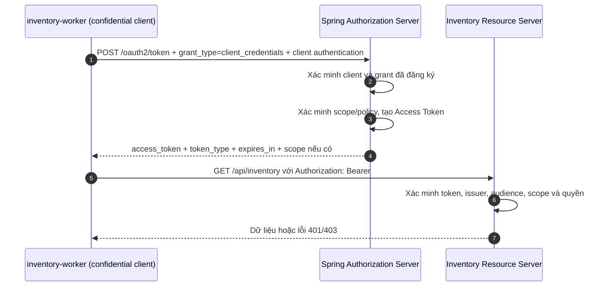
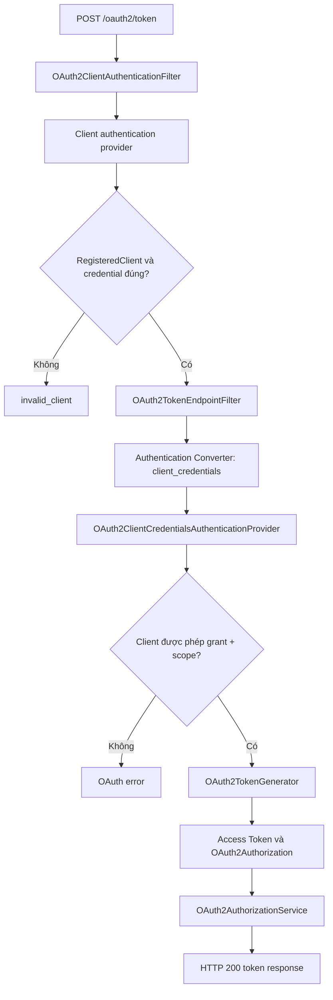

# Đăng ký confidential client cho grant client_credentials

## 1. Mục tiêu và phạm vi

Trong chương **Client Credentials** của module **SPRING_SECURITY_OAUTH2_OIDC_AUTHORIZATION_SERVER**, chúng ta học cách thiết kế, cấu hình, bảo mật, kiểm thử và vận hành OAuth 2.0/OpenID Connect Authorization Server bằng Spring Security và Spring Authorization Server trong ứng dụng Spring Boot.

Bài này giải quyết bài toán: **làm thế nào đăng ký một ứng dụng backend như một confidential OAuth client được phép sử dụng `client_credentials` để lấy Access Token phục vụ giao tiếp máy-với-máy (machine-to-machine, M2M)?**

Ví dụ, `inventory-worker` cần gọi API kiểm tra tồn kho. Không có người dùng mở trình duyệt hay bấm nút đồng ý cấp quyền trong giao dịch này. Thay vào đó, dịch vụ tự xác thực với Authorization Server bằng credential của **chính nó**, xin Access Token cho những scope đã được đăng ký và dùng token đó gọi Resource Server.

Kết thúc bài, người học có thể:

1. Giải thích tại sao `client_credentials` chỉ phù hợp với **confidential clients** có thể xác thực và bảo vệ credential.
2. Tạo `RegisteredClient` với `clientId`, `clientSecret`, `ClientAuthenticationMethod`, `AuthorizationGrantType.CLIENT_CREDENTIALS`, `scope` và `TokenSettings`.
3. Phân biệt định danh client, secret, quyền được đăng ký, quyền trong token và danh tính người dùng.
4. Gửi token request chuẩn `application/x-www-form-urlencoded` qua HTTPS với `client_secret_basic`, đọc response và hiểu các lỗi thường gặp.
5. Tích hợp Access Token vào lời gọi API và kiểm tra issuer, audience, thời hạn, scope tại Resource Server.
6. Lập kế hoạch lưu trữ client registration, phát hành/luân chuyển credential, kiểm toán và vận hành nhiều instance.

**Phạm vi:** các ví dụ Java, URL `localhost` và secret minh họa chỉ dành cho môi trường phát triển. Chúng không phải cấu hình production hoàn chỉnh. Tài liệu dùng API quen thuộc trong Spring Authorization Server 1.x/Spring Security 6.x; khi sử dụng phiên bản khác, cần đối chiếu tài liệu tương ứng trước khi sao chép cấu hình.

## 2. Hiểu đúng Client Credentials Grant

### 2.1. Client xác thực bằng danh tính của chính mình

RFC 6749 mục 4.4 quy định **Client Credentials Grant** dành cho confidential client, khi client đang hành động **nhân danh chính nó**, hoặc trong một ngữ cảnh mà client đã được cho phép truy cập trước đó. Không có bước hỏi người dùng ở Authorization Endpoint.



Đối chiếu với Authorization Code Flow:

| Khía cạnh | Authorization Code + PKCE | Client Credentials |
| --- | --- | --- |
| Chủ thể được ủy quyền | Giao dịch liên quan người dùng và client. | **Chính OAuth client**. |
| Trình duyệt, login, consent | Thường tham gia tùy chính sách. | **Không có** trong grant này. |
| `/oauth2/authorize` | Có. | **Không gọi**. |
| `/oauth2/token` | Client đổi authorization code lấy token. | Client trực tiếp xin token bằng `client_credentials`. |
| PKCE `code_verifier` | Dùng khi đổi authorization code. | **Không áp dụng**, vì không có authorization code. |
| Client authentication | Có thể là confidential hoặc public tùy mô hình. | **Bắt buộc confidential client** theo RFC 6749. |
| Access Token | Dành cho Resource Server theo quyền đã cấp. | Dành cho API theo quyền của client. |
| Refresh Token | Có thể được cấp theo chính sách. | Theo RFC 6749, **SHOULD NOT** được cấp. |
| OIDC ID Token | Có thể xuất hiện khi dùng OIDC. | **Không phải kết quả của grant này**, vì không xác thực end user. |

**Không dùng `client_credentials` để giả mạo “đăng nhập người dùng”**: trong loại grant này không có user principal của một phiên đăng nhập tương tác. Nếu API cần biết một người dùng cụ thể đã đồng ý cấp quyền, hãy sử dụng luồng ủy quyền phù hợp, không nhét tùy ý username hoặc `sub` người dùng vào token client credentials.

### 2.2. Confidential client là gì?

Confidential client có khả năng giữ kín thông tin xác thực hoặc sử dụng một cơ chế xác thực client an toàn tại token endpoint. Ví dụ thường gặp:

- Backend service chạy trong môi trường server được quản trị.
- Job theo lịch, batch worker hoặc service tích hợp nội bộ.
- Backend-for-frontend giữ bí mật ở phía server, không đẩy nó xuống browser.

**SPA JavaScript thuần và mobile/desktop app phân phối đến người dùng cuối không thể được xem là confidential chỉ vì mã nguồn chứa một chuỗi `client_secret`.** Người dùng hoặc attacker có thể trích xuất secret khỏi bundle/application. Những ứng dụng đó thường dùng Authorization Code + PKCE để làm việc với quyền của người dùng, thay vì `client_credentials` với secret nhúng.

`client_id` là **định danh**, không phải bí mật. `client_secret`, private key hoặc credential mTLS là bằng chứng xác thực của client và phải được bảo vệ tương ứng.

## 3. RegisteredClient: những trường phải quyết định

Spring Authorization Server dùng mô hình `RegisteredClient` để lưu những gì một OAuth client được phép thực hiện. Các lựa chọn có ý nghĩa trực tiếp với grant `client_credentials`:

| Trường/cấu hình | Ví dụ | Vì sao cần |
| --- | --- | --- |
| `id` nội bộ | UUID bất kỳ được tạo khi đăng ký. | Khóa định danh bản ghi trong `RegisteredClientRepository`; **khác `client_id`**. |
| `clientId` | `inventory-worker` | Định danh client gửi đến token endpoint. |
| `clientSecret` | Giá trị secret đã được mã hóa/băm thích hợp khi lưu. | Server dùng xác minh phương thức `client_secret_basic`. |
| `clientAuthenticationMethod` | `CLIENT_SECRET_BASIC` | Khai báo client được phép dùng phương thức xác thực nào. |
| `authorizationGrantType` | `CLIENT_CREDENTIALS` | Chỉ cho phép grant `client_credentials`. |
| `scope` | `inventory.read` | Giới hạn tập scope client **được phép yêu cầu**. |
| `TokenSettings` | JWT Access Token 10 phút. | Chính sách định dạng và thời hạn token mới. |
| `ClientSettings` | Thiết lập khác nếu ứng dụng cần. | Các thiết lập như PKCE/consent không có vai trò trực tiếp trong grant này. |
| `redirectUri` | **Không cần**. | Không có browser redirect hoặc authorization code trong grant. |

### 3.1. Một client chỉ được cấp những quyền đã đăng ký

Ví dụ `inventory-worker` chỉ được đăng ký scope `inventory.read`. Request xin `inventory.write` phải bị từ chối hoặc không được cấp scope đó theo chính sách server. Access Token chứa `scope=inventory.read` **không tự cho phép tất cả API**; Resource Server vẫn phải kiểm tra HTTP method, resource, audience và quyền cụ thể.

Phạm vi quyền nên nhỏ và sát nhu cầu công việc: nếu worker chỉ đọc hàng tồn kho thì không đăng ký scope ghi hoặc quản trị. Với nhiều hệ thống, nên đăng ký **những client riêng biệt** cho job đọc dữ liệu và job cập nhật dữ liệu, thay vì một client có toàn bộ quyền.

### 3.2. Một client có thể có nhiều phương thức, nhưng không nên tùy tiện bật tất cả

Ví dụ một client `client_secret_basic` không tự động được phép dùng `client_secret_post`, `private_key_jwt` hoặc mTLS. Phương thức client authentication được quyết định khi đăng ký và được provider kiểm tra ở token endpoint.

Không thêm hàng loạt phương thức chỉ để “dễ tương thích”; mỗi phương thức tăng bề mặt cấu hình, chính sách khóa và kiểm thử. Nếu cần chuyển từ secret sang khóa riêng, hãy lập kế hoạch migration và cập nhật `RegisteredClient` theo quy trình quản trị.

## 4. Cấu hình TokenSettings phù hợp với máy-với-máy

Trong mô hình M2M, client có thể tự xác thực lại để xin Access Token mới, vì vậy thường **không cần Refresh Token**. RFC 6749 khuyến cáo Authorization Server không nên đưa Refresh Token vào response `client_credentials`. TTL của Access Token nên đủ ngắn để giảm nguy cơ credential bị lộ nhưng không quá ngắn khiến hệ thống gửi token request liên tục.

Ví dụ:

```java
import java.time.Duration;
import org.springframework.security.oauth2.core.OAuth2TokenFormat;
import org.springframework.security.oauth2.server.authorization.settings.TokenSettings;

TokenSettings machineTokenPolicy = TokenSettings.builder()
        .accessTokenTimeToLive(Duration.ofMinutes(10))
        .accessTokenFormat(OAuth2TokenFormat.SELF_CONTAINED)
        .build();
```

`SELF_CONTAINED` thường là JWT trong cấu hình có bộ sinh token/JWK thích hợp. Resource Server có thể kiểm tra chữ ký cục bộ. Nếu thay bằng `OAuth2TokenFormat.REFERENCE`, Access Token thường là chuỗi opaque cần introspection; đây là thay đổi kiến trúc xác minh, không chỉ đổi một field.

Một Access Token JWT có thể vẫn được Resource Server chấp nhận đến `exp`, ngay cả khi secret client đã được rotate, **trừ khi** hệ thống có cơ chế thu hồi/kiểm tra trạng thái riêng. Đổi client secret là biện pháp phòng ngừa cho **yêu cầu cấp token mới**; không mặc nhiên thu hồi toàn bộ token cũ.

## 5. Ví dụ đăng ký client trong Spring Authorization Server

### 5.1. Chuẩn bị dependency và cấu hình phát triển

Ví dụ giả định dự án Spring Boot có quản lý version dependency tương thích với Spring Authorization Server 1.x. Với Maven:

```xml
<dependencies>
    <dependency>
        <groupId>org.springframework.boot</groupId>
        <artifactId>spring-boot-starter-web</artifactId>
    </dependency>
    <dependency>
        <groupId>org.springframework.boot</groupId>
        <artifactId>spring-boot-starter-security</artifactId>
    </dependency>
    <dependency>
        <groupId>org.springframework.boot</groupId>
        <artifactId>spring-boot-starter-oauth2-authorization-server</artifactId>
    </dependency>
</dependencies>
```

Các dependency không khai báo version riêng vì dự án dự kiến dùng Spring Boot dependency management. Nếu sử dụng Spring Boot/Spring Security phiên bản khác, hãy xem tài liệu API tương ứng thay vì trộn các ví dụ cấu hình.

Đặt cổng ứng dụng local ở `src/main/resources/application-dev.yml`:

```yaml
server:
  port: 9000
```

Để **không đưa client secret vào source code**, ví dụ lấy secret từ biến môi trường `DEMO_INVENTORY_CLIENT_SECRET`. Khi chạy local trên PowerShell:

```powershell
$env:SPRING_PROFILES_ACTIVE = 'dev'
$env:DEMO_INVENTORY_CLIENT_SECRET = 'dev-secret-please-change-8b34c67aa11e'
.\mvnw.cmd spring-boot:run
```

Chuỗi trên chỉ là secret giả lập. Trong production cần secret ngẫu nhiên đủ entropy, được cấp phát và đưa vào ứng dụng qua cơ chế quản lý bí mật phù hợp. Cũng cần tránh để secret xuất hiện trong shell history, process arguments hoặc log theo cách không kiểm soát.

### 5.2. Cấu hình Java chạy local

Class sau minh họa một Authorization Server chỉ dành cho profile `dev`, có một confidential client được phép dùng `client_credentials`. Nó tạo `JWKSource` để ký JWT Access Token, định nghĩa issuer và security chain cho endpoint giao thức:

```java
package com.example.authorizationserver.config;

import java.security.KeyPair;
import java.security.KeyPairGenerator;
import java.security.interfaces.RSAPrivateKey;
import java.security.interfaces.RSAPublicKey;
import java.time.Duration;
import java.util.UUID;

import com.nimbusds.jose.jwk.JWKSet;
import com.nimbusds.jose.jwk.RSAKey;
import com.nimbusds.jose.jwk.source.JWKSource;
import com.nimbusds.jose.proc.SecurityContext;
import org.springframework.context.annotation.Bean;
import org.springframework.context.annotation.Configuration;
import org.springframework.context.annotation.Profile;
import org.springframework.core.annotation.Order;
import org.springframework.security.config.Customizer;
import org.springframework.security.config.annotation.web.builders.HttpSecurity;
import org.springframework.security.config.annotation.web.configuration.EnableWebSecurity;
import org.springframework.security.crypto.factory.PasswordEncoderFactories;
import org.springframework.security.crypto.password.PasswordEncoder;
import org.springframework.security.oauth2.core.AuthorizationGrantType;
import org.springframework.security.oauth2.core.ClientAuthenticationMethod;
import org.springframework.security.oauth2.core.OAuth2TokenFormat;
import org.springframework.security.oauth2.server.authorization.client.InMemoryRegisteredClientRepository;
import org.springframework.security.oauth2.server.authorization.client.RegisteredClient;
import org.springframework.security.oauth2.server.authorization.client.RegisteredClientRepository;
import org.springframework.security.oauth2.server.authorization.config.annotation.web.configurers.OAuth2AuthorizationServerConfigurer;
import org.springframework.security.oauth2.server.authorization.settings.AuthorizationServerSettings;
import org.springframework.security.oauth2.server.authorization.settings.TokenSettings;
import org.springframework.security.web.SecurityFilterChain;

@Configuration(proxyBeanMethods = false)
@EnableWebSecurity
@Profile("dev")
public class DevMachineClientConfig {

    @Bean
    @Order(1)
    SecurityFilterChain authorizationServerChain(HttpSecurity http) throws Exception {
        OAuth2AuthorizationServerConfigurer configurer =
                OAuth2AuthorizationServerConfigurer.authorizationServer();

        http.securityMatcher(configurer.getEndpointsMatcher())
                .with(configurer, Customizer.withDefaults())
                .authorizeHttpRequests(authorize -> authorize.anyRequest().authenticated());
        return http.build();
    }

    @Bean
    @Order(2)
    SecurityFilterChain applicationChain(HttpSecurity http) throws Exception {
        // Demo không có trang login hay endpoint nghiệp vụ trên AS.
        http.authorizeHttpRequests(authorize -> authorize.anyRequest().denyAll());
        return http.build();
    }

    @Bean
    PasswordEncoder passwordEncoder() {
        return PasswordEncoderFactories.createDelegatingPasswordEncoder();
    }

    @Bean
    RegisteredClientRepository registeredClientRepository(PasswordEncoder encoder) {
        String secret = System.getenv("DEMO_INVENTORY_CLIENT_SECRET");
        if (secret == null || secret.isBlank()) {
            throw new IllegalStateException(
                    "Set DEMO_INVENTORY_CLIENT_SECRET for the dev profile");
        }

        RegisteredClient inventoryWorker = RegisteredClient
                .withId(UUID.randomUUID().toString())
                .clientId("inventory-worker")
                .clientSecret(encoder.encode(secret))
                .clientAuthenticationMethod(ClientAuthenticationMethod.CLIENT_SECRET_BASIC)
                .authorizationGrantType(AuthorizationGrantType.CLIENT_CREDENTIALS)
                .scope("inventory.read")
                .tokenSettings(TokenSettings.builder()
                        .accessTokenTimeToLive(Duration.ofMinutes(10))
                        .accessTokenFormat(OAuth2TokenFormat.SELF_CONTAINED)
                        .build())
                .build();

        return new InMemoryRegisteredClientRepository(inventoryWorker);
    }

    @Bean
    AuthorizationServerSettings authorizationServerSettings() {
        return AuthorizationServerSettings.builder()
                .issuer("http://localhost:9000")
                .build();
    }

    @Bean
    JWKSource<SecurityContext> jwkSource() {
        try {
            KeyPairGenerator generator = KeyPairGenerator.getInstance("RSA");
            generator.initialize(2048);
            KeyPair pair = generator.generateKeyPair();
            RSAKey key = new RSAKey.Builder((RSAPublicKey) pair.getPublic())
                    .privateKey((RSAPrivateKey) pair.getPrivate())
                    .keyID(UUID.randomUUID().toString())
                    .build();
            JWKSet keySet = new JWKSet(key);
            return (selector, context) -> selector.select(keySet);
        } catch (Exception exception) {
            throw new IllegalStateException("Cannot create demo signing key", exception);
        }
    }
}
```

Trong mẫu này:

- `@Profile("dev")` giới hạn những bean ví dụ ở môi trường phát triển.
- `RegisteredClient.withId(...)` tạo định danh nội bộ; khi token request gửi `client_id=inventory-worker`, server tìm bằng `clientId`.
- `encoder.encode(secret)` lưu client secret đã được mã hóa/băm qua `DelegatingPasswordEncoder`, không phải plaintext. Server phải dùng cơ chế xác minh tương thích.
- `CLIENT_SECRET_BASIC` chỉ cho phép HTTP Basic client authentication theo đăng ký này.
- `CLIENT_CREDENTIALS` giới hạn grant; không có `AUTHORIZATION_CODE`, `REFRESH_TOKEN`, redirect URI, user login hoặc consent.
- `scope("inventory.read")` xác định quyền tối đa đã đăng ký của client, **không tự cấp quyền truy cập mọi API**.
- `TokenSettings` phát Access Token mới có TTL 10 phút, định dạng tự chứa.
- `issuer` là địa chỉ cục bộ nhất quán. Trong production phải là issuer HTTPS công khai ổn định.

**Điểm quan trọng:** cặp RSA được tạo mới ở mỗi lần khởi động chỉ phù hợp demo; token đã ký trước restart có thể không còn xác minh được. `InMemoryRegisteredClientRepository` cũng không phù hợp để quản lý client và credential lâu dài, đặc biệt khi có nhiều instance.

### 5.3. Tại sao không cần UserDetailsService và formLogin?

Grant này không đăng nhập một người dùng bằng browser, vì vậy cấu hình minh họa **không cần** `UserDetailsService` hay `formLogin()`. Đối tượng được xác thực tại token endpoint là **OAuth client** thông qua HTTP Basic credential, chứ không phải người dùng `dev.user`.

Nếu cùng một Authorization Server phục vụ thêm Authorization Code Flow thì có thể cần security chain riêng cho form login và hệ thống user authentication, nhưng điều đó thuộc luồng khác. Không nên tạo màn hình login giả chỉ để cho `client_credentials` hoạt động.

## 6. Đường đi của một token request tại /oauth2/token

### 6.1. Request chuẩn theo RFC 6749

Client gửi HTTP POST đến token endpoint, body `application/x-www-form-urlencoded`:

```http
POST /oauth2/token HTTP/1.1
Host: localhost:9000
Authorization: Basic <base64-of-inventory-worker-colon-secret>
Content-Type: application/x-www-form-urlencoded

grant_type=client_credentials&scope=inventory.read
```

Header Basic mang client ID và secret sau mã hóa cú pháp Base64 theo HTTP Basic. **Base64 không bảo mật dữ liệu**: token endpoint công khai phải dùng HTTPS để bảo vệ credential khi truyền. Client phải tránh gửi cùng credential qua nhiều phương thức trong cùng request hoặc đưa `client_secret` vào query string.

Theo RFC 6749:

- `grant_type=client_credentials` là giá trị bắt buộc của grant.
- `scope` là tham số có thể tùy chọn ở tầng giao thức, nhưng nên gửi tường minh trong bài thực hành để quan sát quyền được yêu cầu.
- Confidential client **phải được xác thực** tại token endpoint bằng phương thức đã đăng ký.
- Request thành công không liên quan `code`, `code_verifier`, `redirect_uri` hoặc `nonce` của Authorization Code/OIDC login.

### 6.2. Pipeline xử lý bên trong Spring Authorization Server



Tên và thứ tự chính xác của một số filter/provider phụ thuộc phiên bản Spring Authorization Server, nhưng **nguyên tắc logic** vẫn quan trọng: server xác thực client **trước**, kiểm tra grant/scope **sau**, rồi mới phát hành token và lưu trạng thái liên quan theo mô hình framework.

Client authentication thành công **không đồng nghĩa** client được phép gọi mọi grant. `RegisteredClient` có thể xác thực đúng nhưng nếu request dùng `grant_type=authorization_code` khi chỉ đăng ký `CLIENT_CREDENTIALS` thì server vẫn phải từ chối.

### 6.3. Token response

Ví dụ phản hồi thành công:

```http
HTTP/1.1 200 OK
Content-Type: application/json
Cache-Control: no-store
Pragma: no-cache

{
  "access_token": "<issued-access-token>",
  "token_type": "Bearer",
  "expires_in": 600,
  "scope": "inventory.read"
}
```

`expires_in` khoảng 600 giây tương ứng TTL 10 phút của ví dụ; số thực tế có thể bị ảnh hưởng bởi cách làm tròn hoặc thời điểm phản hồi. Trường `scope` có thể bị lược bỏ trong những tình huống giao thức cho phép khi scope được cấp trùng scope yêu cầu; không nên phụ thuộc vào việc nó luôn hiện diện.

Phản hồi `client_credentials` **không cần có Refresh Token** (RFC 6749 `SHOULD NOT` cấp), cũng **không có ID Token** vì không thực hiện OIDC authentication của người dùng.

## 7. Thực hành gửi request bằng PowerShell và curl

### 7.1. Kiểm tra cấu hình

Khởi động server ở cổng `9000` bằng profile `dev` như phần 5. Kiểm tra public metadata nếu endpoint được hỗ trợ/bật trong cấu hình thực tế:

```powershell
curl.exe -i http://localhost:9000/.well-known/oauth-authorization-server
curl.exe -i http://localhost:9000/oauth2/jwks
```

Metadata chỉ ra token endpoint và các khả năng hỗ trợ; public JWKS chứa các public keys để xác minh JWT, không phải private key. Nếu ứng dụng đang chạy sau reverse proxy, các URL public phải nhất quán với issuer HTTPS đã cấu hình.

### 7.2. Xin Access Token với client_secret_basic

```powershell
$credential = "inventory-worker:$env:DEMO_INVENTORY_CLIENT_SECRET"

curl.exe -sS -X POST 'http://localhost:9000/oauth2/token' -u $credential -H 'Content-Type: application/x-www-form-urlencoded' --data-urlencode 'grant_type=client_credentials' --data-urlencode 'scope=inventory.read'
```

Nếu vừa chạy lệnh trên trong terminal khác, hãy đặt biến môi trường secret **cùng giá trị** cho terminal test trước khi thực hiện. `-u` là cú pháp của curl để gửi HTTP Basic; ví dụ chỉ dùng HTTP qua `localhost` trong môi trường dev.

Trong production, **không đặt secret trực tiếp trong shell history, tham số tiến trình hoặc log**. Nên tích hợp OAuth client library, vault/secret manager hoặc cơ chế runtime cấp credential an toàn. Không gửi credential trong URL query string.

Phản hồi thành công có JSON gồm `access_token`, `token_type` và `expires_in`. Nếu token là JWT, có thể decode header/payload để **quan sát** các claims, nhưng việc decode không chứng minh chữ ký hợp lệ.

### 7.3. Thử request sai để hiểu policy

Thử gửi scope chưa đăng ký:

```powershell
curl.exe -i -X POST 'http://localhost:9000/oauth2/token' -u $credential -H 'Content-Type: application/x-www-form-urlencoded' --data-urlencode 'grant_type=client_credentials' --data-urlencode 'scope=inventory.write'
```

Kết quả mong đợi là phản hồi lỗi OAuth như `invalid_scope`, vì `inventory-worker` chỉ được phép `inventory.read`. Cần đọc status và error body từ framework đang chạy; không dựa vào một mã HTTP duy nhất.

Thử sai client secret (secret giả lập):

```powershell
curl.exe -i -X POST 'http://localhost:9000/oauth2/token' -u 'inventory-worker:wrong-secret' -H 'Content-Type: application/x-www-form-urlencoded' --data-urlencode 'grant_type=client_credentials' --data-urlencode 'scope=inventory.read'
```

Phải bị từ chối ở **client authentication**, thường với lỗi `invalid_client`. Không cấp Access Token chỉ vì `client_id` hợp lệ.

### 7.4. Không có refresh flow bắt buộc

Khi Access Token hết hạn, confidential client có thể tự xác thực lại để xin Access Token mới bằng một request `client_credentials` khác. Không tạo luồng refresh giả:

```text
Access Token hết hạn
  -> Client xác thực lại với token endpoint
  -> grant_type=client_credentials
  -> Access Token mới
```

Một số client library hỗ trợ cache Access Token và chủ động làm mới trước `exp`. Hãy dùng cơ chế của thư viện thay vì gọi token endpoint cho **mỗi** API request nếu không cần thiết; bảo vệ cache và xử lý nhiều request đồng thời để tránh đột biến lưu lượng.

## 8. Resource Server xác minh Access Token như thế nào?

### 8.1. Token phải được dành cho đúng API

Giả sử `inventory-worker` dùng Access Token để gọi:

```http
GET /api/inventory/items HTTP/1.1
Host: api.example.com
Authorization: Bearer <access-token>
```

API cần kiểm tra **token thật sự do Authorization Server đáng tin phát hành**, chưa hết hạn, được dùng cho Resource Server phù hợp, có `scope=inventory.read` và các quyền nghiệp vụ cần thiết. Chỉ nhìn thấy `Bearer` hoặc chuỗi JWT có dạng ba phần **không đủ** để cấp quyền.

Lựa chọn kiểm tra tùy định dạng token:

| Định dạng Access Token | Cơ chế xác minh phổ biến |
| --- | --- |
| JWT / `SELF_CONTAINED` | Xác minh chữ ký qua JWKS, `iss`, `exp`, `nbf`, `aud` và claims/quyền liên quan. |
| Reference / opaque | Gọi token introspection bằng xác thực Resource Server thích hợp; kiểm tra `active`, scopes, audience và policy. |

Với cấu hình `issuer-uri` của Spring Security Resource Server, framework thường kiểm tra issuer cùng các validation JWT mặc định, nhưng **audience không nhất thiết được kiểm tra theo nhu cầu API chỉ bằng một dòng issuer-uri**. Cần bổ sung kiểm tra audience khi kiến trúc dùng `aud` để giới hạn intended resource.

### 8.2. Cấu hình Resource Server tối thiểu

Ví dụ Spring Boot Resource Server có dependency `spring-boot-starter-oauth2-resource-server` và Spring Security:

```yaml
spring:
  security:
    oauth2:
      resourceserver:
        jwt:
          issuer-uri: http://localhost:9000
```

Đây là giá trị issuer **chỉ dành cho local**. Production phải dùng issuer HTTPS công khai. Một security chain chỉ cho phép scope đọc tồn kho:

```java
import org.springframework.context.annotation.Bean;
import org.springframework.http.HttpMethod;
import org.springframework.security.config.Customizer;
import org.springframework.security.config.annotation.web.builders.HttpSecurity;
import org.springframework.security.web.SecurityFilterChain;

@Bean
SecurityFilterChain inventoryApiChain(HttpSecurity http) throws Exception {
    http.authorizeHttpRequests(authorize -> authorize
            .requestMatchers(HttpMethod.GET, "/api/inventory/**")
            .hasAuthority("SCOPE_inventory.read")
            .anyRequest().denyAll())
        .oauth2ResourceServer(oauth -> oauth.jwt(Customizer.withDefaults()));
    return http.build();
}
```

Spring Security thông thường ánh xạ claim `scope` hoặc `scp` trong JWT thành authority có tiền tố `SCOPE_`. Ví dụ `inventory.read` trở thành `SCOPE_inventory.read` nếu converter đang dùng hỗ trợ dạng claim thực tế.

Đây là ví dụ **chỉ tập trung xác minh JWT và scope**; API production còn cần chính sách method/resource, quản lý CORS, session/CSRF nếu có cookie, rate limit và xử lý lỗi. Không mở `anyRequest().permitAll()` để kiểm tra cho tiện.

### 8.3. Audience không được tự suy ra từ scope

Scope `inventory.read` có nghĩa về quyền mà client xin; nó không đồng nghĩa JWT được dành cho bất kỳ API nào có đường dẫn `inventory`. Nếu Resource Server yêu cầu audience `inventory-api`, Authorization Server cần phát hành claim `aud` phù hợp và API cần xác minh claim đó.

Ví dụ **tùy biến JWT** trên Authorization Server cho Access Token của đúng client:

```java
import java.util.List;
import org.springframework.context.annotation.Bean;
import org.springframework.security.oauth2.core.AuthorizationGrantType;
import org.springframework.security.oauth2.core.OAuth2TokenType;
import org.springframework.security.oauth2.server.authorization.token.JwtEncodingContext;
import org.springframework.security.oauth2.server.authorization.token.OAuth2TokenCustomizer;

@Bean
OAuth2TokenCustomizer<JwtEncodingContext> inventoryAudienceCustomizer() {
    return context -> {
        if (OAuth2TokenType.ACCESS_TOKEN.equals(context.getTokenType())
                && AuthorizationGrantType.CLIENT_CREDENTIALS
                        .equals(context.getAuthorizationGrantType())
                && "inventory-worker".equals(
                        context.getRegisteredClient().getClientId())) {
            context.getClaims().audience(List.of("inventory-api"));
        }
    };
}
```

Resource Server tương ứng phải được cấu hình validator bảo đảm `aud` chứa `inventory-api`. **Thêm claim `aud` ở phía server mà không kiểm tra ở API chưa hoàn tất cơ chế giới hạn audience.** Nếu dự án đã có một `OAuth2TokenCustomizer<JwtEncodingContext>`, hãy kết hợp logic vào đó thay vì tạo bean cạnh tranh mà không kiểm soát thứ tự.

## 9. Những phương thức client authentication khác

### 9.1. client_secret_basic

`CLIENT_SECRET_BASIC` là lựa chọn dễ hiểu cho một confidential service có khả năng bảo vệ secret. Client gửi Basic header, server dùng thông tin đã đăng ký để xác minh. Secret phải có entropy phù hợp, được lưu bằng secret manager ở client, không chia sẻ giữa nhiều service không liên quan.

HTTP Basic header mang secret ở dạng Base64, nên HTTPS là điều kiện thiết yếu khi giao tiếp ngoài môi trường loopback.

### 9.2. client_secret_post

`CLIENT_SECRET_POST` gửi `client_id` và `client_secret` trong form body. RFC 6749 cho phép trong một số trường hợp nhưng không khuyến khích cách gửi password/secret trong body khi client hỗ trợ HTTP Basic. Body có thể bị log hoặc ghi trace sai cách; không tự động chọn `client_secret_post` chỉ vì dùng `POST`.

Một client đăng ký chỉ `CLIENT_SECRET_BASIC` **không được coi như tự cho phép** `client_secret_post`.

### 9.3. private_key_jwt và client_secret_jwt

Với `PRIVATE_KEY_JWT`, client ký JWT assertion bằng private key và Authorization Server xác minh bằng public key/JWKS đã đăng ký. JWT assertion có các ràng buộc như `iss`, `sub`, `aud` và `exp`; tùy profile bảo mật còn cần `jti` và replay protection. Client cần quản lý private key và rotation.

`CLIENT_SECRET_JWT` sử dụng shared secret phù hợp cho MAC. Cả hai phương thức đều liên quan đến **client authentication**, không phải định dạng Access Token mà Authorization Server phát hành. Chọn phương thức có chính sách khóa và thư viện client tương thích, không tự tin một JWT chỉ vì nó có trường `alg`.

### 9.4. Mutual TLS và certificate-bound tokens

Với mTLS, client chứng minh sở hữu private key thông qua chứng chỉ TLS và server xác thực certificate theo chính sách đăng ký. Có thể áp dụng OAuth mTLS client authentication hoặc certificate-bound Access Token theo RFC 8705 khi nhu cầu bảo mật yêu cầu.

Điều này cần cấu hình TLS, truststore, reverse proxy, chứng chỉ và `RegisteredClient` nhất quán; không thể chỉ chọn một enum trên client là tự triển khai mTLS hoàn chỉnh.

| Phương thức | Tài sản bảo mật | Cần đặc biệt chú ý |
| --- | --- | --- |
| `client_secret_basic` | Shared secret trong Basic header. | TLS, secret manager và rotation. |
| `client_secret_post` | Shared secret trong body. | Tránh log body, chỉ dùng khi được đăng ký/chính sách cho phép. |
| `private_key_jwt` | Private key phía client, public JWKS đã đăng ký. | Chữ ký, `aud`/`exp`, khóa đúng client, rotation và replay policy. |
| `client_secret_jwt` | Shared secret dùng để ký assertion. | Bảo vệ và quản lý khóa đối xứng, không nhầm password hash với HMAC key. |
| mTLS | Client certificate và private key tương ứng. | Trust chain, định danh client, cấu hình proxy và rotation chứng chỉ. |

## 10. Lưu trữ và quản trị đăng ký client

### 10.1. InMemoryRegisteredClientRepository dùng để học

`InMemoryRegisteredClientRepository` giúp tạo client nhanh, nhưng toàn bộ registration gắn với vòng đời tiến trình. Nếu mỗi node tự sinh `RegisteredClient.id` hoặc nhận secret khác nhau, hệ thống nhiều instance có thể xác thực/ghi trạng thái không nhất quán.

Trong production, cần lựa chọn repository bền vững (ví dụ JDBC hoặc triển khai có cơ chế quản lý đồng bộ phù hợp), dữ liệu đăng ký nhất quán và quy trình cấp phát/thu hồi credential. Spring Authorization Server có mô hình `JdbcRegisteredClientRepository`, nhưng một môi trường production còn phải cân nhắc schema migration, kết nối, bảo vệ database và quản trị thay đổi.

### 10.2. Không lưu client secret thô trong repository

Với `client_secret_basic`, secret lưu phía server nên được xử lý qua `PasswordEncoder` phù hợp. Trong ví dụ, `encoder.encode(secret)` tạo một encoded value có prefix thuật toán mà `DelegatingPasswordEncoder` hiểu.

Khi cấp secret mới:

1. Sinh secret có đủ entropy bằng CSPRNG, không tự chế từ tên service hoặc timestamp.
2. Chuyển credential đến client qua kênh an toàn và lưu trong secret manager phù hợp.
3. Chỉ lưu encoded form ở repository khi dùng phương thức xác minh password/secret tương ứng.
4. Thiết kế lịch rotation, khả năng thu hồi hoặc giai đoạn chuyển đổi mà không vô tình mở quyền cho secret cũ vô thời hạn.
5. Theo dõi hoạt động xác thực client, request sai secret và nhu cầu vô hiệu hóa credential khi bị lộ.

Đối với `private_key_jwt`/mTLS, chính sách khóa/chứng chỉ khác với shared password; không áp dụng máy móc cơ chế hash một chiều cho mọi phương thức xác thực.

### 10.3. Cập nhật RegisteredClient an toàn

Nếu client đã tồn tại trong database, thay đoạn Java khởi tạo không tự sửa bản ghi. Nên có quy trình quản trị đăng ký: xác thực người yêu cầu, phê duyệt scopes và grant, cập nhật repository, ghi audit, kiểm thử và rollback.

Không mở endpoint “tự đăng ký confidential client” cho bất kỳ người dùng không xác thực; việc cấp một `client_id` và credential có quyền `inventory.read` là hành vi cấp quyền ở hệ thống.

### 10.4. Nhiều tenant hoặc nhiều issuer

Nếu một Authorization Server phục vụ nhiều issuer, client phải được phân vùng/ràng buộc với tenant đáng tin cậy. Một `inventory-worker` của tenant A không được sử dụng cùng registration hoặc secret để xin token dưới issuer B nếu policy không cho phép.

Phân vùng repository, token issuance, signing keys và audit theo thiết kế multi-tenancy thực tế; `client_credentials` không tự xác định tenant chỉ dựa trên tên client.

## 11. Lỗi thường gặp và ma trận kiểm thử

### 11.1. Các mã lỗi OAuth cần hiểu

| Tình huống | Lỗi/biểu hiện có thể gặp | Cách kiểm tra |
| --- | --- | --- |
| `client_id` không tồn tại | `invalid_client`. | Đối chiếu đúng `RegisteredClient.clientId`, không nhầm internal UUID. |
| Client secret sai hoặc thiếu | `invalid_client`. | Kiểm tra secret, password encoder và phương thức authentication. |
| Gửi `client_secret_post` khi client chỉ đăng ký Basic | `invalid_client` hoặc lỗi xác thực tương ứng. | Kiểm tra `clientAuthenticationMethod` được đăng ký. |
| `grant_type` không được server hỗ trợ | `unsupported_grant_type`. | Xác minh endpoint/framework hỗ trợ grant. |
| Grant được server hỗ trợ nhưng client không được phép | `unauthorized_client`. | Kiểm tra `authorizationGrantTypes` của đúng client. |
| Xin scope chưa đăng ký | `invalid_scope`. | So request scope với các scopes đã đăng ký. |
| Sai Content-Type/form body | `invalid_request` hoặc lỗi tương ứng. | Gửi `application/x-www-form-urlencoded`, đúng tên tham số. |
| Token endpoint trả 404 | Sai URL/path hoặc cấu hình security chain. | Kiểm tra `AuthorizationServerSettings` và endpoint configuration. |
| API trả 401 | Token thiếu/hết hạn, sai chữ ký/issuer/audience hoặc validation khác. | Kiểm tra Resource Server configuration và token thực tế. |
| API trả 403 | Token được xác thực nhưng thiếu scope/quyền theo policy. | Kiểm tra `SCOPE_inventory.read` và phân quyền endpoint. |
| Không có Refresh Token | Thường là đúng với client credentials. | Không mặc định coi đó là lỗi. |
| Không có ID Token | Đúng vì không có OIDC end-user authentication. | Không thêm `openid` chỉ để cố lấy ID Token. |
| JWT không còn verify được sau restart demo | RSA key được tạo ngẫu nhiên mỗi lần chạy. | Dùng key storage bền vững ngoài môi trường demo. |

Mã lỗi cụ thể và HTTP status có thể khác theo nguyên nhân/phiên bản. Nên kiểm tra **status + OAuth error body + log đã được lọc bí mật**, không kết luận bằng một mã HTTP đơn lẻ.

### 11.2. Bộ kiểm thử tối thiểu

| Loại test | Input | Kỳ vọng |
| --- | --- | --- |
| Happy path | Client đúng ID/secret, `grant_type=client_credentials`, `inventory.read`. | Nhận Access Token phù hợp, không đòi browser login. |
| Sai credential | Secret sai. | Không cấp token. |
| Client lạ | `client_id` chưa đăng ký. | Không cấp token. |
| Sai authentication method | Post secret hoặc JWT khi không đăng ký. | Không vượt qua client authentication. |
| Sai grant | `authorization_code` hoặc `refresh_token` trên client chỉ đăng ký `CLIENT_CREDENTIALS`. | Không cấp token theo grant đó. |
| Xin scope vượt quyền | `inventory.write`. | Không cấp scope chưa đăng ký. |
| Không gửi scope | Request không có `scope`. | Hành vi phù hợp policy mặc định đã định và test rõ; không tự giả định cấp mọi scope. |
| TTL | Phát token mới, kiểm tra `expires_in`/`exp`. | Tương ứng `TokenSettings`. |
| API scope hợp lệ | Dùng token `inventory.read` gọi GET API. | Được phép nếu mọi kiểm tra khác đúng. |
| API scope không hợp lệ | Dùng token không có quyền phù hợp. | API từ chối. |
| JWT sai issuer | Token ký từ issuer khác. | Resource Server từ chối. |
| JWT sai audience | Token không dành cho API này. | API từ chối nếu validation audience đã cấu hình. |
| Token hết hạn | Dùng token sau `exp`. | Resource Server từ chối theo clock-skew policy. |
| Nhiều node | Cùng client gọi qua hai node AS. | Client registration, policy và khóa được đồng bộ. |
| Rotation | Thay secret client trong môi trường test. | Secret cũ bị vô hiệu hóa theo quy trình; client dùng secret mới thành công. |

### 11.3. Đừng kiểm thử bằng cách làm lộ credential

Trong log test và kết quả CI, không ghi `Authorization: Basic ...`, raw client secret hoặc Bearer Access Token. Tránh paste token thật vào dịch vụ decode JWT công khai; dùng JWT decoder cục bộ và dữ liệu giả lập. Test automation cần cơ chế bảo vệ secrets và cleanup sau khi chạy.

## 12. Vận hành an toàn

### 12.1. Caching và làm mới Access Token

Client service có thể cache Access Token đến trước thời điểm hết hạn một khoảng dự phòng hợp lý, rồi gọi token endpoint để xin token mới khi cần. Một cache dùng chung trong **phạm vi credential/issuer/scope/audience tương ứng** tránh sử dụng nhầm token giữa các service hoặc tenant.

Nếu nhiều request API cùng thấy token đã hết hạn, client nên dùng cơ chế đồng bộ làm mới thích hợp thay vì đồng loạt gửi hàng nghìn token requests. Đồng thời xử lý token endpoint timeout/`invalid_client` theo retry policy có backoff và giám sát, **không retry vô hạn với secret sai**.

### 12.2. Rate limit và giám sát

Tại Authorization Server, theo dõi:

- Số lượng token requests theo client đã xác định và grant type.
- Tỉ lệ `invalid_client`, `invalid_scope` và `unauthorized_client`.
- Độ trễ phát token, tình trạng repository, ký JWT và JWK rotation.
- Tần suất token phát hành bất thường, thay đổi scopes/registered clients và hoạt động quản trị.

Không hiển thị raw secret hoặc token trong metrics labels, logs hay traces. Với hệ thống lớn, cân nhắc giới hạn tốc độ để ngăn brute force và giảm rủi ro cạn tài nguyên, nhưng vẫn có cơ chế tránh khóa nhầm quá mức đối với các service hợp lệ.

### 12.3. Phản ứng khi client credential bị lộ

Khi nghi ngờ secret/private key bị lộ:

1. Xác định client, các scopes được cấp, API liên quan và dấu hiệu sử dụng bất thường.
2. Vô hiệu hóa/luân chuyển credential theo quy trình có thể kiểm toán.
3. Đánh giá token đã phát hành có cần revoke, denylist hoặc kiểm tra trạng thái bổ sung hay không.
4. Kiểm tra các Resource Server và thời hạn token đang còn hiệu lực.
5. Rà soát nguyên nhân lộ qua CI, logs, source code, container image hoặc secret manager.

**Đổi secret không mặc nhiên thu hồi JWT Access Token đã cấp** nếu API chỉ kiểm tra chữ ký và `exp`. Cần có chiến lược xử lý token cũ tương ứng với mức độ sự cố.

### 12.4. Client Credentials không phải phân quyền nghiệp vụ đầy đủ

Client đã được phép `inventory.read` không có nghĩa nó được đọc mọi kho hàng hoặc dữ liệu mọi tổ chức. API có thể cần thêm chính sách tenant, danh sách tài nguyên được phép, thời điểm hoạt động, network policies hoặc kiểm soát ngữ cảnh. Các điều kiện này không tự xuất hiện chỉ bằng `RegisteredClient.scope(...)`.

## 13. Bài tập thực hành

### Bài 1 — Tạo hai confidential clients

Đăng ký `inventory-reader` với `inventory.read` và `inventory-writer` với `inventory.write`, cả hai dùng `client_credentials` và secret khác nhau. Thử xin các scopes đúng/sai và giải thích tại sao **client ID không phải quyền truy cập**.

### Bài 2 — Thay đổi phương thức xác thực

Mô tả kế hoạch chuyển một client từ `client_secret_basic` sang `private_key_jwt`. Nêu yêu cầu JWKS/client signing key, kiểm tra `iss/sub/aud/exp`, key rotation và kiểm thử thay đổi. Không coi Access Token JWT và client assertion JWT là cùng loại credential.

### Bài 3 — Kiểm tra API theo scope

Cho `inventory-worker` gọi GET `/api/inventory/items` bằng Access Token `inventory.read`, rồi thử gọi một endpoint quản trị yêu cầu scope khác. Chỉ ra lúc nào Resource Server nên trả 401 và lúc nào trả 403.

### Bài 4 — Secret bị lộ

Giả định client secret vô tình xuất hiện trong CI logs. Viết kế hoạch đáp ứng sự cố gồm đổi secret, kiểm tra token đã cấp, giới hạn API và tránh tái diễn. Giải thích vì sao chỉ rút ngắn Access Token TTL **không phải** toàn bộ giải pháp.

### Bài 5 — Hai Authorization Server nodes

Một client gửi request lần lượt qua hai node; mỗi node dùng `InMemoryRegisteredClientRepository` và cặp RSA khác nhau. Phân tích các rủi ro và đề xuất repository/key management chung cùng quy trình triển khai có kiểm soát.

### Checklist hoàn thành

- [ ] Giải thích được `client_credentials` là M2M grant, không có end-user login/consent.
- [ ] Phân biệt được confidential và public clients; không nhúng client secret vào SPA/mobile bundle.
- [ ] Tạo được `RegisteredClient` với `CLIENT_SECRET_BASIC` và `CLIENT_CREDENTIALS`.
- [ ] Đặt scopes giới hạn và không khai báo redirect URI/PKCE không cần thiết cho grant này.
- [ ] Biết mã hóa/băm secret lưu phía server và dùng secret manager phía client.
- [ ] Gửi được POST `/oauth2/token` theo form-encoding, đúng `grant_type` và `scope`.
- [ ] Phân biệt `invalid_client`, `unauthorized_client`, `invalid_scope` và lỗi API 401/403.
- [ ] Hiểu Access Token có TTL, Refresh Token thường không được cấp, ID Token không thuộc grant.
- [ ] Thiết kế Resource Server kiểm tra issuer, audience, thời hạn và scope.
- [ ] Biết cách triển khai production với repository bền vững, khóa ký ổn định, TLS và rotation credential.

## 14. Tài liệu tham khảo

- [RFC 6749 — OAuth 2.0 Authorization Framework](https://www.rfc-editor.org/rfc/rfc6749) — đặc biệt mục 4.4 (Client Credentials Grant), 3.2.1 (Client Authentication) và 5.1 (Successful Response).
- [RFC 6750 — OAuth 2.0 Bearer Token Usage](https://www.rfc-editor.org/rfc/rfc6750) — Bearer Access Token khi gọi Resource Server.
- [RFC 8705 — OAuth 2.0 Mutual-TLS Client Authentication and Certificate-Bound Access Tokens](https://www.rfc-editor.org/rfc/rfc8705) — lựa chọn xác thực client bằng chứng chỉ.
- [RFC 7523 — JWT Profile for OAuth 2.0 Client Authentication](https://www.rfc-editor.org/rfc/rfc7523) — client assertions như `private_key_jwt` và `client_secret_jwt`.
- [RFC 7662 — OAuth 2.0 Token Introspection](https://www.rfc-editor.org/rfc/rfc7662) — xác minh opaque/reference token.
- [RFC 7009 — OAuth 2.0 Token Revocation](https://www.rfc-editor.org/rfc/rfc7009) — cơ chế thu hồi token.
- [RFC 9700 — OAuth 2.0 Security Best Current Practice](https://www.rfc-editor.org/rfc/rfc9700) — khuyến nghị bảo mật OAuth 2.0 hiện đại.
- [Spring Authorization Server Reference](https://docs.spring.io/spring-authorization-server/reference/) — RegisteredClient, ClientAuthentication, TokenSettings và token endpoint.
- [Spring Authorization Server Core Model Components](https://docs.spring.io/spring-authorization-server/reference/core-model-components.html) — `RegisteredClient`, `RegisteredClientRepository`, `OAuth2Authorization` và `TokenSettings`.
- [Spring Security Resource Server](https://docs.spring.io/spring-security/reference/servlet/oauth2/resource-server/index.html) — xác minh JWT/opaque token và scope-based authorization.

**Kết quả cốt lõi:** Đăng ký confidential client cho `client_credentials` nghĩa là **đăng ký danh tính ứng dụng, phương thức xác thực, grant được phép và các scope tối thiểu**. Sau đó Authorization Server chỉ cấp Access Token khi client tự xác thực hợp lệ và đáp ứng chính sách; Resource Server vẫn phải kiểm tra token và quyền ở từng request. Đây là nền tảng an toàn cho giao tiếp machine-to-machine trong Spring Authorization Server.
