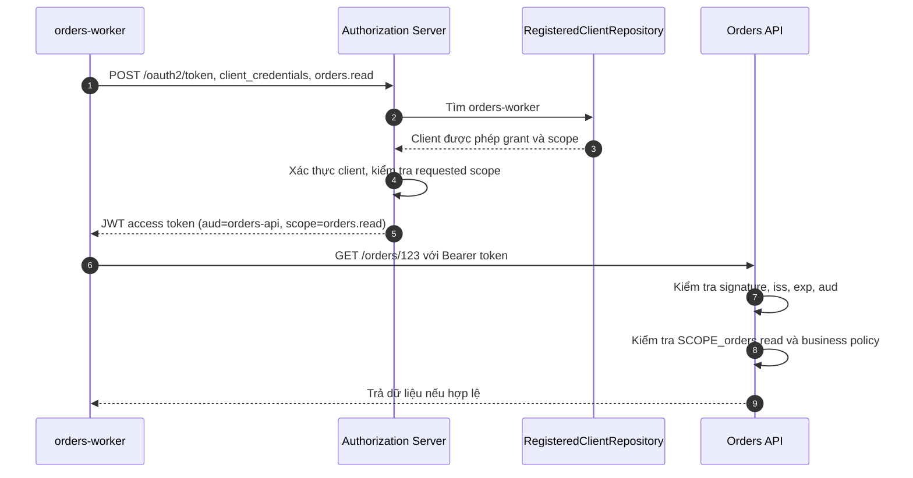
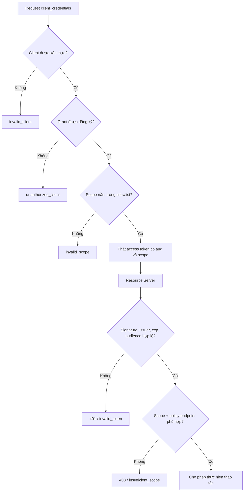
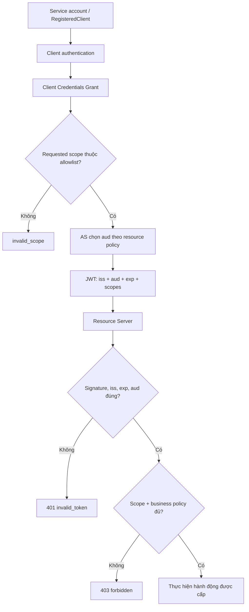

# Giới hạn scope, audience và quyền của từng service account

## 1. Bối cảnh và mục tiêu

Trong chương **Client Credentials** của module **SPRING_SECURITY_OAUTH2_OIDC_AUTHORIZATION_SERVER**, Authorization Server triển khai bằng **Spring Security**, **Spring Authorization Server (SAS)** và **Spring Boot** phải bảo đảm một ứng dụng máy-với-máy (machine-to-machine, M2M) chỉ nhận đúng quyền cần thiết và chỉ sử dụng token tại API được phép.

Bài học giúp bạn thiết kế, cấu hình, bảo mật, kiểm thử và vận hành OAuth 2.0/OpenID Connect Authorization Server với ba lớp ràng buộc:

1. **Client identity:** Service account nào được phép xác thực và dùng `client_credentials`?
2. **Scope:** Service đó được phép xin quyền thao tác nào, ví dụ `orders.read` hoặc `billing.reconcile`?
3. **Audience và authorization:** Token được phát hành cho **Resource Server nào**, và endpoint tại API đó có thật sự cho phép hành động được yêu cầu không?

Sau bài, bạn có thể đăng ký service accounts theo nguyên tắc **least privilege**, gắn `aud` có kiểm soát vào JWT access token, kiểm tra `iss`/`exp`/`aud`/scope ở Resource Server, phân biệt lỗi 401 và 403, thiết kế kiểm thử chống sử dụng token chéo API và vận hành vòng đời service credentials.

**Phạm vi phiên bản:** Ví dụ minh họa API thường gặp của **Spring Authorization Server 1.x / Spring Security 6.x / Spring Boot 3.x**. Ở những phiên bản khác, cần kiểm tra lại API/auto-configuration theo dependency thực tế. Bài dùng **JWT self-contained access token** để biểu diễn audience; opaque token sẽ cần chính sách tương đương qua introspection và Resource Server.

## 2. Service account không phải người dùng cuối

**Client Credentials Grant** (OAuth 2.0) dành cho OAuth2 client tự xác thực để xin access token dựa trên quyền được cấp cho **chính client**. Không có browser login, màn hình consent của resource owner, authorization code hay PKCE trong flow này.



| Thuật ngữ | Vai trò | Ví dụ | Điểm không được nhầm |
| --- | --- | --- | --- |
| `client_id` | Định danh OAuth2 client | `orders-worker` | Không phải secret hay tài khoản con người |
| Client credential | Bằng chứng để xác thực client | Client secret, private-key JWT, mTLS | Không phải access token gọi API |
| Service account | Danh tính được gán cho workload/job | Worker đồng bộ đơn hàng | Không đại diện người dùng cuối |
| `scope` | Năng lực được cấp trong access token | `orders.read` | Không định danh API đích |
| `aud` | API được dự kiến sử dụng token | `orders-api` | Không phải role hoặc client ID |
| `iss` | AS đáng tin đã phát token | `https://auth.example.com` | Không phải issuer do client tự chọn |
| `sub` | Chủ thể token theo token profile | Thường là client trong M2M | Không được suy thành end-user ID |
| Application role | Nhóm quyền nghiệp vụ nếu được định nghĩa | `order-exporter` | Không tự động là scope |

Nếu service cần truy cập API **thay mặt một người dùng**, đó là bài toán ủy quyền/delegation khác. Không tự thêm `user_id` do caller gửi vào token Client Credentials để biến nó thành quyền của người dùng.

## 3. Ba hàng rào bảo mật độc lập



**Tại Authorization Server**, `RegisteredClientRepository` và các provider kiểm tra client, grant, requested scope; token generator/customizer quyết định `aud` theo chính sách đáng tin.

**Tại Resource Server**, JWT decoder phải xác minh token có đúng issuer, chữ ký, thời hạn và audience; cơ chế authorization phải kiểm tra scope/role/tenant tương ứng. Một trong hai bên thiếu kiểm tra sẽ làm suy yếu toàn bộ hệ thống.

### 3.1. Vì sao scope không thay thế audience?

Nếu Orders API và Billing API cùng tin một AS, một JWT hợp lệ không có nghĩa nó được dùng trên **mọi** API. Scope `read` hoặc `orders.read` mô tả khả năng thao tác, nhưng không tự buộc Billing API phải từ chối token được phát riêng cho Orders API.

**Audience `aud`** thiết lập ranh giới token được phép gửi tới **tài nguyên nào**. **Scope** thiết lập ranh giới bên trong tài nguyên đó: được thực hiện **hành động gì**. Khi kết hợp, hai ràng buộc giúp giảm rủi ro sử dụng lại token ở API khác (*cross-resource replay*).

### 3.2. Registered scope, requested scope, granted scope

- **Registered scopes:** Tập tối đa client được phép xin, được lưu trong `RegisteredClient`.
- **Requested scopes:** Danh sách trong `scope` của token request, nếu client gửi.
- **Granted scopes:** Quyền AS thực sự cấp và đưa vào token theo grant/policy.

Không được cấp scope ngoài registered scopes. Trong một số cấu hình grant, nếu bỏ `scope`, AS có thể dùng toàn bộ tập scope client đã đăng ký; vì vậy **giới hạn registered scopes ngay từ đầu** là cần thiết, không chỉ dựa vào việc client tự yêu cầu ít quyền.

## 4. Thiết kế ma trận quyền theo workload

Ví dụ tổ chức có hai API độc lập và ba workload:

| Client/service account | Chức năng | Grant | Registered scopes | Audience |
| --- | --- | --- | --- | --- |
| `orders-worker` | Đọc đơn hàng để đồng bộ kho | `client_credentials` | `orders.read` | `orders-api` |
| `billing-reconciler` | Đối soát thanh toán | `client_credentials` | `billing.reconcile` | `billing-api` |
| `orders-cancel-job` | Hủy đơn hàng được duyệt | `client_credentials` | `orders.read`, `orders.cancel` | `orders-api` |

Tất cả tên chỉ là ví dụ. **Không** tạo một client chung `internal-client` có tất cả scopes và cấp cùng một secret cho nhiều nhóm phát triển: khi lộ secret, blast radius lớn, khó thu hồi riêng và khó audit actor thực tế.

Cách chia service account nên theo: chức năng nghiệp vụ, owner, môi trường triển khai, ranh giới vòng đời credential và yêu cầu audit. Nhiều replica của cùng một workload có thể dùng một danh tính workload nếu chính sách cho phép; không nhất thiết tạo một client mới cho mỗi HTTP request hoặc container.

### 4.1. Scope không thay quyền dữ liệu

Một token có `orders.read` không đương nhiên được đọc mọi đơn hàng trong mọi **tenant**, tổ chức hoặc khu vực. Resource Server còn cần thực thi business policy: tenant được gán, ownership, điều kiện trạng thái đơn hàng, giới hạn dữ liệu và phê duyệt nghiệp vụ.

Nếu đưa claim như `tenant_id` vào token, AS phải lấy giá trị từ nguồn có thẩm quyền; không chép trực tiếp `tenant_id` mà client tự gửi trong request. API cũng không chỉ tin tham số `tenantId` do caller truyền mà bỏ bước đối chiếu với policy.

## 5. Khai báo RegisteredClient tối thiểu trong SAS

Ví dụ Spring Boot dùng `client_secret_basic` cho local/lab, lưu secret dưới dạng hash qua `PasswordEncoder` và giới hạn grant/scopes. Production có thể cân nhắc `private_key_jwt` hoặc mTLS theo threat model.

```java
@Configuration(proxyBeanMethods = false)
public class MachineClientsConfig {

    @Bean
    PasswordEncoder passwordEncoder() {
        return PasswordEncoderFactories
                .createDelegatingPasswordEncoder();
    }

    @Bean
    RegisteredClientRepository registeredClientRepository(
            PasswordEncoder encoder,
            @Value("${ORDERS_WORKER_CLIENT_SECRET}") String ordersSecret,
            @Value("${BILLING_RECONCILER_CLIENT_SECRET}") String billingSecret) {

        RegisteredClient ordersWorker = RegisteredClient
                .withId("orders-worker-local-001")
                .clientId("orders-worker")
                .clientSecret(encoder.encode(ordersSecret))
                .clientAuthenticationMethod(
                        ClientAuthenticationMethod.CLIENT_SECRET_BASIC)
                .authorizationGrantType(
                        AuthorizationGrantType.CLIENT_CREDENTIALS)
                .scope("orders.read")
                .tokenSettings(TokenSettings.builder()
                        .accessTokenFormat(
                                OAuth2TokenFormat.SELF_CONTAINED)
                        .accessTokenTimeToLive(
                                Duration.ofMinutes(5))
                        .build())
                .build();

        RegisteredClient billing = RegisteredClient
                .withId("billing-reconciler-local-001")
                .clientId("billing-reconciler")
                .clientSecret(encoder.encode(billingSecret))
                .clientAuthenticationMethod(
                        ClientAuthenticationMethod.CLIENT_SECRET_BASIC)
                .authorizationGrantType(
                        AuthorizationGrantType.CLIENT_CREDENTIALS)
                .scope("billing.reconcile")
                .tokenSettings(TokenSettings.builder()
                        .accessTokenFormat(
                                OAuth2TokenFormat.SELF_CONTAINED)
                        .accessTokenTimeToLive(
                                Duration.ofMinutes(5))
                        .build())
                .build();

        return new InMemoryRegisteredClientRepository(
                ordersWorker, billing);
    }
}
```

**Ý nghĩa của cấu hình:**

1. `CLIENT_CREDENTIALS` là grant duy nhất được phép; không tự bật `authorization_code` hay `refresh_token` cho worker.
2. `scope(...)` tạo allowlist tối thiểu; `orders-worker` không thể xin `billing.reconcile` hoặc `orders.cancel`.
3. `SELF_CONTAINED` dùng JWT access token, phù hợp minh họa audience/JWKS và kiểm tra offline; cần signing key/JWKSource thực tế.
4. `accessTokenTimeToLive(5 phút)` là chính sách ví dụ; TTL nên cân đối nguy cơ lộ token, độ trễ và tần suất xin token.
5. `PasswordEncoder` chỉ thích hợp lưu secret cho phương thức Basic/POST; với `private_key_jwt` hoặc mTLS cần cơ chế xác minh theo public key/chứng thư.
6. `InMemoryRegisteredClientRepository` dùng cho lab. Production nên có persistence, onboarding, rotation và audit riêng.
7. Mỗi secret đến từ biến môi trường hoặc secret manager; không đưa plaintext vào Git, Docker image hoặc log.

Không mặc định tin rằng mọi phiên bản SAS tự dùng `@Bean PasswordEncoder` tùy chỉnh ở `ClientSecretAuthenticationProvider`; cần bảo đảm encoder dùng khi **ghi** hash tương thích encoder khi **matches**, đặc biệt nếu chọn định dạng khác mặc định.

## 6. Token request và giới hạn requested scopes

### 6.1. Trường hợp được cấp phép

```http
POST /oauth2/token HTTP/1.1
Host: auth.example.com
Authorization: Basic <BASE64_CLIENT_ID_AND_SECRET>
Content-Type: application/x-www-form-urlencoded

grant_type=client_credentials&scope=orders.read
```

Response minh họa, đã thay token thật bằng placeholder:

```http
HTTP/1.1 200 OK
Content-Type: application/json
Cache-Control: no-store
Pragma: no-cache

{
  "access_token": "<JWT_ACCESS_TOKEN>",
  "token_type": "Bearer",
  "expires_in": 300,
  "scope": "orders.read"
}
```

Client Credentials Grant bình thường **không có authorization code, PKCE, browser login, end-user consent hoặc OIDC ID token**. Theo OAuth 2.0, refresh token thường **không nên** được phát cho `client_credentials`; workload có thể xác thực lại để xin access token mới khi cần.

HTTP Basic chỉ **Base64-encode** credentials, không mã hóa bảo vệ bí mật. Khi truyền qua mạng thực, bắt buộc sử dụng **HTTPS/TLS**, đồng thời che header `Authorization` khỏi log.

### 6.2. Trường hợp xin quá quyền

`orders-worker` yêu cầu:

```http
POST /oauth2/token HTTP/1.1
Host: auth.example.com
Authorization: Basic <ORDERS_WORKER_CREDENTIALS>
Content-Type: application/x-www-form-urlencoded

grant_type=client_credentials&scope=orders.cancel
```

Do client không có scope `orders.cancel`, AS phải từ chối với `invalid_scope` hoặc lỗi phù hợp policy, **không** phát token với scope vượt quyền.

Lưu ý: Không bắt Resource Server phải tin rằng AS sẽ luôn cấu hình đúng. API vẫn kiểm tra token thực tế nhận được; nếu AS bị cấu hình sai hoặc bị thay đổi, API có thể chặn hành động mà token không được phép thực hiện.

## 7. Audience (`aud`) trong access token

**Audience** biểu thị một hoặc nhiều API/Resource Server mà JWT access token được phát hành để sử dụng. Ví dụ payload JWT:

```json
{
  "iss": "https://auth.example.com",
  "sub": "orders-worker",
  "aud": ["orders-api"],
  "scope": "orders.read",
  "iat": 1790000000,
  "exp": 1790000300
}
```

Đây là JSON minh họa, không phải token ký thật. `sub` trong M2M thường liên quan danh tính client nhưng cần kiểm tra profile phát hành. `iss` là issuer, `aud` là API đích, `scope` là quyền thao tác và `exp` là hạn dùng.

**Đừng giả định SAS luôn tự gắn đúng audience của API** khi chỉ khai báo registered scopes. Thường cần khai báo chính sách gắn `aud` ở token generation và validator phía Resource Server.

### 7.1. Đặt định danh audience nhất quán

Có thể dùng `orders-api` hoặc URI như `https://api.example.com/orders`. Điều quan trọng là:

- Được quản trị bởi hệ thống, ổn định và không mơ hồ.
- AS và Resource Server so khớp **chính xác giá trị đã thỏa thuận**.
- Client không thể tự chọn `aud=admin-api` chỉ bằng tham số tùy ý.
- Có phân vùng môi trường khi cần, tránh nhận chéo token staging/prod.
- Không tạo một audience `all-internal-services` rộng khắp nếu mục tiêu là tách API.

URI audience là một **định danh**; nó không nhất thiết là URL có thể fetch trực tiếp. Đừng lấy giá trị `Host` từ request chưa tin cậy để suy ra audience.

### 7.2. RFC 8707 và tham số `resource`

OAuth 2.0 Resource Indicators (RFC 8707) định nghĩa tham số `resource` để client biểu thị tài nguyên đích trong những flow được hỗ trợ. Tuy nhiên, **không được giả định SAS mặc định hiểu và xác thực mọi tham số `resource` chỉ vì đã bật `client_credentials`**.

Nếu cần một workload xin token cho nhiều API, hãy thiết kế cơ chế resource selection có **allowlist client → resource → scopes** và kiểm thử extension tương ứng với phiên bản SAS. Phương án dễ kiểm soát trong bài này là gán mỗi service account một audience đã được AS phê duyệt.

## 8. Gắn `aud` bằng `OAuth2TokenCustomizer<JwtEncodingContext>`

SAS cung cấp extension point để tùy biến claims của JWT. Với Client Credentials, có thể ánh xạ **client ID đã được xác thực** sang audience được phép.

```java
@Configuration(proxyBeanMethods = false)
public class MachineTokenCustomizerConfig {

    private static final Map<String, String> AUDIENCE_BY_CLIENT =
            Map.of(
                    "orders-worker", "orders-api",
                    "billing-reconciler", "billing-api");

    @Bean
    OAuth2TokenCustomizer<JwtEncodingContext> machineTokenCustomizer() {
        return context -> {
            if (!OAuth2TokenType.ACCESS_TOKEN.equals(
                    context.getTokenType())) {
                return;
            }

            if (!AuthorizationGrantType.CLIENT_CREDENTIALS.equals(
                    context.getAuthorizationGrantType())) {
                return;
            }

            String clientId = context.getRegisteredClient().getClientId();
            String audience = AUDIENCE_BY_CLIENT.get(clientId);

            if (audience == null) {
                // Fail closed: client M2M chưa có audience policy.
                throw new OAuth2AuthenticationException(
                        new OAuth2Error(
                                OAuth2ErrorCodes.UNAUTHORIZED_CLIENT));
            }

            context.getClaims().audience(List.of(audience));
            context.getClaims().claim("principal_type", "service");
        };
    }
}
```

**Lý do từng lựa chọn:**

- `OAuth2TokenType.ACCESS_TOKEN` bảo đảm không đổi `aud` của OIDC **ID token**, nơi audience là OIDC client.
- Kiểm tra `CLIENT_CREDENTIALS` tránh ảnh hưởng các grant khác nếu AS hỗ trợ nhiều luồng.
- `AUDIENCE_BY_CLIENT` là **policy phía server**; không chép giá trị audience từ HTTP request chưa được xác minh.
- Không có mapping thì từ chối phát token, thay vì silently cấp JWT không rõ đích.
- Claim `principal_type=service` chỉ là metadata minh họa; **không bao giờ** dùng riêng claim này để vượt kiểm tra scope/role.
- SAS vẫn phải kiểm tra requested scopes dựa trên `RegisteredClient`. Token customizer không được tự cấp scopes cao hơn.

Việc ném `OAuth2AuthenticationException` trong customizer là cách minh họa *fail closed*; hình thức lỗi HTTP/OAuth2 được framework chuyển đổi phụ thuộc phiên bản và vị trí tích hợp. Trong production nên kiểm tra policy ngay **khi onboarding client** và có integration test để bảo đảm lỗi nhất quán.

### 8.1. Không suy audience từ tên scope

Không nên thực hiện:

```java
// Anti-pattern: sao chép scope để đoán audience.
String audience = scope.split("\\.")[0] + "-api";
```

Tên scope là convention, không phải cơ chế kiểm soát tài nguyên. Nếu client có scope lạ hoặc prefix không nhất quán, audience suy ra có thể sai hoặc quá rộng. Dùng **allowlist tường minh**, có phê duyệt và kiểm thử.

### 8.2. Workload gọi hai API: lựa chọn thế nào?

| Trường hợp | Thiết kế nên cân nhắc |
| --- | --- |
| Service chỉ gọi Orders API | Một token với `aud=["orders-api"]` và scope orders tối thiểu |
| Service chỉ gọi Billing API | Một token với `aud=["billing-api"]` và scope billing tối thiểu |
| Service cần cả hai API | Token riêng cho từng resource qua cơ chế đã kiểm soát, hoặc tách thành hai client registrations |
| API tự gọi downstream API B | Thiết kế delegation/token exchange nếu cần, không forward bừa token dành cho API A |

Không tạo token `aud=["orders-api","billing-api"]` cho mọi request của workload chỉ vì “tiện”. Nhiều audience chỉ phù hợp khi được thiết kế rõ theo threat model, client policy và use case; có thể làm rộng phạm vi bị ảnh hưởng khi token lộ.

## 9. Resource Server phải tự kiểm tra audience

Việc AS gắn `aud` không tự khiến Orders API từ chối token dành cho Billing API. Resource Server phải xác minh **signature, issuer, thời hạn, audience và scope** trước khi phục vụ request.

### 9.1. Ví dụ JwtDecoder ở Orders API

Trong Spring Boot Resource Server, đặt cấu hình riêng cho API:

```yaml
security:
  issuer-uri: https://auth.example.com
  jwk-set-uri: https://auth.example.com/oauth2/jwks
  required-audience: orders-api
```

Cấu hình Spring Security:

```java
@Configuration(proxyBeanMethods = false)
public class OrdersResourceServerConfig {

    @Bean
    JwtDecoder jwtDecoder(
            @Value("${security.issuer-uri}") String issuer,
            @Value("${security.jwk-set-uri}") String jwksUri,
            @Value("${security.required-audience}") String expectedAudience) {

        NimbusJwtDecoder decoder =
                NimbusJwtDecoder.withJwkSetUri(jwksUri).build();

        OAuth2TokenValidator<Jwt> defaults =
                JwtValidators.createDefaultWithIssuer(issuer);

        OAuth2TokenValidator<Jwt> audience =
                new JwtClaimValidator<List<String>>(
                        JwtClaimNames.AUD,
                        actual -> actual != null
                                && actual.contains(expectedAudience));

        decoder.setJwtValidator(
                new DelegatingOAuth2TokenValidator<>(
                        defaults, audience));

        return decoder;
    }

    @Bean
    SecurityFilterChain apiSecurity(HttpSecurity http)
            throws Exception {

        http
            .authorizeHttpRequests(authorize -> authorize
                    .requestMatchers(HttpMethod.GET, "/orders/**")
                    .hasAuthority("SCOPE_orders.read")
                    .anyRequest().denyAll())
            .oauth2ResourceServer(oauth2 ->
                    oauth2.jwt(Customizer.withDefaults()))
            .sessionManagement(session ->
                    session.sessionCreationPolicy(
                            SessionCreationPolicy.STATELESS));

        return http.build();
    }
}
```

Trong ví dụ:

1. `NimbusJwtDecoder` lấy public key từ JWKS URI được tin cậy để xác minh chữ ký.
2. `JwtValidators.createDefaultWithIssuer` kiểm tra issuer và các điều kiện chuẩn (như timestamp) theo phiên bản Spring Security.
3. `JwtClaimValidator` yêu cầu claim `aud` **chứa `orders-api`**; token không có audience hoặc chỉ có `billing-api` sẽ bị từ chối.
4. `hasAuthority("SCOPE_orders.read")` yêu cầu quyền đọc khi gọi `GET /orders/**`. Spring Security thường ánh xạ claim `scope`/`scp` thành authorities có tiền tố `SCOPE_`; nếu custom converter, phải kiểm tra mapping thực tế.
5. `anyRequest().denyAll()` minh họa mặc định từ chối; ứng dụng thực cần cấu hình thêm endpoints phù hợp (health/operations) theo policy.
6. `STATELESS` phù hợp API chỉ nhận Bearer access token. Với ứng dụng cũng dùng cookie/session browser phải thiết kế CSRF và filter chains riêng; không tắt CSRF toàn cục theo quán tính.

**Vẫn cần kiểm tra business policy** tại controller/service nếu quyền truy cập phụ thuộc tenant, owner, trạng thái đơn hàng hoặc nghiệp vụ; scope chỉ là một tầng bảo vệ.

### 9.2. Phân biệt 401 và 403

| Token/request | Kết quả thường gặp | Nguyên nhân |
| --- | --- | --- |
| Không có Bearer token | `401 Unauthorized` | Chưa có authentication |
| JWT sai chữ ký hoặc issuer | `401` / `invalid_token` | Token không hợp lệ |
| JWT hết hạn | `401` / `invalid_token` | Token đã hết hiệu lực |
| JWT với `aud=["billing-api"]` gửi Orders API | `401` / token validation failure | Token không dành cho API |
| JWT đúng `aud=["orders-api"]` nhưng thiếu `orders.read` | `403 Forbidden` | Token hợp lệ nhưng không đủ quyền |
| JWT có scope nhưng không thuộc tenant được phép | `403` hoặc lỗi truy cập tương đương | Quyền dữ liệu không phù hợp |

Mã HTTP và header chi tiết phụ thuộc `AuthenticationEntryPoint`/`AccessDeniedHandler` và cấu hình framework. Dù vậy, cần phân biệt **authentication không hợp lệ** với **authorization không đủ** để vận hành, quan sát và phản ứng đúng.

## 10. Chống token replay giữa các API

Một token được cấp cho Orders API:

```json
{
  "iss": "https://auth.example.com",
  "sub": "orders-worker",
  "aud": ["orders-api"],
  "scope": "orders.read"
}
```

Nếu token bị gửi sang Billing API:

```http
GET /billing/transactions HTTP/1.1
Host: billing.example.com
Authorization: Bearer <ORDERS_ACCESS_TOKEN>
```

Billing API **phải từ chối**, dù hai API cùng tin chữ ký của Authorization Server và token chưa hết hạn. Rủi ro khi không kiểm tra `aud` là token được cấp cho tài nguyên A bị lạm dụng ở tài nguyên B (*cross-resource token replay*).

**Không xem `client_id` hoặc `sub` là audience.** Chúng mô tả actor/subject, không chỉ đích đến của token. Cũng không nhận **OIDC ID token** như access token tại API.

### 10.1. Scope → authority → quyền endpoint

```text
access token scope: "orders.read"
              |
              v
Spring GrantedAuthority: "SCOPE_orders.read"
              |
              v
GET /orders/{id}: hasAuthority("SCOPE_orders.read")
              |
              v
Business policy: tenant/ownership/data restriction
```

Ma trận quyền ví dụ:

| Endpoint | Audience bắt buộc | Scope cần thiết |
| --- | --- | --- |
| `GET /orders/{id}` | `orders-api` | `orders.read` |
| `POST /orders/{id}/cancel` | `orders-api` | `orders.cancel` |
| `GET /billing/summary` | `billing-api` | `billing.summary.read` |
| `POST /billing/reconcile` | `billing-api` | `billing.reconcile` |

Với một thao tác nhạy cảm, có thể yêu cầu thêm client allowlist theo danh tính đã xác thực trong token. Không dùng header tự khai `X-Client-Id` để cấp quyền mà không kiểm tra token.

### 10.2. “Admin scope” là anti-pattern thường gặp

Một service chỉ cần đọc đơn hàng không nên có `admin` hoặc `orders.*` chỉ để giảm công sức đăng ký. Nên định nghĩa scope theo hành động thật, ví dụ `orders.read`, `orders.cancel` và `billing.reconcile`; bổ sung scope mới qua quy trình phê duyệt cùng bài test mới.

## 11. Thực hành kiểm thử local

Giả sử AS chạy tại `http://localhost:9000` (chỉ lab loopback) và đã có signing key/JWKSource phù hợp. Trên Windows PowerShell:

```powershell
curl.exe --user orders-worker --data-urlencode "grant_type=client_credentials" --data-urlencode "scope=orders.read" http://localhost:9000/oauth2/token
```

Với `--user orders-worker`, `curl.exe` sẽ yêu cầu nhập secret qua prompt nếu chưa có password, tránh hard-code raw secret trong command line. Token response vẫn là thông tin nhạy cảm; không đưa output này vào log hoặc kênh chat chia sẻ. Khi ra môi trường không phải loopback, bắt buộc HTTPS.

Sau khi có JWT trong môi trường test, xác minh claim `aud` là `orders-api`. Gọi Orders API bằng Bearer token và quan sát quyền GET; sau đó thử gọi Billing API bằng cùng token và kỳ vọng bị từ chối.

### 11.1. Ma trận kiểm thử bắt buộc

| Case | Kết quả ở AS | Kết quả ở Orders API | Kết quả ở Billing API |
| --- | --- | --- | --- |
| `orders-worker` xin `orders.read` | Cấp token `aud=orders-api` | Cho GET khi các kiểm tra đúng | Từ chối sai audience |
| `orders-worker` xin `orders.cancel` | `invalid_scope` | Không có token mới | Không có token mới |
| `orders-worker` xin `billing.reconcile` | `invalid_scope` | Không có token mới | Không có token mới |
| `billing-reconciler` xin `billing.reconcile` | Cấp token `aud=billing-api` | Từ chối sai audience | Cho reconcile theo policy |
| Sai client secret | `invalid_client` | Không có token mới | Không có token mới |
| Client không có `client_credentials` | Từ chối grant/client | Không có token mới | Không có token mới |
| JWT không có `aud` | Token issuance có thể sai policy | Từ chối | Từ chối |
| JWT `aud=["billing-api"]` ở Orders API | Không liên quan phát token | `401`/invalid token | Chấp nhận nếu có quyền |
| JWT hết hạn | Đã phát trước đó | `401` | `401` |
| JWT bị sửa payload | Không liên quan phát token | Từ chối chữ ký | Từ chối chữ ký |
| JWT đúng audience nhưng thiếu scope | Không nhất thiết là lỗi phát token | `403` ở endpoint cần scope | Theo policy riêng |
| Token từ issuer lạ | Không thuộc AS được tin | Từ chối | Từ chối |
| Tenant ngoài quyền | Token có thể hợp lệ | `403`/deny ở business layer | Theo policy riêng |

**Đặc biệt quan trọng:** MockMvc `jwt()` trong Spring Security Test có thể tạo sẵn `Authentication` và **bỏ qua chữ ký/decoder**, nên test mock authority **không chứng minh** audience validation hoạt động. Cần thêm integration test với JWT có chữ ký được xác minh bởi `JwtDecoder` thật hoặc test decoder/validator trực tiếp.

### 11.2. Test audience validator

Các case tối thiểu:

- `aud=["orders-api"]` → pass nếu issuer, signature và thời hạn cũng hợp lệ.
- `aud=["billing-api"]` → fail ở Orders API.
- `aud=[]` hoặc thiếu `aud` → fail.
- Token có `iss` khác cấu hình → fail.
- Token hết hạn hoặc `nbf` chưa tới → fail theo validator.
- Token đúng scope nhưng aud sai → fail **trước khi** xét endpoint scope.
- Token đúng audience nhưng thiếu `orders.read` → không truy cập `GET /orders/**`.
- Token đúng audience/scope nhưng tenant không thuộc quyền → bị chặn bởi policy nghiệp vụ.

### 11.3. Test ở môi trường nhiều instance

Kiểm tra AS instance A và B:

1. Cả hai phát cùng issuer, audience policy và các claim phù hợp.
2. Signing keys/JWKS nhất quán, có kế hoạch rotation với `kid` mới.
3. Sau cập nhật registered scopes, token mới phản ánh quyền mới; token cũ được xử lý theo TTL/revocation policy.
4. Resource Server không có cấu hình kiểm tra audience khác nhau giữa các replica.
5. Khi policy mapping thiếu, không có đường fallback cấp token audience quá rộng.

## 12. Vận hành service accounts an toàn

Một service account cần có owner, workload, mục đích, audiences, registered scopes, authentication method, thời hạn/rotation credential và chính sách tắt quyền.

**Giảm phạm vi bị ảnh hưởng khi lộ credential:**

- `orders-worker` chỉ xin được `orders.read`.
- Token chỉ dành cho `orders-api`.
- TTL ngắn (ví dụ năm phút) để giới hạn thời gian khai thác token.
- API chỉ cho phép dữ liệu/tác vụ được phê duyệt.
- Có rate limit, giám sát lỗi `invalid_client`/`invalid_scope` và hành vi bất thường.
- Client credential được bảo vệ ở secret manager; không ở source/image/log.

### 12.1. Rotation và offboarding

Một quy trình hợp lý:

1. Xác định owner và workload của credential sắp hết hạn/bị lộ.
2. Sinh secret hoặc khóa mới và cập nhật hệ thống quản lý bí mật.
3. Thay đổi registered client theo policy, kiểm thử token issuance.
4. Chuyển các instance của workload sang credential mới.
5. Thu hồi credential cũ và giám sát lỗi `invalid_client`.
6. Đánh giá token đã phát hành: với JWT kiểm tra offline, thay secret **không tự thu hồi** access token còn hạn.

Nếu yêu cầu thu hồi gần tức thời, cân nhắc access token TTL ngắn, introspection, denylist hoặc cơ chế propagation theo threat model. Không giả định cập nhật `RegisteredClient` tự khiến mọi Resource Server từ chối JWT cũ.

### 12.2. Tách môi trường

Không tái sử dụng secret sản xuất ở dev/staging. Nên có client IDs/issuer/audience và policy tách biệt theo môi trường khi rủi ro đòi hỏi; tuyệt đối không để Resource Server production tin nhầm issuer test hoặc cho phép audience chung vô ý.

## 13. Những lỗi thường gặp

| Triệu chứng | Nguyên nhân khả dĩ | Cách xử lý |
| --- | --- | --- |
| `invalid_client` khi xin token | Secret sai, phương thức xác thực không được đăng ký hoặc encoder không tương thích | Kiểm tra RegisteredClient/auth provider/credential lifecycle, không log secret |
| `unauthorized_client` | Client chưa được cấp `client_credentials` | Bổ sung grant chỉ sau phê duyệt |
| `invalid_scope` | Requested scope vượt registered scopes | Giảm quyền request hoặc xét duyệt thay policy |
| Token có scope đúng nhưng API trả 401 | Audience, issuer, chữ ký hoặc expiry không hợp lệ | Kiểm tra JwtDecoder, JWKS, `aud` và `iss` |
| Token có aud đúng nhưng API trả 403 | Thiếu scope hoặc business policy không cho phép | Kiểm tra authority `SCOPE_*` và tenant/ownership |
| Token được chấp nhận ở nhiều API ngoài dự kiến | API bỏ kiểm tra audience hoặc AS gắn audience quá rộng | Thêm validator audience tường minh |
| Token không có `aud` | Token customizer không chạy hoặc format không phải JWT | Kiểm tra `OAuth2TokenCustomizer`, token type và wiring |
| Client xin token mà không gửi `scope` vẫn có quyền | AS cấp registered scopes theo policy mặc định | Thu hẹp registered scopes, xác minh default policy |
| API coi `sub` là user cuối | Nhầm subject M2M với user authentication | Phân biệt service principal và end-user principal |
| API nhận ID token thay access token | Nhầm OIDC ID token với Bearer API credential | Kiểm tra token type/profile/audience |
| Đổi secret nhưng API vẫn chấp nhận token cũ | JWT offline vẫn còn hạn | Xác định TTL/revocation strategy |
| Client gọi Token Endpoint liên tục | Không cache token theo TTL hoặc retry vô hạn | Cache có bảo vệ, retry/backoff và rate limit |
| Multi-instance phát audience không giống nhau | Mapping client–audience không đồng bộ | Version hóa policy và rollout/test nhất quán |

## 14. Checklist nghiệm thu

- [ ] Mỗi workload có service account với owner và mục đích rõ ràng, không chia sẻ credential tùy tiện.
- [ ] Registered client chỉ có `client_credentials` và những scope thực sự cần.
- [ ] Requested scope vượt allowlist bị từ chối; test `invalid_scope`.
- [ ] JWT access token gắn `aud` theo policy đáng tin của AS, không lấy từ request chưa xác minh.
- [ ] API kiểm tra signature, issuer, expiration, audience và scope.
- [ ] Cross-resource token replay bị từ chối ngay cả khi token được AS đáng tin ký.
- [ ] Scope được map vào endpoint policy và kiểm tra thêm tenant/ownership khi cần.
- [ ] Không dùng `sub` của M2M như user ID, không dùng ID token để gọi API.
- [ ] TTL access token phù hợp; không mặc nhiên cấp refresh token cho Client Credentials.
- [ ] Credential được sinh, lưu, phân phối và rotate an toàn; không log raw secret/token.
- [ ] Dev/staging/prod không dùng nhầm client credential, issuer hoặc audience.
- [ ] Đã kiểm thử invalid_client, invalid_scope, sai audience, thiếu scope, sai issuer, token expired, tenant denial.
- [ ] Đã kiểm tra policy đồng nhất giữa mọi AS instance và Resource Server replica.
- [ ] Có theo dõi token issuance, lỗi client authentication, latency và sự kiện rotation không kèm thông tin nhạy cảm.

## 15. Tổng kết kiến trúc



**Least privilege trong Client Credentials là hợp đồng hai chiều giữa Authorization Server và Resource Server.** Authorization Server xác thực workload, giới hạn scopes và chọn audience theo policy; Resource Server tự xác minh token dành cho mình và thực thi quyền theo endpoint/dữ liệu. Khi mỗi service account có credential riêng, token có audience hẹp, TTL phù hợp và các API không nhận token chéo, Spring Security OAuth2/OIDC Authorization Server mới bảo vệ đúng ranh giới máy-với-máy ở môi trường vận hành.
