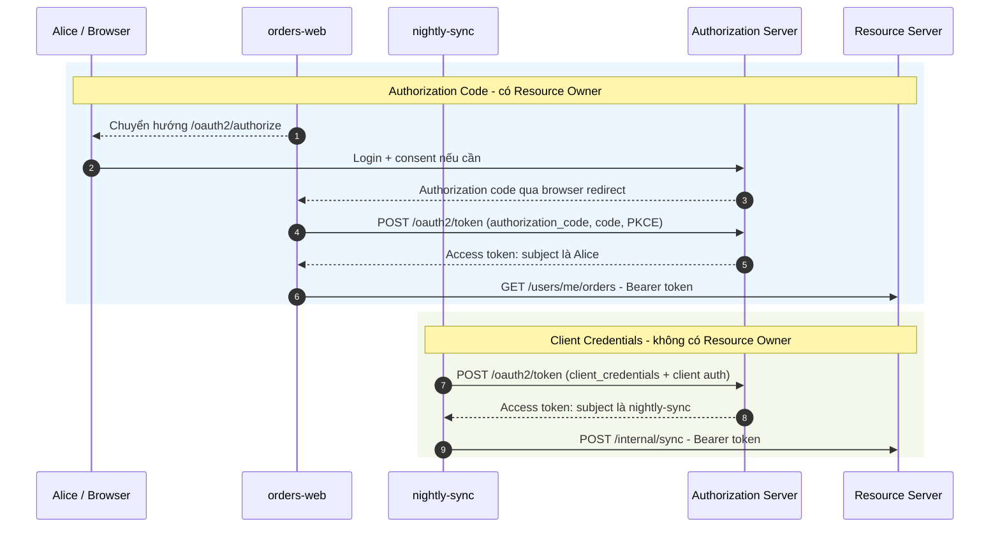

# Phân biệt subject là client với subject là người dùng

## 1. Bài toán: `sub` có luôn là ID của người dùng?

Trong chương **Client Credentials** của mô-đun **SPRING_SECURITY_OAUTH2_OIDC_AUTHORIZATION_SERVER**, chúng ta học cách thiết kế, cấu hình, bảo mật, kiểm thử và vận hành OAuth 2.0/OpenID Connect Authorization Server bằng **Spring Security**, **Spring Authorization Server** và **Spring Boot**.

Một trong những lỗi phân quyền nguy hiểm nhất là xem giá trị `sub` (*subject*) trong mọi access token là **ID người dùng**. Điều đó chỉ đúng khi token được phát hành trong ngữ cảnh phù hợp, chẳng hạn Authorization Code Flow mà người dùng đã đăng nhập. Với **Client Credentials Grant**, client lấy token **nhân danh chính ứng dụng**, không có Resource Owner (người dùng cuối) tham gia.

Ví dụ:

- Một web app `orders-web` giúp Alice xem đơn hàng. Token phát hành bằng `authorization_code` có subject biểu diễn **Alice**; token cũng cần nhận diện ứng dụng `orders-web` đã xin quyền.
- Một tác vụ nền `nightly-sync` tự động đồng bộ tồn kho. Token phát hành bằng `client_credentials` có subject biểu diễn **nightly-sync** hoặc định danh máy/ứng dụng do Authorization Server quản lý. Nó **không chứng minh Alice, Bob hay bất cứ người dùng nào đã đăng nhập**.

Nếu API xử lý cả hai token bằng mã như `findUserById(jwt.getSubject())`, token của service có thể bị hiểu nhầm là một tài khoản người dùng. Khi định danh client trùng tên user có quyền cao, hệ quả còn có thể là **nhầm lẫn danh tính và leo thang đặc quyền**.

### Kết quả cần đạt

Sau bài học, bạn có thể:

1. Giải thích `sub`, `client_id`, principal, Resource Owner và grant type trong hai luồng.
2. Phân biệt token đại diện ứng dụng với token phát sinh khi người dùng cấp quyền.
3. Hiểu cách Spring Authorization Server lưu principal và tùy biến claim access token.
4. Kiểm tra loại subject an toàn ở Spring Security Resource Server, ngoài việc kiểm tra chữ ký và scope.
5. Thiết kế API machine-to-machine (M2M) và API theo người dùng với chính sách riêng.
6. Viết kiểm thử ngăn service token giả danh người dùng, kể cả khi `sub` trùng tên.

## 2. Hiểu đúng `subject` và các danh tính liên quan

**Subject** là thực thể mà token đề cập đến. Với JWT, giá trị của claim `sub` phải được hiểu theo **issuer**, **loại token**, **ngữ cảnh cấp quyền** và hợp đồng giữa Authorization Server với Resource Server. Một chuỗi `"alice"` hoặc `"nightly-sync"` tự nó không chứng minh đó là user hay client.

| Thuộc tính | Câu hỏi được trả lời | Ví dụ |
| --- | --- | --- |
| `iss` (*issuer*) | Ai phát hành token và định nghĩa không gian định danh subject? | `https://auth.example.com` |
| `sub` (*subject*) | Thực thể chính mà token nói đến là ai/cái gì? | `user-1042` hoặc `nightly-sync` |
| `client_id` | Ứng dụng OAuth nào đã được xác định khi nhận token? | `orders-web`, `nightly-sync` |
| `aud` (*audience*) | Token được phát hành cho Resource Server nào? | `orders-api` hoặc `internal-sync-api` |
| `scope` | Token được cấp những phạm vi truy cập nào? | `orders.read`, `inventory.sync` |
| `exp`, `nbf`, `iat` | Token được sử dụng trong khoảng thời gian nào? | Các mốc Unix time |
| Grant type | Token được cấp bằng cơ chế nào? | `authorization_code`, `client_credentials` |
| Principal của Spring Security | Authentication hiện được hệ thống xử lý đại diện cho ai? | `JwtAuthenticationToken` tại API; principal đăng nhập hoặc client ở Authorization Server |

**Chú ý:** `grant_type` là tham số của request OAuth 2.0 tại token endpoint; **không phải claim chuẩn bắt buộc trong mọi JWT access token**. Nếu Resource Server cần phân biệt theo grant, Authorization Server phải cung cấp một tín hiệu đáng tin cậy theo hợp đồng đã thống nhất, ví dụ claim nội bộ `principal_type` hoặc `authorization_grant_type`, và Resource Server phải xác minh token trước khi sử dụng tín hiệu đó.

### Các từ dễ bị hiểu sai

- **Client**: ứng dụng truy cập tài nguyên, thường được nhận diện qua `client_id`.
- **Resource Owner**: chủ thể có quyền cho phép truy cập tài nguyên, thường là người dùng.
- **Principal**: thực thể đã được xác thực trong một bước xử lý; nó có thể là client hoặc người dùng tùy endpoint/grant.
- **Subject**: đối tượng mà claim `sub` định danh trong token cụ thể.
- **Actor (bên thực thi)**: ứng dụng/đại diện đang thực hiện hành động. Trong hệ thống ủy quyền nhiều tầng, actor và subject có thể khác nhau và cần mô hình riêng.

Đừng suy ra rằng vì token được trình bày bởi một ứng dụng thì `sub` phải là client; cũng đừng suy ra vì API phục vụ dữ liệu người dùng thì token luôn có user subject.

## 3. So sánh Authorization Code với Client Credentials

| Tiêu chí | Authorization Code Flow | Client Credentials Flow |
| --- | --- | --- |
| Mục tiêu điển hình | Client truy cập tài nguyên **thay mặt người dùng đã ủy quyền** | Ứng dụng truy cập tài nguyên **nhân danh chính ứng dụng** |
| Có Resource Owner tương tác? | Có trong quy trình cấp quyền thông thường | **Không** |
| Authorization request qua trình duyệt? | Có, với `response_type=code` | Không |
| Token request | `grant_type=authorization_code` và `code` | `grant_type=client_credentials` |
| Xác thực client | Tùy loại client đã đăng ký; confidential client xác thực, public client dùng PKCE | Client cần được xác thực; grant này dùng cho confidential client |
| PKCE | Dùng để ràng buộc authorization code | Không có code để dùng PKCE |
| Consent người dùng | Có thể cần theo cấu hình/chính sách | Không có màn hình consent của người dùng cuối |
| Ý nghĩa `sub` của access token | Thường là định danh người dùng, theo quy tắc issuer | Thường là định danh ứng dụng/client, theo quy tắc issuer |
| `client_id` | Định danh ứng dụng nhận quyền | Định danh ứng dụng được xác thực và nhận quyền |
| Quyền trong API | Quyền đã cấp cho user/client trong authorization | Quyền dành cho ứng dụng/dịch vụ |
| ID Token OIDC | Có thể có khi yêu cầu OIDC hợp lệ | Không phải luồng đăng nhập OIDC của người dùng |
| Refresh token | Có thể cấp theo chính sách và kiểu client | Theo RFC 6749, **không nên** cấp refresh token trong grant này |

### Sơ đồ hai luồng



**Điểm quan trọng:** API chỉ nên chấp nhận token cho đúng **audience**, đúng **loại principal** và đủ **quyền thực tế**. Một token của `nightly-sync` có thể hợp lệ về chữ ký và thời hạn nhưng vẫn phải bị từ chối tại endpoint yêu cầu người dùng đã đăng nhập.

## 4. RFC 9068 hướng dẫn diễn giải subject như thế nào?

**RFC 9068** định nghĩa một profile JWT access token OAuth 2.0 để các Authorization Server và Resource Server có thể thống nhất cấu trúc token.

Theo profile này:

- Token được cấp từ grant **có Resource Owner**, ví dụ `authorization_code`: `sub` **SHOULD** tương ứng định danh subject của Resource Owner.
- Token được cấp từ grant **không có Resource Owner**, ví dụ `client_credentials`: `sub` **SHOULD** tương ứng định danh mà Authorization Server dùng để chỉ **ứng dụng client**.
- Claim `client_id` là **REQUIRED** trong access token theo profile, để nhận diện client OAuth liên quan.
- `iss`, `aud`, `exp`, `iat`, `jti` cùng các yêu cầu bảo vệ JWT khác thuộc profile; Resource Server cần kiểm tra chúng theo quy tắc áp dụng.

Từ **SHOULD** trong RFC là khuyến nghị chuẩn có lý do; nó không có nghĩa mọi sản phẩm đều dùng chính xác chuỗi `client_id` làm `sub`. Authorization Server có thể chọn định danh client ổn định khác, miễn là được định nghĩa và kiểm chứng rõ ràng.

**Không đánh đồng mọi JWT access token của Spring Authorization Server với token đã tuân thủ đầy đủ RFC 9068.** Framework có thể tạo JWT tự chứa với các claim và header mặc định/đã tùy biến; muốn tuyên bố hỗ trợ profile RFC 9068 phải kiểm tra **toàn bộ** điều kiện về claims, header `typ=at+jwt`, audience, validation và các quy tắc giao thức, không chỉ thêm `client_id`.

### Hai token minh họa

Token A: client `orders-web` thực hiện Authorization Code Flow cho Alice:

```json
{
  "iss": "https://auth.example.com",
  "sub": "user-1042",
  "client_id": "orders-web",
  "aud": ["orders-api"],
  "scope": "orders.read",
  "exp": 1800000000,
  "principal_type": "user"
}
```

Token B: service `nightly-sync` thực hiện Client Credentials Flow:

```json
{
  "iss": "https://auth.example.com",
  "sub": "nightly-sync",
  "client_id": "nightly-sync",
  "aud": ["internal-sync-api"],
  "scope": "inventory.sync",
  "exp": 1800000000,
  "principal_type": "client"
}
```

Đây là **payload rút gọn và mang tính minh họa**: `principal_type` là **claim nội bộ tự định nghĩa**, không phải claim bắt buộc của RFC 9068. Thực tế token còn có header, chữ ký và có thể có claim khác. Các giá trị `exp` chỉ nhằm mô phỏng định dạng và không được sử dụng như token thật.

Ở token A, `sub` và `client_id` **khác nhau** vì Alice là subject, còn `orders-web` là client đã xin quyền. Ở token B, hai giá trị **có thể trùng nhau** vì subject được chọn là client; sự trùng nhau này **không phải phép kiểm tra chuẩn để xác định loại principal**.

### Vấn đề va chạm định danh (subject collision)

Giả sử một người dùng quản trị có `sub=admin` và Authorization Server cho khách đăng ký client với `client_id=admin`. Nếu service token cũng có `sub=admin`, Resource Server chỉ dựa vào `sub` có thể hiểu lầm ứng dụng là quản trị viên. RFC 9068 cảnh báo chính xác nhóm rủi ro này.

Giải pháp kiến trúc:

1. Kiểm soát namespace và phê duyệt `client_id` khi đăng ký, không cho client tự chọn tên mạo danh subject người dùng đặc quyền.
2. Dùng **định danh ổn định, riêng biệt** giữa user và client, ví dụ `usr:1042` và `svc:nightly-sync` nếu hệ sinh thái quy ước như vậy.
3. Định nghĩa claim loại subject đáng tin như `principal_type` ở issuer, không cho client truyền tùy ý qua token request.
4. Resource Server kiểm tra grant/loại subject theo chính sách endpoint **sau khi** xác minh token.
5. Khi dùng nhiều issuer hoặc nhiều tenant, kiểm tra cặp `(iss, sub)` và tenant/namespace theo hợp đồng, không so sánh `sub` độc lập.

## 5. Client Credentials: xác thực ứng dụng, không đăng nhập người dùng

Một client backend tên `nightly-sync` đã được đăng ký với:

- `client_id=nightly-sync`;
- phương thức xác thực `client_secret_basic`;
- grant được phép `client_credentials`;
- scope được phép `inventory.sync`.

Để lấy access token, nó gọi token endpoint qua HTTPS:

```http
POST /oauth2/token HTTP/1.1
Host: auth.example.com
Authorization: Basic <base64-encoded-client-credentials>
Content-Type: application/x-www-form-urlencoded

grant_type=client_credentials&scope=inventory.sync
```

Các giá trị trong dấu góc ở ví dụ là placeholder. Trong yêu cầu thật, client dùng HTTP Basic theo quy tắc mã hóa thông tin xác thực OAuth 2.0 và **không ghi secret vào URL/log**.

Authorization Server thực hiện:

1. Tra cứu `RegisteredClient` từ thông tin xác thực được gửi.
2. Xác thực client theo phương thức đã đăng ký và kiểm tra trạng thái/expiry của credential.
3. Kiểm tra client được phép `AuthorizationGrantType.CLIENT_CREDENTIALS`.
4. Kiểm tra các scope request có hợp lệ và được phép theo registration/chính sách.
5. Tạo `OAuth2Authorization` với principal là **client**, và phát access token đại diện ứng dụng.

Một response minh họa:

```http
HTTP/1.1 200 OK
Content-Type: application/json
Cache-Control: no-store
Pragma: no-cache

{
  "access_token": "ACCESS_TOKEN_VALUE",
  "token_type": "Bearer",
  "expires_in": 300,
  "scope": "inventory.sync"
}
```

Trong Client Credentials Flow chuẩn, **không cần** `/oauth2/authorize`, `authorization_code`, `state`, PKCE, trang đăng nhập người dùng hoặc màn hình consent end user. Token được phát hành cho client được xác thực, vì vậy API tuyệt đối không được diễn giải nó như chứng cứ “Alice vừa đăng nhập”.

### Khác biệt với Authorization Code Flow

Một ứng dụng web muốn đọc hóa đơn của Alice cần tương tác với người dùng:

```http
GET /oauth2/authorize?response_type=code&client_id=orders-web&redirect_uri=https%3A%2F%2Forders.example.com%2Fcallback&scope=orders.read&state=CLIENT_STATE&code_challenge=PKCE_CHALLENGE&code_challenge_method=S256 HTTP/1.1
Host: auth.example.com
```

Sau login/consent hợp lệ và callback có code, client đổi code:

```http
POST /oauth2/token HTTP/1.1
Host: auth.example.com
Authorization: Basic <base64-encoded-web-client-credentials>
Content-Type: application/x-www-form-urlencoded

grant_type=authorization_code&code=CODE_VALUE&redirect_uri=https%3A%2F%2Forders.example.com%2Fcallback&code_verifier=PKCE_VERIFIER
```

Token kết quả được cấp trong **ngữ cảnh user Alice**; nó vẫn liên quan đến client `orders-web` nhưng `client_id` không thay thế `sub` của người dùng. Nếu triển khai OIDC, ID Token chứa subject danh tính người dùng cho **Relying Party**; ID Token không phải access token để gọi API.

## 6. Spring Authorization Server lưu principal như thế nào?

Spring Authorization Server dùng `RegisteredClient`, `OAuth2Authorization` và `OAuth2TokenContext` để xử lý từng grant. Các lớp/thuộc tính liên quan:

| Thành phần | Vai trò | Điểm cần nhớ |
| --- | --- | --- |
| `RegisteredClient.clientId` | Định danh client công khai | Không phải ID người dùng |
| `RegisteredClient.id` | ID nội bộ của client registration | Không đồng nhất với `clientId` |
| `OAuth2Authorization.principalName` | Tên principal của Resource Owner **hoặc client** | Phải diễn giải cùng `authorizationGrantType` |
| `OAuth2Authorization.authorizationGrantType` | Cơ chế tạo authorization | `CLIENT_CREDENTIALS` hoặc `AUTHORIZATION_CODE` |
| `OAuth2Authorization.authorizedScopes` | Scope được cấp trong authorization | Không tương đương nhóm quyền của user |
| `JwtEncodingContext.getPrincipal()` | Authentication của Resource Owner **hoặc client** trong quá trình tạo token | Không giả định luôn là user |
| `JwtEncodingContext.getRegisteredClient()` | Client đang được xử lý | Dùng lấy client ID để tạo claim nhất quán |
| `JwtEncodingContext.getAuthorizationGrantType()` | Grant của hoạt động phát token | Có thể là `REFRESH_TOKEN` khi đang cấp lại token |
| `JwtEncodingContext.getAuthorization()` | Authorization liên quan, nếu có | Hữu ích để xem **grant gốc** khi refresh |

Spring Authorization Server mô hình hóa `OAuth2Authorization` như trạng thái ủy quyền đã cấp cho client **bởi Resource Owner hoặc bởi chính client** khi dùng `client_credentials`. Trong grant này, authorization thường chỉ có access token; không mặc nhiên có refresh token hay authorization code.

### Đọc `principalName` cùng grant type

Ví dụ một đoạn mã **quản trị nội bộ** đọc authorization đã lưu:

```java
import org.springframework.security.oauth2.core.AuthorizationGrantType;
import org.springframework.security.oauth2.server.authorization.OAuth2Authorization;

public String describeSubject(OAuth2Authorization authorization) {
    AuthorizationGrantType grant = authorization.getAuthorizationGrantType();
    String principal = authorization.getPrincipalName();

    if (AuthorizationGrantType.CLIENT_CREDENTIALS.equals(grant)) {
        return "Ứng dụng/client: " + principal;
    }
    if (AuthorizationGrantType.AUTHORIZATION_CODE.equals(grant)) {
        return "Người dùng/Resource Owner: " + principal;
    }
    return "Grant khác: kiểm tra mô hình danh tính tương ứng";
}
```

Đây là ví dụ **đọc mô hình**, không phải đoạn mã làm chính sách phân quyền cho Resource Server. Với những grant khác (device authorization, token exchange, refresh token...), phải xem ngữ cảnh gốc và cơ chế được hỗ trợ. Nếu có **refresh token**, token request mang `grant_type=refresh_token` nhưng authorization gốc vẫn có thể gắn với một Resource Owner của Authorization Code Flow.

Điểm cần tránh là dùng `principalName` như khóa duy nhất của bảng người dùng. Tên principal có thể là client ID, user ID, một alias hoặc định danh nội bộ khác tùy thiết kế issuer.

### Đối chiếu claim trong JWT

Với JWT access token, Spring Authorization Server có thể đặt subject từ principal trong token context và có thể cho phép tùy biến claim. **Hãy kiểm tra token thật của phiên bản/configuration đang chạy**: claim mặc định phụ thuộc token generator, grant, token format và `OAuth2TokenCustomizer` đã đăng ký. Không viết Resource Server dựa trên một suy đoán về toàn bộ claim có trong mọi token.

Thay vì ép tất cả chủ thể vào một bảng `users`, nên xác định danh tính có kiểu:

```text
Trusted issuer: https://auth.example.com

Access token A:
  principal_type = user
  sub            = user-1042
  client_id      = orders-web
  meaning        = orders-web được cấp quyền trong ngữ cảnh user-1042

Access token B:
  principal_type = client
  sub            = nightly-sync
  client_id      = nightly-sync
  meaning        = nightly-sync được cấp quyền cho chính ứng dụng
```

`principal_type` ở đây là quy ước **do Authorization Server tự phát hành**, không lấy từ một request parameter chưa tin cậy.

## 7. Tùy biến access token để Resource Server phân biệt rõ chủ thể

Nếu API có cả endpoint user và machine-to-machine, chỉ sử dụng `sub` hoặc kiểm tra `scope` có thể không đủ. Một lựa chọn là thêm claim kiểu chủ thể vào **JWT access token** trong Spring Authorization Server.

### 7.1. Tạo claim `principal_type` theo grant đáng tin

Ví dụ Java minh họa các API của Spring Authorization Server:

```java
package com.example.authserver;

import java.util.List;

import org.springframework.context.annotation.Bean;
import org.springframework.context.annotation.Configuration;
import org.springframework.security.oauth2.core.AuthorizationGrantType;
import org.springframework.security.oauth2.server.authorization.OAuth2Authorization;
import org.springframework.security.oauth2.server.authorization.OAuth2TokenType;
import org.springframework.security.oauth2.server.authorization.token.JwtEncodingContext;
import org.springframework.security.oauth2.server.authorization.token.OAuth2TokenCustomizer;

@Configuration
public class PrincipalTypeTokenConfig {

    @Bean
    OAuth2TokenCustomizer<JwtEncodingContext> accessTokenClaims() {
        return context -> {
            // Không tự ý thay claim của ID Token hay authorization code.
            if (!OAuth2TokenType.ACCESS_TOKEN.equals(context.getTokenType())) {
                return;
            }

            String clientId = context.getRegisteredClient().getClientId();
            context.getClaims().claim("client_id", clientId);

            // Khi refresh, grant của lần phát mới là REFRESH_TOKEN.
            // Ưu tiên grant gốc lưu trong OAuth2Authorization nếu có.
            OAuth2Authorization authorization = context.getAuthorization();
            AuthorizationGrantType originalGrant = authorization != null
                    ? authorization.getAuthorizationGrantType()
                    : context.getAuthorizationGrantType();

            if (AuthorizationGrantType.CLIENT_CREDENTIALS.equals(originalGrant)) {
                context.getClaims().claim("principal_type", "client");
                context.getClaims().audience(List.of("internal-sync-api"));
            } else if (AuthorizationGrantType.AUTHORIZATION_CODE
                    .equals(originalGrant)) {
                context.getClaims().claim("principal_type", "user");
                context.getClaims().audience(List.of("orders-api"));
            }
            // Các grant khác: không gán nhãn "user" theo mặc định.
            // Bổ sung chính sách tường minh trước khi API chấp nhận.
        };
    }
}
```

**Phạm vi và giả định của ví dụ:**

- Có một `OAuth2TokenCustomizer<JwtEncodingContext>` ở cấu hình Authorization Server. Nếu ứng dụng đã có bean cùng kiểu, cần **gộp logic**, tránh khai báo thêm bean xung đột.
- Hệ thống minh họa có đúng hai nhóm grant chính: `CLIENT_CREDENTIALS` cho service và `AUTHORIZATION_CODE` cho user. `REFRESH_TOKEN` được nhận diện theo authorization gốc khi dữ liệu đó có sẵn.
- Việc gán `aud` dựa trên grant ở đây **chỉ là ví dụ**. Production phải xác định audience theo **Resource Server đích, scope, client registration và policy**. Có thể có nhiều API/user flow cùng grant nhưng audience khác nhau; không dùng nguyên cách ánh xạ đơn giản trên cho mọi client.
- Claim `principal_type` là hợp đồng nội bộ giữa issuer và Resource Server. Nếu không có claim hoặc grant chưa được hỗ trợ, API nhạy cảm phải **từ chối theo mặc định**.
- Mẫu code không sửa `sub`; để giữ tính ổn định, không tự thay subject theo `context.getPrincipal().getName()` ở mọi grant. Với refresh hoặc một số grant mở rộng, principal hiện tại có thể là client trong khi subject của authorization gốc là user.
- Nếu dùng **opaque/reference token** thay vì JWT, `JwtEncodingContext` không phải đường phát hành claim của token đó. Cần tùy biến metadata/introspection hoặc `OAuth2TokenCustomizer<OAuth2TokenClaimsContext>` theo generator phù hợp.

### 7.2. Có nên đổi `sub` thành tiền tố `svc:`?

Phân tách namespace như `usr:1042` và `svc:nightly-sync` có thể giúp giảm va chạm, nhưng **thay đổi `sub` là thay đổi hợp đồng định danh**. Cần kiểm tra:

- Resource Server hiện tại có đang lưu `sub` làm khóa liên kết dữ liệu không?
- Claim mới có giữ tính ổn định qua restart và các lần refresh không?
- OAuth2 Authorization Service, introspection, audit hoặc các hệ thống downstream có cần tương thích với subject cũ không?
- Nếu có OIDC, **ID Token subject của user** có giữ đúng hợp đồng OIDC và không bị thay tùy tiện không?

Nếu chọn thêm prefix, hãy thực hiện trong đường phát hành **access token loại client** theo chính sách được kiểm thử, thay vì áp dụng indiscriminately cho mọi token. Việc thêm `principal_type` cũng không thay thế bảo vệ đăng ký `client_id` khỏi mạo danh.

## 8. Spring Security Resource Server: kiểm tra đúng loại subject

Khi Spring Security Resource Server chấp nhận một Bearer JWT, nó thường tạo `JwtAuthenticationToken`. Với cấu hình mặc định:

- `Authentication.getPrincipal()` là một đối tượng **`Jwt`**, không phải tự động là `UserDetails`.
- `Authentication.getName()` thường đọc từ claim **`sub`** nếu có; việc đọc tên **không chứng minh** subject là người dùng.
- Các scope trong JWT được ánh xạ thành authority như `SCOPE_inventory.sync` hoặc `SCOPE_orders.read`.
- Bộ xác minh JWT kiểm tra chữ ký, `iss`, hạn dùng và những validator đã cấu hình. **Audience** và **principal type** cần được kiểm tra theo hợp đồng API nếu chưa được validator xử lý.

Một anti-pattern:

```java
// Không dùng cho API chấp nhận cả token của client và token của user:
String userId = authentication.getName(); // thường chính là JWT.sub
User user = userRepository.findById(userId).orElseThrow();
```

Trong M2M, `authentication.getName()` có thể là `nightly-sync`. Đoạn code trên đã nhầm tên client với user ID. Cách sửa phải bắt đầu từ **chính sách endpoint**, không chỉ sửa câu query.

### 8.1. Hai chính sách endpoint khác nhau

| Endpoint ví dụ | Subject cần chấp nhận | Audience | Authority |
| --- | --- | --- | --- |
| `POST /api/internal/sync` | `principal_type=client` | `internal-sync-api` | `SCOPE_inventory.sync` |
| `GET /api/users/me/orders` | `principal_type=user` | `orders-api` | `SCOPE_orders.read` |

Với endpoint `/api/users/me/orders`, user ID phải lấy từ subject **sau khi** xác minh đó là user token, không lấy từ `client_id`, query string hoặc một HTTP header do người gọi tự điền.

### 8.2. Ví dụ rule ở Resource Server

Đây là **một ví dụ cấu hình trên Resource Server riêng**, áp dụng cho hợp đồng claim được tạo ở phần 7. Mỗi rule kiểm tra **cả audience, principal_type và scope**:

```java
package com.example.resource;

import java.util.function.Supplier;

import org.springframework.context.annotation.Bean;
import org.springframework.context.annotation.Configuration;
import org.springframework.http.HttpMethod;
import org.springframework.security.authorization.AuthorizationDecision;
import org.springframework.security.config.Customizer;
import org.springframework.security.config.annotation.web.builders.HttpSecurity;
import org.springframework.security.config.http.SessionCreationPolicy;
import org.springframework.security.core.Authentication;
import org.springframework.security.oauth2.jwt.Jwt;
import org.springframework.security.oauth2.server.resource.authentication.JwtAuthenticationToken;
import org.springframework.security.web.SecurityFilterChain;

@Configuration
public class ResourceApiSecurity {

    @Bean
    SecurityFilterChain apiFilterChain(HttpSecurity http) throws Exception {
        return http
                // Chỉ dành cho API stateless, dùng Bearer token,
                // không sử dụng cookie để xác thực thao tác thay đổi trạng thái.
                .csrf(csrf -> csrf.disable())
                .sessionManagement(session -> session
                        .sessionCreationPolicy(SessionCreationPolicy.STATELESS))
                .authorizeHttpRequests(auth -> auth
                        .requestMatchers(HttpMethod.POST, "/api/internal/sync")
                        .access((authentication, context) -> allow(
                                authentication.get(),
                                "client", "internal-sync-api", "inventory.sync"))
                        .requestMatchers(HttpMethod.GET, "/api/users/me/orders")
                        .access((authentication, context) -> allow(
                                authentication.get(),
                                "user", "orders-api", "orders.read"))
                        .anyRequest().denyAll())
                .oauth2ResourceServer(resource -> resource
                        .jwt(Customizer.withDefaults()))
                .build();
    }

    private static AuthorizationDecision allow(
            Authentication authentication,
            String requiredPrincipalType,
            String requiredAudience,
            String requiredScope) {

        if (!(authentication instanceof JwtAuthenticationToken jwtAuth)
                || !authentication.isAuthenticated()) {
            return new AuthorizationDecision(false);
        }

        Jwt jwt = jwtAuth.getToken();
        boolean subjectTypeMatches = requiredPrincipalType.equals(
                jwt.getClaimAsString("principal_type"));
        boolean audienceMatches = jwt.getAudience().contains(requiredAudience);
        boolean scopeMatches = authentication.getAuthorities().stream()
                .anyMatch(authority -> ("SCOPE_" + requiredScope)
                        .equals(authority.getAuthority()));

        return new AuthorizationDecision(
                subjectTypeMatches && audienceMatches && scopeMatches);
    }
}
```

Rule trên được gọi **sau khi** Spring Security Resource Server nhận và xác thực token qua cấu hình `oauth2ResourceServer().jwt()`; kiểm tra claim trong một JWT chưa xác minh chữ ký là không an toàn.

Ví dụ cấu hình issuer để Resource Server dùng metadata của Authorization Server:

```yaml
spring:
  security:
    oauth2:
      resourceserver:
        jwt:
          issuer-uri: https://auth.example.com
```

Trong triển khai thực tế, cấu hình thêm JWT decoder và các validator phù hợp với version đang dùng, kiểm tra issuer, chữ ký, TTL, audience/loại token, thuật toán được phép và chính sách thu hồi nếu cần. Ở ví dụ rule này, **audience được kiểm tra theo từng endpoint**; nếu mỗi Resource Server chỉ phục vụ một audience, nên cấu hình audience validator ở tầng decoder để từ chối sớm các JWT dành cho hệ thống khác.

**Giới hạn quan trọng:** tắt CSRF bằng `csrf.disable()` trong ví dụ chỉ phù hợp khi API **thuần stateless Bearer** và không dựa vào cookie/session để xác thực request. Với ứng dụng web có cookie, cần chính sách CSRF đúng cho từng endpoint thay vì copy thao tác này một cách máy móc.

### 8.3. Vì sao chỉ kiểm tra `SCOPE_orders.read` vẫn chưa đủ?

Giả sử do lỗi cấu hình, một client M2M được cấp scope `orders.read`. Nếu endpoint chỉ có:

```java
// Chỉ là ví dụ thiếu điều kiện type, không dùng như policy đầy đủ.
auth.requestMatchers("/api/users/me/orders")
    .hasAuthority("SCOPE_orders.read");
```

API có thể cho token ứng dụng đi qua rule phạm vi quyền. Nếu controller tiếp tục dùng `getName()` làm user ID, lỗi phân quyền xuất hiện. Cần kiểm tra **đúng loại subject** và **scope cụ thể**, đồng thời kiểm tra audience và chỉ lấy user ID ở nhánh xác nhận user token.

Đôi khi **một service được phép truy cập đơn hàng của một người dùng do quản trị giao quyền riêng**, nhưng đó là chính sách **service-to-resource access** (ví dụ service được quản lý truy cập tập người dùng/tenant được chỉ định), **không có nghĩa service token chính là user token**. API cần biểu diễn và ghi audit rõ “service X truy cập bản ghi Y theo quyền Z”.

## 9. Những ranh giới bảo mật dễ bị phá vỡ

### 9.1. Subject collision và đăng ký client ID tùy ý

Nếu hệ thống cho client tự chọn `client_id` trùng với một `sub` người dùng đặc quyền, một API chỉ đọc `sub` rất dễ nhầm hai danh tính. Biện pháp phòng ngừa phải có ở **cả** Authorization Server (quản lý namespace, đăng ký client) và Resource Server (phân loại principal, audience, scope, policy).

### 9.2. Đổi tên claim không tạo ra ủy quyền thay mặt người dùng

Thêm claim `user_id=alice` vào token M2M **không biến** token đó thành access token đã được Alice ủy quyền. Client có thể đang xử lý dữ liệu của Alice theo một tác vụ nghiệp vụ hợp pháp, nhưng quyền đó phải đến từ chính sách dịch vụ đã được phê duyệt, phân quyền theo tenant/resource và audit rõ nguồn hành động. Không để client gửi tham số `user_id` tùy ý rồi chép vào claim `sub`.

### 9.3. Định danh tenant không phải danh tính user

Service M2M có thể được triển khai cho tenant A, trong khi API lưu dữ liệu của nhiều tenant. `principal_type=client` và `scope=inventory.sync` không tự quyết định token có quyền ghi dữ liệu của **tenant B**. Ngoài type và scope, API cần kiểm tra tenant/resource binding đáng tin cậy (ví dụ `tenant_id` do issuer phát hành theo registration/policy, hoặc mapping client–tenant tại backend).

Không để một caller thay `tenant_id` trong request rồi xem đó là đủ căn cứ; JWT đã ký vẫn không bảo đảm quyền tenant nếu Authorization Server chấp nhận claim dựa trên input chưa được kiểm tra.

### 9.4. Audience và token substitution

Một token hợp lệ cho `inventory-api` không được tự dùng cho `billing-api` dù cùng issuer và có một scope trùng tên. Kiểm tra `aud` giúp chống dùng token sai dịch vụ; kiểm tra loại principal và các quyền cụ thể giúp chống dùng sai mục đích.

Khi áp dụng đầy đủ JWT Access Token Profile, còn cần kiểm tra token type/header phù hợp để tránh **ID Token bị dùng thay access token**. Không dựa chỉ vào khả năng decode JWT hoặc một claim `sub` để nhận token vào API.

### 9.5. Refresh token và danh tính gốc

Ở Authorization Code Flow, nếu client được cấp refresh token và dùng nó để lấy access token mới, request lúc đó mang `grant_type=refresh_token`. Client vẫn phải được xác thực nếu thuộc loại confidential; nhưng **subject của access token mới vẫn phải phản ánh authorization gốc** theo chính sách. Không nên lấy trực tiếp tên client đang xác thực tại refresh endpoint để thay `sub` của người dùng.

Client Credentials Flow thông thường **không có refresh token**: ứng dụng được xác thực lại khi cần một access token mới.

### 9.6. Khi cần “thay mặt người dùng” qua nhiều dịch vụ

Giả sử service A nhận request của Alice và cần gọi service B theo quyền của Alice:

- Dùng flow phù hợp có Resource Owner để nhận access token với ngữ cảnh Alice và audience phù hợp; hoặc
- Áp dụng **OAuth 2.0 Token Exchange (RFC 8693)** / delegation nếu Authorization Server thực sự hỗ trợ và đã thiết kế các ràng buộc, actor và quyền cần thiết.

Không tự phát access token `client_credentials` rồi gán `sub=alice` để mô phỏng delegation. Trong token exchange, mô hình subject/actor có thể phong phú hơn; cần xem rõ `sub`, `act`, audience và điều kiện chuyển quyền, không gộp tất cả vào một chuỗi user ID.

### 9.7. Cảnh báo về OAuth2 Client ở ứng dụng web

Spring Security OAuth2 Client có thể quản lý/lưu `OAuth2AuthorizedClient` trong ngữ cảnh một principal đăng nhập của ứng dụng web để **cache** access token client credentials. Việc framework lưu token theo tên người dùng ở phía **OAuth2 Client integration** không thay đổi ý nghĩa của access token đó: token được cấp bằng `client_credentials` vẫn đại diện **ứng dụng** đối với Resource Server. Đừng nhầm “khóa cache token” với “subject đã được người dùng ủy quyền”.

## 10. Kiểm thử hai loại subject qua toàn bộ luồng

Kiểm thử phải đi qua **Authorization Server thật, token issuance và Resource Server validation**, thay vì chỉ kiểm tra một chuỗi `sub` đã được gán trong fixture. Hai loại token phải có danh tính, audience và scope được cấp theo chính sách đã định.

### 10.1. Chuẩn bị fixture

Giả sử test environment có:

| Client | Grant | Principal dự kiến | Scope | Audience |
| --- | --- | --- | --- | --- |
| `nightly-sync` | `client_credentials` | `nightly-sync` (client) | `inventory.sync` | `internal-sync-api` |
| `orders-web` | `authorization_code` | `user-1042` (người dùng) | `orders.read` | `orders-api` |
| `evil-same-name` | `client_credentials` | Một client giả lập | Scope thử nghiệm hạn chế | Audience thử nghiệm |

Với test `evil-same-name`, không thực sự cho client tự đăng ký `client_id` giả mạo người quản trị trong production. Test phải mô phỏng va chạm qua issuer/test fixture trong môi trường cách ly để kiểm tra Resource Server **không cấp quyền user dựa trên tên subject trùng nhau**.

### 10.2. Ma trận kiểm thử

| ID | Tình huống | Kết quả phải đạt |
| --- | --- | --- |
| SUB-01 | `nightly-sync` xin token bằng `client_credentials` hợp lệ | Cấp access token biểu diễn **client**, không có user authentication |
| SUB-02 | JWT M2M được gọi vào `POST /api/internal/sync` | Được phép nếu signature, issuer, audience, hạn, type và scope đều hợp lệ |
| SUB-03 | Cùng token M2M gọi `GET /api/users/me/orders` | **Từ chối**, ngay cả khi `sub` có vẻ là user ID |
| SUB-04 | `orders-web` hoàn tất Authorization Code Flow cho Alice | Token có user subject phù hợp và client ID của `orders-web` |
| SUB-05 | User token gọi endpoint `GET /api/users/me/orders` | Cho phép nếu đủ audience, user type và scope |
| SUB-06 | User token gọi `POST /api/internal/sync` | **Từ chối** nếu endpoint chỉ cho client token |
| SUB-07 | Token client có scope đúng nhưng sai `aud` | **Từ chối** tại Resource Server |
| SUB-08 | Token có chữ ký hợp lệ nhưng thiếu `principal_type` | **Từ chối theo mặc định** tại các endpoint yêu cầu type |
| SUB-09 | Token có `principal_type=user` nhưng chỉ được phép scope của service | Từ chối vì không đáp ứng toàn bộ điều kiện |
| SUB-10 | Token M2M bị sửa `sub` từ client ID sang user ID sau khi ký | Từ chối vì chữ ký không hợp lệ |
| SUB-11 | Token có `sub` trùng tên user admin nhưng `principal_type=client` | Không bao giờ được truy cập như admin user |
| SUB-12 | Client không đăng ký `client_credentials` gửi grant này | Token endpoint từ chối |
| SUB-13 | Secret hoặc khóa xác thực client sai | Token endpoint từ chối client authentication |
| SUB-14 | Client có token hợp lệ nhưng scope thiếu `inventory.sync` | Endpoint sync từ chối |
| SUB-15 | Client thuộc tenant A truy cập dữ liệu tenant B | Từ chối theo ràng buộc tenant/resource |
| SUB-16 | User access token hết hạn hoặc `iss` không đúng | Từ chối trước khi controller sử dụng subject |
| SUB-17 | Client gửi ID Token thay Bearer access token | Từ chối theo quy tắc phân biệt loại token và audience |
| SUB-18 | Refresh token từ authorization code phát access token mới | **Vẫn là user subject**, không đổi thành client subject vì token request dùng client auth |
| SUB-19 | Token mới nhận grant chưa được phân loại (ví dụ extension) | Không tự đánh nhãn `user`; API không cấp quyền ngoài chính sách |
| SUB-20 | Resource Server chỉ đọc `authentication.getName()` làm user ID | Test chứng minh được lỗi thiết kế và xác nhận chính sách mới chặn client token |

### 10.3. Kịch bản thực hành 1: nhận token service

Trong PowerShell, dùng credential thử nghiệm đã đăng ký tại Authorization Server cục bộ:

```powershell
# Dành cho lab. Không đưa client secret production vào command history.
$serviceResponse = curl.exe -sS `
    -u "nightly-sync:lab-only-secret" `
    -H "Content-Type: application/x-www-form-urlencoded" `
    --data-urlencode "grant_type=client_credentials" `
    --data-urlencode "scope=inventory.sync" `
    "http://localhost:9000/oauth2/token" | ConvertFrom-Json

if (-not $serviceResponse.access_token) {
    throw "Khong nhan duoc service access token"
}
$serviceToken = $serviceResponse.access_token
```

Với hệ thống chạy thật, thay HTTP localhost bằng HTTPS, dùng secret manager thay vì credential trong lệnh và không xuất access token vào log.

Giải mã phần JWT payload **chỉ để quan sát claim, không phải xác minh chữ ký**:

```powershell
$segments = $serviceToken.Split('.')
if ($segments.Length -ne 3) {
    throw "Token khong phai JWT 3 phan; co the la opaque token"
}
$base64 = $segments[1].Replace('-', '+').Replace('_', '/')
$base64 += "=" * ((4 - ($base64.Length % 4)) % 4)
$payload = [Text.Encoding]::UTF8.GetString(
    [Convert]::FromBase64String($base64)) | ConvertFrom-Json

$payload | Select-Object iss, sub, client_id, principal_type, aud, scope, exp
```

Kỳ vọng theo hợp đồng **đã tùy biến ở phần 7**:

```text
sub             = nightly-sync (hoặc định danh client do issuer quy định)
client_id       = nightly-sync
principal_type  = client
aud             = internal-sync-api
scope           = inventory.sync
```

Hãy gọi hai endpoint bằng token đó:

```powershell
curl.exe -i -H "Authorization: Bearer $serviceToken" `
    "http://localhost:9100/api/internal/sync" -X POST

curl.exe -i -H "Authorization: Bearer $serviceToken" `
    "http://localhost:9100/api/users/me/orders"
```

Trong cấu hình demo tương ứng, endpoint sync có thể thành công, còn endpoint cần user subject **phải bị từ chối**. Cổng 9000/9100 là quy ước của ví dụ; phải khởi chạy hai ứng dụng với issuer, JWK, endpoint và policy tương ứng mới chạy được các lệnh này.

### 10.4. Kịch bản thực hành 2: nhận token người dùng

Thực hiện Authorization Code + PKCE cho `orders-web` trong trình duyệt, đăng nhập bằng user thử nghiệm, chấp thuận `orders.read` nếu cần, rồi đổi authorization code ở token endpoint. Đối chiếu:

```text
sub             = user-1042 (hoặc mã user do issuer quy định)
client_id       = orders-web
principal_type  = user
aud             = orders-api
scope           = orders.read
```

Không nên kiểm thử bằng cách tự tạo JSON ở trên rồi coi đó là JWT. Token phải do Authorization Server ký và được Resource Server xác minh bằng key/validator của issuer. Nếu muốn tách nguyên nhân lỗi, dùng thêm kiểm thử có JWT signature hợp lệ nhưng scope/audience/type sai do test fixture kiểm soát.

### 10.5. Kiểm thử loại principal ở mức ứng dụng

Khi chạy thử, ghi nhận tối thiểu:

1. Grant được Authorization Server xử lý và client ID đã xác thực.
2. `sub`, `client_id` và `principal_type` của access token hợp lệ.
3. Audience và scopes.
4. Kết quả gọi API ở cả đường được phép và bị từ chối.
5. Log an toàn xác nhận policy chặn do type/audience/scope nào, **không chứa raw token**.

Không chỉ kiểm tra HTTP 200 ở một route rồi kết luận các route user khác đều an toàn. Phải có ít nhất một **negative test** ở mỗi ranh giới machine/user.

## 11. Chẩn đoán lỗi theo lớp

| Triệu chứng | Lớp gây lỗi có thể | Cách xác định |
| --- | --- | --- |
| `invalid_client` tại `/oauth2/token` | Client authentication | Kiểm tra client ID, secret/khóa, method, expiry |
| `unauthorized_client` | Grant bị giới hạn trên client registration | Kiểm tra `RegisteredClient.authorizationGrantTypes` |
| `invalid_scope` | Scope request vượt đăng ký hoặc policy | So sánh phạm vi được phép |
| Token M2M có `sub` là client ID | **Bình thường** trong mô hình Client Credentials | Kiểm tra grant và issuer; không coi là lỗi người dùng |
| Token có `sub` đúng user nhưng `client_id` khác | Authorization Code Flow hoặc tình huống có user | Kiểm tra đúng client được phép, không nhầm hai claim |
| Token M2M bị 403 ở route user | Resource Server từ chối đúng theo type/policy | Không nới rule chỉ để request chạy |
| Token user bị 403 ở route machine | Resource Server yêu cầu client subject | Xác định mục đích endpoint; không đổi `sub` tùy tiện |
| Token cùng issuer, chữ ký đúng nhưng 401 | Audience, expiry, token type hoặc validator khác | Xem lỗi xác thực và cấu hình JWT decoder |
| API thấy `authentication.getName()=nightly-sync` | Resource Server JWT principalName mặc định theo `sub` | Cần kiểm tra `principal_type` trước khi xử lý user |
| Token refresh bất ngờ có `principal_type=client` | Customizer suy type từ grant của **request refresh** hoặc principal hiện tại | Dựa trên authorization gốc khi xác định loại chủ thể |
| Token không có `client_id` | Token profile/creator chưa đưa claim vào | Kiểm tra yêu cầu RFC 9068 và quy tắc tùy biến issuer |
| API chấp nhận user ID từ body trong request M2M | Business authorization thiếu ràng buộc resource/tenant | Đánh giá lại policy, audit và mapping client–resource |

### Quan sát vận hành an toàn

Trong log nội bộ, có thể ghi **correlation ID**, issuer, client ID đã được xác nhận, loại principal, loại grant, nhóm endpoint, audience, kết quả phân quyền và mã lỗi đã phân loại. Tránh ghi:

- Raw Bearer access token, refresh token, authorization code hoặc client secret.
- ID Token, private key và toàn bộ JWT payload nếu chứa dữ liệu nhạy cảm.
- Thông tin định danh người dùng ngoài nhu cầu chẩn đoán và quyền truy cập được cho phép.

Khi cần phân tích một request bị từ chối, bắt đầu từ lớp token validation (issuer, chữ ký, audience, hạn, type), rồi mới đến business authorization (scope, subject type, tenant/resource). Cách này giúp tránh vá lỗi sai chỗ bằng cách cấp thêm scope hoặc tắt validator.

## 12. Câu hỏi ứng dụng và checklist

### Tình huống A: service tên giống quản trị viên

Một service có `client_id=admin` và token Client Credentials mang `sub=admin`. API gọi `findUserByUsername("admin")` rồi cho xem dữ liệu toàn hệ thống.

**Vấn đề:** API đã đồng nhất subject của client với user. Sửa bằng namespace đăng ký an toàn, kiểm tra `principal_type`, issuer, audience, scope và policy riêng. Không xem `sub` là user ID vô điều kiện.

### Tình huống B: cron job xử lý dữ liệu người dùng

Job chạy lúc 02:00 để gửi báo cáo cho Alice. Nó dùng Client Credentials để đọc dữ liệu theo quyền service đã được phê duyệt.

**Đánh giá:** Job vẫn là **actor/client subject**. Việc bản ghi thuộc Alice không có nghĩa Alice đã có phiên đăng nhập lúc 02:00. API phải kiểm tra service có quyền truy cập dữ liệu đúng tenant/phạm vi, ghi audit danh tính service và đối tượng dữ liệu.

### Tình huống C: API kiểm tra scope nhưng quên subject

Một endpoint `/users/me` chỉ yêu cầu `SCOPE_profile.read`. Authorization Server vô tình cấp scope đó cho client M2M.

**Đánh giá:** Scope đúng nhưng subject sai loại. Endpoint phải yêu cầu user subject và từ chối client token, hoặc thiết kế API M2M riêng nếu có nhu cầu truy cập theo service.

### Tình huống D: refresh token cấp lại access token

Ứng dụng web đổi authorization code để lấy access token của Alice, sau đó refresh. Trong request refresh, client tự xác thực với Authorization Server.

**Đánh giá:** Đây không phải căn cứ để biến access token mới thành token của chính ứng dụng. Đọc **authorization gốc** và giữ subject/loại principal theo hợp đồng đã cấp.

### Tình huống E: dùng ID Token để xác định quyền API

Một mobile app nhận ID Token từ OIDC rồi gửi ID Token dưới dạng Bearer khi gọi API.

**Đánh giá:** ID Token phục vụ xác thực danh tính ở phía OIDC client; Resource Server cần một **access token** được phát hành đúng audience/quyền và được kiểm tra đúng loại token.

### Câu hỏi tự kiểm tra

**Câu 1.** `sub=nightly-sync` chứng minh có người dùng tên `nightly-sync` đăng nhập chưa?  
**Đáp án:** Chưa. Trong Client Credentials, subject biểu diễn ứng dụng theo hợp đồng issuer.

**Câu 2.** `client_id=orders-web` và `sub=user-1042` mâu thuẫn nhau không?  
**Đáp án:** Không. Client và user là hai vai trò khác nhau trong Authorization Code Flow.

**Câu 3.** Có thể suy loại token bằng quy tắc `sub == client_id` không?  
**Đáp án:** Không. Đây có thể chỉ là sự trùng chuỗi; issuer có thể dùng subject client khác hoặc gặp va chạm với user. Cần định danh và type policy đáng tin.

**Câu 4.** Chỉ kiểm tra `SCOPE_orders.read` ở API /users/me có đủ không?  
**Đáp án:** Không. Cần xác minh token cùng audience/issuer, kiểm tra subject loại user và các quy tắc theo user/resource.

**Câu 5.** Vì sao không được gán `context.getPrincipal().getName()` vào `sub` cho mọi token mới?  
**Đáp án:** Principal tại một số bước như refresh có thể là client đang xác thực, trong khi subject hợp lệ của authorization gốc là Resource Owner.

**Câu 6.** Một service thật sự cần hành động thay mặt Alice thì làm gì?  
**Đáp án:** Thiết kế flow/delegation có căn cứ ủy quyền, ví dụ access token trong ngữ cảnh user hoặc token exchange với subject/actor và audience được kiểm soát, thay vì tự sửa `sub` trong client token.

### Checklist trước khi đưa vào production

- [ ] Có quy ước định danh subject client và user không va chạm, có tính đến issuer/tenant.
- [ ] Không cho client không được phép tự chọn `client_id` giống user đặc quyền.
- [ ] Mỗi client được đăng ký grant types, authentication methods, scopes và audience phù hợp.
- [ ] JWT access token hoặc introspection response cung cấp thông tin **loại principal** nếu API cần phân biệt.
- [ ] Claim loại principal được Authorization Server tạo từ grant/authorization đáng tin; client không tự quyết định.
- [ ] Refresh token không làm thay đổi user subject thành client subject.
- [ ] Resource Server xác minh chữ ký, issuer, audience, hạn token và loại token.
- [ ] Endpoint machine yêu cầu service type + scope; endpoint user yêu cầu user type + scope.
- [ ] Mọi lookup user từ `sub` chỉ diễn ra sau khi xác minh token là user subject.
- [ ] Chính sách multi-tenant và resource ownership được thực thi riêng.
- [ ] Không dùng ID Token để gọi API; không giả lập user bằng cách sửa claim trong M2M token.
- [ ] Có kiểm thử âm tính cho subject collision, sai type, sai audience, sai scope và thiếu claim.
- [ ] Audit phân biệt actor client với user, không ghi raw token hoặc secret.

### Bản đồ ghi nhớ

```text
Client Credentials:
  Authenticated client: nightly-sync
  Grant: client_credentials
  Access token sub: nightly-sync (hoặc client subject được issuer quy định)
  principal_type: client
  client_id: nightly-sync
  Resource Server: kiểm tra service policy, không xem đây là user login

Authorization Code:
  Authenticated Resource Owner: user-1042
  OAuth Client: orders-web
  Grant: authorization_code
  Access token sub: user-1042
  principal_type: user
  client_id: orders-web
  Resource Server: kiểm tra user policy và resource ownership

Điểm chung:
  JWT signature + iss + aud + exp + scope + subject type
  Các claim phải được issuer bảo đảm, không tin payload chưa xác minh
```

**Điểm cần ghi nhớ:** Với Client Credentials, **subject là ứng dụng**; với Authorization Code Flow có người dùng, **subject thường là Resource Owner**. `sub` có thể trông giống nhau nhưng có ý nghĩa khác nhau. Thiết kế Authorization Server và Resource Server an toàn đòi hỏi định danh không va chạm, claim có hợp đồng rõ ràng và kiểm tra type/audience/scope trước khi truy cập dữ liệu.

## Tài liệu chuẩn để đối chiếu

- [RFC 6749 — OAuth 2.0 Authorization Framework](https://www.rfc-editor.org/rfc/rfc6749), đặc biệt §4.1 và §4.4 về Authorization Code và Client Credentials.
- [RFC 9068 — JWT Profile for OAuth 2.0 Access Tokens](https://www.rfc-editor.org/rfc/rfc9068), đặc biệt §2.2 về `sub` và `client_id`; §5 về subject collision và nhầm lẫn token.
- [RFC 8693 — OAuth 2.0 Token Exchange](https://www.rfc-editor.org/rfc/rfc8693), về mô hình delegation và actor khi được triển khai.
- [Spring Authorization Server — Core Model / Components](https://docs.spring.io/spring-authorization-server/reference/core-model-components.html), về `OAuth2Authorization`, `RegisteredClient`, token context và token generator.
- [Spring Authorization Server — Customize JWT Access Token Claims](https://docs.spring.io/spring-authorization-server/reference/guides/how-to-custom-claims-authorities.html), về `OAuth2TokenCustomizer<JwtEncodingContext>`.
- [Spring Security — OAuth 2.0 Resource Server JWT](https://docs.spring.io/spring-security/reference/servlet/oauth2/resource-server/jwt.html), về JWT validation, `JwtAuthenticationToken` và scope authorities.
- [Spring Security — OAuth 2.0 Client](https://docs.spring.io/spring-security/reference/servlet/oauth2/), về Client Credentials và lưu trữ OAuth2AuthorizedClient theo principal ứng dụng.
