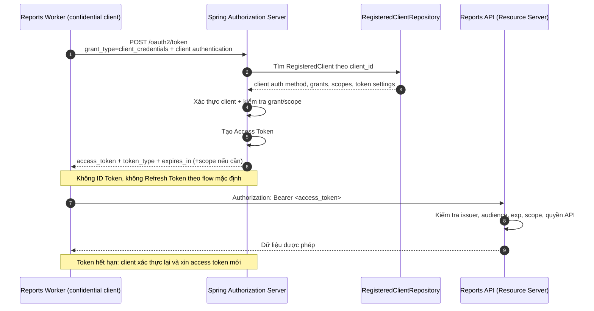
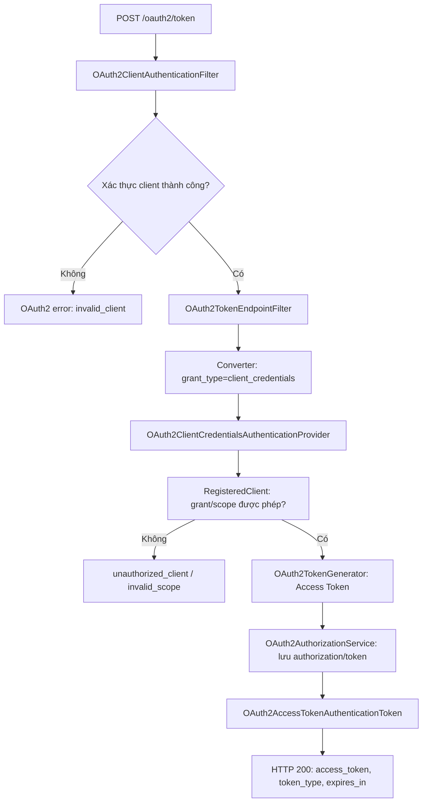
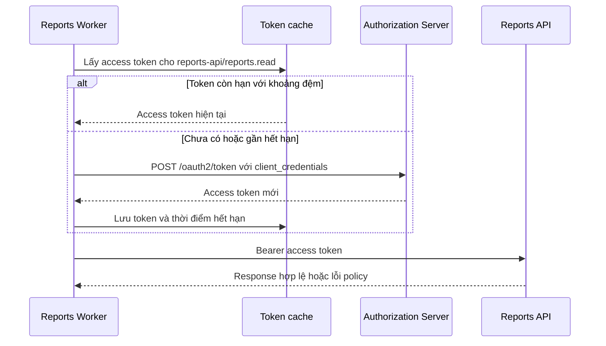

# Giới hạn phát hành ID Token và Refresh Token trong luồng này

## 1. Bài toán: vì sao Client Credentials chỉ trả Access Token?

Một dịch vụ `reports-worker` cần gọi `reports-api` để tạo báo cáo định kỳ. Nó được đăng ký như một **confidential OAuth 2.0 client** và gửi `grant_type=client_credentials` đến Spring Authorization Server. Request thành công; response có `access_token`, `token_type` và `expires_in`, nhưng **không có `id_token` hoặc `refresh_token`**.

Đây thường **không phải lỗi**. Client Credentials Grant dành cho **machine-to-machine (M2M)**, trong đó client sử dụng **chính danh tính/quyền của mình**, không có người dùng cuối đăng nhập hay ủy quyền theo cách của Authorization Code Flow.

Trong bối cảnh Spring Boot:

- **Spring Security** xử lý các `SecurityFilterChain`, client authentication và kiểm tra access token tại Resource Server.
- **Spring Authorization Server** triển khai `/oauth2/token`, xác minh client, kiểm tra grant được phép và phát hành token.
- **OpenID Connect (OIDC)** bổ sung lớp xác thực người dùng cuối, đặc biệt là **ID Token**. Client Credentials không tự tạo ra ngữ cảnh đăng nhập người dùng để phát ID Token.

Bài thuộc chương **Client Credentials** của module `SPRING_SECURITY_OAUTH2_OIDC_AUTHORIZATION_SERVER`. Mục tiêu là học cách **thiết kế, cấu hình, bảo mật, kiểm thử và vận hành OAuth 2.0/OpenID Connect Authorization Server bằng Spring Security và Spring Authorization Server trong Spring Boot**, đặc biệt hiểu **giới hạn phát hành ID Token và Refresh Token** của grant này.

### Kết quả cần đạt

Sau bài học, bạn có thể:

1. Giải thích vì sao **ID Token không thuộc kết quả chuẩn của Client Credentials Grant**.
2. Phân biệt quy tắc **`SHOULD NOT`** cấp refresh token trong RFC 6749 với một lệnh cấm tuyệt đối.
3. Hiểu vì sao `RegisteredClient`, `TokenSettings` và `OAuth2TokenGenerator` không tự biến Client Credentials thành một grant cấp refresh/ID Token.
4. Cấu hình Spring Authorization Server và Spring Security OAuth2 Client để **xin lại access token bằng client authentication**, không phụ thuộc refresh token.
5. Thiết kế test, logging, giới hạn quyền và kiến trúc phù hợp khi hệ thống vừa có người dùng vừa có tác vụ máy với máy.

> **Phạm vi phiên bản:** Ví dụ chính sử dụng API quen thuộc của **Spring Authorization Server 1.x và Spring Security 6.x**. Những cấu hình DSL/điểm mở rộng có thể thay đổi ở Spring Security 7.x. Khi triển khai thực tế, kiểm tra đúng bộ phiên bản dependency và test token response trên server đang chạy, thay vì suy ra chỉ từ việc một phương thức builder tồn tại.

## 2. Client Credentials Grant đại diện cho ai?

**Client Credentials Grant** được định nghĩa ở **RFC 6749, mục 4.4**: một confidential client có thể yêu cầu access token bằng cách xác thực chính nó tại Token Endpoint. Quyền cấp cho client thường được quản trị trước giữa tổ chức sở hữu client và Authorization Server.



Không có trình duyệt, redirect URI, authorization code, `code_verifier`, trang đăng nhập hay consent của người dùng trong flow máy với máy cơ bản. Một dịch vụ có thể dùng cả API gateway, workload identity hoặc certificate, nhưng các thành phần đó không biến flow này thành login của con người.

### 2.1. Bốn danh tính dễ nhầm

| Đối tượng | Ví dụ | Điều nó chứng minh |
| --- | --- | --- |
| **Client ID** | `reports-worker` | Định danh public để tìm `RegisteredClient`; không phải bí mật |
| **Client authentication** | Basic secret, `private_key_jwt` hoặc mTLS | Bên gọi nắm credential đã đăng ký cho client |
| **Principal của access token M2M** | `reports-worker` | Ngữ cảnh quyền của dịch vụ/client; không phải người dùng cuối |
| **End-user principal của OIDC** | Nhân viên Alice đăng nhập bằng Authorization Code + OIDC | Ngữ cảnh xác thực người dùng cần thiết cho ID Token |

**Client authentication thành công không đồng nghĩa “một người dùng đã đăng nhập”.** Dùng tên client làm `sub` trong JWT access token M2M (nếu cấu hình như vậy) cũng **không** biến `sub` thành định danh End-User theo OIDC.

## 3. Vai trò của từng loại token

| Token | Mục đích | Đối tượng nhận/kiểm tra | Client Credentials mặc định |
| --- | --- | --- | --- |
| **Access Token** | Cấp quyền gọi Resource Server | API kiểm tra token, scope và policy | **Có**, nếu request/grant/client hợp lệ |
| **ID Token** | Chuyển thông tin về một **sự kiện xác thực End-User** | OIDC Client xác minh issuer, audience, `sub`, nonce khi áp dụng | **Không** |
| **Refresh Token** | Xin access token mới mà không lặp lại toàn bộ luồng cấp quyền | Token Endpoint, cùng ràng buộc client/authorization | **Không** trong Spring Authorization Server Client Credentials mặc định; chuẩn OAuth khuyến nghị không cấp |
| **Authorization Code** | Cho phép client đổi lấy token sau một yêu cầu cấp quyền của người dùng | Token Endpoint và client giữ PKCE verifier | **Không** |

**Access token không phải ID Token.** Resource Server xác minh access token; OIDC Client xác minh ID Token để tin thông tin xác thực người dùng. Hai loại có đối tượng nhận, claims và ngữ nghĩa khác nhau; không đổi tên một JWT access token thành `id_token` chỉ để bên tích hợp “đủ field”.

### 3.1. Ví dụ token response hợp lệ

Client gửi request qua HTTPS:

```http
POST /oauth2/token HTTP/1.1
Host: auth.example.com
Authorization: Basic <base64-client-id-and-secret>
Content-Type: application/x-www-form-urlencoded
Accept: application/json

grant_type=client_credentials&scope=reports.read
```

`Authorization` ở đây minh họa HTTP Basic; chuỗi Base64 **không mã hóa bí mật**, vì vậy TLS và quản lý secret vẫn bắt buộc. Theo OAuth, client ID/secret phải được biểu diễn đúng cách cho HTTP Basic, bao gồm quy tắc form encoding của RFC 6749 khi chứa ký tự đặc biệt. Không tự tạo Basic header bằng cách nối chuỗi không chuẩn cho dữ liệu Unicode hoặc ký tự đặc biệt.

Phản hồi minh họa:

```http
HTTP/1.1 200 OK
Content-Type: application/json
Cache-Control: no-store
Pragma: no-cache

{
  "access_token": "ACCESS_TOKEN_EXAMPLE",
  "token_type": "Bearer",
  "expires_in": 600,
  "scope": "reports.read"
}
```

Giá trị `expires_in=600` và scope chỉ là ví dụ; thực tế phụ thuộc `TokenSettings` và policy. Không dùng chuỗi `ACCESS_TOKEN_EXAMPLE` như credential thật. Phản hồi có **access token mà không có ID/refresh token vẫn là thành công**.

## 4. Vì sao không có ID Token?

### 4.1. ID Token có ý nghĩa gì trong OpenID Connect?

Theo **OpenID Connect Core 1.0**, ID Token là JWT chứa thông tin xác thực một **End-User** tại OpenID Provider. Những claim cốt lõi gồm:

- `iss`: định danh nhà phát hành.
- `sub`: định danh chủ thể người dùng cuối theo chính sách của nhà cung cấp.
- `aud`: client nhận ID Token.
- `exp`, `iat`: thời hạn và thời điểm phát hành.
- Các claim khác như `auth_time`, `nonce`, `acr` hoặc `amr` xuất hiện theo luồng/yêu cầu.

Đó là chứng cứ dành cho **OIDC Client** về một phiên xác thực người dùng. Trong Client Credentials, **không có bước End-User authentication** để xác định “người dùng nào đã đăng nhập”. Dịch vụ chỉ chứng minh credential của chính nó.

Không thể suy ra một sự kiện người dùng đăng nhập chỉ từ:

```text
client_id = reports-worker
client authentication = success
grant_type = client_credentials
```

Do đó, **ID Token không phải kết quả chuẩn của Client Credentials Grant**. Nếu cần đăng nhập người dùng, hãy chọn luồng OIDC phù hợp như **Authorization Code Flow** thay vì cố phát ID Token trong M2M.

### 4.2. Thêm `openid` vào scope có làm xuất hiện ID Token?

**Không nên giả định như vậy.** `openid` là scope giao thức để báo hiệu yêu cầu OIDC authentication, còn Client Credentials không cung cấp tương tác và principal người dùng cần thiết.

Ví dụ request:

```http
POST /oauth2/token HTTP/1.1
Host: auth.example.com
Authorization: Basic <base64-client-id-and-secret>
Content-Type: application/x-www-form-urlencoded

grant_type=client_credentials&scope=openid%20reports.read
```

Kết quả có thể là:

- **`invalid_scope`** nếu `openid` không được đăng ký/không được phép theo policy;
- hoặc token endpoint xử lý scopes được đăng ký nhưng **không phát ID Token**, theo hành vi provider Client Credentials mặc định.

Kết quả chính xác tùy cấu hình, validator và phiên bản. Nếu tổ chức có policy **cấm `openid` trong Client Credentials**, hãy thực thi/kiểm thử policy này; không coi việc nhận `openid` trong access token như bằng chứng rằng OIDC login đã xảy ra.

### 4.3. JWT client assertion cũng không phải ID Token

Một confidential client có thể xác thực ở Token Endpoint bằng **`private_key_jwt`** hoặc **`client_secret_jwt`**, tức gửi `client_assertion` là JWT do **client** ký.

| JWT | Ai tạo? | Dùng để làm gì? |
| --- | --- | --- |
| **Client assertion** | OAuth2 Client | Chứng minh client được phép dùng client identity tại Token Endpoint |
| **JWT Access Token** | Authorization Server | Trình cho Resource Server để gọi API |
| **OIDC ID Token** | OpenID Provider / Authorization Server | Chứng minh sự kiện xác thực End-User cho OIDC Client |

Chúng có thể cùng sử dụng định dạng JWT nhưng **mục đích, audience, tiêu chuẩn kiểm tra và phía xác minh khác nhau**. Không biến client assertion thành ID Token hoặc cho API chấp nhận ID Token thay vì access token.

## 5. Vì sao không có Refresh Token?

### 5.1. Chuẩn OAuth 2.0 nói gì?

Ở **RFC 6749, mục 4.4.3 (Access Token Response)**, đối với Client Credentials Grant, chuẩn nêu:

> A refresh token SHOULD NOT be included.

**`SHOULD NOT` là khuyến nghị chuẩn mạnh**, không đồng nghĩa với `MUST NOT` cấm tuyệt đối ở mọi hệ thống. Nếu một authorization server cố tình cấp refresh token trong trường hợp đặc biệt, hệ thống phải có **lý do được phân tích và chứng minh về bảo mật/tương thích**.

Lý do thiết kế rất tự nhiên: confidential client có credential hợp lệ và có thể **xác thực lại để xin access token mới**. Nó không cần duy trì một phiên ủy quyền của người dùng và thường không cần thêm một credential dài hạn là refresh token.

### 5.2. Hành vi mặc định của Spring Authorization Server

Trong Spring Authorization Server 1.x, yêu cầu `grant_type=client_credentials` được xử lý bởi **`OAuth2ClientCredentialsAuthenticationProvider`**. Luồng này tập trung vào xác minh client, grant/scope, tạo **access token**, lưu authorization state và trả `OAuth2AccessTokenAuthenticationToken`. Provider mặc định **không phát ID Token hoặc Refresh Token** cho Client Credentials.

Một `OAuth2TokenGenerator` tổng quát có thể được cấu hình để tạo nhiều loại token cho những grant khác. Nhưng việc có `OAuth2RefreshTokenGenerator` trong hệ thống **không buộc** Client Credentials provider gọi nó. **Điểm quyết định loại token phải phát thuộc luồng xử lý grant/provider**, không đơn thuần phụ thuộc bean generator.

### 5.3. Vì sao server thường không cấp refresh token ở grant này?

- **Không có End-User session/consent** để “kéo dài”: client đã xác thực bằng danh tính máy.
- **Có thể xin access token mới** bằng cùng một phương thức client authentication đã đăng ký.
- **Giảm số credential cần bảo vệ**: refresh token là một bí mật khác có nguy cơ bị sao chép, phát lại hoặc tồn tại lâu.
- **Giảm trạng thái vận hành phức tạp**: khỏi phải quản lý refresh-token family, rotation/reuse, thu hồi và tranh chấp refresh đồng thời cho một grant vốn không cần.
- **Phân quyền rõ ràng hơn**: access token M2M ngắn hạn, scope/audience tối thiểu, client credentials được quản lý và quay vòng độc lập.

Điều này **không có nghĩa access token M2M luôn phải là JWT** hay không được thu hồi. Access token có thể là JWT hoặc opaque token tùy policy, và Resource Server vẫn phải xác minh đúng.

## 6. Vì sao các cờ cấu hình không làm xuất hiện hai token này?

### 6.1. `RegisteredClient.authorizationGrantTypes`

Giả sử bạn viết:

```java
// Chỉ minh họa khác biệt giữa grant được đăng ký và token được phát.
.authorizationGrantType(AuthorizationGrantType.CLIENT_CREDENTIALS)
.authorizationGrantType(AuthorizationGrantType.REFRESH_TOKEN)
```

Việc đăng ký thêm `refresh_token` có nghĩa client **được phép yêu cầu refresh grant khi đã có refresh token phù hợp**, chứ không có nghĩa mọi Client Credentials response phải kèm một refresh token để sử dụng grant đó.

Vì provider Client Credentials mặc định không cấp refresh token, client **không có refresh token ban đầu** để gửi cho `grant_type=refresh_token`. Cấu hình cả hai grants không tự giải quyết vấn đề.

### 6.2. `TokenSettings.refreshTokenTimeToLive`

Ví dụ:

```java
TokenSettings settings = TokenSettings.builder()
        .accessTokenTimeToLive(Duration.ofMinutes(10))
        .refreshTokenTimeToLive(Duration.ofDays(7))
        .reuseRefreshTokens(false)
        .build();
```

| Thiết lập | Nó ảnh hưởng tới | Nó **không** làm |
| --- | --- | --- |
| `accessTokenTimeToLive` | TTL của access token khi được tạo | Không phát ID Token/Refresh Token |
| `refreshTokenTimeToLive` | TTL của refresh token **nếu grant tương ứng phát token này** | Không ra lệnh Client Credentials provider phát refresh token |
| `reuseRefreshTokens(false)` | Chính sách rotation khi refresh grant hoạt động | Không bật refresh token issuance cho Client Credentials |
| `accessTokenFormat` | JWT self-contained hay reference/opaque access token theo policy | Không biến access token thành ID Token |

Để thay đổi hành vi cấp token, phải hiểu **provider của grant** và giới hạn của phiên bản; chỉnh mỗi TTL không thay thế logic đó.

### 6.3. `oidc(Customizer.withDefaults())`

Bật OIDC trong `OAuth2AuthorizationServerConfigurer` giúp Authorization Server hỗ trợ OIDC endpoints và các luồng xác thực người dùng tương ứng. Nó **không** tự biến mọi `client_credentials` response thành một OIDC authentication response.

**Không phát ID Token “giả”** chứa `sub=client_id` để thỏa hợp đồng tích hợp đang đòi `id_token`. Nếu bên nhận muốn **xác thực dịch vụ**, hãy dùng client authentication, JWT client assertion, mTLS hoặc token mà hợp đồng API công nhận, chứ không gán nhãn End-User ID Token cho một machine principal.

## 7. Cấu hình RegisteredClient đúng cho M2M

Ví dụ **Spring Authorization Server 1.x**: một confidential client `reports-worker` chỉ dùng Client Credentials và scope `reports.read`.

```java
@Bean
RegisteredClientRepository registeredClientRepository() {
    RegisteredClient worker = RegisteredClient.withId(
                    UUID.randomUUID().toString())
            .clientId("reports-worker")
            // encodedClientSecret: giá trị đã mã hóa bằng PasswordEncoder
            // và được cung cấp từ kho bí mật, không hard-code raw secret.
            .clientSecret(encodedClientSecret)
            .clientAuthenticationMethod(
                    ClientAuthenticationMethod.CLIENT_SECRET_BASIC)
            .authorizationGrantType(AuthorizationGrantType.CLIENT_CREDENTIALS)
            .scope("reports.read")
            .tokenSettings(TokenSettings.builder()
                    .accessTokenTimeToLive(Duration.ofMinutes(10))
                    .build())
            .build();

    return new InMemoryRegisteredClientRepository(worker);
}
```

**Giới hạn ví dụ:** `encodedClientSecret` là giá trị đã được chuẩn bị bên ngoài đoạn mã, không phải biến tự sinh trong snippet. `InMemoryRegisteredClientRepository` chỉ dùng thử nghiệm; production cần repository bền vững, chính sách cấp scope và quy trình quản lý/rotation secret.

Điểm đáng chú ý:

1. `ClientAuthenticationMethod.CLIENT_SECRET_BASIC` đòi confidential client chứng minh secret tại Token Endpoint.
2. `AuthorizationGrantType.CLIENT_CREDENTIALS` là grant duy nhất được cho phép; không thêm `REFRESH_TOKEN` chỉ để “chắc chắn có refresh token”.
3. Scope chỉ dành cho quyền của máy `reports.read`; không đăng ký `openid`, `profile`, `offline_access` nếu dịch vụ không thực hiện xác thực người dùng.
4. TTL access token nên cân bằng giữa tần suất xin token mới và thời gian kẻ tấn công có thể dùng token bị đánh cắp.

Khi cần bảo mật cao hơn, confidential client có thể dùng **`private_key_jwt`** hoặc **mTLS** nếu Authorization Server và hạ tầng đã hỗ trợ. Các phương thức này thay đổi **client authentication**, không làm phát sinh ID/Refresh Token trong Client Credentials Flow.

### 7.1. Authorization Server chain và Token Endpoint

Configurer định nghĩa các endpoint giao thức:

```java
@Bean
@Order(1)
SecurityFilterChain authorizationServerSecurityFilterChain(HttpSecurity http)
        throws Exception {
    OAuth2AuthorizationServerConfigurer authorizationServer =
            OAuth2AuthorizationServerConfigurer.authorizationServer();

    http
        .securityMatcher(authorizationServer.getEndpointsMatcher())
        .with(authorizationServer, Customizer.withDefaults())
        .authorizeHttpRequests(authorize ->
            authorize.anyRequest().authenticated());

    return http.build();
}
```

Đây là **khung filter chain**, chưa phải ứng dụng chạy độc lập. Cần các bean như `RegisteredClientRepository`, `OAuth2AuthorizationService`, `AuthorizationServerSettings`, `OAuth2TokenGenerator`/`JWKSource` tùy token format, cùng các cấu hình bảo mật phù hợp. Nếu ứng dụng hỗ trợ các luồng browser, chain đăng nhập người dùng và các endpoint OIDC có thể được cấu hình riêng.

Không nên tạo controller `POST /oauth2/token` tùy chỉnh để ép thêm trường `id_token` hoặc `refresh_token`: điều đó dễ bỏ qua xác thực client, validation scope/grant và cách trả lỗi chuẩn.

## 8. Bên trong Token Endpoint của Spring Authorization Server



Trong pipeline điển hình:

1. **Client Authentication Filter** nhận thông tin client (Basic/JWT assertion/mTLS theo đăng ký), tra cứu repository và xác thực client.
2. **Token Endpoint Filter** phân tích `grant_type=client_credentials` thành `OAuth2ClientCredentialsAuthenticationToken`.
3. **`OAuth2ClientCredentialsAuthenticationProvider`** kiểm tra grant type, scope, client đã xác thực.
4. Provider tạo **access token** qua `OAuth2TokenGenerator`, lưu `OAuth2Authorization` và trả kết quả phù hợp.
5. Success handler tạo HTTP response. **Không có bước OIDC End-User ID Token** hoặc grant-specific refresh issuance trong xử lý mặc định này.

**Tùy biến generator không giống thay đổi grant semantics:** `OAuth2TokenCustomizer<JwtEncodingContext>` có thể bổ sung claims đáng tin cậy trong JWT access token. Nó không tự khiến Client Credentials provider gọi generator để tạo ID Token hay Refresh Token.

## 9. Thêm claims máy với máy đúng mục đích

Một JWT access token M2M có thể mang những thông tin phục vụ API, ví dụ:

```json
{
  "iss": "https://auth.example.com",
  "sub": "reports-worker",
  "aud": ["reports-api"],
  "scope": ["reports.read"],
  "iat": 1784000000,
  "exp": 1784000600,
  "actor_type": "service"
}
```

Đây là **ví dụ claims minh họa**, không phải một JWT có chữ ký hợp lệ hay cam kết về bộ claims mặc định của mọi phiên bản. `sub` có thể đại diện client tùy cơ chế và token customizer; `scope`/`scp`, kiểu dữ liệu `aud` hoặc claim tùy biến có thể khác nhau theo sản phẩm. Resource Server cần kiểm tra token đã xác minh chữ ký và policy, không chỉ giải mã JSON.

### 9.1. Ví dụ Token Customizer

```java
@Bean
OAuth2TokenCustomizer<JwtEncodingContext> machineTokenCustomizer() {
    return context -> {
        if (!OAuth2TokenType.ACCESS_TOKEN.equals(context.getTokenType())) {
            return;
        }
        if (!AuthorizationGrantType.CLIENT_CREDENTIALS.equals(
                context.getAuthorizationGrantType())) {
            return;
        }

        String clientId = context.getRegisteredClient().getClientId();
        if ("reports-worker".equals(clientId)) {
            context.getClaims().audience(List.of("reports-api"));
            context.getClaims().claim("actor_type", "service");
        }
    };
}
```

Ví dụ chỉ gắn audience/claim cho một client đã đăng ký. Trong hệ thống thật, map audience theo **policy máy chủ**, không lấy giá trị tự do từ body request do client tự đề xuất. `JwtEncodingContext` áp dụng khi generator tạo JWT phù hợp; nếu bạn tự cấu hình `OAuth2TokenGenerator`, phải bảo đảm token customizer được nối vào generator đó.

**Đừng thêm `user_id`, `email`, `auth_time` hoặc `amr` vào machine token như thể có người dùng đã xác thực.** Nếu một tác vụ cần thực hiện thay mặt người dùng, hãy phân tích delegated authorization/token exchange hoặc một luồng có ngữ cảnh người dùng riêng, không “mượn” Client Credentials để giả user.

## 10. Xin lại Access Token khi hết hạn, không dùng Refresh Token

Với Client Credentials, chiến lược bình thường là **gọi lại Token Endpoint với client authentication** khi access token hết hạn hoặc gần hết hạn.



### 10.1. Cần cache token như thế nào?

Không nên gọi `/oauth2/token` **cho từng request API** nếu token vẫn còn hợp lệ. Token issuance quá thường xuyên gây tải cho Authorization Server, làm tăng khả năng bị rate limit và tạo điểm nghẽn khi có nhiều instance dịch vụ.

Một client M2M nên:

- Cache access token theo **client registration + audience/resource + scope/tenant** nếu chính sách phân biệt các ngữ cảnh này.
- Dựa vào `expires_in`/`exp` và **clock skew** để làm mới sớm với biên an toàn.
- Đồng bộ hóa việc xin token mới giữa nhiều thread nếu có khả năng xảy ra **cache stampede**.
- Không chia sẻ access token giữa các dịch vụ/tenant có quyền khác nhau chỉ vì cùng issuer.
- Khi API trả 401, phân biệt **token hết hạn/không hợp lệ** với **403 thiếu quyền**; không retry vô hạn và không tự động tăng scope.
- Che token khỏi log, metric labels và exception; bảo vệ lưu trữ token nếu được cache ra ngoài tiến trình.

### 10.2. Spring Security OAuth2 Client đăng ký Client Credentials

Trong **ứng dụng reports-worker riêng biệt** (đóng vai OAuth2 Client), cấu hình minh họa:

```yaml
spring:
  security:
    oauth2:
      client:
        registration:
          reports-service:
            provider: internal-as
            client-id: ${REPORTS_CLIENT_ID}
            client-secret: ${REPORTS_CLIENT_SECRET}
            client-authentication-method: client_secret_basic
            authorization-grant-type: client_credentials
            scope:
              - reports.read
        provider:
          internal-as:
            token-uri: https://auth.example.com/oauth2/token
```

`REPORTS_CLIENT_ID`/`REPORTS_CLIENT_SECRET` là biến môi trường minh họa; trong production, cần quản lý bí mật đúng cách, giới hạn quyền đọc config và tránh lưu raw secret trong repository. YAML này là cấu hình **OAuth2 Client**, không đặt nhầm vào ứng dụng Authorization Server rồi nghĩ nó sẽ tự đăng ký `RegisteredClient` bên server.

### 10.3. Dùng OAuth2AuthorizedClientManager cho service không có browser

Trong một tiến trình **service/application** (không chạy luồng đăng nhập servlet cho từng người dùng), có thể dùng `AuthorizedClientServiceOAuth2AuthorizedClientManager` với provider hỗ trợ `client_credentials`:

```java
@Bean
OAuth2AuthorizedClientManager authorizedClientManager(
        ClientRegistrationRepository registrations,
        OAuth2AuthorizedClientService authorizedClients) {

    OAuth2AuthorizedClientProvider provider =
            OAuth2AuthorizedClientProviderBuilder.builder()
                    .clientCredentials()
                    .build();

    AuthorizedClientServiceOAuth2AuthorizedClientManager manager =
            new AuthorizedClientServiceOAuth2AuthorizedClientManager(
                    registrations, authorizedClients);
    manager.setAuthorizedClientProvider(provider);
    return manager;
}
```

Khi một job cần token:

```java
OAuth2AuthorizeRequest request = OAuth2AuthorizeRequest
        .withClientRegistrationId("reports-service")
        .principal("reports-worker-job")
        .build();

OAuth2AuthorizedClient authorized =
        authorizedClientManager.authorize(request);

if (authorized == null) {
    throw new IllegalStateException("Không thể lấy access token cho job");
}

String tokenValue = authorized.getAccessToken().getTokenValue();
// Chỉ gửi token qua HTTPS tới API được chỉ định; không log tokenValue.
```

Những đoạn trên là **các mảnh cấu hình minh họa**, cần import Spring Security OAuth2 Client phù hợp và các bean registration/service tương ứng. Manager có thể tái sử dụng authorized client còn hiệu lực và gọi lại Token Endpoint khi cần theo provider/clock skew; hành vi cache thực tế tùy `OAuth2AuthorizedClientService`. **Không có yêu cầu phải nhận refresh token** để lấy access token mới theo Client Credentials Grant.

## 11. Chọn phương thức Client Authentication phù hợp

Client Credentials chỉ phù hợp nếu client có khả năng bảo vệ credential. Không nên dùng grant này trực tiếp từ SPA JavaScript hoặc ứng dụng mobile phát hành rộng rãi với secret nhúng.

| Phương thức | Ví dụ client | Rủi ro/điều kiện |
| --- | --- | --- |
| `client_secret_basic` | Backend nội bộ | Bảo vệ shared secret, TLS và secret rotation |
| `client_secret_post` | Backend cần tương thích | Secret trong request body dễ bị log; không ưu tiên nếu có Basic phù hợp |
| `private_key_jwt` | Dịch vụ có kho khóa riêng | Quản lý JWKS/kid, chữ ký, audience, assertion expiry và replay |
| `client_secret_jwt` | Dịch vụ dùng JWT assertion với shared secret | Vẫn phải bảo vệ secret đối xứng; kiểm soát thuật toán và TTL assertion |
| `tls_client_auth` / `self_signed_tls_client_auth` | Dịch vụ có mTLS phù hợp | TLS stack phải xác thực chứng chỉ và ràng buộc với client registration |

**Các JWT client assertion dùng để xác thực client không phải OIDC ID Token.** mTLS hoặc `private_key_jwt` cũng **không mặc nhiên** khiến Client Credentials phát refresh token.

Với hệ thống phân tán, ưu tiên quản lý khóa/secret trong secret manager hoặc KMS phù hợp; rotation có giai đoạn chuyển đổi, giảm quyền tối thiểu, cảnh báo khi credential bị dùng bất thường. Nếu dùng mTLS qua proxy, không tin header chứa certificate do Internet tự khai báo.

## 12. Phân biệt Client Credentials với các luồng khác

| Tình huống | Grant/luồng thường phù hợp | End-User? | ID Token? | Refresh Token? |
| --- | --- | --- | --- | --- |
| Cron job lấy dữ liệu báo cáo bằng quyền dịch vụ | **Client Credentials** | Không | Không | Không theo hành vi mặc định; chuẩn khuyên không |
| Người dùng đăng nhập vào web app bằng OIDC | **Authorization Code + PKCE + OIDC** | Có | Có khi request OIDC hợp lệ | Có thể, theo policy/client |
| Backend web cần duy trì phiên người dùng | Authorization Code + PKCE, confidential client/BFF | Có | Có thể có OIDC ID Token | Có thể nếu server cấp |
| Mobile/SPA thuần cần đăng nhập người dùng | Authorization Code + PKCE, public client | Có | Có thể khi dùng OIDC | Tùy server/phiên bản/chính sách |
| API cần xác minh service caller | Client authentication ở AS + access token tại RS | Không | Không | Không cần |
| Một tác vụ thực hiện **thay mặt người dùng** với quyền đã ủy quyền | Delegated authorization hoặc token exchange phù hợp hệ thống | Có ngữ cảnh người dùng | Không suy từ M2M | Tùy mô hình và policy |

### 12.1. Nếu API “đòi ID Token” cho service

Đó thường là dấu hiệu **nhầm hợp đồng API**. Resource Server nên yêu cầu **access token** với issuer, audience, scope và quyền dịch vụ phù hợp. Nếu hệ thống muốn xác minh service trực tiếp, có thể dùng mTLS, signed client assertion hoặc workload identity theo kiến trúc. **Không ép sinh ID Token thiếu End-User** rồi để API đối chiếu như thể đây là login.

### 12.2. Nếu service “cần Refresh Token” để chạy lâu dài

Service thường có thể **xin access token mới** bằng cách xác thực lại `client_credentials`. Nếu đó là một công việc kéo dài nhiều giờ, cần một **cơ chế tự gia hạn access token** ở phía client, không mặc định yêu cầu refresh token.

Nếu bài toán thực sự có người dùng và quyền được ủy quyền, hãy kiểm tra lại grant đã chọn: có thể bạn cần Authorization Code/Refresh Token cho **một confidential client có user context**, hoặc một cơ chế token exchange/delegation riêng, chứ không phải Client Credentials.

## 13. Những lỗi nhận thức thường gặp

| Nhận định | Đánh giá | Giải thích |
| --- | --- | --- |
| “Bật OIDC thì mọi grant sẽ trả ID Token.” | **Sai** | ID Token gắn với End-User authentication; Client Credentials không có ngữ cảnh đó |
| “Thêm scope `openid` thì chắc chắn có ID Token.” | **Sai** | Scope không tạo ra End-User và không thay đổi client_credentials grant |
| “Vì Token Generator biết tạo refresh token nên Client Credentials sẽ nhận refresh token.” | **Sai** | Grant provider quyết định loại token được tạo |
| “Thêm `AuthorizationGrantType.REFRESH_TOKEN` sẽ làm response có refresh token.” | **Sai** | Đăng ký grant khác với cấp refresh token ban đầu |
| “`reuseRefreshTokens(false)` bật refresh cho M2M.” | **Sai** | Chỉ có ý nghĩa khi refresh token tồn tại và grant được hỗ trợ |
| “OAuth cấm tuyệt đối mọi refresh token với Client Credentials.” | **Không chính xác** | RFC 6749 dùng **`SHOULD NOT`**, không phải `MUST NOT` |
| “Không có refresh token thì job phải ngừng khi access token hết hạn.” | **Sai** | Confidential client xác thực lại để lấy access token mới |
| “Token có `sub=reports-worker` chứng minh người dùng reports-worker đăng nhập.” | **Sai** | `sub` trong M2M có thể biểu diễn client/service, không phải End-User |
| “Dùng ID Token để gọi Resource Server là như Access Token.” | **Sai** | Khác mục đích/audience/validation |
| “Client Credentials là cách tốt nhất cho SPA vì không cần login.” | **Sai** | SPA không giữ được client secret, không nên nhúng credential |

## 14. Bảo mật Access Token M2M thay vì cố phát token khác

### 14.1. Scope và audience tối thiểu

Không cấp `reports.write` cho client chỉ cần đọc báo cáo. Resource Server phải kiểm tra **audience** phù hợp với chính API và không nhầm scope của một resource khác. JWT hợp lệ về chữ ký nhưng sai audience phải bị từ chối theo chính sách.

Mỗi client/service có thể cần một registration riêng, để rotate secret và thu hồi quyền mà không làm gián đoạn các dịch vụ không liên quan.

### 14.2. Access Token TTL và thu hồi

Access token quá dài hạn làm tăng thời gian kẻ tấn công có thể sử dụng token bị đánh cắp. TTL ngắn hơn giảm rủi ro nhưng tăng tải xin token. Cân bằng theo workload, rate limit và cache. Với JWT self-contained, thu hồi tức thời có thể cần thêm cơ chế như thời hạn ngắn/danh sách từ chối hoặc chính sách khóa khác; với opaque token, introspection/authorization storage cần nhất quán.

### 14.3. Giới hạn credential bị lộ

Không ghi client secret, assertion JWT, access token hay HTTP Authorization header nguyên văn trong log, tracing và error message. Bật TLS; giới hạn kết nối đến Token Endpoint; dùng secret manager và quyền truy cập theo workload identity nếu phù hợp.

### 14.4. Sender-constrained Access Token

Trong threat model có nguy cơ bị lấy cắp bearer token, có thể cân nhắc **mTLS-bound access token** hoặc **DPoP** nếu Authorization Server, client và Resource Server hỗ trợ. Sender constraint cần được **Resource Server thực thi**, không chỉ cấu hình ở bước phát token.

Đây là biện pháp bảo vệ access token M2M, **không phải cách phát ID Token/Refresh Token**.

## 15. Ma trận kiểm thử hành vi mặc định

| Ca kiểm thử | Thiết lập | Kết quả mong đợi |
| --- | --- | --- |
| Client Credentials hợp lệ | Confidential client, secret/PKI đúng, scope được phép | HTTP 200 có `access_token`, `token_type` và thông tin TTL phù hợp |
| Kiểm tra ID Token | Client Credentials response chuẩn | **Không có `id_token`** |
| Kiểm tra Refresh Token | Spring Authorization Server Client Credentials mặc định | **Không có `refresh_token`** |
| Client thêm `openid` không đăng ký | Request scope trái policy | Từ chối `invalid_scope` hoặc lỗi giao thức phù hợp |
| Client đăng ký `openid` nhưng dùng Client Credentials | Cấu hình scope có thể gây hiểu nhầm | Không phát ID Token theo provider mặc định; nên chặn bằng policy khi cần |
| Thêm `REFRESH_TOKEN` vào RegisteredClient | Giữ Client Credentials Flow | Không tự phát refresh token ban đầu |
| Đổi `refreshTokenTimeToLive` | Chỉnh TokenSettings | Không ảnh hưởng loại token được phát trong flow mặc định |
| Bật `oidc(...)` | Có OpenID Provider | Không biến Client Credentials response thành OIDC ID Token response |
| Secret sai | Basic/JWT assertion authentication không hợp lệ | `invalid_client` hoặc phản hồi client-auth phù hợp, không cấp token |
| Grant type không được đăng ký | Client thử `client_credentials` nhưng registration không cho phép | `unauthorized_client` hoặc lỗi phù hợp |
| Scope vượt quyền | Client yêu cầu `reports.admin` khi chỉ có `reports.read` | Không cấp scope vượt chính sách, thường `invalid_scope` |
| Access token hết hạn | Client gọi Token Endpoint lại với credential đúng | Nhận access token mới, không cần refresh token |
| Token không đúng audience | Token dùng sai API | Resource Server từ chối theo audience policy |
| Thử dùng fabricated refresh token | Request `grant_type=refresh_token` không có token hợp lệ | Bị từ chối; lỗi cụ thể tùy giai đoạn validation |
| Trộn user ID trong machine token | Token customizer cố chèn principal của user | Test policy phát hiện claim không có nguồn đáng tin |
| Nhiều job cùng xin token | Cache hết hạn, đồng thời nhiều luồng | Kiểm tra cache stampede, rate limit, retry/backoff |
| Secret/certificate rotation | Đổi client credential theo chính sách | Token requests hoạt động theo cửa sổ rotation, quyền không mở rộng |
| Nâng cấp framework | Test trên phiên bản cũ/mới | Ghi nhận thay đổi error, defaults hoặc cấu trúc token; không suy đoán |

### 15.1. Kiểm thử HTTP nhận biết token bị thiếu

Ví dụ **pseudocode theo phong cách integration test**, không phải test JUnit có thể chạy độc lập:

```java
var response = exchangeClientCredentials(
        "reports-worker", "reports.read");

assertThat(response.status()).isEqualTo(200);
assertThat(response.json().get("access_token")).isNotNull();
assertThat(response.json().has("id_token")).isFalse();
assertThat(response.json().has("refresh_token")).isFalse();
```

Cần dựng `RegisteredClient`, xác thực client, Token Endpoint và token generator thực tế; chạy test với **đúng phiên bản SAS/Spring Security**. Điều quan trọng là kiểm tra **sự hiện diện/không hiện diện của trường response**, không suy từ `TokenSettings`.

### 15.2. Test token mới sau expiry

1. Lấy access token lần đầu và ghi **expiry metadata** (không ghi token raw).
2. Giả lập hết hạn hoặc dùng clock được kiểm soát.
3. Gọi lại `client_credentials` với credential client đúng.
4. Xác minh access token mới có thời hạn/scope/audience đúng và API chấp nhận.
5. Kiểm tra job không phụ thuộc refresh token và không retry vô hạn nếu Token Endpoint trả lỗi.

Không cần đợi token production hết hạn bằng sleep trong test; dùng clock/config/test fixture phù hợp.

## 16. Chẩn đoán lỗi khi tích hợp

| Triệu chứng | Khả năng chính | Hành động |
| --- | --- | --- |
| Token response không có `refresh_token` | Hành vi chuẩn/default Client Credentials | Xin access token mới bằng client authentication khi cần |
| Token response không có `id_token` | Không có End-User/luồng OIDC authentication | Nếu cần login người dùng, dùng Authorization Code + OIDC |
| Thêm `openid` nhưng chỉ có access token | Grant không phát ID Token, scope có thể vẫn được chấp nhận | Tách scope OIDC khỏi scope M2M, kiểm tra policy |
| `invalid_client` | Secret/JWT assertion/mTLS hoặc method sai | Kiểm tra client authentication, repository, expiry và TLS |
| `unauthorized_client` | Grant không nằm trong `RegisteredClient` | Kiểm tra authorizationGrantTypes và policy |
| `invalid_scope` | Scope yêu cầu không được đăng ký/phù hợp | Kiểm tra scopes client, grant, resource policy |
| API trả 401 với JWT mới | Issuer, signature, audience, expiry hoặc key mismatch | Kiểm tra `iss`, `aud`, JWKS, clock và token type |
| API trả 403 | Token có thể hợp lệ nhưng thiếu quyền/scope | Kiểm tra quyền API, không chỉ xin token mới |
| Job xin token quá nhiều | Cache không hoạt động/không xét TTL hoặc concurrency | Sửa cache/clock skew, thêm đồng bộ/backoff |
| Client xin refresh token dù chưa từng nhận | Logic client dùng sai grant | Chỉnh luồng lấy access token mới, không bịa refresh credential |

Những triệu chứng trên cần được xác minh qua log/metrics an toàn: correlation ID, grant type, client ID đã giảm/ẩn danh, mã lỗi, thời gian; **không** đưa secret hoặc token nguyên văn vào báo cáo lỗi.

## 17. Tình huống kiến trúc: dịch vụ báo cáo và ứng dụng web

Một nền tảng có hai nhu cầu:

**A. Reports Worker** chạy báo cáo ban đêm mà không có người dùng trực tiếp. Dịch vụ này:

1. Đăng ký confidential client `reports-worker` với `client_credentials` và `reports.read`.
2. Xác thực bằng secret/khóa/chứng chỉ đã được quản lý an toàn.
3. Nhận **access token** có audience phù hợp cho Reports API.
4. Cache token đến gần hết hạn và xác thực lại để lấy token mới.
5. **Không chờ ID Token hoặc Refresh Token** trong token response mặc định.

**B. Reports Web** cho nhân viên đăng nhập và xem báo cáo theo vai trò. Ứng dụng web này:

1. Dùng **Authorization Code + PKCE + OIDC** để xác thực người dùng.
2. Có thể nhận **ID Token** để kiểm chứng kết quả đăng nhập theo giao thức OIDC.
3. Có thể được cấp **refresh token** nếu Authorization Server, loại client và chính sách cho phép.
4. Trình cho Reports API **access token có user context**, để API xét thêm quyền trên từng báo cáo.

**Không dùng access token của Reports Worker để giả lập một nhân viên**; token máy với máy thể hiện quyền **của dịch vụ**, không phải sự ủy quyền của một người dùng cụ thể. Nếu một background job thực sự cần thực thi thay mặt user, phải thiết kế delegation và kiểm chứng ranh giới quyền riêng.

## 18. Checklist production

- [ ] `RegisteredClient` chỉ đăng ký `client_credentials` và scopes thực sự cần; không dùng `openid`/`offline_access` cho M2M nếu không có lý do chuẩn rõ ràng.
- [ ] Token response test xác nhận **không có `id_token` và `refresh_token`** theo provider mặc định.
- [ ] Client có cơ chế cache và **xin lại access token** bằng client authentication khi gần hết hạn.
- [ ] Secret/khóa/chứng chỉ được bảo vệ, rotate theo chính sách; không đưa credential vào frontend/mobile.
- [ ] Access token có issuer, audience và scope phù hợp, TTL đã được cân bằng; Resource Server kiểm tra đủ.
- [ ] Không nhầm client assertion JWT, JWT access token và OIDC ID Token.
- [ ] Phân biệt HTTP 401 (xác thực/token) với 403 (thiếu quyền); không retry vô hạn hoặc tự tăng scope.
- [ ] Monitor lỗi Token Endpoint, cache stampede, rate limit và mTLS/JWKS/secret rotation, không log token raw.
- [ ] Ghi rõ bộ phiên bản Spring đang chạy và có integration tests phát hiện thay đổi hành vi khi upgrade.

## 19. Tổng kết

**Client Credentials Grant là luồng cấp quyền cho chính OAuth2 Client, không phải xác thực người dùng cuối.** Vì vậy:

1. **ID Token:** Không có End-User authentication nên **không phát ID Token** trong luồng chuẩn.
2. **Refresh Token:** **RFC 6749, mục 4.4.3 khuyến nghị không cấp refresh token (`SHOULD NOT`)**; Spring Authorization Server Client Credentials provider mặc định **không cấp refresh token**.
3. **Access Token:** Là token cần thiết cho API M2M; khi hết hạn, confidential client **xác thực lại và xin token mới**.
4. **Cấu hình:** `TokenSettings`, `AuthorizationGrantType.REFRESH_TOKEN` hoặc bật OIDC **không tự thay đổi semantics** của Client Credentials.

Nếu cần **chứng minh người dùng đã đăng nhập**, hãy dùng OIDC Authorization Code Flow. Nếu cần **duy trì tác vụ máy với máy**, hãy quản lý vòng đời access token và client credentials thay vì ép Authorization Server phát ID Token/Refresh Token không phù hợp.

### Tài liệu tham khảo

- [RFC 6749 — OAuth 2.0 Authorization Framework, Client Credentials (mục 4.4)](https://www.rfc-editor.org/rfc/rfc6749#section-4.4)
- [RFC 6749 — Client Credentials Access Token Response (mục 4.4.3)](https://www.rfc-editor.org/rfc/rfc6749#section-4.4.3)
- [RFC 9700 — OAuth 2.0 Security Best Current Practice](https://www.rfc-editor.org/rfc/rfc9700)
- [OpenID Connect Core 1.0 — ID Token](https://openid.net/specs/openid-connect-core-1_0.html)
- [Spring Authorization Server — Configuration Model](https://docs.spring.io/spring-authorization-server/reference/configuration-model.html)
- [Spring Authorization Server — Core Model Components / TokenSettings](https://docs.spring.io/spring-authorization-server/reference/core-model-components.html)
- [Spring Authorization Server — Protocol Endpoints](https://docs.spring.io/spring-authorization-server/reference/protocol-endpoints.html)
- [Spring Security — OAuth2 Client Credentials Grant](https://docs.spring.io/spring-security/reference/servlet/oauth2/client/authorization-grants.html#oauth2Client-client-credentials-grant)
- [Spring Security — Resource Server JWT Validation](https://docs.spring.io/spring-security/reference/servlet/oauth2/resource-server/jwt.html)
