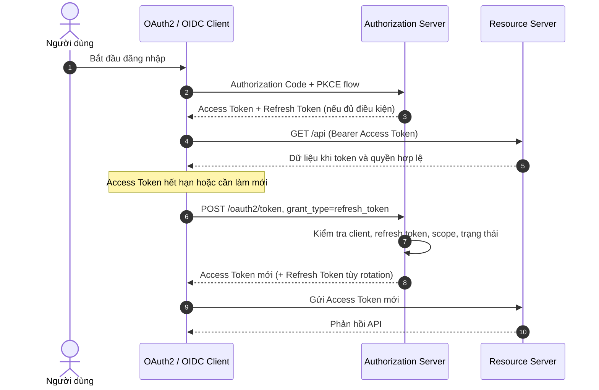
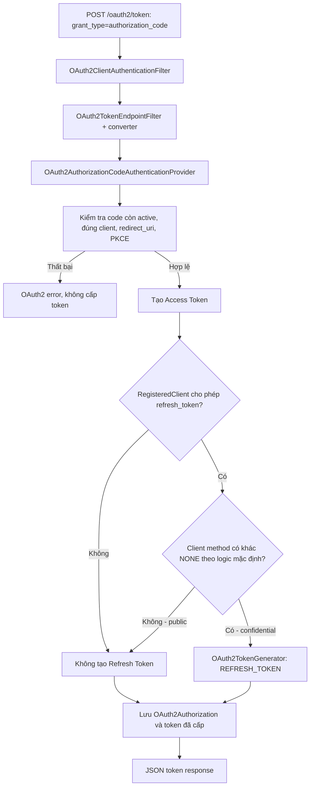
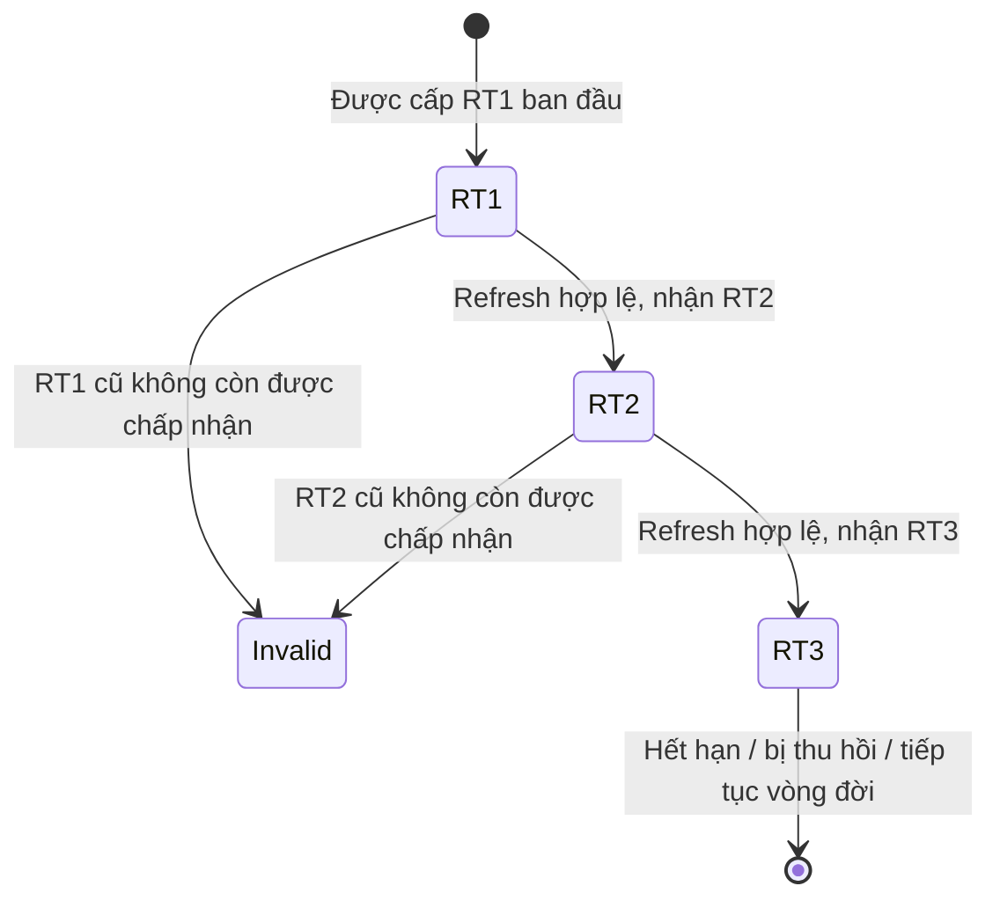

# Điều kiện phát hành refresh token theo grant và loại client

## 1. Vì sao không phải client nào cũng nhận Refresh Token?

Trong chương **Refresh Token** của module `SPRING_SECURITY_OAUTH2_OIDC_AUTHORIZATION_SERVER`, chúng ta tìm hiểu **khi nào OAuth 2.0 Authorization Server phát hành Refresh Token, khi nào cố ý không phát hành, và những yếu tố cấu hình nào quyết định hành vi đó**. Đây là kiến thức cần thiết để thiết kế, cấu hình, bảo mật, kiểm thử và vận hành OAuth 2.0/OpenID Connect Authorization Server bằng **Spring Security** và **Spring Authorization Server trong Spring Boot**.

Giả sử hệ thống có ba ứng dụng:

- **Portal Web**: ứng dụng web có backend, đăng nhập người dùng qua OIDC Authorization Code + PKCE.
- **Mobile App**: native app chạy trên điện thoại, là public client, dùng Authorization Code + PKCE.
- **Reporting Service**: dịch vụ backend dùng Client Credentials để tự lấy Access Token gọi API.

Cả ba đều có thể nhận Access Token theo luồng phù hợp, nhưng **không có nghĩa cả ba đều mặc nhiên được cấp Refresh Token**. Refresh Token cho phép xin Access Token mới sau khi Access Token cũ hết hạn mà không phải thực hiện lại toàn bộ giao dịch ủy quyền ban đầu. Do đó, nó kéo dài khả năng truy cập của client, làm tăng yêu cầu bảo vệ credential, lưu trữ, thu hồi và phát hiện hành vi bất thường.

Sau bài này, bạn có thể:

1. Phân biệt **phát hành Refresh Token ban đầu** với **dùng Refresh Token để refresh Access Token**.
2. Xác định ảnh hưởng của grant type, client authentication method, loại client và chính sách Authorization Server.
3. Hiểu hành vi mặc định đáng lưu ý của **Spring Authorization Server 1.x** đối với Authorization Code và public client.
4. Khai báo `AuthorizationGrantType.REFRESH_TOKEN`, `TokenSettings` và `ClientSettings` đúng mục đích.
5. Giải thích vì sao `offline_access` của OIDC, PKCE và Refresh Token rotation **không tự động** bảo đảm việc phát hành Refresh Token.
6. Thiết kế test và quan sát vận hành để phát hiện sai cấu hình, cấp token ngoài ý muốn và các lỗi refresh phổ biến.

> **Phạm vi phiên bản:** nội dung về các lớp Java và hành vi mặc định dưới đây tập trung vào **Spring Authorization Server 1.x / Spring Security 6.x** với ứng dụng Servlet Spring Boot 3.x. Với Spring Security 7.x hoặc các bản tích hợp Authorization Server sau này, hãy kiểm tra tài liệu và mã nguồn của phiên bản thực tế trước khi áp dụng các quy tắc triển khai ở cấp provider. Các nguyên tắc OAuth 2.0/OIDC được phân biệt riêng với chính sách mặc định của thư viện.

## 2. Refresh Token là gì, khác Access Token ra sao?

| Thuộc tính | Access Token | Refresh Token |
| --- | --- | --- |
| Mục đích | Client đưa tới **Resource Server** để truy cập tài nguyên được bảo vệ | Client đưa tới **Authorization Server Token Endpoint** để yêu cầu Access Token mới |
| Nơi sử dụng | API/Resource Server | Token Endpoint, thường `POST /oauth2/token` |
| Thời hạn | Thường ngắn; do chính sách phát hành quy định | Thường dài hơn Access Token nhưng vẫn có thể hết hạn hoặc bị thu hồi |
| Quyền hạn | Gắn với scope, audience, chủ thể và điều kiện của token | Đại diện khả năng tiếp tục xin token trong giới hạn authorization và chính sách client |
| Bảo vệ | Phải tránh rò rỉ, kiểm tra chữ ký/introspection, expiry, issuer, audience, scope | Phải chống đánh cắp và replay; lưu trữ rất cẩn trọng |
| Có phải JWT? | Có thể là JWT hoặc opaque | Không nên mặc định là JWT; Spring Authorization Server thường sinh **giá trị opaque** bằng token generator phù hợp |
| Có thể gọi API trực tiếp? | Có, nếu đúng tài nguyên/quyền và còn hợp lệ | **Không**; không dùng làm Bearer Access Token cho API |

**Không đánh đồng “đã cấu hình được refresh token” với “token không còn hạn”.** Refresh Token có thể hết hạn, bị vô hiệu, mất hiệu lực do thu hồi authorization hoặc thay đổi chính sách. Một Refresh Token hợp lệ không cấp quyền mới ngoài authorization đã được người dùng và Authorization Server cho phép.

### 2.1. Vị trí trong vòng đời token



Sơ đồ minh họa trường hợp **đã được cấp Refresh Token** ở lần trao đổi code đầu tiên. Nếu client chỉ nhận Access Token, nó không thể tự tạo Refresh Token bằng cách gửi `grant_type=refresh_token`; phải sử dụng lại một luồng cấp quyền hợp lệ khác.

## 3. Hai câu hỏi khác nhau: phát hành và sử dụng

Để tránh sai thiết kế, cần tách hai quyết định:

**Quyết định A — Có phát hành Refresh Token ngay từ đầu không?**

- Request đang sử dụng **grant nào**?
- `RegisteredClient` có cho phép `refresh_token` không?
- Client là **confidential** hay **public**, đang xác thực bằng phương thức nào?
- Provider của grant đó có chính sách phát hành Refresh Token không?
- Authorization Server còn áp dụng điều kiện OIDC, consent, token policy hoặc quy tắc bổ sung nào?

**Quyết định B — Client có được sử dụng Refresh Token đã có không?**

- `grant_type=refresh_token` có được đăng ký cho client không?
- Refresh Token có tồn tại, còn active và gắn với **đúng client** không?
- Client authentication method có hợp lệ không?
- Scope yêu cầu có nằm trong phạm vi đã được cấp không?
- Token đã bị thu hồi, hết hạn hoặc thay thế do rotation chưa?

Việc `RegisteredClient` cho phép `AuthorizationGrantType.REFRESH_TOKEN` là **điều kiện cần trong nhiều flow mặc định**, nhưng **không phải lời hứa mọi grant ban đầu sẽ phát hành Refresh Token**.

## 4. Ma trận grant type và khả năng phát hành Refresh Token

| Grant tại thời điểm cấp token | Phát hành Refresh Token lần đầu? | Lý do / điều kiện |
| --- | --- | --- |
| **Authorization Code** | **Có thể** | Phụ thuộc `RegisteredClient` cho phép `refresh_token`, loại/phương thức xác thực client, provider và chính sách AS |
| **Client Credentials** | **Không trong triển khai chuẩn mặc định của Spring Authorization Server** | Client có thể tự xác thực lại bằng credential để lấy Access Token mới; RFC 6749 nêu Refresh Token **SHOULD NOT** được cấp cho grant này |
| **Refresh Token** | **Không phải bước phát hành ban đầu** | Yêu cầu dùng Refresh Token đã tồn tại; response có thể giữ nguyên hoặc trả Refresh Token mới theo rotation |
| **Device Authorization Grant / Device Code** | **Phụ thuộc phiên bản và provider cụ thể** | Làm rõ grant được hỗ trợ và điều kiện phát hành; không suy ra chỉ từ việc client đăng ký `refresh_token` |
| **Token Exchange / extension grant** | **Phụ thuộc thiết kế và triển khai cụ thể** | Phải có provider và chính sách rõ ràng; không giả định mặc nhiên có Refresh Token |
| **Resource Owner Password Credentials** | **Không phải lựa chọn mặc định của Spring Authorization Server** | Grant legacy không được khuyến nghị cho ứng dụng mới; không thiết kế hệ thống mới dựa vào password grant |

**Lưu ý:** bảng không nói RFC cấm tuyệt đối Refresh Token trong mọi tình huống Client Credentials. RFC 6749 sử dụng ngôn ngữ **SHOULD NOT**, còn Spring Authorization Server mặc định **không cấp** Refresh Token trong provider `client_credentials`. Khi đánh giá custom grant hoặc mở rộng library, phải phân biệt **quy định giao thức** với **hành vi của framework**.

### 4.1. Authorization Code: grant phù hợp để nhận Refresh Token

Authorization Code Flow thường gắn với một lần người dùng ủy quyền cho client. Nếu chính sách cho phép duy trì khả năng truy cập sau lần đăng nhập ban đầu, Authorization Server có thể phát hành Access Token kèm Refresh Token.

Điều kiện tiêu biểu với **provider Authorization Code mặc định trong Spring Authorization Server 1.x**:

1. Authorization Code hợp lệ và chưa dùng; client, redirect URI và PKCE được xác minh.
2. `RegisteredClient.getAuthorizationGrantTypes()` chứa `AuthorizationGrantType.REFRESH_TOKEN`.
3. Client được nhận diện/xác thực bằng phương thức phù hợp với chính sách provider; **public client dùng `ClientAuthenticationMethod.NONE` không được phát hành Refresh Token trong nhánh mặc định này**.
4. Token generator được cấu hình để sinh loại token cần thiết và không có chính sách khác ngăn phát hành.

Điểm thứ ba là **hành vi triển khai quan trọng**: public client có thể được đăng ký `refresh_token` và dùng PKCE đúng cách nhưng vẫn **không nhận `refresh_token`** từ Authorization Code response của Spring Authorization Server 1.x mặc định.

### 4.2. Client Credentials: tại sao không cần Refresh Token?

Backend service `reporting-service` có thể xác thực chính nó mỗi khi cần token:

```http
POST /oauth2/token HTTP/1.1
Host: auth.example.com
Authorization: Basic <encoded-service-credentials>
Content-Type: application/x-www-form-urlencoded

grant_type=client_credentials&scope=reports.read
```

Phản hồi thông thường:

```json
{
  "access_token": "<access-token>",
  "token_type": "Bearer",
  "expires_in": 600,
  "scope": "reports.read"
}
```

**Không có `refresh_token`** trong ví dụ này. Client tiếp tục dùng phương thức client authentication đã đăng ký để xin token mới khi cần; tránh tạo thêm credential sống dài không có lý do rõ ràng. Việc thêm `AuthorizationGrantType.REFRESH_TOKEN` vào registration của một client chỉ sử dụng `client_credentials` **không làm provider Client Credentials tự phát hành Refresh Token**.

### 4.3. Refresh Token Grant: “làm mới” không phải lần cấp đầu

Sau khi đã được phát Refresh Token hợp lệ:

```http
POST /oauth2/token HTTP/1.1
Host: auth.example.com
Authorization: Basic <encoded-client-credentials>
Content-Type: application/x-www-form-urlencoded

grant_type=refresh_token&refresh_token=<original-refresh-token>
```

Authorization Server kiểm tra token và client, cấp Access Token mới nếu được phép. Refresh Token trả trong response **có thể là token cũ được tái sử dụng hoặc token mới** khi rotation được cấu hình. Chính sách đó **không thay đổi điều kiện phải được cấp Refresh Token ban đầu**.

## 5. Confidential client và public client

Một yếu tố quan trọng là **client có giữ bí mật xác thực đáng tin cậy không**.

| Loại client | Ví dụ | Phương thức xác thực điển hình | Tác động tới Refresh Token |
| --- | --- | --- | --- |
| **Confidential client** | Web backend/BFF; dịch vụ backend | `client_secret_basic`, `private_key_jwt` hoặc phương thức được AS hỗ trợ | Có thể đủ điều kiện nhận Refresh Token khi grant/provider và registration cho phép |
| **Public client** | Native/mobile app; SPA chạy trong browser | `none` kết hợp Authorization Code + PKCE | **Không được phát hành Refresh Token theo Authorization Code provider mặc định của Spring Authorization Server 1.x** |

**PKCE không biến public client thành confidential client.** PKCE kiểm tra rằng bên đổi Authorization Code giữ `code_verifier` tương ứng; nó không chứng minh ứng dụng đang giữ một client secret có thể bảo vệ lâu dài.

### 5.1. Vì sao phân biệt này quan trọng?

Với confidential backend, secret hoặc private key có thể được lưu trong secret manager, không gửi tới browser. Với SPA và native app, mã nguồn/chương trình nằm trên thiết bị của người dùng; mọi secret nhúng bên trong ứng dụng không thể được coi là bí mật đáng tin.

Refresh Token trong public client có nguy cơ bị trích xuất từ trình duyệt hoặc thiết bị, nên cần các biện pháp mạnh như **Refresh Token rotation hoặc sender-constraining**, giới hạn thời hạn/quyền và phát hiện replay theo hồ sơ an ninh hiện hành.

**RFC 9700** quy định đối với public clients, Refresh Token (nếu được cấp) **phải** được sender-constrained hoặc sử dụng refresh token rotation để phát hiện replay; đồng thời cần ràng buộc Refresh Token với scope và Resource Server đã được đồng ý. Đây là nguyên tắc bảo mật của giao thức hiện đại; **không có nghĩa cấu hình mặc định Spring Authorization Server tự phát Refresh Token cho public client**.

### 5.2. SPA: cân nhắc Backend-for-Frontend (BFF)

Một lựa chọn phổ biến là dùng **BFF/confidential web backend** xử lý Authorization Code, lưu token phía server và dùng cookie session có bảo vệ CSRF phù hợp cho trình duyệt. Khi backend được đăng ký bằng phương thức client authentication phù hợp, khả năng nhận Refresh Token được đánh giá như confidential client.

Điều này **không có nghĩa** chỉ cần đổi `client_id` hoặc khai báo `client_secret_basic` trong mã JavaScript. Client secret phải thực sự được bảo vệ ở thành phần server, token không lộ qua browser và luồng session phải được thiết kế an toàn.

### 5.3. Native/mobile app cần offline access thì sao?

Nhu cầu làm mới Access Token trong native app là thực tế, nhưng public client dùng `none` vẫn không nhận Refresh Token trong cấu hình mặc định Authorization Code của Spring Authorization Server 1.x. Nếu yêu cầu nghiệp vụ buộc phải cấp Refresh Token cho native app:

1. Xác minh phiên bản framework và chính sách hiện có.
2. Thiết kế phần mở rộng **có chủ đích**, không chỉ thêm `REFRESH_TOKEN` vào registration.
3. Đảm bảo PKCE, rotation hoặc sender-constraining, lưu token an toàn trong thiết bị, chính sách TTL và thu hồi.
4. Thực hiện review bảo mật, kiểm thử token theft/replay và vận hành key/authorization store.

Không vô hiệu hóa client authentication hoặc bỏ kiểm tra PKCE để khiến token response có thêm trường `refresh_token`.

## 6. Ba cơ chế cấu hình khác nhau trong RegisteredClient

Spring Authorization Server dùng `RegisteredClient` để lưu các chính sách chính:

| Cơ chế | API chính | Quyết định |
| --- | --- | --- |
| **Grant types được phép** | `authorizationGrantType(AuthorizationGrantType.AUTHORIZATION_CODE)`, `authorizationGrantType(AuthorizationGrantType.REFRESH_TOKEN)` | Client được phép bắt đầu grant nào và sử dụng Refresh Token Grant hay không |
| **Client authentication** | `clientAuthenticationMethod(ClientAuthenticationMethod.CLIENT_SECRET_BASIC)` hoặc `NONE` | Cách AS xác định/xác thực client; ảnh hưởng điều kiện phát Refresh Token mặc định |
| **Token policy** | `TokenSettings.refreshTokenTimeToLive(...)`, `reuseRefreshTokens(...)` | Tuổi thọ và chế độ tái sử dụng/rotation của Refresh Token **nếu được cấp** |

`ClientSettings.requireProofKey(true)` là yêu cầu PKCE; `requireAuthorizationConsent(true)` quy định một phần consent flow. Hai cài đặt này **không phải cờ bật Refresh Token**.

### 6.1. Cấu hình confidential Authorization Code client

Ví dụ `RegisteredClient` cho web backend:

```java
import java.time.Duration;
import java.util.UUID;

import org.springframework.security.oauth2.core.AuthorizationGrantType;
import org.springframework.security.oauth2.core.ClientAuthenticationMethod;
import org.springframework.security.oauth2.core.oidc.OidcScopes;
import org.springframework.security.oauth2.server.authorization.client.RegisteredClient;
import org.springframework.security.oauth2.server.authorization.settings.ClientSettings;
import org.springframework.security.oauth2.server.authorization.settings.TokenSettings;

public final class WebClientRegistration {

    public static RegisteredClient create(String encodedClientSecret) {
        return RegisteredClient.withId(UUID.randomUUID().toString())
                .clientId("portal-web")
                .clientName("Portal Web")
                .clientSecret(encodedClientSecret)
                .clientAuthenticationMethod(
                        ClientAuthenticationMethod.CLIENT_SECRET_BASIC)
                .authorizationGrantType(AuthorizationGrantType.AUTHORIZATION_CODE)
                .authorizationGrantType(AuthorizationGrantType.REFRESH_TOKEN)
                .redirectUri("https://portal.example.com/login/oauth2/code/as")
                .scope(OidcScopes.OPENID)
                .scope(OidcScopes.PROFILE)
                .scope("orders.read")
                .clientSettings(ClientSettings.builder()
                        .requireProofKey(true)
                        .requireAuthorizationConsent(true)
                        .build())
                .tokenSettings(TokenSettings.builder()
                        .authorizationCodeTimeToLive(Duration.ofMinutes(3))
                        .accessTokenTimeToLive(Duration.ofMinutes(10))
                        .refreshTokenTimeToLive(Duration.ofHours(12))
                        .reuseRefreshTokens(false)
                        .build())
                .build();
    }
}
```

**Ý nghĩa:**

- `AUTHORIZATION_CODE`: client được phép bắt đầu Authorization Code Flow.
- `REFRESH_TOKEN`: client có quyền sử dụng Refresh Token Grant, và là điều kiện của luồng phát hành Refresh Token mặc định khi đổi code.
- `CLIENT_SECRET_BASIC`: client là confidential theo cơ chế xác thực đã đăng ký; Spring Authorization Server cần kiểm tra client secret ở Token Endpoint.
- `requireProofKey(true)`: yêu cầu `code_challenge` và `code_verifier` đúng giao dịch khi dùng Authorization Code.
- `refreshTokenTimeToLive(Duration.ofHours(12))`: đặt TTL **cho Refresh Token được tạo**, không có nghĩa server bắt buộc tạo nó.
- `reuseRefreshTokens(false)`: yêu cầu phát hành Refresh Token mới khi refresh theo cơ chế được framework hỗ trợ; không thay thế thiết kế replay detection/token family đầy đủ.
- `encodedClientSecret` phải là secret đã được mã hóa một chiều và lưu ở Authorization Server theo `PasswordEncoder` phù hợp (ví dụ định dạng `{bcrypt}...`); **không** hard-code raw client secret vào Git.

Ví dụ tạo đối tượng registration, không bao gồm `RegisteredClientRepository`, `OAuth2AuthorizationService`, khóa ký, login hay filter chain cần cho ứng dụng thực tế. Khi lưu trong JDBC, ID client cần ổn định qua các lần deploy; `UUID.randomUUID()` chỉ phù hợp khi đăng ký mới, không phải câu lệnh chạy để thay thế ID mỗi lần khởi động production.

### 6.2. So sánh public client dù đã khai báo refresh grant

```java
RegisteredClient mobile = RegisteredClient.withId("mobile-test-id")
        .clientId("mobile-public")
        .clientAuthenticationMethod(ClientAuthenticationMethod.NONE)
        .authorizationGrantType(AuthorizationGrantType.AUTHORIZATION_CODE)
        .authorizationGrantType(AuthorizationGrantType.REFRESH_TOKEN)
        .redirectUri("com.example.mobile:/oauth2redirect")
        .scope("profile.read")
        .clientSettings(ClientSettings.builder()
                .requireProofKey(true)
                .build())
        .build();
```

Đây là **đoạn minh họa sự khác biệt về eligibility**, không phải lời khuyên cấu hình Refresh Token Grant cho mọi public client. Dù registration chứa `REFRESH_TOKEN`, provider Authorization Code mặc định trong Spring Authorization Server 1.x vẫn **không phát Refresh Token cho client dùng `NONE`**. Client cần chính sách/cơ chế mở rộng được xem xét riêng nếu sản phẩm yêu cầu offline access ở public app.

### 6.3. So sánh client credentials

```java
RegisteredClient reporting = RegisteredClient.withId("reporting-test-id")
        .clientId("reporting-service")
        .clientSecret(encodedServiceSecret)
        .clientAuthenticationMethod(ClientAuthenticationMethod.CLIENT_SECRET_BASIC)
        .authorizationGrantType(AuthorizationGrantType.CLIENT_CREDENTIALS)
        .scope("reports.read")
        .build();
```

`reporting-service` có thể lấy Access Token bằng `client_credentials`, nhưng provider mặc định **không phát Refresh Token**. Nếu thời hạn Access Token sắp hết, service có thể dùng credential đã đăng ký để lấy token khác; nên cache Access Token trong giới hạn an toàn thay vì gửi yêu cầu mới cho mọi API call.

## 7. Điều kiện phát hành trong pipeline Spring Authorization Server

Một request `authorization_code` đi qua:



Đây là sơ đồ **logic điều kiện phát hành** của Authorization Code provider mặc định Spring Authorization Server 1.x, không phải bản sao từng dòng mã nguồn. Các kiểm tra/việc tạo token và lưu trạng thái có thể được cài đặt ở vị trí khác theo phiên bản.

Các thành phần cần phân biệt:

- `OAuth2AuthorizationCodeAuthenticationProvider` xử lý **đổi authorization code** tại Token Endpoint.
- `RegisteredClientRepository` cung cấp cấu hình client, grant types, scopes và token settings.
- `OAuth2AuthorizationService` giữ authorization và trạng thái các token để refresh/revoke/introspection.
- `OAuth2TokenGenerator<?>` tạo Access Token và có thể tạo Refresh Token; generator mặc định có các thành phần thích hợp cho từng `OAuth2TokenType`.
- `OAuth2RefreshTokenAuthenticationProvider` xử lý **yêu cầu dùng Refresh Token đã có**.

**Thay thế `OAuth2TokenGenerator` đơn thuần không đủ để bảo đảm phát Refresh Token cho public client** nếu provider Authorization Code đang cố ý không yêu cầu sinh loại token này. Việc sửa điều kiện phát hành phải được xem xét ở đúng tầng provider, đồng thời giữ client binding, PKCE, grant, scope, rotation và lưu trữ an toàn.

### 7.1. Nếu token generator không tạo được Refresh Token?

Ngay cả khi grant và loại client đáp ứng chính sách, server còn cần `OAuth2TokenGenerator` phù hợp. Với cấu hình mặc định, Spring Authorization Server có thể sinh Refresh Token qua generator cho loại token này; nếu dùng **custom token generator** chỉ hỗ trợ JWT Access Token mà bỏ nhánh Refresh Token, kết quả có thể là lỗi cấp token thay vì tự động fallback.

Khi tùy chỉnh token generator, cần kiểm tra tất cả loại token mà server cần: Access Token, Refresh Token và ID Token (nếu OIDC). Không suy luận rằng `OAuth2TokenType.ACCESS_TOKEN` là loại duy nhất phải hỗ trợ.

### 7.2. Token format và Refresh Token là hai quyết định khác nhau

`TokenSettings.accessTokenFormat(OAuth2TokenFormat.SELF_CONTAINED)` hoặc `REFERENCE` điều khiển **định dạng Access Token**. Đổi sang JWT Access Token không tự động biến Refresh Token thành JWT và cũng không quyết định có được cấp Refresh Token hay không.

Refresh Token nên được coi là credential có giá trị cao dù hình thức chỉ là chuỗi opaque. Nếu storage bị xâm phạm hoặc log làm lộ token, kẻ tấn công có thể có cơ hội xin Access Token mới cho đến khi Refresh Token hết hạn, bị ràng buộc ngăn sử dụng, hoặc bị thu hồi.

## 8. OIDC `offline_access` có bắt buộc không?

OpenID Connect bổ sung scope `offline_access` để diễn đạt rằng client muốn có khả năng truy cập tài nguyên khi người dùng **không còn tương tác trực tiếp**. Đây là một **yêu cầu/phạm vi OIDC**, không phải chính Refresh Token.

Theo OpenID Connect Core, Authorization Server phải xem xét các điều kiện consent khi xử lý `offline_access`: thông thường cần sự đồng ý rõ ràng, chẳng hạn `prompt=consent`, trừ khi đã thỏa điều kiện khác để có consent thích hợp. Khi dùng OIDC, yêu cầu `offline_access` còn phụ thuộc chính sách client, flow và nội dung được hỗ trợ bởi OpenID Provider.

**Đừng nhầm ba tầng:**

| Yếu tố | Có nghĩa là gì? | Điều không nên suy diễn |
| --- | --- | --- |
| `scope=offline_access` | Client đề nghị quyền truy cập ngoại tuyến theo OIDC | **Không tự bảo đảm** server phát Refresh Token |
| `AuthorizationGrantType.REFRESH_TOKEN` | Client registration cho phép refresh grant | **Không tự bảo đảm** authorization_code response có Refresh Token |
| `TokenSettings.refreshTokenTimeToLive` | Chính sách TTL nếu Refresh Token được sinh | **Không phải** công tắc bật phát Refresh Token |

Ngược lại, trong OAuth 2.0 thuần, Refresh Token có thể được phát theo policy mà **không có scope OIDC `offline_access`**. Đối với Spring Authorization Server 1.x, không nên khẳng định framework tự động thực thi toàn bộ kỳ vọng “chỉ phát khi có `offline_access`” trong mọi cấu hình. Nếu sản phẩm có quy định offline consent hoặc cần loại trừ Refresh Token với scope nhất định, phải **định nghĩa và kiểm thử chính sách rõ ràng** thay vì chỉ dựa vào việc client gửi tên scope.

### 8.1. Phân biệt Refresh Token và ID Token

`openid` yêu cầu OpenID Connect; `id_token` được cấp trong OIDC flow thích hợp để **OIDC Client xác minh phiên đăng nhập**. Refresh Token lại phục vụ **lấy Access Token mới**; nó không phải ID Token và không được trình cho API. Việc token response có ID Token không đồng nghĩa chắc chắn có Refresh Token.

## 9. Bảo mật public client: PKCE, rotation và sender constraint

### 9.1. PKCE không trực tiếp bảo vệ Refresh Token về sau

PKCE ràng buộc **Authorization Code** với `code_verifier` trong lần đổi code. Khi client đã nhận Refresh Token, yêu cầu `grant_type=refresh_token` là một giao dịch khác: không tự động có PKCE verifier làm yếu tố xác thực Refresh Token.

Vì vậy, nếu quyết định cấp Refresh Token cho public app bằng một cơ chế được hỗ trợ hoặc tùy chỉnh, cần thiết kế biện pháp bảo vệ vòng đời Refresh Token riêng:

- **Rotation:** thay Refresh Token sau mỗi lần dùng, làm mất hiệu lực token cũ và có chiến lược xử lý replay.
- **Sender-constraining:** ràng buộc token với một khóa/credential mà bên sử dụng phải chứng minh quyền sở hữu khi refresh.
- **Giới hạn TTL/phạm vi:** không cấp quyền rộng hoặc tồn tại vô hạn; ràng buộc với scope/resource đã được cho phép.
- **Lưu trữ an toàn:** trên mobile dùng cơ chế bảo vệ của hệ điều hành khi phù hợp; với browser đánh giá nguy cơ XSS và kiến trúc BFF.
- **Thu hồi/giám sát:** chấm dứt hiệu lực khi nghi lộ token, logout hoặc điều kiện bảo mật yêu cầu.

RFC 9700 nhấn mạnh Refresh Token rotation hoặc sender-constraining cho public clients. **`reuseRefreshTokens(false)` chỉ là một phần của câu chuyện bảo mật**; không nên mặc định rằng chỉ cấu hình một cờ đã tạo đầy đủ token-family tracking, cảnh báo replay, vô hiệu tất cả token liên quan và an toàn đồng thời.

### 9.2. Rotation ở confidential client

Trong Spring Authorization Server, `TokenSettings.reuseRefreshTokens(false)` được dùng để yêu cầu Refresh Token mới khi refresh (nếu provider, generator và chính sách cho phép). Khi `true`, Refresh Token cũ có thể tiếp tục được dùng cho đến khi hết hạn/bị thu hồi, tùy logic triển khai.

Nếu rotation được thực hiện:



Sơ đồ thể hiện logic rotation, **không khẳng định framework mặc định triển khai đầy đủ theo dõi mọi nhánh token family hoặc thu hồi tự động toàn bộ Access Token đã cấp**. Trong hệ thống nhiều instance, phải kiểm thử race condition khi hai request cùng dùng RT1. Chính sách phát hiện và xử lý replay cần được thiết kế cùng storage.

## 10. Refresh Token Grant: kiểm tra khi sử dụng token đã có

Khi client gửi `grant_type=refresh_token`, `OAuth2RefreshTokenAuthenticationProvider` cần xác minh một số điều kiện chính:

1. Client đã được xác thực hoặc được nhận diện theo cơ chế tương ứng và là client sở hữu authorization.
2. `RegisteredClient` cho phép `AuthorizationGrantType.REFRESH_TOKEN`.
3. `OAuth2AuthorizationService` tìm thấy Refresh Token và trạng thái hợp lệ, chưa hết hạn hoặc bị invalidated.
4. Scope được yêu cầu (nếu có) không vượt quá quyền đã cấp.
5. Generator phát hành Access Token mới, Refresh Token được xử lý theo chính sách reuse/rotation.
6. Authorization state được lưu và response phù hợp giao thức.

### 10.1. Một ví dụ HTTP thành công

Giả định confidential client `portal-web` có Refresh Token hợp lệ:

```bash
curl -i -X POST 'https://auth.example.com/oauth2/token' \
  -u 'portal-web:<client-secret>' \
  -H 'Content-Type: application/x-www-form-urlencoded' \
  --data-urlencode 'grant_type=refresh_token' \
  --data-urlencode 'refresh_token=<previous-refresh-token>' \
  --data-urlencode 'scope=orders.read'
```

Nếu chính sách cho phép và token còn active:

```json
{
  "access_token": "<new-access-token>",
  "token_type": "Bearer",
  "expires_in": 600,
  "refresh_token": "<new-refresh-token-if-rotated>",
  "scope": "orders.read"
}
```

Các token, `expires_in` và hành vi rotation trong ví dụ **chỉ mang tính minh họa**. Response thực tế phụ thuộc loại grant, phiên bản và policy. Khi `reuseRefreshTokens(true)`, trường `refresh_token` trong phản hồi có thể là giá trị cũ được tiếp tục sử dụng; khi rotation bật, client phải **lưu token mới một cách an toàn và ngừng dùng token cũ**.

### 10.2. Các lỗi thường thấy

| Tình huống | Dạng lỗi có thể gặp | Cách điều tra |
| --- | --- | --- |
| Client secret/assertion sai | `invalid_client` | Phương thức client authentication, secret, key, RegisteredClient |
| Client không đăng ký refresh grant | `unauthorized_client` | Grant types ở registration |
| Refresh Token không tồn tại/hết hạn/bị thu hồi | `invalid_grant` | Trạng thái authorization và token; TTL; storage |
| Refresh Token thuộc client khác | `invalid_grant` hoặc lỗi bảo vệ tương ứng | Client binding và repository |
| Scope mới vượt quá scope được cấp | `invalid_scope` | Quyền đã được authorize; request refresh |
| Provider/generator tùy chỉnh lỗi | Lỗi server/OAuth2 phù hợp | Kiểm tra token generator, persistence và logs nội bộ |

Đây là ma trận **điển hình**, không phải cam kết status code hoặc thứ tự lỗi cố định cho mọi triển khai. Đừng ghi Refresh Token/secret vào `error_description` hoặc log để xác định token nào thất bại.

### 10.3. Khi nào client nên refresh?

Client thường làm mới Access Token khi gần hết hạn hoặc nhận lỗi cho biết token không còn được chấp nhận theo quy tắc API. Nên có cơ chế **single-flight/lock** để tránh nhiều request đồng thời dùng một Refresh Token, nhất là khi rotation bật.

Nếu refresh thất bại vì token hết hạn/bị thu hồi, client cần chuyển người dùng sang **luồng ủy quyền mới** hoặc xử lý lỗi theo loại ứng dụng. Không retry liên tục cùng một Refresh Token bị từ chối; đây vừa là lỗi trải nghiệm vừa có thể che giấu dấu hiệu replay.

## 11. Test ma trận điều kiện phát hành Refresh Token

Một bài kiểm thử tốt phải xác nhận cả **sự hiện diện** và **sự vắng mặt đúng chủ đích** của trường `refresh_token` trong token response.

| # | Grant ban đầu / tác vụ | Client | Registration/policy | Kỳ vọng chính |
| --- | --- | --- | --- | --- |
| 1 | Authorization Code + PKCE | Confidential | Có `REFRESH_TOKEN`, secret hợp lệ | Có thể có `refresh_token` trong response mặc định |
| 2 | Authorization Code + PKCE | Confidential | **Không** có `REFRESH_TOKEN` | **Không** có `refresh_token` |
| 3 | Authorization Code + PKCE | Public `NONE` | Có `REFRESH_TOKEN` | Spring Authorization Server 1.x mặc định **không** cấp Refresh Token |
| 4 | Authorization Code | Confidential | Client authentication thất bại | Token request bị từ chối; **không cấp token** |
| 5 | Client Credentials | Confidential | Đúng grant/scope | Access Token thành công, **không có Refresh Token** |
| 6 | Client Credentials | Confidential | Có thêm `REFRESH_TOKEN` trong registration | Vẫn **không được cấp Refresh Token từ Client Credentials** theo provider mặc định |
| 7 | Refresh Token Grant | Confidential | Refresh Token còn active, đúng client | Cấp Access Token mới; Refresh Token giữ/đổi theo policy |
| 8 | Refresh Token Grant | Confidential | Token hết hạn/bị thu hồi | `invalid_grant` hoặc từ chối phù hợp |
| 9 | Refresh Token Grant | Confidential | Scope yêu cầu vượt quyền đã cấp | Bị từ chối; không nâng quyền |
| 10 | Authorization Code OIDC | Confidential | Scope `openid`, không có `offline_access` | Không suy luận điều kiện phát hành từ tên scope; kiểm tra policy OIDC thực tế |
| 11 | Authorization Code OIDC | Public `NONE` | Có `offline_access`, `REFRESH_TOKEN`, PKCE | Không tự động vượt giới hạn provider mặc định đối với public client |
| 12 | Device/extension grant | Bất kỳ | Phụ thuộc provider | Kiểm thử riêng từng grant; không suy ra từ hàng 1 |

Đối với hàng 1, “có thể có” giả định **toàn bộ flow thành công và token generator phát hành được Refresh Token**. Đừng chỉ đọc cấu hình đăng ký client rồi kết luận token chắc chắn được tạo.

### 11.1. Unit test cấu hình RegisteredClient

Ví dụ JUnit 5 kiểm tra hai phần **registration và TokenSettings**, không cần phát token thật:

```java
import static org.assertj.core.api.Assertions.assertThat;

import java.time.Duration;
import org.junit.jupiter.api.Test;
import org.springframework.security.oauth2.core.AuthorizationGrantType;
import org.springframework.security.oauth2.core.ClientAuthenticationMethod;
import org.springframework.security.oauth2.server.authorization.client.RegisteredClient;
import org.springframework.security.oauth2.server.authorization.settings.TokenSettings;

class RefreshEligibilityConfigurationTest {

    @Test
    void confidentialWebClientRegistersRefreshGrantAndTokenPolicy() {
        RegisteredClient client = RegisteredClient.withId("test-client-id")
                .clientId("portal-web")
                .clientSecret("{noop}test-secret-only")
                .clientAuthenticationMethod(ClientAuthenticationMethod.CLIENT_SECRET_BASIC)
                .authorizationGrantType(AuthorizationGrantType.AUTHORIZATION_CODE)
                .authorizationGrantType(AuthorizationGrantType.REFRESH_TOKEN)
                .redirectUri("https://portal.example.com/callback")
                .scope("orders.read")
                .tokenSettings(TokenSettings.builder()
                        .refreshTokenTimeToLive(Duration.ofHours(12))
                        .reuseRefreshTokens(false)
                        .build())
                .build();

        assertThat(client.getAuthorizationGrantTypes())
                .contains(AuthorizationGrantType.REFRESH_TOKEN);
        assertThat(client.getClientAuthenticationMethods())
                .contains(ClientAuthenticationMethod.CLIENT_SECRET_BASIC);
        assertThat(client.getTokenSettings().getRefreshTokenTimeToLive())
                .isEqualTo(Duration.ofHours(12));
        assertThat(client.getTokenSettings().isReuseRefreshTokens()).isFalse();
    }
}
```

`{noop}test-secret-only` **chỉ dành cho unit test cấu hình**, tuyệt đối không dùng đăng ký client production. Nếu test Token Endpoint thực tế, nên dùng một `PasswordEncoder` phù hợp, secret test được bảo vệ và băm đúng cách.

**Giới hạn test:** các assert trên chỉ chứng minh registration có cờ và TTL đúng. Không chứng minh JWT/Refresh Token đã được tạo, không kiểm tra điều kiện `NONE` của provider và không kiểm thử rotation. Phải có integration test qua Token Endpoint để chứng minh hành vi.

### 11.2. Integration test cần làm gì?

**Authorization Code – confidential client:**

1. Bắt đầu `/oauth2/authorize` với `client_id`, `redirect_uri`, `state` và PKCE hợp lệ.
2. Đăng nhập/consent nếu cần; nhận code mới tại callback.
3. Gửi `POST /oauth2/token` với đúng client authentication, code và `code_verifier`.
4. Assert token response có `access_token` và, nếu mọi điều kiện ở trên thỏa, có `refresh_token`.
5. Sử dụng Refresh Token để lấy Access Token mới; kiểm tra TTL, scope và rotation.

**Authorization Code – public client:** dùng `ClientAuthenticationMethod.NONE` và `client_id` ở token request theo cấu hình; cùng PKCE hợp lệ. Kiểm tra token response mặc định **không có `refresh_token`** dù registration có `REFRESH_TOKEN`.

**Client Credentials – confidential client:** gọi `grant_type=client_credentials` với secret hợp lệ, assert `access_token` hiện diện và JSON **không có `refresh_token`**.

**Refresh Token rotation:** chỉ test khi đã có Refresh Token. Gửi refresh lần đầu, đọc Refresh Token mới (nếu rotation), rồi gửi lại token cũ: kỳ vọng bị từ chối trong kịch bản tuần tự thông thường. Thử hai request đồng thời với cùng Refresh Token trên nhiều node để tìm race condition và đối chiếu chính sách replay.

### 11.3. Ví dụ curl: đăng nhập client không đồng nghĩa refresh

```bash
# Client Credentials: không mong đợi refresh_token trong response mặc định.
curl -i -X POST 'https://auth-test.example.com/oauth2/token' \
  -u 'reporting-service:<test-secret>' \
  -H 'Content-Type: application/x-www-form-urlencoded' \
  --data-urlencode 'grant_type=client_credentials' \
  --data-urlencode 'scope=reports.read'

# Refresh Token Grant: chỉ gọi khi client đã được cấp Refresh Token thật.
curl -i -X POST 'https://auth-test.example.com/oauth2/token' \
  -u 'portal-web:<test-secret>' \
  -H 'Content-Type: application/x-www-form-urlencoded' \
  --data-urlencode 'grant_type=refresh_token' \
  --data-urlencode 'refresh_token=<token-from-previous-authorization>'
```

Đây là **lệnh minh họa**, không phải kết quả chạy. Secret và token cần được truyền qua công cụ/biến môi trường an toàn của môi trường test; không để thông tin thật xuất hiện trong shell history, log CI hoặc ảnh chụp màn hình.

## 12. Sai lầm thường gặp và cách sửa

### 12.1. Thấy `REFRESH_TOKEN` trong RegisteredClient là mong đợi ngay Refresh Token

Đăng ký grant chưa đủ. Cần xem provider của **grant ban đầu** có phát loại token này không, loại client/method và generator. Với `client_credentials`, mặc định không phát; với public Authorization Code client, Spring Authorization Server 1.x mặc định cũng không phát.

**Cách sửa:** kiểm tra ma trận grant/client, thực hiện một Token Endpoint request hợp lệ, xem response và cấu hình hiệu lực.

### 12.2. Nghĩ rằng `reuseRefreshTokens(false)` bật Refresh Token

Cờ đó liên quan **cách xử lý token khi refresh**. Nếu không có Refresh Token ban đầu, sẽ chẳng có token nào để rotation. `refreshTokenTimeToLive` cũng không phải công tắc cấp phát.

**Cách sửa:** kiểm tra điều kiện phát hành ban đầu trước, rồi mới kiểm tra rotation.

### 12.3. Cho public client một client secret hard-code

Thêm `client_secret_basic` vào SPA hoặc ứng dụng native và nhúng secret trong JS/APK/IPA không tạo ra confidential client an toàn. Kẻ khác có thể trích xuất secret.

**Cách sửa:** giữ đúng phân loại public client và PKCE; nếu cần giữ token/credential dài hạn, cân nhắc BFF hoặc cơ chế Refresh Token được thiết kế phù hợp với public app và yêu cầu RFC 9700.

### 12.4. Nhầm `offline_access` với lệnh cấp Refresh Token

`scope=offline_access` trong OIDC là yêu cầu quyền truy cập ngoại tuyến và gắn với consent/policy; không thay cho `REFRESH_TOKEN` grant, client authentication hay kiểm tra provider. Một triển khai OAuth2 không dùng OIDC cũng có thể phát Refresh Token theo chính sách.

**Cách sửa:** kiểm tra cả OIDC consent và authorization/grant/provider; ghi rõ semantics vào tài liệu hợp đồng với client.

### 12.5. Dùng Refresh Token thay Access Token để gọi API

Resource Server không được coi Refresh Token như Access Token. Nếu API nhận Refresh Token như Bearer credential, hệ thống có thể bỏ qua phân tách quyền và mở rộng nguy cơ lộ thông tin.

**Cách sửa:** API phải xác minh loại/token use, issuer, audience, expiry và scope/quyền phù hợp; Refresh Token chỉ nên tới Token Endpoint.

### 12.6. Lưu Refresh Token ở nơi không kiểm soát

Đưa Refresh Token vào URL, log, analytics, thông báo lỗi, localStorage không có đánh giá nguy cơ hoặc source code là thiết kế rủi ro cao. Refresh Token thường có vòng đời dài hơn Access Token nên mức độ ảnh hưởng khi lộ có thể lớn.

**Cách sửa:** lưu ở backend/secret store hoặc cơ chế bảo vệ thiết bị phù hợp; hạn chế quyền đọc, tránh rò rỉ qua telemetry; thiết kế revocation và rotation.

### 12.7. Cứ `invalid_grant` là tăng TTL

Refresh có thể thất bại do token hết hạn, sai client, bị thu hồi, bị thay trong rotation hoặc lỗi trạng thái giữa các node. Việc tăng TTL không giải quyết nguyên nhân và có thể tăng cửa sổ tấn công.

**Cách sửa:** kiểm tra trạng thái token và luồng refresh, phân tích sự kiện an toàn rồi mới quyết định TTL.

### 12.8. Nghĩ rằng vô hiệu hóa Refresh Token làm mọi JWT Access Token mất hiệu lực tức thì

Nếu Resource Server chỉ xác minh chữ ký JWT và `exp` offline, Access Token đã phát hành có thể vẫn được chấp nhận đến khi hết hạn. Thu hồi Refresh Token **ngăn cấp token mới**, không luôn vô hiệu mọi Access Token đã có.

**Cách sửa:** xác định yêu cầu thu hồi thực tế, cân nhắc TTL Access Token ngắn, token introspection, denylist hoặc chính sách kiểm tra trạng thái khi cần.

## 13. Lưu trữ, nhiều instance và chống replay

Trong Spring Authorization Server, `OAuth2AuthorizationService` giữ trạng thái authorization, token và thông tin cần thiết để kiểm tra refresh. Nếu dùng `InMemoryOAuth2AuthorizationService` ở từng JVM, node A và node B **không chia sẻ trạng thái**: Refresh Token tạo ở node A có thể không được node B tìm thấy.

Với production:

- Chọn kho authorization phù hợp để lưu trạng thái qua restart và giữa các instance.
- Nếu dùng JDBC, tạo/migrate schema đúng phiên bản và xác minh transaction/locking phù hợp.
- Kiểm thử **đồng thời** khi rotation bật: hai request dùng cùng Refresh Token không được làm phát sinh hai nhánh token cùng hợp lệ ngoài chính sách.
- Giữ issuer/khóa ký và chính sách token nhất quán giữa các node.
- Đồng bộ thời gian hệ thống; không dùng clock skew lớn để nới lỏng TTL không có kiểm soát.
- Có quy trình thu hồi authorization/token khi client bị vô hiệu, người dùng logout theo policy hoặc nghi lộ credential.

**Không mặc định rằng chỉ bật JDBC và `reuseRefreshTokens(false)` đã giải quyết mọi kịch bản replay/concurrency.** Cần chứng minh bằng integration test với storage và topology thực tế. Nếu viết `OAuth2AuthorizationService` tùy chỉnh, phải giữ semantics tra cứu, hết hạn, invalidation và cập nhật trạng thái an toàn trước request cạnh tranh.

### 13.1. Observability không tiết lộ token

Nên đo và theo dõi:

| Tín hiệu | Lợi ích |
| --- | --- |
| Số lần token response có/không có `refresh_token` theo grant và loại client | Phát hiện thay đổi policy ngoài ý muốn |
| Tỷ lệ `invalid_client`/`invalid_grant`/`invalid_scope` ở Token Endpoint | Phát hiện lỗi đăng ký, secret, replay hoặc scope |
| Refresh Token rotation và token replay nghi vấn | Phát hiện callback/client retry hoặc dấu hiệu token theft |
| Latency, lỗi database và failover của `OAuth2AuthorizationService` | Chẩn đoán vấn đề nhiều instance |
| Sự kiện thu hồi, đổi secret và thay đổi `RegisteredClient` | Kiểm toán vòng đời và xử lý sự cố |

Không ghi raw Access Token, Refresh Token, authorization code, client assertion, `code_verifier` hay secret trong log và metric labels. Sử dụng correlation ID và mã lỗi để điều tra mà không tạo nguồn rò rỉ credential mới.

## 14. Checklist quyết định phát hành Refresh Token

Trước khi triển khai client hoặc thay đổi policy:

1. **Xác định grant ban đầu:** Authorization Code, Client Credentials, Device hoặc extension grant; đừng mặc định tất cả phát Refresh Token.
2. **Xác định loại client:** confidential/backend hay public/browser/native; client authentication method có bảo đảm đúng đặc điểm triển khai không?
3. **Xác nhận grant registration:** `AuthorizationGrantType.REFRESH_TOKEN` được cho phép đúng client, không gắn vào một client không có nhu cầu.
4. **Kiểm tra chính sách provider:** phiên bản Spring Authorization Server đang dùng có điều kiện chặn Refresh Token cho public client hay grant nào?
5. **Kiểm tra OIDC:** nếu yêu cầu `offline_access`, consent và chính sách OpenID Provider có phù hợp không?
6. **Kiểm tra TTL/rotation:** `refreshTokenTimeToLive`, `reuseRefreshTokens` và khả năng thu hồi đã được thiết kế; phân biệt chúng với cờ phát hành.
7. **Bảo vệ credential:** client secret/private key, Refresh Token, signing keys và các token khác nằm ở nơi lưu trữ phù hợp.
8. **Giới hạn quyền:** Refresh Token không cho phép xin scope/resource vượt quyền đã được cấp; Resource Server vẫn kiểm tra authorization.
9. **Kiểm thử cả hai chiều:** nơi mong đợi **có** Refresh Token và nơi mong đợi **không có** đều phải được test tự động.
10. **Kiểm thử production topology:** restart, nhiều node, concurrent refresh, rotation/replay và revocation được xác minh.
11. **Rà soát khi nâng cấp:** kiểm tra thay đổi provider/generator, default token settings, OIDC behavior và tương thích client sau nâng phiên bản.

## 15. Bài tập và câu hỏi tự đánh giá

**Bài tập A — Đọc cấu hình:** một client khai báo `AUTHORIZATION_CODE`, `REFRESH_TOKEN`, `ClientAuthenticationMethod.NONE` và `requireProofKey(true)`. Hãy giải thích vì sao Spring Authorization Server 1.x mặc định vẫn không trả Refresh Token khi đổi Authorization Code, dù PKCE thành công.

**Bài tập B — Phân biệt grant:** một backend service chỉ dùng `CLIENT_CREDENTIALS` cần lấy Access Token mới mỗi 10 phút. Hãy thiết kế cách cache Access Token và xin lại token bằng client authentication, không yêu cầu Refresh Token.

**Bài tập C — Cấu hình web backend:** đăng ký confidential web client có `AUTHORIZATION_CODE`, `REFRESH_TOKEN`, `CLIENT_SECRET_BASIC`, PKCE và Refresh Token rotation. Test rằng đổi code thành công trả Refresh Token và lần refresh tiếp theo cập nhật token đúng policy.

**Bài tập D — OIDC offline access:** một OIDC Client gửi `openid offline_access`. Liệt kê các yếu tố còn cần xác minh ngoài scope: client registration, user consent, provider policy, loại client, auth method và token settings.

**Bài tập E — Concurrent refresh:** gửi hai request gần đồng thời với cùng Refresh Token khi rotation bật ở cụm hai node. Viết expected behavior và kế hoạch kiểm tra database/authorization state nếu cả hai request thành công.

**Câu hỏi ôn tập:**

1. Tại sao Access Token và Refresh Token có endpoint sử dụng khác nhau?
2. `AuthorizationGrantType.REFRESH_TOKEN` là điều kiện cần hay đủ để AS cấp Refresh Token ban đầu?
3. Trong Spring Authorization Server 1.x, vì sao public client `NONE` dùng PKCE thường không được cấp Refresh Token theo Authorization Code provider mặc định?
4. RFC 6749 nói gì về Refresh Token với Client Credentials Grant?
5. `TokenSettings.reuseRefreshTokens(false)` có khiến client chưa từng nhận Refresh Token tự có Refresh Token không?
6. Khi nào `grant_type=refresh_token` được dùng, và request phải chứng minh những điều kiện gì?
7. `offline_access` trong OIDC khác `AuthorizationGrantType.REFRESH_TOKEN` ở điểm nào?
8. Vì sao PKCE không đủ để bảo vệ Refresh Token sau khi code đã được đổi?
9. RFC 9700 yêu cầu biện pháp nào nếu Refresh Token được cấp cho public client?
10. Nếu thu hồi Refresh Token, JWT Access Token cũ luôn mất hiệu lực tức thì hay không?
11. Tại sao phải có integration test khẳng định response `client_credentials` **không có** `refresh_token`?
12. Điều gì có thể xảy ra khi hai node cùng refresh một token mà không có chiến lược đồng bộ/rotation an toàn?

## 16. Tài liệu tham khảo

- [RFC 6749 — OAuth 2.0: Issuing an Access Token (Section 5.1)](https://www.rfc-editor.org/rfc/rfc6749#section-5.1)
- [RFC 6749 — Refreshing an Access Token (Section 6)](https://www.rfc-editor.org/rfc/rfc6749#section-6)
- [RFC 6749 — Client Credentials Grant (Section 4.4.3)](https://www.rfc-editor.org/rfc/rfc6749#section-4.4.3)
- [RFC 9700 — OAuth 2.0 Security Best Current Practice](https://www.rfc-editor.org/rfc/rfc9700)
- [OpenID Connect Core 1.0 — Requesting Offline Access](https://openid.net/specs/openid-connect-core-1_0.html#OfflineAccess)
- [Spring Authorization Server — Core Model Components](https://docs.spring.io/spring-authorization-server/reference/core-model-components.html)
- [Spring Authorization Server — Protocol Endpoints](https://docs.spring.io/spring-authorization-server/reference/protocol-endpoints.html)
- [Spring Authorization Server — Configuration Model](https://docs.spring.io/spring-authorization-server/reference/configuration-model.html)
- [Spring Security — Servlet OAuth2 Client](https://docs.spring.io/spring-security/reference/servlet/oauth2/client/index.html)

**Ghi nhớ:** **Refresh Token không được phát hành chỉ vì client đăng ký `refresh_token` hoặc đặt TTL dài.** Authorization Server phải xét **grant ban đầu, loại và phương thức xác thực client, chính sách provider, khả năng sinh token và các điều kiện consent/bảo mật**. Trong Spring Authorization Server 1.x mặc định, Authorization Code với confidential client có thể nhận Refresh Token nếu đăng ký và flow hợp lệ; public client dùng `none` không được phát theo nhánh mặc định ấy; Client Credentials không nhận Refresh Token mặc định. Sau khi được cấp, Refresh Token phải được bảo vệ, kiểm tra, luân chuyển và thu hồi theo chính sách riêng.
