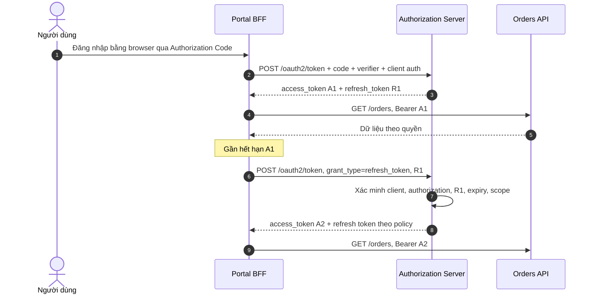
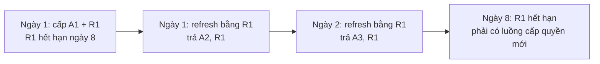
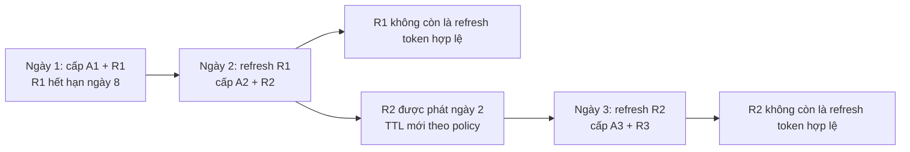
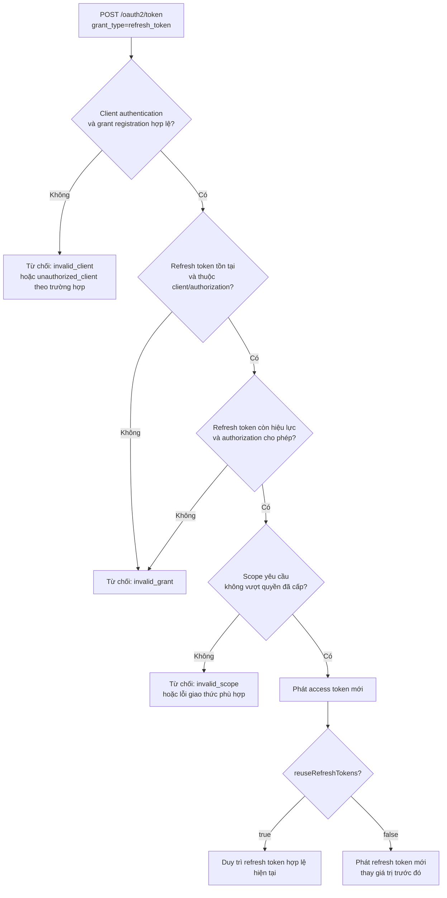
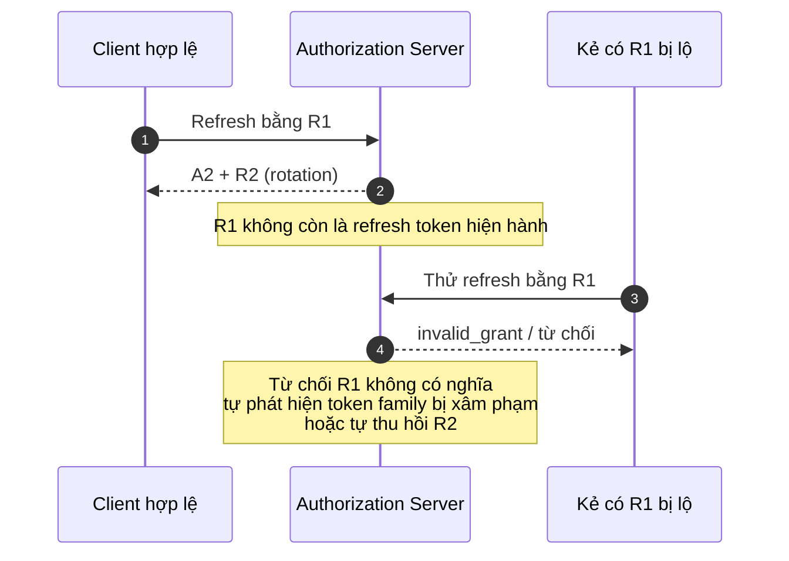
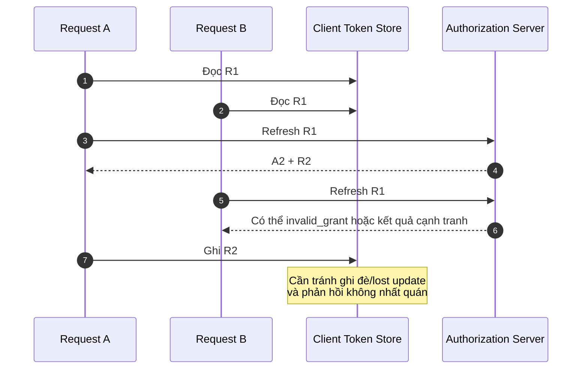

# Cấu hình refreshTokenTimeToLive và reuseRefreshTokens

Trong một ứng dụng Spring Boot triển khai **OAuth 2.0/OpenID Connect Authorization Server** bằng Spring Security và **Spring Authorization Server**, access token thường có thời gian sống ngắn để giảm thiệt hại khi bị lộ. Nhưng nếu mỗi khi access token hết hạn, người dùng lại phải đăng nhập và đồng ý cấp quyền từ đầu, trải nghiệm sử dụng sẽ kém. **Refresh token** cho phép OAuth client xin access token mới từ Token Endpoint mà không cần lặp lại toàn bộ Authorization Code Flow, miễn là refresh token và authorization tương ứng vẫn hợp lệ.

Spring Authorization Server cung cấp hai thiết lập quan trọng trong `TokenSettings` của từng `RegisteredClient`:

- **`refreshTokenTimeToLive(Duration)`:** quy định thời hạn hiệu lực của **mỗi refresh token khi được phát hành**.
- **`reuseRefreshTokens(boolean)`:** quyết định khi refresh thành công sẽ **tái sử dụng refresh token hiện tại** hay **phát hành refresh token mới** (rotation).

Hai tham số tưởng đơn giản nhưng ảnh hưởng trực tiếp đến khả năng duy trì phiên, xử lý đồng thời giữa các node, phát hiện token bị sử dụng lại và quy trình xử lý sự cố. Chọn cấu hình chỉ dựa trên câu hỏi “muốn người dùng đăng nhập lại sau bao lâu?” thường dẫn đến chính sách thiếu an toàn.

Bài thuộc chương **Refresh Token** của mô-đun **SPRING_SECURITY_OAUTH2_OIDC_AUTHORIZATION_SERVER**; mục tiêu là học cách thiết kế, cấu hình, bảo mật, kiểm thử và vận hành OAuth 2.0/OIDC Authorization Server bằng Spring Security và Spring Authorization Server trên Spring Boot. Các ví dụ tập trung vào họ API Spring Authorization Server 1.x/Spring Security 6.x; cần đối chiếu API và hành vi với phiên bản cụ thể khi áp dụng.

> **Thông điệp chính:** `refreshTokenTimeToLive` là **thời hạn của refresh token**, không phải thời hạn đăng nhập chung của người dùng; `reuseRefreshTokens(false)` kích hoạt **rotation**, nhưng **không tự đồng nghĩa đã có đầy đủ phát hiện replay và thu hồi cả họ token**.

## 1. Đặt refresh token vào đúng vị trí trong OAuth2/OIDC

### 1.1. Ba loại token thường bị nhầm

| Thành phần | Dùng để làm gì? | Ai sử dụng? | Ghi chú |
|---|---|---|---|
| **Access token** | Gọi Resource Server/API theo scope và audience | OAuth client gửi cho API | Có thể là JWT hoặc opaque; TTL thường ngắn |
| **Refresh token** | Xin access token mới từ **Token Endpoint** | OAuth client gửi cho Authorization Server | Phải được bảo vệ như credential; không gửi cho API |
| **ID token** | Chứng minh sự kiện xác thực và truyền claims OIDC cho Relying Party | OIDC client xác minh | Không phải access token/refresh token |

Một refresh token **không phải** mật khẩu người dùng, cũng không dùng để đăng nhập lại bằng `/login`. Nó đại diện cho quyền tiếp tục một authorization đã được cấp, theo policy và ràng buộc client. Với cấu hình Spring Authorization Server thường gặp, refresh token là một chuỗi opaque có entropy cao; **không giả định refresh token có cấu trúc JWT** hoặc có thể tự giải mã như ID token.

### 1.2. Khi nào client nhận refresh token?

Không phải mọi luồng đều phát refresh token:

- Một **confidential web/BFF client** dùng `authorization_code` có thể được cấp refresh token nếu `RegisteredClient` cho phép `AuthorizationGrantType.REFRESH_TOKEN` và policy tương ứng đáp ứng.
- Một **public SPA** dùng `ClientAuthenticationMethod.NONE` không nên được thiết kế dựa trên giả định sẽ được Spring Authorization Server 1.x cấp refresh token. Hướng dẫn SPA/PKCE của Spring Authorization Server nêu **không phát refresh token cho public client**; hãy xác minh theo phiên bản đang dùng và cân nhắc BFF nếu cần phiên dài.
- Một **service-to-service client** dùng `client_credentials` thông thường chỉ cần xin access token mới bằng chính client authentication; không cần refresh token cho một phiên người dùng không tồn tại.
- Có scope `openid` hoặc yêu cầu `offline_access` không tự bảo đảm máy chủ phát refresh token; còn phụ thuộc hồ sơ OIDC, grant, loại client và chính sách triển khai.

**Phân biệt:** Cho client được đăng ký `refresh_token` chỉ mở khả năng sử dụng **refresh token grant**. Nó không tự buộc Authorization Server phát refresh token ở mọi token response.

## 2. Vòng đời cơ bản của refresh token

Giả sử Portal BFF là confidential client và vừa hoàn tất Authorization Code + PKCE. Authorization Server cấp access token `A1` cùng refresh token `R1`.



Khi nhận refresh request, Authorization Server phải kiểm tra ít nhất những vấn đề liên quan:

1. **OAuth client** có tồn tại, được xác thực theo phương thức đã đăng ký khi áp dụng và có được dùng refresh grant không?
2. **Refresh token** có tồn tại trong authorization store, đúng client, chưa hết hạn và chưa bị làm mất hiệu lực không?
3. **Authorization gốc** còn phù hợp với chính sách, và client không xin scope vượt quyền đã được cấp trước đó?
4. Nếu được phép, **access token mới** được tạo với TTL, scope và claims theo policy hiện tại.
5. **Refresh token trả về** giữ nguyên hay thay mới tùy `reuseRefreshTokens`.

Việc phát access token mới không làm xuất hiện một đăng nhập người dùng mới. Phiên SSO, cookie trình duyệt, thời hạn ID token và vòng đời refresh token là những trạng thái khác nhau.

## 3. refreshTokenTimeToLive: thời gian sống của mỗi refresh token

### 3.1. Cấu hình bằng Duration

Trong `TokenSettings`:

```java
TokenSettings tokenSettings = TokenSettings.builder()
        .accessTokenTimeToLive(Duration.ofMinutes(10))
        .refreshTokenTimeToLive(Duration.ofDays(7))
        .build();
```

Ý nghĩa của ví dụ:

- Access token được phát theo chính sách có TTL **10 phút**.
- Mỗi refresh token mới được phát hành có TTL **7 ngày** kể từ thời điểm phát hành.
- Chưa có gì trong cấu hình trên nói rằng **phiên người dùng** hoặc **authorization gốc** sẽ sống tối đa 7 ngày. Một policy giới hạn phiên tuyệt đối hoặc ngừng quyền truy cập phải được thiết kế riêng nếu có yêu cầu đó.

Không coi `Duration.ofDays(7)` là khuyến nghị mặc định cho mọi ứng dụng. Hệ thống xử lý tài chính, dữ liệu sức khỏe hoặc quyền quản trị có thể cần TTL ngắn hơn hoặc cơ chế kiểm soát mạnh hơn; điều kiện thực tế còn phụ thuộc mức độ bảo vệ client, thu hồi quyền và sự cân bằng trải nghiệm.

### 3.2. Thời điểm phát hành và thời điểm hết hạn

Tại thời điểm `t0` khi refresh token `R1` được tạo, khái niệm cơ bản là:

```text
R1.issuedAt  = t0
R1.expiresAt = t0 + refreshTokenTimeToLive
```

Ví dụ `t0 = 08:00 ngày 01/12` và TTL là 7 ngày thì `R1` hết hạn vào khoảng `08:00 ngày 08/12` theo quy tắc thời gian của server, không phải “cuối ngày 08/12”. Trong implementation, thời gian dùng `Instant` và cần đồng hồ máy chủ hợp lý; các mốc thời gian dưới đây là giả định để giải thích.

Một refresh request **trước** `expiresAt` vẫn có thể bị từ chối vì token bị thu hồi, không thuộc client, authorization không hợp lệ hoặc chính sách khác. Một refresh request **sau** `expiresAt` phải không được cấp token chỉ vì client còn biết giá trị `R1`.

### 3.3. TTL của refresh token không phải TTL của access token

Nếu access token hết hạn sau 10 phút nhưng refresh token còn 7 ngày, client có thể xin access token mới nhiều lần trong thời gian refresh token/authorization còn hợp lệ. Việc này **không có nghĩa** access token `A1` được gia hạn: server phát token `A2` mới theo policy.

Nếu access token là JWT tự chứa, Resource Server vẫn có thể chấp nhận `A1` cho đến khi nó hết hạn (trừ khi có cơ chế kiểm tra trạng thái/thu hồi bổ sung). Refresh request không mặc nhiên thu hồi access token trước đó.

### 3.4. Khi thay đổi TTL sau khi đã phát token

Giả sử ban đầu TTL refresh là 30 ngày và hôm nay tổ chức đổi thành 7 ngày trong `RegisteredClient`. Không nên tự khẳng định tất cả refresh token đã phát có `expiresAt` lập tức bị rút còn 7 ngày. Thời hạn và trạng thái token đã lưu phụ thuộc lần phát hành ban đầu và cơ chế kiểm tra/thu hồi.

Nếu mục tiêu là **rút ngắn hiệu lực ngay lập tức** do sự cố bảo mật, cần chủ động thu hồi các authorization/token liên quan hoặc áp chính sách chặn bổ sung; sửa `refreshTokenTimeToLive` chỉ định hướng cho những lần phát token mới theo cách triển khai.

## 4. reuseRefreshTokens: tái sử dụng hay xoay refresh token?

### 4.1. Hai giá trị cốt lõi

```java
// Khi refresh thành công, tiếp tục trả/duy trì refresh token đang có:
TokenSettings reuse = TokenSettings.builder()
        .reuseRefreshTokens(true)
        .build();

// Khi refresh thành công, cấp refresh token mới thay token cũ:
TokenSettings rotate = TokenSettings.builder()
        .reuseRefreshTokens(false)
        .build();
```

Trong chính sách **reuse** (`true`), refresh token `R1` được dùng để xin nhiều access token khi `R1` còn hợp lệ. Trong chính sách **rotation** (`false`), refresh thành công bằng `R1` dẫn đến refresh token kế tiếp `R2`; ứng dụng client phải lưu `R2` thay `R1` cho lần refresh tiếp theo.

### 4.2. So sánh trực tiếp

| Khía cạnh | `reuseRefreshTokens(true)` | `reuseRefreshTokens(false)` |
|---|---|---|
| Sau khi dùng `R1` thành công | Client tiếp tục dùng `R1` | Client nhận token mới `R2` và phải thay `R1` |
| Số lần dùng một giá trị token | Có thể nhiều lần trong vòng đời còn hiệu lực | Giá trị cũ không còn là credential hợp lệ sau rotation thành công |
| Dễ triển khai client | Đơn giản hơn vì không cần thay giá trị mỗi lần | Phải lưu atomically và xử lý đồng thời |
| Khi refresh token bị đánh cắp | Một giá trị có thể bị lạm dụng đến khi hết hạn/thu hồi | Giảm thời gian tái sử dụng giá trị cũ, nhưng vẫn có nguy cơ race/theft |
| Cần xử lý lost update/race | Vẫn cần, nhưng ít nhạy với việc thay token | Rất quan trọng khi nhiều request cùng refresh |
| Phù hợp để cân nhắc | Hệ thống có đánh giá rủi ro phù hợp và kiểm soát khác | Nhiều confidential client muốn rotation, có kho lưu token an toàn |
| Phát hiện replay đầy đủ | Không có chỉ nhờ setting | **Không tự có** chỉ vì bật rotation |

**Cảnh báo:** `reuseRefreshTokens(false)` mô tả **phát hành refresh token mới**, không cam kết Spring Authorization Server mặc định theo dõi **toàn bộ token family** hay tự revoke các token hậu duệ khi phát hiện một refresh token cũ bị sử dụng lại. Muốn đáp ứng một chính sách **reuse detection** mạnh, cần thiết kế trạng thái token family, xử lý sự kiện replay và phản ứng thu hồi, hoặc một cơ chế sender-constrained token được hỗ trợ phù hợp.

### 4.3. Timeline khi tái sử dụng token

Giả định `refreshTokenTimeToLive = 7 ngày` và có access token TTL 10 phút:



Với reuse, **giá trị R1 và expiry gốc của R1 không tự gia hạn** chỉ vì được sử dụng lại. Đó là thời hạn cố định của token đang có.

### 4.4. Timeline khi rotation

Vẫn giả định TTL refresh là 7 ngày:



Trong mô hình rotation, mỗi refresh token mới có thời hạn riêng. Nếu client liên tục refresh trước khi token hết hạn, vòng đời khả dụng **có thể dài hơn TTL của từng token**. Vì vậy, nếu yêu cầu “phiên không kéo dài quá 30 ngày kể từ lần đăng nhập đầu tiên”, chỉ cài `refreshTokenTimeToLive(Duration.ofDays(7))` và `reuseRefreshTokens(false)` **chưa đủ**. Cần thêm **absolute session/authorization lifetime** hoặc chính sách cấp lại quyền bằng xác thực tương tác.

## 5. Ma trận lựa chọn theo kiến trúc client

| Loại client | Refresh token có phù hợp? | Hướng cấu hình cân nhắc |
|---|---|---|
| Backend for Frontend (BFF) giữ token server-side | Thường phù hợp nếu cần phiên dài hơn access token | `authorization_code` + `refresh_token`, client authentication, TTL phù hợp, cân nhắc rotation |
| Web application server-side | Có thể phù hợp | Giữ secret và refresh token ở backend, kiểm tra logout/revocation |
| SPA JavaScript public | Không tự giả định SAS phát refresh token | Public + PKCE; cân nhắc BFF hoặc policy khác đã xác minh |
| Native/mobile public | Phụ thuộc tính năng máy chủ, profile và chính sách lưu trữ an toàn | Không nhúng client secret; dùng hệ điều hành bảo vệ token khi được cấp |
| Worker dùng `client_credentials` | Thông thường không cần | Xin access token mới bằng client authentication |
| Client quyền nhạy cảm cao | Phải đánh giá rủi ro kỹ | TTL ngắn hơn, sender-constraining/revocation/audit phù hợp, có thể yêu cầu tái xác thực |

**Không có một cặp TTL/rotation tối ưu cho mọi client.** Cấu hình nằm trong `RegisteredClient.tokenSettings` chính vì các client có khả năng giữ token và mức độ rủi ro khác nhau.

## 6. Ví dụ Spring Authorization Server: cấu hình TokenSettings theo từng client

### 6.1. Bean RegisteredClientRepository cho Portal BFF

Ví dụ sau minh họa **một confidential client** có Authorization Code + PKCE và Refresh Token Grant. Đây là cấu hình **để học và thử nghiệm** với repository in-memory; các bean khác của Authorization Server vẫn phải được cung cấp để có hệ thống chạy được.

```java
package example.authorizationserver.config;

import java.time.Duration;

import org.springframework.context.annotation.Bean;
import org.springframework.context.annotation.Configuration;
import org.springframework.core.env.Environment;
import org.springframework.security.crypto.factory.PasswordEncoderFactories;
import org.springframework.security.crypto.password.PasswordEncoder;
import org.springframework.security.oauth2.core.AuthorizationGrantType;
import org.springframework.security.oauth2.core.ClientAuthenticationMethod;
import org.springframework.security.oauth2.core.oidc.OidcScopes;
import org.springframework.security.oauth2.server.authorization.client.RegisteredClient;
import org.springframework.security.oauth2.server.authorization.client.RegisteredClientRepository;
import org.springframework.security.oauth2.server.authorization.client.InMemoryRegisteredClientRepository;
import org.springframework.security.oauth2.server.authorization.settings.ClientSettings;
import org.springframework.security.oauth2.server.authorization.settings.TokenSettings;

@Configuration(proxyBeanMethods = false)
public class PortalRegisteredClientConfig {

    @Bean
    PasswordEncoder passwordEncoder() {
        return PasswordEncoderFactories.createDelegatingPasswordEncoder();
    }

    @Bean
    RegisteredClientRepository registeredClientRepository(
            PasswordEncoder encoder,
            Environment environment) {

        String secret = environment.getRequiredProperty(
                "PORTAL_BFF_CLIENT_SECRET");

        TokenSettings tokenSettings = TokenSettings.builder()
                .accessTokenTimeToLive(Duration.ofMinutes(10))
                .refreshTokenTimeToLive(Duration.ofDays(7))
                .reuseRefreshTokens(false)
                .build();

        RegisteredClient portal = RegisteredClient
                .withId("portal-bff-registration")
                .clientId("portal-bff")
                .clientSecret(encoder.encode(secret))
                .clientAuthenticationMethod(
                        ClientAuthenticationMethod.CLIENT_SECRET_BASIC)
                .authorizationGrantType(
                        AuthorizationGrantType.AUTHORIZATION_CODE)
                .authorizationGrantType(
                        AuthorizationGrantType.REFRESH_TOKEN)
                .redirectUri(
                        "https://portal.example.com/login/oauth2/code/central")
                .scope(OidcScopes.OPENID)
                .scope(OidcScopes.PROFILE)
                .scope("orders.read")
                .clientSettings(ClientSettings.builder()
                        .requireProofKey(true)
                        .requireAuthorizationConsent(true)
                        .build())
                .tokenSettings(tokenSettings)
                .build();

        return new InMemoryRegisteredClientRepository(portal);
    }
}
```

Ở đây:

1. `accessTokenTimeToLive` giới hạn thời hạn access token mới phát.
2. `refreshTokenTimeToLive` đặt hạn dùng cho mỗi refresh token mới.
3. `reuseRefreshTokens(false)` chọn rotation: client phải cập nhật token sau một lần refresh thành công.
4. `AuthorizationGrantType.REFRESH_TOKEN` là điều kiện registration cần có cho refresh grant.
5. `ClientAuthenticationMethod.CLIENT_SECRET_BASIC` yêu cầu xác thực confidential client ở Token Endpoint; refresh token không thay thế client secret.
6. `requireProofKey(true)` bảo vệ Authorization Code Flow; PKCE áp dụng tại lần cấp code/đổi code, **không phải code verifier trong refresh request**.
7. `requireAuthorizationConsent(true)` là chính sách consent ở luồng có người dùng; không đồng nghĩa mỗi request refresh phải hiện trang consent.

**Lưu ý:** Client secret lấy từ môi trường an toàn, không commit vào Git. `RegisteredClient.id` ổn định; không sinh UUID mới mỗi lần khởi động production khi các authorization đã lưu liên kết bằng ID này. `InMemoryRegisteredClientRepository` và kho authorization in-memory không phù hợp làm storage bền vững cho cluster production.

### 6.2. Một client cấu hình reuse theo chính sách riêng

Nếu một client backend được đánh giá có thể sử dụng refresh token cố định trong vòng đời hữu hạn:

```java
TokenSettings reusePolicy = TokenSettings.builder()
        .accessTokenTimeToLive(Duration.ofMinutes(5))
        .refreshTokenTimeToLive(Duration.ofHours(12))
        .reuseRefreshTokens(true)
        .build();
```

Đoạn mã này **chỉ tạo policy**, không tự gắn vào client. Cần truyền `reusePolicy` vào `RegisteredClient.Builder.tokenSettings(...)` cho đúng client và lưu registration qua repository. Các giá trị 5 phút/12 giờ là ví dụ so sánh, không phải chuẩn bắt buộc.

Không bật reuse chỉ vì client chưa biết xử lý rotation; cần đánh giá thời gian phát hiện/thu hồi token bị đánh cắp, khả năng bảo vệ kho token và yêu cầu phiên thực tế.

### 6.3. Không nhầm với TokenSettings mặc định

Spring Authorization Server có giá trị mặc định cho nhiều trường của `TokenSettings`, nhưng chúng có thể khác theo phiên bản. Bài này dùng cấu hình **tường minh** thay vì phụ thuộc defaults khó nhận biết. Trong production, ghi lại các giá trị có hiệu lực cùng version thư viện, audit khi thay đổi và kiểm thử thời điểm hết hạn thật.

## 7. Token Endpoint xử lý refresh token như thế nào?

### 7.1. Request refresh chuẩn

Sau khi nhận `R1`, Portal BFF có thể gọi:

```http
POST /oauth2/token HTTP/1.1
Host: login.example.com
Authorization: Basic <base64(client_id:client_secret)>
Content-Type: application/x-www-form-urlencoded

grant_type=refresh_token&refresh_token=R1
```

`Authorization: Basic` là **xác thực OAuth client**, không phải tên đăng nhập/mật khẩu của người dùng. Token endpoint phải dùng HTTPS, giới hạn methods/content types theo giao thức và xử lý client credentials bằng cấu hình Spring Authorization Server.

Nếu client được phép yêu cầu thu hẹp scope khi refresh, request có thể có `scope`, nhưng tập scope cấp lại **không được mở rộng vượt scope đã được authorization cho phép**. Không dùng refresh request để xin `orders.admin` khi authorization ban đầu chỉ có `orders.read`.

### 7.2. Response khi reuseRefreshTokens(true)

Ví dụ response minh họa:

```json
{
  "access_token": "A2",
  "token_type": "Bearer",
  "expires_in": 600,
  "refresh_token": "R1",
  "scope": "orders.read"
}
```

Điều quan trọng không nằm ở chuỗi token minh họa, mà ở việc client có thể tiếp tục sử dụng **cùng giá trị refresh token R1** nếu authorization và R1 còn hiệu lực. Không giả định mỗi lần dùng R1 sẽ tăng `expiresAt` của nó.

### 7.3. Response khi reuseRefreshTokens(false)

```json
{
  "access_token": "A2",
  "token_type": "Bearer",
  "expires_in": 600,
  "refresh_token": "R2",
  "scope": "orders.read"
}
```

Client phải coi `R2` là refresh token hiện hành và **thay thế R1** trong kho token an toàn. Không giữ cả R1 và R2 để thử tuần tự khi có lỗi: làm vậy dễ gây replay, race hoặc nhầm dữ liệu phiên.

### 7.4. Những điều kiện kiểm tra độc lập với rotation



Sơ đồ mô tả **kiểm tra chức năng**, không phải thứ tự gọi chính xác của mọi filter/provider trong Spring. Lỗi OAuth cụ thể còn phụ thuộc bước và phiên bản. Spring Authorization Server triển khai refresh token grant qua các endpoint filter và authentication provider được framework cấu hình; không nên thay chúng bằng một `@PostMapping("/oauth2/token")` tự viết mà bỏ qua quy tắc an toàn.

### 7.5. Cấu hình SecurityFilterChain phù hợp

Spring Authorization Server thường cần một `SecurityFilterChain` ưu tiên cho endpoint giao thức, và một chain khác cho form login:

```java
@Bean
@Order(1)
SecurityFilterChain authorizationServerSecurityFilterChain(
        HttpSecurity http) throws Exception {
    OAuth2AuthorizationServerConfigurer as =
            OAuth2AuthorizationServerConfigurer.authorizationServer();

    http
        .securityMatcher(as.getEndpointsMatcher())
        .with(as, configurer ->
                configurer.oidc(Customizer.withDefaults()))
        .authorizeHttpRequests(authorize -> authorize
                .anyRequest().authenticated())
        .exceptionHandling(exceptions -> exceptions
                .defaultAuthenticationEntryPointFor(
                    new LoginUrlAuthenticationEntryPoint("/login"),
                    new MediaTypeRequestMatcher(MediaType.TEXT_HTML)))
        .oauth2ResourceServer(oauth2 -> oauth2
                .jwt(Customizer.withDefaults()));
    return http.build();
}
```

Đoạn mã đã lược import và các bean cần thiết; nó minh họa ranh giới giao thức. Một request refresh từ machine client không được điều hướng sang HTML login. Lỗi client/refresh token cần được trả đúng HTTP/OAuth error.

## 8. Rotation khác replay detection: ranh giới bảo mật

### 8.1. Một kịch bản token bị đánh cắp

Giả sử `R1` bị lộ. Client hợp lệ gửi refresh bằng `R1` và nhận `R2` khi rotation bật. Kẻ tấn công sau đó cố dùng lại `R1`.

- Một implementation đã thay token hiện hành sẽ **không chấp nhận R1** nếu lookup chỉ công nhận token còn hiệu lực.
- Nhưng để kết luận “R1 bị **replay sau rotation**” và **thu hồi cả R2, R3...**, server cần thêm dữ liệu liên kết **token family**, trạng thái token cũ hoặc tín hiệu phù hợp.
- Nếu kẻ tấn công dùng `R1` **trước** client hợp lệ, chúng có thể lấy `R2`; lúc đó client hợp lệ gặp lỗi khi dùng R1. Rotation không tự bảo đảm ngăn mọi kiểu tranh chấp sử dụng token bị đánh cắp.



Do đó, trong tài liệu vận hành phải phân biệt:

- **Rotation:** phát giá trị refresh token mới thay giá trị cũ.
- **Replay/reuse detection:** nhận biết việc giá trị đã luân chuyển xuất hiện lại bất thường.
- **Family revocation:** thu hồi toàn bộ chuỗi refresh tokens/authorization liên quan khi nghi ngờ xâm phạm.
- **Sender-constrained refresh tokens:** ràng buộc khả năng sử dụng token với một client key/chứng chỉ hoặc cơ chế được hỗ trợ phù hợp.

Chỉ khai báo `reuseRefreshTokens(false)` **không cam kết ba biện pháp phía sau đã được thực hiện đầy đủ**. Nếu yêu cầu bảo mật của tổ chức hoặc tiêu chuẩn áp dụng bắt buộc replay detection, cần đánh giá, bổ sung và kiểm thử chính sách đó ở hệ thống thực.

### 8.2. Reuse cũng không phải “không bảo mật” trong mọi bối cảnh

Khi `reuseRefreshTokens(true)`, token R1 có thể được dùng nhiều lần trong TTL của nó. Điều này làm giảm độ phức tạp ghi đè token cho client nhưng tăng giá trị của một R1 bị lộ. Một thiết kế cho phép reuse cần có:

- client authentication/sender constraints theo loại client;
- kho token server-side, TTL được giới hạn;
- cơ chế revocation và audit hiệu quả;
- policy giảm quyền API và phát hiện hành vi bất thường.

Không dùng reuse với token dài hạn chỉ vì đó là mặc định trong một phiên bản thư viện; hãy dựa trên threat model.

## 9. Đồng thời, race condition và lưu refresh token an toàn

### 9.1. Hai request cùng dùng R1

Portal BFF có thể nhận nhiều HTTP request đồng thời khi access token hết hạn. Nếu cả hai cùng nhìn thấy R1 và gửi refresh:



Với rotation, client **phải phối hợp refresh theo phiên/client authorization**. Một cách thường dùng ở backend là *single-flight*: chỉ một request làm mới token tại một thời điểm cho cùng authorization, còn các request khác chờ kết quả và dùng token mới. Các server instance có thể cần distributed lock hoặc cơ chế concurrency control tương đương.

Ở phía Authorization Server, việc kiểm tra và cập nhật refresh token hiện hành cần nhất quán khi nhiều request cạnh tranh; lựa chọn transaction, database isolation và optimistic locking tùy loại `OAuth2AuthorizationService`. Không mặc định repository JDBC được sử dụng sẽ tự giải quyết mọi race ở cấp nghiệp vụ.

### 9.2. Không lưu token ở nhiều nơi khó kiểm soát

Đối với BFF, nên lưu refresh token **phía server** trong authorized-client/token store có truy cập hạn chế, mã hóa khi phù hợp và không đặt trong HTML, cookie không bảo vệ hoặc URL. Nếu một ứng dụng tự quản lý token, việc cập nhật khi rotation phải bảo đảm:

1. Xác định đúng authorization/user/session/client;
2. Gửi refresh request bằng token hiện hành;
3. Khi thành công, lưu refresh token mới một cách atomic hoặc có concurrency control;
4. Không để response cũ ghi đè credential mới;
5. Không dùng lại refresh token cũ chỉ vì nó vẫn còn trong cache;
6. Xử lý `invalid_grant` bằng cách làm sạch credential và khởi tạo lại luồng hợp lệ.

Không tự in refresh token hoặc request body token endpoint vào log để “debug race”. Dữ liệu này là credential.

### 9.3. Không tự động retry refresh với token cũ

Nếu refresh request bị timeout, client không chắc server đã xử lý và rotation thành công hay chưa. Retry bằng R1 có thể thất bại ngay cả khi server đã cấp R2 trước khi kết nối đứt. Hệ thống cần có chiến lược rõ ràng cho **unknown outcome**, không thử brute-force hoặc nới ràng buộc.

Có thể cần tái xác thực người dùng khi không thể phục hồi token mới an toàn. Thiết kế token store và giao thức retry nên được kiểm thử trước những lỗi mạng trong production.

## 10. Thời hạn phiên tuyệt đối và đăng xuất

### 10.1. TTL từng token không đồng nghĩa absolute session lifetime

Một client có thể duy trì hoạt động lâu hơn 7 ngày nếu rotation liên tục sinh refresh token mới có TTL 7 ngày. Nếu mục tiêu là “bất kể người dùng hoạt động thế nào, phải đăng nhập lại sau tối đa 30 ngày”, cần xác định **mốc bắt đầu phiên/authorization** và kiểm tra thời hạn tuyệt đối khi refresh, không chỉ dựa vào `refreshTokenTimeToLive`.

Các chính sách cần tách:

| Chính sách | Đối tượng | Ví dụ |
|---|---|---|
| Access token TTL | Mỗi access token được phát | 10 phút |
| Refresh token TTL | Mỗi refresh token được phát | 7 ngày |
| Absolute authorization lifetime | Quyền tiếp tục authorization kể từ mốc gốc | Tối đa 30 ngày theo sản phẩm |
| Idle timeout | Không hoạt động trong một khoảng | 12 giờ không có tương tác |
| SSO session timeout | Cookie/session đăng nhập tại Authorization Server | Chính sách riêng của Login/IdP |
| Consent lifetime | Quyền được người dùng chấp thuận | Có thể tồn tại qua nhiều phiên, tùy chính sách |

Các mốc absolute/idle/consent bên trên **không được tự triển khai chỉ bởi hai setter `TokenSettings`**. Nếu cần, phải có mô hình trạng thái và cơ chế enforce phù hợp.

### 10.2. Logout không tự vô hiệu mọi token

Khi người dùng logout Portal hoặc Authorization Server, cookie session được kết thúc theo quy trình tương ứng. Nhưng các access token còn hạn và refresh token đã phát có thể vẫn hoạt động nếu không có cơ chế thu hồi token/authorization cụ thể.

Muốn “đăng xuất từ mọi thiết bị” hoặc “thu hồi quyền truy cập ngay” phải xét:

- thu hồi/loại bỏ refresh token và authorization liên quan;
- chiến lược vô hiệu access token (TTL ngắn, introspection, denylist hoặc giải pháp phù hợp);
- các phiên local ở nhiều OAuth client/OIDC Relying Party;
- bất kỳ store/cache đang giữ trạng thái token.

Không dùng `reuseRefreshTokens(false)` như một phép thay thế logout/revocation.

## 11. Lỗi OAuth2 khi refresh và cách chẩn đoán

### 11.1. Những phản hồi lỗi điển hình

| Tình huống | Loại lỗi thường gặp | Hướng xử lý |
|---|---|---|
| Client secret sai hoặc client auth method không khớp | `invalid_client` | Kiểm tra credential/registration, không thử refresh liên tục |
| Client chưa đăng ký `refresh_token` grant | `unauthorized_client` | Sửa registration đúng mục đích, không mở grant tràn lan |
| Refresh token không tìm thấy, hết hạn, bị thay hoặc không thuộc client | `invalid_grant` | Xóa trạng thái token không hợp lệ, bắt đầu lại flow theo chính sách |
| Scope yêu cầu vượt quyền của authorization | `invalid_scope` | Không xin mở rộng scope bằng refresh grant |
| Thiếu `refresh_token` hoặc sai dạng request | `invalid_request` hoặc lỗi phù hợp | Kiểm tra encoding, body và protocol |
| Token endpoint trả `302 /login` | Sai `SecurityFilterChain`/entry point hoặc proxy rewrite | Kiểm tra matcher và response handling |
| Tỷ lệ `invalid_grant` tăng sau bật rotation | Client lưu R1 cũ, race hoặc mất R2 khi timeout | Kiểm tra token storage, single-flight, retry |
| Token mới hợp lệ nhưng Orders API trả 403 | Thiếu scope/role/tenant policy | Kiểm tra resource authorization, không nới TTL |
| Refresh hoạt động trên node A nhưng lỗi ở node B | Authorization store không chia sẻ hoặc cấu hình client/keys khác | Kiểm tra persistence, version và cluster consistency |

Mã lỗi HTTP và chi tiết response phụ thuộc giai đoạn, phiên bản, phương thức client authentication và ngữ cảnh. Tránh phụ thuộc vào exact `error_description` vì thông điệp có thể đổi, và không hiển thị dữ liệu token trong response để giúp client debug.

### 11.2. Ví dụ invalid_grant

```http
HTTP/1.1 400 Bad Request
Content-Type: application/json
Cache-Control: no-store
Pragma: no-cache

{
  "error": "invalid_grant"
}
```

Khi refresh token đã hết hạn hoặc bị thay, client không có quyền tiếp tục bằng credential đó. UI có thể yêu cầu người dùng đăng nhập lại; backend nên xóa authorized-client state liên quan và tránh vòng lặp gọi token endpoint bằng cùng R1.

## 12. Kiểm thử hai thiết lập bằng Spring Security/Spring Authorization Server

### 12.1. Unit test xác minh cấu hình policy

Một test đơn giản có thể xác nhận bean `RegisteredClient` đang chứa đúng giá trị:

```java
import static org.assertj.core.api.Assertions.assertThat;

import java.time.Duration;
import org.junit.jupiter.api.Test;
import org.springframework.security.oauth2.server.authorization.settings.TokenSettings;

class RefreshTokenSettingsTest {

    @Test
    void rotationPolicyHasExplicitDurations() {
        TokenSettings settings = TokenSettings.builder()
                .accessTokenTimeToLive(Duration.ofMinutes(10))
                .refreshTokenTimeToLive(Duration.ofDays(7))
                .reuseRefreshTokens(false)
                .build();

        assertThat(settings.getAccessTokenTimeToLive())
                .isEqualTo(Duration.ofMinutes(10));
        assertThat(settings.getRefreshTokenTimeToLive())
                .isEqualTo(Duration.ofDays(7));
        assertThat(settings.isReuseRefreshTokens()).isFalse();
    }
}
```

Test này chỉ xác minh **cấu hình settings object**. Nó không chứng minh Token Endpoint thật đã rotation đúng, access token/refresh token được phát đúng hoặc client storage an toàn. Cần integration test qua endpoint và authorization store.

### 12.2. Ma trận integration test tối thiểu

| Test case | Thiết lập/tác động | Kết quả cần khẳng định |
|---|---|---|
| Nhận refresh token hợp lệ | Confidential client được đăng ký `authorization_code` + `refresh_token` | Token response có refresh token theo policy |
| Refresh token còn hạn | Gửi token và client auth hợp lệ | Nhận access token mới |
| Reuse = true | Dùng R1 hai lần khi còn hợp lệ | Không yêu cầu client thay R1; kiểm tra behavior thực tế |
| Rotation = false | Dùng R1 rồi nhận R2 | R2 khác R1; client phải lưu R2 |
| Dùng lại R1 sau rotation | Refresh bằng token cũ | Không cấp token dựa trên R1 cũ |
| R2 hợp lệ | Gửi R2 theo chính sách | Nhận token theo policy |
| Refresh token hết hạn | Điều chỉnh clock/test fixture hoặc TTL phù hợp | Từ chối refresh bằng token hết hạn |
| Client secret sai | Dùng đúng refresh token nhưng xác thực client sai | Không cấp token |
| Client khác dùng R1 | Client B trình R1 của client A | Không cấp token |
| Grant không được đăng ký | Client thiếu `refresh_token` grant | Từ chối |
| Scope mở rộng | Xin `orders.admin` từ authorization chỉ có `orders.read` | Không cấp quyền mở rộng |
| Access token TTL | So sánh `expiresAt - issuedAt` token mới | Phù hợp policy và sai số phù hợp clock |
| Refresh token TTL | So sánh `expiresAt - issuedAt` khi R2 được phát | Phù hợp policy |
| Reuse và expiry | R1 được dùng gần hạn khi reuse = true | Không reset expiry gốc của R1 |
| Rotation và expiry | R2 mới được phát | TTL của R2 tính theo thời điểm phát R2 |
| Hai refresh đồng thời | Hai request sử dụng cùng token R1 | Không cấp/ghi đè trái policy, client recover đúng |
| Token bị đánh cắp | Thử dùng lại token đã rotate | Đo thực tế: bị từ chối; family revocation chỉ khi đã triển khai |
| Logout/revocation | Thu hồi authorization/token liên quan | Refresh theo token bị thu hồi bị từ chối |
| Khởi động lại | Kho authorization JDBC/chia sẻ | Token trạng thái còn hiệu lực theo chính sách |
| Nhiều node | Phát ở node A, refresh tại B | Store, registration và clock nhất quán |

### 12.3. Integration test có ý nghĩa hơn mock token

Một test end-to-end nên:

1. Khởi chạy Spring Authorization Server với `RegisteredClient` test và `OAuth2AuthorizationService` có trạng thái thật.
2. Chạy Authorization Code + PKCE và login/consent nếu cần để có `R1`.
3. Gửi refresh request bằng đúng client authentication, xác minh response và scope.
4. Với rotation false, so `R2` và `R1`; thử refresh bằng R1 cũ với một request độc lập, sau đó dùng R2.
5. Với reuse true, so token được trả khi refresh và thời hạn R1; tuyệt đối không dùng cùng fixture giữa các case mà vô tình đổi trạng thái.
6. Kiểm tra trường hợp mất kết nối/refresh song song và hành vi token store.
7. Kiểm tra access token mới ở Resource Server với issuer, audience và scope thực.

Test chỉ assert `TokenSettings.isReuseRefreshTokens()` là chưa đủ. Test mock `Authentication` sẵn cũng có thể bỏ qua Token Endpoint, client authentication và persistence, nên không chứng minh refresh grant hoạt động đúng.

### 12.4. Ví dụ curl cho confidential client

Giả sử hệ thống đã cấu hình đầy đủ và một Authorization Code Flow hợp lệ đã cấp refresh token:

```bash
curl --request POST "https://login.example.com/oauth2/token" \
  --user "$PORTAL_CLIENT_ID:$PORTAL_CLIENT_SECRET" \
  --header "Content-Type: application/x-www-form-urlencoded" \
  --data-urlencode "grant_type=refresh_token" \
  --data-urlencode "refresh_token=$PORTAL_REFRESH_TOKEN"
```

Lệnh chỉ minh họa giao thức; biến môi trường phải được quản lý an toàn. Tránh vô tình đưa token/secret vào lịch sử terminal, log CI hoặc APM. Không thử chạy bằng token thật trong tài liệu hoặc trên môi trường production chung.

Khi thử rotation, lưu `refresh_token` mới **chỉ trong môi trường test** và dùng nó cho lần refresh kế tiếp; không in nguyên token trong biên bản kiểm thử.

## 13. Triển khai nhiều node, lưu trữ và thay đổi chính sách

### 13.1. OAuth2AuthorizationService là dữ liệu trạng thái quan trọng

Spring Authorization Server dùng `OAuth2AuthorizationService` để lưu/đọc authorization và các token liên quan, gồm refresh token. Nếu mỗi node chỉ giữ in-memory authorization store riêng, một refresh request đến node khác có thể không tìm thấy token.

Production cần kho dùng chung bền vững, schema/migration phù hợp phiên bản, cơ chế kiểm soát đồng thời và giám sát. `JdbcOAuth2AuthorizationService` là một lựa chọn nếu dùng JDBC, nhưng cần đánh giá transaction/isolation/locking để đáp ứng chính sách rotation một lần trong điều kiện tải thực, không tự giả định mọi race đã được thư viện loại bỏ.

### 13.2. Đồng bộ RegisteredClient giữa các node

`TokenSettings` gắn với `RegisteredClient`. Nếu các node đọc registration khác nhau (node A bật reuse, node B bật rotation), hành vi refresh có thể không nhất quán. Khi rollout:

- Cập nhật policy bằng thay đổi có phiên bản;
- Xác nhận mọi node đã đọc registration mới;
- Có integration test trước/sau rollout;
- Cân nhắc tác động lên client đang giữ refresh token từ policy cũ;
- Theo dõi `invalid_grant` và lỗi authentication theo client ID.

### 13.3. Migration từ reuse sang rotation

Một chiến lược triển khai có kiểm soát:

1. **Kiểm tra phía client**: có hỗ trợ nhận và lưu refresh token mới không?
2. **Bổ sung single-flight/locking**: tránh nhiều request refresh song song cho cùng authorization.
3. **Chuẩn bị token store**: thay refresh token atomically, tránh cache/stale writes.
4. **Thử trong staging**: refresh liên tiếp, lỗi mạng, khởi động lại, rolling deploy và multi-node.
5. **Bật rotation theo từng client** nếu có thể, không đổi tất cả cùng lúc.
6. **Giám sát và xử lý sự cố**: tăng `invalid_grant` có thể do client chưa thay token, timeout hoặc race.
7. **Định nghĩa rollback**: không mặc định đổi lại `reuse=true` sẽ làm sống lại refresh token đã bị thay/thu hồi.

Nếu giảm TTL đột ngột, kiểm tra quyền truy cập cho các token đã phát và truyền thông đến người dùng/client phù hợp. Tránh sửa policy trực tiếp trên production mà không xác minh tương thích.

## 14. Các tình huống lựa chọn chính sách

### 14.1. Portal BFF cho nhân viên

Portal dùng backend lưu token, có session cookie được bảo vệ, access token TTL 10 phút, refresh token TTL 7 ngày, bật rotation. Server-side token store có lock theo phiên/authorization. Khi refresh thất bại do token không hợp lệ, Portal xóa authorized-client state và chuyển người dùng qua Authorization Code Flow mới. Nếu tổ chức yêu cầu phiên tối đa 30 ngày, bổ sung absolute lifetime được thực thi riêng.

### 14.2. Dashboard SPA thuần trình duyệt

SPA dùng `ClientAuthenticationMethod.NONE` và PKCE. Không xây luồng dựa trên giả định public SPA sẽ nhận refresh token từ Spring Authorization Server 1.x. Nếu yêu cầu phiên dài, dữ liệu nhạy cảm và token phải được bảo vệ mạnh hơn, cân nhắc BFF với lưu token server-side và session cookie có CSRF/SameSite phù hợp. Khi dùng SPA trực tiếp, vẫn cần kiểm soát XSS, CORS, callback state và quản lý access token.

### 14.3. Invoice Worker không có người dùng

Worker dùng `client_credentials` với client authentication được bảo vệ. Khi access token hết hạn, worker xin access token mới bằng grant đó thay vì giữ refresh token phiên người dùng. Thiết kế đơn giản hơn và không phải quản lý rotation của refresh token không cần thiết.

### 14.4. Client cần truy cập dữ liệu nhạy cảm

Nếu client phải xử lý dữ liệu nhạy cảm và nguy cơ lộ credential cao, không chỉ tăng tốc độ rotation hay giảm TTL một cách cơ học. Cần đánh giá sender-constrained token (khi profile/hạ tầng hỗ trợ), khả năng revocation, audit, quản lý thiết bị/workload, thay đổi quyền theo tenant và chính sách tái xác thực. Cấu hình hai trường `TokenSettings` là một thành phần trong threat model, không phải toàn bộ biện pháp.

## 15. Checklist vận hành và câu hỏi tự đánh giá

### 15.1. Checklist

1. **Grant hợp lệ:** `RegisteredClient` thực sự cho phép `AuthorizationGrantType.REFRESH_TOKEN` với loại client/flow được phép.
2. **Client authentication:** confidential client bảo vệ secret/private key và dùng phương thức chính xác ở Token Endpoint.
3. **Access TTL:** chọn `accessTokenTimeToLive` theo API risk, không cố dùng refresh token làm API credential.
4. **Refresh TTL:** chọn `refreshTokenTimeToLive` theo loại client, sensitivity, trải nghiệm và khả năng thu hồi.
5. **Reuse hay rotate:** ghi quyết định tường minh bằng `reuseRefreshTokens(true/false)`; đảm bảo client cập nhật token khi false.
6. **Bảo vệ dữ liệu:** refresh token được lưu server-side/mã hóa khi phù hợp, không ở URL/log/analytics; dữ liệu auth bền vững qua restart.
7. **Đồng thời:** single-flight hoặc cơ chế tương đương khi refresh bằng cùng authorization; kiểm tra race ở Authorization Server.
8. **Giới hạn phiên:** nếu cần absolute/idle timeout, triển khai thêm policy, không chỉ dựa vào TTL từng token.
9. **Revocation:** kiểm thử logout, thu hồi authorization và phản ứng khi token bị đánh cắp.
10. **Replay:** phân biệt rotation, phát hiện replay và family revocation; không quảng cáo khả năng chưa được triển khai.
11. **Migration:** rollout theo client, theo dõi `invalid_grant`, không mặc định token đã phát sẽ tự đổi expiry.
12. **Kiểm thử:** có integration test reuse, rotation, expiry, scope, wrong client, concurrency, cluster và endpoint errors.

### 15.2. Câu hỏi

1. `refreshTokenTimeToLive` giới hạn loại token nào? Vì sao nó không phải absolute session timeout?
2. Với `reuseRefreshTokens(true)`, việc dùng lại R1 có tự làm `expiresAt` của R1 tiến về phía trước không?
3. Với `reuseRefreshTokens(false)`, client phải thay đổi kho token thế nào sau một refresh thành công?
4. Vì sao rotation làm một phiên có thể kéo dài hơn TTL của từng refresh token nếu không có absolute lifetime riêng?
5. Tại sao rotation không tự có nghĩa đã triển khai replay detection và thu hồi toàn bộ token family?
6. Hai refresh request đồng thời cùng dùng R1 có thể gây vấn đề gì, và BFF nên xử lý thế nào?
7. Vì sao một worker dùng `client_credentials` thường không cần refresh token?
8. Tại sao không nên mặc định public SPA sẽ nhận refresh token trong Spring Authorization Server 1.x?
9. Nếu đổi TTL từ 30 ngày xuống 7 ngày, điều gì xảy ra với refresh token đã phát có expiry trong tương lai?
10. Tại sao access token cũ vẫn có thể được Resource Server chấp nhận sau khi refresh token được rotate?
11. Khi Token Endpoint trả `invalid_grant` sau deploy mới, nên kiểm tra những nguyên nhân nào trước khi nới chính sách?
12. Cần những loại integration test nào để chứng minh chính sách reuse/rotation hoạt động đúng trong cluster?

## 16. Tài liệu nền tảng

- [Spring Authorization Server — Core Model / Components](https://docs.spring.io/spring-authorization-server/reference/core-model-components.html): `RegisteredClient`, `TokenSettings`, `OAuth2AuthorizationService`, đặc tính reuse và TTL.
- [Spring Authorization Server — OAuth2 Token Endpoint](https://docs.spring.io/spring-authorization-server/reference/protocol-endpoints.html): luồng token/refresh và cấu hình các thành phần xử lý giao thức.
- [Spring Authorization Server — SPA using PKCE](https://docs.spring.io/spring-authorization-server/reference/guides/how-to-pkce.html): public client, PKCE và chính sách phát refresh token.
- [RFC 6749 — OAuth 2.0](https://www.rfc-editor.org/rfc/rfc6749): Refresh Token Grant, client authentication, scope và `invalid_grant`.
- [RFC 9700 — OAuth 2.0 Security Best Current Practice](https://www.rfc-editor.org/rfc/rfc9700): khuyến nghị về refresh token, rotation, replay và sender-constraining theo threat model.

**Ghi nhớ:** `refreshTokenTimeToLive` quy định thời gian sống của **refresh token được phát**, còn `reuseRefreshTokens` chọn giữa **giữ token cũ** và **cấp token mới khi refresh**. Với rotation, client bắt buộc phải lưu token thay thế và xử lý race; việc thay token không mặc nhiên đồng nghĩa với khả năng phát hiện/revoke toàn bộ token family. Để vận hành Spring Authorization Server an toàn, cần kết hợp đúng `RegisteredClient`, client authentication, authorization persistence, TTL access/refresh token, chính sách revocation, kiểm thử tích hợp và theo dõi hành vi thực tế.
