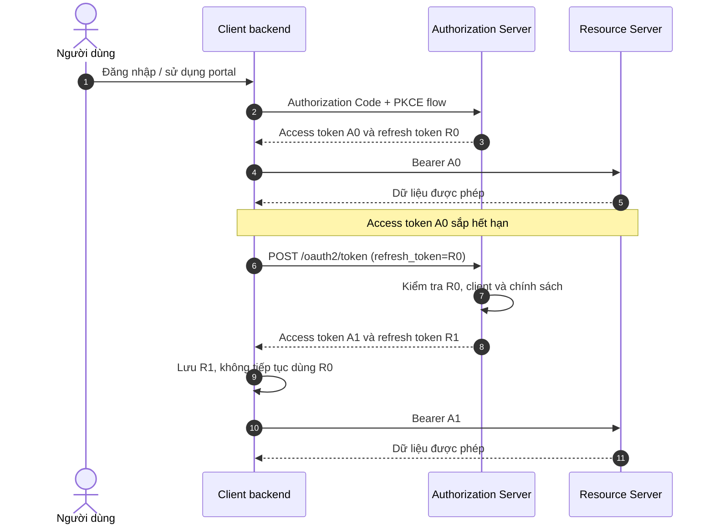
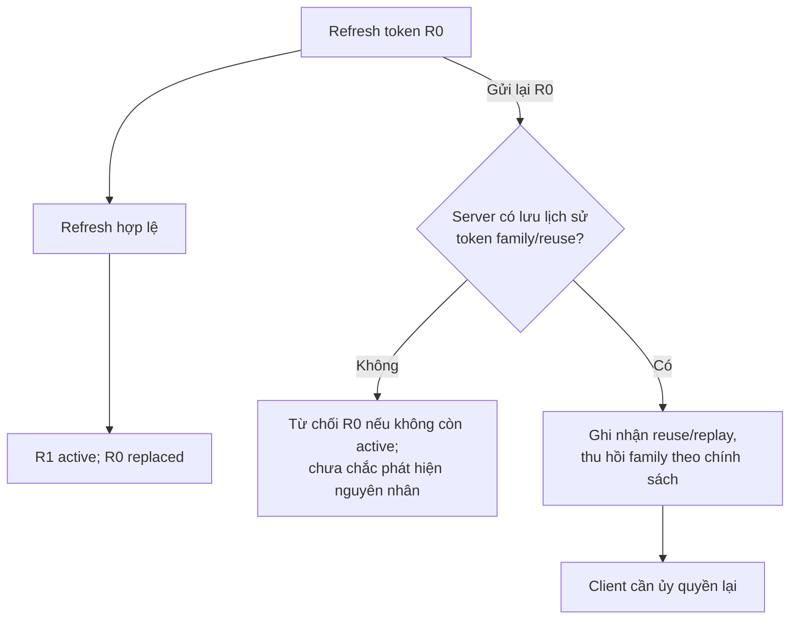
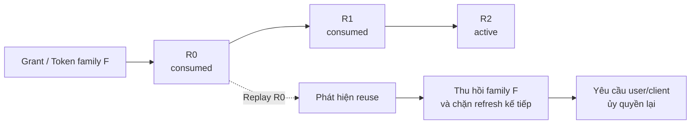
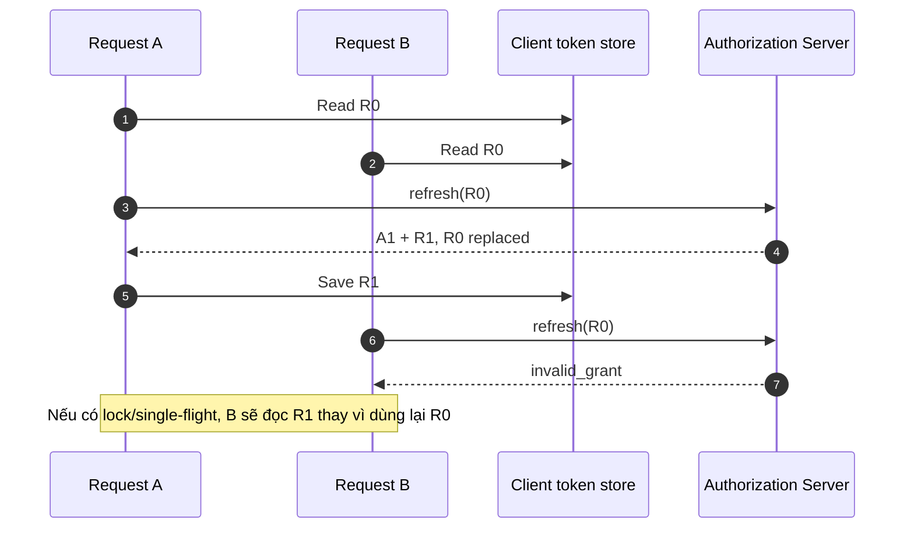

# Refresh token rotation và hiệu lực của token đã được thay thế

Trong OAuth 2.0/OpenID Connect, **refresh token** cho phép một client được cấp access token mới mà không phải yêu cầu người dùng thực hiện lại toàn bộ Authorization Code Flow. Vì vậy, refresh token là một bí mật có giá trị cao: nếu bị đánh cắp và sử dụng thành công, kẻ tấn công có thể tiếp tục xin access token mới trong thời gian refresh token còn được chấp nhận.

**Refresh token rotation** là chính sách cấp **refresh token mới** khi client đổi một refresh token hợp lệ. Giá trị cũ phải được xử lý theo chính sách thay thế/thu hồi, thay vì tiếp tục được sử dụng tùy ý. Tuy nhiên, **rotation**, **từ chối token cũ** và **phát hiện hành vi tái sử dụng để vô hiệu hóa cả chuỗi token** không phải lúc nào cũng là cùng một tính năng.

Bài học thuộc chương **Refresh Token** của module **SPRING_SECURITY_OAUTH2_OIDC_AUTHORIZATION_SERVER**. Mục tiêu là học cách thiết kế, cấu hình, bảo mật, kiểm thử và vận hành OAuth 2.0/OIDC Authorization Server với Spring Security và Spring Authorization Server trong ứng dụng Spring Boot.

Sau bài học, bạn sẽ có thể:

1. Mô tả vòng đời refresh token, refresh token rotation và hành vi của token bị thay thế.
2. Cấu hình `TokenSettings.reuseRefreshTokens(false)` theo từng `RegisteredClient` và giải thích sự khác biệt với `true`.
3. Phân biệt `invalid_grant` do token cũ/hết hạn/sai client với **replay detection** có phản ứng bảo mật nâng cao.
4. Giải thích vì sao access token đã phát hành, refresh token cũ và phiên đăng nhập có các vòng đời riêng.
5. Thiết kế cơ chế lưu token an toàn tại OAuth client, xử lý refresh đồng thời và lỗi mất phản hồi.
6. Kiểm thử hành vi trên Spring Authorization Server và xác định những phần cần tùy biến trước khi sử dụng trong production.

## 1. Refresh token tồn tại ở đâu trong luồng OAuth?

Ví dụ một **confidential web client/BFF** tên `orders-portal` dùng Authorization Code + PKCE để truy cập API đơn hàng:



Với grant `refresh_token`, client thường gửi yêu cầu qua **token endpoint**. Refresh token không được gửi cho Resource Server, không được dùng như access token và không nên được đưa vào URL hoặc log.

Ba khái niệm cần tách bạch:

| Thành phần | Dùng để làm gì? | Hết hiệu lực khi nào? |
| --- | --- | --- |
| **Authorization code** | Đổi lấy token ban đầu trong Authorization Code Flow. | Hết TTL hoặc đã đổi thành công; chỉ dùng một lần. |
| **Access token** | Chứng minh quyền truy cập tài nguyên tại API. | Hết hạn, bị từ chối theo validator/policy hoặc cơ chế thu hồi tương ứng. |
| **Refresh token** | Xin token mới tại Authorization Server. | Hết hạn, bị thu hồi/thay thế, sai client hoặc không còn thỏa điều kiện của authorization. |

**Điểm mấu chốt:** access token A0 có thể còn hạn **sau khi** R0 được thay bằng R1. Việc thay refresh token không đồng nghĩa mọi API tức khắc từ chối A0. Với JWT access token được xác minh offline, API có thể tiếp tục chấp nhận A0 cho tới `exp` nếu không có cơ chế kiểm tra trạng thái bổ sung.

## 2. Rotation, reuse và replay detection khác nhau thế nào?

### 2.1. Rotation

Rotation là quy trình:

1. AS nhận R0 còn hiệu lực từ client đã được xác thực phù hợp.
2. AS kiểm tra authorization và các điều kiện của refresh grant.
3. AS phát access token mới A1.
4. AS phát **refresh token mới R1**, cập nhật trạng thái để R1 thay thế R0.
5. AS trả token response; client ghi nhận R1 thay cho R0.

Một token chain lý tưởng:

```text
Authorization ban đầu:
    R0 (active)

Refresh bằng R0:
    R0 (replaced / no longer usable)
    R1 (active)

Refresh bằng R1:
    R0 (replaced)
    R1 (replaced / no longer usable)
    R2 (active)

Refresh bằng R2:
    R3 (active), các phiên bản trước không còn được dùng
```

Rotation **không phải** việc thêm thời gian sống cho cùng một chuỗi token, cũng không phải đổi access token mà giữ nguyên refresh token.

### 2.2. Reuse refresh token

Một số AS cho phép **reuse**: R0 tiếp tục được gửi qua nhiều lần refresh cho tới khi hết hạn hoặc bị thu hồi. Trong Spring Authorization Server, `TokenSettings.reuseRefreshTokens(true)` thể hiện chính sách tái sử dụng theo cơ chế được thư viện hỗ trợ.

| Chính sách | Khi refresh thành công | Hệ quả bảo mật |
| --- | --- | --- |
| `reuseRefreshTokens(true)` | Tiếp tục sử dụng refresh token hiện có theo cách AS xử lý. | Client đơn giản hơn, nhưng nếu R0 bị lộ và còn hợp lệ, kẻ tấn công có thêm thời gian để tái sử dụng nó. |
| `reuseRefreshTokens(false)` | AS tạo refresh token mới và dùng nó thay token trước trong authorization state. | Thu hẹp cơ hội dùng lại R0; client phải cập nhật an toàn và xử lý race condition. |

Đừng nhầm `reuseRefreshTokens(false)` với việc **không bao giờ** phát refresh token cho client. Quy tắc có được cấp refresh token hay không còn phụ thuộc grant, loại client, cấu hình đăng ký và chính sách AS.

### 2.3. Replay detection và token-family revocation

**Replay** là trường hợp một refresh token từng được dùng hoặc bị thay thế lại xuất hiện ở token endpoint. Điều đó có thể báo hiệu:

- Client lỗi, chưa lưu R1 và vẫn gửi R0.
- Hai request hợp lệ đã đọc cùng R0 và cùng thực hiện refresh.
- Token R0 bị sao chép rồi kẻ tấn công thử sử dụng sau client.
- Token bị đánh cắp được sử dụng **trước** client, khiến client sau đó gửi token đã bị thay thế.

Một thiết kế nâng cao có thể lưu **quan hệ giữa các refresh token cùng một grant/token family**. Khi phát hiện R0 đã được dùng lại, AS từ chối request và **thu hồi cả token family/authorization liên quan**, buộc client xin ủy quyền mới.



**Cảnh báo về Spring Authorization Server:** `reuseRefreshTokens(false)` định hướng **rotation** của token được phát hành. Không được tự tuyên bố rằng chỉ bật cờ này đã có đầy đủ cơ chế **phát hiện reuse, theo dõi token family, vô hiệu hóa mọi descendant và cảnh báo xâm nhập**. Cần kiểm tra hành vi của đúng phiên bản/kho dữ liệu đang sử dụng và bổ sung thiết kế riêng nếu yêu cầu đáp ứng chính sách phát hiện replay nghiêm ngặt.

RFC 9700 (OAuth 2.0 Security Best Current Practice) đưa ra yêu cầu bảo vệ refresh token cho **public client** bằng cơ chế **sender-constrained** hoặc **refresh token rotation** có khả năng phát hiện reuse theo mô hình chuẩn. Khi áp dụng Spring Authorization Server, phải đánh giá **toàn bộ** việc hiện thực, không đánh đồng một setter cấu hình với việc hoàn thành mọi yêu cầu tiêu chuẩn.

## 3. Vòng đời R0, R1 và access token đã cấp

Giả sử policy minh họa:

- Access token TTL: 10 phút.
- Refresh token TTL: 8 giờ.
- `reuseRefreshTokens(false)`.
- Confidential client có quyền dùng `authorization_code` và `refresh_token`.

Tại `10:00`, AS cấp A0 (hết hạn `10:10`) và R0. Tại `10:05`, client refresh thành công, AS cấp A1 và R1.

| Thời điểm | R0 | R1 | A0 | A1 |
| --- | --- | --- | --- | --- |
| Trước refresh lúc `10:05` | Hợp lệ nếu chưa hết hạn/thu hồi. | Chưa có. | Còn hạn. | Chưa có. |
| Ngay sau refresh thành công | **Bị thay thế**, không còn là refresh token hợp lệ trong authorization state chuẩn. | Token hiện hành. | Có thể còn được API chấp nhận nếu chưa hết hạn và validator không kiểm tra thu hồi bổ sung. | Có thể dùng tại API nếu hợp lệ. |
| Sau `10:10` | Không hợp lệ. | Còn hiệu lực nếu chưa hết hạn/thu hồi. | Hết `exp`; API phải từ chối ngoài dung sai đồng hồ. | Còn hạn tùy thời điểm phát hành. |
| Khi R1 bị thu hồi | Không hợp lệ. | Không hợp lệ. | Không thể mặc định suy ra trạng thái offline JWT. | Tùy định dạng/thu hồi và kiểm tra của API. |

Bảng minh họa cơ chế token bình thường; phản hồi cụ thể còn phụ thuộc phiên bản Spring Authorization Server, cách lưu `OAuth2Authorization`, loại access token và cấu hình Resource Server.

### 3.1. R0 bị thay thế không đồng nghĩa “chưa hết TTL nên vẫn dùng được”

TTL chỉ cho biết **thời điểm hết hạn tối đa của một token**, không bảo đảm token luôn được chấp nhận cho đến hạn đó. Một refresh token có thể bị **vô hiệu hóa sớm** vì:

- Đã được thay bằng refresh token mới.
- Bị revoke hoặc authorization liên quan bị hủy.
- Không tồn tại trong kho trạng thái sau restart hoặc chuyển instance sai.
- Không thuộc client đang xác thực.
- Bị chính sách bảo mật từ chối.

Vì vậy, câu “R0 chưa đủ 8 giờ nên AS phải cho refresh” là **sai** nếu R0 đã bị thay.

### 3.2. R0 dùng lại sau rotation thường dẫn đến invalid_grant

Trong luồng refresh grant, khi AS không còn tìm thấy refresh token hợp lệ hoặc token không còn active, response thường là lỗi `invalid_grant`:

```http
HTTP/1.1 400 Bad Request
Content-Type: application/json
Cache-Control: no-store

{
  "error": "invalid_grant"
}
```

Đây là **ví dụ response điển hình**, không phải lời hứa rằng mọi bản SAS đều trả đúng cùng status/headers cho mọi tình huống. Sai client authentication có thể tạo lỗi `invalid_client` trước khi kiểm tra refresh token. Không dùng HTTP status duy nhất để xác định token có bị tấn công hay không.

### 3.3. Điều gì xảy ra với access token A0?

Cần phân biệt ít nhất hai chế độ:

1. **JWT self-contained:** Resource Server thường xác minh chữ ký, `iss`, `exp`, `aud` và scope tại chỗ. Nó **không tự biết** R0 đã bị thay hoặc access token A0 bị xóa khỏi trạng thái authorization của AS. JWT A0 có thể được chấp nhận tới hết hạn nếu không có denylist, introspection hoặc cơ chế trạng thái khác.
2. **Opaque/reference access token:** Resource Server thường gọi introspection hoặc tra trạng thái AS. Thời điểm A0 ngừng được chấp nhận phụ thuộc cách AS cập nhật authorization, cơ chế tra cứu và cache introspection.

Do đó, phải viết riêng policy **rotation refresh token** và policy **thu hồi access token**. Đừng dùng việc rotation R0 như bằng chứng rằng A0 đã lập tức không thể gọi API.

## 4. Cấu hình rotation bằng TokenSettings trong Spring Authorization Server

Trong Spring Authorization Server 1.x, `TokenSettings` là thuộc tính **theo từng `RegisteredClient`**. Những method quan trọng:

| Method | Ý nghĩa |
| --- | --- |
| `reuseRefreshTokens(false)` | Phát refresh token mới khi xử lý refresh grant theo policy của thư viện. |
| `refreshTokenTimeToLive(Duration)` | TTL được áp dụng khi tạo refresh token mới. |
| `accessTokenTimeToLive(Duration)` | TTL của access token mới. |
| `authorizationCodeTimeToLive(Duration)` | TTL authorization code; không quyết định rotation. |
| `accessTokenFormat(...)` | Định dạng access token, liên quan xác minh và khả năng thu hồi. |

### 4.1. Ví dụ đăng ký confidential client

Ví dụ dùng **Java 17+, Spring Boot 3.x tương thích với Spring Authorization Server 1.x**. Đây là cấu hình **đăng ký client**, giả định ứng dụng đã có `PasswordEncoder`, `SecurityFilterChain`, khóa ký/JWKS, issuer và các bean hạ tầng khác.

```java
package com.example.authserver.config;

import java.time.Duration;
import java.util.UUID;

import org.springframework.beans.factory.annotation.Value;
import org.springframework.context.annotation.Bean;
import org.springframework.context.annotation.Configuration;
import org.springframework.security.crypto.password.PasswordEncoder;
import org.springframework.security.oauth2.core.AuthorizationGrantType;
import org.springframework.security.oauth2.core.ClientAuthenticationMethod;
import org.springframework.security.oauth2.core.oidc.OidcScopes;
import org.springframework.security.oauth2.server.authorization.client.InMemoryRegisteredClientRepository;
import org.springframework.security.oauth2.server.authorization.client.RegisteredClient;
import org.springframework.security.oauth2.server.authorization.client.RegisteredClientRepository;
import org.springframework.security.oauth2.server.authorization.settings.ClientSettings;
import org.springframework.security.oauth2.server.authorization.settings.TokenSettings;

@Configuration(proxyBeanMethods = false)
public class PortalClientRegistrationConfig {

    @Bean
    RegisteredClientRepository registeredClientRepository(
            PasswordEncoder passwordEncoder,
            @Value("${demo.portal-client-secret}") String clientSecret) {

        TokenSettings rotationPolicy = TokenSettings.builder()
            .authorizationCodeTimeToLive(Duration.ofMinutes(2))
            .accessTokenTimeToLive(Duration.ofMinutes(10))
            .refreshTokenTimeToLive(Duration.ofHours(8))
            .reuseRefreshTokens(false)
            .build();

        RegisteredClient portal = RegisteredClient
            .withId(UUID.randomUUID().toString())
            .clientId("orders-portal")
            .clientSecret(passwordEncoder.encode(clientSecret))
            .clientAuthenticationMethod(
                ClientAuthenticationMethod.CLIENT_SECRET_BASIC)
            .authorizationGrantType(
                AuthorizationGrantType.AUTHORIZATION_CODE)
            .authorizationGrantType(
                AuthorizationGrantType.REFRESH_TOKEN)
            .redirectUri(
                "https://portal.example.com/login/oauth2/code/sas")
            .scope(OidcScopes.OPENID)
            .scope("orders.read")
            .clientSettings(ClientSettings.builder()
                .requireProofKey(true)
                .requireAuthorizationConsent(true)
                .build())
            .tokenSettings(rotationPolicy)
            .build();

        return new InMemoryRegisteredClientRepository(portal);
    }
}
```

Trong `application.yml`:

```yaml
demo:
  portal-client-secret: ${PORTAL_CLIENT_SECRET}
```

Cấp biến môi trường `PORTAL_CLIENT_SECRET` khi chạy. **Không commit secret thật vào source code**, không đặt secret trong log, không đặt secret trên ứng dụng SPA/public client.

**Phân tích:**

- Client được đăng ký grant `authorization_code` và `refresh_token`; cờ `reuseRefreshTokens(false)` **không tự cấp** refresh grant nếu client chưa được đăng ký hoặc không đủ điều kiện.
- `CLIENT_SECRET_BASIC` dành cho backend confidential client có thể giữ client secret ở phía server. Public SPA/native app không thể bảo vệ client secret tương tự.
- `requireProofKey(true)` yêu cầu PKCE cho authorization code. PKCE kiểm tra **code exchange**, không thay client authentication và không thay rotation cho refresh token.
- `refreshTokenTimeToLive(Duration.ofHours(8))` là TTL của **mỗi refresh token được phát hành** theo policy. Nếu rotation phát token mới, thời hạn của token mới thường được tính từ thời điểm phát hành mới; đó không tự tạo **thời hạn tuyệt đối của cả phiên/authorization**.
- `InMemoryRegisteredClientRepository` chỉ phù hợp học và test. Đừng tạo random internal ID khi đang vận hành repository bền vững với consent/authorization state; cần ID ổn định và cập nhật registration có kiểm soát.

### 4.2. Policy không áp dụng cho tất cả grant

`client_credentials` thường không cấp refresh token: service có thể xin access token mới bằng chính client credentials. Với Authorization Code Flow, refresh token có thể được cấp khi client và cấu hình cho phép. Không gắn `REFRESH_TOKEN` vào SPA rồi giả định thư viện sẽ cấp refresh token trong mọi phiên bản.

Với **public client**, RFC 9700 yêu cầu cơ chế giảm rủi ro refresh token bằng sender-constraining hoặc rotation có phát hiện reuse. Nếu kiến trúc SPA không thể bảo vệ token đủ tốt, cân nhắc **Backend-for-Frontend (BFF)** để không phải lưu refresh token trong JavaScript.

### 4.3. So sánh một client reuse và một client rotate

```java
TokenSettings legacyReuse = TokenSettings.builder()
    .refreshTokenTimeToLive(Duration.ofHours(8))
    .reuseRefreshTokens(true)
    .build();

TokenSettings rotatingRefresh = TokenSettings.builder()
    .refreshTokenTimeToLive(Duration.ofHours(8))
    .reuseRefreshTokens(false)
    .build();
```

Hai policy có thể được gắn vào **hai `RegisteredClient` khác nhau**. Nếu đổi policy của một client đang vận hành, phải tính đến token đã phát hành và những client application đang giữ token cũ; không thay đổi chỉ để “đẹp cấu hình” khi client chưa xử lý được refresh token mới.

## 5. Request/response khi refresh có rotation

Giả sử client đã nhận R0 qua Authorization Code Flow và giữ nó an toàn ở backend.

Request:

```http
POST /oauth2/token HTTP/1.1
Host: login.example.com
Authorization: Basic <BASE64_OF_CLIENT_ID_COLON_CLIENT_SECRET>
Content-Type: application/x-www-form-urlencoded

grant_type=refresh_token&refresh_token=<R0>&scope=orders.read
```

Đây là ví dụ **confidential client** dùng Basic client authentication qua HTTPS. Với ứng dụng thật, `client_id` và secret phải được mã hóa đúng khi tạo HTTP Basic credential; token không được ghi vào URL/log.

Response rút gọn khi thành công:

```json
{
  "access_token": "<NEW_ACCESS_TOKEN_A1>",
  "token_type": "Bearer",
  "expires_in": 600,
  "refresh_token": "<NEW_REFRESH_TOKEN_R1>",
  "scope": "orders.read"
}
```

Sau khi nhận response, client phải dùng **R1 thay cho R0** ở các lần refresh kế tiếp. Nếu SAS đã lưu trạng thái rotation thành công mà client vẫn giữ R0, lần dùng tiếp theo có thể bị từ chối với `invalid_grant`.

### 5.1. Scope khi refresh

Refresh grant không phải cơ hội xin scope bất kỳ. Theo nguyên tắc OAuth:

- Scope của refresh request **không được mở rộng** vượt quyền đã cấp cho authorization gốc.
- Nếu tham số `scope` được bỏ qua, AS áp dụng quy tắc scope của authorization/refresh token tương ứng.
- Client gửi thêm `orders.write` khi chỉ từng được cấp `orders.read` phải bị từ chối hoặc giới hạn theo giao thức/chính sách, không được tự động nâng quyền.
- Dù token có scope hợp lệ, Resource Server vẫn kiểm tra audience, tenant và quyền trên đối tượng.

Không lấy tham số scope từ client làm **nguồn quyền tin cậy**, và không dùng logic refresh tự viết để bỏ qua authorization state.

### 5.2. Refresh token được cấp mới có gì khác?

R1 phải là một giá trị mới khó đoán và được lưu an toàn như thông tin xác thực. AS cần liên kết R1 với client/authorization phù hợp, thời điểm phát hành, hạn sử dụng và các điều kiện ràng buộc. **R1 không nên là biến thể có thể tính từ R0**; việc phát hành token phải dùng nguồn ngẫu nhiên an toàn theo thư viện.

Trong Spring Authorization Server, `OAuth2TokenGenerator` và các thành phần provider xử lý phát token. Đừng tự viết `R1 = R0 + "1"` hay cấp một UUID có cấu trúc dễ đoán.

## 6. Spring Authorization Server xử lý trạng thái thế nào?

Những thành phần cần phân biệt:

| Thành phần | Trách nhiệm |
| --- | --- |
| `RegisteredClientRepository` | Lưu thông tin client, grant types, authentication method và `TokenSettings`. |
| `OAuth2RefreshTokenAuthenticationConverter` | Chuyển HTTP refresh request thành đối tượng authentication request. |
| `OAuth2RefreshTokenAuthenticationProvider` | Kiểm tra refresh grant, authorization/token và phát token theo cấu hình. |
| `OAuth2AuthorizationService` | Lưu và tra authorization state, gồm các token đã cấp. |
| `OAuth2TokenGenerator` | Sinh access token/refresh token phù hợp policy và grant. |
| `OAuth2AuthorizationConsentService` | Lưu consent của người dùng, không phải kho refresh token. |
| Resource Server | Xác minh access token; không xác thực refresh token qua API. |

Với mô hình authorization state chuẩn, một authorization có refresh token hiện hành. Khi rotation thành công và trạng thái được ghi lại, token mới thay token cũ trong trạng thái đó. Việc tìm R0 sau đó sẽ thất bại hoặc trả trạng thái không còn active **theo cơ chế lưu trữ/tra cứu thực tế**. Cách Spring xử lý lỗi phải được xác minh bằng integration test cho phiên bản và repository đang dùng.

### 6.1. Vì sao repository và transaction quan trọng?

Một hệ thống production có nhiều replica AS không nên để mỗi JVM dùng một kho authorization in-memory riêng. Nếu request R0 lần đầu tới instance A, lần tiếp theo tới instance B không thấy trạng thái đã cập nhật, kết quả có thể là lỗi ngẫu nhiên, hoặc trong thiết kế tùy biến kém an toàn là cấp nhiều nhánh token.

Các lựa chọn thường gặp:

- `InMemoryOAuth2AuthorizationService`: phù hợp demo/test, không bền vững sau restart và không chia sẻ giữa instance.
- `JdbcOAuth2AuthorizationService`: lưu trạng thái vào cơ sở dữ liệu; cần thiết kế migration/index/concurrency phù hợp.
- `OAuth2AuthorizationService` tùy biến: có thể bổ sung optimistic locking, compare-and-swap, token-family tracking, audit và kiểm tra atomic refresh.

**Lưu trữ chung chưa chắc đủ để chống race.** Nếu hai refresh request đồng thời cùng đọc R0 đang active trước khi bất kỳ transaction nào ghi R1, chúng có thể cùng đi qua một số bước kiểm tra trừ khi kho trạng thái và logic refresh bảo đảm cập nhật nguyên tử. Đây là điểm cần kiểm tra bằng concurrent integration tests, không chỉ với một request nối tiếp.

### 6.2. Đừng nhầm trạng thái lưu token với khả năng phát hiện replay

Nếu repository chỉ giữ **token hiện hành**, sau khi R0 bị thay bằng R1, request R0 cũ có thể không tìm thấy authorization:

```text
findByToken(R0, REFRESH_TOKEN) -> null
=> invalid_grant
```

Kết quả này **từ chối R0** nhưng không nhất thiết xác định rằng R0 đã từng hợp lệ và vừa bị sử dụng lại. Nếu không lưu lịch sử, server khó phân biệt:

- R0 vừa bị thay do refresh thành công.
- R0 là token không tồn tại do attacker đoán.
- R0 là token của authorization đã bị xóa khỏi kho.
- R0 đã hết hạn lâu và bị dọn dẹp.

Một hệ thống yêu cầu **replay detection có phản ứng** cần có thêm bằng chứng lịch sử và chính sách: token family, token identifier/hash, thông tin “consumed/replaced”, mốc thời gian, client binding và hành động revoke có tính nguyên tử.

## 7. Thiết kế token family để phát hiện refresh token reuse

Đây là **mô hình kiến trúc bổ sung**, không phải một bean mặc định có sẵn chỉ cần bật `reuseRefreshTokens(false)`.



Một bản ghi gia đình token có thể chứa:

| Thuộc tính | Mục đích |
| --- | --- |
| `family_id` / `authorization_id` | Liên kết chuỗi token phát sinh từ cùng một grant. |
| `client_id` / internal registered client ID | Ràng buộc token với đúng client. |
| `current_token_hash` | Đối chiếu token đang active mà không cần lưu raw token trong các bảng audit tùy biến. |
| `used_token_hashes` hoặc bản ghi consumed | Nhận ra token cũ bị gửi lại. |
| `version` hoặc sequence | Hỗ trợ optimistic locking/CAS để ngăn hai refresh đồng thời cùng thành công. |
| `expires_at` và `absolute_expires_at` | TTL của token hiện hành và giới hạn tuyệt đối của grant/family nếu policy yêu cầu. |
| `revoked_at` / `revoked_reason` | Bảo đảm cả family bị chặn sau reuse được xác nhận. |
| `last_refresh_at` / audit event ID | Quan sát bất thường mà không ghi raw refresh token. |

**Mô hình transaction khái niệm:**

```text
BEGIN TRANSACTION
  1. Tra family từ định danh/hash của token được gửi.
  2. Kiểm tra client binding, grant, expiry, revoked flag.
  3. Nếu token là token ACTIVE:
       - Thay đổi ACTIVE -> CONSUMED bằng update có điều kiện/CAS.
       - Sinh và lưu R_new ở trạng thái ACTIVE.
       - Ghi token/authorization metadata và commit nhất quán.
  4. Nếu token đã CONSUMED/REPLACED:
       - Ghi security event không chứa token thô.
       - Revoke family theo policy và commit.
       - Trả invalid_grant.
  5. Nếu token không tồn tại:
       - Trả invalid_grant; không suy đoán danh tính.
COMMIT
```

Nếu hai request chạy đồng thời, **chỉ một transaction** được phép thắng thao tác chuyển token từ ACTIVE sang CONSUMED. Request còn lại phải xử lý theo cơ chế chống replay đã thiết kế. Không để logic “đọc rồi cập nhật” thiếu khóa hoặc điều kiện version dẫn tới hai R1/R1' đều hợp lệ.

### 7.1. Vì sao không mặc định thu hồi cả family cho mọi invalid_grant?

`invalid_grant` có thể do token hết hạn, bị thu hồi, sai redirect/code hoặc trạng thái không hợp lệ khác. Không phải mọi `invalid_grant` chứng minh có reuse refresh token của một family xác định.

Một phản ứng cực đoan “mỗi invalid_grant đều xóa tất cả phiên của user” có thể gây **denial of service**. Đặc biệt kẻ tấn công có thể gửi một chuỗi ngẫu nhiên với client ID đã biết để cố kích hoạt thu hồi. Chỉ áp dụng family revocation khi server **có bằng chứng token cũ thuộc family cụ thể và đã bị tiêu thụ**, theo chính sách đã được thiết kế cẩn thận.

### 7.2. Xử lý giai đoạn chuyển tiếp và replay

Một số hệ thống muốn có khoảng thời gian grace ngắn để chịu lỗi mạng. Nhưng nếu cho R0 còn sử dụng được sau khi R1 được phát hành, kẻ tấn công giữ R0 cũng có cơ hội dùng lại nó; điều này làm yếu hoặc thay đổi ý nghĩa rotation.

Nếu cần cơ chế retry/idempotency, hãy thiết kế theo threat model, ràng buộc với cùng client/transaction và dữ liệu server-side, không mở rộng grace một cách chung chung. Một tính năng cho phép **một token đã bị thay thế đổi thêm token mới không giới hạn** không thể được coi là refresh token rotation an toàn.

## 8. Client phải lưu refresh token mới thế nào?

Rotation không thể thành công nếu client vẫn giữ R0 sau khi AS đã phát R1. Vì vậy, trách nhiệm của **OAuth client** là một phần quan trọng của thiết kế.

### 8.1. Backend/BFF

Ở một backend có database token store:

1. Đọc access token gần hết hạn và refresh token hiện hành.
2. Chỉ cho phép **một refresh operation cho mỗi session/authorization** tại một thời điểm (single-flight hoặc distributed lock).
3. Gửi refresh token qua HTTPS, xác thực client như đã đăng ký.
4. Khi nhận response thành công, ghi **access token mới + refresh token mới + expiry** như một thay đổi nhất quán.
5. Chỉ sau khi commit trạng thái mới, cho các request khác sử dụng token mới.
6. Không lưu raw refresh token trong log, metrics, browser localStorage hoặc message không được bảo vệ.

Với ứng dụng nhiều instance, một `synchronized` lock trong JVM **không đủ** vì hai server có thể nhận request của cùng user. Dùng distributed synchronization hoặc transaction/CAS tại token store của client.

### 8.2. Pseudocode tránh hai request dùng cùng R0

```text
getAccessToken(sessionId):
    state = tokenStore.read(sessionId)

    if accessToken còn đủ hạn an toàn:
        return accessToken

    acquire per-session distributed lock

    try:
        state = tokenStore.read(sessionId)  // re-read after lock

        if state.accessToken đã được instance khác cập nhật:
            return state.accessToken

        response = tokenEndpoint.refresh(
            clientAuthentication,
            state.refreshToken
        )

        if response success:
            newState = {
                accessToken: response.accessToken,
                refreshToken: response.refreshToken
                    ?? state.refreshToken, // chỉ fallback khi protocol/policy cho phép
                expiresAt: response.expiresAt,
                version: state.version + 1
            }

            tokenStore.compareAndSwap(sessionId, state.version, newState)
            return newState.accessToken

        if response invalid_grant:
            invalidate local refresh credential
            require reauthorization
    finally:
        release lock
```

Đây là **pseudocode thiết kế**, không phải thư viện Java chạy được ngay. Với client **bắt buộc rotation**, nếu token response thiếu refresh token mới thì không nên âm thầm giữ R0 rồi tiếp tục refresh như cũ; cần xử lý theo contract đã được kiểm chứng. Token store cũng cần thiết kế để không bị lỗi khi CAS thất bại sau khi AS đã phát token mới.

### 8.3. Race condition giữa hai request



Nếu AS có cơ chế family revocation khi thấy token cũ bị dùng lại, **một race condition hợp lệ ở client** có thể làm cả family bị thu hồi và người dùng phải đăng nhập lại. Do đó cần xử lý concurrency ở cả client lẫn Authorization Server.

### 8.4. Mất phản hồi sau khi AS đã commit rotation

Tình huống khó:

1. Client gửi R0.
2. AS lưu R1 và vô hiệu R0.
3. Mạng đứt hoặc client timeout **trước khi nhận R1**.
4. Client chỉ còn R0 trong token store.
5. Retry bằng R0 trả `invalid_grant`, hoặc bị coi là replay trong hệ thống có detection.

Không thể giải quyết tuyệt đối bằng cách tăng TTL. Cần chọn hành vi theo chính sách bảo mật: kết thúc authorization và khởi động lại Authorization Code Flow, hoặc có cơ chế retry/idempotency server-side được thiết kế riêng và kiểm tra an toàn. **Không giả định retry cùng R0 luôn thành công**.

## 9. TTL khi rotation: sliding expiration và giới hạn tuyệt đối

Giả sử `refreshTokenTimeToLive(Duration.ofHours(8))`. Nếu mỗi lần rotation AS phát token mới có TTL 8 giờ từ **thời điểm phát hành**, một client thường xuyên refresh có thể tiếp tục gia hạn token liên tục. Đây là **sliding expiration** theo từng token, không phải giới hạn tuyệt đối 8 giờ cho toàn bộ authorization.

```text
10:00  R0 issued, expires 18:00
12:00  refresh(R0) -> R1 issued, expires 20:00
15:00  refresh(R1) -> R2 issued, expires 23:00
...
```

Mốc trên chỉ để minh họa. Hành vi hết hạn được xác định bởi token generator và policy của phiên bản triển khai. Nếu chính sách sản phẩm yêu cầu phiên phải chấm dứt sau tối đa 24 giờ kể từ ủy quyền ban đầu, **chỉ đặt refreshTokenTimeToLive(...) không đủ**. Cần thêm:

- `authorization/session started_at` và `absolute_expires_at` được lưu bền vững.
- Validation trước mỗi refresh để từ chối khi vượt giới hạn tuyệt đối.
- Chính sách yêu cầu xác thực lại, ví dụ max authentication age/MFA khi phù hợp.
- Quy trình quản trị revoke và xóa authorization state.

Không dùng refresh token TTL làm định nghĩa duy nhất của thời hạn phiên đăng nhập SSO hoặc phiên web.

## 10. Refresh token rotation và loại client

| Loại client | Có nên cấp refresh token? | Chính sách và rủi ro |
| --- | --- | --- |
| Confidential backend/BFF | Có thể, nếu dùng grant và cần duy trì phiên làm việc. | Giữ refresh token ở backend, mã hóa và phân quyền; nên đánh giá rotation, revoke và concurrency. |
| Public SPA | Chỉ khi kiến trúc/AS hỗ trợ cơ chế an toàn. | JavaScript không giữ bí mật tuyệt đối trước XSS; theo RFC 9700 cần rotation có phát hiện reuse hoặc sender-constrained refresh token nếu cấp cho public client. |
| Native/mobile app | Có thể, tùy loại app và chính sách. | Bảo vệ token bằng kho khóa thiết bị, PKCE, phát hiện thiết bị mất/cài lại, rotation/sender constraint. |
| Machine client dùng `client_credentials` | Thông thường không cần và không được cấp theo luồng chuẩn. | Service dùng client authentication để xin access token mới, không refresh theo user session. |
| Client có quyền nhạy cảm cao | Cần đánh giá nghiêm ngặt. | Access token ngắn, rotation/sender constraint, giới hạn tuyệt đối, tín hiệu rủi ro và thu hồi có hiệu lực phù hợp. |

**Quan trọng:** mTLS, DPoP hoặc một hình thức sender-constraining có thể ràng buộc việc sử dụng token với khóa của client, nhưng cần triển khai ở đúng endpoint, token format và bên xác minh. Không tự hiểu rằng bật `requireProofKey(true)` (PKCE) đã sender-constrain refresh token.

## 11. Thu hồi, logout và tác động lên access token

Có ít nhất bốn hành động khác nhau:

1. **Rotation:** AS cấp R1 thay R0 sau refresh thành công.
2. **Revoke refresh token:** AS đánh dấu hoặc xóa khả năng dùng R hiện hành, theo RFC 7009/chính sách.
3. **Logout web/OIDC:** chấm dứt phiên đăng nhập ở client/AS hoặc thông báo logout; không tự đồng nghĩa với revoke mọi access token.
4. **Revoke access token:** làm cho API ngừng chấp nhận token trước `exp`, điều này phụ thuộc cách xác minh token.

Ví dụ: người dùng logout portal vào lúc `10:06` khi JWT A1 còn hạn 9 phút. Nếu API chỉ xác minh JWT tại chỗ, A1 **có thể vẫn được chấp nhận** đến hết hạn. Nếu yêu cầu cắt quyền ngay, cần introspection, denylist, token binding, kiểm tra quyền theo thời gian thực hoặc mô hình token khác.

Ngược lại, nếu R1 bị thu hồi, client có thể bị buộc khởi động lại authorization flow khi A1 hết hạn, nhưng việc thu hồi R1 chưa chắc khiến A1 ngừng hoạt động ngay.

**Chính sách thu hồi access token phải được kiểm thử tại Resource Server**, không chỉ bằng việc gọi revoke endpoint của AS.

## 12. Tình huống lỗi thường gặp

### 12.1. Client nhận invalid_grant sau khi refresh thành công một lần

Khả năng thường gặp:

- Client vẫn lưu R0 thay vì R1.
- Hai request đã refresh đồng thời bằng R0.
- Token store ghi token mới bị lỗi hoặc cập nhật không nguyên tử.
- AS đã commit rotation nhưng phản hồi bị mất.
- Authorization state bị xóa do restart hoặc lỗi phân phối giữa nhiều instance.
- R1 đã hết hạn hoặc bị revoke.

Đừng tự động tăng refresh TTL hay bật lại reuse mà chưa hiểu nguyên nhân. Tìm dấu vết transaction/audit **không chứa raw token**, kiểm tra thời điểm và phiên bản token store.

### 12.2. Reuse false nhưng R0 vẫn được chấp nhận trong một test cạnh tranh

Nếu hai request đồng thời cùng đọc R0 trước khi trạng thái được cập nhật, repository/transaction có thể thiếu bảo đảm atomicity. Kiểm thử phải xác nhận **chỉ một refresh thành công** và chỉ một descendant hợp lệ theo chính sách. Nếu không, bổ sung optimistic locking/compare-and-swap hoặc lưu trữ/serialization theo session.

### 12.3. R0 cũ bị từ chối nhưng hệ thống không phát cảnh báo replay

Đó có thể là hành vi hợp lệ của một repository chỉ lưu token hiện hành. Không thể phân biệt token đã consumed với token chưa từng tồn tại nếu không lưu lịch sử. Muốn phát hiện reuse phải có thiết kế token-family/history cùng logic security event.

### 12.4. Người dùng bị logout ngẫu nhiên khi truy cập nhiều tab

Có thể client đồng thời refresh từ nhiều tab/instance và một yêu cầu dùng R0 đã bị thay; hoặc ứng dụng không lưu được R1 đúng thời điểm. Dùng single-flight/deduplicated refresh, cập nhật trạng thái có điều kiện và đảm bảo mọi request đọc token mới sau khi refresh.

### 12.5. Có R1 hợp lệ nhưng JWT A0 vẫn gọi API được

Rotation refresh token không bắt buộc làm JWT A0 đã phát hành mất hiệu lực trong bộ xác minh offline. Nếu đây là yêu cầu nghiệp vụ, thiết kế revoke/denylist/introspection riêng hoặc dùng access token ngắn hạn phù hợp.

### 12.6. R1 hết hạn sau restart dù TTL còn

`OAuth2AuthorizationService` hoặc repository in-memory không bền vững sau restart. Dùng kho trạng thái bền vững/chia sẻ cho production; kiểm tra key rotation, cache, issuer và client registration consistency.

### 12.7. Client Credentials không nhận refresh token

Đây thường là hành vi đúng của grant `client_credentials`. Client nhận access token và xin lại bằng client authentication khi cần. Không thêm refresh token vào một luồng chỉ vì muốn giảm số token requests.

## 13. Chiến lược lưu trữ và vận hành

### 13.1. Lưu token và audit có kiểm soát

- Không ghi raw refresh token, access token, client secret hoặc private key vào log, URL, exception, metrics label hoặc message trao đổi.
- Token store của client và AS phải hạn chế truy cập, mã hóa dữ liệu nhạy cảm ở trạng thái lưu trữ, có cơ chế backup/restore an toàn. Với hệ thống tùy biến có thể dùng hash token đủ mạnh để đối chiếu mà không lưu raw token trong bảng audit.
- Tránh dùng `client_id` hoặc user ID làm khóa duy nhất của refresh transaction: một client/user có thể có nhiều authorization/session/device cùng tồn tại.
- Nếu lưu lịch sử token consumed để phát hiện replay, đặt TTL/retention hợp lý: lưu đủ lâu để nhận ra reuse theo chính sách nhưng không giữ vô hạn dữ liệu không cần thiết.
- Bảo đảm backup/restore không khiến token cũ “sống lại” do rollback dữ liệu; có kế hoạch xử lý trạng thái và version sau khôi phục.

### 13.2. Giám sát

Nên đo/ghi các **số liệu tổng hợp**:

| Metric / sự kiện | Ý nghĩa |
| --- | --- |
| `refresh_success_total` | Theo dõi lưu lượng refresh thành công. |
| `refresh_invalid_grant_total` | Nhận diện tăng đột biến lỗi do expiry, race, mất trạng thái hoặc replay. |
| `refresh_reuse_detected_total` | Chỉ phát khi logic phát hiện token consumed/replaced có bằng chứng. |
| `refresh_family_revoked_total` | Đếm family bị thu hồi do security policy, không gắn raw token. |
| `refresh_latency` | Theo dõi thời gian token endpoint và database/lock. |
| `refresh_concurrency_conflict_total` | Phát hiện cạnh tranh khi cập nhật token/authorization state. |
| `authorization_store_error_total` | Báo lỗi persistence gây mất phiên hoặc sai lệch token. |

Không gọi mọi `invalid_grant` là tấn công. Khi điều tra, dùng event ID, client ID đã được kiểm soát, family ID giả danh và timestamp; không để ID raw người dùng/tenant hay token trong nhãn metric có số lượng không giới hạn.

### 13.3. Khả năng sẵn sàng của nhiều instance

AS chạy nhiều replica cần:

- Cùng issuer và ký token bằng bộ khóa quản trị chung.
- Cùng `RegisteredClientRepository`, `OAuth2AuthorizationService` và policy token.
- Một cơ chế concurrency control đủ mạnh cho việc **tiêu thụ R0 và phát R1**.
- Chiến lược retry/backoff và idempotency phù hợp, không vô tình dùng lại consumed token.
- Đồng bộ đồng hồ/TTL, index DB, timeout và cleanup các token/family hết hạn.
- Test rolling deployment khi các instance đang chạy hai phiên bản code/policy khác nhau.

Một kho dữ liệu dùng chung nhưng cho phép lost update vẫn có thể làm rotation không an toàn. Ngược lại, một thuật toán atomic tốt nhưng chạy trên hai kho độc lập cũng không giải quyết HA.

## 14. Ma trận kiểm thử rotation và hiệu lực token cũ

Để bảo đảm behavior, cần kiểm thử **request tuần tự**, **request đồng thời**, **lỗi mạng** và **các cơ chế xác minh API**.

| Tình huống | Kết quả mong đợi |
| --- | --- |
| R0 hợp lệ, client đúng, `reuseRefreshTokens(false)` | AS phát A1 và R1; R1 khác R0. |
| Gửi lại R0 sau refresh thành công | R0 không được cấp token tiếp theo; kết quả lỗi phù hợp (thường `invalid_grant`). |
| Gửi R1 lần đầu sau rotation | AS cấp token mới (A2/R2) nếu R1 còn hạn và policy cho phép. |
| Client gửi sai secret | Bị từ chối client authentication; không dùng được R0/R1. |
| Client B lấy R1 của client A | Không được refresh vì token bị ràng buộc với client đã cấp. |
| Refresh token hết TTL | Không cấp access token mới. |
| R1 bị revoke | Không cấp access token mới. |
| Client không đăng ký `refresh_token` grant | Không được refresh dù gửi một giá trị có hình thức giống refresh token. |
| Refresh với scope vượt quyền ban đầu | Không cấp scope vượt mức authorization đã cấp. |
| `reuseRefreshTokens(true)` | Kiểm tra hành vi reuse thực tế theo phiên bản SAS, không mặc định có R mới. |
| Hai request đồng thời bằng R0 | Với policy rotation nghiêm ngặt, chỉ một lần tiêu thụ R0 được phép thành công. |
| Server commit rotation rồi client mất response | Client không được tự giả định R0 vẫn active; có lối tái ủy quyền an toàn. |
| Client lưu R1 không thành công | Không tiếp tục gửi R0 một cách lặp vô hạn; phát hiện và xử lý mất state. |
| Replay R0 trong thiết kế có token family | Nhận diện token cũ thuộc family; revoke theo policy và ghi event. |
| Request với token ngẫu nhiên chưa tồn tại | Từ chối nhưng không tùy tiện revoke family của người khác. |
| Access token A0 là JWT chưa hết hạn sau R0→R1 | Test làm rõ liệu API còn chấp nhận A0; không mặc định rotation thu hồi A0. |
| Access token A0 là opaque sau R0→R1 | Kiểm tra introspection/cache và chính sách thời gian thực tế. |
| Đổi TTL hoặc `reuseRefreshTokens` khi có token cũ | Policy mới áp dụng theo cơ chế phát hành/đọc registration; test dữ liệu đã tồn tại. |
| AS restart hoặc đổi replica giữa các lần refresh | Authorization state/registration và khóa nhất quán; không mất R hiện hành. |
| Rotation nhiều lần liên tiếp | R0/R1 bị thay, chỉ refresh token hiện hành có thể dùng theo policy. |

### 14.1. Quy trình test thủ công từng bước

**Bước 1:** chạy Authorization Server và một confidential client đã đăng ký `authorization_code`, `refresh_token`, PKCE, bật `reuseRefreshTokens(false)`. Đảm bảo callback và issuer khớp.

**Bước 2:** hoàn tất Authorization Code Flow để nhận access token A0 và refresh token R0. Giữ token trong môi trường test an toàn, **không dán raw token vào log công khai hoặc công cụ trực tuyến**.

**Bước 3:** gửi token refresh request bằng R0:

```bash
curl --silent --show-error --fail-with-body \
  -u "orders-portal:$PORTAL_CLIENT_SECRET" \
  -H 'Content-Type: application/x-www-form-urlencoded' \
  --data-urlencode 'grant_type=refresh_token' \
  --data-urlencode "refresh_token=$R0" \
  'https://login.example.com/oauth2/token'
```

Đây là ví dụ cho môi trường Bash; trong PowerShell, xử lý biến môi trường/cú pháp `curl` khác nhau. Dùng TLS đúng, không đưa token vào shell history/log, tránh bật verbose khi có credential thật.

**Bước 4:** kiểm tra response có A1 và R1; assert `R1 != R0` (không in cả hai ra log). Dùng R1 refresh lần kế tiếp để nhận A2/R2.

**Bước 5:** gửi lại R0. Kỳ vọng token endpoint từ chối và không phát token mới. Nếu hệ thống có replay-family detection, kiểm tra event và trạng thái thu hồi theo thiết kế.

**Bước 6:** với access token A0 vẫn còn `exp`, thử gọi Resource Server. Ghi nhận JWT offline validation hoặc introspection trả kết quả gì; kiểm tra ranh giới này **độc lập** với rotation.

### 14.2. Gợi ý integration test ở phía AS

Một test framework-level có thể:

1. Tạo `RegisteredClient` với `reuseRefreshTokens(false)` và một `OAuth2Authorization` hợp lệ có refresh token R0 còn hạn.
2. Gửi refresh request với client authentication đúng.
3. Assert có access token và refresh token mới khác R0.
4. Tra lại authorization state qua `OAuth2AuthorizationService`; xác minh token hiện hành là R1.
5. Gửi lại R0 và assert từ chối.
6. Dùng R1 thành công, xác minh R2 thay R1.
7. Chạy test concurrent requests để phát hiện lost update và kiểm tra hành vi repository thật.
8. Dùng mock clock/clock injection khi cần kiểm thử TTL; tránh `Thread.sleep` dài hoặc phụ thuộc đồng hồ CI.
9. Dùng test riêng cho revoked family nếu có hiện thực custom; không kỳ vọng chức năng đó xuất hiện chỉ nhờ setter của `TokenSettings`.

Một lưu ý: **đọc trực tiếp private fields hoặc parse raw token dạng JWT** không thay thế việc gọi endpoint thật và xác minh trạng thái. Refresh token thường là opaque; không được coi nó là ID token hay access token.

## 15. Bài tập thiết kế: refresh token bị dùng lại

Một công ty triển khai Authorization Server cho `employee-portal` (confidential BFF), access token TTL 10 phút, refresh token TTL 8 giờ, `reuseRefreshTokens(false)`.

Tình huống:

- `09:00`: client nhận R0/A0.
- `09:04`: một request refresh bằng R0 thành công, nhận R1/A1.
- `09:04:01`: một request khác vẫn dùng R0.
- `09:05`: security team phát hiện refresh token của user có khả năng đã lộ.
- `09:07`: API vẫn nhận JWT A0 chưa hết hạn.
- `09:08`: user logout từ portal.

Hãy trả lời:

1. R0 có được phép tiếp tục xin access token không sau khi R1 được cấp? Vì sao TTL 8 giờ không phải bằng chứng R0 còn active?
2. Có thể khẳng định request thứ hai là attacker không? Những nguyên nhân hợp lệ nào tạo ra tình huống này?
3. `reuseRefreshTokens(false)` đã đủ để **thu hồi toàn bộ family** và phát security event chưa? Cần lưu thêm dữ liệu gì?
4. Vì sao một JWT A0 vẫn được API chấp nhận sau rotation? Khi nào bạn cần introspection/denylist hoặc một cơ chế từ chối khác?
5. Nếu hai request cùng đọc R0 trước khi bất kỳ request nào lưu R1, hệ thống nên dựa vào cơ chế gì để chỉ cho một request thắng?
6. Nếu token endpoint đã commit R1 nhưng HTTP response bị mất, client nên xử lý theo chính sách nào?
7. Nếu refresh token mới có TTL 8 giờ từ lúc phát hành, client refresh mỗi 2 giờ liên tục thì phiên có tự kết thúc sau 8 giờ kể từ lần đăng nhập đầu tiên không?
8. Logout user có thu hồi mọi JWT đã cấp trước đó không? Cần kiểm thử gì tại Resource Server?

**Hướng trả lời:** R0 đã bị thay thì không còn được sử dụng dù chưa quá TTL; request R0 lặp có thể là race hoặc replay, phải dựa vào trạng thái và security policy để quyết định. Rotation thuần khác family detection/revocation. Access token, refresh token và phiên SSO là các vòng đời riêng, đòi hỏi cơ chế thu hồi phù hợp.

## 16. Checklist trước khi triển khai production

- [ ] Client được đăng ký đúng grant và authentication method; không cấp refresh token cho grant/loại client không phù hợp.
- [ ] `TokenSettings.reuseRefreshTokens` được chọn tường minh; thời hạn access/refresh token phù hợp rủi ro.
- [ ] Với rotation, client cập nhật refresh token mới sau mỗi lần thành công và không tiếp tục dùng token cũ.
- [ ] Có single-flight/lock/CAS cho refresh đồng thời tại client, kể cả nhiều instance hoặc nhiều tab.
- [ ] Authorization state được lưu bền vững/chia sẻ, cập nhật token tiêu thụ và token mới có tính nguyên tử phù hợp.
- [ ] Nếu cần replay detection/token-family revocation, đã thiết kế lưu lịch sử và response policy; không giả định setter SAS tự cung cấp toàn bộ.
- [ ] Có kế hoạch xử lý response bị mất, client timeout và token store write failure mà không làm yếu chính sách.
- [ ] Có thời hạn tuyệt đối cho authorization/session khi policy yêu cầu; không nhầm TTL từng refresh token với maximum session lifetime.
- [ ] Refresh token không được lưu trong log, URL, analytics, exception trace hoặc các kho trình duyệt kém an toàn.
- [ ] Public client có rotation với reuse detection hoặc sender-constraining theo yêu cầu RFC 9700 khi được cấp refresh token.
- [ ] Scope khi refresh không tăng vượt authorization đã cấp; client binding và revoke được kiểm tra.
- [ ] Đã hiểu ảnh hưởng của rotation/revoke lên JWT vs opaque access token ở Resource Server.
- [ ] Có kiểm thử token cũ, token mới, hết hạn, sai client, concurrency, replay, restart, multi-instance và rollout.
- [ ] Metrics/audit phân biệt invalid_grant thông thường với reuse có bằng chứng; không lộ thông tin xác thực.
- [ ] Đã diễn tập khóa/secret rotation, database recovery, issuer/key consistency và cơ chế đăng nhập lại sau mất token.

**Ghi nhớ:** Với Spring Authorization Server, `TokenSettings.reuseRefreshTokens(false)` giúp **phát refresh token mới khi refresh**, khiến client phải sử dụng token mới thay cho token cũ. **Token cũ bị thay thế không còn được quyền refresh chỉ vì TTL chưa hết.** Nhưng khả năng **phát hiện reuse, thu hồi token family, xử lý race condition và vô hiệu hóa access token đang lưu hành** là những yêu cầu rộng hơn, cần kiến trúc lưu trữ, client behavior, Resource Server validation và kiểm thử riêng.

**Tài liệu tham khảo:**

- [Spring Authorization Server — Core Model and Components](https://docs.spring.io/spring-authorization-server/reference/core-model-components.html): `RegisteredClient`, `TokenSettings`, `OAuth2AuthorizationService`.
- [Spring Authorization Server — Protocol Endpoints](https://docs.spring.io/spring-authorization-server/reference/protocol-endpoints.html): token endpoint, refresh token grant và authentication provider.
- [RFC 6749 — OAuth 2.0 Authorization Framework](https://www.rfc-editor.org/rfc/rfc6749.html): mục 6 về Refreshing an Access Token.
- [RFC 9700 — Best Current Practice for OAuth 2.0 Security](https://www.rfc-editor.org/rfc/rfc9700.html): bảo vệ refresh token, replay detection và sender-constraining/rotation.
- [RFC 7009 — OAuth 2.0 Token Revocation](https://www.rfc-editor.org/rfc/rfc7009.html): thu hồi token.
- [RFC 7662 — OAuth 2.0 Token Introspection](https://www.rfc-editor.org/rfc/rfc7662.html): truy vấn trạng thái token.
- [OpenID Connect Core 1.0](https://openid.net/specs/openid-connect-core-1_0.html): luồng OIDC và quan hệ giữa authorization, token và phiên người dùng.

