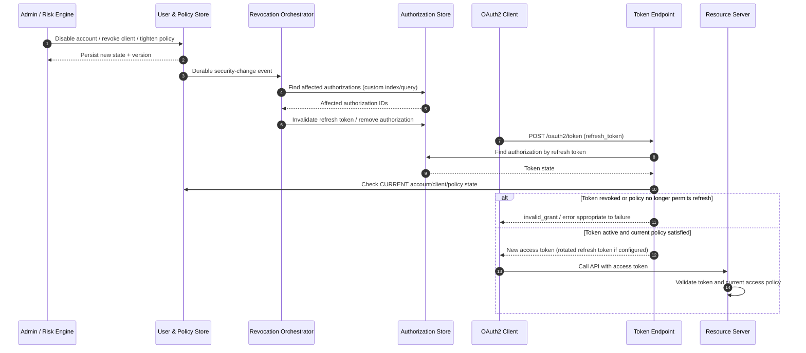

# Thu hồi refresh token khi tài khoản, client hoặc chính sách thay đổi

Trong ứng dụng Spring Boot sử dụng **Spring Security và Spring Authorization Server** để triển khai OAuth 2.0/OpenID Connect (OIDC), **refresh token** cho phép OAuth2 Client xin access token mới mà không cần người dùng lặp lại toàn bộ Authorization Code flow. Tính năng này giúp duy trì trải nghiệm đăng nhập, nhưng cũng tạo ra một yêu cầu bảo mật quan trọng: **điều gì xảy ra với refresh token đã cấp nếu tài khoản người dùng bị khóa, client bị vô hiệu hóa, quyền truy cập bị thu hẹp hoặc chính sách xác thực thay đổi?**

Một refresh token vốn hợp lệ tại thời điểm cấp **không nên tự động tiếp tục có quyền tạo access token mới** khi điều kiện cấp quyền gốc đã không còn thỏa mãn. Muốn quản lý vòng đời token an toàn, hệ thống cần kết hợp **sự kiện thay đổi trạng thái**, **quy tắc thu hồi**, **kiểm tra ở token endpoint**, **cơ chế persistence** và **kiểm thử cạnh tranh/thu hồi thực tế**.

Bài học thuộc chương **Refresh Token** của module **SPRING_SECURITY_OAUTH2_OIDC_AUTHORIZATION_SERVER** hướng dẫn thiết kế, cấu hình, bảo mật, kiểm thử và vận hành quy trình này trong Spring Authorization Server. Trọng tâm là **thu hồi refresh token theo tài khoản, client và chính sách**, không chỉ cách gửi một HTTP request tới revocation endpoint.

> **Nguyên tắc cốt lõi:** Thu hồi refresh token nhằm ngăn **sử dụng token đó để tiếp tục xin token mới**. Việc thu hồi **không tự bảo đảm access token JWT đã phát hành trước đó mất hiệu lực ngay**, không tự xóa mọi session của trình duyệt và cũng không tự hủy mọi consent đã lưu.

## 1. Nhắc lại vai trò của refresh token

Trong Authorization Code flow điển hình, người dùng đăng nhập tại Authorization Server (AS), hoàn thành consent nếu cần, rồi ứng dụng nhận **authorization code** và đổi code tại token endpoint. Tùy grant, loại client, scope và chính sách, AS có thể cấp thêm refresh token:

```http
HTTP/1.1 200 OK
Content-Type: application/json;charset=UTF-8
Cache-Control: no-store
Pragma: no-cache

{
  "access_token": "REDACTED_ACCESS_TOKEN",
  "token_type": "Bearer",
  "expires_in": 600,
  "refresh_token": "REDACTED_REFRESH_TOKEN",
  "scope": "openid profile documents.read"
}
```

Các giá trị `REDACTED_...` chỉ là placeholder. Trong một **OIDC Authorization Code flow** hợp lệ, phản hồi cấp token ban đầu cũng bao gồm `id_token` theo đặc tả OIDC; ví dụ trên chỉ tập trung minh họa cặp access/refresh token.

Khi access token sắp hết hạn, client có thể gửi:

```http
POST /oauth2/token HTTP/1.1
Host: identity.example.com
Authorization: Basic <REDACTED_CLIENT_AUTH>
Content-Type: application/x-www-form-urlencoded

grant_type=refresh_token&refresh_token=REDACTED_REFRESH_TOKEN&scope=documents.read
```

AS phải xác minh refresh token, client binding và quyền được phép trước khi cấp token mới. Với **confidential client**, thông tin xác thực client vẫn cần được kiểm tra theo phương thức đã đăng ký. Client **không được dùng refresh token của client khác**, cũng không thể dùng refresh grant để mở rộng quyền vượt phạm vi đã được cấp. Trong RFC 6749, scope được yêu cầu khi refresh **không được chứa scope nào chưa được resource owner cấp ban đầu**; bỏ qua tham số này thường có nghĩa yêu cầu phạm vi ban đầu theo hợp đồng giao thức, nhưng AS vẫn phải áp dụng chính sách hiện hành.

### 1.1. Refresh token không phải là phiên đăng nhập

| Dữ liệu | Được dùng để | Thu hồi/xóa dữ liệu đó có tự thu hồi các dữ liệu khác? |
|---|---|---|
| **Refresh token** | Yêu cầu phát access token mới theo refresh grant | Không tự vô hiệu mọi access token JWT đã phát |
| **Access token** | Truy cập Resource Server | Không tự xóa refresh token của cùng authorization |
| **Session cookie tại AS** | Duy trì phiên đăng nhập trong browser | Logout session không tự bảo đảm refresh token bị thu hồi |
| **OIDC ID Token** | Thông tin về lần xác thực dành cho Relying Party | Không phải credential để refresh hay gọi API |
| **Authorization consent** | Nhớ quyền user đã đồng ý cấp cho client | Xóa consent không mặc nhiên thu hồi refresh token |
| **RegisteredClient** | Metadata và chính sách của OAuth2 Client | Xóa/sửa client không tự vô hiệu mọi token JWT ngoài hệ thống |

**Authorization code** là credential một lần của bước authorization; **refresh token** là credential có thể dùng để tạo token tiếp theo trong vòng đời được AS cho phép. Vì refresh token có thể sống lâu hơn access token, mất refresh token có thể nghiêm trọng hơn mất một access token ngắn hạn.

### 1.2. Khi nào không có refresh token?

- **Client Credentials grant:** RFC 6749 nêu refresh token **SHOULD NOT** được cấp; confidential client thường xin access token mới bằng credential của nó.
- **Public client:** quyền cấp refresh token và cơ chế bảo vệ/rotation phải dựa trên chính sách của AS và khả năng triển khai; không mặc định mọi SPA/mobile đều nhận refresh token.
- **Authorization Code không được cấp quyền offline/refresh:** AS có thể chỉ cấp access token và ID Token nếu là OIDC.
- **Refresh token bị chính sách từ chối:** thời hạn, trạng thái user/client, scope, grant hoặc rủi ro có thể khiến AS không phát hành hoặc không tiếp tục chấp nhận refresh token.

Việc request có scope `offline_access` trong OIDC **không có nghĩa AS bắt buộc cấp refresh token vô điều kiện**; cần tuân thủ chính sách và các điều kiện consent/loại client theo đặc tả được hỗ trợ.

## 2. Ba nhóm sự kiện cần xem xét thu hồi

Không phải mọi thay đổi đều cần thu hồi tất cả token. Phải xác định **sự kiện nào làm mất hiệu lực quyết định cấp quyền trước đây**, phạm vi người dùng/client, mức độ khẩn cấp và tác động tới dịch vụ.

| Nhóm | Sự kiện ví dụ | Hành động thường cần đánh giá |
|---|---|---|
| **Tài khoản người dùng** | Vô hiệu hóa, khóa do xâm nhập, xóa tài khoản, reset mật khẩu vì nghi ngờ lộ credential | Chặn refresh mới của user; thu hồi refresh token/session liên quan; đánh giá access token còn hiệu lực |
| **Client** | Client bị thu hồi quyền, mất credential, client không còn được tin cậy, grant bị gỡ | Chặn client authentication/token grant; thu hồi authorization/refresh token của client; quản lý access token đã phát |
| **Chính sách** | Scope bị loại khỏi đăng ký, role bị thu hồi, consent bị xóa, yêu cầu MFA mới, thay đổi TTL/risk policy | Từ chối refresh không còn đáp ứng policy; thu hồi hoặc giảm phạm vi token theo quyết định; yêu cầu interactive authorization khi cần |

**Ví dụ phân biệt:** Đổi tên hiển thị của client có thể không cần thu hồi mọi refresh token. Ngược lại, thay redirect URI do phát hiện bị chiếm quyền hoặc thu hồi quyền truy cập dữ liệu nhạy cảm thường đòi hỏi hành động quyết liệt. Chính sách nên **dựa trên mức rủi ro và tác động**, tránh thu hồi đại trà không cần thiết gây ngừng dịch vụ.

### 2.1. Bảng quyết định ban đầu

| Sự kiện | Cấm refresh tiếp? | Thu hồi refresh token đã cấp? | Có cần xử lý access token? |
|---|---|---|---|
| User bị vô hiệu hóa | **Có** | Thường **có**, toàn bộ token liên quan | **Có**, theo SLA vô hiệu hóa của hệ thống |
| User bị nghi ngờ chiếm tài khoản | **Có** hoặc tạm khóa | Thường **toàn bộ phiên/authorization có liên quan** | Ưu tiên giới hạn hiệu lực tức thời nếu threat model yêu cầu |
| User đổi mật khẩu tự nguyện | **Theo policy** | Có thể thu hồi các phiên khác hoặc toàn bộ | Đánh giá risk, phiên hiện tại và TTL |
| Client bị vô hiệu hóa | **Có** | **Có**, các refresh token gắn client | Có, đặc biệt token scope rộng |
| Client secret rotation bình thường | Phải ngăn credential cũ sau cutover | **Không nhất thiết toàn bộ** nếu danh tính client còn tin cậy; theo policy | Không tự thu hồi JWT trước đó |
| Scope bị gỡ khỏi client | **Không cho cấp scope đã gỡ** | Thu hồi token vượt policy hoặc yêu cầu cấp quyền lại | Cần xử lý access token đang chứa scope bị gỡ |
| User thu hồi consent | Đánh giá lại/không tiếp tục cấp quyền tương ứng | Theo chính sách thường phải xử lý refresh token liên quan | Cần cơ chế revocation hoặc hạn hiệu lực rõ ràng |
| Policy MFA tăng mức yêu cầu | Không refresh cho trường hợp thiếu assurance | Có thể thu hồi hoặc bắt interactive step-up | API nhạy cảm cũng cần kiểm tra assurance/freshness |

Đây là **khung quyết định tham khảo**, không phải quy tắc bắt buộc của mọi sản phẩm. Điều quan trọng là chính sách phải được thực thi **trên mọi đường cấp token mới**, kể cả refresh grant.

## 3. Luồng thu hồi chủ động và chặn phát hành mới

Một quy trình đầy đủ có **hai tuyến phòng vệ**:

1. **Event-driven revocation:** khi user/client/policy thay đổi, xác định các authorization liên quan rồi vô hiệu refresh token đã cấp.
2. **Refresh-time policy validation:** ngay tại token endpoint, xác minh trạng thái user/client/policy hiện tại trước khi phát access token mới.

Chỉ làm tuyến thứ nhất có thể bị **race condition**: một request refresh đồng thời được xử lý trước khi tiến trình thu hồi cập nhật DB. Chỉ làm tuyến thứ hai có thể để dữ liệu refresh token cũ nằm rải rác quá lâu và tăng khó khăn về audit/vận hành. Kết hợp cả hai giúp giảm cửa sổ rủi ro.



Một sự kiện bảo mật quan trọng phải được ghi nhận **bền vững** (ví dụ transaction/outbox hoặc cơ chế tương đương), xử lý có retry/idempotency và có thể hòa giải lại trạng thái khi job lỗi. Không dựa vào thông báo fire-and-forget không có cơ chế khôi phục.

### 3.1. Thứ tự an toàn khi user/client bị khóa khẩn cấp

1. **Lưu trạng thái không còn được phép cấp token** trước, hoặc cập nhật security version/policy epoch khiến các yêu cầu mới thất bại.
2. Đảm bảo đường **refresh grant** đọc được trạng thái mới và **không phát access token mới**.
3. Tìm/thu hồi refresh token đã cấp tương ứng trong storage.
4. Kích hoạt phương án xử lý **access token chưa hết hạn** theo mức khẩn cấp.
5. Kiểm tra kết quả, ghi audit, đồng bộ cache và phát hiện job thu hồi bị lỗi.

Với hệ thống nhiều node, cần có ranh giới nhất quán đủ mạnh: việc cập nhật trạng thái user/client và phát hành token không được cho phép **request đồng thời dùng policy cũ** vượt quá cửa sổ rủi ro đã chấp nhận. Khi cần ngăn tuyệt đối, thiết kế lock/version check/transaction hoặc cơ chế gate tương đương, không chỉ dựa trên event bất đồng bộ.

## 4. Dữ liệu nào lưu refresh token trong Spring Authorization Server?

Spring Authorization Server sử dụng **`OAuth2Authorization`** cho trạng thái của một authorization (các token, metadata, principal và thông tin liên quan), cùng **`OAuth2AuthorizationService`** để lưu và tra cứu. Với refresh token, phần dữ liệu liên quan thường nằm trong:

| Thành phần | Vai trò |
|---|---|
| `OAuth2Authorization.getId()` | Định danh authorization nội bộ |
| `OAuth2Authorization.getRegisteredClientId()` | Liên kết tới **`RegisteredClient.id`**, không phải client ID giao thức |
| `OAuth2Authorization.getPrincipalName()` | Principal gắn với authorization |
| `OAuth2Authorization.getAuthorizedScopes()` | Các scope được cấp cho authorization |
| `OAuth2Authorization.getRefreshToken()` | Token wrapper chứa refresh token và metadata về trạng thái |
| `OAuth2Authorization.Token.isActive()` | Cho biết token đang còn hoạt động theo metadata/thời hạn |
| `OAuth2AuthorizationService` | `save`, `remove`, `findById` và `findByToken` |

**Đừng đồng nhất `OAuth2AuthorizationService` và `RegisteredClientRepository`.** Repository client lưu metadata/chính sách client; authorization service lưu token/authorization. **`OAuth2AuthorizationConsentService`** lại lưu quyết định đồng ý của principal với client, không lưu refresh token.

### 4.1. Hợp đồng service và giới hạn tìm kiếm

Các thao tác cốt lõi của `OAuth2AuthorizationService`:

```java
public interface OAuth2AuthorizationService {
    void save(OAuth2Authorization authorization);
    void remove(OAuth2Authorization authorization);
    OAuth2Authorization findById(String id);
    OAuth2Authorization findByToken(
        String token, OAuth2TokenType tokenType);
}
```

**Không có phương thức chuẩn** `findAllByPrincipalName`, `findAllByClientId`, `revokeAllByUser` hoặc `revokeAllByTenant` trong interface này. `findByToken(...)` dùng để tìm một authorization theo **giá trị token cụ thể**, không dùng để liệt kê toàn bộ token của một user.

Vì vậy thu hồi theo **tài khoản, client hoặc policy** ở quy mô sản xuất cần:

- Một **chỉ mục/query bổ sung** trên storage authorization theo `principalName`, `registeredClientId`, security version hoặc phạm vi policy;
- Hoặc một service quản trị riêng nắm các authorization IDs/refresh-token families;
- Hoặc một mô hình token/session version check đủ tin cậy để từ chối refresh theo trạng thái hiện tại, kết hợp cleanup/revocation bất đồng bộ.

Không viết code kiểu `authorizationService.findByPrincipalName(userId)` rồi coi đó là API sẵn có của Spring Authorization Server.

### 4.2. InMemory hay JDBC?

| Service | Phù hợp | Giới hạn với revocation |
|---|---|---|
| `InMemoryOAuth2AuthorizationService` | Học tập, thử nghiệm, ứng dụng đơn node có chủ đích | Restart mất state; nhiều AS node có thể không chia sẻ trạng thái thu hồi |
| `JdbcOAuth2AuthorizationService` | Lưu authorization/token bền vững khi có schema phù hợp | Cần migration, transaction, indexing, backup và quy trình revoke đa node |
| Custom authorization store | Hệ thống có hạ tầng authorization riêng hoặc yêu cầu policy phức tạp | Phải bảo toàn token metadata, atomicity, lookup và tương thích Spring |

Đối với production nhiều AS instance, việc dùng **chung dữ liệu authorization** là yếu tố quan trọng để các node đồng thuận rằng một refresh token đã bị vô hiệu hóa. Nhưng shared DB **không tự giải quyết** refresh request đang xử lý đồng thời hoặc cache policy lỗi thời.

## 5. Thu hồi một refresh token cụ thể ở phía Authorization Server

Nếu biết chính xác giá trị refresh token (ví dụ từ revocation endpoint hoặc một luồng quản trị được phép), có thể tìm authorization tương ứng:

```java
OAuth2Authorization authorization = authorizationService.findByToken(
    refreshTokenValue,
    OAuth2TokenType.REFRESH_TOKEN
);

if (authorization == null) {
    // Không tìm thấy authorization cho refresh token này.
}
```

Đây chỉ là **phần minh họa ở lớp service nội bộ**; biến `refreshTokenValue` phải đến từ nguồn hợp lệ và được bảo vệ. Trong luồng quản trị, cần xác minh requester có quyền thao tác lên đúng client/principal/token trước khi sửa trạng thái. **Không tạo API công khai “nhận token nào cũng được rồi thu hồi” không xác thực**.

### 5.1. Vô hiệu token bằng metadata

Spring Authorization Server hỗ trợ mô hình đánh dấu token đã bị vô hiệu trong `OAuth2Authorization`. Ví dụ một đoạn logic thường dùng khi API builder hỗ trợ `invalidate(...)`:

```java
OAuth2Authorization authorization = authorizationService.findByToken(
    refreshTokenValue, OAuth2TokenType.REFRESH_TOKEN);

if (authorization != null && authorization.getRefreshToken() != null) {
    OAuth2Authorization updated = OAuth2Authorization.from(authorization)
        .invalidate(authorization.getRefreshToken().getToken())
        .build();

    authorizationService.save(updated);
}
```

Đoạn code minh họa hành vi **invalidate refresh token đang lưu**, không phải endpoint bảo mật hoàn chỉnh. Cần kiểm tra API của **đúng phiên bản Spring Authorization Server** và bảo vệ bằng quyền quản trị/client binding, transaction, concurrency control, auditing. Khi provider kiểm tra refresh token, một token không còn `isActive()` phải bị từ chối.

**Quan trọng:** Thao tác trên **refresh token** không tự vô hiệu các access token JWT trước đó. Trong cùng authorization có thể vẫn còn access token đã cấp. Nếu muốn ngừng **toàn bộ authorization**, cần quyết định khác (xem phần tiếp theo).

### 5.2. Xóa toàn bộ OAuth2Authorization

Khi sự kiện cần chấm dứt mọi trạng thái authorization được lưu, có thể dùng:

```java
OAuth2Authorization existing = authorizationService.findById(
    authorizationId);

if (existing != null) {
    authorizationService.remove(existing);
}
```

`remove(...)` xóa bản ghi authorization cùng token metadata được lưu ở service. Sau khi persistence đã xóa và token endpoint dùng cùng nguồn dữ liệu, refresh token tương ứng không còn được tìm thấy để đổi token mới.

**Nhưng** nếu access token là JWT được Resource Server xác minh offline, xóa DB authorization **không thể tự khiến Resource Server từ chối JWT cũ** khi token còn hợp lệ về chữ ký/thời hạn/audience. Cần thiết kế riêng TTL, revocation/denylist, token introspection hoặc kiểm tra quyền hiện tại ở RS khi cần chặn tức thời.

### 5.3. Chọn invalidate hay remove?

| Lựa chọn | Lợi ích | Rủi ro/giới hạn |
|---|---|---|
| **Invalidate refresh token** trong authorization | Giữ lại một phần metadata/token khác phục vụ điều tra, quản lý vòng đời | Cần phân biệt trạng thái token; access token có thể vẫn active |
| **Remove cả authorization** | Đơn giản để ngăn refresh từ authorization đó; dọn dữ liệu liên quan | Mất một số metadata nếu chưa có audit riêng; JWT đã phát có thể vẫn dùng offline |
| **Security/version gate + async revocation** | Ngăn phát hành mới khi nhiều token liên quan đến cùng tài khoản/chính sách | Phải thiết kế consistency, xử lý sự kiện và refresh-time validation chính xác |

Không chọn một chiến thuật cho mọi loại sự kiện. Ví dụ, với tài khoản bị xâm nhập, cần vừa chặn phát hành mới vừa xử lý tất cả authorization và access token theo mức nghiêm trọng. Với thay đổi chính sách ít nhạy cảm, có thể từ chối một số scope hoặc yêu cầu interactive reauthorization.

## 6. Thu hồi qua OAuth 2.0 Token Revocation Endpoint

**RFC 7009** chuẩn hóa endpoint để **client yêu cầu AS thu hồi một token**. Với đường dẫn thường gặp của Spring Authorization Server là `/oauth2/revoke`, ví dụ:

```http
POST /oauth2/revoke HTTP/1.1
Host: identity.example.com
Authorization: Basic <REDACTED_CLIENT_AUTH>
Content-Type: application/x-www-form-urlencoded

token=REDACTED_REFRESH_TOKEN&token_type_hint=refresh_token
```

`token` là tham số cần thiết; `token_type_hint` giúp AS nhận biết kiểu token, nhưng **hint không được xem là bằng chứng bảo mật** và không thay xác thực client. Confidential client phải xác thực bằng phương thức đã đăng ký theo hợp đồng endpoint. AS cần kiểm tra client đang yêu cầu có quyền thu hồi token tương ứng và không tiết lộ dữ liệu của client khác.

### 6.1. Response của RFC 7009 có ý nghĩa gì?

Khi yêu cầu thu hồi được xử lý thành công:

```http
HTTP/1.1 200 OK
Cache-Control: no-store
```

Theo RFC 7009, server thường trả **200** cả khi token đã không còn hợp lệ/không tồn tại, nhằm không cho caller dễ dò trạng thái token. **200 không phải cam kết mọi access token/JWT đã phát hành ở các Resource Server lập tức vô hiệu**. Quy tắc thu hồi token liên quan cũng phụ thuộc chính sách và triển khai.

Nếu client authentication sai, AS có thể trả `invalid_client` hoặc lỗi tương ứng, không phải cố báo thành công. Việc chỉ có quyền gửi request HTTP không cho phép quản trị viên tùy ý liệt kê hay thu hồi token của tất cả user.

### 6.2. Endpoint khác chức năng quản trị thu hồi hàng loạt

RFC 7009 hữu ích khi **client biết token cụ thể** và muốn thu hồi, ví dụ sau logout khỏi ứng dụng hoặc khi phát hiện refresh token bị lộ. Nó **không cung cấp API chuẩn “thu hồi mọi refresh token của người dùng X”**.

Những sự kiện như “khóa tài khoản Alice”, “ngừng hoạt động client B”, “thu hồi mọi token liên quan quyền C” cần thêm **truy vấn authorization theo chủ thể/client/chính sách** hoặc cơ chế token-version/event-driven bên trong hệ thống. Không yêu cầu người dùng hay ứng dụng cung cấp tất cả refresh token thô mới có thể quản trị vòng đời.

## 7. Khi tài khoản người dùng thay đổi

Thay đổi tài khoản có thể đến từ user self-service, bộ phận quản trị, IdP bên ngoài hoặc hệ thống kiểm soát rủi ro. AS phải biết trạng thái **hiện tại** của principal; refresh grant không thể chỉ dựa vào kết quả đăng nhập trong quá khứ.

### 7.1. Khóa hoặc vô hiệu tài khoản

Khi người dùng bị disabled:

1. Ghi nhận trạng thái `user.disabled=true` và phiên bản/timestamp bảo mật nếu thiết kế sử dụng.
2. Chặn ngay việc cấp access token mới qua refresh grant cho principal này.
3. Tìm và invalidate/remove refresh token hoặc authorization liên quan, có kiểm soát transaction/idempotence.
4. Vô hiệu session đăng nhập, nhớ rằng **xóa session không tự thu hồi refresh token**.
5. Xử lý access token đang active theo mức yêu cầu (JWT TTL, denylist, introspection hoặc RS current-state authorization).

**Không được giả định Spring Authorization Server mặc định luôn gọi `UserDetailsService.loadUserByUsername(...)` và kiểm tra `enabled/locked` mỗi lần xử lý refresh token.** Phải kiểm chứng thực tế đường chạy của phiên bản/hệ thống và bổ sung current-user-state validation tại refresh grant nếu yêu cầu.

### 7.2. Đổi mật khẩu, reset do nghi bị lộ, hoặc thay MFA

Không phải hai sự kiện đều có rủi ro tương đương:

- **User đổi mật khẩu thông thường:** sản phẩm có thể cho tiếp tục phiên hiện tại nhưng thu hồi phiên trên thiết bị khác, hoặc áp dụng policy thu hồi toàn bộ refresh token.
- **User reset mật khẩu sau sự cố chiếm tài khoản:** thường cần thu hồi rộng hơn và xác thực lại các client/session.
- **Đổi hoặc gỡ MFA factor:** nếu bằng chứng xác thực cũ không còn phù hợp, có thể buộc reauthentication/step-up; không tiếp tục cấp token với `acr/amr` không còn được bảo đảm.
- **Tài khoản bị xóa/thu hồi quyền:** cần xử lý cả quyền trong ứng dụng, token storage, session, audit và thời gian lưu dữ liệu.

Đặc biệt với OIDC, refresh request **không phải một sự kiện MFA mới**. Không tự thay `auth_time` hoặc nâng `acr` khi chỉ phát access token mới. Nếu policy yêu cầu MFA mới, client cần tương tác với người dùng theo flow thích hợp trước khi tiếp tục nhận quyền nhạy cảm.

### 7.3. Security version / token epoch

Một kỹ thuật thường dùng trong hệ thống lớn là lưu **phiên bản trạng thái bảo mật của tài khoản** hoặc **thời điểm thu hồi toàn cục**:

```text
User state:
  principalName = user-42
  enabled = false
  securityVersion = 12

Authorization metadata at issuance:
  principalName = user-42
  issuedSecurityVersion = 11
```

Tại refresh grant, nếu user disabled hoặc phiên bản hiện tại khác phiên bản đã ghi khi cấp authorization, AS từ chối (hoặc buộc reauthorization theo policy). **Security version là thiết kế tùy chỉnh**, không phải trường có sẵn tự động của mọi `OAuth2Authorization`. Phải tạo và kiểm chứng cơ chế lưu metadata, cập nhật nguyên tử, cache invalidation, migration và kiểm tra trong token endpoint.

Nếu chỉ phát event bất đồng bộ để tăng version mà không kiểm tra nó khi refresh, cơ chế này **không thực sự chặn** refresh trong thời gian event chưa xử lý.

## 8. Khi RegisteredClient hoặc danh tính client thay đổi

Client là một chủ thể OAuth riêng. Những thay đổi sau thường ảnh hưởng đến refresh grant:

| Thay đổi | Hành động nên đánh giá |
|---|---|
| **Client bị vô hiệu hoặc xóa quyền truy cập** | Không chấp nhận token request mới, thu hồi các refresh token gắn client |
| **Client secret bị lộ** | Rotation/thu hồi credential, đánh giá các authorization đã dùng client bị lộ |
| **Rotation client secret bình thường** | Đồng bộ AS/client; không mặc nhiên thu hồi mọi refresh token nếu policy không yêu cầu |
| **Gỡ `AuthorizationGrantType.REFRESH_TOKEN`** | Từ chối refresh grant mới; cân nhắc thu hồi những refresh token đã tồn tại |
| **Thu hẹp `RegisteredClient.scopes`** | Không phát lại scope đã bị gỡ; thu hồi/thu hẹp authorization không còn hợp lệ |
| **Thay phương thức client authentication** | Chỉ chấp nhận method đã đăng ký; đồng bộ client trước cutover |
| **Client bị chuyển tenant hoặc sở hữu** | Kiểm tra lại đối tượng được phép, revoke/re-provision theo policy |

### 8.1. `clientId` khác `registeredClientId`

Trong Spring Authorization Server:

```text
RegisteredClient.id       = "reg-portal-123"
RegisteredClient.clientId = "portal-web"

OAuth2Authorization.registeredClientId = "reg-portal-123"
```

Vì authorization lưu **registered client ID nội bộ**, một job thu hồi theo client phải tìm đúng `RegisteredClient.getId()`, không lấy `clientId` làm khóa DB rồi suy ra chắc chắn trùng. Giữ ID ổn định qua lần cập nhật; nếu thay ID, cần migration của authorization/consent hoặc quy trình revoke theo policy.

### 8.2. Chỉ đổi secret có đủ chưa?

**Không nhất thiết.** Rotation client secret ngăn dùng secret cũ để xác thực token endpoint sau khi cutover, nhưng:

- Một client với secret mới có thể vẫn sử dụng refresh token cũ nếu AS vẫn chấp nhận authorization đó và chính sách cho phép.
- Access token JWT trước đó có thể tiếp tục được RS chấp nhận đến khi hết hạn.
- Nếu credential bị lộ, cần điều tra các token request và authorization đã cấp trong thời gian nghi vấn, không chỉ thay secret.
- Nếu có cache `RegisteredClient`, nhiều node có thể tạm chấp nhận secret khác nhau khi chưa đồng bộ.

Với rủi ro cao, kết hợp rotation, kiểm soát phương thức authentication, revoke authorization và hạn chế token đã phát. Với rotation định kỳ bình thường, không thu hồi đồng loạt nếu làm gián đoạn hệ thống không cần thiết.

### 8.3. Xóa RegisteredClient không thay cho revoke

Xóa registration có thể khiến việc tra cứu client/token grant thất bại; tuy nhiên đó **không phải** quy trình thu hồi hoàn chỉnh. Token/authorization đã phát vẫn tồn tại trong storage hoặc Resource Server; JWT xác minh offline không cần truy vấn registration mỗi lần. Nên xử lý các token trước/sau khi thay registration theo trình tự vận hành được thiết kế, có audit và rollback khi phù hợp.

## 9. Khi chính sách quyền, scope hoặc consent thay đổi

Một refresh token có thể xuất phát từ authorization được cấp khi principal/client được phép sử dụng nhiều scope. Sau đó tổ chức có thể thay đổi RBAC/ABAC, tenant policy, consent hoặc yêu cầu MFA.

### 9.1. Thu hẹp scope

Ví dụ:

```text
Authorization ban đầu:
  principal = user-42
  client = portal-web
  authorized scopes = documents.read, documents.write

Chính sách mới:
  documents.read: vẫn được
  documents.write: đã bị thu hồi
```

Khi client gửi refresh request:

```http
POST /oauth2/token HTTP/1.1
Content-Type: application/x-www-form-urlencoded
Authorization: Basic <REDACTED_CLIENT_AUTH>

grant_type=refresh_token&refresh_token=REDACTED_REFRESH_TOKEN&scope=documents.read%20documents.write
```

AS không nên phát access token mới có `documents.write` nếu chính sách hiện tại đã thu hồi quyền này. Tùy sản phẩm, có hai hướng:

1. **Từ chối refresh grant** và yêu cầu client khởi tạo lại authorization flow với phạm vi hợp lệ.
2. **Cho phép phạm vi nhỏ hơn** nếu giao thức, client và policy hỗ trợ; phải thiết kế cách token mới và refresh token mới phản ánh **authorized scopes hiện hành** một cách nhất quán.

Không tùy tiện “cắt scope trong access token mới” nhưng giữ refresh authorization còn nguyên quyền cũ mà không có bảo đảm ở những lần refresh sau. Cũng không coi việc đổi `RegisteredClient.scopes` là tự động cập nhật mọi `OAuth2Authorization.getAuthorizedScopes()` đã lưu. **Việc enforce chính sách hiện tại cần được kiểm thử thực tế.**

### 9.2. Người dùng rút consent

`OAuth2AuthorizationConsentService.remove(consent)` xóa dữ liệu consent của một principal đối với một registered client. **Nó không phải lời gọi `OAuth2AuthorizationService.remove(authorization)`.** Vì vậy nếu yêu cầu “ngừng cho ứng dụng truy cập” phải có tác dụng cả với refresh token đã cấp, cần:

1. Xóa/thu hẹp consent đúng principal/client sau khi xác minh quyền thực hiện.
2. Tìm các authorization/refresh token liên quan.
3. Thu hồi hoặc gắn policy/version không cho refresh tiếp.
4. Xử lý access token còn hiệu lực theo mức bảo đảm sản phẩm công bố.
5. Kiểm thử lại authorization flow để chắc chắn scope đã thu hồi không được tự đồng ý trở lại.

Việc AS có một màn hình quản lý consent **không chứng minh** refresh token sẽ tự mất hiệu lực khi người dùng nhấn “Thu hồi quyền”.

### 9.3. Thay chính sách MFA và phiên xác thực

Ví dụ trước đây `documents.write` chỉ cần đăng nhập mật khẩu; nay bắt buộc MFA đã xác minh trong 5 phút. Một refresh token được cấp trước khi đổi chính sách **không chứng minh** user đã đáp ứng điều kiện mới. Khi xử lý refresh:

- Xác định những scope/token nào cần assurance cao hơn.
- Xác minh evidence có thực sự đạt chính sách hiện tại và còn đủ mới.
- Nếu không đủ, **không phát quyền mới**; thông thường client cần trở lại luồng authorization tương tác để người dùng step-up.
- Chỉ ghi claims OIDC `acr`, `amr`, `auth_time` dựa trên xác thực thực tế, không dựa vào thời điểm refresh token.

Không biến refresh endpoint thành form đăng nhập có redirect HTML; token request cần trả **OAuth2 error** thích hợp, và ứng dụng client quyết định cách khởi tạo tương tác lại.

### 9.4. Policy version cho thay đổi diện rộng

Với chính sách chung, có thể lưu `policyVersion` hoặc `grantsVersion` tại thời điểm authorization và so với phiên bản mới nhất. Khi phiên bản thay đổi, refresh provider có thể từ chối, yêu cầu tái đánh giá hoặc giảm quyền theo chính sách đã công bố. Cần tránh tăng toàn cục một version làm **vô hiệu toàn bộ client/user** chỉ vì một scope không liên quan nếu tổ chức không muốn tác động đó.

Thiết kế version nên xem xét:

- Phân vùng theo principal, client, resource hoặc nhóm policy liên quan.
- Tính nguyên tử của cập nhật và issuance.
- Cache TTL/invalidation ở nhiều node.
- Kiểm thử liên quan tới rollback và sự kiện đến trễ.
- Khả năng giải thích “vì sao token bị từ chối” trong log nội bộ, không tiết lộ credential.

## 10. Refresh token rotation và phát hiện replay

**Refresh token rotation** là cơ chế khi client dùng refresh token hợp lệ, AS phát refresh token mới và làm token cũ không còn sử dụng được theo quy tắc triển khai. Nó giảm khả năng một refresh token lâu dài tiếp tục được dùng sau khi lộ.

Trong Spring Authorization Server, cấu hình client có thể dùng `TokenSettings.reuseRefreshTokens(false)`:

```java
RegisteredClient portal = RegisteredClient.withId(
        "portal-web-internal-id")
    .clientId("portal-web")
    .clientSecret(passwordEncoder.encode(
        clientSecretFromSecureStore))
    .clientAuthenticationMethod(
        ClientAuthenticationMethod.CLIENT_SECRET_BASIC)
    .authorizationGrantType(
        AuthorizationGrantType.AUTHORIZATION_CODE)
    .authorizationGrantType(
        AuthorizationGrantType.REFRESH_TOKEN)
    .redirectUri(
        "https://portal.example.com/login/oauth2/code/company")
    .scope("documents.read")
    .tokenSettings(TokenSettings.builder()
        .accessTokenTimeToLive(Duration.ofMinutes(10))
        .refreshTokenTimeToLive(Duration.ofDays(7))
        .reuseRefreshTokens(false)
        .build())
    .build();
```

Đoạn code là **phần tạo RegisteredClient**, cần các imports/bean đầy đủ, mã hóa secret, repository và cấu hình AS. Việc gọi `reuseRefreshTokens(false)` không tự tạo cơ chế **“phát hiện reuse rồi thu hồi toàn bộ token family của thiết bị”** theo mọi threat model. Hãy phân biệt:

| Tính năng | Ý nghĩa |
|---|---|
| **Rotate** | Sau refresh thành công, thay refresh token cũ bằng token mới theo chính sách |
| **Reject old token** | Refresh token cũ không còn đủ điều kiện đổi token |
| **Detect reuse/replay** | Nhận biết token cũ **bị dùng lại** sau rotation và phân biệt với lỗi bình thường theo thông tin lưu được |
| **Revoke token family** | Chủ động vô hiệu hóa **mọi hậu duệ/nhánh** của chuỗi refresh token có thể bị lộ |

Không mặc định Spring Authorization Server cung cấp đầy đủ **replay detection và family-wide revocation** chỉ bằng một cờ `reuseRefreshTokens(false)`. Nếu sản phẩm cần phát hiện refresh token bị đánh cắp, thiết kế custom token-family metadata, atomic rotation, xử lý reuse và cảnh báo, đồng thời kiểm thử trong điều kiện nhiều request song song.

### 10.1. Race condition khi hai request refresh cùng token

```mermaid
sequenceDiagram
    autonumber
    participant C1 as Client request A
    participant C2 as Client request B
    participant AS as Authorization Server
    participant DB as Authorization Store

    C1->>AS: refresh_token=RT1
    C2->>AS: refresh_token=RT1
    AS->>DB: Đọc RT1 active
    DB-->>AS: active
    AS->>DB: Request thứ hai cũng đọc RT1
    DB-->>AS: active hoặc trạng thái mới tùy timing
    AS->>DB: Rotate RT1 → RT2; commit
    AS-->>C1: Trả access token và RT2
    AS-->>C2: Phải xử lý cạnh tranh an toàn
```

Một hệ thống an toàn không được để hai request đồng thời cùng dùng RT1 rồi nhận hai chuỗi refresh token độc lập trái với policy. Cần **optimistic locking, compare-and-swap, transaction serialization hoặc cơ chế tương đương** khi triển khai custom storage/rotation, đặc biệt trong cụm nhiều node.

Phải tránh hiểu nhầm mọi lần reuse là tấn công: mobile app gặp timeout, retry hoặc nhiều tab cũng có thể làm phát sinh yêu cầu trùng. Chính sách cần cân bằng chống replay, độ tin cậy, idempotency và việc buộc đăng nhập lại khi phát hiện bất thường.

### 10.2. Khi client bị xâm nhập

Nếu nghi refresh token bị trộm:

1. Vô hiệu refresh token và token family theo phạm vi được xác định.
2. Chặn issuance dựa trên security state mới, không chỉ dựa vào một cleanup job.
3. Cân nhắc thu hồi access token đang hoạt động và thông báo client/người dùng.
4. Điều tra client credential, thiết bị/session, thời gian truy cập, IP/ngữ cảnh theo chính sách riêng tư.
5. Chỉ cho tái cấp quyền sau khi xác thực lại và khắc phục điểm yếu.

Refresh token thường là **bearer credential**, nên nơi lưu nó và cơ chế ngăn replay là ưu tiên bảo mật.

## 11. Thiết kế service thu hồi hàng loạt theo tài khoản/client

Trong Spring Authorization Server mặc định, `OAuth2AuthorizationService` không có API liệt kê token theo user hoặc client. Do đó cần một service chỉ mục riêng; ví dụ mô hình sau:

```text
interface AuthorizationRevocationIndex (định nghĩa của ứng dụng)
  findAuthorizationIdsByPrincipal(principalName, tenantId)
  findAuthorizationIdsByRegisteredClientId(registeredClientId)
  findAuthorizationIdsAffectedByPolicy(policyChange)

RevocationOrchestrator
  onUserDisabled(principal, tenant)
  onClientDisabled(registeredClientId)
  onConsentRevoked(principal, registeredClientId)
  onPolicyChanged(policyVersion, affectedScopeSet)
```

Đây là **giao diện minh họa cho kiến trúc**, không phải API có sẵn của Spring. Index có thể dùng bảng phụ trỏ tới authorization ID, truy vấn JDBC an toàn hoặc store riêng; tránh phụ thuộc trực tiếp cấu trúc JSON/LOB của cột token trong SQL tự viết nếu chưa kiểm tra schema và mapper đúng phiên bản.

### 11.1. Pseudocode thu hồi theo danh sách authorization IDs

```java
// PSEUDOCODE: index, securityPolicy và audit là thành phần tùy chỉnh.
void revokeForDisabledUser(String principalName, String tenantId) {
    securityPolicy.blockRefreshForPrincipal(principalName, tenantId);

    for (String id : index.findAuthorizationIdsByPrincipal(
            principalName, tenantId)) {
        OAuth2Authorization authorization =
            authorizationService.findById(id);

        if (authorization == null) {
            continue; // Idempotent: record đã được xóa bởi worker khác.
        }
        if (!authorization.getPrincipalName().equals(principalName)) {
            continue; // Defense in depth: không revoke sai principal.
        }
        // Kiểm tra tenant binding theo data model của ứng dụng.
        OAuth2Authorization.Token<OAuth2RefreshToken> refresh =
            authorization.getRefreshToken();

        if (refresh != null && refresh.isActive()) {
            OAuth2Authorization updated =
                OAuth2Authorization.from(authorization)
                    .invalidate(refresh.getToken())
                    .build();
            authorizationService.save(updated);
        }
    }
    audit.recordRevocationCompleted(principalName, tenantId);
}
```

Đoạn code minh họa luồng, **không chạy độc lập** và **không thể coi một vòng lặp là cơ chế an toàn tuyệt đối trước các request refresh đồng thời**. Phải:

- Xác minh **actor có quyền** phát lệnh chặn/thu hồi tài khoản.
- Chặn cấp token mới **trước** hoặc đồng thời với cleanup bằng một policy gate có hiệu lực.
- Kiểm tra tenant/principal/client binding từ storage đáng tin, không tin dữ liệu do HTTP client gửi.
- Dùng transaction, batching và retry phù hợp; không giữ một transaction khổng lồ cho hàng triệu authorization.
- Lưu checkpoint/progress để job có thể lặp lại an toàn; xử lý sự kiện đến trễ và retry.
- Không ghi token thô vào log; audit chỉ ghi ID/nội dung cần thiết, số lượng và kết quả.

### 11.2. Revoke theo client

Để thu hồi client `portal-web`, trước hết lấy `RegisteredClient.id` tương ứng, tìm authorization của ID nội bộ này và vô hiệu hóa theo policy. **Không lọc theo `client_id` từ query string của HTTP request** mà bỏ qua authentication/authorization phía quản trị.

Khi client thực sự bị vô hiệu hóa, cần có policy gate từ chối **client token requests**. Nếu hệ thống có cơ chế rotation secret và nhiều node, phải đồng bộ trạng thái client trước khi tin rằng việc xóa một số token cũ đã đủ.

### 11.3. Revoke theo scope hoặc chính sách

Không phải mọi authorization của một user đều bị ảnh hưởng bởi một policy thay đổi. Index nên hỗ trợ lọc theo registered client, subject, tenant, authorized scopes hoặc policy version, rồi xác minh lại chính sách ở mỗi bản ghi trước khi thu hồi.

Ví dụ khi bỏ quyền `documents.write`, cần xác định những authorization có scope đó và những client/resource chịu tác động; không xóa toàn bộ refresh token của client không liên quan nếu không cần. Nhưng khi nghi bị lộ khóa hoặc tài khoản bị chiếm quyền toàn diện, phạm vi xử lý có thể rộng hơn.

## 12. Chặn refresh grant khi trạng thái hiện tại không còn hợp lệ

Chỉ invalidating token trong database **không đủ** nếu việc chặn chỉ diễn ra sau một event đến chậm. Một yêu cầu refresh hợp lệ về mặt mật mã vẫn cần qua kiểm tra **chính sách hiện hành**.

### 12.1. Những điều cần xác minh khi refresh

| Trạng thái | Kiểm tra |
|---|---|
| Refresh token | Tồn tại, còn thời hạn, active/chưa bị invalidate, đúng token type |
| Registered client | Đang được phép hoạt động; xác thực client đúng phương thức; grant `refresh_token` vẫn được cho phép |
| Liên kết client | Token được cấp cho chính registered client đang gọi |
| User/principal | Tài khoản còn hiệu lực, không bị khóa/xóa theo policy |
| Security version | Authorization chưa bị thu hồi bởi account/session/policy epoch mới |
| Scope hiện tại | Không mở rộng quyền và không cấp lại scope đã bị thu hồi |
| Consent | Nếu sản phẩm yêu cầu kiểm tra consent mới nhất, không tiếp tục cấp phạm vi đã bị rút |
| MFA/assurance | Nếu chính sách yêu cầu, bằng chứng cũ còn đủ mức và thời gian hay cần authorization tương tác mới |
| Token rotation | Dùng một lần/rotation/reuse detection theo policy, chống race |

**Không giả định provider mặc định của Spring Authorization Server tự áp dụng toàn bộ custom account-state, consent, tenant policy hoặc MFA freshness checks.** Cần đọc/kiểm thử hành vi của phiên bản đang chạy và bổ sung enforcement ở lớp phát token tương ứng.

### 12.2. Nơi mở rộng trong Spring Authorization Server

Ở Spring Authorization Server, refresh request thông thường được xử lý qua `OAuth2TokenEndpointFilter` và authentication providers dành cho grant, trong đó có `OAuth2RefreshTokenAuthenticationProvider`. Điểm mở rộng có thể gồm:

- **Decorator/custom authentication provider** kiểm tra trạng thái user/client/policy trước khi cho phép refresh thành công.
- **Token endpoint configuration hooks** để gắn converter/provider phù hợp, tùy phiên bản API.
- **Custom authorization service** hoặc service nhận event đảm nhiệm token metadata/revocation.
- **Token customizer** chỉ để tạo claims đúng; **không dùng token customizer như lớp thay thế đầy đủ cho policy gate**, vì việc tạo claim thường là giai đoạn sau khi một phần quyết định cấp quyền đã diễn ra.

Không sửa nội bộ framework tùy tiện hoặc chỉ thay error handler rồi cho rằng đã chặn grant. Phải đảm bảo chốt kiểm tra thực sự chạy **trước khi token được phát hành/ghi nhận**, và các request không thể đi vòng qua chốt.

Một đoạn pseudocode mô tả quyết định:

```java
// PSEUDOCODE trong quy trình authenticate refresh grant.
OAuth2Authorization existing = lookupAndValidateRefreshToken(request);
RegisteredClient registeredClient = resolveAndAuthenticateClient(request);

CurrentPolicy policy = policyService.loadCurrentPolicy(
    existing.getPrincipalName(),
    existing.getRegisteredClientId(),
    existing.getAuthorizedScopes());

if (!policy.allowsRefresh()
        || policy.securityVersionChanged(existing)
        || !policy.allowsGrantedScopes(existing.getAuthorizedScopes())) {
    // Đồng bộ/đánh dấu token invalid theo policy và audit nếu cần.
    throw new OAuth2AuthenticationException(
        new OAuth2Error(OAuth2ErrorCodes.INVALID_GRANT,
            "Refresh grant is no longer valid", null));
}

// Nếu còn hợp lệ, tiếp tục provider/token generator tiêu chuẩn
// với kiểm soát rotation, TTL, token binding và replay.
```

Các hàm/kiểu `CurrentPolicy`, `lookupAndValidateRefreshToken`, `resolveAndAuthenticateClient` do ứng dụng **tự thiết kế**; code không thể biên dịch nguyên trạng. Mã lỗi thực tế phải phân biệt đúng nguyên nhân: ví dụ client authentication thất bại thường là `invalid_client`; refresh token không hợp lệ thường là `invalid_grant`; grant bị cấm có thể là `unauthorized_client` theo vị trí kiểm tra. Không gộp mọi lỗi thành `invalid_grant` chỉ vì đang xử lý refresh.

### 12.3. Vì sao timeout hoặc DB lỗi không được biến thành “user vẫn hợp lệ”?

Khi không thể truy cập chính sách hiện hành (database outage, cache stale/invalid, policy service timeout), hệ thống bảo mật cần hành vi **fail-closed** cho quyền nhạy cảm: không phát token mới dựa trên một kết quả “không kiểm tra được”. Đồng thời phải phân biệt lỗi hệ thống với lỗi credential trong logs/metrics để vận hành, áp dụng retry/backoff có giới hạn, tránh tạo vòng lặp vô hạn.

## 13. Resource Server và access token sau khi refresh bị thu hồi

Khi refresh token bị vô hiệu:

- OAuth2 Client không thể dùng refresh token đó để xin access token mới.
- Access token **opaque** có thể được AS/Resource Server kiểm tra trạng thái theo cơ chế introspection, tùy triển khai.
- Access token **JWT self-contained** vẫn có thể được API chấp nhận đến lúc hết hạn nếu JWT có chữ ký hợp lệ, issuer/audience/scope phù hợp và RS **không tra trạng thái thu hồi**.

### 13.1. Các lựa chọn cần cân nhắc

| Phương án | Lợi ích | Chi phí/giới hạn |
|---|---|---|
| Access token TTL ngắn | Giới hạn thời gian token lộ có thể sử dụng | Tăng tần suất cấp token và độ phụ thuộc AS |
| Opaque token + introspection | RS có thể hỏi trạng thái hiện tại theo cơ chế triển khai | Độ trễ, khả dụng của AS và cache introspection |
| JWT denylist/token epoch check tại RS | Có thể chặn token JWT trước hạn nếu thiết kế đúng | Cần lưu state, cache invalidation và kiểm tra cho mọi request nhạy cảm |
| Tăng kiểm soát RBAC/ABAC ở API | Thay đổi quyền nghiệp vụ có thể tác động tới request hiện tại | RS phải tra policy/dữ liệu hiện tại, có latency |
| Sender-constrained token (mTLS/DPoP khi hỗ trợ) | Giảm khả năng token bị đánh cắp dùng từ máy khác | Yêu cầu hạ tầng và cấu hình phức tạp hơn |

Không dùng tuyên bố “xóa refresh token là đã logout hoàn toàn” khi access token trước đó vẫn có thể truy cập API. SLA thu hồi quyền phải nêu rõ **thời gian tối đa** token còn hiệu lực và biện pháp đảm bảo.

### 13.2. Kiểm tra issuer, audience và scope vẫn bắt buộc

Resource Server không chỉ kiểm tra refresh token có bị thu hồi hay không — nó **thường không nhận refresh token**. Nó nhận access token và phải xác minh chữ ký/introspection, issuer, thời hạn, audience và scope/quyền. Nếu API liên quan giao dịch tài chính hoặc dữ liệu nhạy cảm, có thể cần kiểm tra trạng thái user/tenant hoặc assurance mới nhất theo hợp đồng riêng.

## 14. Bảo mật thao tác thu hồi và quyền quản trị

Revocation là hành động nhạy cảm: thu hồi sai có thể gây gián đoạn dịch vụ, nhưng không thu hồi đúng lúc có thể duy trì quyền truy cập trái phép.

### 14.1. Kiểm soát ai có quyền thu hồi

- **Người dùng:** có thể thu hồi token/ủy quyền của chính mình thông qua luồng đã xác thực và có xác nhận khi cần.
- **OAuth2 Client:** có thể yêu cầu thu hồi token thuộc phạm vi mình được phép qua endpoint chuẩn với client authentication thích hợp.
- **Admin/Risk Engine:** có thể áp dụng chính sách thu hồi rộng, nhưng phải có phân quyền quản trị, audit và xác minh tenant.
- **Ứng dụng nội bộ:** không được truyền user ID/client ID tùy ý tới một endpoint không có authentication để thu hồi dữ liệu của bất kỳ ai.

Không dùng một API quản trị “revokeByUsername” public mà chỉ cần biết tên tài khoản là gọi được. Không cho client A thu hồi hoặc dò token của client B trái hợp đồng.

### 14.2. Đừng log refresh token thô

Refresh token là credential; nếu hệ thống lưu trong DB hoặc truyền tới token/revoke endpoint, cần:

- HTTPS/TLS cho mọi đường truyền.
- Redact `refresh_token`, `access_token`, `Authorization`, client secret và cookie khỏi logs/traces/error responses.
- Giới hạn quyền đọc, backup, dump và retention của authorization storage; mã hóa lưu trữ khi cần.
- Không đưa token vào query string, hệ thống analytics, link hỗ trợ hoặc ticket.
- Với audit, dùng authorization ID, principal/client ID theo mức được phép, reason code, timestamp và correlation ID, **không ghi token value**.

Không suy rằng Spring Authorization Server luôn chỉ lưu **hash** của refresh token trong mọi persistence implementation. Phải kiểm tra schema/mapper, bảo vệ DB và backup như **kho credential nhạy cảm**.

### 14.3. Audit và idempotency

Một lệnh revoke có thể được gửi lại do retry, event delivery hoặc thao tác quản trị. Hệ thống nên xử lý **idempotent**: revoke token đã bị vô hiệu vẫn là trạng thái cuối cùng mong đợi, không tái kích hoạt token. Lưu mã sự kiện duy nhất, actor, lý do, phạm vi, thời điểm, số authorization đã xử lý và số lỗi. Khi job thất bại một phần, có thể tiếp tục từ checkpoint mà không cấp lại quyền đã bị thu hồi.

## 15. Kiểm thử tích hợp trong Spring Boot

Kiểm thử một phương thức `invalidate(...)` đơn lẻ **chưa đủ**. Mục tiêu phải là chứng minh **refresh request thật đi qua filter/provider sẽ bị từ chối** khi token hoặc trạng thái policy không còn hợp lệ, và Resource Server xử lý access token đúng cam kết.

### 15.1. Ma trận kiểm thử

| Tình huống | Kết quả cần khẳng định |
|---|---|
| Refresh token hợp lệ, user/client/policy hợp lệ | Cấp access token mới theo grant và scope đúng |
| Refresh token đã bị invalidate | `invalid_grant` hoặc lỗi đúng hợp đồng; không phát token |
| `OAuth2AuthorizationService.remove(...)` xóa authorization | Refresh token cũ không thể đổi token mới |
| User disabled sau lần cấp token trước | Không phát access token mới, kể cả nếu token chưa hết hạn |
| User bị reset mật khẩu nghi xâm nhập | Các authorization thuộc phạm vi revoke không còn refresh được |
| Thay MFA policy yêu cầu step-up | Không tự gắn MFA mới khi refresh; buộc luồng tương tác nếu cần |
| Client disabled | Không cấp token mới cho client bị khóa |
| Client secret rotated, secret cũ dùng lại | Client authentication thất bại theo cutover |
| Client authentication hợp lệ nhưng refresh thuộc client khác | Không được cấp token |
| Gỡ refresh grant khỏi registration | Refresh request bị từ chối theo chính sách |
| Thu hồi một scope | Không phát scope bị thu hồi bằng refresh token cũ |
| Xóa consent | Chặn/thu hồi theo chính sách công bố; không tự giả định framework làm việc này |
| Token rotation bật | Token cũ không được dùng lại, token mới theo chính sách |
| Hai refresh request đồng thời cùng token | Không phát hai token family trái policy hoặc hồi sinh token cũ |
| Revocation event đến chậm | Refresh-time gate vẫn từ chối khi state đã thay đổi |
| DB/cache không khả dụng | Không fail-open để phát token cho trạng thái không kiểm tra được |
| Revoke token không tồn tại qua RFC 7009 | Phản hồi theo hợp đồng, không làm lộ token có tồn tại hay không |
| Client cố revoke token không thuộc quyền | Không cho phép thao tác trái quyền |
| JWT access token cũ sau khi revoke refresh | Hành vi ở RS đúng TTL/denylist/introspection đã thiết kế |
| Nhiều AS node / rolling restart | Trạng thái revoke nhất quán, không hồi sinh refresh token |
| Log/tracing | Không xuất hiện refresh token/access token/client secret |

### 15.2. Phác thảo MockMvc test token đã bị vô hiệu

Giả sử môi trường thử nghiệm đã đăng ký confidential client `portal-web` với grant `refresh_token` và có fixture tạo một authorization với refresh token hợp lệ. Có thể test:

```java
@SpringBootTest
@AutoConfigureMockMvc
class RefreshTokenRevocationTests {
    @Autowired MockMvc mvc;
    @Autowired OAuth2AuthorizationService authorizationService;

    @Test
    void invalidatedRefreshTokenCannotIssueNewAccessToken()
            throws Exception {
        OAuth2Authorization issued =
            createAuthorizationFixtureWithRefreshToken();
        authorizationService.save(issued);

        OAuth2RefreshToken refresh = issued.getRefreshToken().getToken();
        OAuth2Authorization revoked = OAuth2Authorization.from(issued)
            .invalidate(refresh)
            .build();
        authorizationService.save(revoked);

        mvc.perform(post("/oauth2/token")
                .with(httpBasic("portal-web", "test-client-secret"))
                .contentType(MediaType.APPLICATION_FORM_URLENCODED)
                .param("grant_type", "refresh_token")
                .param("refresh_token", refresh.getTokenValue()))
            .andExpect(status().isBadRequest())
            .andExpect(content().contentTypeCompatibleWith(
                MediaType.APPLICATION_JSON))
            .andExpect(jsonPath("$.error").value("invalid_grant"));
    }
}
```

Đoạn test là **khung minh họa**, không phải class biên dịch ngay: cần imports, fixture `createAuthorizationFixtureWithRefreshToken()` xây dựng đúng authorization/token metadata/client binding, decoder/token generator và cấu hình AS phù hợp. `test-client-secret` chỉ dùng cho fixture. Nếu client authentication không hợp lệ, test có thể nhận `invalid_client` **trước khi** tới kiểm tra refresh token. Vì vậy fixture phải xác nhận các điều kiện khác đều hợp lệ khi muốn test `invalid_grant`.

### 15.3. Kiểm thử RFC 7009

Với client đã xác thực đúng và sở hữu refresh token, gửi `POST /oauth2/revoke` rồi thử refresh lại:

```text
Given:
  - Client có refresh token RT1 đang active.
When:
  - Client POST /oauth2/revoke với token=RT1.
Then:
  - Response theo RFC 7009, không tiết lộ token tồn tại hay không.
  - Authorization metadata không cho RT1 tiếp tục refresh.

When:
  - Client POST /oauth2/token với grant_type=refresh_token và RT1.
Then:
  - Không phát access token mới.

When:
  - Client revoke lại RT1.
Then:
  - Kết quả vẫn an toàn/idempotent, không hồi sinh token.
```

### 15.4. Kiểm thử trạng thái mới thay vì chỉ chỉnh DB token

Để chứng minh tài khoản bị khóa **thực sự chặn refresh**, cần test:

1. Cấp refresh token hợp lệ cho user A.
2. Thay trạng thái user A thành disabled mà **chưa chạy cleanup job thu hồi token**.
3. Gửi refresh request ngay lập tức.
4. Xác minh AS từ chối và không phát access token mới.
5. Chạy sự kiện thu hồi để invalid token trong DB.
6. Thử lại và vẫn bị từ chối; khôi phục account (nếu cho phép) **không tự hồi sinh** refresh token đã invalidate.

Lặp lại logic tương ứng khi client bị disabled, scope bị thu hẹp và policy version thay đổi. Đây là test giá trị cao vì phát hiện điểm yếu **revoke job bất đồng bộ**.

### 15.5. Kiểm thử đồng thời và nhiều node

Cho hai request refresh dùng cùng token đang active, đồng thời với event disabled/revoked. Xác minh:

- Không có access token mới nào được cấp **sau ranh giới thu hồi mà SLA xác định**.
- Không mất cập nhật metadata do transaction/read-modify-write không nguyên tử.
- Không có node dùng cache cũ để cấp token cho user/client đã bị khóa.
- Token family không bị tách thành hai nhánh ngoài ý muốn khi rotation.
- Retry revocation event không làm đổi token thành active.

Đây là integration/concurrency test cần thiết riêng, không thể thay bằng một MockMvc test đơn tuyến.

## 16. Quan sát và vận hành việc thu hồi

Khi có sự cố người dùng không refresh được, cần biết **lý do**, nhưng không nên biến log thành kho credential.

| Sự kiện/metric | Mục đích | Không ghi |
|---|---|---|
| `refresh_attempt_success` / `failure` | Tỷ lệ refresh thành công và lỗi theo client/policy | Raw refresh token |
| `revocation_requested` | Có yêu cầu thu hồi từ user/admin/risk engine | Token value, password |
| `revocation_applied` | Số authorization đã invalidate/remove | Raw token, toàn bộ HTTP body |
| `policy_epoch_changed` | Theo dõi thay đổi bảo mật và thời điểm có hiệu lực | Dữ liệu người dùng dư thừa |
| `refresh_blocked_account_disabled` | Xác nhận gate thực thi trạng thái user | Secret hoặc OTP |
| `refresh_blocked_client_disabled` | Xác nhận gate thực thi trạng thái client | Client secret, private key |
| `refresh_reuse_detected` | Phát hiện replay khi hệ thống có cơ chế đó | Token family secret |
| `revocation_job_retry/dead_letter` | Phát hiện job lỗi hoặc xử lý sự kiện đến trễ | Credential/payload nhạy cảm |

Nên đo **độ trễ từ sự kiện khóa tới khi refresh bị chặn**, tỷ lệ event xử lý lỗi, trạng thái queue, số token còn sống sau thu hồi theo policy. Với sự cố nghi lộ token, cần audit phạm vi principal/client/scope, token issuance time và mức tác động của access token hiện tại.

### 16.1. Hạ tầng nhiều node

Trong cụm AS nhiều node:

- Tất cả node phải dùng trạng thái client, user, policy và authorization đủ nhất quán.
- Dùng migrations/schema phù hợp đúng phiên bản Spring Authorization Server, index lookup và transaction.
- Nếu cache dữ liệu policy/client, phải invalidate khi có thay đổi nhạy cảm.
- Hệ thống event-driven phải hỗ trợ retry, outbox/acknowledgment, idempotency và reconciliation khi queue mất kết nối.
- Khóa ký và issuer phải đồng nhất theo thiết kế; nhưng **JWT key rotation không mặc nhiên là cơ chế thay thế cho refresh token revocation**.
- Kiểm tra trước/giữa rolling upgrade rằng phiên bản mới đọc được metadata invalidate do phiên bản cũ ghi.

### 16.2. Tính riêng tư và vòng đời dữ liệu

Authorization DB có thể chứa token và metadata liên quan user/client. Đặt chính sách backup, retention, phân quyền và xóa dữ liệu hợp lệ. Khi remove authorization mà vẫn cần audit, lưu **event audit riêng đã giảm dữ liệu**, không giữ token thô vô thời hạn để phục vụ điều tra.

## 17. Các hiểu nhầm nguy hiểm

| Nhận định sai | Cách hiểu đúng |
|---|---|
| “Logout ở OP đồng nghĩa refresh token mất hiệu lực” | Logout session và revoke refresh token là hai quy trình cần phối hợp |
| “Xóa OAuth2AuthorizationConsent là đã revoke token” | Consent và authorization/token là storage khác nhau |
| “Đổi mật khẩu chắc chắn làm Spring từ chối refresh token cũ” | Phải kiểm tra/triển khai policy hiện hành ở refresh grant |
| “Đổi client secret thì mọi refresh token tự bị thu hồi” | Secret cũ có thể ngừng xác thực, nhưng token cũ có thể còn dùng với credential mới nếu được phép |
| “Xóa RegisteredClient là đã revoke JWT ở mọi API” | RS xác minh JWT offline có thể tiếp tục chấp nhận token cũ |
| “RFC 7009 là API có thể thu hồi mọi token của user bằng userId” | Endpoint chuẩn nhận **một token**, không có bulk-by-user API |
| “OAuth2AuthorizationService có sẵn findAllByPrincipalName” | Interface cốt lõi không có; cần custom index/query/store |
| “reuseRefreshTokens(false) đã giải quyết toàn bộ replay detection” | Rotation khác phát hiện reuse và revoke token family |
| “Thu hồi refresh token cũng làm access token JWT cũ hết hiệu lực tức thì” | Cần TTL/denylist/introspection/RS policy theo thiết kế |
| “Refresh token mới có nghĩa user vừa MFA” | Refresh không phải sự kiện user authentication mới |
| “Có consent cũ là mọi scope mới đều được cấp” | Scope mới và policy phải được kiểm tra, không mở rộng tự động |
| “Chỉ cần chạy cleanup job, không cần kiểm tra policy tại token endpoint” | Race/event delay có thể cho phép token được phát sau khi tài khoản bị khóa |
| “Lỗi DB thì nên cho refresh tiếp để tránh gián đoạn” | Với quyền nhạy cảm phải không fail-open khi không xác minh được policy |

## 18. Checklist thiết kế trước production

1. **Đã có danh sách sự kiện revoke?** Account disabled, compromised password, MFA reset, client disabled, secret compromised, scope/consent/policy change được phân loại theo mức rủi ro?
2. **Ranh giới hiệu lực rõ ràng?** Yêu cầu “ngừng cấp token mới” có SLA và cơ chế gate tại refresh grant hay chỉ trông chờ cleanup?
3. **Tra cứu được authorization liên quan?** Có index/query theo principal, registered client ID, tenant và scope/version, không viện dẫn method không có?
4. **Token storage bền vững?** Shared DB/migration, token invalidation metadata, transaction và concurrency được kiểm thử?
5. **Client authentication đủ mạnh?** Client không dùng được refresh token của client khác, secret/key/registered methods đúng?
6. **Chính sách hiện tại được enforce?** Account state, client state, scope, consent, MFA freshness, version được đánh giá trước issuance?
7. **Access token còn sống xử lý thế nào?** JWT TTL, denylist, introspection hoặc kiểm tra quyền động có đáp ứng yêu cầu thu hồi tức thời?
8. **Rotation/replay đầy đủ?** Kiểm tra old-token rejection, concurrent refresh và nếu yêu cầu thì token-family detection/revocation?
9. **Endpoint RFC 7009 đúng hợp đồng?** Client auth, token ownership, error/no-enumeration và idempotency được kiểm thử?
10. **An toàn dữ liệu?** Không log token, kiểm soát DB/backup, audit và retention phù hợp?
11. **Đa node/event reliability?** Có invalidation cache, outbox/retry/reconciliation, handling event trễ và rolling upgrades?
12. **Đã test tình huống nguy hiểm nhất?** User/client disabled ngay trước refresh, scope bị thu hồi, revocation event chưa kịp chạy, JWT còn active và DB outage?

## 19. Tổng kết

**Thu hồi refresh token** là một phần của **quản lý quyền truy cập theo thời gian**, không đơn thuần là gọi `/oauth2/revoke`. Khi tài khoản, client hoặc chính sách thay đổi, hệ thống cần xác định các authorization chịu tác động, vô hiệu hóa refresh token đã cấp và **kiểm tra trạng thái hiện hành ngay khi client thử refresh**.

Trong **Spring Authorization Server**, các đối tượng `OAuth2Authorization` và `OAuth2AuthorizationService` giúp lưu/tra cứu/invalidate/remove token; `RegisteredClientRepository` lưu chính sách client, còn `OAuth2AuthorizationConsentService` quản lý consent. Interface authorization service **không có sẵn bulk query theo principal/client**, vì thế giải pháp production thường cần chỉ mục/custom persistence và service điều phối revocation.

Một hệ thống an toàn phải phân biệt **refresh token revocation, access token validation, session logout, consent withdrawal và client credential rotation**. Kết hợp **refresh-time policy gate, event-driven revocation bền vững, token rotation, kiểm soát concurrency, quyền quản trị, audit và integration tests** giúp ngăn token cũ tiếp tục tạo quyền truy cập sau khi điều kiện cấp quyền không còn hợp lệ.

## 20. Tài liệu tham khảo

- [RFC 6749 — The OAuth 2.0 Authorization Framework](https://www.rfc-editor.org/rfc/rfc6749): refresh grant §6, token response §5 và yêu cầu client binding.
- [RFC 7009 — OAuth 2.0 Token Revocation](https://www.rfc-editor.org/rfc/rfc7009): revocation endpoint, token_type_hint và tính chất response.
- [RFC 9700 — Best Current Practice for OAuth 2.0 Security](https://www.rfc-editor.org/rfc/rfc9700): bảo vệ refresh token, rotation và các rủi ro OAuth.
- [RFC 7662 — OAuth 2.0 Token Introspection](https://www.rfc-editor.org/rfc/rfc7662): kiểm tra trạng thái access token theo cơ chế introspection.
- [RFC 6750 — OAuth 2.0 Bearer Token Usage](https://www.rfc-editor.org/rfc/rfc6750): rủi ro bearer token và lỗi Resource Server.
- [OpenID Connect Core 1.0](https://openid.net/specs/openid-connect-core-1_0.html): offline_access, refresh và yêu cầu xác thực OIDC.
- [Spring Authorization Server Reference](https://docs.spring.io/spring-authorization-server/reference/): `OAuth2Authorization`, `OAuth2AuthorizationService`, token endpoint, revocation endpoint và `TokenSettings`.
- [Spring Security Reference](https://docs.spring.io/spring-security/reference/): Resource Server validation, client authentication, authentication/session security.
