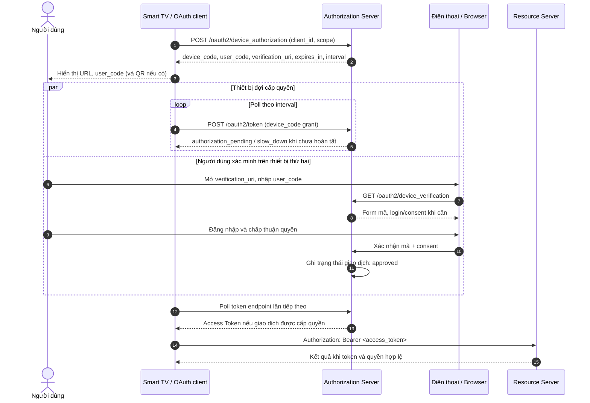
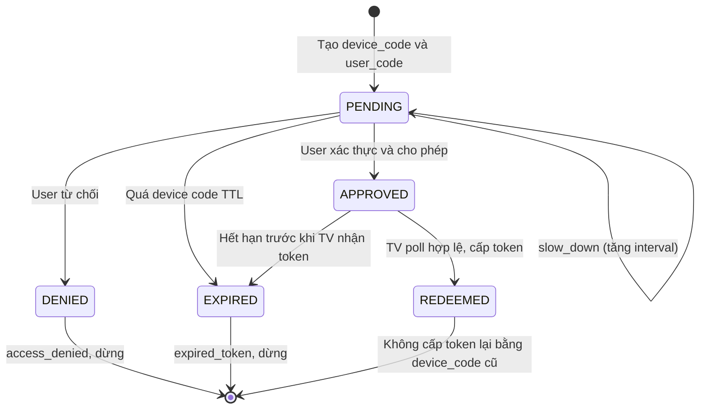

# Kịch bản thiết bị hạn chế nhập liệu và luồng xác thực trên thiết bị thứ hai

## 1. Bối cảnh: đăng nhập trên thiết bị không có bàn phím phù hợp

Trong chương **Device Authorization** của module **SPRING_SECURITY_OAUTH2_OIDC_AUTHORIZATION_SERVER**, chúng ta học cách thiết kế, cấu hình, bảo mật, kiểm thử và vận hành OAuth 2.0/OpenID Connect Authorization Server bằng Spring Security và Spring Authorization Server trong ứng dụng Spring Boot.

Hãy hình dung một ứng dụng chạy trên **smart TV**: người dùng muốn kết nối tài khoản để xem danh sách phim đã lưu, nhưng TV chỉ có điều khiển từ xa. Nếu bắt người dùng nhập tên tài khoản, mật khẩu và mã xác thực nhiều yếu tố trên màn hình TV thì trải nghiệm rất khó khăn. TV cũng không có một trình duyệt đáng tin cậy, tiện dụng để hoàn thành tất cả bước OAuth thông thường.

**OAuth 2.0 Device Authorization Grant** (RFC 8628) giải quyết vấn đề này bằng cách tách hai công việc:

1. **Thiết bị hạn chế nhập liệu** (smart TV, máy in, thiết bị IoT, ứng dụng CLI) yêu cầu Authorization Server tạo một giao dịch đăng nhập thiết bị, rồi hiển thị mã ngắn và địa chỉ xác minh.
2. **Thiết bị thứ hai** (điện thoại, laptop, máy tính bảng) mở trang xác minh, đăng nhập bằng giao diện thuận tiện và chấp thuận quyền cho ứng dụng trên thiết bị thứ nhất.

Trong lúc người dùng thực hiện bước 2, thiết bị thứ nhất **poll** Token Endpoint theo khoảng thời gian được server chỉ dẫn. Sau khi người dùng chấp thuận, server mới cho thiết bị lấy Access Token theo điều kiện grant.

**Điểm đặc biệt:** thiết bị thứ nhất **không nhận mật khẩu người dùng**, không cần browser redirect trở lại TV và không cần yêu cầu người dùng sao chép Access Token từ điện thoại. Các bên chỉ trao đổi mã điều phối có vòng đời ngắn do Authorization Server kiểm soát.

### Kết quả cần đạt

Sau bài này, bạn có thể:

- Giải thích được vì sao dùng Device Authorization Grant thay vì Authorization Code + PKCE hoặc Client Credentials trong kịch bản thiết bị hạn chế.
- Phân biệt `device_code`, `user_code`, `verification_uri`, `verification_uri_complete`, `expires_in` và `interval`.
- Theo dõi toàn bộ chuỗi từ device authorization request, màn hình nhập mã trên thiết bị thứ hai, login/consent, polling, đến token response.
- Hiểu các trạng thái `authorization_pending`, `slow_down`, `access_denied`, `expired_token`, và quy tắc dừng polling.
- Đăng ký OAuth client hỗ trợ Device Code Grant trong Spring Authorization Server; biết nơi cần xây dựng UI xác minh và vận hành phiên người dùng.
- Thiết kế các phép kiểm thử bảo mật cho mã thiết bị, mã người dùng, rate limit, timeout, scope, token và môi trường nhiều instance.

Ví dụ trong bài sử dụng URL `localhost`, mã giả lập và tài khoản phát triển. Mọi mật khẩu, token và cấu hình khóa trong môi trường thực cần được bảo vệ theo chính sách production.

## 2. Phân biệt ba mô hình trước khi chọn Device Flow

| Đặc điểm | Authorization Code + PKCE | Client Credentials | Device Authorization Grant |
| --- | --- | --- | --- |
| Bên cần được cấp quyền | User ủy quyền cho client | Client hành động nhân danh chính nó | User ủy quyền cho client chạy trên thiết bị hạn chế |
| Giao diện đăng nhập người dùng | Browser tương tác trong luồng client | Không có bước đăng nhập user | **Browser trên thiết bị thứ hai** |
| Authorization Endpoint dạng redirect | Có, `/oauth2/authorize` | Không dùng | Thay bằng device authorization + verification interaction |
| Callback `redirect_uri` tới thiết bị thứ nhất | Thường có | Không có | **Không bắt buộc/không dùng làm bước trao đổi code** |
| PKCE `code_verifier` | Có trong Authorization Code Flow | Không áp dụng | **Không phải tham số của Device Grant** |
| Poll Token Endpoint | Không phải cơ chế mặc định | Không cần; client chủ động xin token | **Có**, theo `interval` và lỗi hướng dẫn |
| Xác thực và consent của người dùng | Trên Authorization Server qua trình duyệt | Không có end user | Trên Authorization Server qua thiết bị thứ hai |
| Loại token khi thành công | Access Token, có thể ID/Refresh Token theo điều kiện | Access Token, thường không Refresh Token | Access Token; Refresh Token/ID Token tùy khả năng và chính sách |

RFC 8628 cho phép các client có khả năng giữ bí mật hoặc public clients tùy mô hình. Rất nhiều TV/CLI được xem là **public client** vì không thể bảo đảm giữ kín credential được phân phối cùng ứng dụng. Không thêm một client secret cố định vào firmware hoặc binary rồi khẳng định đó là confidential client.

Device Grant **không phải** một cách để TV xin Access Token bằng `client_credentials`: người dùng thực sự phải xác thực và quyết định cấp quyền trên một thiết bị khác.

## 3. Bốn vai trò trong một kịch bản Smart TV

| Vai trò | Ví dụ | Trách nhiệm |
| --- | --- | --- |
| **Thiết bị hạn chế / OAuth client** | `living-room-tv` | Bắt đầu device authorization, hiển thị hướng dẫn, giữ `device_code` ở phía thiết bị, poll Token Endpoint. |
| **Thiết bị thứ hai / User Agent** | Điện thoại hoặc laptop | Truy cập `verification_uri`, nhập hoặc xác nhận `user_code`, đăng nhập/consent qua giao diện bảo mật. |
| **Resource Owner / End User** | Chủ tài khoản | Xác thực với Authorization Server và quyết định cho phép hoặc từ chối. |
| **Authorization Server / OpenID Provider** | Spring Authorization Server | Cấp mã thiết bị/người dùng, liên kết hai nửa giao dịch, xử lý xác minh, điều phối trạng thái, phát token. |
| **Resource Server** | API danh sách phim | Xác minh Access Token, audience, scope và quyền trước khi cung cấp dữ liệu. |

**Điện thoại không cấp token trực tiếp cho TV.** Điện thoại tương tác với Authorization Server và xác nhận một giao dịch đang chờ; TV tự lấy token từ Authorization Server bằng `device_code` đã nhận trước đó. Đây là ranh giới bảo mật cốt lõi của Device Flow.

### 3.1. Sơ đồ end-to-end



Thứ tự thực tế của polling và người dùng nhập mã là **bất đồng bộ**: TV có thể poll vài lần trước hoặc sau khi điện thoại đang đăng nhập. Hai thiết bị không cần kết nối trực tiếp với nhau; cả hai chỉ cần liên lạc an toàn tới Authorization Server.

## 4. Bước 1 — Thiết bị bắt đầu Device Authorization Request

### 4.1. Endpoint và request

RFC 8628 định nghĩa **Device Authorization Endpoint** do Authorization Server công bố qua metadata hoặc cấu hình được tin cậy. Với cấu hình mặc định thường gặp của Spring Authorization Server, đường dẫn là:

```text
POST /oauth2/device_authorization
```

Ví dụ public client `living-room-tv`, scope `movies.read`:

```http
POST /oauth2/device_authorization HTTP/1.1
Host: localhost:9000
Content-Type: application/x-www-form-urlencoded

client_id=living-room-tv&scope=movies.read
```

Với client public, `client_id` giúp xác định client đã đăng ký chứ **không tự chứng minh tính bí mật của ứng dụng**. Nếu client được đăng ký là confidential, phương thức client authentication phù hợp phải được áp dụng theo cấu hình.

`scope` chỉ yêu cầu tập quyền đã được đăng ký; Authorization Server vẫn phải kiểm tra client, scope và chính sách của từng resource. Không thêm `grant_type=client_credentials` hoặc `code_challenge` vào request này; hai tham số đó thuộc các luồng OAuth khác.

### 4.2. Dữ liệu Response

Một phản hồi thành công minh họa:

```http
HTTP/1.1 200 OK
Content-Type: application/json
Cache-Control: no-store
Pragma: no-cache

{
  "device_code": "<long-unpredictable-secret-code>",
  "user_code": "KJHT-WDVB",
  "verification_uri": "http://localhost:9000/oauth2/device_verification",
  "verification_uri_complete": "http://localhost:9000/oauth2/device_verification?user_code=KJHT-WDVB",
  "expires_in": 600,
  "interval": 5
}
```

Các giá trị chỉ minh họa. `user_code` không nhất thiết có định dạng 8 ký tự như trên, `verification_uri_complete` là **tùy chọn**, và việc server trả `interval` phụ thuộc cấu hình/khả năng triển khai. `expires_in` là **thời hạn giao dịch device authorization tính bằng giây**, không phải Access Token TTL.

| Trường | Ai sử dụng? | Ý nghĩa và bảo vệ |
| --- | --- | --- |
| **`device_code`** | Chỉ thiết bị thứ nhất và token endpoint | Mã khó đoán dùng poll và nhận token; **không hiện trên màn hình TV cho người dùng, không đưa vào QR hay log**. |
| **`user_code`** | Người dùng nhìn trên TV, nhập trên thiết bị thứ hai | Mã ngắn, tiện nhập bằng người, dùng ghép với giao dịch đã tạo. |
| **`verification_uri`** | Người dùng trên thiết bị thứ hai | URL công khai, đáng tin của trang xác minh thiết bị. |
| `verification_uri_complete` | Link/QR để đưa người dùng tới trang xác minh nhanh hơn | URL tùy chọn có sẵn mã người dùng; vẫn cần chống nhầm phiên/lừa đảo. |
| **`expires_in`** | Thiết bị thứ nhất | Khoảng thời gian tối đa giao dịch còn hiệu lực từ lúc được tạo. |
| **`interval`** | Thiết bị thứ nhất | Khoảng cách tối thiểu giữa các lần poll; đơn vị giây. |

**Không dùng `device_code` làm `user_code`.** Device code là credential độ entropy cao mà TV phải giữ, còn user code được thiết kế để con người có thể nhìn và nhập. Chúng có mô hình rủi ro khác nhau.

### 4.3. Kiểm tra URL từ nguồn tin cậy

TV nên sử dụng metadata/configuration được tin cậy của Authorization Server để biết endpoint. Không chấp nhận một URL xác minh tùy ý do người khác đưa vào như một “device authorization response” chưa được TLS/source verification; nếu không, TV có thể hướng người dùng tới trang giả mạo.

Trong môi trường production, các endpoint phải có HTTPS, chứng chỉ phù hợp, hostname và issuer ổn định. `http://localhost:9000` chỉ dành cho bài thực hành local.

## 5. Bước 2 — TV hướng dẫn người dùng sử dụng thiết bị thứ hai

### 5.1. Thiết kế màn hình hạn chế nhập liệu

Một UI TV điển hình có thể hiển thị:

```text
KẾT NỐI TÀI KHOẢN

1. Trên điện thoại hoặc máy tính, mở:
   https://auth.example.com/activate

2. Nhập mã:
   KJHT-WDVB

3. Đăng nhập và đồng ý cấp quyền.

Mã này hết hạn sau 10 phút.
Đang chờ bạn hoàn tất trên thiết bị thứ hai...
```

Đây là bản UI minh họa; URL thực phải khớp `verification_uri` được server phát và đồng nhất với thương hiệu/hostname được tin cậy. Không hiển thị mật khẩu, client secret, `device_code` hoặc token trên màn hình.

### 5.2. verification_uri và verification_uri_complete

Hai cách mở trang xác minh:

1. **Thủ công:** người dùng nhập `verification_uri` vào trình duyệt điện thoại rồi nhập `user_code`.
2. **Nhanh hơn:** TV hiển thị mã QR được tạo từ `verification_uri_complete` nếu server cung cấp; điện thoại mở form đã điền `user_code`.

Kể cả khi dùng QR, nên cho người dùng **nhìn và so khớp mã trên TV với mã đang được xác nhận trên điện thoại**. Việc mở link có sẵn mã không nên trở thành thao tác cấp quyền im lặng, đặc biệt trong môi trường có nguy cơ lừa đảo mã thiết bị.

Mã trên TV cần đủ rõ ràng, có khoảng cách hoặc nhóm ký tự dễ đọc, thể hiện trạng thái hết hạn, cho phép người dùng hủy hoặc yêu cầu mã mới. Đừng yêu cầu người dùng nhập password trực tiếp vào TV khi đã chọn Device Flow.

### 5.3. Tại sao user_code ngắn vẫn có thể sử dụng?

`user_code` tiện nhập nên thường có entropy thấp hơn `device_code`. Authorization Server phải bù lại bằng:

- giới hạn số lần thử và rate limit ở trang nhập mã;
- thời hạn ngắn, loại bỏ/thu hồi mã khi giao dịch kết thúc;
- kiểm tra chính xác mã và tránh lộ trạng thái chi tiết cho attacker;
- đăng nhập và consent bảo vệ bằng session/CSRF;
- chống phishing và xác nhận đúng thiết bị/ứng dụng đang được cấp quyền.

**Mã người dùng không phải password và không tự cấp Access Token.** Nó chỉ liên kết phiên xác minh của user với một yêu cầu đang chờ, sau đó người dùng vẫn phải xác thực và đồng ý theo chính sách.

## 6. Bước 3 — Đăng nhập và consent trên điện thoại

### 6.1. Mở Device Verification Endpoint

Với Spring Authorization Server, endpoint xác minh thiết bị thường có đường dẫn mặc định:

```text
GET /oauth2/device_verification
```

Trang xác minh có thể cần được ứng dụng cấu hình hoặc tùy biến giao diện. Tùy phiên bản Spring Authorization Server, các extension point cho device verification và bước success/error handling khác nhau. **Không nên giả định chỉ thêm một RegisteredClient là có sẵn trang nhập mã thân thiện và consent UI hoàn chỉnh** trong mọi bản triển khai.

Trình duyệt ở điện thoại phải đến đúng Authorization Server, không đi qua một endpoint callback nào trên TV. Nếu người dùng chưa đăng nhập, Authorization Server chuyển tới form login hoặc cơ chế xác thực đã cấu hình.

### 6.2. Login là bước xác thực user

Người dùng nhập credential trên thiết bị thứ hai qua HTTPS:

```text
Điện thoại → Authorization Server
    GET verification_uri
    GET /login nếu chưa có session
    POST /login + CSRF / MFA nếu yêu cầu
    Tiếp tục xác minh user_code
```

Spring Security có thể sử dụng `SecurityFilterChain`, `AuthenticationProvider`, `SecurityContextRepository`, session cookie và `CsrfTokenRepository`. Phiên đăng nhập ở đây là **phiên của điện thoại với Authorization Server**; TV không nhận cookie phiên này.

Nếu người dùng đã đăng nhập trước đó trên điện thoại, bước nhập lại mật khẩu có thể được bỏ qua theo chính sách, nhưng server vẫn phải kiểm tra user code và consent phù hợp.

### 6.3. Ghép user_code với giao dịch đang chờ

Khi user nhập hoặc xác nhận `user_code`, Authorization Server tra trạng thái device authorization tương ứng:

```text
user_code: KJHT-WDVB
device_code: <secret-stored-with-transaction>
client_id: living-room-tv
requested_scopes: [movies.read]
created_at: ...
expires_at: ...
status: PENDING
```

Đây là **mô hình dữ liệu logic** để giải thích, không phải schema bắt buộc của Spring Authorization Server. Server cần kiểm tra:

1. User code tồn tại, chưa hết hạn, đúng trạng thái chưa hoàn thành.
2. Yêu cầu thuộc client đã đăng ký hợp lệ, không bị thu hồi.
3. User đã được xác thực ở phiên điện thoại và đủ điều kiện cấp quyền.
4. Scopes hiển thị không vượt scopes được client đăng ký/yêu cầu.
5. Khi người dùng chọn cấp quyền, cập nhật trạng thái authorization/consent đúng cách.

### 6.4. Consent: người dùng thực sự phê duyệt điều gì?

Trên điện thoại, giao diện cần nêu rõ client và quyền đang yêu cầu:

```text
Ứng dụng: Living Room TV
Thiết bị chờ kết nối: TV ở phòng khách
Quyền được yêu cầu:
  - Đọc danh sách phim đã lưu (movies.read)

Mã đang xác nhận: KJHT-WDVB

[Cho phép]    [Từ chối]
```

Chỉ hiển thị tên thiết bị/phòng khách nếu server có dữ liệu đáng tin cậy hoặc trình bày rõ là tên do client khai báo; không khẳng định danh tính phần cứng đã được xác minh nếu không có cơ chế xác minh tương ứng.

**Login khác consent:** user đăng nhập thành công không có nghĩa mọi scope được tự động cấp. Nếu policy cần consent, người dùng phải có quyền xem thông tin client, các scope và lựa chọn từ chối.

### 6.5. Phê duyệt hoặc từ chối được lưu như thế nào?

Về logic, trạng thái giao dịch chuyển từ `PENDING` sang:

- `APPROVED`: user đã xác thực và chấp thuận quyền hợp lệ; token endpoint có thể cấp token cho thiết bị đang giữ `device_code` đúng.
- `DENIED`: user từ chối; token endpoint trả `access_denied`.
- `EXPIRED`: quá thời hạn; không cấp token kể cả user nhập đúng code sau thời điểm hết hạn.

Spring Authorization Server có mô hình `OAuth2Authorization`, `OAuth2AuthorizationService`, `OAuth2AuthorizationConsent` và `OAuth2AuthorizationConsentService` để quản lý các đối tượng/trạng thái liên quan. Khi cần tùy biến màn xác minh hoặc lưu consent, hãy sử dụng extension point hỗ trợ bởi phiên bản framework đang chạy thay vì tự thêm một endpoint công khai cho phép sửa trạng thái bằng mỗi `user_code`.

## 7. Bước 4 — TV poll Token Endpoint trong lúc chờ

### 7.1. Device Code Grant trên token endpoint

TV gửi `device_code` (không phải `user_code`) tới Token Endpoint:

```http
POST /oauth2/token HTTP/1.1
Host: localhost:9000
Content-Type: application/x-www-form-urlencoded

grant_type=urn%3Aietf%3Aparams%3Aoauth%3Agrant-type%3Adevice_code&
device_code=<secret-device-code>&
client_id=living-room-tv
```

Giá trị grant sau URL decoding:

```text
urn:ietf:params:oauth:grant-type:device_code
```

Public client thường gửi `client_id` để được nhận diện. Confidential client phải sử dụng phương thức xác thực client đã đăng ký. TV không gửi `username`/`password` của user, `user_code`, `authorization_code` hoặc PKCE verifier tại token endpoint này.

### 7.2. Trạng thái authorization_pending

Khi user chưa hoàn thành xác minh trên điện thoại, server trả phản hồi lỗi giao thức:

```http
HTTP/1.1 400 Bad Request
Content-Type: application/json
Cache-Control: no-store

{
  "error": "authorization_pending"
}
```

Đây **không phải lỗi hệ thống bất thường**: nó có nghĩa giao dịch vẫn đang chờ người dùng. TV nên tiếp tục hiển thị trạng thái chờ và poll theo `interval`; không bật lại trang đăng nhập ở TV và không tự động tạo giao dịch mới mỗi khi nhận lỗi này.

### 7.3. Interval và slow_down

Trường `interval` trong device authorization response cho biết **số giây tối thiểu giữa các lần polling**. Nếu server không gửi `interval`, RFC 8628 quy định client sử dụng **mặc định 5 giây**.

Ví dụ:

```text
Response ban đầu: interval = 5
Poll thứ 1 sau ít nhất 5 giây → authorization_pending
Poll thứ 2 sau ít nhất 5 giây → authorization_pending
Nếu nhận slow_down         → tăng interval thêm 5 giây
Poll tiếp theo             → đợi ít nhất 10 giây, và tiếp tục đợi 10 giây
```

Theo RFC 8628, `slow_down` yêu cầu **tăng khoảng polling thêm 5 giây cho lần này và tất cả lần sau** trong cùng giao dịch; không chỉ ngủ thêm 5 giây đúng một lần rồi quay về khoảng cũ.

Response minh họa:

```json
{
  "error": "slow_down"
}
```

Nếu gặp network timeout hoặc không thể kết nối, client nên **giảm tần suất** truy vấn bằng chiến lược backoff thích hợp, ví dụ tăng khoảng chờ lũy tiến theo khuyến nghị RFC, thay vì retry liên tục ngay lập tức.

### 7.4. Khi người dùng từ chối hoặc device_code hết hạn

Các lỗi kết thúc:

```json
{
  "error": "access_denied"
}
```

hoặc:

```json
{
  "error": "expired_token"
}
```

Với `access_denied`, TV phải dừng polling và thông báo người dùng đã từ chối. Với `expired_token`, giao dịch đã hết hạn, TV phải dừng và chỉ bắt đầu một device authorization request **mới** khi người dùng chủ động thử lại. Không tiếp tục gửi `device_code` cũ vô hạn.

Các lỗi client authentication/authorization khác như `invalid_client` hoặc `invalid_grant` cũng không phải lý do để poll liên tục như `authorization_pending`.

### 7.5. Bảng xử lý phản hồi đúng

| Phản hồi token endpoint | Ý nghĩa | Hành động của thiết bị |
| --- | --- | --- |
| HTTP 200 kèm `access_token` | User đã xác minh/cấp quyền và grant được chấp nhận. | **Dừng polling**, lưu token an toàn, tiếp tục gọi API. |
| `authorization_pending` | User chưa hoàn thành. | Chờ ít nhất `interval` rồi poll lại. |
| `slow_down` | Thiết bị đang hỏi quá nhanh hoặc server yêu cầu giảm tốc. | Tăng khoảng chờ thêm **5 giây** cho lần này và về sau. |
| `access_denied` | User đã từ chối. | **Dừng**, hiển thị trạng thái từ chối. |
| `expired_token` | Device code hết thời hạn. | **Dừng**, xóa giao dịch cũ, cho phép khởi tạo lại khi cần. |
| `invalid_client` hoặc lỗi client authentication | Client ID/credential/method không hợp lệ. | Dừng, không retry không giới hạn; kiểm tra cấu hình và credential. |
| Timeout/mất mạng | Không có phản hồi đáng tin. | Backoff, giữ giới hạn hết hạn và có chiến lược retry thận trọng. |

Không dựa vào duy nhất status HTTP 400 để xác định hành vi: client cần parse `error` theo giao thức OAuth và vẫn thực hiện các chính sách timeout/giới hạn tổng thể.

## 8. Bước 5 — Server cấp token khi giao dịch đã hoàn tất

Khi user trên điện thoại đã xác thực và consent hợp lệ, lần poll tiếp theo với đúng `device_code` và client hợp lệ có thể nhận:

```http
HTTP/1.1 200 OK
Content-Type: application/json
Cache-Control: no-store
Pragma: no-cache

{
  "access_token": "<issued-access-token>",
  "token_type": "Bearer",
  "expires_in": 600,
  "scope": "movies.read"
}
```

Phản hồi tùy grant, cấu hình và client có thể có `refresh_token`; nếu hệ thống hỗ trợ các điều kiện OIDC liên quan (ví dụ yêu cầu `openid` với OIDC integration), có thể có `id_token` theo chính sách, nhưng **RFC 8628 tự nó không bảo đảm ID Token luôn hiện diện**. Không giả định Device Flow giống hệt Authorization Code/OIDC token response.

### 8.1. Hai thời hạn phải tách biệt

| Thời hạn | Áp dụng cho | Ví dụ |
| --- | --- | --- |
| **`deviceCodeTimeToLive`** | Giao dịch chờ người dùng xác minh; phản ánh ở `expires_in` của device authorization response. | 10 phút. |
| **`accessTokenTimeToLive`** | Access Token được cấp sau khi xác minh thành công; phản ánh ở token response. | 10 phút, độc lập với TTL của device code. |
| `refreshTokenTimeToLive` (nếu cấp) | Refresh Token sau khi cấp quyền. | Theo chính sách client và khả năng token generator. |

Nếu device code hết hạn lúc 10:10 nhưng user đã xác minh xong và TV lấy Access Token lúc 10:08, Access Token mới có thời hạn riêng và có thể hết hạn lúc 10:18 (nếu TTL 10 phút). **Không lấy thời hạn device code để xác minh Access Token**.

### 8.2. TV gọi Resource Server

```http
GET /api/movies/saved HTTP/1.1
Host: api.example.com
Authorization: Bearer <access-token>
```

Resource Server xác minh chữ ký/JWKS nếu Access Token dạng JWT, hoặc dùng token introspection nếu dạng opaque; đồng thời kiểm tra issuer, thời hạn, audience, scope và những điều kiện nghiệp vụ. `scope=movies.read` không tự cấp mọi quyền, kể cả quyền chỉnh sửa danh sách phim hoặc quản trị tài khoản.

Không dùng `device_code` hoặc `user_code` làm Bearer Access Token. Cũng không đưa Access Token lên màn hình TV hay mã QR.

### 8.3. Device grant không dùng authorization code và PKCE

Trong Device Grant, mã dùng để poll là `device_code`, còn `user_code` dành cho người dùng nhập trên thiết bị thứ hai. **Không có redirect chứa `code` về TV**, và không có cặp `code_challenge`/`code_verifier` của Authorization Code Flow. Cần bảo vệ device code bằng tính ngẫu nhiên, binding đúng client, TTL, polling rules và validation của Authorization Server.

## 9. Spring Authorization Server: mô hình và cấu hình client

### 9.1. Những thành phần tham gia

Trong các phiên bản Spring Authorization Server hỗ trợ Device Grant, các thành phần giao thức thường gồm:

| Thành phần | Vai trò |
| --- | --- |
| `OAuth2DeviceAuthorizationEndpointFilter` | Tiếp nhận yêu cầu cấp `device_code`, `user_code` và URL xác minh. |
| `OAuth2DeviceVerificationEndpointFilter` | Xử lý xác minh user code, liên kết trạng thái người dùng và giao dịch thiết bị. |
| `OAuth2TokenEndpointFilter` | Nhận các lần poll bằng grant `device_code` và trả lỗi/trả token. |
| `RegisteredClientRepository` | Tra client, client authentication methods, grant types và scopes đã đăng ký. |
| `OAuth2AuthorizationService` | Lưu trạng thái device authorization, mã, thời hạn và kết quả cấp quyền. |
| `OAuth2AuthorizationConsentService` | Lưu consent khi chính sách yêu cầu. |
| `TokenSettings` | Quy định `deviceCodeTimeToLive` và TTL/format token sau khi cấp. |
| `SecurityFilterChain` và user authentication | Hỗ trợ trang login/verification/consent trên thiết bị thứ hai. |

Tên API, handler, trang mặc định và đường dẫn endpoint có thể khác giữa các phiên bản Spring Authorization Server. Cần kiểm tra tài liệu version thực tế khi tùy biến verification UI hoặc vị trí endpoint.

### 9.2. Đăng ký public client cho Device Grant

Ví dụ Java dưới đây **chỉ đăng ký client** dùng `device_code` và scope `movies.read`. Nó không tự tạo một Authorization Server đầy đủ:

```java
import java.time.Duration;
import java.util.UUID;

import org.springframework.context.annotation.Bean;
import org.springframework.security.oauth2.core.AuthorizationGrantType;
import org.springframework.security.oauth2.core.ClientAuthenticationMethod;
import org.springframework.security.oauth2.core.OAuth2TokenFormat;
import org.springframework.security.oauth2.server.authorization.client.InMemoryRegisteredClientRepository;
import org.springframework.security.oauth2.server.authorization.client.RegisteredClient;
import org.springframework.security.oauth2.server.authorization.client.RegisteredClientRepository;
import org.springframework.security.oauth2.server.authorization.settings.ClientSettings;
import org.springframework.security.oauth2.server.authorization.settings.TokenSettings;

@Bean
RegisteredClientRepository registeredClientRepository() {
    RegisteredClient smartTv = RegisteredClient.withId(UUID.randomUUID().toString())
            .clientId("living-room-tv")
            .clientAuthenticationMethod(ClientAuthenticationMethod.NONE)
            .authorizationGrantType(AuthorizationGrantType.DEVICE_CODE)
            .scope("movies.read")
            .clientSettings(ClientSettings.builder()
                    .requireAuthorizationConsent(true)
                    .build())
            .tokenSettings(TokenSettings.builder()
                    .deviceCodeTimeToLive(Duration.ofMinutes(10))
                    .accessTokenTimeToLive(Duration.ofMinutes(10))
                    .accessTokenFormat(OAuth2TokenFormat.SELF_CONTAINED)
                    .build())
            .build();

    return new InMemoryRegisteredClientRepository(smartTv);
}
```

Đặt bean trong class `@Configuration`. Nếu dự án đã có `RegisteredClientRepository`, hãy tích hợp client vào repository hiện tại để tránh trùng bean. `ClientAuthenticationMethod.NONE` thể hiện TV là **public client** trong ví dụ; server vẫn phải nhận diện client bằng `client_id` và kiểm tra `device_code` gắn với client đó.

`AuthorizationGrantType.DEVICE_CODE` là grant type dành cho Device Authorization; tùy phiên bản API, nếu không có constant sẵn thì có thể dùng giá trị chuẩn `urn:ietf:params:oauth:grant-type:device_code` qua constructor phù hợp. Không thêm `AUTHORIZATION_CODE` hoặc `CLIENT_CREDENTIALS` nếu TV chưa được cấp quyền sử dụng các grant đó.

Không cần `redirectUri(...)` cho Device Grant, vì kết quả không redirect về TV. `requireProofKey(true)` cũng không thay thế được bảo vệ của Device Flow, vì PKCE dùng cho Authorization Code Grant.

### 9.3. Cấu hình Authorization Server và đăng nhập người dùng

Ứng dụng Spring Boot vẫn cần:

- dependency Spring Authorization Server, Spring Security và Servlet/Web stack tương thích;
- `SecurityFilterChain` cho các endpoint OAuth 2.0/Device Grant;
- chain xử lý form login hoặc một phương thức user authentication đáng tin trên thiết bị thứ hai;
- `AuthorizationServerSettings` với issuer, endpoint URLs phù hợp và HTTPS ở production;
- `OAuth2AuthorizationService`, `OAuth2AuthorizationConsentService` và `RegisteredClientRepository`;
- JWK/`OAuth2TokenGenerator` thích hợp để phát Access Token theo định dạng đã cấu hình;
- UI xác minh `user_code` và consent phù hợp với các extension point/framework version.

Ví dụ cấu hình chain ở dòng Spring Authorization Server hỗ trợ API `OAuth2AuthorizationServerConfigurer.authorizationServer()`:

```java
import org.springframework.context.annotation.Bean;
import org.springframework.core.annotation.Order;
import org.springframework.http.MediaType;
import org.springframework.security.config.Customizer;
import org.springframework.security.config.annotation.web.builders.HttpSecurity;
import org.springframework.security.oauth2.server.authorization.config.annotation.web.configurers.OAuth2AuthorizationServerConfigurer;
import org.springframework.security.web.SecurityFilterChain;
import org.springframework.security.web.authentication.LoginUrlAuthenticationEntryPoint;
import org.springframework.security.web.util.matcher.MediaTypeRequestMatcher;

@Bean
@Order(1)
SecurityFilterChain authorizationServerChain(HttpSecurity http) throws Exception {
    OAuth2AuthorizationServerConfigurer configurer =
            OAuth2AuthorizationServerConfigurer.authorizationServer();

    http.securityMatcher(configurer.getEndpointsMatcher())
            .with(configurer, Customizer.withDefaults())
            .authorizeHttpRequests(auth -> auth.anyRequest().authenticated())
            .exceptionHandling(ex -> ex.defaultAuthenticationEntryPointFor(
                    new LoginUrlAuthenticationEntryPoint("/login"),
                    new MediaTypeRequestMatcher(MediaType.TEXT_HTML)));
    return http.build();
}

@Bean
@Order(2)
SecurityFilterChain applicationChain(HttpSecurity http) throws Exception {
    http.authorizeHttpRequests(auth -> auth.anyRequest().authenticated())
            .formLogin(Customizer.withDefaults());
    return http.build();
}
```

Đoạn code minh họa việc kết hợp protocol endpoints với trang login. Nó **chưa** tạo user, signing key, issuer, verification UI hoặc consent page hoàn chỉnh. Nếu muốn dùng một trang xác minh tùy biến, cần kiểm tra cách Spring Authorization Server xử lý GET/POST xác minh và response/error handlers ở version cụ thể; không thay provider kiểm tra giao thức bằng controller tùy tiện chỉ nhận `user_code`.

### 9.4. Cấu hình thời hạn của Device Code

`TokenSettings.deviceCodeTimeToLive(Duration)` định nghĩa thời hạn giao dịch chờ user xác minh. Nếu đặt 10 phút, TV cần hiển thị thời gian còn lại từ `expires_in` và dừng poll sau khi hết hạn, thay vì coi `device_code` là credential vĩnh viễn.

Khi phát Access Token thành công, thời hạn Access Token được điều khiển bởi `accessTokenTimeToLive` và các chính sách token generation tương ứng. Không có quy tắc rằng TTL của `device_code` phải bằng TTL của Access Token.

## 10. Bài thực hành HTTP end-to-end với PowerShell

### 10.1. Thiết lập bài thực hành

Giả sử Authorization Server đang chạy ở `http://localhost:9000`, đã:

- đăng ký `living-room-tv` theo phần 9;
- bật device authorization/device verification endpoints với các đường dẫn tương ứng;
- thiết lập user authentication và trang nhập user code/consent;
- cấu hình `OAuth2AuthorizationService` cùng signing key để phát Access Token.

Nếu thiếu verification UI hoặc chưa bật đúng endpoint, các lệnh dưới đây có thể không hoàn tất flow. Đừng coi một `RegisteredClient` đơn lẻ là đủ để dựng toàn bộ thiết bị thứ hai.

### 10.2. Xin device_code và user_code

Từ PowerShell:

```powershell
$deviceResponse = curl.exe -sS -X POST 'http://localhost:9000/oauth2/device_authorization' -H 'Content-Type: application/x-www-form-urlencoded' --data-urlencode 'client_id=living-room-tv' --data-urlencode 'scope=movies.read' | ConvertFrom-Json

$deviceResponse.user_code
$deviceResponse.verification_uri
$deviceResponse.expires_in
$deviceResponse.interval
```

Không in hoặc ghi `deviceResponse.device_code` ra log công khai. Nó phải được giữ trong bộ nhớ hoặc lưu trữ tạm bảo vệ của chính TV/CLI client để poll token endpoint.

Nếu không có `interval`, dùng mặc định **5 giây**. Xác định deadline từ thời điểm nhận response và `expires_in`; không tự kéo dài deadline mỗi khi poll.

### 10.3. Xác minh trên thiết bị thứ hai

Trên điện thoại hoặc browser khác:

1. Mở `$deviceResponse.verification_uri`. Nếu dùng QR/`verification_uri_complete`, xác nhận URL thuộc Authorization Server đáng tin.
2. Đăng nhập vào Authorization Server bằng tài khoản test trên điện thoại.
3. Nhập `$deviceResponse.user_code` hoặc đối chiếu mã đã điền sẵn.
4. Đọc tên client/scopes, chọn **Cho phép** hoặc **Từ chối**.
5. Quay về TV/terminal và quan sát trạng thái polling.

Không cần copy authorization code từ URL callback và không cần truyền mật khẩu hay token từ điện thoại sang TV.

### 10.4. Poll thủ công lần đầu

```powershell
curl.exe -i -X POST 'http://localhost:9000/oauth2/token' -H 'Content-Type: application/x-www-form-urlencoded' --data-urlencode 'grant_type=urn:ietf:params:oauth:grant-type:device_code' --data-urlencode 'client_id=living-room-tv' --data-urlencode "device_code=$($deviceResponse.device_code)"
```

Trước khi user đồng ý, phản hồi `authorization_pending` là bình thường. Sau khi user đồng ý và code còn hiệu lực, server có thể trả `access_token`. Nếu user từ chối, phản hồi `access_denied` và TV dừng poll.

Đoạn trên thực hiện **một lần poll**, không tự động lặp liên tục. Khi thử bằng tay, giữ khoảng cách ít nhất `interval` và tuân thủ `slow_down`. Không gửi request nhiều lần liên tiếp chỉ để “kiểm tra nhanh”.

### 10.5. Thuật toán polling của thiết bị

Pseudocode không phụ thuộc một thư viện:

```text
deadline = monotonicNow + expires_in
pollInterval = interval nếu có, ngược lại 5 giây

while monotonicNow < deadline:
    wait(pollInterval)
    response = POST token endpoint với device_code + client identification

    if response là token hợp lệ:
        lưu token an toàn; kết thúc
    else if response.error == authorization_pending:
        tiếp tục vòng poll
    else if response.error == slow_down:
        pollInterval = pollInterval + 5 giây
        tiếp tục vòng poll
    else if response.error == access_denied:
        hiển thị bị từ chối; kết thúc
    else if response.error == expired_token:
        hiển thị mã hết hạn; kết thúc
    else if network timeout / lỗi kết nối:
        tăng backoff một cách phù hợp; kiểm tra deadline; tiếp tục thận trọng
    else:
        dừng và xử lý lỗi theo chính sách; không retry vô hạn

nếu quá deadline:
    xóa device_code và thông báo cần tạo yêu cầu mới
```

**Không poll ngay khi vừa nhận response nếu server yêu cầu khoảng chờ tối thiểu**; bản mô tả trên đợi trước mỗi lần gọi. Không dựa hoàn toàn vào `Thread.sleep` hoặc đồng hồ bị người dùng chỉnh; cần deadline nhất quán và xử lý ứng dụng bị đưa vào background, mất mạng hoặc sleep mode.

### 10.6. Java minh họa state machine ở phía thiết bị

Ví dụ dưới đây chỉ trình bày logic xử lý phản hồi; việc gửi HTTP, bảo vệ token và thời gian chờ do tầng ứng dụng đảm nhiệm:

```java
enum DevicePollOutcome {
    AUTHORIZED,
    AUTHORIZATION_PENDING,
    SLOW_DOWN,
    ACCESS_DENIED,
    EXPIRED_TOKEN,
    FATAL_ERROR
}

record PollingState(long intervalSeconds, boolean active) {
    PollingState on(DevicePollOutcome outcome) {
        return switch (outcome) {
            case AUTHORIZATION_PENDING -> this;
            case SLOW_DOWN -> new PollingState(intervalSeconds + 5, true);
            case AUTHORIZED, ACCESS_DENIED, EXPIRED_TOKEN, FATAL_ERROR ->
                    new PollingState(intervalSeconds, false);
        };
    }
}
```

Ví dụ dùng `enum` và `record` của Java 17. Đoạn mã không tự chờ hoặc gọi HTTP; nó minh họa cách **giữ interval tăng sau `slow_down`** thay vì giảm về 5 giây ở lần sau. Tầng HTTP phải dừng khi `active=false` và kiểm tra deadline trước mỗi request.

## 11. Các trạng thái và chuyển tiếp của giao dịch



Hệ thống cần xác định khi nào giao dịch được đánh dấu **redeemed/consumed** để ngăn một device code được dùng nhiều lần ngoài ý muốn. Đây là vấn đề trạng thái server và atomic update khi có nhiều request đến đồng thời, không phải trách nhiệm của người dùng trên điện thoại.

Một authorization đã được phê duyệt không nên bị dùng lại vô hạn để cấp nhiều Access Token chỉ vì thiết bị gửi lại cùng `device_code`. Token endpoint phải tuân thủ trạng thái grant và quy tắc token issuance/authorization service tương ứng.

## 12. Bảo mật: device code, user code và phishing

### 12.1. Các mối đe dọa khác nhau

| Nguy cơ | Tại sao nguy hiểm? | Biện pháp |
| --- | --- | --- |
| Lộ `device_code` | Ai có code có thể cố poll và lấy token sau khi user cấp quyền nếu những ràng buộc khác không ngăn cản. | Mã khó đoán, gắn client/transaction, TLS, không hiển thị hay log, TTL ngắn. |
| Đoán `user_code` | Attacker có thể thử ghép vào một giao dịch hợp lệ. | Rate limit, mã đủ entropy, thông báo lỗi không lộ quá nhiều, hết hạn nhanh. |
| Tấn công phishing qua Device Flow | Attacker mở giao dịch của chính mình rồi dụ user nhập mã/approve trên trang thật. | Hiển thị rõ client/scopes, người dùng chỉ xác minh khi tự bắt đầu, so khớp mã và ngữ cảnh thiết bị. |
| `verification_uri` giả mạo | User bị dẫn tới trang login giả để đánh cắp credential. | Hostname tin cậy, HTTPS, hướng dẫn kiểm tra domain, QR/link chỉ từ metadata đã xác minh. |
| Poll quá nhanh | Gây tải lớn, tấn công cạn tài nguyên token endpoint. | `interval`, `slow_down`, rate limit, backoff và deadline. |
| Giao dịch hết hạn vẫn được phê duyệt | Bỏ qua ràng buộc thời gian. | Kiểm tra TTL khi nhập mã, consent và đổi token. |
| Chấp thuận không có consent/CSRF | Thiết bị được cấp quyền mà user không thực sự đồng ý. | Session, CSRF, UX consent rõ ràng và kiểm tra user authorization. |
| Lộ token trên TV/CLI | Access Token có thể được dùng để truy cập API. | Lưu bảo vệ, không in màn hình/log, xóa khi logout, rotate/revoke khi cần. |
| Client giả mạo | Public client ID không phải bí mật, app khác có thể khai báo cùng ID. | Đánh giá rủi ro public client, ràng buộc giao dịch, user verification, rate limit và chính sách bổ sung khi cần. |

### 12.2. Device Flow phishing là rủi ro đặc trưng

Một kiểu tấn công thường gặp:

1. Attacker tự bắt đầu Device Flow cho một ứng dụng (có thể mạo danh bối cảnh hợp lệ).
2. Attacker gửi cho nạn nhân một đường dẫn xác minh và `user_code` của giao dịch **do attacker tạo**.
3. Nạn nhân đăng nhập trên trang Authorization Server thật, thấy giao diện cấp quyền và vô tình approve.
4. Thiết bị/client của attacker, vốn giữ `device_code`, có thể nhận Access Token khi poll.

Chỉ sử dụng HTTPS và trang login thật **không đủ** ngăn trường hợp này, vì người dùng có thể đang thao tác trên trang thật nhưng phê duyệt **giao dịch của attacker**.

Để giảm rủi ro, giao diện trên điện thoại cần nhấn mạnh: **chỉ nhập mã nếu bạn vừa tự khởi tạo kết nối trên thiết bị của mình; kiểm tra mã hiển thị có khớp, tên ứng dụng và scopes đang xin**. Nếu có dữ liệu device instance đáng tin, hiển thị để người dùng đối chiếu; không khẳng định hardware identity chỉ dựa trên một tên do client tự khai báo.

### 12.3. Không coi user_code là yếu tố xác thực duy nhất

`user_code` là phương tiện liên kết yêu cầu xác minh, không phải bằng chứng chứng minh danh tính user. Trước khi approve, Authorization Server cần user authentication và consent/phân quyền theo chính sách. Không tạo một REST endpoint `approve?user_code=...` mà bất cứ ai biết mã đều có thể gọi để cấp token.

CSRF bảo vệ form tương tác ở thiết bị thứ hai, trong khi Device Code polling là giao thức HTTP giữa OAuth client và Authorization Server. **Không tắt CSRF toàn ứng dụng** chỉ vì token endpoint không dùng phiên browser.

### 12.4. Định dạng mã và giới hạn thử

RFC 8628 có các khuyến nghị về sự cân bằng giữa mã người dùng đủ dễ nhập và khả năng chống đoán. Mã có thể loại ký tự dễ nhầm như `O`/`0` hoặc `I`/`1` và chia nhóm bằng dấu gạch nối để tăng khả năng đọc.

Không dựa vào định dạng `KJHT-WDVB` như tiêu chuẩn cố định. Độ dài, alphabet, entropy, tần suất thử và TTL phải được chọn/kiểm thử cùng nhau. Khi trả lỗi mã sai, tránh tiết lộ thông tin tài khoản hoặc trạng thái giao dịch theo cách giúp attacker đoán mã.

## 13. Resource Server, ID Token và Refresh Token

### 13.1. Access Token dùng cho API, không phải cho trang xác minh

Sau khi TV lấy token, Resource Server cần:

- xác minh chữ ký, issuer, thời hạn và audience cho JWT Access Token; hoặc introspect opaque token;
- kiểm tra scope được cấp (ví dụ `movies.read`) và quyền nghiệp vụ;
- phân biệt `401 Unauthorized` (chưa xác thực/token không hợp lệ) với `403 Forbidden` (token hợp lệ nhưng không đủ quyền) theo cấu hình và semantics áp dụng.

Đừng dùng `user_code` hoặc `device_code` gọi API. Đây không phải Access Token.

### 13.2. Có ID Token không?

RFC 8628 định nghĩa một **OAuth 2.0 grant**, không mặc định xác thực người dùng theo toàn bộ đặc tả OIDC. Nếu server triển khai OIDC cho Device Grant và client yêu cầu `openid` trong một ngữ cảnh được hỗ trợ, response có thể có ID Token; nhưng **không được mặc định giả định mọi triển khai Spring Authorization Server đều phát `id_token` qua Device Flow**.

Nếu có ID Token, OIDC client phải kiểm tra chữ ký, `iss`, `aud`, `exp` và các điều kiện khác tương ứng. Không đưa ID Token tới API thay Access Token.

### 13.3. Có Refresh Token không?

Tùy policy và khả năng của Authorization Server, client có thể được cấp Refresh Token để lấy Access Token mới mà không buộc user lặp lại Device Flow mỗi khi Access Token hết hạn. Điều này đặc biệt hữu ích với TV nhưng làm tăng yêu cầu bảo vệ credential lâu dài.

Cần cân nhắc:

- thiết bị có khả năng lưu trữ an toàn không;
- rotation, revocation và refresh token expiry được triển khai thế nào;
- người dùng có thể đăng xuất/thu hồi kết nối TV bị thất lạc hay không;
- chính sách xác thực lại sau một khoảng thời gian cố định.

Không mở quyền refresh vô thời hạn chỉ để người dùng không phải nhập mã lần nữa. Khi thiết bị bị bán/cho mượn, cần có cơ chế xóa token và thu hồi quyền thích hợp.

## 14. Kiểm thử từng giai đoạn của Device Flow

| Bước | Tình huống thử | Kỳ vọng |
| --- | --- | --- |
| Device authorization | Client đã đăng ký, grant phù hợp, scope hợp lệ. | Trả `device_code`, `user_code`, `verification_uri`, `expires_in`, `interval` khi có. |
| Device authorization | Client ID không tồn tại. | Từ chối, không cấp bộ mã cho client không hợp lệ. |
| Device authorization | Scope không được phép. | Từ chối theo chính sách scope. |
| Device authorization | Client không đăng ký Device Grant. | Từ chối theo grant policy. |
| User verification | User nhập `user_code` hợp lệ, chưa đăng nhập. | Chuyển login rồi quay lại xác minh theo trạng thái an toàn. |
| User verification | Mã sai hoặc không tồn tại. | Không liên kết/cấp quyền; có rate limit. |
| User verification | Mã hết hạn. | Không approve; yêu cầu tạo giao dịch mới. |
| User verification | User từ chối. | Ghi trạng thái DENIED; poll nhận `access_denied`. |
| User verification | User đồng ý scope hợp lệ. | Ghi APPROVED; poll hợp lệ có thể nhận token. |
| Polling | Poll trước khi user xác nhận. | `authorization_pending`. |
| Polling | Client poll quá nhanh. | `slow_down`/rate limit theo policy; client tăng interval. |
| Polling | Server không gửi `interval`. | Client dùng mặc định 5 giây. |
| Polling | Nhận `slow_down` một lần. | Client tăng khoảng chờ **ít nhất thêm 5 giây** cho các lần sau. |
| Polling | `device_code` hết hạn. | `expired_token`; dừng và dọn trạng thái. |
| Polling | Device code của client A được gửi dưới client B. | Không cấp token, chống dùng chéo client. |
| Polling | Hai request cùng device code sau khi APPROVED. | Chỉ xử lý issuance theo ngữ nghĩa một lần/atomic state của framework. |
| Polling | Lỗi mạng liên tục. | Backoff, có deadline, không lặp vô hạn. |
| Security | Attacker đoán `user_code` nhiều lần. | Rate limit và kiểm soát thử; không lộ dữ liệu nhạy cảm. |
| Security | QR dẫn tới hostname giả. | Client/UI từ chối hoặc cảnh báo theo cấu hình tin cậy. |
| Resource Server | Access Token đúng issuer, audience, scope. | Cho phép theo policy của API. |
| Resource Server | Token hết hạn hoặc sai scope. | Từ chối 401/403 tùy điều kiện. |
| Multi-node | Poll ở node B sau khi user approve ở node A. | Cùng thấy trạng thái authorization/consent. |

### 14.1. Test happy path

Một bài test tích hợp thành công nên kiểm chứng:

1. Client xin device authorization, nhận mã có TTL và endpoint phù hợp.
2. Poll trước khi user xác minh trả `authorization_pending`.
3. User trên browser đăng nhập, nhập đúng `user_code` và đồng ý `movies.read`.
4. Poll sau khi phê duyệt nhận Access Token đúng client/scope.
5. Resource Server xác minh Access Token và cho phép GET API đọc phim đã lưu.
6. Không có mật khẩu user, Refresh Token hoặc `device_code` bị lộ trong TV log.

### 14.2. Test negative và timing

Để tránh test flakiness, nên dùng `Clock`/fake clock hoặc thời hạn cấu hình ngắn trong môi trường kiểm thử khi framework hỗ trợ. Kiểm tra các mốc:

- trước khi user chấp thuận;
- ngay sau khi user chấp thuận;
- lúc device code vừa hết hạn;
- khi gọi token endpoint quá nhanh;
- khi có hai poll đồng thời;
- sau khi từ chối và sau khi code đã sử dụng.

Không chỉ kiểm tra HTTP 200 của trang login; phải xác minh **đúng state transition** và kết quả token endpoint.

### 14.3. Observability không làm lộ mã

Nên log theo correlation ID/giao dịch nội bộ đã được bảo vệ, client ID, trạng thái chuẩn hóa và thời gian xử lý. Tránh log `device_code`, `user_code`, Access Token, Refresh Token, session cookie hoặc mật khẩu.

Các metrics hữu ích gồm tỉ lệ yêu cầu được approve/deny/expire, số lần `slow_down`, độ trễ chờ xác minh, tỉ lệ user bỏ dở và tải token polling. Giới hạn nhãn metrics để không lộ user code hoặc các định danh cá nhân.

## 15. Vận hành và kiến trúc nhiều instance

### 15.1. Kho trạng thái phải dùng chung

Device Authorization Grant có thời gian chờ tương đối dài, từ vài chục giây tới vài phút. Trong khoảng này:

- node A có thể phát `device_code`;
- browser của user được phục vụ trên node B;
- poll token endpoint đến node C.

Ba node phải cùng truy cập được trạng thái giao dịch hợp lệ, thời gian hết hạn, client, user, consent và trạng thái đã redeem. `InMemoryOAuth2AuthorizationService` độc lập trên mỗi node thường không giải quyết đầy đủ yêu cầu đó. Hệ thống thật cần persistence/service chia sẻ, cập nhật trạng thái nguyên tử và cleanup dữ liệu hết hạn.

### 15.2. Khóa ký và issuer

Nếu Access Token là JWT, các node phải có chiến lược quản lý/rotation signing keys nhất quán và công bố JWKS chứa public keys tương ứng. Issuer phải ổn định qua HTTPS và phù hợp với metadata/resource server configuration.

Đổi hostname hoặc dùng HTTP internal URL làm issuer công khai có thể khiến client/Resource Server từ chối token vì issuer mismatch. Cấu hình forwarded headers chỉ tin reverse proxy đáng tin và không dựa vào `Host` do client có thể tự gửi để tạo issuer khác.

### 15.3. Token polling và khả năng chịu tải

Ví dụ 10.000 thiết bị cùng chờ, mỗi thiết bị poll 5 giây/lần tạo ra trung bình khoảng **2.000 request/giây** nếu không xét phân bố thời điểm hoặc giảm tốc; thực tế cần thiết kế rate limits, chọn interval phù hợp, cache/state lookup hiệu quả và capacity planning.

Không biến polling thành vòng lặp không ngủ hay retry vô hạn. Có thể áp dụng jitter/backoff an toàn khi cần nhưng không vi phạm **khoảng polling tối thiểu** mà server yêu cầu.

### 15.4. Logout và thu hồi thiết bị

Người dùng cần có cách xem và thu hồi những thiết bị đã kết nối. Khi user đăng xuất TV hoặc bán/cho mượn thiết bị, ứng dụng phải xóa credential đã lưu và, nếu có cơ chế hỗ trợ, gọi revocation/thu hồi phiên hoặc Refresh Token. Đồng thời phải hiểu JWT Access Token tự chứa đã cấp có thể tiếp tục hợp lệ đến `exp` nếu Resource Server chỉ xác minh offline và không dùng kiểm tra trạng thái bổ sung.

## 16. Những hiểu nhầm cần tránh

1. **“Điện thoại gửi Access Token cho TV.”** Không đúng: điện thoại chỉ xác minh/consent; TV tự poll và nhận token từ Authorization Server.
2. **“`user_code` dùng để gọi `/oauth2/token`.”** Không đúng: token request dùng `device_code`.
3. **“`device_code` được hiển thị cùng mã QR.”** Không nên: đây là credential khó đoán, chỉ thiết bị giữ.
4. **“Device Flow dùng PKCE verifier và redirect URI.”** Không đúng: hai khái niệm đó thuộc Authorization Code Flow.
5. **“Client Credentials là đủ cho TV có người dùng.”** Không đúng nếu mục đích là user cấp quyền truy cập dữ liệu của mình.
6. **“Nhận `authorization_pending` nghĩa là hệ thống bị lỗi.”** Không đúng: đây là trạng thái bình thường trước khi user xác minh.
7. **“`slow_down` chỉ cần chờ thêm 5 giây đúng một lần.”** Không đúng: khoảng chờ mới áp dụng cho các poll tiếp theo.
8. **“Không có `interval` thì poll liên tục.”** Không đúng: RFC 8628 mặc định 5 giây.
9. **“User đã login trên điện thoại nghĩa là TV tự được cấp quyền.”** Không đúng: còn phải kiểm tra user code, consent/chính sách và giao dịch chưa hết hạn.
10. **“Cứ có HTTPS là không thể bị Device Flow phishing.”** Không đúng: attacker có thể dụ user approve giao dịch attacker tạo trên chính trang xác minh thật.
11. **“Device code hết hạn thì Access Token cũng hết hạn.”** Không đúng: hai loại có TTL riêng.
12. **“Chỉ cần đăng ký client là có đủ giao diện device verification.”** Không nên giả định: cần kiểm tra version framework, UI, login/consent và các extension point.

## 17. Bài tập tự kiểm tra

### Bài tập 1 — TV và điện thoại

Vẽ sequence diagram từ lúc TV gọi Device Authorization Endpoint đến khi gọi Resource Server. Đánh dấu chỗ tạo `device_code`/`user_code`, chỗ người dùng nhập mã, vị trí login/consent và bước poll thành công.

### Bài tập 2 — Tạo màn hình TV

Đề xuất màn hình hiển thị `verification_uri`, `user_code`, trạng thái chờ và thời gian còn lại. Giải thích vì sao không hiển thị `device_code` và nên yêu cầu người dùng so khớp mã trên TV với trang xác minh.

### Bài tập 3 — Viết polling state machine

Giả sử response đầu có `interval=5`. Server lần lượt trả `authorization_pending`, `slow_down`, `authorization_pending` và token response. Tính khoảng cách tối thiểu giữa các lần poll và mô tả lúc nào phải dừng.

### Bài tập 4 — Consent bị từ chối

Cho người dùng trên điện thoại chọn từ chối. Hãy mô tả trạng thái authorization ở server, phản hồi polling trên TV và thông báo UI thích hợp. TV có được tự tạo một yêu cầu mới không nếu người dùng chưa chủ động yêu cầu?

### Bài tập 5 — Mã hết hạn

Đặt `deviceCodeTimeToLive` ngắn trong môi trường test. Để device code hết hạn, rồi thử nhập user code trên điện thoại hoặc poll token endpoint. Giải thích cách tạo giao dịch mới và xóa mã cũ.

### Bài tập 6 — Multi-node và phản ứng sự cố

Ba node Authorization Server dùng state riêng và key riêng. Chỉ ra các lỗi có thể xảy ra khi node A phát device code, node B xử lý user approval, node C nhận poll. Đề xuất persistence chia sẻ, atomic state transition và key management.

### Checklist hoàn thành

- [ ] Phân biệt Device Authorization Grant với Authorization Code + PKCE và Client Credentials.
- [ ] Nắm rõ bốn vai trò: thiết bị thứ nhất, thiết bị thứ hai, user, Authorization Server (và Resource Server).
- [ ] Giải thích được `device_code`, `user_code`, `verification_uri`, `verification_uri_complete`, `expires_in` và `interval`.
- [ ] Biết TV gửi `device_code` tới token endpoint, user nhập `user_code` trên điện thoại.
- [ ] Biết login/consent chỉ diễn ra ở browser của thiết bị thứ hai, không yêu cầu TV nhận password.
- [ ] Xử lý đúng `authorization_pending`, `slow_down`, `access_denied` và `expired_token`.
- [ ] Biết `slow_down` tăng interval thêm 5 giây và thiếu `interval` thì mặc định 5 giây.
- [ ] Đăng ký được public `RegisteredClient` cho `AuthorizationGrantType.DEVICE_CODE` và đặt `deviceCodeTimeToLive`.
- [ ] Hiểu cần cấu hình verification UI/login/consent phù hợp với Spring Authorization Server version.
- [ ] Thiết kế được rate limit, chống đoán mã, chống phishing và bảo vệ token trên thiết bị.
- [ ] Biết kiểm thử multi-node, issuer, scope, Access Token validation và trạng thái dùng mã một lần.

## 18. Tài liệu tham khảo và hướng học tiếp

- [RFC 8628 — OAuth 2.0 Device Authorization Grant](https://www.rfc-editor.org/rfc/rfc8628) — device authorization request/response, user verification, token polling, `authorization_pending`, `slow_down`, `access_denied` và `expired_token`.
- [RFC 6749 — OAuth 2.0 Authorization Framework](https://www.rfc-editor.org/rfc/rfc6749) — client authentication, token response, scope và các grant cơ bản.
- [RFC 9700 — Best Current Practice for OAuth 2.0 Security](https://www.rfc-editor.org/rfc/rfc9700) — khuyến nghị bảo vệ OAuth 2.0 hiện đại.
- [RFC 8414 — Authorization Server Metadata](https://www.rfc-editor.org/rfc/rfc8414) — metadata và những endpoint mà client có thể phát hiện.
- [RFC 7009 — OAuth 2.0 Token Revocation](https://www.rfc-editor.org/rfc/rfc7009) — thu hồi token/phiên theo cơ chế được hỗ trợ.
- [Spring Authorization Server Reference](https://docs.spring.io/spring-authorization-server/reference/) — cấu hình RegisteredClient, endpoints và token issuance.
- [Spring Authorization Server Protocol Endpoints](https://docs.spring.io/spring-authorization-server/reference/protocol-endpoints.html) — các extension point liên quan đến Device Authorization và Device Verification.
- [Spring Security Reference](https://docs.spring.io/spring-security/reference/) — xác thực người dùng, form login, CSRF, Resource Server và validation token.
- [OpenID Connect Core 1.0](https://openid.net/specs/openid-connect-core-1_0.html) — nếu tích hợp OIDC và ID Token ở một hệ thống hỗ trợ.

**Kết luận:** Device Authorization Grant cho phép thiết bị khó nhập liệu **bắt đầu** một giao dịch mà người dùng **hoàn tất đăng nhập và consent trên thiết bị thứ hai**. Authorization Server nối hai nửa luồng bằng `device_code`/`user_code`, đồng thời áp dụng thời hạn, polling interval, rate limit, xác thực người dùng và kiểm soát cấp quyền. Thiết bị thứ nhất chỉ lấy token khi toàn bộ giao dịch hợp lệ, không phải bằng cách nhận credential từ điện thoại.
