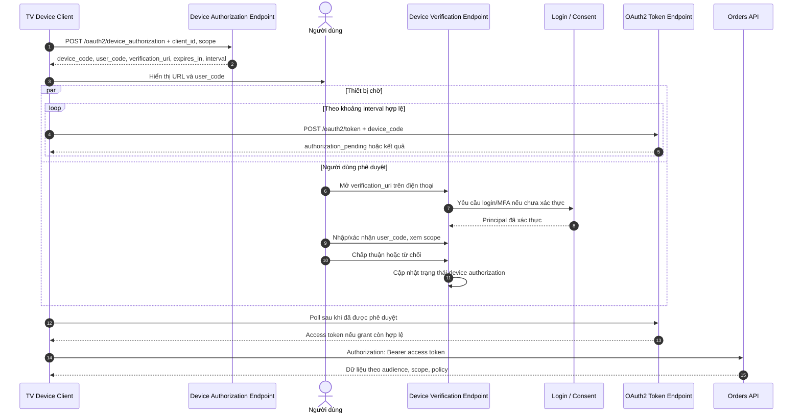
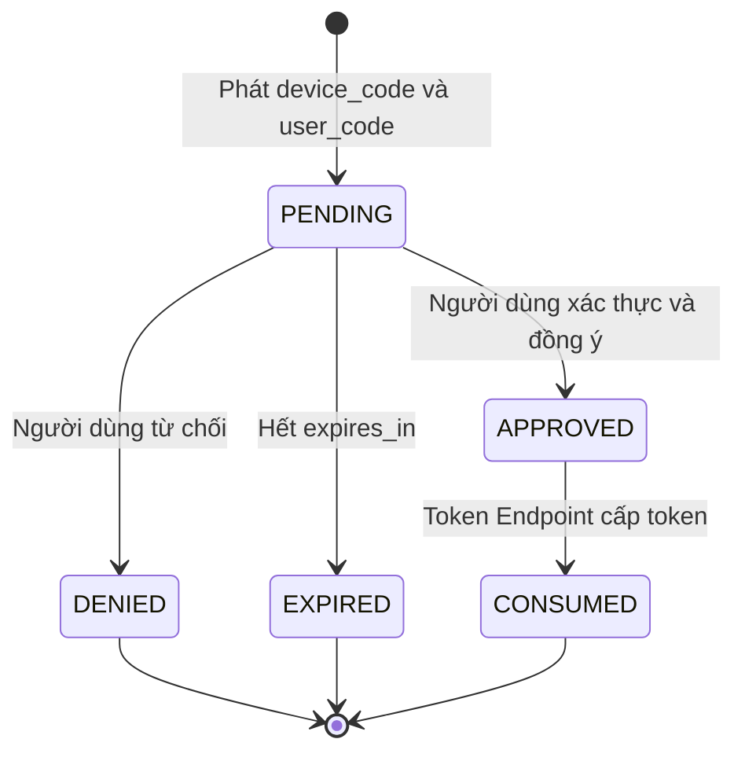

# Bật Device Authorization Endpoint và Device Verification Endpoint

Một ứng dụng chạy trên TV, máy in, đầu phát đa phương tiện hoặc thiết bị IoT thường **không có trình duyệt hay bàn phím thuận tiện** để người dùng đăng nhập. Yêu cầu họ nhập tên đăng nhập, mật khẩu và MFA bằng điều khiển từ xa vừa khó sử dụng vừa tăng rủi ro lộ thông tin xác thực. **OAuth 2.0 Device Authorization Grant (RFC 8628)** giải quyết bài toán này bằng cách tách thiết bị cần nhận quyền khỏi thiết bị mà người dùng sử dụng để đăng nhập.

Với **Spring Authorization Server** trong ứng dụng **Spring Boot**, hai endpoint trung tâm của luồng này là:

- **Device Authorization Endpoint** — mặc định `POST /oauth2/device_authorization`: thiết bị xin một `device_code`, một `user_code` và địa chỉ để người dùng mở trên điện thoại/máy tính.
- **Device Verification Endpoint** — mặc định `/oauth2/device_verification`: người dùng truy cập qua trình duyệt trên thiết bị khác, nhập hoặc xác nhận `user_code`, đăng nhập và quyết định cấp hay từ chối quyền.

Sau đó thiết bị liên tục kiểm tra kết quả qua **Token Endpoint** `POST /oauth2/token` với grant `urn:ietf:params:oauth:grant-type:device_code`. Việc **bật và kết nối đúng cả hai endpoint** là cơ sở để hoàn tất luồng thiết bị; chỉ khai báo một đường dẫn không đủ để tạo trải nghiệm đăng nhập hoặc cấp token an toàn.

Bài thuộc chương **Device Authorization** trong mô-đun **SPRING_SECURITY_OAUTH2_OIDC_AUTHORIZATION_SERVER**, phục vụ lộ trình học thiết kế, cấu hình, bảo mật, kiểm thử và vận hành OAuth 2.0/OpenID Connect Authorization Server bằng Spring Security và Spring Authorization Server trong Spring Boot. Trọng tâm là cấu hình endpoint giao thức, phân chia trách nhiệm giữa thiết bị và trình duyệt, kiểm thử và triển khai an toàn.

> **Điểm cốt lõi:** Device Authorization Endpoint cấp **mã chờ xác nhận**, Device Verification Endpoint xử lý **tương tác của người dùng**, còn Token Endpoint chỉ cấp access token **sau khi được phê duyệt** và mọi điều kiện giao thức hợp lệ.

## 1. Vì sao cần Device Authorization Grant?

Giả sử một ứng dụng `living-room-tv` cần xem danh sách đơn hàng của nhân viên thông qua Orders API. TV có màn hình lớn nhưng chỉ có điều khiển từ xa. Một nhân viên có thể mở điện thoại, truy cập `https://login.example.com/oauth2/device_verification`, đăng nhập bằng MFA và nhập mã ngắn đang hiển thị trên TV.

| Thành phần | Ví dụ | Trách nhiệm |
|---|---|---|
| **Device Client** | Ứng dụng trên TV | Xin mã, hiển thị hướng dẫn, poll Token Endpoint, lưu access token |
| **Authorization Server** | `login.example.com` | Đăng ký client, phát `device_code`/`user_code`, xác thực người dùng và xử lý cấp quyền |
| **Secondary Device** | Điện thoại/máy tính người dùng | Có trình duyệt đầy đủ để đăng nhập/MFA và xác nhận mã |
| **Resource Owner** | Nhân viên | Quyết định có cấp quyền cho ứng dụng TV không |
| **Resource Server** | Orders API | Xác minh access token và kiểm tra scope/audience/quyền nghiệp vụ |

Thiết bị TV **không nhận mật khẩu** của nhân viên. Người dùng đăng nhập **trực tiếp với Authorization Server** trên thiết bị phụ, không vào một trang do TV tự dựng rồi chuyển mật khẩu tới máy chủ.

### 1.1. So sánh với Authorization Code + PKCE

| Câu hỏi | Authorization Code + PKCE | Device Authorization Grant |
|---|---|---|
| Client có trình duyệt/callback thuận tiện? | Thường có | Thường không |
| Người dùng đăng nhập ở đâu? | Trình duyệt theo redirect của client | Trình duyệt trên thiết bị phụ |
| Client nhận mã gì trước token? | Authorization code qua callback | `device_code` từ Device Authorization Endpoint |
| Có `redirect_uri` callback tới thiết bị? | Có, theo registration | Không phải bước trung tâm của Device Flow |
| Bước chờ cấp quyền | Theo redirect/login/consent | Thiết bị poll Token Endpoint |
| Ràng buộc bảo mật đặc thù | `state`, PKCE, redirect URI | `device_code`, `user_code`, TTL, polling, user confirmation |

Không dùng Device Flow chỉ để tránh triển khai redirect hoặc PKCE cho ứng dụng có trình duyệt bình thường. RFC 8628 hướng tới **thiết bị có khả năng nhập liệu và duyệt web hạn chế**. Khi ứng dụng web hoặc mobile có trình duyệt, Authorization Code + PKCE thường là lựa chọn phù hợp hơn.

## 2. Ba endpoint phối hợp trong một giao dịch



Sơ đồ mang tính khái niệm: có thể có nhiều lần polling **trước và sau** khi người dùng tương tác. Thiết bị phụ không gửi access token trở lại TV qua trình duyệt; Authorization Server lưu trạng thái authorization để Token Endpoint xử lý khi TV hỏi.

### 2.1. Ba loại mã không được nhầm

| Giá trị | Bên nhận hoặc hiển thị | Mục đích | Có phải access token? |
|---|---|---|---|
| `device_code` | **Chỉ device client** giữ để poll | Khóa đại diện cho giao dịch chờ cấp quyền | Không |
| `user_code` | Người dùng thấy trên TV, nhập/xác nhận ở website | Liên kết người dùng với giao dịch cụ thể | Không |
| `access_token` | Device client nhận **sau khi được duyệt** | Gọi Resource Server | Có |

`device_code` phải đủ ngẫu nhiên và khó đoán. `user_code` thường ngắn hơn để nhập được bằng tay, nên cần bảo vệ chống thử mã hàng loạt, giới hạn thời gian và tốc độ thử. Người dùng **không bao giờ cần đọc hoặc nhập `device_code`**.

### 2.2. Các trạng thái của yêu cầu thiết bị

Một vòng đời khái niệm:



Đây là **state machine giải thích giao thức**, không phải danh sách tên enum có thể sử dụng trực tiếp trong Spring Authorization Server. Không coi `PENDING` đã là quyền truy cập. Mọi trạng thái cuối cùng phải chặn cấp token trái chính sách hoặc dùng lại `device_code` khi nó đã được tiêu thụ.

## 3. Device Authorization Endpoint: xin mã cho thiết bị

### 3.1. Đường dẫn và method

Trong Spring Authorization Server 1.x, đường dẫn mặc định do `AuthorizationServerSettings` cung cấp:

```text
POST /oauth2/device_authorization
Content-Type: application/x-www-form-urlencoded
```

Request tối thiểu của **public client** có thể là:

```http
POST /oauth2/device_authorization HTTP/1.1
Host: login.example.com
Content-Type: application/x-www-form-urlencoded

client_id=living-room-tv&scope=orders.read
```

Trong đó `client_id` xác định thiết bị/client đã đăng ký; `scope` cho biết quyền muốn xin và phải nằm trong allowlist của `RegisteredClient`. Client confidential (nếu được thiết kế/đăng ký) cần thực hiện phương thức client authentication tương ứng. **Không đưa password của người dùng** vào device authorization request.

### 3.2. Phản hồi thành công theo RFC 8628

Ví dụ phản hồi minh họa:

```http
HTTP/1.1 200 OK
Content-Type: application/json
Cache-Control: no-store
Pragma: no-cache

{
  "device_code": "opaque-device-code-example",
  "user_code": "BDTX-RQPL",
  "verification_uri": "https://login.example.com/oauth2/device_verification",
  "verification_uri_complete": "https://login.example.com/oauth2/device_verification?user_code=BDTX-RQPL",
  "expires_in": 600,
  "interval": 5
}
```

Các giá trị mã/URI chỉ minh họa. `verification_uri_complete` là trường **tùy chọn theo RFC**; trong các cấu hình khác nhau, phản hồi có thể không chứa trường này. Khi triển khai thực tế phải dùng đúng giá trị server trả, không tự ghép query khi endpoint không hỗ trợ.

| Trường response | Ý nghĩa |
|---|---|
| `device_code` | Mã có entropy cao mà device client dùng để gọi Token Endpoint |
| `user_code` | Mã người dùng nhập hoặc xác nhận khi mở verification URI |
| `verification_uri` | Địa chỉ ngắn, dễ nhập cho trình duyệt của người dùng |
| `verification_uri_complete` | URI tối ưu để mở qua QR/NFC/deep link, có thể truyền sẵn mã |
| `expires_in` | Số giây giao dịch/mã còn hiệu lực kể từ khi được cấp |
| `interval` | Số giây tối thiểu giữa các lần polling khi chờ; nếu không có, client mặc định 5 giây theo RFC |

`interval` là chỉ dẫn giao thức, không phải cấu hình TTL. Nếu hết `expires_in`, thiết bị phải ngừng poll với `device_code` cũ.

### 3.3. Phải hiển thị gì trên TV?

Một giao diện phù hợp:

```text
Kết nối tài khoản với TV

1. Mở trình duyệt trên điện thoại hoặc máy tính.
2. Truy cập: https://login.example.com/oauth2/device_verification
3. Nhập mã: BDTX-RQPL
4. Kiểm tra tên ứng dụng và quyền được yêu cầu trước khi đồng ý.

Mã chỉ có hiệu lực trong thời gian giới hạn.
```

Có thể dùng QR từ `verification_uri_complete` **nếu được cung cấp**. Tuy nhiên, vẫn nên hiển thị **`user_code` rõ ràng** để người dùng so với mã trên trang xác nhận, hạn chế một số dạng tấn công chuyển hướng hoặc lừa xác nhận thiết bị khác.

### 3.4. Các trường hợp Device Authorization Endpoint phải từ chối

- `client_id` không tồn tại hoặc không được đăng ký sử dụng Device Authorization Grant.
- Phương thức client authentication không đúng loại client.
- `scope` không được đăng ký hoặc vượt quyền được phép.
- Request sai method/content type/tham số.
- Thao tác bị policy chặn (client disabled, quá hạn đăng ký, quota hoặc biện pháp chống lạm dụng).

Phản hồi lỗi phải theo OAuth2, không cấp `device_code` khi request không được phép. Không biến một endpoint công khai cho public client thành nơi có thể tạo vô hạn mã chờ mà không có rate limit và vận hành phù hợp.

## 4. Device Verification Endpoint: người dùng xác nhận trên thiết bị khác

### 4.1. Vai trò của endpoint

`/oauth2/device_verification` là địa chỉ mà người dùng mở trên **thiết bị phụ có trình duyệt**. Hành vi logic thường gồm:

1. Người dùng đến `verification_uri` được TV hiển thị.
2. Nếu chưa đăng nhập vào Authorization Server, người dùng xác thực tại trang login (và MFA nếu có).
3. Người dùng nhập hoặc kiểm tra `user_code` đang thấy trên TV.
4. Authorization Server tìm giao dịch device authorization đang chờ tương ứng, kiểm tra còn hạn và chưa được duyệt/từ chối trước đó.
5. Trang xác nhận trình bày **client nào** yêu cầu và **những scope nào** cần được đồng ý.
6. Người dùng chọn **chấp thuận** hoặc **từ chối**.
7. Máy chủ ghi quyết định vào authorization state; không đưa token lên trang browser này để truyền sang TV.

**Bật filter xử lý endpoint** không tự chứng minh bạn đã có giao diện nhập mã, trang consent và thông báo thành công phù hợp sản phẩm. Trong cấu hình thực, cần kiểm tra UX mặc định của phiên bản Spring Authorization Server và cung cấp trang/handler tùy chỉnh nếu cần.

### 4.2. Các loại request khác nhau

- **Device Authorization Endpoint:** request từ **TV** tới `/oauth2/device_authorization`.
- **Device Verification Endpoint:** request từ **trình duyệt của người dùng** tới `/oauth2/device_verification`, có thể bao gồm màn hình nhập mã, xác nhận và submission tùy configuration.
- **Token Endpoint:** request từ **TV** tới `/oauth2/token` để poll.

Không để TV tự submit thay sự đồng ý của người dùng. Nếu user code có trong URL hoàn chỉnh, giao diện xác minh vẫn phải hiển thị đủ thông tin để người dùng kiểm tra và quyết định rõ ràng.

### 4.3. Consent là quyền, không phải xác thực người dùng

Người dùng đã đăng nhập vào Authorization Server không có nghĩa TV tự động được phép đọc Orders API. Còn một quyết định ủy quyền cho **client** và các **scope** được yêu cầu. Với `ClientSettings.requireAuthorizationConsent(true)`, Server có thể hiển thị consent page trong luồng device verification.

Ngược lại, nếu người dùng từ chối, thiết bị không được phát access token. Token Endpoint cần phản hồi lỗi `access_denied` hoặc tương đương theo giao thức khi thiết bị poll.

### 4.4. Giảm nguy cơ phishing của Device Flow

Kẻ tấn công có thể mở một device authorization session của **thiết bị của chúng**, rồi gửi user code hoặc QR lừa người dùng chấp thuận. Vì vậy, trang verification cần:

- Hiển thị tên ứng dụng/client đáng tin từ **RegisteredClient**, không từ tham số client tự gửi;
- Cho người dùng đối chiếu **user_code** trên trang với mã hiện trên TV;
- Hiển thị scope bằng ngôn ngữ dễ hiểu và chủ thể/tài khoản đang phê duyệt;
- Yêu cầu thao tác xác nhận chủ động, không tự phê duyệt chỉ vì `user_code` được truyền trong URI;
- Giới hạn số lần nhập sai, chống brute force và ghi nhận audit an toàn;
- Không công bố trạng thái user/device chi tiết cho người chưa được phép.

## 5. Spring Authorization Server đã hỗ trợ hai endpoint ở đâu?

Từ dòng Spring Authorization Server **1.1**, hai configurer hỗ trợ Device Authorization Grant:

- `OAuth2DeviceAuthorizationEndpointConfigurer` tạo cấu hình `OAuth2DeviceAuthorizationEndpointFilter`.
- `OAuth2DeviceVerificationEndpointConfigurer` tạo cấu hình `OAuth2DeviceVerificationEndpointFilter`.

Trong cấu hình Authorization Server mặc định của dòng 1.5.x, **hai endpoint nằm trong danh sách endpoint giao thức được cấu hình**. Do đó, “bật” trong bài này có nghĩa bảo đảm Authorization Server configurer đang được áp dụng, đúng endpoint URL, có client đăng ký `DEVICE_CODE`, có luồng xác thực người dùng/verification và các service liên quan. Gọi các method `deviceAuthorizationEndpoint(...)` và `deviceVerificationEndpoint(...)` chủ yếu dùng để **tùy chỉnh**; không phải hai công tắc bắt buộc phải gọi nếu giữ cấu hình mặc định.

### 5.1. Bean SecurityFilterChain minh họa

Ví dụ dựa trên API thông dụng của Spring Boot 3.x, Spring Security 6.x và Spring Authorization Server 1.x hỗ trợ `HttpSecurity.with(...)`:

```java
package example.authserver.config;

import org.springframework.context.annotation.Bean;
import org.springframework.context.annotation.Configuration;
import org.springframework.core.annotation.Order;
import org.springframework.http.MediaType;
import org.springframework.security.config.Customizer;
import org.springframework.security.config.annotation.web.builders.HttpSecurity;
import org.springframework.security.oauth2.server.authorization.config.annotation.web.configurers.OAuth2AuthorizationServerConfigurer;
import org.springframework.security.web.SecurityFilterChain;
import org.springframework.security.web.authentication.LoginUrlAuthenticationEntryPoint;
import org.springframework.security.web.util.matcher.MediaTypeRequestMatcher;

@Configuration(proxyBeanMethods = false)
public class AuthorizationServerChains {

    @Bean
    @Order(1)
    SecurityFilterChain protocolSecurityFilterChain(HttpSecurity http)
            throws Exception {

        OAuth2AuthorizationServerConfigurer as =
                OAuth2AuthorizationServerConfigurer.authorizationServer();

        http
            .securityMatcher(as.getEndpointsMatcher())
            .with(as, server -> server
                // Cấu hình tường minh để làm rõ hai endpoint;
                // nếu không tùy biến, bản mặc định đã hỗ trợ chúng.
                .deviceAuthorizationEndpoint(Customizer.withDefaults())
                .deviceVerificationEndpoint(Customizer.withDefaults()))
            .authorizeHttpRequests(authorize -> authorize
                .anyRequest().authenticated())
            .exceptionHandling(exceptions -> exceptions
                .defaultAuthenticationEntryPointFor(
                    new LoginUrlAuthenticationEntryPoint("/login"),
                    new MediaTypeRequestMatcher(MediaType.TEXT_HTML)));

        return http.build();
    }

    @Bean
    @Order(2)
    SecurityFilterChain loginSecurityFilterChain(HttpSecurity http)
            throws Exception {
        http
            .authorizeHttpRequests(authorize -> authorize
                .anyRequest().authenticated())
            .formLogin(Customizer.withDefaults());

        return http.build();
    }
}
```

Đây là **cấu hình khung**, không phải ứng dụng Authorization Server chạy độc lập. Phải bổ sung `RegisteredClientRepository`, `OAuth2AuthorizationService`, `OAuth2AuthorizationConsentService`, xác thực người dùng, `AuthorizationServerSettings`, nguồn khóa/token generator khi phát JWT hoặc OIDC token và những cấu hình ứng dụng khác.

### 5.2. Vì sao chain giao thức và chain login cần tách?

`FilterChainProxy` xét `SecurityFilterChain` theo `@Order`, chọn **chain đầu tiên có matcher khớp**. Các endpoint giao thức thuộc matcher của Authorization Server; `/login` thường thuộc chain ứng dụng. Khi người dùng mở `/oauth2/device_verification` mà chưa đăng nhập, server có thể redirect tới `/login`, sau đó tiếp tục bước verification qua HTTP request mới.

Không dùng `securityMatcher("/oauth2/**")` thay `as.getEndpointsMatcher()` cho toàn bộ giao thức, vì các endpoint OIDC/metadata có thể nằm ngoài pattern này. Không áp dụng redirect HTML login một cách mù quáng lên device authorization hoặc token endpoint phục vụ machine client. Các handler giao thức cần trả JSON/error theo OAuth2 khi phù hợp.

### 5.3. Một số API tùy chỉnh của hai configurer

Tài liệu Spring Authorization Server cung cấp extension points để thêm/thay:

| Configurer | Khả năng tùy chỉnh | Khi nào cần |
|---|---|---|
| `deviceAuthorizationEndpoint(...)` | Request converter, authentication provider, success/error response handler | Chính sách request đặc thù, audit, bảo vệ bổ sung |
| `deviceAuthorizationEndpoint(...verificationUri(...))` | `verification_uri` thông báo cho thiết bị | Trang xác minh riêng có URL phù hợp |
| `deviceVerificationEndpoint(...)` | Request converter, authentication provider, success/error response handler | UI/validation/flow xác nhận đặc thù |
| `deviceVerificationEndpoint(...consentPage(...))` | Địa chỉ trang consent riêng | Cần giao diện thương hiệu và giải thích scope |

Tùy biến converter/provider là điểm mở rộng mạnh; thay thế không đúng có thể bỏ qua xác minh user code, client binding, expiry, consent hoặc CSRF. Chỉ thay phần cần thiết, giữ cơ chế validation mặc định khi có thể và bổ sung integration test cho mọi custom path.

## 6. AuthorizationServerSettings: URL giao thức và URL người dùng nhìn thấy

### 6.1. Giữ đường dẫn mặc định

Có thể khai báo issuer và xác định rõ endpoint settings:

```java
import org.springframework.context.annotation.Bean;
import org.springframework.security.oauth2.server.authorization.settings.AuthorizationServerSettings;

@Bean
AuthorizationServerSettings authorizationServerSettings() {
    return AuthorizationServerSettings.builder()
        .issuer("https://login.example.com")
        .deviceAuthorizationEndpoint("/oauth2/device_authorization")
        .deviceVerificationEndpoint("/oauth2/device_verification")
        .tokenEndpoint("/oauth2/token")
        .build();
}
```

Các đường dẫn trên là **giá trị mặc định** của dòng Spring Authorization Server 1.x. Việc khai báo tường minh giúp minh họa nhưng không phải điều kiện duy nhất để endpoint tồn tại. Issuer phải phản ánh địa chỉ public HTTPS thực tế; cần cấu hình forwarded headers theo proxy tin cậy nếu ứng dụng đứng sau ingress/load balancer.

### 6.2. Nếu đổi đường dẫn endpoint

Ví dụ tổ chức muốn dùng prefix `/oauth2/v1`:

```java
@Bean
AuthorizationServerSettings authorizationServerSettings() {
    return AuthorizationServerSettings.builder()
        .issuer("https://login.example.com")
        .deviceAuthorizationEndpoint("/oauth2/v1/device_authorization")
        .deviceVerificationEndpoint("/oauth2/v1/device_verification")
        .tokenEndpoint("/oauth2/v1/token")
        .build();
}
```

Đây là **phương án thay thế** bean ở mục trước, không đăng ký cả hai bean trong cùng context. Đồng thời cần đối chiếu URI mà Device Authorization Endpoint trả cho thiết bị qua `verification_uri`, đặc biệt khi đã gọi `verificationUri(...)` để tùy biến. Các đường dẫn giao thức, UI verification và metadata/discovery (nếu sử dụng) phải thống nhất.

Không “sửa lỗi URL” bằng cách mở mọi host/đường dẫn hoặc tin `X-Forwarded-*` đến trực tiếp từ Internet. Chỉ nhận forwarded headers từ reverse proxy đáng tin.

### 6.3. Cấu hình verificationUri cho trang riêng

Khi thực sự có trang xác minh riêng, có thể tùy chỉnh trong protocol chain:

```java
.with(as, server -> server
    .deviceAuthorizationEndpoint(device -> device
        .verificationUri(
            "https://login.example.com/oauth2/v1/device_verification"))
    .deviceVerificationEndpoint(Customizer.withDefaults()))
```

Đoạn trên chỉ minh họa phần `.with(...)` cần **thay thế** trong chain ở mục 5, không khai báo chain mới. Để có đường dẫn `/oauth2/v1/device_verification`, cần cấu hình `AuthorizationServerSettings.deviceVerificationEndpoint(...)` tương ứng hoặc routing UI nhất quán, đồng thời xác minh endpoint thật sự có thể được mở từ thiết bị phụ.

**Lưu ý:** `verification_uri` trong phản hồi được người dùng mở trên browser, vì vậy không trỏ tới token endpoint, API nội bộ hoặc địa chỉ chỉ pod trong cluster truy cập được.

## 7. RegisteredClient phải cho phép DEVICE_CODE

Hai endpoint đúng đường dẫn vẫn không giúp một client lấy token nếu `RegisteredClient` chưa cho phép Device Authorization Grant.

Ví dụ **public device client** mang tên `living-room-tv`:

```java
package example.authserver.config;

import java.time.Duration;

import org.springframework.context.annotation.Bean;
import org.springframework.context.annotation.Configuration;
import org.springframework.security.oauth2.core.AuthorizationGrantType;
import org.springframework.security.oauth2.core.ClientAuthenticationMethod;
import org.springframework.security.oauth2.server.authorization.client.InMemoryRegisteredClientRepository;
import org.springframework.security.oauth2.server.authorization.client.RegisteredClient;
import org.springframework.security.oauth2.server.authorization.client.RegisteredClientRepository;
import org.springframework.security.oauth2.server.authorization.settings.ClientSettings;
import org.springframework.security.oauth2.server.authorization.settings.TokenSettings;

@Configuration(proxyBeanMethods = false)
public class DeviceClientRegistration {

    @Bean
    RegisteredClientRepository registeredClientRepository() {
        RegisteredClient tv = RegisteredClient
            .withId("living-room-tv-registration")
            .clientId("living-room-tv")
            .clientName("Living Room TV")
            .clientAuthenticationMethod(ClientAuthenticationMethod.NONE)
            .authorizationGrantType(AuthorizationGrantType.DEVICE_CODE)
            .scope("orders.read")
            .clientSettings(ClientSettings.builder()
                .requireAuthorizationConsent(true)
                .build())
            .tokenSettings(TokenSettings.builder()
                .deviceCodeTimeToLive(Duration.ofMinutes(10))
                .accessTokenTimeToLive(Duration.ofMinutes(5))
                .build())
            .build();

        return new InMemoryRegisteredClientRepository(tv);
    }
}
```

**Giải thích cấu hình:**

1. `ClientAuthenticationMethod.NONE`: một TV app phân phối đến thiết bị người dùng thường không thể bảo vệ client secret đáng tin; theo RFC, public device client tự định danh bằng `client_id`.
2. `AuthorizationGrantType.DEVICE_CODE`: cho phép grant `urn:ietf:params:oauth:grant-type:device_code`, khác `AUTHORIZATION_CODE` và `CLIENT_CREDENTIALS`.
3. `scope("orders.read")`: giới hạn scope mà thiết bị được phép xin; API vẫn phải kiểm tra quyền theo user/tenant.
4. `requireAuthorizationConsent(true)`: yêu cầu consent tương ứng policy và flow có người dùng.
5. `deviceCodeTimeToLive(Duration.ofMinutes(10))`: đặt TTL cho **device code**, không phải access token hoặc phiên người dùng.
6. `accessTokenTimeToLive(Duration.ofMinutes(5))`: minh họa TTL của access token được phát **sau phê duyệt**.

Các TTL 10/5 phút chỉ để minh họa, cần điều chỉnh theo UX nhập mã, rủi ro và tải polling. `InMemoryRegisteredClientRepository` phù hợp test; production cần nguồn client registration ổn định/bền vững. Không tạo registered client ID mới sau mỗi restart khi consent/authorization store có dữ liệu tham chiếu.

### 7.1. Confidential device client có được không?

RFC 8628 hỗ trợ cả confidential client nếu thiết bị/hạ tầng **thực sự** giữ credential an toàn. Khi đó client phải xác thực theo phương thức đã đăng ký tại các endpoint tương ứng. Tuy nhiên, phần mềm phân phối rộng tới TV/thiết bị không do nhà vận hành kiểm soát thường phải được coi là **public**, dù developer có thể nhúng một secret vào firmware.

Không dùng chung một `client_id`/credential cho mọi loại ứng dụng có khả năng giữ bí mật khác nhau. Nếu có appliance quản lý bằng chứng chỉ phần cứng, đánh giá riêng mô hình đăng ký, vòng đời khóa và sender-constrained authentication.

### 7.2. Device code không phải refresh token

`deviceCodeTimeToLive` kiểm soát cửa sổ chờ **người dùng chấp thuận**. Sau khi device code được đổi thành access token, token mới có `accessTokenTimeToLive` riêng. Refresh token (nếu server cấp theo loại client/flow/chính sách tương ứng) có cấu hình và vòng đời khác.

Không suy ra một thiết bị được cấp device code 10 phút thì access token của nó cũng 10 phút, hay rằng một device code có thể được dùng lại như refresh token.

## 8. Device Verification UI: xác thực, nhập mã và consent

### 8.1. Tách rõ protocol handler và giao diện

`OAuth2DeviceVerificationEndpointFilter` xử lý các request xác minh mã và consent. Tuy nhiên, để hoàn thiện trải nghiệm, cần bảo đảm người dùng thực sự thấy trang nhập mã và trang xác nhận quyền. Nếu dùng custom page, ứng dụng phải có controller/template/handler cho route được chỉ định — chỉ gọi `.consentPage("/device/consent")` **không tự sinh HTML**.

Hành trình giao diện gợi ý:

```text
Trang 1: Nhập hoặc xác nhận mã
  "Nhập mã từ thiết bị của bạn"
  [ BDTX-RQPL ] [ Tiếp tục ]

Nếu chưa đăng nhập:
  Chuyển đến trang login của Authorization Server

Trang 2: Xác nhận cấp quyền
  Ứng dụng: Living Room TV
  Yêu cầu: Xem các đơn hàng được phép
  Mã trên thiết bị: BDTX-RQPL
  [ Cho phép ] [ Từ chối ]

Trang 3: Hoàn tất
  "Bạn có thể trở lại TV."
```

Đây là **đề xuất UX**, không phải cam kết rằng framework tạo sẵn đúng ba trang với các nhãn trên.

### 8.2. Consent page custom có contract cần tuân thủ

Trong API của `OAuth2DeviceVerificationEndpointConfigurer`, nếu custom consent page được cấu hình, Spring Authorization Server truyền ngữ cảnh như `client_id`, `scope`, `state` và `user_code` tới trang đó. Form consent cần gửi dữ liệu theo **contract của phiên bản framework** về Device Verification Endpoint, thường là HTTP POST với `client_id`, `state`, danh sách `scope` được chấp thuận và `user_code`.

Một fragment minh họa các trường **khái niệm** (không phải bản copy chạy ngay trong production):

```html
<form method="post" action="/oauth2/device_verification">
  <!-- client_id, state, user_code lấy từ authorization context đã xác minh -->
  <input type="hidden" name="client_id" value="living-room-tv">
  <input type="hidden" name="state" value="OPAQUE_STATE_FROM_SERVER">
  <input type="hidden" name="user_code" value="BDTX-RQPL">

  <label>
    <input type="checkbox" name="scope" value="orders.read">
    Cho phép xem đơn hàng
  </label>

  <!-- Nếu CSRF protection áp dụng, gửi token theo cấu hình hiện tại. -->
  <button type="submit">Cho phép</button>
</form>
```

**Không dùng các giá trị tĩnh này làm mẫu triển khai trực tiếp.** Trang thực phải lấy authorization context đã được xác minh, escape mọi giá trị hiển thị, có CSRF/correlation protection thích hợp, xử lý từ chối rõ ràng và tuân theo tên trường/method chính xác của Spring Authorization Server đang dùng. Không tạo endpoint riêng tự gọi `OAuth2AuthorizationConsentService.save(...)` dựa chỉ trên dữ liệu form mà bỏ kiểm tra client, user code, requested scopes hoặc session.

### 8.3. Phân biệt trạng thái đăng nhập với trạng thái phê duyệt

Người dùng đã có session ở `login.example.com` không có nghĩa yêu cầu device code được duyệt. Verification Endpoint cần xác định **người dùng nào**, **thiết bị/client nào**, **mã nào** và **những scope nào**, rồi yêu cầu sự chấp thuận theo policy. Không tự động approve mọi mã chỉ vì trình duyệt đã đăng nhập.

### 8.4. Vấn đề nhập sai mã

Khi người dùng nhập một `user_code` không tồn tại, sai hoặc hết hạn:

- Không được xác nhận/duyệt một giao dịch khác.
- Hiển thị lỗi rõ nhưng không tiết lộ chi tiết có thể giúp kẻ tấn công liệt kê mã còn hợp lệ.
- Áp dụng rate limiting, hạn chế thử mã và khả năng khóa/chặn tạm theo chính sách.
- Hướng dẫn người dùng lấy lại mã mới trên thiết bị khi giao dịch đã hết hạn.
- Không tự kéo dài TTL cũ chỉ vì người dùng thử nhập nhiều lần.

## 9. Token Endpoint và polling: phần không thể thiếu của việc bật Device Flow

### 9.1. Token request với device_code

TV gọi Token Endpoint theo `interval` của Device Authorization Response:

```http
POST /oauth2/token HTTP/1.1
Host: login.example.com
Content-Type: application/x-www-form-urlencoded

grant_type=urn%3Aietf%3Aparams%3Aoauth%3Agrant-type%3Adevice_code&device_code=opaque-device-code-example&client_id=living-room-tv
```

Đối với public client dùng `none`, `client_id` giúp server định danh client. Với confidential client, phải dùng client authentication method phù hợp; không đưa người dùng nhập password vào token request.

### 9.2. Các lỗi trả khi đang chờ

| Mã lỗi | Ý nghĩa | Thiết bị nên làm gì? |
|---|---|---|
| `authorization_pending` | Người dùng chưa hoàn thành tương tác/phê duyệt | Chờ đủ khoảng polling rồi thử tiếp |
| `slow_down` | Polling quá nhanh/cần giảm tải | **Tăng interval ít nhất 5 giây** cho lần sau theo RFC |
| `access_denied` | Người dùng đã từ chối cấp quyền | **Dừng polling**, thông báo kết quả |
| `expired_token` | Device code hết hạn | **Dừng polling**; tạo giao dịch mới khi có hành động người dùng |
| `invalid_client` hoặc `invalid_grant` (khi áp dụng) | Client authentication hoặc device code/grant không hợp lệ | Dừng và xử lý cấu hình/authorization; không retry vô hạn |

Theo RFC 8628, nếu response ban đầu không có `interval`, client dùng mặc định **5 giây**. Khi nhận `slow_down` phải cộng thêm **5 giây** vào interval cho các lần polling tiếp theo. Khi timeout kết nối, client phải giảm tần suất và nên dùng backoff; không vòng lặp gửi ngay liên tục.

### 9.3. Pseudocode polling đúng nhịp

```javascript
// Pseudocode: deviceClientPoll() là hàm HTTP thật cần tự triển khai.
// response.expires_in và response.interval đến từ device authorization.
async function pollDeviceGrant(response, deviceClientPoll) {
  const endAt = Date.now() + response.expires_in * 1000;
  let intervalSeconds = response.interval ?? 5;

  while (Date.now() < endAt) {
    await sleep(intervalSeconds * 1000); // Hàm sleep do ứng dụng cung cấp.

    try {
      const result = await deviceClientPoll(response.device_code);

      if (result.access_token) {
        return result;
      }

      if (result.error === "authorization_pending") {
        continue;
      }

      if (result.error === "slow_down") {
        intervalSeconds += 5;
        continue;
      }

      // access_denied, expired_token hoặc lỗi không thể tiếp tục:
      throw new Error("Device authorization failed: " + result.error);
    } catch (error) {
      // Trong mã thật cần PHÂN BIỆT lỗi OAuth đã được xử lý ở trên
      // với timeout mạng, lỗi HTTP và cancel; timeout phải backoff.
      throw error;
    }
  }

  throw new Error("Device code expired");
}
```

Đoạn này là **pseudocode minh họa logic interval và các trạng thái**, không phải thư viện polling đầy đủ. Một client production cần xử lý backoff khi timeout, khả năng hủy, clock skew, parsing lỗi HTTP và việc ngừng poll khi người dùng thoát màn hình kết nối. Không tự tái tạo hàng loạt device authorization request khi mã hết hạn.

### 9.4. Thành công sau khi người dùng đồng ý

Token Endpoint có thể trả dữ liệu tương tự:

```json
{
  "access_token": "<example-access-token>",
  "token_type": "Bearer",
  "expires_in": 300,
  "scope": "orders.read"
}
```

Refresh token và ID token **không được giả định luôn xuất hiện**: chúng phụ thuộc loại client, grant và chính sách của phiên bản Server. Khi TV nhận access token, phải giữ an toàn và gọi đúng Resource Server; Orders API kiểm tra issuer, chữ ký/trạng thái, audience, TTL, scope và quyền người dùng trên từng tài nguyên.

## 10. Bảo mật đặc thù của Device Authorization Flow

### 10.1. User code phải chống brute force

`user_code` thường dễ gõ nên entropy thấp hơn `device_code`. Authorization Server cần giới hạn thử mã, áp dụng expiry ngắn và phát hiện số lần sai bất thường. Không sử dụng `user_code` cố định cho cùng thiết bị hoặc tạo mã theo số thứ tự dễ dự đoán. Nếu mã hết hạn, phải phát giao dịch mới thay vì hồi sinh mã cũ.

### 10.2. Phishing và “đăng nhập giúp tôi”

Một kẻ tấn công có thể khởi tạo Device Flow cho client của hắn và yêu cầu nạn nhân nhập mã. Người dùng có thể tưởng đang giúp kết nối TV của mình, trong khi thực tế đang cấp quyền cho thiết bị khác.

Biện pháp giảm thiểu:

- Người dùng phải **tự nhìn mã trên thiết bị đang muốn kết nối** và so sánh với mã hiển thị trên trang verification.
- Trang xác nhận cho biết rõ client và scope, không chỉ nút “Tiếp tục”.
- Không tự approve khi mở QR hoặc `verification_uri_complete`.
- Dùng MFA, cảnh báo và tín hiệu rủi ro theo chính sách.
- Tài liệu hướng dẫn nhấn mạnh không nhập mã do người lạ gửi.

### 10.3. Client ID public và quyền scope

`ClientAuthenticationMethod.NONE` phù hợp khi client không thể giữ secret. Nhưng `client_id` công khai nên không thể bảo đảm mọi request thực sự đến từ một chiếc TV thuộc tổ chức. Kiểm soát scope, thời hạn token, các chính sách user/device và các biện pháp bổ sung phù hợp threat model.

Consent cho `orders.read` không có nghĩa TV đọc được mọi đơn hàng; Resource Server phải thực hiện object-level/tenant authorization.

### 10.4. CSRF, cookie và bảo vệ giao diện người dùng

Device Authorization Endpoint và Token Endpoint là machine-to-machine protocol endpoints; Device Verification Endpoint có tương tác trình duyệt và thường dựa trên phiên login. Khi tùy chỉnh form verification/consent, phải xác định đúng chính sách CSRF và session của chain hiện tại. Không tắt CSRF toàn ứng dụng để “sửa” lỗi một form nhập user code.

Bảo vệ XSS, encode/escape tên client, scope và user code khi render. Không phản chiếu query chưa kiểm tra vào HTML; không đặt access token vào trang verification.

### 10.5. Giới hạn polling để bảo vệ hệ thống

Nếu có 50.000 TV đang chờ và mỗi TV poll mỗi giây, Token Endpoint phải nhận 50.000 request/s chưa tính lưu lượng khác. `interval`, `slow_down`, backoff, rate limit theo client/device và quan sát tải là yếu tố vận hành quan trọng.

Không để server cấp token sau khi device code hết hạn hoặc đã được tiêu thụ dù client poll liên tục. Polling ở nhiều node cần trạng thái authorization nhất quán để tránh phản hồi khác nhau.

## 11. Lưu trữ trạng thái và chạy nhiều instance

`OAuth2AuthorizationService` lưu trạng thái authorization, bao gồm thông tin cấp device code và kết quả xác minh. Nếu device code được tạo ở node A nhưng người dùng mở verification page qua node B, hoặc TV poll token endpoint qua node C, các node phải truy cập **cùng trạng thái authorization thích hợp**.

| Thành phần | Điều cần bảo đảm |
|---|---|
| `RegisteredClientRepository` | Các node cùng nhận diện client và grant/scope nhất quán |
| `OAuth2AuthorizationService` | Device code, user code, expiry và trạng thái phê duyệt không phân mảnh giữa node |
| `OAuth2AuthorizationConsentService` | Quyền đã được chấp thuận có thể đọc/ghi nhất quán |
| User authentication/session | Đăng nhập trên browser device phụ hoạt động qua proxy/load balancer |
| Token signing/JWK source | Token phát từ các node có issuer và khóa ký hợp lệ, JWKS nhất quán |
| `AuthorizationServerSettings` | Issuer và endpoint URLs công khai đúng, không bị khác giữa các node |

Môi trường học có thể dùng `InMemoryOAuth2AuthorizationService`; production nhiều node cần persistence chia sẻ và kiểm thử race condition. Với nhiều request verification/polling cùng lúc, phải bảo đảm device grant chỉ được chuyển sang trạng thái hợp lệ và không phát token nhiều lần trái policy.

### 11.1. Không log mã nhạy cảm

Không ghi nguyên `device_code`, access/refresh token, session cookie, client secret hoặc thông tin cá nhân vào log. `user_code` cũng cần bảo vệ vì có thể được sử dụng để liên kết và phê duyệt một giao dịch. Thay vào đó, log correlation ID, client ID, loại endpoint, loại lỗi, trạng thái tổng quát và latency theo chính sách audit.

### 11.2. Vòng đời device code và access token độc lập

`deviceCodeTimeToLive` giới hạn cửa sổ chờ user. Khi hết hạn, user code tương ứng không được tiếp tục chấp thuận. Access token mới, nếu đã được phát trước khi mã hết hạn, có TTL và policy riêng. Revocation/logout user session không mặc nhiên làm mọi access token đã phát mất hiệu lực tức thì; cần chiến lược riêng nếu tổ chức yêu cầu thu hồi tức thời.

## 12. Kiểm thử việc bật endpoint và hoàn tất giao dịch

### 12.1. Kiểm thử cấu hình endpoint

| Test case | Request hoặc tình huống | Kỳ vọng |
|---|---|---|
| Device Authorization tồn tại | `POST /oauth2/device_authorization` với client hợp lệ | JSON có `device_code`, `user_code`, `verification_uri`, `expires_in` |
| Đúng method | `GET /oauth2/device_authorization` | Không trở thành endpoint phát mã thành công |
| Client thiếu grant | Client chỉ có `client_credentials` | Không được cấp device code |
| Public client hợp lệ | `client_id` đã đăng ký `none` + `device_code` | Được xử lý theo chính sách |
| Secret sai ở confidential client | Client authentication không hợp lệ | Từ chối, không phát code |
| Scope vượt allowlist | `scope=orders.admin` chưa đăng ký | Từ chối yêu cầu |
| Custom path | Đã đổi settings sang `/oauth2/v1/...` | Request được xử lý ở path mới; response đúng verification URI |
| User Verification | Browser mở `verification_uri` | Dẫn tới luồng nhập/kiểm tra user code và login phù hợp |
| Không có session | User chưa đăng nhập | Yêu cầu login ở AS, không bỏ qua authentication |
| User code sai | Nhập mã không tồn tại | Không cấp quyền/token |
| User code hết hạn | Chờ vượt `expires_in` | Không thể phê duyệt code cũ |
| User code đúng | User xác thực và chấp thuận đúng client/scope | Grant chuyển sang trạng thái được duyệt |
| Người dùng từ chối | Chọn “Từ chối” | Không cấp token; polling nhận `access_denied` theo flow |
| Poll trước khi được duyệt | POST token với device code đang chờ | `authorization_pending` |
| Poll quá nhanh | Không tuân interval | `slow_down` hoặc chính sách throttle tương ứng |
| Poll sau khi duyệt | Token request hợp lệ | Access token phù hợp |
| Poll sau expiry | Device code quá hạn | `expired_token` theo giao thức |
| Dùng lại device code đã tiêu thụ | Token request lần nữa | Không cấp token vượt chính sách |
| Nhiều node | Mã phát ở A, người dùng xác minh ở B, poll ở C | Trạng thái nhất quán |
| Phishing defense | Mở URI chứa mã nhưng chưa xác nhận thủ công | Không tự approve mà không có chủ đích của user |

**Không chỉ assert status 200 tại Device Authorization Endpoint.** Test phải chứng minh hai endpoint có thể nối trạng thái với nhau và Token Endpoint chỉ cấp token sau phê duyệt.

### 12.2. Test end-to-end theo ba tác nhân

Một integration test cần mô phỏng **TV**, **trình duyệt người dùng** và **Authorization Server**:

1. Tạo `RegisteredClient` thử nghiệm với `DEVICE_CODE`, scope phù hợp và consent policy.
2. TV gửi `POST /oauth2/device_authorization` để lấy hai mã và URL.
3. TV poll lần đầu: nhận `authorization_pending`.
4. Trình duyệt mở verification URI, đăng nhập và nhập/kiểm tra user code.
5. Trình duyệt submit đồng ý (hoặc từ chối ở testcase khác), giữ session và CSRF đúng.
6. TV poll sau quyết định: thành công chỉ nếu user đã cấp quyền; nếu bị từ chối thì không có access token.
7. Kiểm tra access token ở API về issuer, audience, TTL, scope, tenant/object authorization.
8. Lặp lại với mã hết hạn, mã sai, user khác và các request song song.

`MockMvc` và `spring-security-test` hỗ trợ test filter chain và form, nhưng khi test Device Flow nên có ít nhất một bài integration test HTTP thật để xử lý cookie, session, routing, JSON, polling interval và state persistence. Mock sẵn `Authentication` có thể bỏ qua lỗi ở login/consent thực tế.

### 12.3. Curl quan sát Device Authorization Endpoint

Ví dụ public TV client:

```bash
curl --request POST "https://login.example.com/oauth2/device_authorization" \
  --header "Content-Type: application/x-www-form-urlencoded" \
  --data-urlencode "client_id=living-room-tv" \
  --data-urlencode "scope=orders.read"
```

Nếu client và endpoint được đăng ký đúng, server trả dữ liệu JSON gồm device code và user code. Đoạn demo không tự xử lý login/consent.

### 12.4. Curl poll Token Endpoint

Với `DEVICE_CODE` lấy từ response test ở trên:

```bash
curl --request POST "https://login.example.com/oauth2/token" \
  --header "Content-Type: application/x-www-form-urlencoded" \
  --data-urlencode "grant_type=urn:ietf:params:oauth:grant-type:device_code" \
  --data-urlencode "device_code=$DEVICE_CODE" \
  --data-urlencode "client_id=living-room-tv"
```

Nếu chưa có user approval, thường nhận `authorization_pending`. **Không chạy lệnh này liên tục thủ công hoặc tự động ở tần suất vượt `interval`**. Chỉ sau khi người dùng xác nhận trong browser và code chưa hết hạn mới có thể nhận token. Không đưa mã thật hay token vào log/ticket.

### 12.5. Kiểm thử denial và expiry độc lập

Tạo **device authorization request mới** cho mỗi testcase:

- Một case user chọn từ chối, xác nhận polling nhận `access_denied`.
- Một case chờ quá hạn, xác nhận `expired_token` hoặc phản hồi từ chối theo implementation.
- Một case thử user code không hợp lệ, kiểm tra không có client khác được duyệt nhầm.
- Một case mở `verification_uri_complete`, xác nhận trang vẫn yêu cầu kiểm tra/đồng ý rõ ràng.

Không dùng lại một device code của testcase đã thành công hoặc đã hết hạn để chứng minh happy path tiếp theo.

## 13. Lỗi cấu hình hay gặp và cách chẩn đoán

| Triệu chứng | Khả năng gây ra | Cách xử lý |
|---|---|---|
| `POST /oauth2/device_authorization` trả 404 | Protocol chain không được áp dụng, path đã đổi hoặc thiếu tính năng theo phiên bản | Kiểm tra `OAuth2AuthorizationServerConfigurer`, settings và route |
| Trả `invalid_client` | Client ID sai, method không khớp hoặc client chưa đăng ký | Kiểm tra `RegisteredClientRepository` và authentication method |
| Client không được tạo mã | Thiếu `AuthorizationGrantType.DEVICE_CODE` hoặc scope sai | Kiểm tra grant/scope allowlist |
| Device Authorization trả verification URI nội bộ | Sai issuer/proxy/`verificationUri` | Dùng URL public HTTPS và settings thống nhất |
| Browser mở verification URL bị 404 | Chưa triển khai giao diện/custom route hoặc endpoint sai đường dẫn | Kiểm tra verification configurer, controller và template |
| Browser bị redirect loop tới login | `SecurityFilterChain`, session hoặc saved request sai | Kiểm tra matcher/order, cookie, login success handling |
| Nhập đúng mã nhưng không duyệt được | User code hết hạn, authorization store khác node, consent sai | Kiểm tra TTL, storage chia sẻ, principal/scope |
| TV poll luôn `authorization_pending` | Chưa hoàn tất consent/approval hoặc trạng thái không đồng bộ | Kiểm tra verification UI, authorization store |
| TV nhận `slow_down` liên tục | Polling quá nhanh hoặc không tăng interval | Sửa polling logic, thêm rate limiting |
| TV nhận `expired_token` | Device code hết thời hạn | Khởi tạo flow mới khi người dùng chủ động |
| User xác nhận nhưng TV không nhận token | Cấu hình client/token grant, lưu trạng thái hoặc mạng có lỗi | Kiểm tra token endpoint và state persistence |
| Cấp quyền cho nhầm TV | User code bị đánh tráo hoặc UI thiếu xác nhận | Đối chiếu mã hiển thị, client name/scope và cảnh báo phishing |
| Sau restart toàn bộ request chờ mất hiệu lực | Dùng in-memory authorization store | Dùng kho bền vững nếu yêu cầu sản phẩm |
| Device client có access token nhưng API trả 403 | Scope/audience/tenant policy tại API | Kiểm tra Resource Server validation và quyền nghiệp vụ |

### 13.1. Không nhầm lỗi verification với lỗi token polling

**Người dùng nhập mã sai** được xử lý trong luồng verification trên browser; **TV nhận `authorization_pending` hoặc `slow_down`** lại là kết quả từ Token Endpoint khi TV chờ. Chúng không phải cùng một lỗi. Khi hỗ trợ khách hàng, cần biết mã HTTP/endpoint và tác nhân nào đang gọi để chẩn đoán đúng.

### 13.2. Đừng mở rộng quyền chỉ để test thành công

Nếu Device Authorization trả `invalid_scope`, đừng đơn giản thêm `orders.admin` vào mọi client. Xác định tính năng của thiết bị thật sự cần scope nào, đăng ký least privilege và kiểm tra consent. Nếu vì lỗi 403 ở form mà tắt CSRF toàn ứng dụng, có thể tạo lỗ hổng trên trang người dùng.

## 14. Vận hành sản phẩm nhiều thiết bị

### 14.1. Quan sát các chỉ số có ý nghĩa

Nên theo dõi:

- Số phiên device authorization được tạo theo client/môi trường;
- Tỷ lệ người dùng hoàn tất verification, từ chối và để mã hết hạn;
- Độ trễ từ phát device code đến approval;
- Polling rate, `authorization_pending` và `slow_down`;
- Tỷ lệ device code bị dùng lại hoặc thử user code sai;
- Lỗi DB/authorization store và sự khác biệt hành vi giữa node;
- Tỷ lệ token response thành công và lỗi ở Resource Server sau kết nối.

Chỉ log metadata an toàn như correlation ID, client ID, endpoint, nhóm lỗi và latency. Không log nguyên device code, user code, token, cookie hay client secret.

### 14.2. Quản lý thiết bị đã được cấp quyền

Sau khi một TV nhận access token, sản phẩm cần xác định:

- Token được lưu ở đâu trên thiết bị và bảo vệ khỏi đọc trộm như thế nào?
- Khi người dùng bán/chuyển giao TV, có cơ chế “ngắt liên kết thiết bị” và revoke token/authorization không?
- Nếu TV bị mất, người dùng có thể xem và thu hồi quyền truy cập theo thiết bị không?
- Access token có audience/scope tối thiểu không?
- Nếu cần đăng nhập lại định kỳ, điều đó được thực thi ở đâu (token TTL, authorization lifetime, revocation, device management)?

Hai endpoint Device Flow giải quyết việc **đăng nhập/ủy quyền trên thiết bị có input hạn chế**. Chúng không tự cung cấp toàn bộ nền tảng quản lý thiết bị, remote wipe hoặc vô hiệu hóa tất cả token khi bị mất.

### 14.3. Kiến trúc triển khai đa vùng/đa node

Cần đảm bảo issuer, authorization store, registered client configuration, signing keys và verification URL nhất quán. Nếu các node công bố URL khác hoặc dùng kho cục bộ khác nhau, cùng một `user_code` có thể được xác nhận ở node này nhưng device code không thể đổi token ở node khác.

Chọn TTL và polling interval dựa trên độ trễ người dùng thực tế, tải server và giới hạn bảo mật. Khi đổi endpoint path/issuer, cần kế hoạch tương thích cho TV firmware cũ và telemetry để phát hiện phiên bản thiết bị chưa cập nhật.

## 15. Câu hỏi tự đánh giá và bài tập

### 15.1. Câu hỏi

1. Tại sao Device Authorization Grant phù hợp với TV hơn Authorization Code + PKCE trong một số kiến trúc?
2. Device Authorization Endpoint và Device Verification Endpoint khác nhau về tác nhân gọi và chức năng nào?
3. `device_code` khác `user_code` ra sao? Mã nào không nên hiển thị cho người dùng?
4. `verification_uri_complete` có bắt buộc trong mọi response không? Vì sao vẫn cần hiển thị user code khi dùng QR?
5. Vì sao người dùng đã đăng nhập chưa đồng nghĩa TV đã được chấp thuận?
6. `AuthorizationGrantType.DEVICE_CODE` cần được đăng ký ở đâu?
7. `deviceCodeTimeToLive` khác `accessTokenTimeToLive` thế nào?
8. Khi Token Endpoint trả `authorization_pending`, thiết bị cần làm gì? Khi `slow_down` phải điều chỉnh khoảng polling ra sao?
9. Nếu trang verification custom bị 404, việc chỉ thêm `deviceVerificationEndpoint(Customizer.withDefaults())` có đủ giải quyết mọi trường hợp không?
10. Có những nguy cơ phishing và brute-force đặc thù nào với `user_code`?
11. Vì sao production nhiều node cần authorization store được chia sẻ nhất quán?
12. Nếu người dùng từ chối hoặc mã hết hạn, TV nên hiển thị gì và dừng polling thế nào?
13. Những điểm nào phải kiểm thử ngoài việc Device Authorization Endpoint trả 200?
14. Vì sao `ClientAuthenticationMethod.NONE` không cho phép bỏ qua scope, user verification hay API authorization?

### 15.2. Bài tập: kích hoạt kết nối TV trong Spring Boot

**Yêu cầu:** Thiết kế Central Login cho một ứng dụng TV công khai `living-room-tv`, chỉ xin `orders.read`. Người dùng nhập code trên điện thoại, có bước xem tên TV app và từ chối/đồng ý.

**Tiêu chí hoàn thành:**

1. Authorization Server dùng configurer có Device Authorization và Device Verification Endpoint, với issuer public HTTPS.
2. `RegisteredClient` cho phép `DEVICE_CODE`, `NONE` và scope `orders.read`, TTL device code có chủ đích.
3. `POST /oauth2/device_authorization` trả JSON theo RFC 8628, không yêu cầu password của user.
4. TV hiển thị verification URI và user code, không hiển thị device code.
5. Trình duyệt trên điện thoại đăng nhập, nhập/xác minh mã, nhìn thấy scope và lựa chọn rõ ràng.
6. Trước approval, token endpoint trả `authorization_pending`; sau approval, trả token; khi denied/expired, không cấp token.
7. TV tuân `interval` và `slow_down`, dừng polling khi đã kết thúc.
8. Orders API kiểm tra access token đúng issuer, audience, TTL, scope và quyền đối tượng.
9. Trường hợp user code sai/hết hạn và nhiều node đều được kiểm thử.
10. Không có credential, code hoặc token thật xuất hiện trong log hay giao diện không cần thiết.

## 16. Tài liệu tham khảo

- [RFC 8628 — OAuth 2.0 Device Authorization Grant](https://www.rfc-editor.org/rfc/rfc8628): định nghĩa các endpoint, `device_code`, `user_code`, polling, mã lỗi và biện pháp giảm nguy cơ phishing.
- [Spring Authorization Server — Configuration Model](https://docs.spring.io/spring-authorization-server/reference/configuration-model.html): các protocol endpoint mặc định, `AuthorizationServerSettings` và `OAuth2AuthorizationServerConfigurer`.
- [Spring Authorization Server — Protocol Endpoints](https://docs.spring.io/spring-authorization-server/reference/protocol-endpoints.html): extension points của `OAuth2DeviceAuthorizationEndpointConfigurer` và `OAuth2DeviceVerificationEndpointConfigurer`.
- [Spring Authorization Server — Core Model / Components](https://docs.spring.io/spring-authorization-server/reference/core-model-components.html): `RegisteredClient`, `OAuth2AuthorizationService`, `TokenSettings` và các thành phần lưu trữ.
- [Spring Authorization Server — TokenSettings.Builder API](https://docs.spring.io/spring-authorization-server/reference/api/java/org/springframework/security/oauth2/server/authorization/settings/TokenSettings.Builder.html): `deviceCodeTimeToLive` và các giới hạn TTL của token.

**Ghi nhớ:** Spring Authorization Server cung cấp **Device Authorization Endpoint** để thiết bị lấy `device_code`/`user_code`, **Device Verification Endpoint** để người dùng đăng nhập và chấp thuận trên trình duyệt khác, và **Token Endpoint** để thiết bị poll kết quả. Việc bật đúng luồng cần có protocol SecurityFilterChain, `AuthorizationServerSettings` phù hợp, `RegisteredClient` cho phép `DEVICE_CODE`, xác thực người dùng, UI xác minh/consent và authorization store nhất quán. Khi triển khai, phải bảo vệ user code khỏi brute force/phishing, tuân thủ `interval`/`slow_down`, kiểm soát TTL và kiểm thử đầy đủ cả cấp quyền lẫn từ chối.
