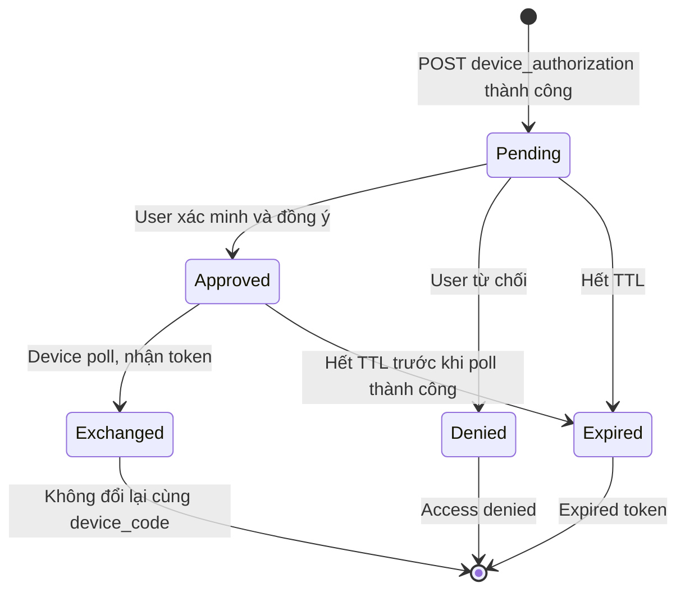

# Phát hành device_code, user_code, verification_uri và thời hạn

## 1. Mục tiêu và bối cảnh

Trong chương **Device Authorization** của module `SPRING_SECURITY_OAUTH2_OIDC_AUTHORIZATION_SERVER`, chúng ta tìm hiểu cách một **OAuth 2.0 Authorization Server phát hành dữ liệu khởi tạo Device Authorization Grant** cho thiết bị có khả năng nhập liệu hoặc trình duyệt hạn chế. Nội dung phục vụ mục tiêu học cách **thiết kế, cấu hình, bảo mật, kiểm thử và vận hành OAuth 2.0/OpenID Connect Authorization Server bằng Spring Security và Spring Authorization Server trong ứng dụng Spring Boot**.

Hãy hình dung một ứng dụng chạy trên TV, máy chơi game hoặc thiết bị đầu cuối không tiện đăng nhập trực tiếp. Thiết bị hiển thị địa chỉ xác minh cùng mã ngắn; người dùng mở địa chỉ đó trên điện thoại, đăng nhập và xác nhận cấp quyền. Trong lúc ấy, thiết bị có thể thăm dò Token Endpoint cho đến khi người dùng hoàn tất, từ chối hoặc yêu cầu hết hạn.

Device Authorization Grant được tiêu chuẩn hóa trong **RFC 8628 — OAuth 2.0 Device Authorization Grant**. Khác với Authorization Code Flow, thiết bị **không cần nhận redirect chứa Authorization Code** trên trình duyệt của chính nó. Thay vào đó, quá trình bắt đầu bằng một phản hồi chứa các giá trị đặc thù:

- `device_code`: thông tin bí mật để **thiết bị** gửi khi thăm dò Token Endpoint.
- `user_code`: mã ngắn để **người dùng** nhập tại trang xác minh trên thiết bị thứ hai.
- `verification_uri`: địa chỉ công khai mà **người dùng** mở để xác minh và phê duyệt.
- `expires_in`: số giây còn hiệu lực của cả `device_code` và `user_code` kể từ phản hồi cấp mã.
- `interval` (nếu có): số giây thiết bị tối thiểu nên chờ giữa các lần thăm dò Token Endpoint.
- `verification_uri_complete` (nếu có): URI chứa sẵn `user_code`, thuận tiện cho QR code hoặc liên kết; **không thay thế bước người dùng xác minh và đồng ý**.

Sau bài này, bạn có thể giải thích đúng vai trò từng trường, cấu hình thời hạn phát hành trong Spring Authorization Server, kiểm thử Device Authorization Endpoint và xác định các rủi ro như dò mã, lừa đảo cấp quyền, polling quá nhanh hoặc mất trạng thái giữa các node.

## 2. Phân biệt Device Authorization Grant với các luồng OAuth2 khác

| Luồng | Cách tương tác với người dùng | Thông tin trung gian | Cách lấy Access Token |
| --- | --- | --- | --- |
| **Authorization Code + PKCE** | Trình duyệt chuyển tới Authorization Endpoint và quay lại callback của client | `authorization_code` và PKCE | Client đổi Authorization Code tại Token Endpoint |
| **Device Authorization Grant** | Người dùng xác minh trên **thiết bị phụ**; thiết bị chính hiển thị mã/hướng dẫn | `device_code` và `user_code` | Thiết bị thăm dò Token Endpoint với `device_code` |
| **Client Credentials** | Không có người dùng cuối trong giao dịch cấp token | Không có authorization code/user code | Client tự xác thực với Token Endpoint |
| **Refresh Token Grant** | Không lặp lại bước người dùng phê duyệt nếu Refresh Token còn hợp lệ | Refresh Token đã được cấp trước đó | Client gửi Refresh Token tới Token Endpoint |

Device flow phù hợp khi thiết bị **có thể giao tiếp HTTPS với Authorization Server** và hiển thị chỉ dẫn nhưng khó nhập mật khẩu hoặc không có trình duyệt đầy đủ. Nó **không phải** cách bỏ qua xác thực người dùng, không phải giao thức ghép đôi thiết bị tùy ý, cũng không có nghĩa mọi thiết bị đều được tự động cấp quyền sau khi có `user_code`.

## 3. Sơ đồ phát hành và sử dụng các giá trị

```mermaid
sequenceDiagram
    autonumber
    participant D as TV / Device Client
    participant AS as Authorization Server
    actor U as Người dùng
    participant B as Browser trên điện thoại
    D->>AS: POST /oauth2/device_authorization (client_id, scope)
    AS->>AS: Xác định client, grant, scope; tạo mã và hạn dùng
    AS-->>D: device_code, user_code, verification_uri, expires_in, interval
    D-->>U: Hiển thị user_code + verification_uri / QR
    par Thiết bị chờ kết quả
        loop Không nhanh hơn interval
            D->>AS: POST /oauth2/token (device_code grant)
            AS-->>D: authorization_pending / slow_down
        end
    and Người dùng xác minh
        U->>B: Mở verification_uri trên điện thoại
        B->>AS: GET trang xác minh; nhập/đối chiếu user_code
        AS->>U: Yêu cầu đăng nhập và xác nhận quyền
        U->>AS: Chấp thuận hoặc từ chối
        AS->>AS: Cập nhật trạng thái device authorization
    end
    D->>AS: Lần poll sau khi đã được chấp thuận
    AS->>AS: Kiểm tra device_code, client, hạn dùng và consent
    AS-->>D: Access Token nếu được phép, hoặc lỗi OAuth2
```

Sơ đồ nêu đường đi logic; các vòng thăm dò thực tế **không nên chạy mãi**. Thiết bị dừng khi đã có token, người dùng từ chối, `device_code` hết hạn hoặc nhận lỗi không thể phục hồi. Người dùng thường được yêu cầu xác nhận rõ thiết bị hoặc ứng dụng đang xin quyền trước khi cấp quyền.

**Tách đúng hai kênh:**

1. **Device channel:** thiết bị nói chuyện với `/oauth2/device_authorization` và `/oauth2/token`, giữ `device_code`.
2. **User verification channel:** browser của người dùng truy cập `verification_uri`, nhập/đối chiếu `user_code`, xác thực người dùng và xác nhận quyết định.

`user_code` không thay thế `device_code` trong token request. `device_code` cũng không được dùng làm mã người dùng phải gõ vào trang xác minh.

## 4. Các trường của Device Authorization Response

Theo RFC 8628, phản hồi thành công có các trường bắt buộc `device_code`, `user_code`, `verification_uri`, `expires_in`; `verification_uri_complete` và `interval` là các trường tùy chọn.

| Trường | Bắt buộc? | Đối tượng sử dụng | Ý nghĩa |
| --- | --- | --- | --- |
| `device_code` | Có | Device Client và Authorization Server | Giá trị khó đoán, dùng để liên kết token polling với giao dịch đang chờ |
| `user_code` | Có | Người dùng và Authorization Server | Giá trị dễ đọc/nhập, dùng chọn đúng giao dịch cần xác minh |
| `verification_uri` | Có | Người dùng trên browser khác | URI tới trang xác minh của Authorization Server |
| `verification_uri_complete` | Không | Người dùng, QR/đường liên kết | URI chứa sẵn code giúp giảm thao tác nhập, nhưng vẫn cần xác minh an toàn |
| `expires_in` | Có | Device Client | Số giây `device_code` và `user_code` còn hiệu lực |
| `interval` | Không | Device Client | Chu kỳ chờ tối thiểu giữa các lần polling, tính bằng giây |

Ví dụ phản hồi **minh họa**, không phải một mã thực đang có hiệu lực:

```http
HTTP/1.1 200 OK
Content-Type: application/json
Cache-Control: no-store

{
  "device_code": "sample-device-code-high-entropy-value",
  "user_code": "ABCD-EFGH",
  "verification_uri": "https://auth.example.com/oauth2/device_verification",
  "verification_uri_complete": "https://auth.example.com/oauth2/device_verification?user_code=ABCD-EFGH",
  "expires_in": 600,
  "interval": 5
}
```

**Các giá trị trên là ví dụ.** Không thiết lập sẵn `device_code`/`user_code` cố định trong production, không giả định Spring Authorization Server luôn phát mã theo đúng định dạng `ABCD-EFGH`, và không coi `600` hay `5` là những giá trị mặc định bất biến của mọi phiên bản.

### 4.1. `device_code`: bí mật ở kênh thiết bị

`device_code` cần đủ ngẫu nhiên, khó đoán và gắn với đúng phiên cấp mã. Device Client lưu nó trong bộ nhớ/trạng thái của giao dịch cho đến khi nhận token hoặc yêu cầu kết thúc. Giá trị này được gửi tới Token Endpoint cùng grant type đặc thù:

```text
urn:ietf:params:oauth:grant-type:device_code
```

`device_code` không phải Access Token, không có quyền truy cập Resource Server và không được đặt vào QR code/URL hiển thị công khai cho người dùng. Nó là credential trung gian nhạy cảm; tránh lưu vào access log, analytics, crash report hoặc thông báo lỗi.

### 4.2. `user_code`: dùng cho người dùng, không dùng thay xác thực

`user_code` được thiết kế để người dùng dễ đọc và nhập, thường có ký tự/ngắt nhóm giúp tránh nhầm. Vì ngắn hơn `device_code`, nó cần được bảo vệ bằng **giới hạn số lần thử, giới hạn tốc độ, thời hạn ngắn và chống dò mã hàng loạt**.

Nhập được `user_code` **không có nghĩa đã chứng minh quyền sở hữu tài khoản**. Người dùng phải đăng nhập tại Authorization Server và có bước chấp thuận có chủ đích; mã chỉ giúp hệ thống tìm đúng yêu cầu thiết bị cần xử lý.

### 4.3. `verification_uri`: địa chỉ dành cho người dùng

`verification_uri` phải là URL công khai phù hợp với Authorization Server, thường dùng HTTPS, ví dụ:

```text
https://auth.example.com/oauth2/device_verification
```

Device Client hiển thị rõ tên miền đáng tin cậy và mã. Không tự dựng URL bằng cách lấy hostname không kiểm soát từ request hoặc header `X-Forwarded-Host` không đáng tin. Khi triển khai sau reverse proxy, phải xác minh `issuer`, host, scheme và endpoint path được công bố nhất quán.

`verification_uri_complete` chỉ giúp điền trước code, thường dùng để tạo QR. Theo RFC 8628, ngay cả khi browser mở URI hoàn chỉnh, **Authorization Server vẫn cần bảo đảm người dùng xác nhận mã/thiết bị và phê duyệt**, tránh cấp quyền ngoài ý muốn qua một liên kết lừa đảo.

### 4.4. `expires_in`: thời hạn của cả hai mã

`expires_in` là thời gian tính bằng **giây**, tính từ phản hồi Device Authorization thành công. Nó **không phải** TTL của Access Token và cũng không phải thời gian hết hạn của session đăng nhập người dùng.

Ví dụ phản hồi vào lúc 10:00:00 với `expires_in=600`:

| Thời điểm | Trạng thái |
| --- | --- |
| 10:00:00 | AS phát hành `device_code` và `user_code`; TTL bắt đầu |
| 10:02:00 | User chưa nhập mã; device tiếp tục polling theo `interval` |
| 10:05:00 | User nhập mã và đồng ý; device sẽ nhận kết quả ở lần poll phù hợp |
| 10:09:59 | Yêu cầu có thể còn hạn nếu các điều kiện khác hợp lệ |
| Từ khoảng 10:10:00 | Yêu cầu hết hạn; code cũ phải bị từ chối, kể cả khi user chưa thao tác |

Đồng hồ giữa các node cần nhất quán. Client nên dừng polling khi tới hạn theo thời gian đơn điệu phù hợp, không cố đoán rằng server sẽ gia hạn chỉ vì user vẫn đang mở trang login.

## 5. Device Authorization Endpoint: yêu cầu và phản hồi HTTP

Trong Spring Authorization Server 1.x, Device Authorization Endpoint mặc định thường là:

```text
POST /oauth2/device_authorization
```

Tên đường dẫn có thể được thay qua `AuthorizationServerSettings`. Device Client gửi request `application/x-www-form-urlencoded` với `client_id` (đặc biệt với public client) và scope khi cần. Client authentication phụ thuộc phương thức đã đăng ký: public client dùng `none` không có secret đáng tin, còn confidential client dùng phương thức phù hợp.

Ví dụ với public device client `tv-app`:

```http
POST /oauth2/device_authorization HTTP/1.1
Host: auth.example.com
Content-Type: application/x-www-form-urlencoded

client_id=tv-app&scope=media.read
```

Hoặc thử trên môi trường test:

```bash
curl -i -X POST 'https://auth-test.example.com/oauth2/device_authorization' \
  -H 'Content-Type: application/x-www-form-urlencoded' \
  --data-urlencode 'client_id=tv-app' \
  --data-urlencode 'scope=media.read'
```

Một yêu cầu hợp lệ chưa có sự đồng ý của người dùng **vẫn có thể nhận HTTP 200 với các mã khởi tạo**. **Nó chưa phải phản hồi cấp Access Token**. Authorization Server sẽ lưu trạng thái yêu cầu, thời điểm cấp/hết hạn và liên kết với Registered Client.

Các lỗi ở bước này có thể đến từ client không tồn tại, client authentication sai, không được phép Device Code Grant, scope không hợp lệ, giới hạn tốc độ hoặc chính sách của server. Đừng “sửa” lỗi bằng cách bỏ xác thực client hay chấp nhận mọi scope.

## 6. Cấu hình Spring Authorization Server để phát hành mã

Spring Authorization Server có các thành phần tiêu biểu sau (tên API cần đối chiếu với phiên bản đang sử dụng):

| Thành phần | Trách nhiệm |
| --- | --- |
| `OAuth2DeviceAuthorizationEndpointFilter` | Nhận request khởi tạo device authorization và tạo HTTP response |
| `OAuth2DeviceAuthorizationRequestAuthenticationConverter` | Chuyển form parameters thành yêu cầu xác thực của Device Authorization |
| `OAuth2DeviceAuthorizationRequestAuthenticationProvider` | Xác minh client/grant/scope, tạo dữ liệu device/user code và lưu authorization |
| `OAuth2DeviceVerificationEndpointFilter` | Xử lý browser flow để người dùng xác minh mã và cấp/từ chối quyền |
| `OAuth2TokenEndpointFilter` và Device Code provider | Xử lý polling `grant_type=urn:ietf:params:oauth:grant-type:device_code` |
| `RegisteredClientRepository` | Tra client và grant/scope đã được đăng ký |
| `OAuth2AuthorizationService` | Lưu trạng thái yêu cầu, mã, approval và token sau khi cấp |
| `TokenSettings` | Đặt TTL của Device Code và các loại token khi được phát hành |
| `AuthorizationServerSettings` | Định nghĩa issuer và đường dẫn của các endpoint |

**Không cần tự sinh `device_code` hoặc `user_code` trong Controller MVC** nếu đang dùng pipeline chuẩn của Spring Authorization Server. Hãy cấu hình client, thời hạn và giao diện người dùng; chỉ viết extension khi có yêu cầu cụ thể và đã bảo đảm các điều kiện bảo mật của RFC 8628.

### 6.1. Đăng ký một public device client

Ví dụ Java tạo `RegisteredClient` dành cho TV; đây là ví dụ **Spring Authorization Server 1.x** và phải ghép với các cấu hình nền tảng khác của ứng dụng:

```java
import java.time.Duration;
import java.util.UUID;

import org.springframework.context.annotation.Bean;
import org.springframework.context.annotation.Configuration;
import org.springframework.security.oauth2.core.AuthorizationGrantType;
import org.springframework.security.oauth2.core.ClientAuthenticationMethod;
import org.springframework.security.oauth2.server.authorization.client.InMemoryRegisteredClientRepository;
import org.springframework.security.oauth2.server.authorization.client.RegisteredClient;
import org.springframework.security.oauth2.server.authorization.client.RegisteredClientRepository;
import org.springframework.security.oauth2.server.authorization.settings.ClientSettings;
import org.springframework.security.oauth2.server.authorization.settings.TokenSettings;

@Configuration(proxyBeanMethods = false)
class DeviceClientConfiguration {

    @Bean
    RegisteredClientRepository deviceClients() {
        RegisteredClient tv = RegisteredClient.withId(UUID.randomUUID().toString())
                .clientId("tv-app")
                .clientName("TV Demo Client")
                .clientAuthenticationMethod(ClientAuthenticationMethod.NONE)
                .authorizationGrantType(AuthorizationGrantType.DEVICE_CODE)
                .scope("media.read")
                .clientSettings(ClientSettings.builder()
                        .requireAuthorizationConsent(true)
                        .build())
                .tokenSettings(TokenSettings.builder()
                        .deviceCodeTimeToLive(Duration.ofMinutes(10))
                        .accessTokenTimeToLive(Duration.ofMinutes(10))
                        .build())
                .build();

        return new InMemoryRegisteredClientRepository(tv);
    }
}
```

Các điểm cần chú ý:

1. `AuthorizationGrantType.DEVICE_CODE` là grant được đăng ký cho thiết bị; giá trị giao thức của nó là `urn:ietf:params:oauth:grant-type:device_code`.
2. `ClientAuthenticationMethod.NONE` xác định public client **không giữ client secret**. `client_id` giúp xác định ứng dụng, nhưng không phải bằng chứng rằng yêu cầu chắc chắn đến từ thiết bị chính hãng.
3. Không khai báo `redirectUri` cho ví dụ này vì device flow không chuyển browser về callback có Authorization Code.
4. `deviceCodeTimeToLive(Duration.ofMinutes(10))` là chính sách TTL dùng khi sinh mã thiết bị; **khác** `accessTokenTimeToLive(...)` dành cho Access Token sau khi user đồng ý.
5. `requireAuthorizationConsent(true)` là chính sách yêu cầu người dùng đồng ý; trang xác minh và form consent phải được cấu hình để người dùng có thể hoàn tất flow.
6. `UUID.randomUUID()` dùng cho ví dụ đăng ký ban đầu. Với repository bền vững, ID của RegisteredClient cần được lưu ổn định, không thay đổi mỗi lần khởi động.
7. `InMemoryRegisteredClientRepository` chỉ lưu danh sách client; trạng thái các yêu cầu device authorization nằm ở `OAuth2AuthorizationService` và phải có chiến lược riêng cho môi trường nhiều node.

**Lưu ý:** đoạn trên không phải một Authorization Server đầy đủ. Hệ thống thực tế còn cần `SecurityFilterChain`, xác thực người dùng, `AuthorizationServerSettings`, token generator, nguồn ký/JWK tùy định dạng token và các service lưu authorization/consent.

### 6.2. Cấu hình endpoint URI và issuer

Nếu muốn đặt rõ các đường dẫn, có thể khai báo bean:

```java
import org.springframework.context.annotation.Bean;
import org.springframework.context.annotation.Configuration;
import org.springframework.security.oauth2.server.authorization.settings.AuthorizationServerSettings;

@Configuration(proxyBeanMethods = false)
class DeviceEndpointSettingsConfiguration {

    @Bean
    AuthorizationServerSettings authorizationServerSettings() {
        return AuthorizationServerSettings.builder()
                .issuer("https://auth.example.com")
                .deviceAuthorizationEndpoint("/oauth2/device_authorization")
                .deviceVerificationEndpoint("/oauth2/device_verification")
                .build();
    }
}
```

`issuer` phải khớp địa chỉ công khai người dùng và client thật sự truy cập. Với môi trường local, sử dụng issuer local tương ứng; không giữ hostname production giả trong ứng dụng test. Nếu đổi URI mặc định, phải cập nhật tài liệu, giao diện hiển thị trên thiết bị, proxy routing và integration test.

### 6.3. Hai SecurityFilterChain và bước đăng nhập người dùng

Một ứng dụng Spring Boot dùng Servlet có thể cấu hình chain Authorization Server ưu tiên cao và chain form login:

```java
import org.springframework.context.annotation.Bean;
import org.springframework.context.annotation.Configuration;
import org.springframework.core.annotation.Order;
import org.springframework.http.MediaType;
import org.springframework.security.config.Customizer;
import org.springframework.security.config.annotation.web.builders.HttpSecurity;
import org.springframework.security.oauth2.server.authorization.config.annotation.web.configurers.OAuth2AuthorizationServerConfigurer;
import org.springframework.security.web.SecurityFilterChain;
import org.springframework.security.web.authentication.LoginUrlAuthenticationEntryPoint;
import org.springframework.security.web.util.matcher.MediaTypeRequestMatcher;

@Configuration(proxyBeanMethods = false)
class DeviceSecurityConfiguration {

    @Bean
    @Order(1)
    SecurityFilterChain authorizationServerChain(HttpSecurity http) throws Exception {
        OAuth2AuthorizationServerConfigurer configurer =
                OAuth2AuthorizationServerConfigurer.authorizationServer();

        http.securityMatcher(configurer.getEndpointsMatcher())
            .with(configurer, server -> server.oidc(Customizer.withDefaults()))
            .authorizeHttpRequests(authorize -> authorize.anyRequest().authenticated())
            .exceptionHandling(exceptions -> exceptions
                .defaultAuthenticationEntryPointFor(
                    new LoginUrlAuthenticationEntryPoint("/login"),
                    new MediaTypeRequestMatcher(MediaType.TEXT_HTML)));
        return http.build();
    }

    @Bean
    @Order(2)
    SecurityFilterChain applicationChain(HttpSecurity http) throws Exception {
        http.authorizeHttpRequests(authorize -> authorize.anyRequest().authenticated())
            .formLogin(Customizer.withDefaults());
        return http.build();
    }
}
```

Chain ở trên là **khung cấu hình**; muốn chạy device flow thật, ứng dụng còn cần các bean authorization/consent/user/keys phù hợp và giao diện Device Verification (nhập hoặc xác nhận `user_code`, chọn consent). OIDC không bắt buộc cho Device Authorization Grant thuần OAuth2; bỏ `.oidc(...)` nếu dự án không triển khai OpenID Connect.

Đừng coi mọi endpoint có cùng nhu cầu xác thực: request Device Authorization của một public client có thể được nhận dạng bằng `client_id` và `NONE`, còn browser vào Device Verification Endpoint phải có **user authentication** và **quyết định đồng ý** trước khi thiết bị nhận token. Filter và provider đảm nhiệm từng bước theo giao thức.

## 7. Thời hạn device_code và user_code

### 7.1. TTL bắt đầu khi Authorization Server phát hành mã

Mốc khởi tạo của cả hai mã là **lần POST Device Authorization thành công**, không phải thời điểm người dùng mở `verification_uri`. Trạng thái authorization lưu thông tin thời gian phát hành/hết hạn; thiết bị đọc `expires_in` để dừng polling đúng lúc.



Mô hình trên trình bày **trạng thái logic**: một triển khai có thể lưu `OAuth2Authorization` và các token metadata theo cách riêng; không bắt buộc có enum `Pending/Approved/Denied` giống sơ đồ. Nếu device authorization đã hết hạn, AS phải từ chối xử lý tiếp mã cũ ngay cả khi người dùng mở tab xác minh trễ.

### 7.2. `TokenSettings.deviceCodeTimeToLive` và `expires_in`

Ở Spring Authorization Server 1.x, `TokenSettings.deviceCodeTimeToLive(Duration)` là điểm cấu hình TTL cấp mã thiết bị theo `RegisteredClient`. Ví dụ:

```java
TokenSettings.builder()
    .deviceCodeTimeToLive(Duration.ofMinutes(7))
    .accessTokenTimeToLive(Duration.ofMinutes(12))
    .build();
```

Phần cấu hình này cho phép **Device Code có tuổi thọ 7 phút** và Access Token được phát hành về sau có tuổi thọ 12 phút. `expires_in` của Device Authorization Response phải biểu thị thời hạn của mã thiết bị/người dùng, **không phải** tuổi thọ Access Token. Cần đối chiếu phiên bản đang chạy để biết chính xác cách tạo và hết hạn `user_code` đi kèm.

Nên chọn TTL dựa trên thời gian thực tế người dùng mở điện thoại, tìm đúng trang và nhập mã, cân nhắc MFA/consent; nhưng TTL càng dài thì cơ hội dò mã và lừa đảo kéo dài hơn. Tránh tự đặt TTL hàng giờ chỉ vì thiết bị có kết nối chậm. Khi hết hạn, thiết bị bắt đầu **giao dịch Device Authorization mới** và hiển thị code mới.

### 7.3. Không gia hạn mã bằng mỗi lần polling

`authorization_pending` nghĩa là yêu cầu chưa được người dùng xử lý. Nó **không** gia hạn `expires_in`. `slow_down` yêu cầu giảm tần suất polling nhưng cũng **không gia hạn** mã. Không nên cho thiết bị “giữ mã sống” vô thời hạn bằng request liên tục.

Một Device Client cần quản lý ít nhất:

```text
issuedAt      = thời điểm thiết bị nhận phản hồi cấp mã
deadline      = issuedAt + expires_in (có thể dừng sớm để dự phòng trễ)
pollInterval  = giá trị interval hoặc 5 giây nếu response không có
stopCondition = đã có token / từ chối / hết hạn / lỗi không thể phục hồi
```

Giá trị `interval` của RFC 8628 là **số giây**, không phải mili giây. Client nên xử lý độ trễ mạng và timeout cẩn thận, không xếp nhiều request đồng thời để “bù” những lần bị chậm.

## 8. Polling Token Endpoint sau khi cấp mã

Sau Device Authorization Response, thiết bị gửi request Token Endpoint với grant đặc thù:

```http
POST /oauth2/token HTTP/1.1
Host: auth.example.com
Content-Type: application/x-www-form-urlencoded

grant_type=urn%3Aietf%3Aparams%3Aoauth%3Agrant-type%3Adevice_code&
device_code=<device-code-from-response>&
client_id=tv-app
```

Ở dạng shell:

```bash
curl -i -X POST 'https://auth-test.example.com/oauth2/token' \
  -H 'Content-Type: application/x-www-form-urlencoded' \
  --data-urlencode 'grant_type=urn:ietf:params:oauth:grant-type:device_code' \
  --data-urlencode 'device_code=<device-code-from-response>' \
  --data-urlencode 'client_id=tv-app'
```

Public client sử dụng `client_id` theo cách được framework và đăng ký hỗ trợ; confidential client phải dùng phương thức client authentication đã đăng ký. `device_code` **không thay thế** xác thực client khi client thuộc loại cần xác thực.

### 8.1. Các mã lỗi riêng của Device Authorization

| Mã lỗi | Ý nghĩa | Hành động của Device Client |
| --- | --- | --- |
| `authorization_pending` | User chưa hoàn thành xác minh/cấp quyền | Chờ ít nhất `interval`, sau đó poll lại nếu chưa hết hạn |
| `slow_down` | Poll quá nhanh hoặc server yêu cầu giảm tốc | Tăng thời gian chờ thêm **ít nhất 5 giây** so với nhịp hiện tại và áp dụng cho các lần sau |
| `access_denied` | User đã từ chối hoặc AS từ chối cấp quyền | Dừng polling; hiển thị kết quả phù hợp |
| `expired_token` | Device Code đã hết hạn | Dừng polling; yêu cầu Device Authorization mới |
| `invalid_client`, `invalid_request`, `unauthorized_client`... | Thông tin request/client/grant không hợp lệ | Không tiếp tục polling vô hạn; sửa request/registration trước khi thử lại |

Theo RFC 8628, khi response ban đầu **không có `interval`**, client dùng mặc định **5 giây**. `slow_down` làm tăng khoảng chờ **5 giây** so với giá trị đang sử dụng, và các lần poll kế tiếp phải tôn trọng khoảng mới. Nếu gặp network timeout hoặc lỗi kết nối, client nên sử dụng **backoff** để tránh gây thêm tải, không lập tức thử liên tục.

Ví dụ khi `interval=5`:

| Thời điểm (minh họa) | Kết quả | Nhịp chờ tiếp theo |
| --- | --- | --- |
| Sau 5 giây | `authorization_pending` | Tối thiểu 5 giây |
| Sau 10 giây | `slow_down` | Tối thiểu 10 giây |
| Sau 20 giây | `authorization_pending` | Tối thiểu 10 giây |
| Sau 30 giây | User đồng ý, server trả token | **Dừng polling** |

Trường hợp `slow_down` ở trên là **ví dụ**, không khẳng định mọi server đều trả sau đúng một số request cố định.

### 8.2. Phản hồi khi chưa được người dùng cho phép

```http
HTTP/1.1 400 Bad Request
Content-Type: application/json
Cache-Control: no-store

{
  "error": "authorization_pending"
}
```

Phản hồi này **không phải lỗi máy chủ**: nó là trạng thái bình thường của device flow trước khi người dùng hoàn tất xác minh. Không coi HTTP 400 `authorization_pending` như lý do tạo yêu cầu Device Authorization mới ngay lập tức.

### 8.3. Phản hồi khi thành công

Sau khi user xác minh và grant được cho phép, một lần poll hợp lệ có thể nhận:

```json
{
  "access_token": "<new-access-token>",
  "token_type": "Bearer",
  "expires_in": 900,
  "scope": "media.read"
}
```

Đây là **ví dụ minh họa**, không phải kết quả chạy thực tế. Response có thể có thêm trường theo grant/policy và phiên bản, nhưng **đừng mặc định** rằng Device Authorization Grant luôn cấp Refresh Token hoặc ID Token. Nếu cần OIDC hoặc offline access, phải thiết kế và kiểm tra điều kiện phát hành riêng.

## 9. Trang xác minh: user_code không phải bằng chứng chấp thuận

Khi browser truy cập `verification_uri`, Authorization Server cần bảo đảm:

1. Mã `user_code` đã được phát hành, chưa hết hạn và gắn với một yêu cầu thiết bị hợp lệ.
2. Người dùng đã xác thực bằng cơ chế được chấp nhận; nếu chưa, chuyển đến login và bảo toàn luồng xác minh.
3. Giao diện hiển thị rõ **tên ứng dụng/thiết bị, quyền (scope) và tài khoản** đang được dùng để phê duyệt.
4. Người dùng có cơ hội **đồng ý hoặc từ chối có chủ đích**; không cấp token chỉ vì mở `verification_uri_complete`.
5. Trạng thái chấp thuận được lưu để lần poll tiếp theo của đúng `device_code` nhận kết quả.
6. User code cũ, mã đã dùng, mã hết hạn hoặc mã thuộc giao dịch đã đóng bị từ chối hợp lý.

Ví dụ màn hình đơn giản (khái niệm):

```text
Đăng nhập thiết bị

Ứng dụng: TV Demo Client
Mã xác minh: ABCD-EFGH
Quyền yêu cầu: Đọc thư viện nội dung (media.read)

[Đồng ý]   [Từ chối]

Chỉ đồng ý nếu bạn vừa tự bắt đầu đăng nhập trên thiết bị mình đang sử dụng.
```

Đây là **mô tả UI**, không phải trang được framework tự động dựng đúng y hệt. Nếu tạo form Device Verification tùy chỉnh, cần bảo vệ CSRF, kiểm tra code ở phía server, bảo vệ session, escape dữ liệu hiển thị và không tin danh tính/tên ứng dụng do browser tự truyền.

### 9.1. Rủi ro “device code phishing”

Kẻ tấn công có thể khởi tạo một device flow trên thiết bị do mình kiểm soát, sau đó tìm cách thuyết phục người dùng đăng nhập vào `verification_uri` hợp lệ và nhập `user_code` của kẻ tấn công. Nếu người dùng nhầm lẫn và đồng ý, token có thể được cấp cho thiết bị của kẻ tấn công.

Các lớp phòng vệ phù hợp:

- Hiển thị client/thiết bị/scope rõ ràng; không trình bày verification như một yêu cầu đăng nhập ngẫu nhiên.
- Yêu cầu xác nhận chủ động, nhất là khi sử dụng `verification_uri_complete` hoặc QR.
- Hướng dẫn “chỉ tiếp tục nếu chính bạn vừa yêu cầu đăng nhập trên thiết bị đó”.
- Ràng buộc mã với client và giao dịch, dùng TTL ngắn, giới hạn thử mã và kiểm soát rate limit.
- Phát hiện sự kiện bất thường và có quy trình thu hồi token khi người dùng báo cấp quyền nhầm.

Không coi việc sở hữu `user_code` là dấu hiệu xác thực đa yếu tố hoặc bằng chứng quyền sở hữu thiết bị; đó chỉ là mã tra cứu giao dịch.

## 10. Lưu trữ, expiry và môi trường nhiều instance

Trong Spring Authorization Server, `OAuth2AuthorizationService` lưu trạng thái authorization và metadata token cần để liên kết `device_code`, `user_code`, client, user decision, thời hạn và token đã phát hành.

| Cách lưu | Phù hợp | Điều cần lưu ý |
| --- | --- | --- |
| `InMemoryOAuth2AuthorizationService` | Bài học hoặc test đơn node | Mất trạng thái khi restart; không chia sẻ giữa các instance |
| `JdbcOAuth2AuthorizationService` | Môi trường SQL cần trạng thái bền vững | Cần schema đúng phiên bản, quản lý transaction và kiểm tra concurrency |
| Kho lưu trữ tùy chỉnh | Hạ tầng đặc thù | Phải giữ đúng ngữ nghĩa expiry, user-code lookup, approval, device-code redemption một lần |

Nếu TV nhận mã từ node A nhưng browser xác minh trên node B, hoặc lần polling đi sang node C, **tất cả các node cần nhìn thấy cùng trạng thái authorization**. Sticky session chỉ giải quyết một phần trạng thái tương tác browser, không thay thế kho authorization chia sẻ.

Khi device code đã được đổi lấy token thành công, những lần sử dụng lại phải bị từ chối. Với nhiều request đồng thời, kho lưu trữ và lớp xử lý phải tránh tình huống hai node cùng đọc “đã được duyệt và chưa dùng”, rồi đều phát token. **Chỉ dùng JDBC không tự chứng minh đã xử lý atomicity đúng trong mọi trường hợp**; cần kiểm thử race condition với đúng version framework và database.

### 10.1. Không ghi mã vào log

Không log nguyên giá trị `device_code`, `user_code`, Access Token, client secret, assertion hoặc dữ liệu session. Có thể ghi **correlation ID, tên endpoint, loại grant, client ID nếu policy cho phép, trạng thái pending/approved/denied/expired và mã lỗi** để debug. Tránh đưa `user_code` vào URL của hệ thống analytics hoặc bên thứ ba.

### 10.2. Xử lý hết hạn và dọn trạng thái

Device authorization hết hạn không có nghĩa bản ghi phải bị xóa ngay khỏi database trong cùng mili giây. Điều bắt buộc là **không chấp nhận mã đã hết hạn**. Chiến lược cleanup lưu trữ có thể chạy bất đồng bộ có kiểm soát và theo chính sách retention/audit.

Khi user nhập code đã hết hạn, hệ thống nên thông báo an toàn rằng cần bắt đầu lại trên thiết bị. Không cấp lại `device_code` cũ, không gia hạn âm thầm, không gắn một `user_code` đã hết hạn với giao dịch mới.

## 11. Kiểm thử Device Authorization Endpoint

Một bài kiểm thử nên có cả **hình dạng response** và **hành vi theo thời gian/giao dịch**, thay vì chỉ khẳng định server trả HTTP 200.

### 11.1. Kiểm tra response phát hành mã bằng MockMvc

Giả sử integration test đã tạo `RegisteredClient` có `client_id=tv-app`, grant `DEVICE_CODE`, scope `media.read` và cấu hình đầy đủ để Spring Authorization Server xử lý Device Authorization Endpoint.

```java
import org.junit.jupiter.api.Test;
import org.springframework.beans.factory.annotation.Autowired;
import org.springframework.boot.test.autoconfigure.web.servlet.AutoConfigureMockMvc;
import org.springframework.boot.test.context.SpringBootTest;
import org.springframework.http.MediaType;
import org.springframework.test.web.servlet.MockMvc;

import static org.hamcrest.Matchers.greaterThan;
import static org.springframework.test.web.servlet.request.MockMvcRequestBuilders.post;
import static org.springframework.test.web.servlet.result.MockMvcResultMatchers.jsonPath;
import static org.springframework.test.web.servlet.result.MockMvcResultMatchers.status;

@SpringBootTest
@AutoConfigureMockMvc
class DeviceAuthorizationResponseTest {

    @Autowired
    MockMvc mockMvc;

    @Test
    void registeredDeviceClientReceivesCodeAndVerificationUri() throws Exception {
        mockMvc.perform(post("/oauth2/device_authorization")
                        .contentType(MediaType.APPLICATION_FORM_URLENCODED)
                        .param("client_id", "tv-app")
                        .param("scope", "media.read"))
                .andExpect(status().isOk())
                .andExpect(jsonPath("$.device_code").isNotEmpty())
                .andExpect(jsonPath("$.user_code").isNotEmpty())
                .andExpect(jsonPath("$.verification_uri").isNotEmpty())
                .andExpect(jsonPath("$.expires_in", greaterThan(0)));
    }
}
```

Đây là **mẫu kiểm thử tích hợp**, cần đủ Spring Boot test dependencies, Authorization Server filter chain và các bean test fixture. Nó xác minh bốn field bắt buộc; vì `interval` và `verification_uri_complete` là tùy chọn theo RFC, **không viết test bắt buộc chúng có mặt trong mọi response**. Nếu triển khai nội bộ cam kết luôn có các field ấy, bổ sung test theo hợp đồng riêng.

### 11.2. Ma trận test từ lúc cấp mã đến khi nhận token

| Ca test | Kỳ vọng |
| --- | --- |
| Client hợp lệ, grant `DEVICE_CODE` được phép, scope đã đăng ký | HTTP 200, có `device_code`, `user_code`, `verification_uri`, `expires_in > 0` |
| `client_id` không tồn tại | Bị từ chối, không cấp mã |
| Client không được phép dùng Device Code Grant | Bị từ chối theo policy/permission |
| Scope không đăng ký | Lỗi OAuth2 phù hợp; không cấp mã |
| Hai yêu cầu khởi tạo riêng biệt | Mã đủ khó đoán, không tái sử dụng cố định; trạng thái độc lập |
| Poll trước khi user xác minh | `authorization_pending` |
| Poll quá nhanh | Thực hiện policy throttling/`slow_down` khi cần; client chờ tăng ít nhất 5 giây nếu nhận lỗi này |
| User nhập `user_code` đúng và đồng ý | Poll hợp lệ sau đó có thể được cấp Access Token |
| User từ chối | Poll trả `access_denied`; không phát Access Token |
| Code hết `expires_in` | User code và device code không còn được chấp nhận; polling trả lỗi hết hạn phù hợp |
| User nhập code không tồn tại | Không tiết lộ giao dịch/tài khoản; chống dò code |
| Cùng device_code được dùng sau lần thành công | Không cấp thêm token từ mã đã tiêu thụ |
| Hai poll song song trên nhiều node | Kiểm tra không có nhiều lần redeem trái chính sách |
| Mở `verification_uri_complete` | Không được tự cấp token chỉ vì mở liên kết |
| Gateway/proxy đặt lại hostname | URI phản hồi vẫn là địa chỉ HTTPS công khai đúng issuer |

Kiểm thử expiry nên dùng thời gian điều khiển được hoặc fixture phù hợp khi có thể; tránh `Thread.sleep` kéo dài trong bộ test chính. Nếu version framework không cho can thiệp clock, dùng test cấu hình TTL riêng và một ít end-to-end test được thiết kế để tránh lỗi thời gian không ổn định.

### 11.3. Test hệ quả bảo mật

Ngoài shape response, phải xác minh:

1. Device Authorization Request không làm phát hành Access Token ngay.
2. Một user_code chưa được user xác minh không thể đổi thành token chỉ bằng việc gọi verify URL.
3. Việc đăng nhập user khác, từ chối consent hoặc hết hạn không thể chuyển thành “đã cấp quyền”.
4. Client không thể poll bằng device code của client khác.
5. Dịch vụ không chấp nhận vô hạn các lần nhập user code sai.
6. Trạng thái không bị mất/sai khi nhiều node xử lý xen kẽ hoặc node restart.
7. Log và tracing không chứa giá trị mã thô, token hoặc secret.

## 12. Chẩn đoán lỗi thường gặp

| Triệu chứng | Khả năng cần kiểm tra | Hướng xử lý |
| --- | --- | --- |
| `POST /oauth2/device_authorization` trả 404 | Filter chain/endpoint chưa bật, sai path, proxy rewrite | Kiểm tra `OAuth2AuthorizationServerConfigurer`, `AuthorizationServerSettings`, chain order và routing |
| Trả `invalid_client` | Client không tồn tại hoặc authentication method sai | Kiểm tra `RegisteredClient`, `client_id`, public/confidential |
| Trả `unauthorized_client` | Client chưa đăng ký Device Code Grant | Thêm grant khi đã được duyệt; không bỏ validation |
| Không có `verification_uri_complete` | Field tùy chọn theo RFC hoặc phiên bản không cung cấp | Hiển thị `verification_uri` và `user_code` riêng |
| `verification_uri` dùng host nội bộ | Issuer/proxy/forwarded header không thống nhất | Sửa cấu hình issuer và trust boundary proxy |
| Mã hết hạn quá sớm | TTL nhỏ, clock drift, user mất nhiều thời gian | Xem `deviceCodeTimeToLive`, độ trễ và đồng bộ thời gian |
| Thiết bị gọi token liên tục | Client bỏ qua `interval`, `slow_down` | Cập nhật scheduler/backoff và chặn polling quá nhanh |
| User đã approve nhưng device vẫn pending | State không dùng chung giữa node; lỗi lưu authorization/consent | Kiểm tra `OAuth2AuthorizationService`, storage và user decision |
| User mở QR mà token được cấp ngay không cần xác nhận | Verification flow quá tin URL đã điền mã | Bổ sung bước xác minh rõ ràng và consent |
| Hai request nhận token từ cùng device code | Race condition/single-use enforcement sai | Test đồng thời, sửa atomicity và cơ chế consume |
| User code đoán được hoặc bị brute force | RNG không an toàn, thiếu rate limit hoặc mã sống quá lâu | Thay generator/entropy policy, giới hạn số lần thử, rút TTL hợp lý |

Một request `/oauth2/token` trả HTTP 400 `authorization_pending` **không chứng minh có lỗi cấu hình**. Ngược lại, Device Authorization Endpoint trả 200 cũng chưa chứng minh rằng bước user verification, consent và token polling hoạt động đúng.

## 13. Bảo mật và vận hành

### 13.1. Phân biệt bề mặt tấn công của hai mã

- `device_code` dài và có entropy cao, không hiển thị cho người dùng; không cho phép dùng tại Resource Server.
- `user_code` ngắn và dễ nhập nhưng dễ bị đoán hơn; phải giới hạn tốc độ và chống brute force.
- `verification_uri` được công bố, cần HTTPS và host đáng tin; mọi hình thức phishing/QR sai nguồn phải được tính đến.
- `verification_uri_complete` có thể lộ mã qua lịch sử browser hoặc hệ thống ghi URL; không cho mã đi tới dịch vụ bên thứ ba bằng referrer/analytics.

### 13.2. Consent và hiển thị thiết bị

Người dùng cần biết **ứng dụng/thiết bị đang nhận quyền, phạm vi quyền và tài khoản dùng để cấp quyền**. Bước xác minh nên cho phép từ chối dễ dàng. Đừng thay trải nghiệm consent bằng một trang chỉ có nút “Tiếp tục” mà không thể hiện hành động cấp quyền.

### 13.3. Rate limiting và polling

Rate limit cần áp dụng cho cả **Device Authorization Endpoint**, **nhập user_code**, và **Token Endpoint polling**. Thiết kế giới hạn dựa trên client, phiên yêu cầu, địa chỉ mạng hoặc tín hiệu rủi ro phù hợp; tránh cho một client làm cạn tài nguyên của toàn hệ thống. `slow_down` là tín hiệu protocol cho client nhưng không thay thế giới hạn tốc độ ở gateway và server.

### 13.4. Thu hồi và token đã phát hành

Khi user từ chối hoặc yêu cầu hết hạn, không phát token. Sau khi đã cấp Access Token, cần quản lý `exp`, scope/audience, thu hồi và theo dõi token theo chính sách chung. Việc hết hạn `device_code` **không tự làm Access Token đã phát hành hết hạn ngay**: đó là hai vòng đời khác nhau.

### 13.5. Monitoring không làm lộ credential

Theo dõi số request khởi tạo, tỷ lệ user phê duyệt/từ chối/hết hạn, độ trễ từ lúc phát mã đến lúc người dùng xác nhận, lỗi `authorization_pending`/`slow_down`, số lần nhập user_code sai và tỷ lệ token issuance thành công. Không dùng `device_code` hay `user_code` làm nhãn metrics; dùng correlation ID không tiết lộ bí mật.

## 14. Checklist triển khai Device Authorization

1. **Client đúng vai trò:** đã đăng ký `AuthorizationGrantType.DEVICE_CODE`, scope và phương thức xác thực client phù hợp.
2. **Device Authorization Endpoint:** xử lý POST form-encoded, trả đủ bốn trường bắt buộc và thông tin tùy chọn theo hợp đồng đã định.
3. **Mã khó đoán:** `device_code` có entropy cao; `user_code` đủ dễ nhập nhưng chống thử đoán.
4. **URI đúng:** `verification_uri` là HTTPS/public domain đáng tin; `verification_uri_complete` không được vượt qua user verification.
5. **Thời hạn rõ:** `deviceCodeTimeToLive` và `expires_in` có ý nghĩa nhất quán; user code hết hạn cùng giao dịch.
6. **Poll đúng chuẩn:** tối thiểu `interval`, mặc định 5 giây nếu thiếu; xử lý `slow_down`, `authorization_pending`, `access_denied` và `expired_token`.
7. **Có user authentication/consent:** nhập code không tự động cấp token; người dùng thấy ứng dụng, tài khoản và scope.
8. **Trạng thái bền vững:** `OAuth2AuthorizationService` và session/consent đáp ứng HA, failover, nhiều node.
9. **Chống replay:** code đã tiêu thụ hoặc hết hạn không được đổi tiếp; kiểm thử các yêu cầu đồng thời.
10. **Bảo mật và logging:** HTTPS, CSRF của form xác minh, rate limiting, chống phishing, không log mã/token/secret.
11. **Vận hành:** giám sát tỷ lệ pending/denied/expired, rotation/thu hồi Access Token theo policy và kiểm tra cấu hình sau nâng cấp Spring.

## 15. Bài tập và câu hỏi tự đánh giá

**Bài tập A — Đọc response.** Thiết bị nhận `expires_in=420`, `interval=5` lúc 09:00:00. Người dùng nhập mã lúc 09:04:30 và phê duyệt. Khi nào thiết bị phải dừng polling do hết hạn? Thời gian còn lại có được tự động cộng thêm khi browser được mở hay không?

**Bài tập B — Cấu hình TTL.** Đăng ký `RegisteredClient` cho TV dùng `DEVICE_CODE` và `ClientAuthenticationMethod.NONE`. Đặt TTL device code 8 phút, Access Token 15 phút; giải thích tại sao hai giá trị không được hoán đổi.

**Bài tập C — Xử lý slow_down.** Response cấp mã không có `interval`; lần poll thứ nhất trả `authorization_pending`, lần thứ hai trả `slow_down`. Hãy viết bảng các khoảng chờ hợp lệ tiếp theo theo RFC 8628.

**Bài tập D — Kiểm thử user verification.** Mở `verification_uri_complete` với code hợp lệ trong phiên browser chưa đăng nhập. Hãy giải thích các bước phải diễn ra trước khi thiết bị được cấp token và chứng minh rằng việc mở URI một mình không đủ.

**Bài tập E — Multi-node.** Node A phát hành mã, node B xử lý user code, node C xử lý token polling. Hãy thiết kế kho lưu trữ trạng thái và test đảm bảo approval được nhìn thấy ở mọi node nhưng cùng một device code không bị đổi hai lần.

**Câu hỏi ôn tập:**

1. `device_code` khác `user_code` về người sử dụng, entropy và mục đích như thế nào?
2. Bốn trường nào bắt buộc trong Device Authorization Response theo RFC 8628?
3. `verification_uri_complete` có bắt buộc hay không? Vì sao không nên auto-approve chỉ vì user mở URI này?
4. `expires_in` biểu diễn TTL của mã nào và bắt đầu từ lúc nào?
5. Điều gì xảy ra khi user chấp thuận sau khi device code hết hạn?
6. `interval` mặc định là bao nhiêu giây nếu server không cung cấp?
7. Khi server trả `slow_down`, client thay đổi lịch polling thế nào?
8. Token Endpoint nhận `device_code` bằng grant type nào?
9. Vì sao không nên cố định `user_code` hay ghi `device_code` ra log?
10. Cấu hình `TokenSettings.deviceCodeTimeToLive` khác `accessTokenTimeToLive` như thế nào?
11. Tại sao Device Authorization Grant vẫn cần user authentication và consent?
12. Khi triển khai nhiều node, vì sao `RegisteredClientRepository` chung chưa đủ nếu `OAuth2AuthorizationService` vẫn in-memory?

## 16. Tài liệu tham khảo

- [RFC 8628 — OAuth 2.0 Device Authorization Grant](https://www.rfc-editor.org/rfc/rfc8628)
- [RFC 8628, Section 3.2 — Device Authorization Response](https://www.rfc-editor.org/rfc/rfc8628#section-3.2)
- [RFC 8628, Section 3.5 — Device Access Token Request](https://www.rfc-editor.org/rfc/rfc8628#section-3.5)
- [RFC 8628, Section 5 — Security Considerations](https://www.rfc-editor.org/rfc/rfc8628#section-5)
- [RFC 6749 — The OAuth 2.0 Authorization Framework](https://www.rfc-editor.org/rfc/rfc6749)
- [RFC 9700 — OAuth 2.0 Security Best Current Practice](https://www.rfc-editor.org/rfc/rfc9700)
- [Spring Authorization Server — Protocol Endpoints](https://docs.spring.io/spring-authorization-server/reference/protocol-endpoints.html)
- [Spring Authorization Server — Core Model Components](https://docs.spring.io/spring-authorization-server/reference/core-model-components.html)
- [Spring Authorization Server — Configuration Model](https://docs.spring.io/spring-authorization-server/reference/configuration-model.html)

**Ghi nhớ:** Device Authorization Endpoint **phát hành `device_code`, `user_code`, `verification_uri` và `expires_in`**, chứ chưa cấp Access Token. `device_code` dùng cho thiết bị thăm dò Token Endpoint; `user_code` và `verification_uri` giúp người dùng xác minh một yêu cầu trên thiết bị khác. **Thời hạn ngắn, polling đúng nhịp, xác thực/consent rõ ràng, chống dò mã và lưu trạng thái nhất quán** là các điều kiện để triển khai Device Authorization Grant an toàn trong Spring Authorization Server.
