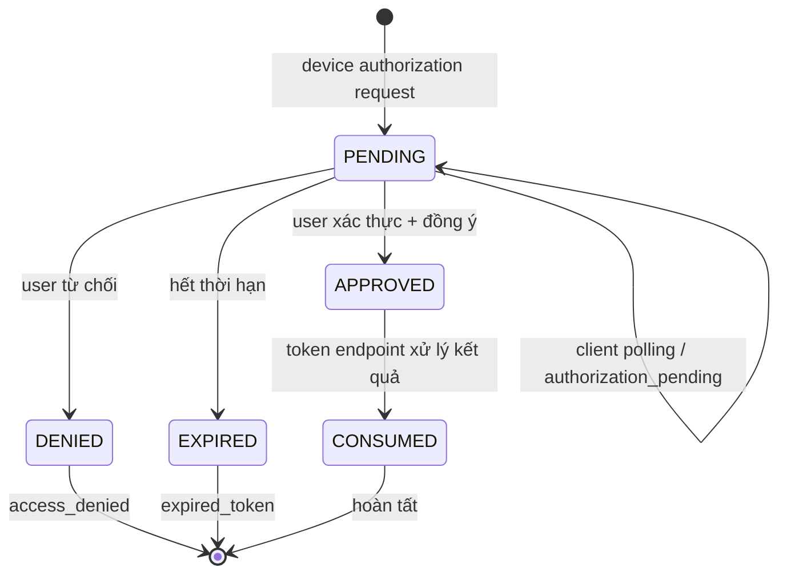

# Trang nhập user_code và xác nhận thiết bị cho người dùng

## 1. Bài toán: thiết bị cần quyền truy cập nhưng không có bàn phím phù hợp

Một ứng dụng chạy trên **smart TV**, thiết bị trình chiếu hoặc máy in mạng muốn gọi API của người dùng, nhưng việc nhập mật khẩu trên điều khiển từ xa vừa bất tiện vừa dễ làm lộ thông tin. **OAuth 2.0 Device Authorization Grant** (RFC 8628) cho phép thiết bị hiển thị **mã xác nhận ngắn** cùng URL; người dùng dùng điện thoại hoặc laptop truy cập URL đó, đăng nhập vào Authorization Server rồi quyết định có cấp quyền cho thiết bị hay không.

Trong Spring Boot, **Spring Authorization Server** xử lý giao thức ở **Device Authorization Endpoint**, **Device Verification Endpoint** và **Token Endpoint**. **Spring Security** hỗ trợ phiên đăng nhập, kiểm tra quyền truy cập, CSRF và các filter chain. Phần **giao diện nhập `user_code` và xác nhận thiết bị** là nơi nối trải nghiệm người dùng với những yêu cầu bảo mật của RFC 8628.

Bài thuộc chương **Device Authorization** của module `SPRING_SECURITY_OAUTH2_OIDC_AUTHORIZATION_SERVER`, phục vụ mục tiêu **thiết kế, cấu hình, bảo mật, kiểm thử và vận hành OAuth 2.0/OpenID Connect Authorization Server bằng Spring Security và Spring Authorization Server trong ứng dụng Spring Boot**.

### Sau bài này, bạn có thể

1. Phân biệt `user_code`, `device_code`, `verification_uri` và `verification_uri_complete`.
2. Thiết kế màn hình nhập mã và xác nhận thiết bị mà không tự ý cấp token khi mã vừa được nhập.
3. Giải thích luồng **nhập mã → xác thực người dùng → kiểm tra giao dịch → consent → cập nhật trạng thái → thiết bị polling**.
4. Tích hợp trang nhập mã với `OAuth2AuthorizationServerConfigurer` và `deviceVerificationEndpoint(...)` theo đúng phạm vi phiên bản.
5. Phân tích nguy cơ **user-code guessing, phishing, thiết bị giả mạo, clickjacking, CSRF, polling abuse** và xây ma trận kiểm thử.

> **Phiên bản:** Ví dụ DSL sử dụng hướng API **Spring Authorization Server 1.x / Spring Security 6.x**. Endpoint URI, phương thức HTTP mà filter chấp nhận, các điểm tùy chỉnh và trạng thái bật mặc định có thể khác giữa phiên bản Spring Authorization Server và Spring Security 7.x. Cần kiểm tra reference guide/implementation đúng artifact khi xây giao diện thật; không tự thay endpoint mặc định bằng controller MVC xử lý token.

## 2. Device Authorization khác Authorization Code thông thường ra sao?

Với **Authorization Code + PKCE**, một browser được đưa trực tiếp đến Authorization Endpoint và callback trở lại client. Với **Device Authorization**, thiết bị thường không có browser tương tác đầy đủ và **không nhận authorization code qua redirect URI**.

Thay vào đó:

- Thiết bị yêu cầu một **device authorization transaction**.
- Authorization Server trả một `device_code` có entropy cao cho thiết bị và `user_code` thuận tiện để người dùng đọc/nhập.
- Người dùng nhập mã tại trang xác minh trên **thiết bị thứ hai** có browser.
- Người dùng **đăng nhập và xác nhận** yêu cầu quyền.
- Thiết bị tiếp tục polling Token Endpoint bằng `device_code`; chỉ khi giao dịch được chấp thuận hợp lệ, máy chủ mới phát token theo chính sách.

| Tiêu chí | Authorization Code + PKCE | Device Authorization Grant |
| --- | --- | --- |
| Thiết bị gọi API | Browser/mobile app có khả năng điều hướng | TV, CLI, IoT hoặc thiết bị hạn chế input |
| Cách người dùng tương tác | Browser trong luồng authorization của client | Browser trên thiết bị khác tại verification URI |
| Giá trị client dùng lấy token | Authorization code + PKCE verifier | Device code |
| Giá trị người dùng nhập | Thường không nhập mã thủ công | User code dễ đọc |
| Cách nhận kết quả | Callback tại redirect URI | Polling Token Endpoint |
| Điểm cần chống lạm dụng | Redirect URI, state, PKCE, login CSRF | Guessing user code, phishing, polling, xác nhận sai thiết bị |

**Không sử dụng Device Flow thay cho Authorization Code chỉ để bỏ qua login hoặc MFA**. Người dùng vẫn cần được xác thực tại trang xác minh theo chính sách.

## 3. Bốn giá trị trọng tâm của giao thức

Device Authorization Response theo RFC 8628 có các trường chính:

| Trường | Ai nhận/sử dụng? | Ý nghĩa bảo mật |
| --- | --- | --- |
| `device_code` | **Thiết bị/client** lưu và gửi tới Token Endpoint | Credential cho giao dịch polling; thường dài, ngẫu nhiên, không hiển thị cho người dùng |
| `user_code` | Người dùng đọc và nhập tại verification page | Mã nhập tay, ngắn và dễ đọc; entropy thấp hơn nên bắt buộc có chống đoán |
| `verification_uri` | Người dùng mở trong browser | Trang xác minh **do Authorization Server sở hữu** |
| `verification_uri_complete` | Đường dẫn tùy chọn đã kèm user code | Giảm thao tác nhập khi dùng QR/deep link; **không được bỏ qua bước xác nhận chủ động** |
| `expires_in` | Client và server | Thời gian hiệu lực của device/user code |
| `interval` | Client | Khoảng polling tối thiểu do server yêu cầu; nếu không có, RFC 8628 quy định mặc định 5 giây |

Ví dụ response minh họa:

```http
HTTP/1.1 200 OK
Content-Type: application/json
Cache-Control: no-store
Pragma: no-cache

{
  "device_code": "DEVICE_CODE_HIGH_ENTROPY_EXAMPLE",
  "user_code": "HD73-K9FP",
  "verification_uri": "https://auth.example.com/activate",
  "verification_uri_complete": "https://auth.example.com/activate?user_code=HD73-K9FP",
  "expires_in": 600,
  "interval": 5
}
```

**Lưu ý:** Tên miền, mã, TTL và interval ở trên chỉ để học tập. Không tự giả định Spring Authorization Server luôn trả `verification_uri_complete` hoặc luôn chọn đúng format/TTL này; kiểm tra response thực tế.

### 3.1. Không nhầm user code với device code

`user_code` dùng cho **con người** và cần được bảo vệ bằng rate limit/thời hạn/ngữ cảnh xác nhận. `device_code` dùng cho **client polling**, có entropy cao và phải giữ bí mật trong phạm vi thiết bị. **Không yêu cầu người dùng dán `device_code` vào form**, không in device code trong QR công khai và không đưa nó vào log trình duyệt.

### 3.2. Code nhập tay không phải mật khẩu người dùng

Việc ai đó nhập đúng `user_code` chỉ chứng minh họ biết một **mã giao dịch**, không chứng minh họ là chủ tài khoản và càng không chứng minh thiết bị đáng tin. Vì vậy, Authorization Server phải xử lý tiếp **user authentication, kiểm tra trạng thái giao dịch và quyết định consent**.

## 4. Sơ đồ đầy đủ: hai thiết bị và một Authorization Server

```mermaid
sequenceDiagram
    autonumber
    participant TV as Smart TV / Device Client
    participant AS as Authorization Server
    actor U as Người dùng
    participant B as Browser trên điện thoại
    TV->>AS: POST /oauth2/device_authorization<br/>client_id, scope và client auth nếu cần
    AS-->>TV: device_code, user_code,<br/>verification_uri, expires_in, interval
    TV-->>U: Hiển thị URL + user_code
    loop Polling khi còn hiệu lực
        TV->>AS: POST /oauth2/token<br/>device_code grant
        AS-->>TV: authorization_pending hoặc kết quả khác
    end
    U->>B: Mở verification_uri
    B->>AS: GET /activate
    AS-->>B: Trang nhập user_code
    U->>B: Nhập mã hiện trên TV
    B->>AS: Gửi user_code đến Device Verification Endpoint
    alt Chưa đăng nhập
        AS-->>B: Chuyển sang form login
        U->>AS: Xác thực người dùng
    end
    AS->>AS: Tra cứu giao dịch và kiểm tra mã/thời hạn
    AS-->>B: Hiển thị client, scope và yêu cầu xác nhận
    U->>B: Chấp thuận hoặc từ chối
    B->>AS: Gửi quyết định qua luồng xác nhận an toàn
    AS->>AS: Ghi trạng thái authorization
    AS-->>B: Thông báo hoàn tất; không trả token cho browser
    TV->>AS: Poll token endpoint theo interval
    alt Đã được chấp thuận
        AS-->>TV: Access token (và token khác nếu policy cho phép)
    else Bị từ chối/hết hạn
        AS-->>TV: access_denied hoặc expired_token
    end
```

Phần browser **không nhận device access token** như một kết quả trực tiếp của form xác nhận. Browser chỉ giúp người dùng thực hiện authentication và authorization. **Thiết bị** nhận token qua Token Endpoint và phải tuân thủ `interval`, `expires_in` cùng các phản hồi pending/slow-down.

## 5. Bước 1 — Trang nhập user_code phải hướng người dùng đúng nơi

Giả sử TV hiển thị:

```text
KẾT NỐI THIẾT BỊ
Trên điện thoại hoặc máy tính, truy cập:
https://auth.example.com/activate

Nhập mã: HD73-K9FP

Mã có hiệu lực trong khoảng thời gian được hiển thị.
Chỉ xác nhận nếu bạn tự bắt đầu kết nối trên thiết bị này.
```

Trang `/activate` cần đơn giản, dễ nhập trên điện thoại và giải thích rõ mục đích. Tối thiểu nên có:

1. Tên trang và hostname **Authorization Server** rõ ràng; yêu cầu HTTPS.
2. Một ô nhập **user code**, hỗ trợ bàn phím và công cụ hỗ trợ tiếp cận.
3. Hướng dẫn tìm mã trên màn hình thiết bị và không chia sẻ mã qua chat/người lạ.
4. Thông báo lỗi chung nếu mã sai, hết hạn hoặc đã được sử dụng; không tiết lộ thông tin tài khoản qua việc đoán mã.
5. Mô tả bước tiếp theo: đăng nhập nếu cần rồi xác nhận tên thiết bị/client và quyền được yêu cầu.

Tránh bắt người dùng nhập **client secret, device code, access token hoặc mật khẩu vào thiết bị TV**. Mật khẩu chỉ được thu thập trên **trang đăng nhập chính thức của Authorization Server** với HTTPS và chính sách xác thực được tổ chức quản lý.

### 5.1. verification_uri và verification_uri_complete

`verification_uri` thường trỏ tới màn hình để người dùng **tự nhập** `user_code`. `verification_uri_complete` có thể kèm code trong URL hoặc QR để prefill.

**Prefill không đồng nghĩa consent.** Nếu người dùng quét một QR dẫn tới màn hình xác nhận, họ vẫn cần **kiểm tra mã đang hiển thị trên TV** và chủ động chấp thuận. Việc ép người dùng so khớp là một biện pháp giảm nguy cơ kẻ tấn công dụ người dùng kết nối thiết bị của chúng.

Nếu dùng URL chứa user code, cân nhắc lịch sử browser, HTTP access logs, referrer và analytics. Hạn chế tài nguyên bên thứ ba trên trang xác minh, đặt chính sách Referrer-Policy/CSP phù hợp và không ghi nguyên user code vào metric labels.

## 6. Bước 2 — Xác thực người dùng trước khi xác nhận thiết bị

Một người có thể mở `/activate` khi chưa có phiên đăng nhập tại Authorization Server. Tùy cách thiết kế giao diện, họ có thể nhập code trước rồi login, hoặc login trước rồi nhập code; **tại thời điểm approve/deny phải có principal người dùng phù hợp**.

Luồng điển hình:

```text
GET /activate
  -> hiển thị form nhập user_code
  -> gửi user_code tới Device Verification Endpoint
  -> nếu người dùng chưa đăng nhập: redirect /login
  -> POST /login (có CSRF) và xác thực
  -> quay lại giao dịch xác minh đang chờ
  -> hiển thị thông tin client và bước consent
```

Spring Security đảm nhiệm login/session bằng `AuthenticationManager`, `SecurityContext`, `SecurityFilterChain` và các entry point/success handler. Không nên tạo một controller riêng tự nhận `username/password` cùng `user_code` rồi cấp token theo kết quả truy vấn database.

**Chú ý RequestCache:** Nếu browser rời verification flow để login, phải khôi phục ngữ cảnh **đúng user code/giao dịch**. Không tin một tham số `return_url` tự do. Với nhiều tab hoặc session hết hạn, phải xử lý tình huống context mất thay vì tự liên kết code với người dùng khác.

### 6.1. Login không phải consent

Người dùng đăng nhập thành công chỉ chứng minh họ sở hữu một tài khoản. Họ còn phải biết **thiết bị/client nào đang yêu cầu quyền** và quyết định **cho phép hay từ chối**. Không tự đánh dấu giao dịch `APPROVED` ngay khi user code được tra cứu hoặc mật khẩu đúng.

## 7. Bước 3 — Trang xác nhận thiết bị phải trình bày những gì?

Sau khi code hợp lệ và người dùng được xác thực, trang confirmation nên hiển thị dữ liệu **được server xác minh**, chẳng hạn:

| Thông tin hiển thị | Nguồn đáng tin | Lý do |
| --- | --- | --- |
| Tên ứng dụng đang yêu cầu | `RegisteredClient` và metadata đã kiểm duyệt | Giúp nhận ra client thật, không tin tên từ input tùy ý |
| Mã xác minh | Giao dịch device authorization đang chờ | Người dùng đối chiếu với mã trên thiết bị |
| Scope/quyền truy cập | Scope đã validate và policy consent | Người dùng hiểu điều gì sẽ được cấp |
| Thông tin thiết bị đã xác thực được (nếu có) | Metadata do hệ thống quản lý/kiểm tra | Tránh hiển thị thiết bị giả mạo từ user-agent không đáng tin |
| Tài khoản sẽ cấp quyền | Principal đăng nhập hiện tại | Ngăn cấp nhầm tài khoản khi browser lưu nhiều phiên |
| Thời hạn còn lại | Thời điểm hết hạn giao dịch phía server | Không hiển thị mã đã hết hạn như vẫn có thể approve |
| Nút **Cho phép** và **Từ chối** | Form quyết định do server quản lý | Bảo đảm người dùng có quyền lựa chọn |

Một bố cục minh họa:

```text
XÁC NHẬN THIẾT BỊ

Bạn đang đăng nhập với tài khoản: alice@example.com
Ứng dụng: Living Room TV
Mã trên thiết bị: HD73-K9FP

Ứng dụng yêu cầu:
  • Xem danh sách nội dung (media.read)
  • Xem hồ sơ cơ bản (profile)

Chỉ chọn "Cho phép" nếu bạn đang thực hiện kết nối
trên TV của mình và mã hiển thị trùng khớp.

[Từ chối]         [Cho phép thiết bị]
```

Tên/email/scopes trong ví dụ chỉ là dữ liệu minh họa. **Tránh hiện một thông điệp chung “Thiết bị đã được xác minh” trước khi user bấm Cho phép.**

### 7.1. Không lấy tên thiết bị từ request chưa kiểm chứng

Thiết bị có thể gửi một nhãn kiểu `friendly_name=My TV`, nhưng đây là dữ liệu chưa được tin. Một attacker có thể đặt tên giống “Microsoft Security” hay “Admin Console” để gây nhầm lẫn. Trang xác nhận cần dùng tên client đã được đăng ký/kiểm duyệt và phân biệt rõ metadata tự khai báo với dữ liệu được xác nhận.

### 7.2. Hạn chế màn hình “đồng ý một lần”

Không tự động chấp thuận `media.write` khi người dùng chỉ định cấp `media.read`. Nếu policy yêu cầu người dùng chọn scopes, cần validate danh sách scope được chọn; tuyệt đối không cho client hoặc browser tự nâng quyền bằng cách thêm input vào form.

Consent đã lưu từ phiên trước **không đồng nghĩa lần ghép thiết bị mới không cần xác nhận**. Device Authorization có rủi ro ghép sai thiết bị, vì thế thiết kế cần đánh giá bước xác nhận chủ động ngay cả khi trước đó người dùng đã đồng ý scope cho cùng client.

## 8. Bước 4 — Ghi quyết định và thông báo kết quả

Sau khi người dùng **Cho phép**:

1. Endpoint tiếp nhận xác nhận phải kiểm tra **người dùng đang đăng nhập**.
2. Kiểm tra transaction `user_code`/device authorization tương ứng **còn hiệu lực, chưa bị từ chối hoặc hoàn tất**.
3. Kiểm tra client và scopes đã được validate, không nhận quyền vượt registration.
4. Xác nhận CSRF/session binding của thao tác POST theo cơ chế bảo vệ phù hợp.
5. Ghi trạng thái authorization và consent qua các service của Authorization Server.
6. Trả trang thông báo **“Đã xác nhận. Bạn có thể quay lại thiết bị.”**.

Nếu người dùng **Từ chối**, thiết bị đang polling cần nhận kết quả từ chối theo giao thức. Nếu mã hết hạn hoặc dùng lại, server không được chuyển trạng thái từ invalid/expired thành approved chỉ vì UI còn mở.

**Quan trọng:** Trang xác nhận không trả access token trong HTML, query string hay cookie của browser. Authorization Server phát token cho **thiết bị đã có `device_code`** khi thiết bị gọi lại Token Endpoint theo đúng grant, client binding và policy.

### 8.1. Trạng thái giao dịch



Đây là **mô hình trạng thái khái niệm** cho bài học, không phải tên enum/cột bảng bắt buộc trong Spring Authorization Server. Việc đọc/ghi trạng thái cụ thể phụ thuộc `OAuth2AuthorizationService`, implementation và phiên bản.

Đặc biệt, chỉ có một quyết định cuối cùng hợp lệ cho giao dịch. Khi nhiều request gần đồng thời, cần bảo đảm logic kiểm tra trạng thái và cập nhật được đồng bộ/transactional ở storage phù hợp.

## 9. Liên kết với cấu hình Spring Authorization Server

### 9.1. Những endpoint liên quan

| URI mặc định thường gặp | Vai trò | Ai gọi? |
| --- | --- | --- |
| `/oauth2/device_authorization` | Bắt đầu Device Authorization | Thiết bị/client |
| `/oauth2/device_verification` | Tiếp nhận user code và luồng xác minh | Browser người dùng |
| `/oauth2/token` | Poll device code và lấy token khi được phép | Thiết bị/client |
| `/activate` (ví dụ tùy biến) | Trang hướng dẫn/nhập code | Browser người dùng |
| `/login` (nếu dùng form login) | Xác thực người dùng | Browser người dùng |

Spring Authorization Server có các điểm mở rộng như `deviceAuthorizationEndpoint(...)` và `deviceVerificationEndpoint(...)`. **Cần phân biệt `verificationUri(...)`** — đường dẫn hiển thị cho người dùng trong response của Device Authorization Endpoint — với **filter xử lý xác minh user code** ở `/oauth2/device_verification`.

### 9.2. Ví dụ SecurityFilterChain

Ví dụ theo cấu trúc API Spring Authorization Server 1.x:

```java
@Configuration
@EnableWebSecurity
class SecurityConfig {

    @Bean
    @Order(1)
    SecurityFilterChain authorizationServerSecurityFilterChain(
            HttpSecurity http) throws Exception {

        OAuth2AuthorizationServerConfigurer authorizationServer =
                OAuth2AuthorizationServerConfigurer.authorizationServer();

        http
            .securityMatcher(authorizationServer.getEndpointsMatcher())
            .with(authorizationServer, server ->
                server
                    .deviceAuthorizationEndpoint(device ->
                        device.verificationUri("/activate"))
                    .deviceVerificationEndpoint(Customizer.withDefaults())
            )
            .authorizeHttpRequests(authorize ->
                authorize.anyRequest().authenticated())
            .exceptionHandling(exceptions -> exceptions
                .defaultAuthenticationEntryPointFor(
                    new LoginUrlAuthenticationEntryPoint("/login"),
                    new MediaTypeRequestMatcher(MediaType.TEXT_HTML)
                )
            );

        return http.build();
    }

    @Bean
    @Order(2)
    SecurityFilterChain applicationSecurityFilterChain(HttpSecurity http)
            throws Exception {
        http
            .authorizeHttpRequests(authorize -> authorize
                .requestMatchers("/activate", "/assets/**").permitAll()
                .anyRequest().authenticated()
            )
            .formLogin(Customizer.withDefaults());

        return http.build();
    }
}
```

Các import đã được lược bỏ cho dễ đọc. Đây là **khung cấu hình**, chưa phải một ứng dụng chạy độc lập: cần `RegisteredClientRepository`, `OAuth2AuthorizationService`, `OAuth2AuthorizationConsentService` khi sử dụng consent, `AuthorizationServerSettings`, token generator/key phù hợp và nguồn xác thực người dùng.

**Ranh giới chain:** `/activate` là trang MVC tùy biến, có thể nằm ngoài matcher của Authorization Server và cần được permit; `/oauth2/device_verification` là protocol endpoint và phải được filter giao thức xử lý. Không khai báo MVC controller trùng đường dẫn với filter rồi mặc định controller sẽ chạy.

**Lưu ý:** Khả năng bật mặc định Device Authorization Grant khác nhau theo dòng/phiên bản Spring. Ví dụ chỉ minh họa điểm cấu hình, không đảm bảo mọi binary sẽ tự kích hoạt mọi endpoint; đối chiếu tài liệu đúng dependency và kiểm thử HTTP thực tế.

### 9.3. RegisteredClient cho thiết bị công khai

Thiết bị TV phân phối cho người dùng thường là **public client**, không có nơi lưu client secret an toàn. Ví dụ cấu hình:

```java
RegisteredClient tvClient = RegisteredClient.withId(
                UUID.randomUUID().toString())
        .clientId("living-room-tv")
        .clientAuthenticationMethod(ClientAuthenticationMethod.NONE)
        .authorizationGrantType(AuthorizationGrantType.DEVICE_CODE)
        .scope("media.read")
        .scope("profile")
        .clientSettings(ClientSettings.builder()
                .requireAuthorizationConsent(true)
                .build())
        .build();
```

`AuthorizationGrantType.DEVICE_CODE` và `ClientAuthenticationMethod.NONE` cần được kiểm tra API/version thực tế. Không cài `client_secret_basic` cho một TV rồi nhúng secret trong firmware để coi đó là bí mật: người sở hữu thiết bị có thể trích xuất nó.

Device Flow có thể hỗ trợ client loại confidential khi môi trường thực sự bảo vệ được credential. **Cơ chế xác thực client tại Device Authorization/Token Endpoint vẫn theo chính sách của client type**, không được bỏ qua validation chỉ vì giao dịch yêu cầu người dùng nhập mã.

### 9.4. Cấu hình trang nhập mã và trang consent khác nhau

Một hệ thống có thể dùng `deviceAuthorizationEndpoint(...verificationUri("/activate"))` để công bố URL nhập mã. Tùy phiên bản, `deviceVerificationEndpoint(...)` cũng cung cấp điểm mở rộng cho **consent page** và các converter/provider/handler.

**Trang nhập mã** trả lời *“mã nào đang được yêu cầu?”*. **Trang consent** trả lời *“người dùng có cho phép client/thiết bị này nhận những quyền đã yêu cầu không?”*. Không đánh đồng hai trang hoặc tự ghi consent chỉ khi form đầu tiên hợp lệ.

Khi tùy chỉnh consent, phải giữ các validation bắt buộc và dùng đường dẫn/callback mà endpoint filter của phiên bản đang chạy mong đợi; không tự suy đoán tên parameter của consent filter từ HTML.

## 10. Ví dụ trang nhập user_code trong Spring MVC/Thymeleaf

### 10.1. Controller chỉ hiển thị UI

```java
@Controller
class DeviceActivationPageController {

    @GetMapping("/activate")
    String showEntryPage(Model model) {
        model.addAttribute("pageTitle", "Xác minh thiết bị");
        return "device-activate";  // Thymeleaf view
    }
}
```

Controller này **không** tra cứu/approve device authorization và không cần biết `device_code`. Nó chỉ phục vụ trang nhập mã; framework device verification endpoint vẫn xử lý việc nhận `user_code` và xác minh giao dịch.

### 10.2. Ví dụ form Thymeleaf

```html
<!doctype html>
<html lang="vi" xmlns:th="http://www.thymeleaf.org">
<head>
  <meta charset="utf-8">
  <meta name="viewport" content="width=device-width, initial-scale=1">
  <title>Xác minh thiết bị</title>
</head>
<body>
  <main>
    <h1>Kết nối thiết bị</h1>
    <p>Mở mã trên màn hình thiết bị và nhập vào bên dưới.</p>
    <p>Chỉ xác nhận nếu bạn vừa yêu cầu kết nối thiết bị đó.</p>

    <!-- Với filter/phiên bản chấp nhận GET có user_code,
         request này đưa người dùng tới luồng verification,
         KHÔNG trực tiếp cấp quyền hay token. -->
    <form th:action="@{/oauth2/device_verification}" method="get">
      <label for="user_code">Mã xác minh</label>
      <input id="user_code" name="user_code" required
             autocomplete="one-time-code" autocapitalize="characters"
             spellcheck="false" aria-describedby="codeHelp">
      <p id="codeHelp">Ví dụ: HD73-K9FP</p>
      <button type="submit">Tiếp tục</button>
    </form>
  </main>
</body>
</html>
```

**Quan trọng:** Đây là ví dụ cho **bước tra cứu mã qua GET** khi `OAuth2DeviceVerificationEndpointFilter` ở phiên bản đang dùng hỗ trợ phương thức/parameter này; cần xác minh đúng request contract của bản Spring bạn triển khai. Nếu hệ thống hỗ trợ/thiết kế POST cho tra cứu mã, có thể dùng POST cùng CSRF token theo chính sách, giúp giảm việc mã xuất hiện trên URL/log. Đừng thay đổi method tùy tiện nếu filter không chấp nhận.

**Không đặt hành vi “approve” trong nút Tiếp tục.** Sau khi mã được kiểm tra và người dùng đã đăng nhập, phải có bước **xem thông tin client/scope và xác nhận chủ động** theo yêu cầu/policy. Form quyết định approval/denial có contract riêng của Device Verification Endpoint/consent handler, thường là POST và cần CSRF protection phù hợp; không sao chép nguyên form nhập mã rồi đổi nhãn nút thành “Cho phép”.

### 10.3. URL có prefix và HTTPS

Nếu ứng dụng công khai tại `https://login.example.com/auth` nhưng servlet context path là `/auth`, Thymeleaf `th:action="@{/oauth2/device_verification}"` có thể sinh đường dẫn có context đúng khi proxy/forwarded headers được cấu hình thích hợp.

Không hard-code `http://localhost:9000/oauth2/device_verification` trong HTML. Cấu hình issuer, `verification_uri` công khai, reverse proxy rewrite, TLS termination và cookie `Secure`/`Path` phải nhất quán. Đặc biệt, user nhập mã từ **điện thoại bên ngoài mạng**, không thể truy cập hostname nội bộ của TV.

## 11. Bước 5 — Thiết bị polling Token Endpoint

Sau khi nhận `device_code`, thiết bị gửi request tới Token Endpoint theo RFC 8628:

```http
POST /oauth2/token HTTP/1.1
Host: auth.example.com
Content-Type: application/x-www-form-urlencoded

grant_type=urn%3Aietf%3Aparams%3Aoauth%3Agrant-type%3Adevice_code&
device_code=DEVICE_CODE_HIGH_ENTROPY_EXAMPLE&
client_id=living-room-tv
```

Nếu client là confidential, phải bổ sung client authentication phù hợp với registration và giao thức. Ví dụ dùng public client nên không có client secret.

### 11.1. Các phản hồi polling quan trọng

| OAuth error ở Token Endpoint | Ý nghĩa | Client cần làm |
| --- | --- | --- |
| `authorization_pending` | Người dùng chưa hoàn tất xác minh/quyết định | Tiếp tục polling sau interval |
| `slow_down` | Client polling nhanh hơn mức cho phép hoặc server yêu cầu chậm lại | Tăng interval ít nhất 5 giây cho các request tiếp theo |
| `access_denied` | Người dùng từ chối hoặc authorization bị từ chối | Dừng polling, thông báo phù hợp |
| `expired_token` | Device code hết hạn | Dừng polling; nếu người dùng muốn thử lại, khởi tạo giao dịch mới |
| `invalid_grant` hoặc lỗi khác | Code/request không hợp lệ theo ngữ cảnh triển khai | Dừng hoặc xử lý theo loại lỗi; không retry vô hạn |

Theo RFC 8628, nếu Device Authorization Response không có `interval`, client dùng **5 giây**. Khi gặp `slow_down`, phải **tăng thời gian chờ ít nhất 5 giây**, và nếu gặp lỗi mạng, nên áp dụng backoff phù hợp. Không gửi một POST mỗi vài trăm mili-giây để “nhận token nhanh hơn”.

### 11.2. Khi người dùng đã chấp thuận

Token Endpoint có thể trả:

```json
{
  "access_token": "ACCESS_TOKEN_EXAMPLE",
  "token_type": "Bearer",
  "expires_in": 3600,
  "scope": "media.read"
}
```

Các trường khác, bao gồm refresh token hoặc OIDC ID token **nếu thực sự được hỗ trợ/phát hành**, phụ thuộc cấu hình, chính sách và ngữ cảnh giao thức. **Không hứa rằng mọi Device Authorization Grant đều phải cấp ID Token/Refresh Token**. Thiết bị chỉ nên xử lý những trường mà token response hợp lệ thực sự chứa.

## 12. Bảo mật user_code: entropy thấp, kiểm soát phải chặt

Mã `user_code` thường ngắn để người dùng dễ nhập nên không có entropy cao như `device_code`. Kẻ tấn công có thể thử đoán mã trên verification page, dẫn tới liên kết nhầm tài khoản người dùng với giao dịch của thiết bị khác.

**Phòng vệ theo RFC 8628 và threat model:**

1. **Random/entropy phù hợp** do Authorization Server sinh, mã không tuần tự/đoán được. Không tự thay generator bằng `000001`, `000002` hoặc ID database.
2. **Giới hạn tốc độ thử mã** theo IP, session, device/client, account và tín hiệu rủi ro. Không dựa độc nhất vào IP vì NAT và mạng di động.
3. **Giới hạn số lần nhập sai** và thời gian hiệu lực; tránh một user code có thể thử vô thời hạn.
4. **Không tiết lộ trạng thái nhạy cảm** khi tra cứu mã không hợp lệ: tránh thông tin hỗ trợ enumerate tài khoản hoặc biết client nào đang chờ.
5. **Mã dùng cho một giao dịch**, hết hiệu lực khi giao dịch đã hoàn tất/hết hạn/hủy theo implementation.
6. **Log an toàn**: không ghi toàn bộ code vào analytics, query logs, crash report hoặc message cho bên thứ ba.

### 12.1. Chuẩn hóa mã trước khi kiểm tra

Một số giao diện cho phép người dùng nhập có/không dấu nối, chữ thường/chữ hoa. **Chỉ chuẩn hóa theo đúng format mà Authorization Server định nghĩa**; không tự chuyển mọi ký tự, loại bỏ quá nhiều ký tự hoặc chấp nhận alias gây va chạm mã. Nếu sử dụng mã có checksum để phát hiện lỗi gõ, cần thiết kế generator/validator đồng bộ.

Thông báo lỗi nên nói “Mã không hợp lệ hoặc đã hết hạn. Vui lòng kiểm tra lại trên thiết bị.” thay vì trả về client metadata chi tiết cho từng mã thử sai.

## 13. Phishing và device-code authorization attack

Device Flow có một lớp rủi ro đáng kể: kẻ tấn công có thể **tự tạo giao dịch Device Authorization** trên thiết bị của chúng rồi lừa nạn nhân nhập `user_code` của kẻ tấn công vào trang xác minh thật. Khi nạn nhân chấp thuận, **thiết bị của kẻ tấn công** là bên nhận token.

Ví dụ kịch bản:

1. Attacker khởi tạo Device Authorization Grant cho client hoặc thiết bị mà chúng kiểm soát.
2. Attacker gửi email/chat “Vui lòng đăng nhập để xác thực bảo mật” kèm mã đang chờ.
3. Nạn nhân mở **trang xác minh chính thức**, nhập mã và đăng nhập.
4. Nếu trang chỉ có nút “Tiếp tục” khó hiểu hoặc tự động đồng ý, token có thể được cấp cho thiết bị của attacker.

Điểm nguy hiểm: **HTTPS và trang đăng nhập thật vẫn chưa đủ**. Phần mà người dùng cần kiểm tra là **họ có chủ động khởi tạo kết nối thiết bị đó không**, **mã có trùng trên thiết bị của họ không**, và **ứng dụng đang xin những quyền nào**.

### 13.1. Biện pháp bảo vệ ở giao diện

- Luôn hiển thị lời nhắc: **“Chỉ cho phép nếu bạn vừa yêu cầu kết nối trên thiết bị đang cầm/sở hữu.”**
- Hiển thị client/app name đã kiểm duyệt, user code và scopes; yêu cầu người dùng so khớp mã với thiết bị.
- Phân biệt rõ **Từ chối** và **Cho phép**; không tự động approve khi quét QR hoặc khi login thành công.
- Với scope rủi ro cao, áp dụng MFA/step-up hoặc không hỗ trợ Device Flow tùy chính sách.
- Tránh nhãn chung chung như “Xác nhận tài khoản” khi thật ra đang cấp quyền truy cập API cho một thiết bị.
- Có nút hủy, lời giải thích “nếu bạn không yêu cầu kết nối này, hãy từ chối”.

### 13.2. Clickjacking, XSS, CSRF

Trang login và consent là màn hình nhạy cảm; cấu hình `Content-Security-Policy` với `frame-ancestors` thích hợp hoặc cơ chế anti-framing được hỗ trợ. Escape mọi chuỗi do client/user cung cấp để phòng XSS. Bảo vệ POST approve/deny bằng CSRF token/session binding thích hợp và không cho một GET vô tình chuyển giao dịch sang trạng thái approved.

Không nhúng JavaScript analytics bên thứ ba trên trang đang chứa user code hoặc dữ liệu nhận diện tài khoản nếu không có lý do được đánh giá nghiêm ngặt.

## 14. Client public, consent và quyền cấp

Trong Device Flow, thiết bị phổ biến là **public client** vì phần mềm/firmware dễ bị phân tích. Client ID chỉ dùng để tìm registration, **không chứng minh thiết bị đáng tin**. Điều này làm cho **bước người dùng xác nhận và binding của device code** càng quan trọng.

### 14.1. Phân biệt scope được yêu cầu và scope được cấp

`Requested scopes` đến từ client, nhưng chỉ scopes **đã đăng ký và được policy cho phép** mới hợp lệ. Trang consent nên hiển thị ngôn ngữ dễ hiểu, ví dụ:

| Scope | Mô tả hiển thị |
| --- | --- |
| `media.read` | Xem danh sách nội dung của tài khoản |
| `profile` | Xem thông tin hồ sơ cơ bản |
| `media.write` | Thay đổi nội dung; cần cảnh báo/đánh giá rủi ro riêng |

Không dùng chuỗi mô tả scope do client gửi tự do; server phải ánh xạ **scope đã được validate** sang văn bản đáng tin. Khi người dùng từ chối hoặc chỉ chấp thuận một tập scope theo implementation, token cuối cùng phải tuân thủ kết quả đó.

### 14.2. Refresh token và lifetime

Device Authorization Grant có thể đi kèm chính sách token riêng của server. Vì thiết bị có thể tồn tại lâu và khó nhập liệu, cần quyết định rõ:

- Access token TTL và việc refresh có được hỗ trợ theo loại client không.
- Refresh token (nếu phát) được bảo vệ/rotate/revoke ra sao trên thiết bị.
- Quy trình mất thiết bị, bán lại TV, đổi tài khoản, đăng xuất và thu hồi quyền.
- Thiết bị có phải lưu thông tin nhạy cảm vào filesystem hoặc flash không; có thể bảo vệ bằng secure hardware không.

**Không suy từ việc người dùng xác nhận user code rằng refresh token chắc chắn sẽ được cấp.** Cần test Token Endpoint và chính sách theo phiên bản.

## 15. Lưu trạng thái, nhiều instance và vận hành

Giao dịch Device Authorization thường kéo dài qua **nhiều request HTTP và hai thiết bị**. Nếu Authorization Server chạy nhiều node, dữ liệu authorization/device code và consent phải truy cập nhất quán theo storage phù hợp.

### 15.1. Các thành phần lưu trữ

| Thành phần | Lưu những gì? | Lưu ý |
| --- | --- | --- |
| `RegisteredClientRepository` | Client ID, grant, method, scopes, policy | Bền vững và thống nhất giữa các node |
| `OAuth2AuthorizationService` | Authorization/device-code state và token liên quan | Cần nhất quán qua polling và approval |
| `OAuth2AuthorizationConsentService` | Quyết định consent theo client/user khi áp dụng | Không thay thế trạng thái từng device transaction |
| HTTP session store | Principal browser và ngữ cảnh request xác minh | Không tự đồng nhất session với device code |
| Key/token service | Token keys, TTL và signing policy | Phù hợp issuer và Resource Server |

Chỉ dùng in-memory service cho demo/test nếu không cần sống qua restart hoặc nhiều node. Một node cấp `device_code` rồi node khác nhận `user_code`/polling có thể thất bại nếu trạng thái không được chia sẻ.

### 15.2. Timeout và cleanup

Giao dịch chưa hoàn tất phải tự hết hạn theo `expires_in`. Dọn dẹp record/tokens hết hạn theo chính sách storage; không để mã xác minh tồn tại mãi. Nếu user mở browser sau khi đã hết hạn, UI nên hướng dẫn **bắt đầu lại từ thiết bị** thay vì âm thầm tái sử dụng code cũ.

### 15.3. Observability an toàn

Nên theo dõi:

- Số giao dịch device authorization đang pending và tỷ lệ approved/denied/expired.
- Tỷ lệ nhập user code sai, rate-limit hits và dấu hiệu quét mã.
- Tỷ lệ `authorization_pending`/`slow_down`, tải polling ở Token Endpoint.
- Lỗi session/login/consent sau reverse proxy, thời gian đến khi xác nhận.
- Tỷ lệ thất bại khi storage/node chuyển giao hoặc sau triển khai phiên bản mới.

Log correlation ID, endpoint, client ID được xử lý theo chính sách, loại kết quả và timestamp. **Không log nguyên `device_code`, `user_code`, access token, refresh token, session cookie hoặc mật khẩu.**

## 16. Ma trận kiểm thử trang nhập user_code và xác nhận thiết bị

| Tình huống | Bước thử | Kết quả mong đợi |
| --- | --- | --- |
| Client device hợp lệ | Gửi device authorization request đúng scope/grant | Trả device_code/user_code/verification_uri/expires_in, interval nếu áp dụng |
| Public client không gửi secret | `ClientAuthenticationMethod.NONE` theo registration | Flow hoạt động theo policy, không đòi secret nhúng |
| verification_uri công khai | Mở URL trên điện thoại | Tải qua HTTPS, hostname/path đúng, không lộ URL nội bộ |
| Trang nhập mã | GET `/activate` | Form dễ hiểu, có label, không chứa device_code |
| User code hợp lệ | Gửi mã theo contract filter | Chuyển sang login hoặc bước xác nhận đúng giao dịch, chưa cấp token ngay |
| User code sai | Gửi mã không tồn tại | Thông báo chung, không tiết lộ client/username |
| User code hết hạn | Đợi/giả lập quá `expires_in` | Không thể xác nhận; yêu cầu tạo giao dịch mới |
| User code đã dùng lại | Nhập mã sau approval/consumption | Không cấp quyền lần hai trái policy |
| Guessing/rate limit | Gửi nhiều mã sai liên tiếp | Bị giới hạn/thử thách theo chính sách, có cảnh báo |
| Chưa đăng nhập | Browser nhập mã nhưng không có session | Chuyển login, giữ đúng ngữ cảnh giao dịch |
| Sai mật khẩu | POST login lỗi | Không hoàn tất verification |
| Thiếu CSRF ở approve/deny | POST quyết định thiếu token cần thiết | Không cập nhật authorization |
| Đăng nhập đúng nhưng chưa consent | User vẫn trên confirmation page | Thiết bị tiếp tục nhận `authorization_pending` |
| User bấm **Cho phép** | Authenticated + transaction hợp lệ | Authorization được ghi; thiết bị nhận token khi polling đúng |
| User bấm **Từ chối** | Xác nhận denial | Thiết bị nhận `access_denied`, không token |
| Poll trước approval | Poll đúng interval | `authorization_pending` |
| Poll quá nhanh | Vượt interval | `slow_down`; client tăng interval |
| Device code sai/hết hạn | Poll code không hợp lệ | Trả lỗi thích hợp, không phát token |
| Device code bị dùng bởi client khác | Client B gửi code của A | Từ chối binding sai; không chuyển giao token |
| verification_uri_complete | Quét QR/URL prefill | Mã có thể được điền trước nhưng vẫn cần confirmation chủ động |
| Hai tab/mã đồng thời | Hai code với client khác nhau | Không nối nhầm user/code/client hoặc consent |
| XSS/client name giả | Metadata chứa HTML hoặc tên giả mạo | UI escape và dùng tên đã kiểm duyệt |
| Reverse proxy prefix | AS dưới `/auth` với TLS termination | Login, activation, device verification và form action đều đúng URL |
| Nhiều instance | Device auth ở node A, verify node B, poll node C | Trạng thái nhất quán; không mất giao dịch |
| Token response sau approval | Device polling thành công | Scope/audience/issuer đúng, token không bị đưa vào browser |

### 16.1. Kiểm thử theo lớp

**Unit/UI tests:** Controller `GET /activate`, khả năng truy cập bàn phím, hiển thị lỗi chung, không lộ credential, form action đúng. Kiểm tra HTML escaping, CSP và khả năng trang login được truy cập khi chưa authenticated.

**Integration tests:** Khởi tạo `RegisteredClient` với Device Grant, gọi Device Authorization Endpoint, lấy mã test, xác nhận bằng một browser/session có user thật, rồi polling Token Endpoint. Test cả approve, deny, hết hạn và code mismatch. Không chỉ test controller MVC hoặc `GET /activate` trả HTTP 200.

**Performance/security tests:** Rate limit user code, polling interval/`slow_down`, nhiều request đồng thời, khôi phục session sau login, nhiều node chia sẻ state, URL/phishing/clickjacking và cách xử lý log.

## 17. Những lỗi phổ biến và hướng chẩn đoán

| Triệu chứng | Khả năng chính | Hướng xử lý |
| --- | --- | --- |
| TV nhận 404 ở `/oauth2/device_authorization` | Device endpoint chưa bật, sai URI hoặc rơi nhầm filter chain | Kiểm tra configurer, matcher, version, proxy |
| TV không thấy `verification_uri` đúng | `verificationUri`/issuer/public base URL chưa chuẩn | Chốt canonical URL và route ngoài proxy |
| `/activate` 404 | Chưa có MVC controller/view hoặc chain chặn | Đăng ký GET trang và permit đúng |
| Nhập code nhưng chẳng hiện bước xác nhận | Form action/method/parameter không khớp DeviceVerificationEndpoint | Đối chiếu filter contract và handler theo phiên bản |
| Sau nhập code bị lặp `/login` | Session cookie, RequestCache, login chain, forwarded headers | Xem `Set-Cookie`/`Location` và state |
| Login thành công nhưng mã hết hạn | Transaction TTL đã hết khi người dùng nhập liệu | Thông báo restart từ thiết bị, không kéo dài vô hạn |
| TV luôn nhận `authorization_pending` | UI chưa thực hiện consent, state không đồng bộ, polling nhìn nhầm transaction | Xác minh quyết định được ghi đúng authorization |
| TV nhận `slow_down` liên tục | Polling interval quá ngắn | Tăng interval theo RFC, backoff khi lỗi mạng |
| TV nhận `access_denied` sau người dùng từ chối | Kết quả đúng giao thức | Dừng polling, cho phép bắt đầu giao dịch mới |
| User code hợp lệ nhưng hiện sai client | Lỗi binding code→client, concurrent sessions hoặc UI lấy tên từ input | Dùng metadata server-side và kiểm tra transaction |
| API từ chối token sau activation | Issuer/audience/scope/expiry/JWKS không khớp | Kiểm tra Resource Server validation; đừng chỉ sửa form |

### 17.1. Không điều tra bằng cách log mã/token nguyên văn

Để chẩn đoán, dùng **correlation ID** hoặc ID transaction nội bộ không nhạy cảm, kèm trạng thái và thời hạn. Giới hạn quyền đọc log, lọc query string nếu user code đi trên GET URL, che các header/field nhạy cảm.

## 18. Tình huống tổng hợp: ghép TV của nhân viên với tài khoản

Một tổ chức triển khai ứng dụng hiển thị dashboard trên TV phòng họp:

1. TV có client ID `meeting-room-tv`, chỉ được xin scope `dashboard.read`. Trình quản lý không nhúng client secret trong app trên TV.
2. TV gọi Device Authorization Endpoint, nhận `device_code`, `user_code` và URL công khai; chỉ hiển thị user code/URL hoặc QR phù hợp.
3. Alice mở `https://auth.example.com/activate` trên điện thoại, nhập mã đang thấy trên TV.
4. Authorization Server yêu cầu Alice đăng nhập và MFA nếu policy yêu cầu, sau đó hiển thị **tên client đã được xác minh**, mã và scope.
5. Alice so khớp mã, chọn **Cho phép**. Nếu cô không chủ động kết nối TV, cô phải chọn **Từ chối**.
6. Authorization Server ghi quyết định với giao dịch còn hiệu lực, không trả access token trong trang điện thoại.
7. TV polling theo interval, chỉ nhận token khi giao dịch approved, lưu token an toàn và gọi Dashboard API.
8. Khi TV bị thay thế hoặc có nguy cơ lộ quyền, đội vận hành thu hồi token/ủy quyền theo chính sách và yêu cầu ghép lại thiết bị mới.

Nếu attacker gửi Alice một mã của thiết bị do attacker kiểm soát, trang xác minh cần đủ thông tin để Alice nhận ra **mã không trùng trên TV của cô** và từ chối. Đó là lý do bước xác nhận chủ động là thành phần bảo mật thiết yếu, không phải một hộp thoại trang trí.

## 19. Checklist trước khi triển khai production

- [ ] `verification_uri` trỏ tới HTTPS public URL thuộc Authorization Server, không phải IP/hostname nội bộ.
- [ ] Trang nhập mã chỉ yêu cầu **user_code**, không yêu cầu device_code/client secret của thiết bị.
- [ ] User code được sinh ngẫu nhiên, có thời hạn, giới hạn lần thử và rate limiting chống đoán mã.
- [ ] Browser phải đăng nhập đúng tài khoản trước khi approve/deny; login không tự đồng ý scope.
- [ ] Trang confirmation hiển thị client/scopes/mã **đã kiểm chứng từ server**, kèm nhắc so khớp với thiết bị.
- [ ] Có lựa chọn **Từ chối** rõ ràng; không approve tự động khi mở `verification_uri_complete`/QR.
- [ ] POST quyết định được bảo vệ bằng session/CSRF phù hợp, không thể duyệt quyền bằng GET.
- [ ] Giao dịch hết hạn/đã sử dụng không thể được chấp thuận lại hoặc phát token trái policy.
- [ ] Device client xử lý `authorization_pending`, `slow_down`, `access_denied`, `expired_token` đúng RFC 8628.
- [ ] `OAuth2AuthorizationService` và session/consent storage nhất quán khi nhiều instance; có cleanup.
- [ ] Token chỉ trả về thiết bị qua Token Endpoint; Resource Server kiểm tra issuer/audience/scope.
- [ ] CORS/proxy/forwarded headers/cookie và login/activation đều được test từ URL công khai.
- [ ] Không log user_code, device_code, client secret, token, cookie; giám sát abuse và polling.
- [ ] Có integration test từ đầu Device Authorization tới approve/deny và token/error response.

## 20. Tổng kết

**Trang nhập `user_code` là cửa vào của quá trình xác minh thiết bị, không phải nơi phát token.** Giao dịch Device Authorization an toàn cần đủ những lớp sau:

1. **Thiết bị xin giao dịch** và hiển thị `verification_uri` + `user_code` dễ đọc.
2. **Browser nhập mã** và Authorization Server xác minh mã/giao dịch còn hiệu lực.
3. **Người dùng đăng nhập** rồi **chủ động xác nhận/từ chối** đúng thiết bị, client và scope.
4. **Authorization Server cập nhật trạng thái**, không lộ token qua browser.
5. **Thiết bị polling Token Endpoint** theo interval và chỉ nhận token nếu được phép.

Thiết kế đúng không chỉ là một trang HTML đẹp: phải kiểm soát **định danh client, ràng buộc mã, thời hạn, consent, phishing, rate limiting, CSRF/session và storage nhiều node**. Đây là khác biệt giữa demo hoạt động và Device Authorization Grant đủ điều kiện vận hành thực tế.

### Tài liệu tham khảo

- [RFC 8628 — OAuth 2.0 Device Authorization Grant](https://www.rfc-editor.org/rfc/rfc8628)
- [RFC 8628 — User Interaction and Security Considerations](https://www.rfc-editor.org/rfc/rfc8628#section-3.3)
- [RFC 6749 — OAuth 2.0 Authorization Framework](https://www.rfc-editor.org/rfc/rfc6749)
- [RFC 9700 — OAuth 2.0 Security Best Current Practice](https://www.rfc-editor.org/rfc/rfc9700)
- [Spring Authorization Server — Configuration Model](https://docs.spring.io/spring-authorization-server/reference/configuration-model.html)
- [Spring Authorization Server — Protocol Endpoints](https://docs.spring.io/spring-authorization-server/reference/protocol-endpoints.html)
- [Spring Authorization Server — Core Model Components](https://docs.spring.io/spring-authorization-server/reference/core-model-components.html)
- [Spring Security — Form Login](https://docs.spring.io/spring-security/reference/servlet/authentication/passwords/form.html)
- [Spring Security — CSRF Protection](https://docs.spring.io/spring-security/reference/servlet/exploits/csrf.html)
