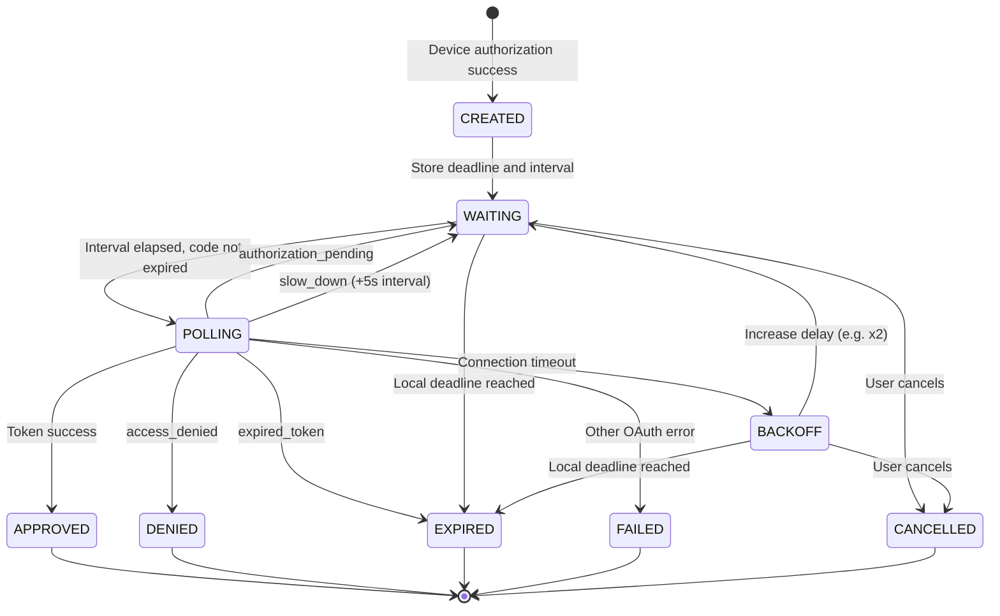
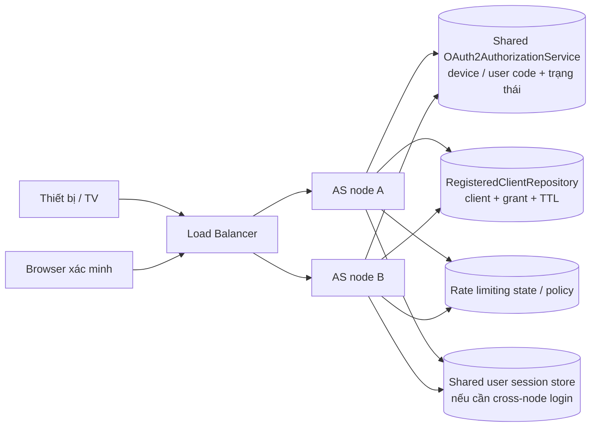

# Xử lý authorization_pending, slow_down, access_denied và expired_token

## 1. Bối cảnh: thiết bị không có trình duyệt vẫn cần xin quyền

Một chiếc Smart TV, máy in, thiết bị phát nội dung hoặc thiết bị IoT có màn hình và bàn phím rất hạn chế. Thay vì yêu cầu người dùng nhập mật khẩu trên thiết bị, **OAuth 2.0 Device Authorization Grant (RFC 8628)** cho phép:

1. Thiết bị (OAuth client) xin `device_code` và `user_code` từ **Device Authorization Endpoint**.
2. Thiết bị hiển thị địa chỉ xác minh và mã để người dùng mở trên điện thoại/máy tính.
3. Người dùng đăng nhập, kiểm tra tên ứng dụng/phạm vi quyền và chấp thuận hoặc từ chối ở **Device Verification Endpoint**.
4. Trong khi chờ, thiết bị **poll Token Endpoint** bằng `device_code`, nhận một trong các lỗi trạng thái hoặc nhận access token sau khi được phê duyệt.

Trong module **SPRING_SECURITY_OAUTH2_OIDC_AUTHORIZATION_SERVER**, chúng ta học cách thiết kế, cấu hình, bảo mật, kiểm thử và vận hành OAuth2/OIDC Authorization Server bằng **Spring Security và Spring Authorization Server trên Spring Boot**. Bài thuộc chương **Device Authorization** này tập trung chuyên sâu vào **bốn kết quả của polling**: `authorization_pending`, `slow_down`, `access_denied` và `expired_token`.

Đây là các **mã lỗi giao thức**, không chỉ là thông điệp UI. Hai mã đầu cho phép thiết bị tiếp tục polling với nhịp đúng; hai mã cuối buộc kết thúc giao dịch hiện tại. Hiểu sai chúng có thể tạo vòng lặp vô hạn, tấn công làm quá tải Token Endpoint, lộ token hoặc khiến UX bị kẹt ở trạng thái “đang chờ”.

### Mục tiêu

- Phân biệt **Device Authorization Response** với **Device Access Token Response** và vị trí của bốn mã lỗi.
- Xây dựng **state machine phía client** với thời hạn, interval, backoff, cancel và terminal states.
- Áp dụng chính xác quy tắc của **RFC 8628 §3.5**: interval mặc định 5 giây, `slow_down` cộng thêm 5 giây tích lũy, mọi lỗi khác ngoài hai mã pending phải ngừng polling.
- Liên hệ các component của Spring Authorization Server, cấu hình client và lifetime của device code.
- Thiết kế kiểm thử thành công/chưa chấp thuận/từ chối/hết hạn/quá tần suất, đồng thời cân nhắc bảo mật, nhiều node và vận hành.

**Phạm vi phiên bản:** Ví dụ Java/Spring hướng tới **Spring Authorization Server 1.5.x, Spring Security 6.x, Spring Boot 3.x**. Ở dòng Spring Security 7.x, các chức năng Authorization Server chuyển vào Spring Security và có thể khác chi tiết cấu hình. Tham khảo Javadoc đúng phiên bản dự án khi triển khai.

## 2. Ba endpoint và hai loại mã khác nhau

| Thành phần | Đường dẫn mặc định của Spring Authorization Server | Ai gọi? | Chức năng |
| --- | --- | --- | --- |
| **Device Authorization Endpoint** | `POST /oauth2/device_authorization` | Thiết bị/client | Khởi tạo phiên cấp quyền và nhận `device_code`, `user_code`, `verification_uri`, `expires_in`, `interval` nếu có |
| **Device Verification Endpoint** | `/oauth2/device_verification` | Người dùng qua browser trên thiết bị thứ hai | Nhập/xác nhận `user_code`, xác thực và chấp thuận/từ chối quyền |
| **Token Endpoint** | `POST /oauth2/token` | Thiết bị/client | Poll bằng `device_code`; nhận token hoặc mã lỗi trạng thái |

Đường dẫn có thể đổi trong `AuthorizationServerSettings`. Mỗi endpoint có kiểm soát truy cập, dữ liệu đầu vào và response riêng; **đừng gửi request polling tới Device Authorization Endpoint**.

### 2.1. `device_code` khác `user_code`

| Dữ liệu | Bên nhận/sử dụng | Yêu cầu bảo mật |
| --- | --- | --- |
| `device_code` | Thiết bị giữ và gửi tới Token Endpoint | Dữ liệu nhạy cảm, entropy cao, thời hạn ngắn; không đưa lên màn hình, QR công khai hoặc log |
| `user_code` | Con người nhập ở Device Verification Endpoint | Dễ đọc/dễ nhập, nhưng phải chống đoán mã và giới hạn lượt thử |
| `verification_uri` | Browser của người dùng | URL HTTPS hợp lệ thuộc Authorization Server/OP; không lấy từ nguồn không tin cậy |
| `verification_uri_complete` (nếu có) | Có thể mã hóa trong QR để giảm thao tác nhập | Chỉ là tối ưu UX; cần xác nhận ứng dụng và quyền trước khi duyệt |
| `expires_in` | Client | Số giây tối đa device code còn hiệu lực; dùng xác định **deadline** của polling |
| `interval` (nếu có) | Client | Số giây tối thiểu giữa các polling requests; **mặc định 5 giây nếu trường này vắng mặt** |

**Không dùng `user_code` để poll Token Endpoint**; request token phải mang `device_code`. Mã người dùng không phải OAuth access token hoặc Authorization Code, và không tự mang quyền gọi API.

### 2.2. Mẫu khởi tạo device authorization

Ví dụ public device client `living-room-tv` đã đăng ký grant type Device Code:

```http
POST /oauth2/device_authorization HTTP/1.1
Host: auth.example.com
Content-Type: application/x-www-form-urlencoded

client_id=living-room-tv&scope=library.read
```

Response thành công giả định:

```http
HTTP/1.1 200 OK
Content-Type: application/json
Cache-Control: no-store
Pragma: no-cache

{
  "device_code": "DEVICE_CODE_EXAMPLE_NOT_REAL",
  "user_code": "WDJB-MJHT",
  "verification_uri": "https://auth.example.com/oauth2/device_verification",
  "verification_uri_complete": "https://auth.example.com/oauth2/device_verification?user_code=WDJB-MJHT",
  "expires_in": 600,
  "interval": 5
}
```

Đây là **dữ liệu giả lập**, không phải mã thật hay bảo đảm mặc định `expires_in=600`, `interval=5` của mọi server. RFC 8628 yêu cầu các trường `device_code`, `user_code`, `verification_uri`, `expires_in`; `verification_uri_complete` và `interval` là tùy chọn. Khi không có `interval`, client phải áp dụng 5 giây.

Thiết bị nên hiển thị lời hướng dẫn rõ ràng: “Truy cập địa chỉ này trên điện thoại, nhập mã hiển thị rồi xác nhận bạn đang cấp quyền cho ứng dụng X”. Tránh yêu cầu người dùng nhập mật khẩu trên TV.

## 3. Token polling: nơi bốn mã lỗi xuất hiện

Sau khi hiển thị `verification_uri` và `user_code`, thiết bị chờ ít nhất khoảng thời gian được chỉ định rồi gửi:

```http
POST /oauth2/token HTTP/1.1
Host: auth.example.com
Content-Type: application/x-www-form-urlencoded

grant_type=urn%3Aietf%3Aparams%3Aoauth%3Agrant-type%3Adevice_code&device_code=DEVICE_CODE_EXAMPLE_NOT_REAL&client_id=living-room-tv
```

Lưu ý:

- Giá trị grant type chính xác là `urn:ietf:params:oauth:grant-type:device_code`; biểu diễn URL-encoded trong `application/x-www-form-urlencoded`.
- `device_code` là mã bí mật do Device Authorization Endpoint phát; **không** phải `user_code`.
- Public client không xác thực bằng shared secret phải gửi `client_id`; confidential client nếu được cấp credential thì phải xác thực theo cơ chế đã đăng ký.
- Request chạy **server-to-server / device-to-AS** qua TLS, không phụ thuộc cookie browser của người dùng.
- **Không được poll liên tục** chỉ vì người dùng chưa nhấn đồng ý.

Trong lúc người dùng chưa hoàn thành xác minh, Token Endpoint thường trả:

```http
HTTP/1.1 400 Bad Request
Content-Type: application/json
Cache-Control: no-store
Pragma: no-cache

{ "error": "authorization_pending" }
```

Response này là **một kết quả dự kiến của giao thức**, không phải dấu hiệu hỏng hệ thống. Theo RFC 8628 §3.5, `authorization_pending` và `slow_down` là **hai mã lỗi đặc biệt cho phép tiếp tục poll**. Các lỗi khác từ Token Endpoint **kết thúc việc polling của giao dịch hiện tại**.

### 3.1. Bảng quyết định chuẩn

| Giá trị `error` | Ý nghĩa | Client làm gì? | Có tiếp tục poll cùng `device_code`? |
| --- | --- | --- | --- |
| **`authorization_pending`** | Người dùng chưa hoàn tất bước xác thực/ủy quyền | Giữ màn hình chờ; đợi **ít nhất interval hiện tại** trước request tiếp theo | **Có** |
| **`slow_down`** | Vẫn đang chờ, nhưng tốc độ polling cần giảm | Tăng interval **thêm 5 giây**, áp dụng **ngay cho lần kế tiếp và mọi lần sau** | **Có, với nhịp mới** |
| **`access_denied`** | Người dùng đã từ chối yêu cầu | Dừng polling; báo bị từ chối, không tự khởi động lại | **Không** |
| **`expired_token`** | Device code hết hạn; phiên device authorization kết thúc | Dừng polling; bỏ mã cũ, hướng dẫn bắt đầu phiên mới theo thao tác người dùng | **Không** |
| OAuth error khác, ví dụ `invalid_client`, `invalid_grant`, `invalid_request` | Request/credential/grant không hợp lệ hoặc lỗi khác | Dừng polling, xử lý lỗi theo loại; không vòng lặp mù | **Không** |
| Token response thành công | Người dùng đã chấp thuận và AS cấp token | Dừng polling, lưu token an toàn và truy cập API | **Không** |

**Độ mạnh của chuẩn:** `authorization_pending`/`slow_down` là các mã hỗ trợ tiếp tục; với bất kỳ error code khác, **RFC 8628 yêu cầu client MUST stop polling**. Với `expired_token`, client **có thể** khởi tạo một device authorization mới nhưng **nên đợi người dùng tương tác** thay vì tự lặp lại để tránh polling vô ích.

## 4. `authorization_pending` — chờ đúng nhịp

### 4.1. Tình huống

Thiết bị lấy mã lúc 10:00:00, server trả `interval=5` giây; người dùng đang mở URL xác minh hoặc chưa kịp đăng nhập. Lần poll hợp lệ nhận:

```json
{
  "error": "authorization_pending"
}
```

Client không được coi lỗi này như đăng nhập thất bại và không cần yêu cầu cấp mã mới. Nó giữ `device_code`, tiếp tục hiển thị chỉ dẫn cho người dùng và lên lịch lần poll tiếp theo với **interval hiện tại**.

### 4.2. Quy tắc thời gian

- Nếu device authorization response gửi `interval=N`, trước mỗi lần poll tiếp theo phải chờ **ít nhất N giây**, có tính đến các lần tăng do `slow_down`.
- Nếu không có `interval`, **mặc định là 5 giây**.
- Không tự đặt 0, 1 hay 2 giây chỉ vì cần “responsive UI”.
- Khi server bận, client có thể chọn **chờ lâu hơn** interval; RFC quy định nhịp tối thiểu, không bắt buộc poll chính xác mỗi N giây.
- Nếu hệ thống kết nối không ổn định, phải giảm tần suất polling khi timeout mạng (mục 5.4).

Ví dụ:

```text
Device Authorization Response: interval = 5s

10:00:05  Poll #1 -> authorization_pending
10:00:10  Poll #2 -> authorization_pending
10:00:15  Poll #3 -> authorization_pending
10:00:20  Poll #4 -> có thể nhận access token khi user đã đồng ý
```

Đây là timeline minh họa; các request thực cần tính đến **thời điểm hoàn tất request và thời gian chờ**, tránh vô tình gửi quá nhanh. Thiết kế bảo thủ có thể đếm interval từ **khi nhận response trước đó**, bảo đảm khoảng cách giữa các request không nhỏ hơn mức yêu cầu.

### 4.3. Phân biệt “đang chờ” với lỗi sản phẩm

UI phù hợp: “Đang chờ bạn xác nhận trên điện thoại. Vui lòng kiểm tra mã X và tên ứng dụng.” Có thể hiển thị countdown tới deadline. Không hiện `authorization_pending` như lỗi 500, không tạo thêm hàng chục session/mã mới chỉ vì poll chưa thành công.

## 5. `slow_down` — tăng khoảng chờ và giữ mức đã tăng

### 5.1. Ý nghĩa

`slow_down` là một biến thể của `authorization_pending`: **ủy quyền vẫn chưa hoàn tất**, nhưng Authorization Server yêu cầu client polling chậm hơn. RFC 8628 §3.5 quy định **MUST increase interval by 5 seconds** ngay tại phản hồi này và **cho mọi request tiếp theo**.

Ví dụ response:

```http
HTTP/1.1 400 Bad Request
Content-Type: application/json
Cache-Control: no-store
Pragma: no-cache

{ "error": "slow_down" }
```

### 5.2. Tính cộng dồn, không reset

Giả sử device authorization response ban đầu có `interval=5` giây:

| Sự kiện sau khi poll | Interval phải giữ cho lần sau | Điều cần tránh |
| --- | --- | --- |
| `authorization_pending` đầu tiên | 5 giây | Không giảm xuống 1 giây |
| `slow_down` lần 1 | **10 giây** | Không chờ chỉ thêm 5 giây trên tổng? Phải tăng từ 5 lên 10 |
| `authorization_pending` sau đó | **10 giây** | Không reset về 5 |
| `slow_down` lần 2 | **15 giây** | Không reset về 10 |
| `authorization_pending` lần nữa | **15 giây** | Không bỏ qua tăng trước đó |

Nếu server ban đầu chỉ định `interval=8`, lần `slow_down` đầu tiên làm interval tăng thành **13 giây**, lần thứ hai thành **18 giây**. Giá trị không cố định ở 10 giây.

Một bug thường gặp:

```java
// SAI: mất lịch sử slow_down ở mọi lần pending tiếp theo.
int delaySeconds = "slow_down".equals(error) ? 10 : 5;
```

Thay vào đó, lưu interval hiện hành **trong state của từng device authorization transaction**. Mỗi giao dịch có `device_code`/deadline/interval riêng, không dùng một biến toàn cục khiến nhiều thiết bị ảnh hưởng lẫn nhau.

### 5.3. Nếu client nhận HTTP 429?

**HTTP 429 Too Many Requests** là tín hiệu HTTP có thể được gateway/rate limiter phát ra, **không đồng nghĩa** mọi response 429 có OAuth JSON `{"error":"slow_down"}`. Thiết kế client phải:

1. Parse response phù hợp với API contract và content type.
2. Với `slow_down` theo RFC 8628, **luôn cộng thêm 5 giây**.
3. Với 429 hoặc 503 **không chứa một OAuth error hợp lệ**, áp dụng chính sách backoff/retry lỗi hạ tầng một cách an toàn, xem `Retry-After` khi được cung cấp, không vượt deadline.
4. **Không** chuyển 429 thành thành công hoặc reset interval.

Vì RFC 8628 yêu cầu dừng polling khi gặp một **OAuth error code khác** với hai mã pending, không được âm thầm tự lặp lại mã lỗi như `invalid_client` dù response HTTP là 400 hay 429.

### 5.4. Timeout kết nối: giảm tần suất theo RFC

Một nhánh riêng là **connection timeout** (không nhận được response). RFC 8628 yêu cầu client **MUST reduce polling frequency** trước khi retry; chuẩn khuyến nghị dùng **exponential backoff**, ví dụ nhân đôi interval sau từng timeout.

```text
interval cơ sở 5s
timeout #1 -> interval chờ 10s
timeout #2 -> interval chờ 20s
timeout #3 -> interval chờ 40s
...
```

Đặt giới hạn phù hợp TTL/UX/tài nguyên thiết bị và chỉ retry khi chưa hết thời hạn. Không lập tức gửi lại hàng loạt request sau timeout; dù request có thể đã đến server, client cũng không nên nhân bản chúng đồng thời.

## 6. `access_denied` — từ chối là trạng thái kết thúc

### 6.1. Tình huống

Người dùng mở `verification_uri` trên điện thoại, xác minh tên `living-room-tv` và quyết định không cấp quyền. Lần poll sau đó có thể nhận:

```json
{
  "error": "access_denied"
}
```

Điều này khác hẳn `authorization_pending`: người dùng đã đưa ra quyết định **từ chối**, không phải chưa xử lý xong.

### 6.2. Cách xử lý

- **Ngừng polling cùng device code ngay**; theo RFC 8628, chỉ hai mã `authorization_pending` và `slow_down` cho phép tiếp tục.
- Đưa UI về trạng thái “Yêu cầu kết nối đã bị từ chối”, cung cấp nút “Thử lại” **do người dùng chủ động** nếu sản phẩm cho phép.
- Xóa `device_code` đang giữ khỏi state không cần thiết, ngừng timer và không để một polling worker cũ tiếp tục.
- Không lặng lẽ tự sinh mã mới để “chờ user đồng ý lần khác”, không tạo vòng lặp xin consent liên tục.
- Ghi audit/metric theo mã lỗi và correlation ID; **không** ghi raw `device_code`, `user_code` hoặc token.

### 6.3. Từ chối là quyết định của người dùng, không phải lỗi xác thực client

`access_denied` không chứng minh client secret sai, `device_code` hết hạn hoặc Token Endpoint bị lỗi. Nó phản ánh yêu cầu cấp quyền không được chấp thuận. Hiển thị lỗi vừa đủ; không tự động điều hướng browser hay tiết lộ danh tính người dùng từ phía thiết bị.

## 7. `expired_token` — device authorization session đã hết hạn

### 7.1. Tình huống

Server trả `expires_in=600` giây lúc client khởi tạo request. Người dùng không hoàn thành bước xác minh trước khi device code hết hạn. Lần poll liên quan có thể nhận:

```json
{
  "error": "expired_token"
}
```

**Đây là hết hạn `device_code`**, không nhất thiết là hết hạn access token hay refresh token đã được phát hành trong một phiên khác. Khi nhận lỗi này, device authorization session hiện tại đã kết thúc.

### 7.2. Cách xử lý

1. **Ngừng polling**, vô hiệu hóa state/timer của mã cũ.
2. Hiển thị “Mã xác minh đã hết hạn”, không tiếp tục yêu cầu người dùng nhập `user_code` cũ.
3. Cho phép bắt đầu **một Device Authorization Request mới** bằng nút/luồng tương tác của người dùng, nhận một cặp mã mới.
4. Giữ giới hạn số lần tạo mã và chống lạm dụng; tránh auto-restart vòng lặp làm tăng tải.

RFC 8628 cho phép khởi động lại quy trình sau khi code hết hạn nhưng **SHOULD wait for user interaction before restarting**, vì việc tạo mã và poll liên tục khi không có ai thao tác là không có ích.

### 7.3. Kiểm tra deadline phía client

Ngay khi nhận `expires_in`, client nên tạo deadline cho transaction, ưu tiên **đồng hồ đơn điệu (monotonic clock)** để tránh sai lệch khi thiết bị đổi giờ hệ thống. Trước khi gửi request tiếp theo, kiểm tra:

```text
if remaining_lifetime <= 0:
    stop polling
    show "Verification expired"
else:
    wait at least current_interval
    if deadline passed while waiting: stop without a new HTTP request
    else: poll /oauth2/token
```

Đồng hồ phía client có thể khác server và mạng có độ trễ, nên vẫn phải **tôn trọng `expired_token` do server trả**. Không coi local deadline là bằng chứng AS đã xóa mọi bản ghi ngay lập tức; nó là ranh giới **để client ngừng gửi request không cần thiết**.

## 8. State machine đúng cho bốn mã lỗi



**Bất biến an toàn:**

- Chỉ **một polling worker / một request đang chạy** cho mỗi device transaction, trừ khi thiết kế đặc biệt bảo đảm tương đương.
- Không gửi tiếp trước `nextAllowedPollAt` và không gửi sau deadline.
- Mọi phản hồi `slow_down` **cộng 5 giây** vào interval đã tồn tại.
- `authorization_pending` **không reset** interval đã tăng.
- `access_denied`, `expired_token`, OAuth error khác và thành công đều chuyển sang **terminal**.
- Hủy từ UI (cancel), shutdown, mất phiên hoặc logout phải dừng timer và bỏ state bí mật.
- Không tiếp tục polling mã cũ sau khi bắt đầu một device authorization mới; tránh race khiến kết quả cũ ghi đè kết quả mới.

### 8.1. Timeline minh họa có `slow_down`

```text
T0       Device response: interval=5, expires_in=600
T0+5s    Poll #1 -> authorization_pending        => vẫn 5s
T0+10s   Poll #2 -> slow_down                    => 10s
T0+20s   Poll #3 -> authorization_pending        => vẫn 10s
T0+30s   Poll #4 -> slow_down                    => 15s
T0+45s   Poll #5 -> authorization_pending        => vẫn 15s
T0+60s   Poll #6 -> access_denied                 => STOP
```

Các mốc giả định network latency không đáng kể; code thực phải đếm bằng bộ lập lịch an toàn. Nếu ở bước cuối nhận token thay vì `access_denied`, client **vẫn dừng polling**, lưu token theo chính sách.

## 9. Java: chính sách polling có state, deadline và backoff

Để thấy rõ bốn lỗi được xử lý thế nào, ta viết một **state policy thuần Java 17**. Đối tượng này **không tự gửi HTTP**; adapter HTTP của ứng dụng chịu trách nhiệm gọi Token Endpoint, parse response và dùng quyết định `RETRY/COMPLETE/STOP_*` để lên lịch.

Thiết kế tách như vậy giúp unit test chính sách trước khi kết nối với mạng thật:

```java
import java.time.Duration;
import java.time.Instant;
import java.util.Objects;

public final class DevicePollingPolicy {
    public enum Action {
        RETRY, COMPLETE, STOP_DENIED, STOP_EXPIRED, STOP_ERROR, STOP_CANCELLED
    }

    public record Decision(Action action, Duration waitBeforeNextPoll) {}

    private final Instant deadline;
    private Duration currentInterval;
    private boolean terminal;

    /**
     * @param startedAt thời điểm nhận device authorization response
     * @param expiresInSeconds expires_in từ response, phải > 0
     * @param intervalSeconds interval của response; null nghĩa là 5 giây
     */
    public DevicePollingPolicy(
            Instant startedAt, long expiresInSeconds, Long intervalSeconds) {
        Objects.requireNonNull(startedAt);
        if (expiresInSeconds <= 0) {
            throw new IllegalArgumentException("expires_in must be positive");
        }
        long pollEvery = intervalSeconds == null ? 5 : intervalSeconds;
        if (pollEvery <= 0) {
            throw new IllegalArgumentException("interval must be positive");
        }
        this.deadline = startedAt.plusSeconds(expiresInSeconds);
        this.currentInterval = Duration.ofSeconds(pollEvery);
    }

    public Duration interval() {
        return currentInterval;
    }

    public boolean mayPoll(Instant now) {
        return !terminal && now.isBefore(deadline);
    }

    /** Gọi khi đã nhận OAuth error từ Token Endpoint. */
    public Decision onError(String oauthError, Instant receivedAt) {
        if (terminal) {
            throw new IllegalStateException("Device flow already completed");
        }
        Objects.requireNonNull(receivedAt);
        // Ưu tiên trạng thái terminal do Authorization Server trả về.
        if ("access_denied".equals(oauthError)) {
            return stop(Action.STOP_DENIED);
        }
        if ("expired_token".equals(oauthError)) {
            return stop(Action.STOP_EXPIRED);
        }
        if (!receivedAt.isBefore(deadline)) {
            return stop(Action.STOP_EXPIRED);
        }

        return switch (oauthError == null ? "" : oauthError) {
            case "authorization_pending" ->
                    new Decision(Action.RETRY, currentInterval);

            case "slow_down" -> {
                currentInterval = currentInterval.plusSeconds(5);
                yield new Decision(Action.RETRY, currentInterval);
            }

            default -> stop(Action.STOP_ERROR); // invalid_client, invalid_grant...
        };
    }

    /** Timeout kết nối: giảm tần suất trước khi thử lại (RFC 8628 §3.5). */
    public Decision onConnectionTimeout(Instant receivedAt) {
        if (terminal) {
            throw new IllegalStateException("Device flow already completed");
        }
        if (!receivedAt.isBefore(deadline)) {
            return stop(Action.STOP_EXPIRED);
        }
        currentInterval = currentInterval.multipliedBy(2);
        return new Decision(Action.RETRY, currentInterval);
    }

    public Decision onSuccess() {
        if (terminal) {
            throw new IllegalStateException("Device flow already completed");
        }
        return stop(Action.COMPLETE);
    }

    public Decision cancel() {
        return stop(Action.STOP_CANCELLED);
    }

    private Decision stop(Action action) {
        terminal = true;
        return new Decision(action, Duration.ZERO);
    }
}
```

### 9.1. Cách adapter HTTP dùng state policy

Phần dưới là **pseudocode**, mô tả trình tự tích hợp; `httpPollTokenEndpoint`, `sleepMonotonic`, `parseOAuthError`… không phải API Spring tự cung cấp:

```text
deviceResponse = requestDeviceAuthorization()
policy = DevicePollingPolicy(now, expires_in, interval_if_present)

while not userCancelled:
    sleepMonotonic(policy.interval())      # lần đầu cũng phải chờ
    if not policy.mayPoll(now):            # chặn polling sau deadline
        showExpired()
        break

    try:
        response = httpPollTokenEndpoint(
            grant_type = "urn:ietf:params:oauth:grant-type:device_code",
            device_code = deviceResponse.device_code,
            client_authentication = configured_method
        )

        if response is successful_token_response:
            policy.onSuccess()
            saveTokenSafely(response)
            showConnected()
            break

        decision = policy.onError(parseOAuthError(response), now)
        if decision.action == RETRY:
            # lần sau chờ decision.waitBeforeNextPoll (interval đã cập nhật)
            continue
        showTerminalError(decision.action)
        break

    catch ConnectionTimeout:
        decision = policy.onConnectionTimeout(now)
        if decision.action == RETRY:
            continue
        showExpired()
        break

if userCancelled:
    policy.cancel()
clearSensitiveDeviceState()
```

**Khi chuyển thành code thật, đừng dùng vừa `sleep(policy.interval())` vừa `sleep(decision.waitBeforeNextPoll)` cho cùng một chu kỳ**: sẽ chờ hai lần. Chọn **một nguồn thời gian** để lên lịch request tiếp theo. Pseudocode sử dụng `policy.interval()` hiện tại, do đó quyết định trả ra chỉ giúp báo trạng thái và kiểm thử.

Để thực thi chính xác thời gian:

- Dùng `ScheduledExecutorService`/scheduler hoặc coroutine/event loop **không block UI thread**.
- Ưu tiên đồng hồ **monotonic** (ví dụ `System.nanoTime()`) cho thời gian chờ/TTL trong runtime; ví dụ trên dùng `Instant` để dễ unit test logic.
- Sau mỗi response, lên lịch **một** request tiếp theo, không vừa scheduler vừa vòng `while` gửi đồng thời.
- Khi cancel, terminal, shutdown hoặc khởi tạo phiên mới, phải hủy timer/callback cũ; dùng transaction ID/generation để loại response đến muộn.
- Không lập kế hoạch gửi sau deadline; có thể dừng trước hạn nếu khoảng chờ cần thiết dài hơn thời gian còn lại.
- Với retry do lỗi mạng khác timeout, giới hạn theo retry policy, không che OAuth error dạng terminal, không tăng tải đột ngột.

### 9.2. Unit test bốn lỗi với JUnit 5

```java
import java.time.Instant;

import org.junit.jupiter.api.Test;
import static org.junit.jupiter.api.Assertions.*;

class DevicePollingPolicyTest {
    private static final Instant T0 = Instant.parse("2026-01-01T00:00:00Z");

    @Test
    void missingIntervalDefaultsToFiveSeconds() {
        DevicePollingPolicy policy = new DevicePollingPolicy(T0, 600, null);
        assertEquals(5, policy.interval().toSeconds());
        var decision = policy.onError("authorization_pending", T0.plusSeconds(5));
        assertEquals(DevicePollingPolicy.Action.RETRY, decision.action());
        assertEquals(5, decision.waitBeforeNextPoll().toSeconds());
    }

    @Test
    void slowDownAccumulatesEvenAfterPending() {
        DevicePollingPolicy policy = new DevicePollingPolicy(T0, 600, 8L);
        policy.onError("slow_down", T0.plusSeconds(8));
        assertEquals(13, policy.interval().toSeconds());
        policy.onError("authorization_pending", T0.plusSeconds(21));
        assertEquals(13, policy.interval().toSeconds()); // không reset
        policy.onError("slow_down", T0.plusSeconds(34));
        assertEquals(18, policy.interval().toSeconds()); // cộng tiếp 5s
    }

    @Test
    void denialStopsPolling() {
        DevicePollingPolicy policy = new DevicePollingPolicy(T0, 600, 5L);
        var decision = policy.onError("access_denied", T0.plusSeconds(5));
        assertEquals(DevicePollingPolicy.Action.STOP_DENIED, decision.action());
        assertFalse(policy.mayPoll(T0.plusSeconds(10)));
    }

    @Test
    void expiredTokenStopsEvenIfLocalDeadlineNotReached() {
        DevicePollingPolicy policy = new DevicePollingPolicy(T0, 600, 5L);
        var decision = policy.onError("expired_token", T0.plusSeconds(100));
        assertEquals(DevicePollingPolicy.Action.STOP_EXPIRED, decision.action());
        assertFalse(policy.mayPoll(T0.plusSeconds(120)));
    }

    @Test
    void connectionTimeoutAppliesBackoff() {
        DevicePollingPolicy policy = new DevicePollingPolicy(T0, 600, 5L);
        policy.onConnectionTimeout(T0.plusSeconds(5));
        assertEquals(10, policy.interval().toSeconds());
        policy.onConnectionTimeout(T0.plusSeconds(15));
        assertEquals(20, policy.interval().toSeconds());
    }

    @Test
    void anyOtherOAuthErrorIsTerminal() {
        DevicePollingPolicy policy = new DevicePollingPolicy(T0, 600, 5L);
        assertEquals(DevicePollingPolicy.Action.STOP_ERROR,
                policy.onError("invalid_client", T0.plusSeconds(5)).action());
        assertFalse(policy.mayPoll(T0.plusSeconds(10)));
    }
}
```

Test này kiểm tra **quy tắc điều phối phía thiết bị**, không thay HTTP integration test. Chính sách thực tế còn phải giới hạn số request, phân loại lỗi transport/TLS, tránh overflow khi nhân delay, đóng phiên sau khi token được phát và tách dữ liệu bí mật khỏi telemetry.

## 10. Spring Authorization Server xử lý Device Grant ở đâu?

### 10.1. Các component theo nhiệm vụ

Trong Spring Authorization Server 1.5.x, tài liệu **Protocol Endpoints** mô tả:

| Tầng | Component | Vai trò |
| --- | --- | --- |
| Khởi tạo device authorization | `OAuth2DeviceAuthorizationEndpointFilter` | Nhận request thiết bị, trả device authorization response |
| Chuyển đổi request | `OAuth2DeviceAuthorizationRequestAuthenticationConverter` | Đọc client/scopes và tạo authentication request |
| Xử lý khởi tạo | `OAuth2DeviceAuthorizationRequestAuthenticationProvider` | Kiểm tra client/grant và tạo mã theo chính sách |
| Xác minh bởi người dùng | `OAuth2DeviceVerificationEndpointFilter` | Nhận tương tác nhập mã và consent trên browser |
| Xử lý user code/consent | `OAuth2DeviceVerificationAuthenticationProvider`, `OAuth2DeviceAuthorizationConsentAuthenticationProvider` | Kiểm tra, xác thực và ghi quyết định cấp quyền |
| Token polling | `OAuth2TokenEndpointFilter` | Nhận `grant_type=urn:ietf:params:oauth:grant-type:device_code` |
| Chuyển đổi polling | `OAuth2DeviceCodeAuthenticationConverter` | Parse `device_code`/grant ở Token Endpoint |
| Quyết định polling | `OAuth2DeviceCodeAuthenticationProvider` | Kiểm tra authorization state, grant, client; trả token hoặc OAuth error |
| Lưu state | `OAuth2AuthorizationService` | Lưu device code, user code, trạng thái authorization/consent/token |
| Sinh token | `OAuth2TokenGenerator<?>` | Tạo access token (và token khác nếu grant/chính sách cho phép) |

**Đừng gán bốn lỗi polling cho Device Authorization Endpoint.** Nó trả mã để bắt đầu flow. Các mã `authorization_pending`, `slow_down`, `access_denied` và `expired_token` được định nghĩa cho **Token Endpoint response** của Device Authorization Grant.

### 10.2. Dữ liệu nào quyết định pending/denied/expired?

Một phiên device authorization có ít nhất những khía cạnh trạng thái:

- `RegisteredClient` nào đã khởi tạo, phương thức client authentication/grant/scope hợp lệ hay không.
- `device_code` và `user_code` được phát, thời điểm phát và hết hạn.
- Người dùng đã xác minh `user_code` hay chưa; có từ chối hay đã chấp thuận.
- Authorization đã được cập nhật và có token nào được cấp; device code đã bị sử dụng hay vô hiệu hóa.
- Các quy tắc chống polling quá nhanh hoặc abuse nếu ứng dụng triển khai.

Spring Authorization Server dùng `OAuth2AuthorizationService` để giữ/tra cứu authorization state. Khi chạy nhiều instance, dùng persistence chia sẻ phù hợp để Token Endpoint ở node khác vẫn thấy kết quả người dùng vừa xác minh.

### 10.3. Phần nào cần custom khi muốn trả `slow_down`?

Spring Authorization Server cung cấp các **extension points** ở `OAuth2TokenEndpointConfigurer` để tùy chỉnh authentication converter/provider hoặc error handler. Nhưng **không nên khẳng định thư viện tự có đầy đủ cơ chế rate limit và tự phát `slow_down` trong mọi phiên bản/cấu hình**. Hãy kiểm tra hành vi thật bằng test:

- Nếu client vượt khoảng thời gian được công bố, Authorization Server có trả `slow_down` theo yêu cầu sản phẩm không?
- Nếu có ingress/API gateway rate limit riêng trả HTTP 429, client có hiểu đúng sự khác biệt với OAuth `slow_down` không?
- Có thể định danh chính xác **device transaction và client**, thay vì một IP NAT chung?
- Có tránh phản hồi `slow_down` sai cho request không hợp lệ (device code sai, client sai, expired) không?
- Có bảo đảm cập nhật rate-limit state bền vững/nhất quán giữa các node không?

Nếu cần bổ sung, thiết kế rate limiter/polling policy ở tầng Token Endpoint **mà không bỏ qua xác thực client, tra cứu authorization và các validator mặc định**. Đừng tự phát token hoặc tự trả `authorization_pending` bằng một `@RestController` bên ngoài Spring Security mà không nắm rõ giao thức.

## 11. Cấu hình một device client trong Spring Boot

Ví dụ sau tạo **public device client** cho môi trường học/test, đăng ký grant type chính xác từ RFC 8628. Nó không phải cấu hình Authorization Server đầy đủ:

```java
import java.time.Duration;

import org.springframework.context.annotation.Bean;
import org.springframework.context.annotation.Configuration;
import org.springframework.security.oauth2.core.AuthorizationGrantType;
import org.springframework.security.oauth2.core.ClientAuthenticationMethod;
import org.springframework.security.oauth2.server.authorization.client.InMemoryRegisteredClientRepository;
import org.springframework.security.oauth2.server.authorization.client.RegisteredClient;
import org.springframework.security.oauth2.server.authorization.client.RegisteredClientRepository;
import org.springframework.security.oauth2.server.authorization.settings.ClientSettings;
import org.springframework.security.oauth2.server.authorization.settings.TokenSettings;

@Configuration(proxyBeanMethods = false)
public class DeviceClientConfiguration {

    private static final AuthorizationGrantType DEVICE_CODE =
            new AuthorizationGrantType(
                    "urn:ietf:params:oauth:grant-type:device_code");

    @Bean
    RegisteredClientRepository registeredClientRepository() {
        RegisteredClient tv = RegisteredClient.withId("tv-stable-internal-id")
                .clientId("living-room-tv")
                .clientName("Living Room TV")
                .clientAuthenticationMethod(ClientAuthenticationMethod.NONE)
                .authorizationGrantType(DEVICE_CODE)
                .scope("library.read")
                .clientSettings(ClientSettings.builder()
                        .requireAuthorizationConsent(true)
                        .build())
                .tokenSettings(TokenSettings.builder()
                        .deviceCodeTimeToLive(Duration.ofMinutes(10))
                        .accessTokenTimeToLive(Duration.ofMinutes(15))
                        .build())
                .build();

        return new InMemoryRegisteredClientRepository(tv);
    }
}
```

Giải thích:

- `ClientAuthenticationMethod.NONE` đại diện **public client** không giữ shared secret an toàn; vẫn phải được đăng ký và tuân thủ grant/scope policy.
- Device Grant dùng URI chính xác `urn:ietf:params:oauth:grant-type:device_code`; không tự đặt `grant_type=device_code`.
- `TokenSettings.deviceCodeTimeToLive(...)` điều khiển lifetime **device code**, độc lập với access token TTL. Trong Spring Authorization Server 1.5.x, Javadoc nêu device code TTL mặc định **5 phút**; ví dụ đặt **10 phút** theo lựa chọn giả định.
- `requireAuthorizationConsent(true)` quy định chính sách consent khi áp dụng; UI verification cần cung cấp đủ thông tin tên client/scope để người dùng nhận diện yêu cầu.
- `InMemoryRegisteredClientRepository` chỉ phù hợp demo/test. Production cần `RegisteredClientRepository` và `OAuth2AuthorizationService` bền vững; cả session người dùng ở browser verification cũng cần được thiết kế khi chạy nhiều node.

**Không thêm credential bí mật cố định vào firmware/thùng ứng dụng rồi coi thiết bị là confidential.** Nếu client có khả năng bảo vệ credential thực sự, hãy dùng một phương thức client authentication phù hợp; nếu không, bảo vệ bằng chính sách registration, user verification, mã ngẫu nhiên, TTL/rate limits và các kiểm soát khác.

### 11.1. Định nghĩa endpoint chính xác

Một ứng dụng có thể cấu hình `AuthorizationServerSettings` riêng:

```java
import org.springframework.context.annotation.Bean;
import org.springframework.security.oauth2.server.authorization.settings.AuthorizationServerSettings;

@Bean
AuthorizationServerSettings authorizationServerSettings() {
    return AuthorizationServerSettings.builder()
            .issuer("https://auth.example.com")
            .deviceAuthorizationEndpoint("/oauth2/device_authorization")
            .deviceVerificationEndpoint("/oauth2/device_verification")
            .tokenEndpoint("/oauth2/token")
            .build();
}
```

Những đường dẫn là **mặc định** của Spring Authorization Server 1.5.x và được liệt kê để làm rõ quan hệ. Cần có Authorization Server `SecurityFilterChain`, user authentication/consent, signing key, repository và service đầy đủ để chạy; chỉ bean trên không tự tạo các endpoint.

Tại `OAuth2AuthorizationServerConfigurer`, có thể tùy chỉnh:

- `deviceAuthorizationEndpoint(...)`: converter/provider, success/error response handler, `verificationUri(...)`.
- `deviceVerificationEndpoint(...)`: converter/provider, verification response/error handler, consent page.
- `tokenEndpoint(...)`: converter/provider và error handling cho device_code grant cùng các grant khác.

**Đừng nhầm `verificationUri(...)` với Token Endpoint**: URI xác minh dành cho **browser của người dùng**, không phải địa chỉ poll.

### 11.2. Phân biệt hai chuỗi cấu hình

```text
Authorization Server:
    spring.security.oauth2.authorizationserver.client.*
    RegisteredClientRepository / AuthorizationServerSettings

Thiết bị OAuth Client:
    Device Authorization Endpoint + Token Endpoint + Device Polling Policy
    (có thể viết bằng Java/SDK khác)
```

Khai báo client trên server **không tự viết mã polling ở firmware**. Ngược lại, client polling đúng RFC **không thay thế** validation/rate limiting và state transitions phía server.

## 12. Xử lý giao diện xác minh và từ chối cho đúng ngữ cảnh

### 12.1. Hai thiết bị, hai trải nghiệm

**Trên TV/thiết bị:**

- Hiển thị tên ứng dụng, `verification_uri` dễ đọc, `user_code` với cỡ chữ đủ lớn và QR nếu có.
- Hiển thị thời gian còn lại, “Đang chờ xác nhận” khi `authorization_pending`, nhưng **không** hiện raw error code cho người dùng cuối.
- Nếu `slow_down`: tiếp tục chờ, cập nhật nhịp polling **ở nền**, tránh UI liên tục nhấp nháy.
- Nếu `access_denied`: hiển thị “Bạn đã từ chối kết nối” và nút “Thử lại” (do người dùng quyết định).
- Nếu `expired_token`: hiển thị “Mã đã hết hạn” và nút “Lấy mã mới”.

**Trên browser/điện thoại:**

- Xác thực người dùng với Authorization Server, không nhập mật khẩu trên TV.
- Hiển thị **tên client, device/session context phù hợp, các scope** trước khi chấp thuận.
- Giải thích yêu cầu nào đang chờ, đặc biệt với thiết bị công cộng hoặc thiết bị dùng chung.
- Từ chối phải tạo quyết định rõ ràng để lần polling sau được trả `access_denied` hoặc trạng thái tương đương của implementation.

### 12.2. Phòng chống lừa đảo và nhầm thiết bị

RFC 8628 mô tả rủi ro **remote phishing**: người dùng có thể bị kẻ tấn công dụ nhập mã trên trang thật nhằm cấp quyền cho *thiết bị của kẻ tấn công*. Vì vậy:

1. Trên browser, hiển thị ứng dụng/thiết bị đang xin quyền cùng mô tả dễ hiểu.
2. Nhắc người dùng chỉ chấp thuận nếu **chính họ vừa khởi tạo yêu cầu trên thiết bị của mình**.
3. Nếu sử dụng `verification_uri_complete`/QR, vẫn cần xác minh **tên ứng dụng và quyền**; không duyệt tự động ngay khi mở URL.
4. Giới hạn số lần đoán `user_code`, thiết kế mã đủ entropy và thời gian hiệu lực phù hợp.
5. Bảo vệ Device Verification Endpoint khỏi CSRF, session fixation, open redirect và dùng HTTPS.

**Lưu ý:** hiển thị `user_code` cho con người là một phần hợp lệ của giao thức; **device_code không bao giờ nên được đưa lên UI để người dùng chép**.

## 13. Kiểm thử tích hợp cho bốn mã lỗi

### 13.1. Bộ dữ liệu thử nghiệm

Thiết lập môi trường Spring Boot integration test gồm:

- Một client `living-room-tv` đăng ký device grant với scopes và `deviceCodeTimeToLive` đã xác định.
- Device Authorization Endpoint phát cặp `device_code`/`user_code` thật.
- Browser test có phiên người dùng và consent flow qua Device Verification Endpoint.
- `OAuth2AuthorizationService` có thể quan sát authorization state qua công cụ test; không dựa vào token values trong log production.
- Một **polling client test** có clock/scheduler điều khiển được, không phải đợi thực 10 phút ở mỗi test.

Không thay đổi `OAuth2AuthorizationService` và input của provider để “ép” mã lỗi bằng cách vô hiệu hóa các kiểm tra bảo mật khác; test nên tạo trạng thái theo giao thức, hoặc fixture/service riêng **chỉ trong môi trường test**.

### 13.2. Ma trận trường hợp bắt buộc

| Case | Trạng thái/hành vi | Kỳ vọng |
| --- | --- | --- |
| P01 | Tạo device authorization hợp lệ; chưa ai xác minh | Poll nhận `authorization_pending`; client lên lịch theo interval |
| P02 | Response Device Authorization **không có** `interval` | Client chờ ít nhất **5 giây** |
| P03 | Response có `interval=7` | Client chờ ít nhất **7 giây**, không dùng cứng 5 |
| P04 | Poll trước nhịp khi server có policy rate limit | Nhận `slow_down` hoặc cơ chế rate-limit đã cấu hình; xác minh behavior thực tế |
| P05 | `slow_down` lần đầu sau interval 7 giây | Client tăng lên **12 giây** |
| P06 | `authorization_pending` ngay sau `slow_down` | Client **giữ 12 giây**, không reset 7 |
| P07 | `slow_down` lần thứ hai | Client tăng lên **17 giây** |
| P08 | Timeout kết nối | Client giảm polling frequency; exponential backoff hoặc chiến lược phù hợp |
| P09 | Người dùng từ chối trên verification page | Poll nhận `access_denied`; **stop**, không token |
| P10 | Nhận `access_denied` rồi UI không tương tác | Client không tự xin mã/poll lại |
| P11 | `device_code` hết hạn trước khi user chấp thuận | Token Endpoint trả `expired_token` khi trạng thái tương ứng; client stop |
| P12 | Deadline client đã hết trước lần poll tiếp theo | Client tự stop, **không** gửi request mới |
| P13 | Sau `expired_token` user chọn “Thử lại” | Khởi tạo phiên mới với mã mới; không dùng mã cũ |
| P14 | Người dùng đồng ý khi code còn active | Token response thành công; client stop polling và lưu token |
| P15 | Dùng lại device code đã redeem | Không được cấp thêm token; trả OAuth error phù hợp |
| P16 | `device_code` đúng nhưng `client_id`/client auth sai | Từ chối; không cấp token, không tiết lộ trạng thái user |
| P17 | Device code không tồn tại/malformed | OAuth error theo contract, không busy retry |
| P18 | OAuth error khác: `invalid_client`, `invalid_grant` | Client **stop**, hiển thị lỗi phù hợp |
| P19 | User hủy/power off thiết bị giữa polling | Hủy timer/HTTP request, không còn worker tiếp tục |
| P20 | Hai phiên device authorization đồng thời trên hai thiết bị | Interval, code, deadline độc lập, không dùng nhầm |
| P21 | AS nhiều node: yêu cầu mã trên node A, verify trên B, poll trên C | Tất cả dùng state thống nhất qua shared storage |
| P22 | Gateway trả 429/503 không có OAuth JSON error | Client xử lý transport/rate limit an toàn; không coi đó là token thành công |
| P23 | Consent phê duyệt scope hẹp hơn request | Access token chỉ có phạm vi được cấp, không tăng quyền |
| P24 | Browser nhập sai `user_code` nhiều lần | Có rate limit, không lộ mã/identity và không dò mã không giới hạn |

Các test với “server trả `slow_down`” cần cấu hình hoặc fixture **rate limiting thực sự**; nếu Spring Authorization Server/ingress ở phiên bản bạn dùng không tự phát mã này, không mặc định assert framework đã có sẵn hành vi đó. Ngược lại, **client vẫn bắt buộc xử lý `slow_down` khi nhận được** từ một Authorization Server tuân thủ RFC.

### 13.3. Curl minh họa ở môi trường test

Khởi tạo device authorization:

```bash
curl --silent --show-error --request POST \
  'https://auth.test.example/oauth2/device_authorization' \
  --header 'Content-Type: application/x-www-form-urlencoded' \
  --data-urlencode 'client_id=living-room-tv' \
  --data-urlencode 'scope=library.read'
```

Poll Token Endpoint **chỉ sau khoảng chờ bắt buộc**:

```bash
curl --silent --show-error --request POST \
  'https://auth.test.example/oauth2/token' \
  --header 'Content-Type: application/x-www-form-urlencoded' \
  --data-urlencode 'grant_type=urn:ietf:params:oauth:grant-type:device_code' \
  --data-urlencode 'client_id=living-room-tv' \
  --data-urlencode 'device_code=TEST_DEVICE_CODE_FROM_PREVIOUS_RESPONSE'
```

Các giá trị ví dụ là placeholder; thay bằng response fixture của môi trường test. **Không dùng lệnh shell trong vòng lặp 0 giây**, không chia sẻ raw output chứa `device_code` hoặc access token vào hệ thống log chung. Để tái hiện `access_denied`, thao tác từ chối trên verification UI; để tái hiện `expired_token`, dùng TTL ngắn trong test; để tái hiện `slow_down`, dùng rate-limit policy/test double được cấu hình minh bạch.

## 14. Vận hành production: state, bảo mật và giới hạn tải

### 14.1. Nhiều instance Authorization Server



Nếu node A cấp device code nhưng node B không tra được state (vì chỉ dùng `InMemoryOAuth2AuthorizationService` riêng từng node), B có thể báo code không hợp lệ/hết hạn dù người dùng đang xác minh trên A. Không giải quyết bằng cách tắt validation hoặc buộc user cấp mã mới liên tục; cần lưu trữ state chia sẻ và thiết kế session browser nhất quán.

### 14.2. Đặt TTL và interval phù hợp

Các yếu tố cần cân nhắc:

- **Device code TTL:** đủ dài để người dùng mở điện thoại, đăng nhập và nhập mã, nhưng không quá dài làm tăng thời gian mã có thể bị lạm dụng.
- **Polling interval:** giới hạn chi phí mỗi thiết bị; không đặt 0 hoặc 1 giây để “nhanh hơn”.
- **Rate limit trên server:** theo client/device transaction và các tiêu chí khác phù hợp; tránh khóa hàng loạt thiết bị cùng NAT chỉ do rate limit theo IP quá thô.
- **Jitter/backoff:** có thể thêm chờ ngẫu nhiên *dài hơn* interval để tránh đồng loạt; không để jitter làm khoảng chờ ngắn hơn mức yêu cầu.
- **Cleanup:** dọn authorization đã hết hạn theo retention/audit policy; không xóa state đang chờ trước TTL.
- **Observability:** đo số phiên khởi tạo, tỷ lệ pending/slow_down/denied/expired/success, thời gian hoàn tất, số request trên mỗi phiên và tải Token Endpoint.

Ước lượng trực quan: nếu có **10.000 thiết bị** đồng thời polling mỗi **5 giây**, tải trung bình xấp xỉ **2.000 requests/giây** chỉ từ flow đang chờ. Giảm tần suất khi `slow_down` và có chiến lược rate limiting là thiết kế cần thiết cho Authorization Server có quy mô lớn. Đây là phép tính trung bình minh họa, không dự đoán burst thực tế.

### 14.3. Chính sách HTTP/cache và dữ liệu nhạy cảm

- Trả OAuth error từ Token Endpoint theo JSON chuẩn với `Cache-Control: no-store`, `Pragma: no-cache` khi thích hợp theo response của OAuth.
- Chỉ dùng HTTPS; kiểm soát TLS/proxy/issuer, tránh chuyển tiếp credential vào URL hoặc referrer.
- Không ghi raw `device_code`, `user_code`, access token, refresh token hoặc client secret vào log, traces, metric labels.
- Bảo vệ `verification_uri_complete` nếu chứa mã xác minh, tránh chia sẻ QR rộng rãi ngoài mục đích.
- Thực thi device code **dùng một lần** và ràng buộc với client/authorization state, chống tranh chấp hai requests redeem đồng thời.
- Với public client, không nhúng shared secret cố định trong firmware và tự nhận đó là phương thức bảo mật đáng tin cậy.

## 15. Những hiểu nhầm và anti-pattern thường gặp

| Nhầm lẫn / anti-pattern | Cách hiểu đúng |
| --- | --- |
| “`authorization_pending` là lỗi hệ thống, cần xin device code mới.” | Đây là trạng thái bình thường; tiếp tục polling theo interval hiện hành. |
| “`slow_down` nghĩa là dừng hẳn.” | Vẫn chờ, nhưng tăng interval **thêm 5 giây** và giữ cho mọi lần sau. |
| “Sau `slow_down`, gặp `authorization_pending` thì về interval ban đầu.” | Không; mức tăng phải tích lũy. |
| “Chỉ cần chờ 5 giây cố định cho mọi device grant.” | Chỉ dùng 5 giây khi response không có `interval`; tôn trọng giá trị server và các lần tăng. |
| “HTTP 400 nào cũng retry; polling vốn nhận 400 mà.” | Chỉ `authorization_pending` và `slow_down` mới cho tiếp tục; OAuth error khác phải stop. |
| “Bị `access_denied` thì cứ tiếp tục đến khi user đổi ý.” | Người dùng đã từ chối; dừng và cho retry qua hành động chủ động. |
| “`expired_token` nghĩa là access token vừa hết hạn.” | Đây là **device code** hết hạn, phiên cấp quyền hiện tại kết thúc. |
| “`expired_token` thì tự xin code mới vô hạn.” | Có thể xin flow mới, nhưng nên đợi người dùng tương tác. |
| “Có thể gửi `user_code` ở Token Endpoint thay `device_code`.” | Token polling yêu cầu `device_code`, user_code dành cho browser verification. |
| “Không có `interval` thì poll ngay lập tức.” | Mặc định chờ 5 giây. |
| “Timeout kết nối thì retry ngay.” | RFC yêu cầu giảm tần suất; exponential backoff được khuyến nghị. |
| “Rate limiter HTTP 429 mặc định là OAuth `slow_down`.” | Hai cơ chế khác nhau; parse nội dung và xử lý transport riêng. |
| “Thiết bị nhiều tab/luồng có thể poll song song mã giống nhau cho nhanh.” | Tránh concurrent polling; nguy cơ vượt interval, gây race/abuse. |
| “Spring starter tự có policy chống spam polling hoàn chỉnh.” | Phải kiểm chứng behavior server/version và thiết kế rate limit phù hợp. |
| “Dùng JdbcRegisteredClientRepository thì device session đã dùng JDBC.” | Registration và `OAuth2AuthorizationService` là hai kho dữ liệu khác nhau. |
| “Người dùng mở QR nghĩa là đã đồng ý.” | Chỉ chấp thuận sau xác thực và xác nhận tên client, quyền yêu cầu. |

## 16. Checklist triển khai trước production

**Giao thức**

- [ ] Device Authorization Response trả `device_code`, `user_code`, `verification_uri`, `expires_in` và `interval` nếu được cấu hình.
- [ ] Client dùng đúng grant `urn:ietf:params:oauth:grant-type:device_code` và gửi `device_code`, không gửi nhầm `user_code`.
- [ ] Có fallback `interval=5s` nếu response không có trường interval.
- [ ] `authorization_pending` → tiếp tục polling theo interval hiện hành.
- [ ] `slow_down` → cộng **5 giây** mỗi lần, không reset khi pending.
- [ ] `access_denied`, `expired_token` và mọi OAuth error khác → **dừng polling**.
- [ ] Token success → dừng polling, lưu token an toàn và cập nhật UI.
- [ ] Timeout mạng → giảm tần suất trước khi retry; deadline luôn được tôn trọng.

**Bảo mật và dữ liệu**

- [ ] Device code có entropy cao, chỉ dành cho Token Endpoint và ràng buộc đúng client.
- [ ] User code chống brute force, browser verification có xác thực/consent và thông báo ứng dụng.
- [ ] Thời hạn device code và lưu trữ authorization state nhất quán qua các node.
- [ ] Device code dùng một lần, tránh race khi người dùng approve ngay sát thời điểm hết hạn.
- [ ] Server có rate limit/polling policy thực tế; test `slow_down` và lỗi gateway.
- [ ] Không lộ mã/token/secret qua URL, log, analytics hoặc màn hình không phù hợp.

**Trải nghiệm và vận hành**

- [ ] UI có trạng thái chờ, từ chối, hết hạn, thành công và nút thử lại do người dùng chủ động.
- [ ] Người dùng có thể hủy; timer/worker/HTTP request được dọn sạch.
- [ ] Có metric theo error code, thời gian hoàn tất và requests per session; không đưa token vào metric labels.
- [ ] Test nhiều thiết bị, nhiều node, session browser, backoff, timeout và concurrency.
- [ ] Rà soát phiên bản Spring, grant registration, cấu hình issuer/endpoint và các extension points đã tùy biến.

## 17. Tài liệu tham khảo

- [RFC 8628 §3.1–3.2 — Device Authorization Request/Response](https://www.rfc-editor.org/rfc/rfc8628#section-3.2): cấu trúc `device_code`, `user_code`, `verification_uri`, `expires_in` và `interval`.
- [RFC 8628 §3.4–3.5 — Device Access Token Request/Response](https://www.rfc-editor.org/rfc/rfc8628#section-3.5): bốn lỗi, quy tắc interval 5 giây, slow_down cộng 5 giây, dừng polling và network backoff.
- [RFC 8628 §5 — Security Considerations](https://www.rfc-editor.org/rfc/rfc8628#section-5): brute-force user/device code, remote phishing, bảo vệ public devices.
- [RFC 6749 §5.2 — OAuth Token Error Response](https://www.rfc-editor.org/rfc/rfc6749#section-5.2): JSON error response và ý nghĩa mã lỗi.
- [Spring Authorization Server 1.5.x — Protocol Endpoints](https://docs.spring.io/spring-authorization-server/reference/protocol-endpoints.html): Device Authorization/Verification Endpoint configurers, `OAuth2DeviceCodeAuthenticationProvider` và Token Endpoint.
- [Spring Authorization Server 1.5.x — Configuration Model](https://docs.spring.io/spring-authorization-server/reference/configuration-model.html): `AuthorizationServerSettings` và endpoint URIs.
- [Spring Authorization Server 1.5.x — Core Model / Components](https://docs.spring.io/spring-authorization-server/reference/core-model-components.html): `RegisteredClient`, `OAuth2AuthorizationService` và `OAuth2TokenGenerator`.
- [Spring Authorization Server 1.5.x — TokenSettings API](https://docs.spring.io/spring-authorization-server/reference/api/java/org/springframework/security/oauth2/server/authorization/settings/TokenSettings.html): `getDeviceCodeTimeToLive()` và các TTL của token.
- [RFC 9700 — OAuth 2.0 Security Best Current Practice](https://www.rfc-editor.org/rfc/rfc9700): bảo mật OAuth2 và các nguyên tắc bảo vệ token/khách hàng công khai.

**Kết luận:** Trong Device Authorization Grant, **`authorization_pending` giữ thiết bị ở chế độ chờ**, **`slow_down` giữ chế độ chờ nhưng buộc tăng khoảng polling 5 giây mỗi lần**, còn **`access_denied` và `expired_token` là điểm kết thúc giao dịch**. Client phải dừng với mọi lỗi OAuth khác, tôn trọng deadline, giảm tần suất khi timeout và không tự phát sinh mã mới vô hạn. Spring Authorization Server xử lý state/authorization ở các endpoint và provider chuyên biệt; thiết bị vẫn phải triển khai **state machine polling tuân thủ RFC 8628** để kết nối ổn định và an toàn.
