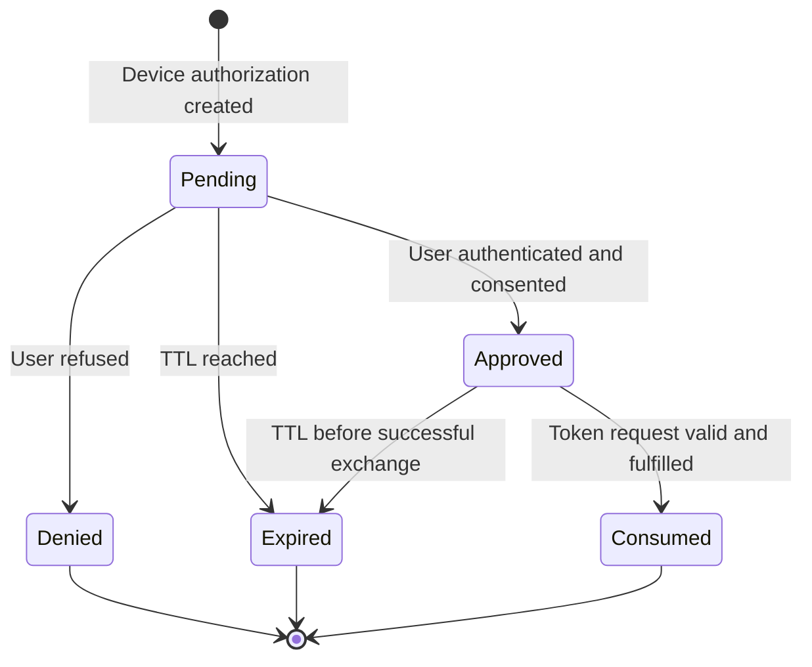
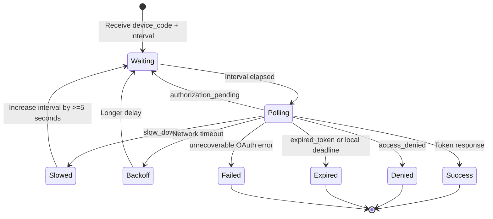
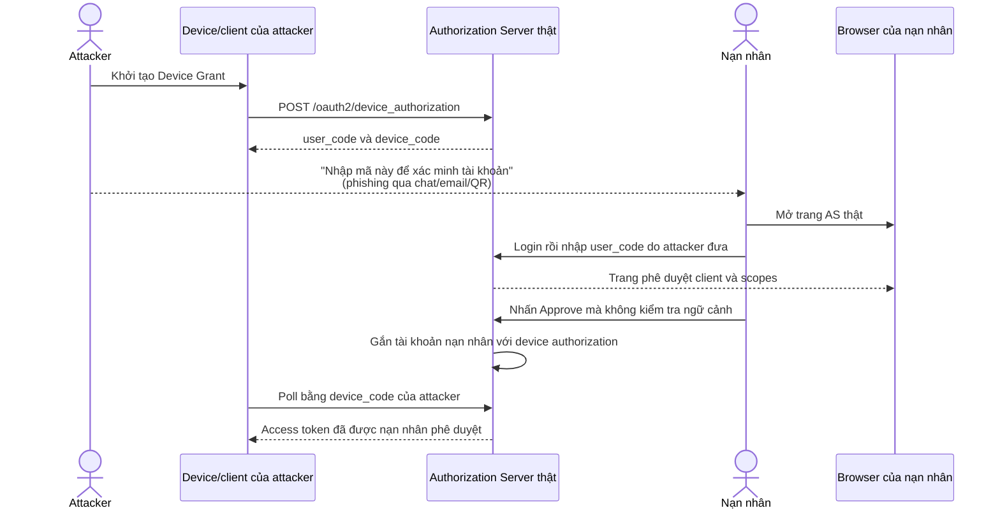
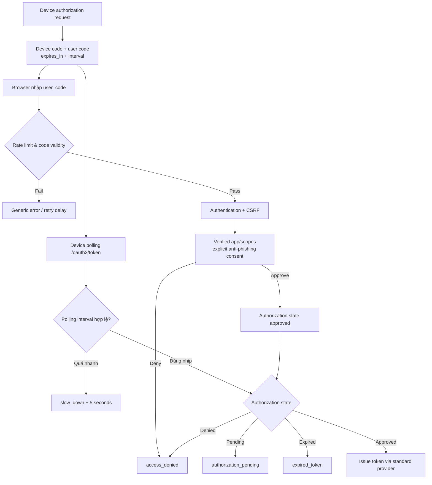

# Giới hạn số lần thử user_code, tốc độ polling và chống phishing

## 1. Bối cảnh và mục tiêu bài học

Trong chương **Device Authorization** của module **SPRING_SECURITY_OAUTH2_OIDC_AUTHORIZATION_SERVER**, OAuth 2.0 Device Authorization Grant (RFC 8628) giải quyết trường hợp thiết bị không có bàn phím, trình duyệt hoặc khả năng đăng nhập thuận tiện: TV thông minh, máy chơi game, thiết bị đầu cuối tại quầy hoặc ứng dụng CLI. Thiết bị hiển thị một **mã ngắn**; người dùng sử dụng điện thoại/máy tính khác để đăng nhập tại Authorization Server (AS) và phê duyệt yêu cầu.

Luồng này phù hợp với mục tiêu **thiết kế, cấu hình, bảo mật, kiểm thử và vận hành OAuth 2.0/OpenID Connect Authorization Server bằng Spring Security và Spring Authorization Server (SAS) trong Spring Boot**, nhưng tạo ra ba điểm tấn công đặc thù:

1. **`user_code` ngắn, dễ gõ** có thể bị đoán trực tuyến nếu trang xác minh không giới hạn số lần thử.
2. **Thiết bị liên tục polling `/oauth2/token`** có thể gây tải lớn hoặc cố tình bỏ qua chỉ dẫn `interval`/`slow_down`.
3. **Device-flow phishing:** kẻ tấn công khởi tạo flow trên thiết bị của mình rồi lừa nạn nhân nhập mã và xác nhận trên AS thật, khiến kẻ tấn công nhận token liên quan đến tài khoản nạn nhân.

Sau bài này, bạn có thể thiết lập giới hạn dò mã đa chiều, hiểu cách điều tiết polling chuẩn RFC 8628, thiết kế UI xác minh an toàn, tích hợp các điểm kiểm soát vào SAS và kiểm thử các tình huống replay, hết hạn, từ chối hoặc nghi ngờ phishing.

**Phạm vi phiên bản:** Ví dụ Java dùng các thành phần thường gặp trong **Spring Authorization Server 1.x**, **Spring Security 6.x** và **Spring Boot 3.x**. Phải đối chiếu đúng phiên bản đang chạy vì tên extension point, khả năng cấu hình Device Authorization/Verification Endpoint và auto-configuration có thể thay đổi. Các tham số rate limit số học trong bài là **ví dụ để thiết kế và kiểm thử**, không phải con số bắt buộc của RFC.

> **Điều quan trọng:** `user_code` và `device_code` là hai credential khác nhau. `user_code` tối ưu cho con người nên cần bảo vệ đặc biệt khỏi brute force; `device_code` là giá trị có entropy cao mà thiết bị giữ để polling. Không dùng lẫn hai mã và không xem việc xác minh một mã là đủ để bảo đảm người dùng thật sự muốn cấp quyền.

## 2. Luồng Device Authorization và các bề mặt tấn công

```mermaid
sequenceDiagram
    autonumber
    actor U as Người dùng
    participant D as Thiết bị / CLI
    participant AS as Authorization Server
    participant S as OAuth2AuthorizationService
    participant B as Browser tin cậy
    D->>AS: POST /oauth2/device_authorization (client_id, scope)
    AS->>S: Tạo device authorization state
    AS-->>D: device_code, user_code, verification_uri,<br/>expires_in, interval
    D-->>U: Hiện URL chính thức + user_code
    loop Trong thời hạn, tuân thủ interval
        D->>AS: POST /oauth2/token (device_code)
        AS-->>D: authorization_pending hoặc slow_down
    end
    U->>B: Mở verification_uri trên điện thoại
    B->>AS: GET /oauth2/device_verification
    AS-->>B: Login nếu chưa xác thực
    U->>AS: Nhập user_code + submit (CSRF)
    AS->>S: Tìm device authorization, kiểm tra hiệu lực
    AS-->>B: Hiển thị app, thiết bị, scope và cảnh báo
    U->>AS: Đồng ý hoặc từ chối
    AS->>S: Lưu trạng thái quyết định
    D->>AS: Poll token endpoint hợp lệ
    AS-->>D: Token nếu chấp thuận; lỗi nếu từ chối/hết hạn
```

Sơ đồ là luồng khái niệm; khi người dùng xác nhận, client có thể đang polling ở nhịp riêng. Mọi lần phát token đều phải đi qua xử lý giao thức của AS, không chỉ dựa vào UI báo “Đã kết nối”.

### 2.1. Ba nơi cần thực thi kiểm soát khác nhau

| Nơi | Đối tượng truy cập | Giá trị dùng | Đe dọa chính | Kiểm soát |
| --- | --- | --- | --- | --- |
| `/oauth2/device_authorization` | Thiết bị xin cấp mã | `client_id`, scopes, client authentication nếu có | Tạo vô số flow, chiếm tài nguyên, enumeration client | Client registration, giới hạn tạo flow, TTL, quota |
| `/oauth2/device_verification` | Browser người dùng nhập mã và phê duyệt | **`user_code`** | Đoán mã ngắn, phishing, CSRF, xác nhận nhầm thiết bị | Rate limit, login/session, CSRF, UI xác minh thiết bị, consent |
| `/oauth2/token` với device grant | Thiết bị polling | **`device_code`** | Flood, polling dày, replay, tiếp tục sau hết hạn | `interval`, `slow_down`, TTL, kiểm tra client/code, per-device limiter |

Một rate limiter chung cho tất cả request **không thay** ba nhóm kiểm soát: tốc độ hợp lý của một người đang gõ mã khác với tốc độ thiết bị tự động polling trong nhiều phút.

## 3. Hiểu chính xác response và trạng thái Device Grant

### 3.1. Bắt đầu bằng device authorization request

Một public client mang định danh `living-room-tv` có thể gửi:

```http
POST /oauth2/device_authorization HTTP/1.1
Host: auth.example.com
Content-Type: application/x-www-form-urlencoded

client_id=living-room-tv&scope=profile.read
```

Endpoint sau khi kiểm tra registered client/grant/scope sẽ trả response minh họa:

```json
{
  "device_code": "HIGH_ENTROPY_OPAQUE_DEVICE_CODE",
  "user_code": "WDJB-MJHT",
  "verification_uri": "https://auth.example.com/activate",
  "verification_uri_complete": "https://auth.example.com/activate?user_code=WDJB-MJHT",
  "expires_in": 600,
  "interval": 5
}
```

Các URL và mã là dữ liệu **minh họa**; Spring Authorization Server có endpoint mặc định thường gặp `/oauth2/device_verification`, nhưng `verification_uri` trả từ AS có thể khác nếu được cấu hình. Không dựng URI xác minh bằng cách tự nối một path cứng ở client; dùng URI mà AS công bố và **kiểm tra domain chính thức** trong UI.

| Trường | Vai trò | Quy tắc quan trọng |
| --- | --- | --- |
| `device_code` | Secret có entropy cao, thiết bị gửi khi polling | Không hiện lên TV cho người dùng gõ; không log hoặc chia sẻ. |
| `user_code` | Mã ngắn người dùng gõ trên thiết bị khác | Phải có TTL và giới hạn đoán trực tuyến; không dùng để polling. |
| `verification_uri` | Trang người dùng mở để nhập mã | Phải là domain HTTPS đáng tin, dễ nhận diện. |
| `verification_uri_complete` | URI tùy chọn, có thể mang sẵn user code | Giảm thao tác nhưng **không** được tự động chấp thuận. |
| `expires_in` | Số giây mà device code còn hiệu lực | Cả client và AS phải dừng flow khi hết hạn. |
| `interval` | Số giây tối thiểu giữa các lần polling token endpoint | Nếu không có, client mặc định chờ **5 giây** theo RFC 8628. |

Đoạn response này mô tả giao thức, không hứa rằng mọi SAS version sẽ trả `verification_uri_complete` hoặc `interval` trong mọi cấu hình.

### 3.2. Trạng thái của một yêu cầu xác minh



Các trạng thái trên là **mô hình tư duy**, không phải enum API bắt buộc của SAS. `OAuth2AuthorizationService` giữ authorization và token metadata; ứng dụng không nên tạo trạng thái riêng trong session của browser làm nguồn sự thật duy nhất cho mã đã phát.

**Bất biến bảo mật:**

- Sau `Denied`, không phát token.
- Sau `Expired`, không hồi sinh mã bằng cách sửa đồng hồ client.
- Một device authorization không được dùng để tạo nhiều bộ token trái chính sách hoặc tự chuyển cho client khác.
- User code không thể được phê duyệt khi không có authorization request hợp lệ và principal đã xác thực.
- Device code không thể bị đổi bởi một client khác không có quyền sở hữu authorization.

## 4. Vì sao `user_code` đặc biệt dễ bị đoán?

`user_code` ngắn, thường tránh ký tự khó đọc để người dùng nhập bằng tay. Khác với `device_code` dài và ngẫu nhiên, tập không gian tìm kiếm của user code nhỏ hơn; nếu AS cho nhập thử mã liên tục không giới hạn, kẻ tấn công có thể tìm ra những phiên xác minh đang hoạt động.

**Rủi ro chính:**

- **Online guessing:** tự động thử nhiều user code qua form hoặc API xác minh.
- **Enumeration:** dựa vào thông báo “mã không tồn tại”/“mã tồn tại chờ duyệt” để lọc những mã có hiệu lực.
- **Credential stuffing dạng mã:** tái sử dụng mã lấy từ ảnh, log hoặc kênh liên lạc.
- **Denial of service:** cố tình nhập sai để khóa mã/khóa tài khoản hợp lệ.
- **Phishing:** gửi mã của thiết bị attacker cho người dùng hợp lệ và dụ họ nhập vào AS thật.

### 4.1. Thiết kế định dạng và entropy

Cần chọn:

1. **Mã được sinh ngẫu nhiên bằng CSPRNG** và đủ khó đoán trong khoảng thời gian hiệu lực.
2. Tập ký tự dễ đọc (tránh `O/0`, `I/1` nếu phù hợp UX), có thể nhóm bằng dấu gạch.
3. **TTL ngắn và rõ ràng**, đồng nhất giữa response và authorization state.
4. Thông báo lỗi không tiết lộ thừa việc mã tồn tại, thuộc client nào hay người dùng nào.
5. Giới hạn số lần thử trực tuyến để bù cho việc user code ngắn.

Không tự chọn mẫu có quy luật như `TV-000001`, số thứ tự thiết bị, timestamp dễ suy hoặc băm trực tiếp từ client ID. **Mã hiển thị dễ nhập không đồng nghĩa mã có thể đoán trước**.

### 4.2. Chuẩn hóa input nhất quán

Nếu UI cho phép nhập `WDJBMJHT` thay `WDJB-MJHT`, việc bỏ dấu gạch, viết hoa/thường và trim khoảng trắng phải được định nghĩa **một lần** và dùng nhất quán ở bước tạo, tìm và kiểm tra user code. Không biến đổi Unicode tự phát hoặc dùng so sánh tiền tố.

Ví dụ pseudocode:

```text
normalizeUserCode(input):
    reject if input too long
    trim outer whitespace
    remove only separators allowed by format
    uppercase using locale-independent rules
    reject characters outside allowed alphabet
    return canonicalCode

verify:
    enforce pre-auth rate limit
    normalize
    atomically evaluate eligibility and state
    record failure or success
    show generic error when invalid
```

Không đưa canonical user code vào URL log, metrics label hay audit event. Vì không gian mã ngắn, **hash không có khóa** của user code không tự ngăn kẻ tấn công offline đoán lại mã nếu database bị lộ; bảo vệ kho dữ liệu và dùng khóa HMAC cho correlation ẩn danh khi thực sự cần.

## 5. Giới hạn số lần thử `user_code` theo nhiều chiều

Một chính sách chỉ tính “5 lần sai cho mỗi IP” không đủ: nhiều người hợp pháp sau NAT chia sẻ IP, còn attacker có thể đổi địa chỉ. Tương tự, khóa cứng một mã ngay sau vài lần sai có thể bị lợi dụng để **khóa flow của nạn nhân**. Cần thiết kế rate limiter nhiều tầng với độ ưu tiên khác nhau.

### 5.1. Các chiều nên áp dụng

| Chiều giới hạn | Mục đích | Lưu ý bảo mật/vận hành |
| --- | --- | --- |
| Theo IP/subnet/ASN | Giảm thử mã hàng loạt từ một nguồn | NAT, proxy và mobile networks gây false positive; không coi IP là danh tính chắc chắn. |
| Theo browser session | Giảm thử liên tục của cùng browser | Cookie dễ xóa, phải kết hợp chiều khác. |
| Theo authenticated user | Giới hạn hành vi đáng ngờ sau login | Không khóa account chỉ vì có vài mã nhập sai do user vô tình. |
| Theo client/application | Phát hiện số lượng mã tạo hoặc xác minh bất thường | Không tin client ID tự khai nếu chưa đối chiếu registered client. |
| Theo mã/challenge | Bảo vệ một flow không bị spam | Hard lock per-code có thể tạo DoS nếu attacker biết mã; cân nhắc retry delay và điều kiện khóa. |
| Tổng hệ thống | Chống sự kiện brute force có phân tán | Cần metrics và quy trình khẩn cấp không làm hỏng đăng nhập hợp lệ. |

**Ví dụ ngân sách khởi đầu để thử nghiệm, không phải quy tắc bắt buộc:** Một browser session nhập sai khoảng 5 lần trong vài phút có thể bị chờ ngắn; một địa chỉ IP có hàng chục lần nhập sai/giờ có thể bị giới hạn nhiều hơn; một account được xác thực có chuỗi xác minh bất thường phải yêu cầu xác thực lại/đánh giá rủi ro. Ngưỡng phải điều chỉnh từ lưu lượng thật, threat model và tỷ lệ false positive.

### 5.2. Định nghĩa hành vi khi vượt ngưỡng

Không chỉ “trả 429” rồi kết thúc. Tùy trường hợp:

- Tăng thời gian chờ/giới hạn tốc độ ở lớp gateway, security filter hoặc verification handler.
- Yêu cầu xác thực người dùng trước khi xử lý hành động nhạy cảm nếu trải nghiệm cho phép.
- Trả **thông báo trung tính**, không cho biết user code có tồn tại.
- Ghi event dạng đã làm sạch để hệ thống phát hiện brute force.
- Cân nhắc CAPTCHA hoặc challenge bổ sung khi rủi ro cao, nhưng không dùng CAPTCHA như lớp bảo vệ duy nhất.
- Khi nhiều nguồn độc lập tấn công, kích hoạt kiểm soát toàn hệ thống thay vì chỉ per-IP.

**Không tiết lộ quá nhiều trạng thái:** Thay vì phân biệt công khai “mã này tồn tại, nhưng thuộc account khác” và “mã không tồn tại”, dùng lỗi như “Mã không hợp lệ hoặc đã hết hạn” ở bước chưa đủ quyền để biết thông tin chi tiết. Sau khi xác thực và chuẩn bị hiển thị consent, người dùng mới thấy thông tin app/thiết bị đã được AS xác minh.

### 5.3. Tránh lockout như một phương tiện DoS

Một attacker có mã của nạn nhân có thể cố tình gửi request sai để chặn ghép thiết bị. Do đó, không nên mặc định **khóa vĩnh viễn user code khi có 3 lần nhập sai**. Cân nhắc kết hợp quota theo nguồn, cửa sổ thời gian ngắn, backoff, retry có kiểm soát và TTL tự hết hạn.

Nếu mã bị nghi ngờ lộ hoặc bị abuse, có thể hủy flow và yêu cầu thiết bị tạo **mã mới** thay vì kéo dài quyền sử dụng mã cũ. Giao diện phải nói rõ khi nào cần bắt đầu lại trên thiết bị.

## 6. Lưu rate limit và kiểm tra trạng thái một cách nguyên tử

### 6.1. Vì sao một biến đếm trong JVM không đủ?

Khi AS có nhiều instance:

- Browser có thể gửi lần thử 1 tới node A và lần thử 2 tới B.
- Counter ở memory mỗi node không cộng dồn, làm rate limit bị vượt.
- Hai request cùng lúc có thể cùng quan sát counter chưa tới ngưỡng.
- Việc cập nhật mã đã được xác minh cũng có thể đua với TTL hết hạn hoặc lệnh từ chối.

Hệ thống có thể dùng Redis với atomic increment/script, database transaction, hoặc dịch vụ rate limit phân tán. Chọn phương án theo tải, topology và yêu cầu availability.

### 6.2. Contract thuật toán tham khảo

Đây là **pseudocode thiết kế**, không phải API chuẩn của SAS:

```text
submitUserCode(source, authenticatedPrincipal, suppliedCode):
    sourceKey = derivePrivacySafeSourceKey(source)

    if distributedLimiter.isBlocked("verify:source:" + sourceKey):
        return genericRetryLater()

    if authenticatedPrincipal != null and
       distributedLimiter.isBlocked("verify:user:" + authenticatedPrincipal.id):
        return genericRetryLater()

    normalized = normalizeUserCode(suppliedCode)
    if normalized is invalid:
        distributedLimiter.recordFailure(sourceKey, principal)
        return genericInvalidCode()

    // Xử lý state bằng thao tác đồng bộ/transaction phù hợp:
    challenge = deviceAuthorizationStore.findByUserCode(normalized)

    if challenge is null or challenge.expired or challenge.consumed:
        distributedLimiter.recordFailure(sourceKey, principal)
        return genericInvalidCode()

    if challenge.client is not eligible:
        return genericInvalidCode()

    // Không auto-approve chỉ vì code đúng.
    showVerifiedClientAndScopes(challenge)
    waitForExplicitConsentAfterAuthentication()
```

Cơ chế lưu trữ phải **tự bảo vệ khỏi replay** sau khi người dùng phê duyệt và thiết bị nhận token. Nếu tùy biến SAS provider/authorization store, xem xét transaction/locking/conditional update khi trạng thái có thể được thay đổi bởi nhiều request.

**Giới hạn chức năng:** Pseudocode không thay `OAuth2DeviceVerificationEndpointFilter` hoặc các provider chuẩn. Nên tích hợp rate limit/abuse policy tại lớp filter/extension point phù hợp trước bước tìm mã, để SAS vẫn quản lý xác thực, consent, token grant và error semantics.

### 6.3. Không dùng user code thô làm khóa metrics

Một khóa cache như `rate:user_code:WDJB-MJHT` có thể làm mã xuất hiện trong Redis monitoring, dashboard hoặc snapshot. Có thể dùng định danh nội bộ của challenge hoặc một giá trị HMAC được tính từ canonical code với secret do server quản lý khi cần tương quan. Chỉ dùng giá trị ẩn danh không thể quay lại mã ngắn bằng brute-force offline; quản lý key và thời hạn retention theo policy.

Rate limiting theo IP cũng là dữ liệu liên quan người dùng trong nhiều khu vực pháp lý; giới hạn quyền truy cập, thời gian lưu và mục đích sử dụng.

## 7. Polling Token Endpoint theo RFC 8628

Sau device authorization response, thiết bị **không liên tục gọi token endpoint vô hạn**. Nó phải đợi theo `interval` và các phản hồi từ AS.

### 7.1. Token request cho Device Grant

Thiết bị public client gửi:

```http
POST /oauth2/token HTTP/1.1
Host: auth.example.com
Content-Type: application/x-www-form-urlencoded

grant_type=urn:ietf:params:oauth:grant-type:device_code&device_code=HIGH_ENTROPY_OPAQUE_DEVICE_CODE&client_id=living-room-tv
```

Nếu là confidential client, client phải xác thực theo phương thức đã đăng ký; public client không gửi secret giả. `device_code` là credential để thiết bị tiếp tục flow; `user_code` **không** được gửi trong token request.

### 7.2. Các phản hồi cần xử lý riêng

| `error` hoặc kết quả | Ý nghĩa | Thiết bị phải làm gì? |
| --- | --- | --- |
| `authorization_pending` | Người dùng chưa hoàn tất xác minh/chấp thuận | Tiếp tục polling theo `interval` đã nhận. |
| `slow_down` | Client polling quá nhanh, AS yêu cầu giảm nhịp | **Tăng thời gian đợi thêm ít nhất 5 giây** cho lần và các lần polling tiếp theo. |
| `access_denied` | Người dùng từ chối | **Dừng** polling, thông báo từ chối và cho phép bắt đầu flow mới nếu cần. |
| `expired_token` | Device code đã hết hạn | **Dừng** polling; thiết bị phải xin mã mới. |
| Token response thành công | AS đã xác minh và cấp token theo policy | Dừng polling, lưu token an toàn và chuyển sang trạng thái đã ghép. |
| `invalid_client`/lỗi không thể phục hồi | Client registration/authentication sai | Dừng và báo lỗi; không thử vô hạn hoặc bỏ xác thực. |
| Network timeout/transient lỗi kết nối | Không có response giao thức hợp lệ | Dùng **exponential backoff** hợp lý; không tăng tần suất gửi. |

Theo RFC 8628, nếu response device authorization **không có `interval`**, client dùng **5 giây** giữa các request polling. Khi nhận `slow_down`, tăng interval thêm **5 giây** theo yêu cầu của chuẩn; trên client còn có thể chọn chờ dài hơn để bảo vệ hạ tầng. Mọi lần retry phải nằm trong `expires_in` và chính sách timeout client.

**Không hiểu nhầm `slow_down` thành lỗi vĩnh viễn.** Đây là tín hiệu điều tiết nhịp, khác `access_denied` và `expired_token` vốn kết thúc flow.

### 7.3. Ví dụ HTTP response

Khi người dùng chưa nhập mã:

```http
HTTP/1.1 400 Bad Request
Content-Type: application/json
Cache-Control: no-store

{"error":"authorization_pending"}
```

Khi polling quá nhanh:

```http
HTTP/1.1 400 Bad Request
Content-Type: application/json
Cache-Control: no-store

{"error":"slow_down"}
```

Khi đã chấp thuận:

```http
HTTP/1.1 200 OK
Content-Type: application/json
Cache-Control: no-store

{
  "access_token": "<ACCESS_TOKEN>",
  "token_type": "Bearer",
  "expires_in": 300,
  "scope": "profile.read"
}
```

Đây là ví dụ của giao thức, không phải token thật. Nếu request có `scope=openid` và AS bật OIDC phù hợp, token response có thể có ID token theo profile/phiên bản và chính sách đã cấu hình; không tự mặc định mọi device flow đều có OIDC ID token hoặc refresh token.

## 8. Xây polling scheduler đúng ở phía thiết bị

### 8.1. Mô hình trạng thái của client



Thiết bị chỉ nên có **một vòng polling hiệu lực cho mỗi device authorization đang hoạt động**. Nếu người dùng bấm “Thử lại” nhiều lần, không được vô tình tạo N worker polling cùng một `device_code`. Khi ứng dụng đóng, chuyển tài khoản hoặc xin mã mới, cần hủy vòng polling cũ.

### 8.2. Java ví dụ tính lịch polling

Lớp dưới đây minh họa **chính sách nhịp**, không thực hiện HTTP request hay sleep. Mã gọi cần quản lý clock, deadline, cancel token và tránh chạy nhiều worker song song.

```java
import java.time.Duration;

public final class DevicePollSchedule {
    private Duration interval;

    public DevicePollSchedule(Long intervalFromServer) {
        long seconds = intervalFromServer == null
                || intervalFromServer <= 0 ? 5 : intervalFromServer;
        this.interval = Duration.ofSeconds(seconds);
    }

    public Duration nextDelayAfterPending() {
        return interval;
    }

    public Duration nextDelayAfterSlowDown() {
        interval = interval.plusSeconds(5);
        return interval;
    }

    public Duration nextDelayAfterNetworkTimeout() {
        interval = interval.multipliedBy(2);
        return interval;
    }
}
```

Bên gọi tạo deadline từ `expires_in` và **dừng khi deadline đến**, thay vì chờ đến khi AS trả `expired_token`. Có thể thêm jitter dương để nhiều thiết bị không cùng gửi request tại một thời điểm, nhưng không dùng jitter âm khiến interval thực tế ngắn hơn thời gian tối thiểu AS yêu cầu.

Nếu thư viện OAuth client đã có Device Authorization hỗ trợ RFC 8628 đầy đủ, ưu tiên sử dụng thư viện được bảo trì thay vì tự viết vòng polling trong production.

### 8.3. Những lỗi polling hay gặp

- Thiết bị gọi token endpoint mỗi 100–500 ms dù `interval=5`.
- Khi nhận `slow_down`, client **chỉ chờ một lần** lâu hơn rồi quay về 5 giây; chuẩn yêu cầu giữ interval tăng cho các lần sau.
- Khi network timeout, client lập tức retry nhiều lần.
- Client polling song song bằng nhiều thread với cùng device code.
- Client tiếp tục polling sau `access_denied` hoặc `expired_token`.
- Sau khi flow hết hạn, thiết bị giữ nguyên user code cũ nhưng reset timer nội bộ.
- Client nhận JSON lỗi rồi parse nhầm thành token response và lưu dữ liệu không hợp lệ.
- Client chấp nhận response đến từ URL Token Endpoint chưa được xác minh hoặc qua HTTP không bảo mật.

## 9. Server-side polling limiter phải bảo vệ cả AS lẫn UX

Ngay cả khi client được lập trình đúng, AS **không được tin** mọi thiết bị đều tuân thủ interval. Kẻ tấn công có thể gửi HTTP request tự viết, giả client ID, replay device code hoặc tạo nhiều mã đồng thời.

### 9.1. Những giới hạn nên kết hợp

| Giới hạn | Mục tiêu | Ghi chú |
| --- | --- | --- |
| Mỗi `device_code` | Không cho một flow được poll dày hơn chính sách | Theo dõi thời điểm poll gần nhất và mức slow_down, lưu ở shared store nếu nhiều node. |
| Theo `client_id` đã xác minh | Ngăn một client tạo quá nhiều flow hoặc polling flood | Không tin client ID do request tự khai nếu chưa kiểm tra. |
| Theo IP/nguồn mạng | Chặn flood hàng loạt | Cân nhắc NAT, proxy, địa chỉ thay đổi, false positive. |
| Tổng số device authorizations pending | Kiểm soát bộ nhớ, database và token store | Đặt quota/TTL, cleanup state hết hạn. |
| Tổng lưu lượng token endpoint | Bảo vệ khả năng phục vụ các grant khác | Tách metrics và quota giữa device polling và grant thường. |

Nếu một flow polling sớm, AS nên trả `slow_down` theo ngữ nghĩa Device Grant khi phù hợp; vẫn có thể dùng cơ chế bảo vệ hạ tầng như gateway rate limiting cho tình huống abuse nặng. Không coi HTTP `429` chung là **thay thế hoàn toàn** cho phản hồi `slow_down` mà client chuẩn hiểu được.

### 9.2. Thiết kế atomic timestamp per-device

Một chính sách minh họa:

```text
poll(deviceCode, client):
    authenticateOrValidateClient(client)
    auth = findAuthorizationByDeviceCode(deviceCode)
    reject if auth is missing, expired or belongs to another client

    now = trustedServerClock()
    policy = loadPollPolicy(auth.id)

    atomically:
        if now < policy.nextAllowedAt:
            policy.interval += 5 seconds
            policy.nextAllowedAt = now + policy.interval
            save(policy)
            return slow_down

        policy.nextAllowedAt = now + policy.interval
        save(policy)

    continue standard device grant provider:
        pending -> authorization_pending
        denied -> access_denied
        expired -> expired_token
        approved -> issue token under grant rules
```

Đây là **pseudocode minh họa**, không phải API sẵn có của Spring Authorization Server. Cách SAS phiên bản đang dùng thực thi `slow_down` và tracking poll cần được xác minh qua integration test. Nếu triển khai thêm limiter, không được tạo đường bypass provider chuẩn hoặc làm thay đổi `authorization_pending` thành token success khi user chưa approve.

Với nhiều node, cập nhật `nextAllowedAt` phải nguyên tử; tránh hai request cùng đọc thời điểm cũ rồi đều được đi tiếp. Dùng Redis script/transaction hoặc repository có locking/compare-and-set. Khóa nội bộ nên là authorization ID hoặc định danh được bảo vệ, **không phải device code thô trong metrics/log**.

### 9.3. Không để rate limiter mở lỗ hổng mới

Một limiter tự viết có thể trở thành nguồn lỗi:

- Reset interval xuống 5 giây mỗi request, khiến `slow_down` không có tác dụng.
- Dùng client clock thay server clock, dẫn đến time-skew exploit.
- Không có TTL cho bộ đếm hoặc pending state, gây memory leak.
- Dùng Redis counter không atomic, bị vượt giới hạn khi concurrency cao.
- Trả lời “device code tồn tại” cho caller không có quyền, làm lộ thông tin.
- Block nguyên token endpoint của các grant khác vì một client device flood.
- Ghi raw `device_code` vào Redis key/log mà nhiều operator truy cập được.

Khi shared rate-limit store mất kết nối, hệ thống cần chính sách an toàn và khả năng phục hồi đã được thống nhất; không tự bỏ qua toàn bộ giới hạn trong production chỉ để giữ throughput.

## 10. Device-flow phishing: tấn công nguy hiểm nhất về mặt UX

### 10.1. Kịch bản tấn công phổ biến



**Điểm đáng chú ý:** Đây có thể là phishing **ngay trên domain AS thật**, không nhất thiết giả mạo website. Kẻ tấn công cần nạn nhân chấp thuận **mã của thiết bị attacker**. Vì vậy chỉ hướng dẫn “hãy nhìn ổ khóa HTTPS” là chưa đủ.

### 10.2. Vì sao việc nhập đúng code vẫn chưa đủ an toàn?

Mã do attacker tạo là **mã hợp lệ thật**. Khi nạn nhân nhập và đồng ý, AS vẫn có thể thực hiện đúng giao thức nhưng cấp quyền cho sai đối tượng theo ý định của người dùng. Do đó, việc xác minh “mã có tồn tại” **không chứng minh** rằng người dùng đang đứng trước thiết bị mình muốn ghép.

Cần kiểm tra ít nhất:

- Người dùng có **chủ động bắt đầu** quá trình ghép trên thiết bị mình sở hữu/đang sử dụng không?
- Mã có xuất hiện **trực tiếp trên màn hình thiết bị đó**, thay vì do người lạ gửi qua chat/email không?
- Ứng dụng/client hiển thị có đúng thương hiệu/owner đáng tin không?
- Phạm vi quyền được yêu cầu có hợp lý với tác vụ không?
- Nếu được hỗ trợ, thông tin thiết bị, phiên kết nối hoặc yếu tố rủi ro bổ sung có khớp với ngữ cảnh thật không?

Mục tiêu là giúp người dùng xác nhận **ý định cấp quyền**, không chỉ xác nhận rằng họ đã gõ một chuỗi ký tự hợp lệ.

## 11. Thiết kế trang xác minh và consent chống phishing

### 11.1. Một màn hình xác minh rõ ràng

Sau khi người dùng đăng nhập và nhập mã hợp lệ, trang xác minh có thể hiển thị:

```text
XÁC NHẬN KẾT NỐI THIẾT BỊ

Ứng dụng: Living Room TV
Nhà phát hành ứng dụng: Example Media
Quyền yêu cầu: Đọc hồ sơ cơ bản
Mã hiển thị trên thiết bị: WDJB-MJHT
Thời gian còn lại: 04:32

Chỉ chọn "Cho phép" nếu bạn đang tự kết nối thiết bị
và mã này đang hiển thị trực tiếp trên thiết bị đó.

Nếu mã đến từ email, cuộc gọi, tin nhắn hoặc người lạ:
chọn "Từ chối".

[ Từ chối ]   [ Cho phép kết nối ]
```

Đây là mẫu **nội dung UX**, không phải giao diện mặc định của SAS. Các giá trị tên app, publisher và thiết bị phải đến từ **client registration được quản trị/kiểm chứng** hoặc metadata có chính sách tin cậy, không tin nguyên văn một nhãn `device_name` do client tự gửi. Tên thiết bị tự khai có thể bị spoof; nếu không có attestation hoặc quản lý device inventory, hãy nói rõ đó chỉ là mô tả do ứng dụng cung cấp.

### 11.2. Các rào chắn hữu ích

| Kiểm soát | Tác dụng | Giới hạn |
| --- | --- | --- |
| Hiển thị client name/publisher đã kiểm chứng | Giúp nhận biết ai đang xin quyền | Nếu client giả mạo brand từ đầu, phải có kiểm soát đăng ký client. |
| Yêu cầu xác nhận thiết bị/ngữ cảnh | Giảm xác nhận nhầm mã do người khác gửi | Không thể tự chứng minh thiết bị vật lý nếu không có kênh ràng buộc tin cậy. |
| Hiển thị scopes dễ hiểu | Giúp user hiểu quyền đang cấp | Scope quá kỹ thuật hoặc quá rộng có thể bị bỏ qua. |
| Không tự auto-approve từ `verification_uri_complete` | Chặn trường hợp scan QR là đồng ý ngay | User vẫn có thể bị dụ nhấn Approve. |
| Reauthentication/MFA cho quyền nhạy cảm | Tăng bảo vệ tài khoản | MFA không tự giải quyết phishing nếu user chủ động approve mã attacker. |
| Từ chối mặc định, nút Deny rõ ràng | Khuyến khích lựa chọn an toàn | UX phải tránh dark patterns. |
| Cảnh báo “chỉ nhập mã từ thiết bị của bạn” | Chặn kịch bản chat/email phishing | Người dùng vẫn cần nhận diện chính xác ngữ cảnh. |
| Hạn hiệu lực ngắn + rate limit | Giảm cơ hội tấn công và dò mã | Không thay kiểm soát ý định consent. |

### 11.3. `verification_uri_complete`, QR và deep link

`verification_uri_complete` có thể giúp giảm thao tác gõ mã bằng cách điền sẵn user code khi người dùng quét QR. Nhưng:

- Chỉ cho phép URL **thuộc domain chính thức của AS** và sử dụng HTTPS.
- Không tự động approve chỉ vì đường link chứa user code hợp lệ.
- Sau mở link, vẫn hiển thị client, scopes và yêu cầu xác nhận ý định.
- Tránh log toàn bộ query string; user code có thể nằm trong URL.
- Trang cần CSRF protection và session authentication đúng cách.
- Deep link/QR từ nguồn không đáng tin cũng có thể hướng tới trang giả mạo; hướng dẫn người dùng xác minh domain và mục đích.

Các biện pháp chống phishing cho device flow **phải đi cùng** kiểm soát chống open redirect và đăng ký client, không chỉ là một đoạn cảnh báo tĩnh.

### 11.4. Khi nào cần hạn chế hoặc không dùng Device Grant?

Nếu một ứng dụng có thể dùng trình duyệt hệ thống và Authorization Code + PKCE một cách phù hợp, hãy cân nhắc flow đó thay vì mặc định chọn Device Grant. Với môi trường có threat model phishing rất cao, lựa chọn flow ít dễ bị chuyển mã giữa thiết bị hơn, hoặc thêm **binding** giữa thiết bị và phiên xác minh khi có cơ chế tin cậy.

Không hứa rằng chỉ bật MFA hoặc chỉ hiển thị “Mã của bạn” sẽ loại bỏ hoàn toàn device-flow phishing.

## 12. Tích hợp điểm kiểm soát vào Spring Authorization Server

### 12.1. Đăng ký client Device Grant

Ví dụ một thiết bị public client `living-room-tv`:

```java
@Bean
RegisteredClientRepository registeredClientRepository() {
    RegisteredClient tvClient = RegisteredClient
            .withId("living-room-tv-local-001")
            .clientId("living-room-tv")
            .clientAuthenticationMethod(
                    ClientAuthenticationMethod.NONE)
            .authorizationGrantType(
                    AuthorizationGrantType.DEVICE_CODE)
            .scope("profile.read")
            .clientSettings(ClientSettings.builder()
                    .requireAuthorizationConsent(true)
                    .build())
            .build();

    return new InMemoryRegisteredClientRepository(tvClient);
}
```

Đây là cấu hình client cho lab. Một thiết bị public không thể giữ client secret bí mật; không nhúng secret tĩnh vào firmware/app rồi cho rằng đó là bảo đảm xác thực mạnh. Với client có khả năng giữ credential và được đăng ký confidential, chính sách client authentication phải áp dụng đúng ở device authorization và token request theo phiên bản framework.

### 12.2. Bật Device Authorization/Verification Endpoint theo phiên bản

Một ví dụ dạng cấu hình DSL của SAS 1.x:

```java
@Bean
@Order(1)
SecurityFilterChain authorizationServerChain(HttpSecurity http)
        throws Exception {

    OAuth2AuthorizationServerConfigurer as =
            OAuth2AuthorizationServerConfigurer.authorizationServer();

    http
        .securityMatcher(as.getEndpointsMatcher())
        .with(as, configurer -> {
            configurer.deviceAuthorizationEndpoint(
                    Customizer.withDefaults());
            configurer.deviceVerificationEndpoint(
                    Customizer.withDefaults());
        })
        .authorizeHttpRequests(authorize ->
                authorize.anyRequest().authenticated())
        .exceptionHandling(exceptions ->
                exceptions.defaultAuthenticationEntryPointFor(
                        new LoginUrlAuthenticationEntryPoint("/login"),
                        new MediaTypeRequestMatcher(MediaType.TEXT_HTML)));

    return http.build();
}
```

Cần có application filter chain riêng cho `/login`/form authentication, cùng `OAuth2AuthorizationService`, token generator, signing key/JWK và các service liên quan. **Đừng coi đoạn code là một Authorization Server hoàn chỉnh có thể chạy độc lập.** Các endpoint Device Grant được bật hoặc cấu hình khác nhau theo SAS version; cần kiểm tra route/metadata và behavior thực tế sau khởi động.

Các path thường gặp:

| Endpoint | Vai trò | Mức bảo vệ |
| --- | --- | --- |
| `/oauth2/device_authorization` | Tạo device/user codes | Client registration, quota, allowed scopes |
| `/oauth2/device_verification` | Người dùng nhập mã/đồng ý | Login, CSRF, rate limit user code, chống phishing |
| `/oauth2/token` | Device polling đổi device code | Client binding, interval/slow_down, expiry, grant validation |

Nếu dùng custom verification page/filter, nên tích hợp rate limit ở lớp request và state transition phù hợp **trước bước lookup mã**, nhưng không bỏ qua các provider giao thức của SAS. Trang consent phải dùng đúng dữ liệu client/authorization đã được xác minh.

### 12.3. Các extension points cần xác minh trước khi tùy biến

- `RegisteredClientRepository`: client ID, grant, scopes và client authentication method.
- `OAuth2AuthorizationService`: pending authorization, token/device code metadata và trạng thái chấp thuận.
- `OAuth2AuthorizationConsentService`: consent theo chính sách.
- Device Authorization/Verification endpoint configurer và các filter/provider được framework cung cấp.
- Gateway/security filter cho giới hạn số request, cùng shared rate-limit store nếu scale out.
- Token endpoint extension/handler phù hợp để giữ error semantics `authorization_pending`/`slow_down`.
- Login/session/CSRF và custom verification UI khi cần.

**Không tự tạo controller phát token** từ `user_code`. User code chỉ để người dùng xác minh; token được thiết bị nhận qua polling `device_code` tại Token Endpoint sau khi AS đã xác thực client và kiểm tra state.

## 13. Kiểm thử bảo mật và hiệu năng

### 13.1. Ma trận kiểm thử bắt buộc

| Tình huống | Kết quả mong đợi |
| --- | --- |
| Thiết bị tạo flow hợp lệ | Nhận device/user codes, URI, TTL và interval theo protocol. |
| User code đúng, user login và approve | Flow chuyển trạng thái; polling hợp lệ nhận token. |
| User code sai | Lỗi trung tính, không tiết lộ flow hoặc tài khoản tồn tại. |
| User code đã hết hạn | Không cho approve; thiết bị phải tạo flow mới. |
| Nhập sai lặp lại từ một session/IP | Limiter giảm tốc hoặc chặn theo policy, ghi event làm sạch. |
| Dò mã qua nhiều IP/nhiều node | Limit phân tán và tín hiệu toàn hệ thống vẫn phát hiện tấn công. |
| Cố khóa flow hợp lệ bằng spam | Không khóa vĩnh viễn thiếu cân nhắc; cơ chế DoS-resilience hoạt động. |
| Nhập cùng user code và approve song song | Không có cấp quyền trùng trái policy; state transition nhất quán. |
| Không đăng nhập khi submit user code | Yêu cầu login, không gắn tài khoản chưa xác thực vào flow. |
| Submit consent không có CSRF | Bị chặn, không approve. |
| QR chứa user code nhưng user chưa consent | Không tự động được cấp token. |
| Mã từ attacker được gửi nạn nhân | UI hiển thị cảnh báo, client/scopes rõ; user có thể deny. |
| Poll trước khi user approve | `authorization_pending`; chưa phát token. |
| Poll nhanh hơn interval | `slow_down` hoặc bảo vệ tốc độ theo chuẩn; client tăng interval thêm 5 giây. |
| Client không tuân slow_down | AS tiếp tục điều tiết; không tăng tải vô hạn. |
| Network timeout | Client backoff, không tăng polling rate. |
| User deny | Token polling nhận `access_denied` và dừng. |
| Device code hết hạn | Polling nhận `expired_token` hoặc dừng theo deadline. |
| Client khác poll bằng device code của flow | Từ chối; không lộ token. |
| Hai worker poll cùng device code | Không tạo token vượt chính sách, không race. |
| Rate-limit store lỗi | Hành vi được xác định, không tự bypass âm thầm. |
| AS scale nhiều instance | Counter và authorization state thống nhất. |

### 13.2. Kiểm thử `slow_down` theo thời gian

Giả sử authorization response cho `interval=5`. Test logic client polling:

```text
t=00s  Device authorization response (interval=5)
t=05s  Poll #1 -> authorization_pending
t=10s  Poll #2 -> slow_down
t=20s  Poll #3 -> authorization_pending  (interval now 10s)
t=30s  Poll #4 -> ...
```

Đây là timeline minh họa **khi không có network delay hay retry khác**. Sau `slow_down`, interval mới ít nhất 10 giây cho các poll tiếp theo. Nếu nhận thêm `slow_down`, tiếp tục tăng interval thêm 5 giây. Khi `expires_in` hết, dừng; không dùng polling liên tục để “đợi tới khi user approve”.

Kiểm thử thêm trường hợp response không có `interval` (mặc định 5s), interval lớn hơn 5s do AS trả, nhiều lần `slow_down`, timeout liên tiếp và hủy flow giữa chừng.

### 13.3. Đo tải trên môi trường gần production

Các chỉ số nên có:

- P50/P95/P99 latency của `device_authorization`, `device_verification` và `token` cho device grant.
- Số pending device authorizations, tỷ lệ approved/denied/expired.
- Tỷ lệ `authorization_pending`, `slow_down`, `access_denied`, `expired_token`.
- Số lần nhập sai `user_code` theo nguồn đã ẩn danh và tổng hệ thống.
- Số `client_id` có tần suất tạo/poll bất thường.
- Số trường hợp người dùng từ chối sau khi thấy client/scopes.
- Thời gian từ tạo mã đến phê duyệt; tỷ lệ flow không hoàn tất.
- Sức tải Redis/database/shared store và tỷ lệ lỗi atomic update.

**Không log:** raw `device_code`, `user_code`, authorization header, cookie session, access/refresh/ID token, mật khẩu hoặc query string mang `verification_uri_complete`. Dùng correlation ID riêng, không dùng mã làm ID trong log.

## 14. Xử lý sự cố phổ biến

| Hiện tượng | Nguyên nhân có thể | Cách chẩn đoán |
| --- | --- | --- |
| Thiết bị nhận `authorization_pending` mãi | Người dùng chưa approve, browser vào sai phiên, consent chưa lưu | Kiểm tra thời hạn flow, trạng thái consent, session và UI. |
| Thiết bị liên tục bị `slow_down` | Client poll nhanh hơn interval hoặc có nhiều polling workers | Đo khoảng cách requests, thread count, policy server. |
| Tăng tần suất polling khi mạng lỗi | Client không có backoff | Áp exponential backoff và hạn thời gian. |
| User code đúng nhưng UI báo không hợp lệ | Normalize không nhất quán, code hết hạn, store khác node | Kiểm tra format, TTL, shared authorization store. |
| Mã bị đoán hàng loạt | Limiter thiếu hoặc chỉ per-IP | Bổ sung multi-dimensional limits và anomaly monitoring. |
| Tài khoản/flow hợp lệ bị chặn do rate limit | Ngưỡng quá chặt, NAT hoặc per-code hard lock | Điều chỉnh chính sách, chống lockout DoS. |
| App lạ vẫn được approve | Client metadata dễ giả mạo, UI không có ngữ cảnh | Kiểm soát registration, hiển thị publisher/scopes và cảnh báo. |
| Token được cấp sau khi user deny | State transition/provider tùy chỉnh sai | Kiểm tra authorization state, transaction và test denial. |
| Token được cấp sau hết hạn | TTL/server clock/caching sai | Dùng server clock, xác minh `expires_in` và invalidation. |
| Client khác dùng được device code | Không kiểm tra client binding | Khôi phục provider chuẩn và test client mismatch. |
| Thời gian chờ khác giữa AS instances | Counters giữ trong memory mỗi node | Dùng shared limiter và atomic update. |
| Browser vào website giả thay vì AS | QR/URL phishing, không kiểm tra domain | Dùng domain HTTPS chính thức, hướng dẫn mở URL đã biết. |
| QR tự phê duyệt không hiện consent | Thiết kế verification_uri_complete sai | Bắt buộc user xác thực và xác nhận riêng. |
| Token Endpoint trả HTML login | Filter chain/matcher sai | Kiểm tra AS chain và client authentication/endpoint handler. |

## 15. Checklist nghiệm thu trước vận hành

- [ ] Client Device Grant được đăng ký đúng grant, scopes và phương thức xác thực phù hợp.
- [ ] Device/user codes được tạo ngẫu nhiên an toàn, có TTL, liên kết đúng client và state.
- [ ] `user_code` được normalize nhất quán, không bị suy đoán từ timestamp/counter.
- [ ] Verification Endpoint giới hạn số lần thử theo nhiều chiều, dùng store phân tán nếu nhiều node.
- [ ] Thông báo mã sai/hết hạn không giúp enumeration các flow/tài khoản.
- [ ] Rate limit không khóa vĩnh viễn flow chỉ vì attacker gửi request sai.
- [ ] Verification UI bắt buộc login, CSRF và explicit consent; không auto-approve từ QR/deep link.
- [ ] App/publisher/scopes được hiển thị từ nguồn đã xác minh, có cảnh báo về mã do người lạ gửi.
- [ ] Người dùng có thể từ chối rõ ràng và biết cách tạo mã mới nếu flow hết hạn.
- [ ] Device client tôn trọng `interval`, mặc định 5 giây nếu thiếu, tăng ít nhất 5 giây sau `slow_down`.
- [ ] Client có backoff khi network lỗi và dừng sau `access_denied`/`expired_token`/thành công.
- [ ] Server áp limiter cho polling theo device code/client/nguồn, không trông chờ client tự giác.
- [ ] Pending authorizations/counters có cleanup và không tạo memory leak.
- [ ] Token chỉ phát sau approval hợp lệ, không dùng mã sai/đã hết hạn/khác client.
- [ ] Multi-instance cùng nhìn thấy authorization state, rate-limit state và chính sách nhất quán.
- [ ] Không log raw mã, token, cookie hoặc full verification URI chứa mã.
- [ ] Có integration test brute force, phishing UX, CSRF, polling race, retry, expiry và denial.
- [ ] Có metrics/cảnh báo và quy trình xử lý khi có device-flow phishing campaign.

## 16. Tổng kết kiến trúc



**Bảo vệ Device Authorization phải bao phủ cả mã do người dùng nhập, thiết bị đang polling và quyết định cấp quyền trên giao diện.** Giới hạn thử `user_code` làm giảm online guessing; `interval`/`slow_down` kiểm soát tải và abuse của Token Endpoint; còn xác thực người dùng, hiển thị client/scopes đáng tin cùng xác nhận ý định giúp giảm device-flow phishing. Khi các kiểm soát này được áp dụng nhất quán trong Spring Security và Spring Authorization Server, thiết bị hạn chế nhập liệu có thể sử dụng OAuth2/OIDC an toàn hơn mà không phá vỡ quy tắc giao thức.
