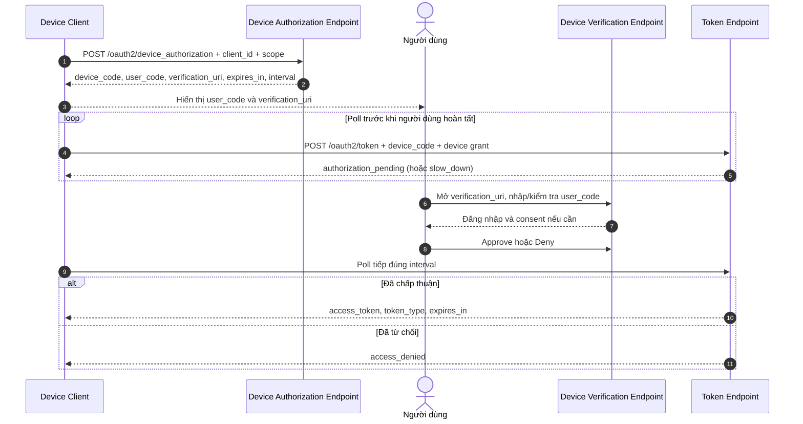
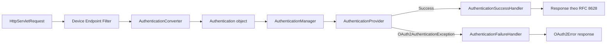

# Tùy chỉnh converter, provider và response handler cho Device Flow

## Mục tiêu bài học

Trong chương **Device Authorization** của module **SPRING_SECURITY_OAUTH2_OIDC_AUTHORIZATION_SERVER**, chúng ta nghiên cứu các điểm mở rộng của **Spring Authorization Server** khi triển khai **OAuth 2.0 Device Authorization Grant (RFC 8628)**. Đây là một phần trong quá trình học thiết kế, cấu hình, bảo mật, kiểm thử và vận hành OAuth 2.0/OpenID Connect (OIDC) Authorization Server bằng **Spring Security** và **Spring Boot**.

Device Flow phù hợp với TV, thiết bị IoT, CLI hoặc thiết bị có khả năng nhập liệu hạn chế. Thiết bị xin `device_code` và `user_code`, người dùng dùng **một thiết bị thứ hai** để đăng nhập và chấp thuận, rồi thiết bị ban đầu **poll** Token Endpoint để lấy access token. Việc tùy chỉnh không được làm sai quy tắc này.

Sau bài học, bạn có thể:

- Xác định chính xác trách nhiệm của **Device Authorization Endpoint**, **Device Verification Endpoint** và **Token Endpoint**.
- Phân biệt ba giai đoạn mở rộng: **`AuthenticationConverter`** (chuẩn hóa/kiểm request), **`AuthenticationProvider`** (xác thực và áp chính sách), **success/failure handler** (phản hồi).
- Sử dụng các method của `OAuth2DeviceAuthorizationEndpointConfigurer` và `OAuth2DeviceVerificationEndpointConfigurer` đúng vị trí.
- Giữ các converter/provider mặc định khi bổ sung validation, policy, cách sinh mã, audit hoặc giao diện xác minh.
- Tạo response/error phù hợp RFC 8628, xử lý `authorization_pending`, `slow_down`, `access_denied` và `expired_token` mà không phá polling.
- Kiểm thử end-to-end với public/confidential client, consent, TTL, rate limit, user-code enumeration, nhiều replica và reverse proxy.
- Nhận diện những tùy biến nguy hiểm: tự cấp token khi chưa xác minh người dùng, ghi raw device code, thay thế provider mặc định hoặc trả HTTP 200 cho mọi lỗi.

> **Nguyên tắc:** Chỉ tùy chỉnh đúng lớp chịu trách nhiệm. Không dùng response handler để “bỏ qua” kiểm tra grant, không dùng MVC controller để phát access token thay framework và không biến polling thành vòng lặp tải cao.

## 1. Device Flow và ba endpoint cần phân biệt

Theo RFC 8628, client thường chạy trên thiết bị không thuận tiện cho người dùng nhập mật khẩu. Luồng gồm **hai kênh**: thiết bị xin cấp quyền rồi polling; người dùng thao tác trên trình duyệt của thiết bị thứ hai.



Mỗi endpoint có **loại request, filter và ranh giới bảo mật riêng**:

| Endpoint | URL mặc định thường gặp (SAS 1.x) | Vai trò | Tùy chỉnh chính |
|---|---|---|---|
| Device Authorization | `POST /oauth2/device_authorization` | Client xin `device_code`, `user_code` và thông tin xác minh. | Converter, provider, device-authorization response/error handler, verification URI. |
| Device Verification | `/oauth2/device_verification` | Trình duyệt thứ hai nhập/xác nhận `user_code`, đăng nhập, consent. | Verification converter, provider, success/error handler, consent page. |
| Token | `POST /oauth2/token` | Device poll với `device_code`; sau approval nhận access token. | **Token Endpoint** converter/provider và token response/error handler. |

**Sai lầm quan trọng:** Tùy chỉnh `OAuth2DeviceAuthorizationEndpointConfigurer.errorResponseHandler(...)` **không** điều chỉnh response `authorization_pending` hoặc `slow_down` của poll tại Token Endpoint. Đây là các lỗi từ **Device Code Grant ở Token Endpoint**, nên muốn điều chỉnh chúng cần xem `OAuth2TokenEndpointConfigurer` và provider xử lý device code, đồng thời vẫn bảo toàn hành vi RFC 8628.

### 1.1. Các mã và URI trong Device Flow

| Giá trị | Bên nhận | Mức độ nhạy cảm | Cách dùng đúng |
|---|---|---|---|
| `device_code` | Device client và Authorization Server | **Bí mật, entropy cao** | Device dùng để poll; không hiển thị trên TV/CLI cho người dùng gõ. |
| `user_code` | Người dùng | Dễ nhập hơn, entropy thường thấp hơn device code | Người dùng nhập/đối chiếu trên trang verification; bảo vệ khỏi brute force. |
| `verification_uri` | Người dùng | Public HTTPS URL | Trang xác minh mã, ngắn và rõ tên miền. |
| `verification_uri_complete` | Người dùng/QR code nếu có | Chứa user code hoặc dữ liệu tương đương | Là đường tắt UX; vẫn nên hiển thị/đối chiếu user code. |
| `expires_in` | Device | Thời gian còn hiệu lực theo giây | Device ngừng poll sau hạn, tránh giữ mã mãi. |
| `interval` | Device | Thời gian poll tối thiểu | Nếu không được cung cấp, client dùng 5 giây theo RFC; xử lý `slow_down` đúng. |

**Không đặt device code hoặc client secret vào log, telemetry tags, QR code công khai hoặc error description.** User code cũng cần bảo vệ trước enumeration/rate limit, không nên lưu nguyên giá trị trong logs không hạn chế.

## 2. Cấu hình nền tảng trước khi tùy chỉnh

Điểm mở rộng chỉ hoạt động khi máy chủ đã có các thành phần nền tảng:

1. `RegisteredClientRepository` có client được đăng ký grant `AuthorizationGrantType.DEVICE_CODE` và các scope phù hợp.
2. Cấu hình client authentication phù hợp: confidential client phải xác thực; public client có `ClientAuthenticationMethod.NONE` trong luồng được hỗ trợ.
3. `OAuth2AuthorizationService` lưu trạng thái `device_code` và `user_code` đủ nhất quán giữa Device Authorization, Verification và Token Endpoint; production cần persistence có khả năng phục vụ nhiều replica.
4. `OAuth2AuthorizationConsentService` nếu cần lưu consent của người dùng.
5. Các `SecurityFilterChain` phù hợp cho giao thức và UI xác thực người dùng.
6. `AuthorizationServerSettings` có issuer và các endpoint URL đúng public hostname/TLS.
7. `OAuth2TokenGenerator`/JWK source khi cấp JWT, cộng cơ chế Resource Server xác minh token.

Ví dụ đăng ký một **public device client**:

```java
RegisteredClient smartTv = RegisteredClient.withId("smart-tv-v1")
        .clientId("smart-tv")
        .clientName("Smart TV")
        .clientAuthenticationMethod(ClientAuthenticationMethod.NONE)
        .authorizationGrantType(AuthorizationGrantType.DEVICE_CODE)
        .scope("media.read")
        .clientSettings(ClientSettings.builder()
                .requireAuthorizationConsent(true)
                .build())
        .build();
```

Đây là **đoạn khởi tạo `RegisteredClient` minh họa**, không phải source file hoàn chỉnh. Nếu xây hệ thống production, client ID nội bộ cần ổn định; không tùy tiện dùng `InMemoryRegisteredClientRepository` hoặc `InMemoryOAuth2AuthorizationService` trên nhiều replica.

Với confidential device client có thể bảo vệ secret, đăng ký phương thức như `CLIENT_SECRET_BASIC` và credential phù hợp. Không cấu hình `NONE` cho một ứng dụng có khả năng bảo vệ credential chỉ để né client authentication.

### 2.1. Đường dẫn và public issuer

```java
@Bean
AuthorizationServerSettings authorizationServerSettings() {
    return AuthorizationServerSettings.builder()
            .issuer("https://auth.example.com")
            .deviceAuthorizationEndpoint("/oauth2/device_authorization")
            .deviceVerificationEndpoint("/oauth2/device_verification")
            .tokenEndpoint("/oauth2/token")
            .build();
}
```

Đường dẫn trong builder là path của ứng dụng; khi chạy sau ingress/reverse proxy, phải kiểm tra **URI công khai** trả trong Device Authorization Response thực sự truy cập được từ trình duyệt người dùng. Đừng đưa hostname nội bộ như `http://auth-service:9000` vào `verification_uri`.

**Phân biệt:** `AuthorizationServerSettings.deviceVerificationEndpoint(...)` chọn URL giao thức, còn `OAuth2DeviceAuthorizationEndpointConfigurer.verificationUri(...)` là URI mà server hướng dẫn người dùng truy cập. Nếu URI tự chọn là một trang UI riêng, cần route hợp lệ dẫn tới verification flow, không đặt một đường dẫn không tồn tại.

## 3. Kiến trúc mở rộng converter → provider → handler

Spring Authorization Server chia quá trình xử lý request thành ba pha:



| Pha | Interface/cấu trúc | Nên dùng cho | Không nên dùng cho |
|---|---|---|---|
| **Tiền xử lý** | `AuthenticationConverter` | Parse request, chuẩn hóa kiểu dữ liệu, phát hiện tham số lặp/sai cấu trúc. | Tạo token hoặc xác định user đã đồng ý. |
| **Xử lý chính** | `AuthenticationProvider` | Kiểm client/grant/scope, policy tenant, authorization state, tạo mã qua generator chính thức. | Ghi HTTP response tùy tiện hoặc bỏ qua provider giao thức. |
| **Sau xử lý** | `AuthenticationSuccessHandler` / `AuthenticationFailureHandler` | Viết đúng JSON, redirect UI, audit an toàn, response headers. | Bỏ validation, cấp access token ngoài provider hoặc biến mọi lỗi thành 200. |

Default ở Device Authorization Endpoint (dòng SAS 1.x):

- Converter: `OAuth2DeviceAuthorizationRequestAuthenticationConverter`.
- Provider: `OAuth2DeviceAuthorizationRequestAuthenticationProvider`.
- Success handler: implementation nội bộ tạo `OAuth2DeviceAuthorizationResponse`.
- Failure handler: `OAuth2ErrorAuthenticationFailureHandler`.

Default ở Device Verification Endpoint:

- Converter: `DelegatingAuthenticationConverter` gồm `OAuth2DeviceVerificationAuthenticationConverter` và `OAuth2DeviceAuthorizationConsentAuthenticationConverter`.
- Provider: các provider xác minh user code và xử lý device consent.
- Success handler: hướng người dùng sang trang xác minh thành công, mặc định thường `/?success`.
- Failure handler: trả lỗi giao thức/theo luồng xác minh.

**Ưu tiên mở rộng danh sách mặc định**, đặc biệt ở verification vì có hai loại request: **xác minh mã** và **chấp thuận quyền**. Bỏ converter/provider consent có thể khiến bước Approve/Deny thất bại dù GET verification vẫn hoạt động.

## 4. Các điểm mở rộng ở Device Authorization Endpoint

`OAuth2DeviceAuthorizationEndpointConfigurer` cung cấp các method:

| API | Vai trò | Ví dụ nhu cầu |
|---|---|---|
| `deviceAuthorizationRequestConverter(converter)` | Thêm một converter đọc request. | Hỗ trợ cấu trúc input đặc thù đã được đánh giá. |
| `deviceAuthorizationRequestConverters(consumer)` | Truy cập danh sách converter mặc định và bổ sung. | Tiền kiểm tra tham số lặp, giữ converter chuẩn. |
| `authenticationProvider(provider)` | Thêm provider tham gia xử lý authentication. | Áp chính sách được bảo vệ hoặc extension đã được phê duyệt. |
| `authenticationProviders(consumer)` | Xem/tùy biến danh sách provider mặc định. | Điều chỉnh `deviceCodeGenerator`/`userCodeGenerator` khi có yêu cầu kỹ thuật rõ. |
| `deviceAuthorizationResponseHandler(handler)` | Xử lý thành công, trả `OAuth2DeviceAuthorizationResponse`. | Response serialization hoặc headers đặc thù vẫn theo RFC. |
| `errorResponseHandler(handler)` | Xử lý `OAuth2AuthenticationException`. | Giữ lỗi OAuth2 chuẩn, thêm audit/redaction. |
| `verificationUri(uri)` | URI dẫn người dùng đến bước xác minh trên thiết bị khác. | Địa chỉ trang activate thân thiện. |

### 4.1. Ví dụ cấu hình cơ sở

```java
package com.example.authserver.config;

import org.springframework.context.annotation.Bean;
import org.springframework.context.annotation.Configuration;
import org.springframework.core.annotation.Order;
import org.springframework.security.config.annotation.web.builders.HttpSecurity;
import org.springframework.security.oauth2.server.authorization.config.annotation.web.configurers.OAuth2AuthorizationServerConfigurer;
import org.springframework.security.web.SecurityFilterChain;

@Configuration(proxyBeanMethods = false)
class DeviceFlowSecurityConfig {

    @Bean
    @Order(1)
    SecurityFilterChain authorizationServerChain(HttpSecurity http)
            throws Exception {

        var authorizationServer =
                OAuth2AuthorizationServerConfigurer.authorizationServer();

        http.securityMatcher(authorizationServer.getEndpointsMatcher())
            .with(authorizationServer, server -> server
                .deviceAuthorizationEndpoint(device -> device
                    .verificationUri("/oauth2/device_verification"))
                .deviceVerificationEndpoint(device -> device
                    .consentPage("/device/consent")))
            .authorizeHttpRequests(authorize ->
                authorize.anyRequest().authenticated());

        return http.build();
    }
}
```

Đây là **khung cấu hình minh họa** cho Spring Authorization Server 1.x/Spring Security 6.2+; cần đủ `SecurityFilterChain` cho login/UI, `RegisteredClientRepository`, OAuth2 authorization/consent services, token generator/JWK, issuer và các Bean bắt buộc khác mới chạy được. Tên package/API ở Spring Security 7.x có thể khác: **không trộn import từ hai dòng framework**.

`/device/consent` ở ví dụ là trang do ứng dụng cung cấp; phải kiểm tra đăng nhập, giữ state và gửi quyết định về đúng endpoint xử lý device consent theo hợp đồng của framework. Không coi `consentPage(...)` là lệnh tự sinh MVC template.

### 4.2. Ví dụ converter kiểm tra tham số `scope` bị lặp

Giả sử hệ thống muốn từ chối request gửi nhiều trường `scope` thay vì chọn ngầm giá trị đầu. Có thể bổ sung một converter **chỉ kiểm tra và trả `null` khi hợp lệ**, để converter mặc định tiếp tục parse theo RFC.

```java
import org.springframework.security.core.Authentication;
import org.springframework.security.oauth2.core.OAuth2AuthenticationException;
import org.springframework.security.oauth2.core.OAuth2Error;
import org.springframework.security.oauth2.core.OAuth2ErrorCodes;
import org.springframework.security.oauth2.core.endpoint.OAuth2ParameterNames;
import org.springframework.security.web.authentication.AuthenticationConverter;

import jakarta.servlet.http.HttpServletRequest;

final class DuplicateScopeGuard implements AuthenticationConverter {

    @Override
    public Authentication convert(HttpServletRequest request) {
        String[] scopeValues =
                request.getParameterValues(OAuth2ParameterNames.SCOPE);

        if (scopeValues != null && scopeValues.length > 1) {
            throw new OAuth2AuthenticationException(
                    new OAuth2Error(OAuth2ErrorCodes.INVALID_REQUEST));
        }

        // Không consume request. Converter chuẩn của SAS xử lý tiếp.
        return null;
    }
}
```

Đăng ký theo thứ tự trước converter mặc định:

```java
.deviceAuthorizationEndpoint(device -> device
    .deviceAuthorizationRequestConverters(converters ->
        converters.add(0, new DuplicateScopeGuard())))
```

Đây là **đoạn cấu hình chèn vào lambda của `OAuth2AuthorizationServerConfigurer`**, không phải lời gọi tĩnh độc lập. Trong thực tế, framework có thể đã kiểm tra các tham số lặp; hãy xem đây là ví dụ kỹ thuật để hiểu extension point, không phải yêu cầu phải thêm guard này vào mọi server.

**Quy tắc converter an toàn:**

- Converter trả `null` khi không xử lý, để `DelegatingAuthenticationConverter` dùng converter sau.
- Nếu tạo authentication object mới, phải bảo toàn client authentication, original parameters và các ràng buộc giao thức.
- Không chuyển `scope=admin` thành scope hợp lệ theo mặc định; không bỏ client ID hoặc biến body sai thành request được cấp token.
- Không ghi `device_code`/`user_code`/secret vào log từ converter.
- Kiểm tra method/path, content type và request size ở tầng thích hợp; tránh parse không giới hạn input.
- Test cả request hợp lệ sau khi thêm converter, vì guard thiếu điều kiện có thể phá backward compatibility.

### 4.3. Tùy biến provider mà không bỏ provider mặc định

`authenticationProvider(customProvider)` thêm provider; `authenticationProviders(consumer)` cho phép truy cập danh sách mặc định. Không đơn giản xóa `OAuth2DeviceAuthorizationRequestAuthenticationProvider` rồi tự xử lý, vì provider mặc định quản lý những kiểm tra và state quan trọng của RFC 8628.

Một kỹ thuật minh họa **pre-policy provider**:

```java
final class DeviceEnrollmentGate implements AuthenticationProvider {
    private final DeviceEnrollmentPolicy policy;

    DeviceEnrollmentGate(DeviceEnrollmentPolicy policy) {
        this.policy = policy;
    }

    @Override
    public Authentication authenticate(Authentication authentication) {
        // Kiểm tra điều kiện chung đã được phê duyệt.
        if (!policy.deviceFlowEnabled()) {
            throw new OAuth2AuthenticationException(
                    new OAuth2Error(OAuth2ErrorCodes.INVALID_REQUEST));
        }

        // Trả null để provider chuẩn còn cơ hội xử lý authentication.
        return null;
    }

    @Override
    public boolean supports(Class<?> type) {
        return OAuth2DeviceAuthorizationRequestAuthenticationToken.class
                .isAssignableFrom(type);
    }
}
```

`DeviceEnrollmentPolicy` là interface **giả định thuộc ứng dụng** do đội triển khai, không phải API có sẵn của Spring. Đây là mô hình policy gate đơn giản, chưa phân quyền theo tenant/client; trong production phải có căn cứ đã được xác thực và rate limit. Việc đặt provider này trước provider mặc định cần được thực hiện qua `authenticationProviders(list -> list.add(0, ...))` và kiểm thử khả năng xử lý tiếp khi trả `null`:

```java
.deviceAuthorizationEndpoint(device -> device
    .authenticationProviders(providers ->
        providers.add(0, new DeviceEnrollmentGate(devicePolicy))))
```

Nếu cần hạn chế theo `client_id`/tenant, tránh tin một request parameter chưa xác thực để ra quyết định đặc quyền. Chỉ nhận dữ liệu danh tính từ `Authentication` đã được kiểm chứng hoặc làm policy sau xác thực phù hợp, đồng thời chống enumeration. **Không dùng custom provider trả authentication “thành công” chỉ vì client ID có thật**.

### 4.4. Đổi cách sinh `device_code` hoặc `user_code`

Trong những phiên bản cung cấp API tương ứng, provider mặc định có thể nhận `OAuth2TokenGenerator<OAuth2DeviceCode>` và `OAuth2TokenGenerator<OAuth2UserCode>` qua các setter. Chỉ thay khi thật sự cần thay độ dài/định dạng user code hoặc yêu cầu random/token storage:

```java
.deviceAuthorizationEndpoint(device -> device
    .authenticationProviders(providers -> providers.forEach(provider -> {
        if (provider instanceof
                OAuth2DeviceAuthorizationRequestAuthenticationProvider standard) {
            standard.setUserCodeGenerator(customUserCodeGenerator);
        }
    })))
```

`customUserCodeGenerator` ở trên là một **Bean do ứng dụng triển khai, có kiểu phù hợp với `OAuth2TokenGenerator<OAuth2UserCode>`**; không được cung cấp sẵn chỉ vì ta gọi setter. Để an toàn, generator phải:

- Dùng **CSPRNG** và entropy/định dạng user code được tính toán cho nguy cơ brute force.
- Giữ user code dễ đọc nhưng không quá ngắn; có thể dùng bảng ký tự tránh nhầm `O/0` và `I/1` khi UX cần.
- Phát hiện/giải quyết collision và dùng storage bền vững/atomic khi tạo mã.
- Đặt TTL và giới hạn số lần nhập, không dùng mã tuần tự hoặc mã lấy từ timestamp.
- Kiểm tra mã giữa các instance và khi restart; không tự đặt user code trùng cho hai device authorization đang hoạt động.
- Không xuất raw device code ra logs hoặc analytics.

**Đổi cách sinh mã không được làm thay đổi ngữ nghĩa xác thực**: user code dành cho người dùng và device code dành cho client không được hoán đổi vai trò.

## 5. Tùy chỉnh handler sau xử lý Device Authorization

### 5.1. Success handler phải giữ response RFC 8628

Sau khi provider chấp nhận request và tạo authorization state, success handler trả Device Authorization Response. Ví dụ:

```http
HTTP/1.1 200 OK
Content-Type: application/json
Cache-Control: no-store
Pragma: no-cache

{
  "device_code": "DEVICE_CODE_SAMPLE_NOT_REAL",
  "user_code": "ABCD-EFGH",
  "verification_uri": "https://auth.example.com/oauth2/device_verification",
  "verification_uri_complete": "https://auth.example.com/oauth2/device_verification?user_code=ABCD-EFGH",
  "expires_in": 600,
  "interval": 5
}
```

RFC 8628 yêu cầu `device_code`, `user_code`, `verification_uri`, `expires_in`; `verification_uri_complete` và `interval` là tùy chọn. Nếu `interval` vắng, client phải chờ tối thiểu **5 giây** khi polling.

`deviceAuthorizationResponseHandler(AuthenticationSuccessHandler)` cho phép thay cách xử lý response, nhưng handler mặc định của SAS đã tạo JSON theo giao thức. **Nếu không cần can thiệp serialization/hợp đồng response, giữ handler mặc định**; việc đăng ký custom handler có thể khiến bạn phải tự bảo đảm đầy đủ các trường, headers, code status và bảo vệ dữ liệu.

Nếu cần bổ sung response metadata không tiêu chuẩn, phải chứng minh client SDK nhận diện và không ảnh hưởng `device_code`, `user_code`, `expires_in`, `interval`. Mã ví dụ sau thể hiện **vị trí hook**, không phải phương thức sẵn có để sửa response:

```java
.deviceAuthorizationEndpoint(device -> device
    .deviceAuthorizationResponseHandler(customDeviceAuthorizationResponseHandler))
```

Biến `customDeviceAuthorizationResponseHandler` phải là implementation `AuthenticationSuccessHandler` được viết và kiểm thử riêng; không có implementation giả định nào được tạo tự động. Trước khi thay handler, cần nắm cách nhận `OAuth2DeviceAuthorizationResponse` từ Authentication token, serializer của framework và hành vi khi token hết hạn; kiểm thử HTTP E2E thay vì chỉ mock handler.

### 5.2. Failure handler: giữ error code chuẩn

Default `OAuth2ErrorAuthenticationFailureHandler` trả OAuth2 error response. Một số trường hợp Device Authorization Endpoint có lỗi do request sai, scope không hợp lệ hoặc client không được phép dùng grant; client authentication có thể thất bại tại tầng filter khác trước khi đi tới handler của endpoint.

Nếu chỉ cần **audit** mà không đổi response, có thể bọc failure handler chuẩn:

```java
import org.springframework.security.web.authentication.AuthenticationFailureHandler;
import org.springframework.security.oauth2.server.authorization.web.authentication.OAuth2ErrorAuthenticationFailureHandler;

AuthenticationFailureHandler standard =
        new OAuth2ErrorAuthenticationFailureHandler();

AuthenticationFailureHandler audited = (request, response, exception) -> {
    // Ghi request ID, endpoint, mã lỗi đã chuẩn hóa (không ghi raw body).
    auditSink.record("device_authorization_failure");
    standard.onAuthenticationFailure(request, response, exception);
};
```

Đoạn trên có `auditSink` là component giả định của ứng dụng. Đăng ký:

```java
.deviceAuthorizationEndpoint(device -> device
    .errorResponseHandler(audited))
```

Không lấy `exception.getMessage()`, raw `client_secret`, `user_code` hoặc `device_code` rồi ghép vào JSON hay log. Handler phải **duy trì error code/status/challenge phù hợp**; không biến toàn bộ lỗi thành HTTP 200, không chuyển hướng request máy sang trang login và không xác nhận client ID có tồn tại.

### 5.3. Handler không thay thế validation

Sai lầm phổ biến là dùng success handler để tự sinh `device_code`/`user_code` mà không có state trong `OAuth2AuthorizationService`; khi device poll, Token Endpoint không tìm thấy grant và trả lỗi. Nếu muốn đổi thuật toán sinh code, hãy dùng generator/provider phù hợp và giữ lưu state nhất quán, không ghép dữ liệu sau khi provider đã xong.

## 6. Tùy chỉnh Device Verification Endpoint

Device Verification là **phần người dùng thao tác trên thiết bị thứ hai**. Nó liên quan login, nhập/đối chiếu `user_code`, hiển thị client/scope, consent và kết quả thành công/từ chối.

`OAuth2DeviceVerificationEndpointConfigurer` có bộ API tương ứng:

| API | Tác dụng |
|---|---|
| `deviceVerificationRequestConverter(...)` / `deviceVerificationRequestConverters(...)` | Parse mã người dùng hoặc quyết định consent theo form. |
| `authenticationProvider(...)` / `authenticationProviders(...)` | Xác thực user code và/hoặc consent; duy trì trạng thái grant. |
| `deviceVerificationResponseHandler(...)` | Success handler điều hướng người dùng khi xác minh thành công. |
| `errorResponseHandler(...)` | Xử lý lỗi xác minh hoặc consent cho luồng UI. |
| `consentPage(...)` | Trang phê duyệt quyền tùy chỉnh của Device Flow. |

### 6.1. Giữ cả verification converter lẫn consent converter

Trong SAS 1.x, cấu hình mặc định sử dụng `DelegatingAuthenticationConverter` gồm:

- `OAuth2DeviceVerificationAuthenticationConverter`: đọc request xác minh user code.
- `OAuth2DeviceAuthorizationConsentAuthenticationConverter`: đọc request quyết định consent.

Các provider tương ứng xử lý việc kiểm code và quyết định quyền. Nếu thêm converter custom, dùng danh sách converter để bảo toàn cả hai:

```java
.deviceVerificationEndpoint(verify -> verify
    .deviceVerificationRequestConverters(converters ->
        converters.add(0, customVerificationGuard)))
```

`customVerificationGuard` trong ví dụ là `AuthenticationConverter` do bạn triển khai. Nó cần trả `null` nếu request hợp lệ và muốn converter chuẩn tiếp tục chạy. Nếu guard kiểm tra mã user code có định dạng sai, chỉ trả lỗi chung; không xác nhận mã nào đã tồn tại hoặc client nào đang chờ.

**Không xóa converter xử lý consent**, vì bước user code có thể hoạt động nhưng người dùng không thể approve/deny. Cũng không bỏ provider xác minh user code để tự lưu consent từ form chưa được kiểm chứng.

### 6.2. Success handler cho UX sau xác minh

Default verification success handler thường redirect người dùng tới một trang hoàn tất. Nếu tổ chức muốn hiển thị trang hướng dẫn “Bạn có thể quay lại TV”, có thể dùng một `AuthenticationSuccessHandler` phục vụ UI:

```java
import org.springframework.security.web.authentication.AuthenticationSuccessHandler;
import org.springframework.security.web.authentication.SimpleUrlAuthenticationSuccessHandler;

AuthenticationSuccessHandler deviceVerificationSuccess =
        new SimpleUrlAuthenticationSuccessHandler("/device/success");
```

Đăng ký:

```java
.deviceVerificationEndpoint(verify -> verify
    .deviceVerificationResponseHandler(deviceVerificationSuccess))
```

Phải có route/template `/device/success` thực tế, có bảo vệ session phù hợp. Handler chỉ được dùng khi framework đã xác minh user code và cập nhật authorization state; nó **không gửi access token cho browser** hoặc xác nhận rằng thiết bị đã nhận token (device còn phải poll).

UI hiển thị mã người dùng nên được hạn chế lộ dữ liệu; với QR link `verification_uri_complete`, trang cần cho người dùng **xác nhận user code khớp với mã đang hiện trên thiết bị** để giảm nguy cơ phishing/thay mã.

### 6.3. Failure handler của verification khác token error

Verification có thể là request từ browser, cho nên handler có thể hiển thị view lỗi hoặc phản hồi phù hợp với từng pha, **nhưng không tạo open redirect**, không phản hồi trạng thái “user code X thuộc tài khoản Y”. Không dùng thẳng handler JSON Token Endpoint để thay thế tất cả lỗi trình duyệt nếu điều đó làm sai UX/giao thức.

Dù response UI có thể khác, server phải giữ các yêu cầu: user code hết hạn không được approve, approval cần principal đã đăng nhập, consent chỉ cho scope hợp lệ, state không được tái sử dụng trái phép và thao tác từ chối phải chặn phát token.

## 7. Token Endpoint xử lý polling: ranh giới bắt buộc

Sau khi nhận Device Authorization Response, device poll:

```http
POST /oauth2/token HTTP/1.1
Host: auth.example.com
Content-Type: application/x-www-form-urlencoded

grant_type=urn%3Aietf%3Aparams%3Aoauth%3Agrant-type%3Adevice_code&device_code=DEVICE_CODE_SAMPLE_NOT_REAL&client_id=smart-tv
```

Đây là request minh họa **public client**; confidential client cần xác thực theo phương thức đã đăng ký. Grant type đầy đủ là `urn:ietf:params:oauth:grant-type:device_code`. Không gửi `user_code` vào Token Endpoint thay `device_code`. Mã device là credential thiết bị dùng để polling, phải giữ kín.

Ở Spring Authorization Server, Device Code Grant thường được xử lý trong `OAuth2TokenEndpointConfigurer` qua `OAuth2DeviceCodeAuthenticationConverter` và `OAuth2DeviceCodeAuthenticationProvider` (dùng tên/package phù hợp phiên bản). Cấu hình của **Device Authorization Endpoint** không tự kiểm soát `Token Endpoint`.

### 7.1. Các lỗi đặc trưng của poll theo RFC 8628

| `error` từ Token Endpoint | Ý nghĩa | Client phải làm gì? |
|---|---|---|
| `authorization_pending` | Người dùng chưa hoàn tất xác minh/chấp thuận. | Tiếp tục polling sau thời gian chờ tối thiểu. |
| `slow_down` | Client poll quá nhanh hoặc server yêu cầu giảm tần suất. | **Tăng interval tối thiểu thêm 5 giây** cho lần này và các lần sau. |
| `access_denied` | Người dùng từ chối. | **Dừng polling**, hiển thị trạng thái từ chối. |
| `expired_token` | Device code đã hết hạn hoặc phiên hoàn tất theo chính sách. | **Dừng polling**, chỉ khởi tạo request mới khi người dùng thực sự yêu cầu. |
| `invalid_client` | Xác thực client sai khi được yêu cầu. | Dừng và sửa credential/auth method, không retry vô hạn. |
| `invalid_request` | Request sai cấu trúc hoặc thiếu `device_code`. | Sửa request, không tiếp tục request y hệt. |

Ví dụ poll khi đang chờ:

```http
HTTP/1.1 400 Bad Request
Content-Type: application/json
Cache-Control: no-store

{"error":"authorization_pending"}
```

Thông điệp phản hồi có thể gồm trường tùy chọn an toàn; không đưa `device_code`, principal hay user code vào `error_description`.

### 7.2. Tính interval và backoff

Giả sử Device Authorization Response có `interval=5`:

1. Device chờ ít nhất 5 giây trước poll đầu và giữa những poll.
2. Gặp `authorization_pending`: tiếp tục sau interval hiện tại.
3. Gặp `slow_down`: **cộng thêm 5 giây**, từ 5 lên tối thiểu 10 giây, rồi áp dụng cho các poll tiếp theo; nếu tiếp tục gặp slow_down lại cộng thêm.
4. Nếu timeout kết nối, RFC 8628 yêu cầu client tự giảm tần suất polling; exponential backoff là cách được khuyến nghị.
5. Gặp `access_denied` hoặc `expired_token`: dừng hẳn.
6. Nếu không có `interval`, dùng **5 giây** theo RFC 8628.

```text
Ví dụ polling:
  00:00  Nhận device_code, interval=5
  00:05  Poll -> authorization_pending
  00:10  Poll -> slow_down
  00:20  Poll -> authorization_pending  (interval giờ >= 10)
  00:30  Poll -> access_denied          (dừng)
```

Không dùng `Thread.sleep(0)`, không mở nhiều polling worker song song cho cùng device code và không tự giảm interval khi thấy người dùng sắp hoàn tất. Device Authorization Grant có thể tạo tải đáng kể lên Token Endpoint khi nhiều TV/CLI cùng poll; cần rate limiting và capacity planning phù hợp.

### 7.3. Tùy chỉnh Token Endpoint phải giữ mọi grant khác

Nếu cần instrumentation của poll hoặc điều chỉnh provider device grant, dùng `tokenEndpoint(...).accessTokenRequestConverters(...)`, `authenticationProviders(...)` và handlers theo API của phiên bản. **Không gỡ các converter/provider của `authorization_code`, `refresh_token` hoặc `client_credentials`** khi chỉ muốn xử lý device grant.

Ví dụ ý tưởng an toàn hơn là thêm metric ở filter/observer có redaction mà **giữ nguyên Token Endpoint handlers**. Việc tự thay provider device code/poll interval phải được kiểm thử theo từng lỗi `authorization_pending`, `slow_down`, `access_denied`, `expired_token`, cũng như hành vi client authentication và token issuance.

## 8. Thiết kế response và policy đúng lớp

Chọn vị trí tùy chỉnh theo yêu cầu:

| Yêu cầu | Điểm mở rộng khuyến nghị | Lý do |
|---|---|---|
| Thêm validation đầu vào scope hoặc định dạng request | Device Authorization converter/validator, giữ mặc định. | Là tiền xử lý của request xin code. |
| Đặt chính sách cấp phát code theo tenant/client | Provider/policy sau nhận diện client hợp lệ. | Không để request chưa xác thực quyết định đặc quyền. |
| Thay định dạng user code có entropy đảm bảo | `OAuth2DeviceAuthorizationRequestAuthenticationProvider` với user code generator. | Code tạo ở pha xử lý chính, lưu trong authorization state. |
| Thay trang người dùng nhập user code | Verification URI/UI cùng Device Verification Endpoint. | Là tương tác trên thiết bị thứ hai. |
| Thay nội dung trang “Xong, quay lại TV” | Verification success handler. | Chỉ ảnh hưởng UI sau xác minh. |
| Thay màn hình consent của Device Flow | Verification `consentPage(...)` và consent service. | Không phải Authorization Code consent endpoint thông thường. |
| Bổ sung audit response xin device code | Bọc failure handler hoặc ghi event không chứa code; cân nhắc success telemetry. | Không sửa ý nghĩa response JSON. |
| Thay lỗi `slow_down` khi polling | Token Endpoint device-code provider/policy. | Lỗi này phát sinh ở Token Endpoint. |
| Thêm audience/claim vào access token | Token generator/customizer và Resource Server validation. | Không phải Device Authorization response handler. |
| Thay timeout/TTL của device code | Token settings/generator/persistence theo phiên bản, kiểm thử hết hạn. | Không sửa `expires_in` JSON mà quên đổi TTL thật. |

Nguyên tắc đặc biệt quan trọng: **giá trị `expires_in` trong JSON phải phản ánh đúng hạn lưu device/user code**, và `interval` phải tương thích chính sách kiểm soát poll của server. Không chỉ sửa field response bằng handler trong khi thời gian hết hạn hoặc rate limit ở provider vẫn giữ giá trị khác.

## 9. Bảo mật Device Flow khi tùy chỉnh

### 9.1. User code có entropy thấp hơn device code

Vì người dùng cần nhập bằng tay, `user_code` thường ngắn hơn `device_code`, nên dễ bị đoán hơn. RFC 8628 yêu cầu giảm nguy cơ online brute force và remote phishing:

- Áp dụng **rate limit** theo IP/ngữ cảnh, và theo mức request phù hợp mà không vô tình làm nghẽn người dùng hợp lệ.
- Giới hạn số lần nhập mã sai, thời hạn tồn tại và tổng số lần kiểm tra.
- Không phản hồi khác biệt quá rõ giữa “mã không tồn tại”, “mã hết hạn”, “mã thuộc thiết bị X”.
- Giao diện phải hiển thị danh tính client và user code để người dùng kiểm chứng đúng thiết bị.
- Dùng HTTPS public URI và khóa ký/authorization state bền vững, không có mã tuần tự.

### 9.2. Ngăn remote phishing

Kẻ tấn công có thể tự yêu cầu một user code, rồi dụ người dùng vào trang xác minh và nhập code để cấp quyền cho **thiết bị của kẻ tấn công**. Để giảm rủi ro:

- Yêu cầu user chủ động bắt đầu quá trình ghép nối trên thiết bị của mình.
- Trang verification cần hiển thị code và tên client/device rõ ràng, người dùng đối chiếu với thiết bị thật.
- Khi dùng QR, không tự phê duyệt chỉ vì đã scan `verification_uri_complete`.
- Trình duyệt thứ hai vẫn phải xác thực người dùng và hiển thị consent theo chính sách.
- Không giảm bước xác nhận vì “thiết bị nội bộ”.

### 9.3. Không để code và credential rò rỉ

Kiểm tra cả gateway/APM/server logs. Đặc biệt:

- `device_code` là credential đủ nhạy cảm để phải che; đừng log nguyên raw body/token request.
- `user_code` có thể hiển thị cho người dùng nhưng không đưa vào audit public, telemetry tag hay support ticket không bảo vệ.
- Client secret/JWT client assertion/chứng chỉ phải được quản lý riêng.
- Không trả `user_code` hoặc `device_code` trong error body khi không cần.
- Với `verification_uri_complete`, tránh bị lộ qua Referer tới tài nguyên bên thứ ba; dùng chính sách referrer, asset hosting và CSP hợp lý.

### 9.4. Storage, concurrency và nhiều replica

`OAuth2AuthorizationService` cần đồng bộ trạng thái giữa:

1. Request Device Authorization tạo code.
2. Browser GET/POST Device Verification cập nhật approval/deny.
3. Poll Token Endpoint từ thiết bị đọc trạng thái và đổi thành token.
4. Các request poll tiếp theo không được cấp thêm token trái phép.

Với cluster nhiều instance, nếu authorization state chỉ lưu `InMemoryOAuth2AuthorizationService` từng node, device có thể xin code ở A, user xác minh ở B, poll tới C rồi luôn gặp lỗi. Production cần persistent/shared storage và semantics cập nhật/tiêu thụ code nhất quán; concurrency cần kiểm thử cả trường hợp hai poll đến cùng lúc.

## 10. Kiểm thử converter, provider và response handler

### 10.1. Unit tests cho converter

| Test | Kỳ vọng |
|---|---|
| Device Authorization request hợp lệ, một scope field | Guard trả `null`; converter mặc định còn hoạt động. |
| Request có hai trường `scope` | Throw `OAuth2AuthenticationException` với `invalid_request`. |
| Request có form malformed hoặc encoding lạ | Không chuyển thành authorization hợp lệ, không làm lộ dữ liệu. |
| Converter không hỗ trợ request | Trả `null` để converter khác xử lý khi thích hợp. |
| Input rất dài | Bị giới hạn ở tầng HTTP/validation, không gây memory exhaustion. |

Nếu tạo converter thật, cần test behavior với `MockHttpServletRequest` và test integration để đảm bảo filter chain gọi đúng thứ tự converter. **Unit test converter độc lập không chứng minh Device Flow end-to-end hoạt động.**

### 10.2. Tests cho provider

| Test | Kỳ vọng |
|---|---|
| RegisteredClient đúng grant, scope, authentication method | Provider chuẩn có thể tạo device authorization. |
| Client không được phép grant device_code | Request bị từ chối đúng OAuth2 error. |
| Scope ngoài registration | Không cấp device authorization với quyền vượt giới hạn. |
| Custom policy gate không cho phép | Bị từ chối; không tạo device/user code. |
| Custom policy gate cho phép | Trả `null` và default provider tiếp tục xử lý. |
| Custom generator tạo collision user code | Có chiến lược xử lý collision, không gắn nhầm device. |
| Code hết hạn | Không thể approve hoặc đổi thành access token. |
| Hai poll đồng thời | Không phát nhiều token bất hợp lệ từ một grant. |

### 10.3. Tests cho handler

| Trường hợp | Kỳ vọng |
|---|---|
| Device Authorization thành công | HTTP 200 JSON đủ `device_code`, `user_code`, `verification_uri`, `expires_in`; `interval` phù hợp. |
| Handler tùy chỉnh thay response | Không thiếu trường bắt buộc, không đưa token/secret vào log, đúng cache headers. |
| Device Authorization lỗi | OAuth2 JSON lỗi, không trả 200/HTML không hợp lệ. |
| Verification thành công | User thấy thông báo hoàn tất, không nhận access token từ browser. |
| Verification thất bại hoặc mã bị đoán | Không lộ trạng thái client/user và không cấp token. |
| Deny | Token Endpoint poll trả `access_denied` theo flow; client dừng. |
| Pending/Slow down | Token Endpoint poll trả `authorization_pending`/`slow_down`; device tuân thủ interval. |
| Expiry/replay | `expired_token`, không phát token từ mã hết hạn hoặc đã được tiêu thụ. |

### 10.4. Tối thiểu nên có integration test dạng nào?

1. Đăng ký một public device client `smart-tv` với grant `DEVICE_CODE`, scope `media.read`.
2. Gửi `POST /oauth2/device_authorization`, xác nhận mã và URI đủ và không bị lộ trong logs.
3. Poll `/oauth2/token` trước khi user xác minh; mong `authorization_pending`.
4. Mô phỏng polling quá nhanh theo chính sách; xác nhận `slow_down` và interval tăng theo RFC.
5. Dùng browser/session test đăng nhập, nhập/đối chiếu `user_code`, chọn Approve hoặc Deny.
6. Poll sau approval, xác nhận access token được cấp; Resource Server kiểm tra `iss`, `aud`, TTL, scope.
7. Làm lại flow với Deny, kiểm tra `access_denied`.
8. Cho code hết hạn, kiểm tra `expired_token`; thử replay/poll đồng thời.
9. Thử client authentication sai, scope sai, converter guard và custom provider; xác nhận response chuẩn.
10. Chạy qua proxy HTTPS, nhiều replica, restart và DB failover để phát hiện trạng thái bị phân mảnh.

### 10.5. Các lỗi thường gặp và cách chẩn đoán

| Triệu chứng | Nguyên nhân có thể | Hướng xử lý |
|---|---|---|
| 404 ở `/oauth2/device_authorization` | Sai endpoint path/chain/gateway. | Kiểm tra `AuthorizationServerSettings`, endpoint matcher, ingress. |
| `invalid_client` | Client auth method hoặc secret sai. | So sánh RegisteredClient với request, không log secret. |
| `unauthorized_client` | Client không đăng ký `DEVICE_CODE`. | Cập nhật grant theo policy có kiểm soát. |
| Device Authorization Response thiếu `user_code` | Custom success handler trả JSON sai. | Giữ handler mặc định hoặc triển khai đúng RFC 8628. |
| QR trỏ domain nội bộ | `issuer`/verification URI hoặc proxy headers sai. | Cố định public HTTPS URI, chỉ tin proxy headers hợp lệ. |
| Trang verify luôn báo mã không tồn tại | Session/state nhiều replica khác nhau hoặc code hết hạn. | Kiểm tra persistent authorization service và clock. |
| Approve nhưng poll vẫn pending | Không lưu trạng thái approval, sai client/code, consent chưa hoàn tất. | Kiểm tra provider, consent service, state và DB. |
| Poll trả `slow_down` liên tục | Device không tăng interval hoặc nhiều poll worker song song. | Sửa client poll scheduler và rate policy. |
| Sau Deny vẫn phát token | Custom provider bỏ qua deny hoặc state bị gắn sai. | Bỏ bypass, khôi phục provider chuẩn và test toàn luồng. |
| Mã hợp lệ sau thời gian hết hạn | Token TTL/response `expires_in` không nhất quán. | Đồng bộ generator, persistence và response. |

## 11. Quy trình lựa chọn tùy biến

Trước khi sửa converter/provider/handler, tự hỏi:

1. **Yêu cầu xuất phát từ đâu?** Input request, business validation, token generation, UI, hay JSON response?
2. **Đã có cấu hình mặc định chưa?** Đường dẫn, consent, client settings và token TTL có thể giải quyết mà không cần override logic.
3. **Có thay thế behavior chuẩn không?** Nếu có, cần hiểu đủ RFC 8628, lớp xác thực client, state/persistence và test client SDK.
4. **Có thể giữ converter/provider mặc định không?** Ưu tiên thêm guard/validator và hook phù hợp hơn thay toàn bộ.
5. **Có ảnh hưởng đến các grant khác không?** Đặc biệt khi chỉnh Token Endpoint, đừng phá authorization_code, refresh_token hay client_credentials.
6. **Có kiểm thử cả denial/expiry/poll?** Happy path chưa đủ chứng minh an toàn.
7. **Có cần audit/metric thay vì custom response?** Quan sát có redaction thường phù hợp hơn sửa error JSON.
8. **Có kế hoạch rollback không?** Thay code format hoặc URI công khai có thể làm thiết bị đang chờ bị hỏng giữa phiên.

**Quyết định kiến trúc mẫu:**

| Nhu cầu | Lựa chọn ít rủi ro |
|---|---|
| Đổi URI người dùng nhìn thấy | Cấu hình verification URI và routing/public issuer, kiểm tra QR/browser. |
| Bổ sung kiểm tra tham số đặc thù | Thêm converter guard không bỏ converter chuẩn. |
| Phân quyền dùng Device Flow theo chính sách | Policy ở provider sau xác thực client và dữ liệu đã tin cậy. |
| Điều chỉnh entropy/format user code | Generator mặc định tùy chỉnh, kiểm soát collision/TTL/rate-limit. |
| Thêm trang thành công đẹp hơn | Verification success handler, không sinh token ở browser. |
| Thêm audit lỗi | Bọc failure handler chuẩn, không thay OAuth2 error. |
| Tối ưu polling | Client scheduler đúng RFC và Token Endpoint capacity/rate policy. |

## 12. Bài tập thực hành

**Bối cảnh:** Một nền tảng streaming có ứng dụng TV `living-room-tv`. Người dùng mở ứng dụng trên TV, TV hiển thị mã và đường dẫn xác minh. Người dùng nhập mã trên điện thoại rồi phê duyệt scope `media.read`. Đội sản phẩm muốn: chuẩn hóa request, tạo user code dễ đọc, trang thành công tùy chỉnh, audit lỗi và chặn polling quá nhanh.

Yêu cầu:

1. Đăng ký RegisteredClient `living-room-tv` với `DEVICE_CODE` và scope `media.read`; xác định public/confidential client đúng khả năng bảo vệ credential.
2. Cấu hình issuer, Device Authorization, Device Verification và Token Endpoint công khai nhất quán.
3. Giữ default converter và thêm một guard không cho request có scope field lặp.
4. Giữ default provider; thử thêm một pre-policy provider chỉ từ chối khi tính năng device flow bị tắt, còn lại trả `null` để provider chuẩn xử lý.
5. Thiết kế custom user code generator an toàn theo CSPRNG, collision handling và TTL; lý giải entropy và rate limiting.
6. Giữ JSON Device Authorization Response chuẩn, xác minh `verification_uri`, `expires_in`, `interval`; không tự sửa expires_in sai với TTL.
7. Tạo trang verification và consent phù hợp, success handler tới `/device/success` với thông báo quay lại TV.
8. Bọc failure handler để ghi request ID và error category (không ghi code/secret).
9. Thử poll khi `authorization_pending`, `slow_down`, `access_denied` và `expired_token`; đảm bảo client điều chỉnh interval hoặc dừng.
10. Chạy cùng bài test qua hai replica với persistence dùng chung; thử restart, expiry và submit đồng thời.

**Tiêu chí hoàn thành:** device nhận response hợp lệ, user code không đoán dễ, verification gắn đúng user/device, approved grant mới phát token, client tuân thủ polling, error/metrics không rò mã và các handler không phá giao thức.

## 13. Checklist trước khi bàn giao

- [ ] Phân biệt Device Authorization, Device Verification và polling Token Endpoint.
- [ ] RegisteredClient đăng ký `DEVICE_CODE`, auth method, scope và policy phù hợp.
- [ ] Đã xác định rõ converter, provider hoặc handler nào thực sự cần tùy chỉnh.
- [ ] Thêm converter không vô tình loại converter mặc định.
- [ ] Thêm provider không bypass xác thực client/grant/scope hoặc tạo code khi chưa hợp lệ.
- [ ] User code/device code dùng CSPRNG, TTL, collision handling và chống brute force.
- [ ] Response JSON có trường RFC 8628 bắt buộc và đúng `expires_in`/`interval`.
- [ ] User verification URI và QR link dùng public HTTPS host, không có open redirect.
- [ ] Verification và consent được bảo vệ bằng login/session/CSRF theo cấu hình.
- [ ] Success handler verification không trả access token cho browser.
- [ ] Error handler không thay OAuth2 error bằng HTML/200 không phù hợp cho machine endpoint.
- [ ] Token Endpoint giữ các grant khác và hỗ trợ đúng `authorization_pending`, `slow_down`, `access_denied`, `expired_token`.
- [ ] Device polling đúng interval, có backoff/timeout, không tạo token storm.
- [ ] Authorization state, consent và client registry bền vững trên nhiều replica.
- [ ] Đã test happy path, denial, expiry, replay, scope sai, auth sai, race condition.
- [ ] Gateway, logs, tracing, telemetry đã che raw device code/user code và client credentials.
- [ ] Có cảnh báo, rate limit, policy rollback và hướng dẫn hỗ trợ người dùng.

## Tổng kết

Trong Device Flow của Spring Authorization Server, **converter** nhận dạng request, **provider** kiểm chứng giao thức và áp chính sách, còn **response/error handler** trả kết quả cho máy hoặc giao diện người dùng. Device Authorization Endpoint tạo và công bố mã/URI; Device Verification Endpoint xác minh user code và quyết định người dùng; **Token Endpoint** xử lý polling và cấp access token sau khi có sự đồng ý hợp lệ.

Tùy biến tốt nghĩa là **giữ nguyên các bảo đảm mặc định của RFC 8628**, mở rộng đúng hook, bảo vệ mã và state, tuân thủ interval/error, kiểm thử hai thiết bị và môi trường nhiều replica. Việc thay JSON, tạo mã hoặc thêm provider phải có test chứng minh không làm yếu xác thực client, consent, TTL hay token issuance.

## Tài liệu tham khảo

1. [RFC 8628 — OAuth 2.0 Device Authorization Grant](https://www.rfc-editor.org/rfc/rfc8628): toàn bộ Device Flow, response fields, polling/slow_down, bảo mật user code và remote phishing.
2. [Spring Authorization Server 1.x — Protocol Endpoints](https://docs.spring.io/spring-authorization-server/reference/protocol-endpoints.html): `OAuth2DeviceAuthorizationEndpointConfigurer`, `OAuth2DeviceVerificationEndpointConfigurer`, `OAuth2TokenEndpointConfigurer` và các extension points.
3. [Spring Authorization Server — Configuration Model](https://docs.spring.io/spring-authorization-server/reference/configuration-model.html): `OAuth2AuthorizationServerConfigurer`, `AuthorizationServerSettings` và filter chain.
4. [Spring Authorization Server 1.5 — Device Authorization Configurer API](https://docs.spring.io/spring-authorization-server/reference/api/java/org/springframework/security/oauth2/server/authorization/config/annotation/web/configurers/OAuth2DeviceAuthorizationEndpointConfigurer.html): converter/provider/handlers/verification URI.
5. [Spring Authorization Server 1.5 — Device Verification Configurer API](https://docs.spring.io/spring-authorization-server/reference/api/java/org/springframework/security/oauth2/server/authorization/config/annotation/web/configurers/OAuth2DeviceVerificationEndpointConfigurer.html): verification/consent converters/providers/handlers.
6. [Spring Authorization Server — Core Model / Components](https://docs.spring.io/spring-authorization-server/reference/core-model-components.html): client repository, authorization service, consent service và token model.
7. [Spring Security — OAuth 2.0 Authorization Server (newer versions)](https://docs.spring.io/spring-security/reference/servlet/oauth2/authorization-server/protocol-endpoints.html): đối chiếu tên API và package khi dùng dòng tích hợp Spring Security.
8. [RFC 6749 — The OAuth 2.0 Authorization Framework](https://www.rfc-editor.org/rfc/rfc6749): client authentication, token errors và access-token response.

