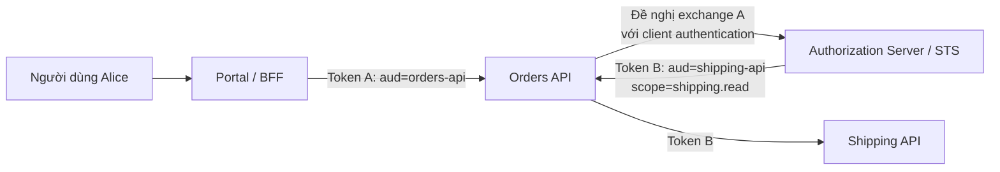
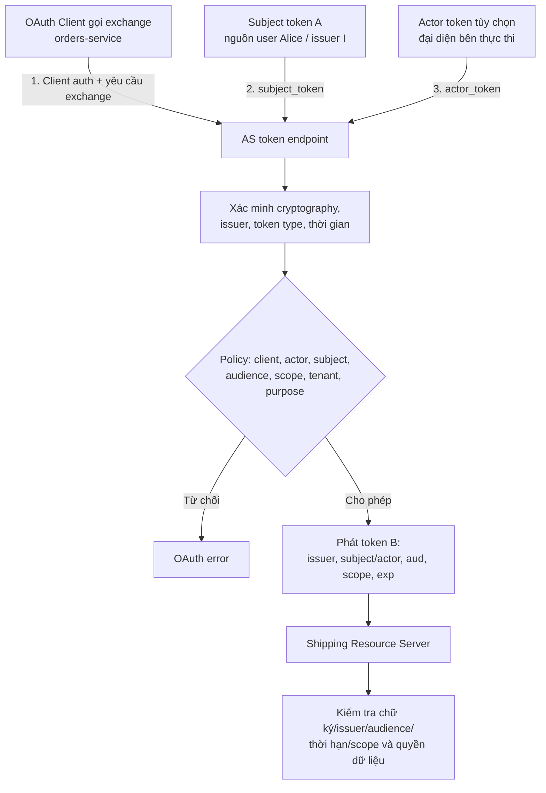
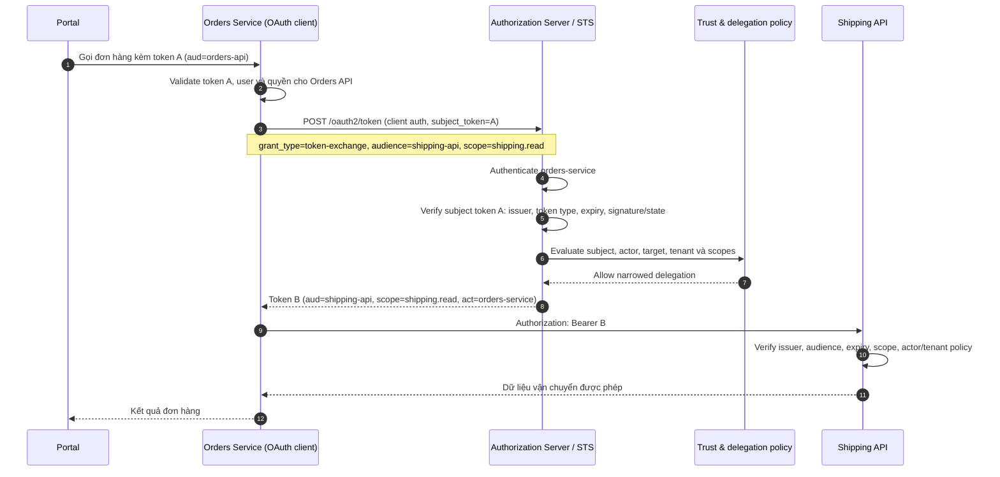
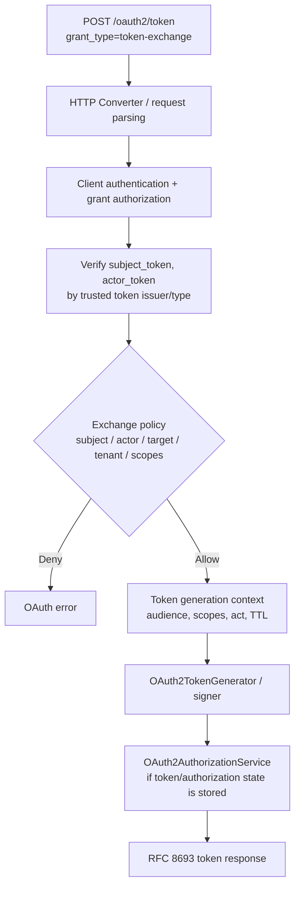

# Mục đích của OAuth 2.0 Token Exchange và ranh giới tin cậy

Trong kiến trúc microservices, API Gateway hoặc Backend-for-Frontend (BFF), một service có thể cần gọi service khác **thay mặt người dùng** hoặc **dưới danh tính một service đã được ủy quyền**. Việc đơn giản chuyển tiếp access token ban đầu qua mọi service thường không an toàn: token có thể được phát hành cho audience khác, mang quyền quá rộng hoặc không thể hiện rõ service nào thực sự thực hiện hành động.

**OAuth 2.0 Token Exchange** (RFC 8693) là một cơ chế chuẩn để client trình một **security token đầu vào** cho Authorization Server hoặc Security Token Service (STS), yêu cầu phát hành **security token mới** phù hợp với đối tượng nhận và ngữ cảnh ủy quyền. Nó giúp chuyển đổi ngữ cảnh tin cậy một cách có kiểm soát, nhưng **không tự động bảo đảm** delegation, impersonation hay least privilege: tất cả phụ thuộc vào chính sách xác minh token và phát hành token của máy chủ.

Bài thuộc chương **Token Exchange** của module **SPRING_SECURITY_OAUTH2_OIDC_AUTHORIZATION_SERVER**, hướng tới thiết kế, cấu hình, bảo mật, kiểm thử và vận hành OAuth 2.0/OpenID Connect Authorization Server bằng Spring Security và Spring Authorization Server trong Spring Boot.

**Mục tiêu học tập:**

- Giải thích vì sao cần Token Exchange khi gọi API qua nhiều tầng, và phân biệt với chuyển tiếp bearer token, `client_credentials`, refresh token, introspection.
- Đọc được các tham số RFC 8693: `subject_token`, `subject_token_type`, `actor_token`, `actor_token_type`, `requested_token_type`, `audience`, `resource` và `scope`.
- Phân biệt **subject**, **actor**, **delegation** và **impersonation**; hiểu ý nghĩa claim `act` và giới hạn khi chỉ nhìn `sub`.
- Xác định những ranh giới tin cậy ở client gọi exchange, token endpoint, kho chính sách và Resource Server đích.
- Thiết kế chính sách thu hẹp quyền, kiểm tra audience/issuer, ngăn confused deputy, token substitution và cross-tenant access.
- Xây dựng kế hoạch tích hợp/token policy trong Spring Authorization Server và bộ kiểm thử các trường hợp bị từ chối.

## 1. Vấn đề: một access token không nên đi qua mọi service

Ví dụ hệ thống bán hàng có:

| Thành phần | Danh tính/địa chỉ minh họa | Vai trò |
| --- | --- | --- |
| Người dùng | `alice` | Xem và tạo đơn hàng. |
| Frontend/portal | `https://portal.example.com` | Bắt đầu đăng nhập qua OIDC, nhận phiên ứng dụng. |
| Authorization Server | `https://login.example.com` | Phát token, áp dụng chính sách cấp quyền. |
| Orders API | audience `orders-api` | Xử lý đơn hàng. |
| Shipping API | audience `shipping-api` | Đọc thông tin vận chuyển, tạo yêu cầu giao hàng. |
| Orders backend client | `orders-service` | Thành phần thực hiện HTTP request từ Orders tới Shipping. |

Alice đăng nhập, portal có access token A dành cho `orders-api`. Orders API cần lấy tình trạng vận chuyển từ Shipping API. Có hai cách thiết kế:

**Cách 1 — Chuyển tiếp token A nguyên vẹn:**

```text
Alice -> Portal -> Orders API (A: aud=orders-api)
                        |
                        +----> Shipping API (vẫn dùng A)
```

Nếu Shipping API **xác minh audience đúng**, token A dành cho Orders API phải bị từ chối. Nếu Shipping API bỏ qua `aud` để tiện cho việc gọi nhau, hệ thống tạo **audience confusion**: bearer token bị lấy cắp từ một service có thể được dùng ở service khác ngoài ý định phát hành.

**Cách 2 — Token Exchange có chính sách:**



AS chỉ phát token B sau khi kiểm tra token A, xác thực client gọi exchange, xác minh **Orders có quyền gọi Shipping thay mặt Alice** và giới hạn scope/audience. Shipping chỉ nhận B nếu token B vượt qua validator của nó.

**Lợi ích cốt lõi:** token B có **đích đến và quyền riêng**, có thể có TTL ngắn và thông tin actor phục vụ audit. Token A không cần được Shipping chấp nhận. Đây là phân chia ranh giới tin cậy, không phải thủ thuật biến mọi token thành token vạn năng.

### 1.1. Token Exchange giải quyết được và không giải quyết được gì?

| Vấn đề | Token Exchange có thể giúp | Nhưng vẫn cần |
| --- | --- | --- |
| Token ban đầu không dành cho API đích | Phát token có `aud`/`resource` dành cho API đích. | API đích xác minh audience; AS xác định đích được phép. |
| Quyền ban đầu quá rộng | Chỉ phát các scopes phù hợp với request và chính sách. | Quy tắc không nâng quyền, kiểm tra nghiệp vụ/tenant tại API. |
| Cần biết service nào thay mặt user | Phát token thể hiện subject và actor. | Actor được xác thực thực sự, khai báo delegation rõ ràng, audit. |
| Kết nối nhiều miền danh tính | Có thể trao đổi token từ issuer/định dạng được tin cậy sang token đích. | Trust federation, kiểm tra khóa, issuer, token purpose và policy. |
| Giảm số service giữ token gốc | Giới hạn token gốc tại service đầu vào, phát token riêng cho hop sau. | Bảo vệ kho token, truyền TLS và giới hạn logs. |
| Ngăn token bị dùng lại sau khi đánh cắp | Có thể phát token thời hạn ngắn hoặc sender-constrained nếu triển khai. | Xác thực/authorization ở từng hop; revoke, PoP, rotation theo thiết kế. |

Token Exchange **không mặc nhiên** xác minh quyền truy cập tài nguyên cuối cùng, không làm mTLS/DPoP xuất hiện, không thu hồi mọi token trước, không thay PKCE, không thay user login và không tạo cross-issuer trust chỉ từ việc nhận một JWT.

## 2. Các vai trò và ranh giới tin cậy

Trong RFC 8693, **client** gọi token endpoint để yêu cầu exchange, **subject token** đại diện cho danh tính/ngữ cảnh được trao đổi, còn **actor token** (nếu có) đại diện cho một bên đang hành động. Authorization Server/STS là bên đánh giá có thể phát token mới hay không.



Một số **trust boundaries** cần đặt rõ:

1. **Trình duyệt → frontend/BFF:** user đã đăng nhập không có nghĩa mọi request browser đều được phép làm nghiệp vụ. Client còn phải giữ phiên, kiểm soát CSRF và scope.
2. **OAuth client → token endpoint:** `client_id` là định danh công khai, không phải bằng chứng. AS phải xác thực confidential client hoặc áp dụng phương thức/giới hạn tương ứng với loại client.
3. **Subject token → AS/STS:** token do client gửi là **dữ liệu từ ngoài vùng tin cậy** cho đến khi AS xác minh issuer, chữ ký hoặc introspection, mục đích, thời hạn và cách token được phép sử dụng làm bằng chứng exchange.
4. **Actor token → AS/STS:** actor token cũng cần được xác minh theo chính sách; không lấy `actor_token` do client tự chế để gán cho service một danh tính đáng tin.
5. **AS → Resource Server đích:** token mới phải được API đích xác minh đúng `iss`, `aud`, `exp`, scope và ràng buộc actor/tenant khi policy yêu cầu.
6. **Giữa các tenant/issuer:** cùng một chuỗi `sub=alice` hoặc `client_id=orders-service` ở hai issuer không mặc nhiên chỉ cùng một thực thể; phải dùng danh tính có nguồn issuer rõ ràng.

**Quy tắc thiết kế:** chỉ có một **token mới do AS có thẩm quyền phát hành và API đích chấp nhận** mới được đi qua ranh giới sang API đích; đừng biến `subject_token` thành “giấy thông hành” được tin ở mọi nơi.

## 3. RFC 8693 định nghĩa Token Exchange như thế nào?

Token Exchange được yêu cầu qua **OAuth token endpoint**, bằng một `grant_type` đặc biệt:

```text
urn:ietf:params:oauth:grant-type:token-exchange
```

Client gửi các tham số dưới dạng `application/x-www-form-urlencoded` bằng `POST` qua HTTPS.

### 3.1. Các tham số quan trọng

| Tham số | Bắt buộc? | Ý nghĩa |
| --- | --- | --- |
| `grant_type` | **Có** | Đặt đúng URN token-exchange theo RFC 8693. |
| `subject_token` | **Có** | Security token làm đầu vào, thể hiện party/authorization context được yêu cầu trao đổi. |
| `subject_token_type` | **Có** | Kiểu token đầu vào, ví dụ access token, JWT hoặc ID token theo URN tương ứng. |
| `actor_token` | Tùy chọn | Security token đại diện actor thực hiện hành động thay subject. |
| `actor_token_type` | Bắt buộc **nếu gửi `actor_token`** | Kiểu actor token. |
| `requested_token_type` | Tùy chọn | Kiểu token muốn nhận; kết quả còn phụ thuộc policy AS. |
| `audience` | Tùy chọn | Đối tượng nhận logic dự kiến của token được phát hành. |
| `resource` | Tùy chọn | Resource URI đích; có thể được dùng để chỉ tài nguyên mà token sẽ được chấp nhận. |
| `scope` | Tùy chọn | Các quyền mong muốn cho token mới; không thể tự ý tăng quyền. |

Một số token type identifier phổ biến:

```text
urn:ietf:params:oauth:token-type:access_token
urn:ietf:params:oauth:token-type:refresh_token
urn:ietf:params:oauth:token-type:id_token
urn:ietf:params:oauth:token-type:jwt
urn:ietf:params:oauth:token-type:saml1
urn:ietf:params:oauth:token-type:saml2
```

AS **không cần** hỗ trợ tất cả kiểu token trong bảng. Mỗi loại được chấp nhận phải có validator, ràng buộc issuer/audience và chính sách chuyển đổi phù hợp. `subject_token_type` là **khai báo của client**, không phải chứng cứ thực tế; AS phải tự xác minh token là đúng kiểu và đủ điều kiện sử dụng.

**Lưu ý OIDC:** ID token được phát hành nhằm xác thực user cho **OIDC client**, không phải access token để gọi API. Đừng mặc nhiên cho phép ID token trở thành `subject_token` được trao đổi lấy quyền API; điều đó cần thiết kế trust policy riêng để tránh token-type confusion.

### 3.2. Request HTTP chuẩn minh họa

Ví dụ Orders service muốn lấy access token cho Shipping API, thay mặt Alice:

```http
POST /oauth2/token HTTP/1.1
Host: login.example.com
Authorization: Basic <BASE64_OF_CLIENT_ID_AND_SECRET>
Content-Type: application/x-www-form-urlencoded

grant_type=urn%3Aietf%3Aparams%3Aoauth%3Agrant-type%3Atoken-exchange
&subject_token=<SUBJECT_ACCESS_TOKEN_A>
&subject_token_type=urn%3Aietf%3Aparams%3Aoauth%3Atoken-type%3Aaccess_token
&requested_token_type=urn%3Aietf%3Aparams%3Aoauth%3Atoken-type%3Aaccess_token
&audience=shipping-api
&scope=shipping.read
```

Body được xuống dòng để dễ nhìn. **Khi gửi thật**, các cặp form được encode đúng và cùng thuộc một request body; không gửi raw token trong query string. Basic authentication là **ví dụ cho confidential client**; client cũng có thể được xác thực bằng `private_key_jwt`, mTLS hoặc cách được server cho phép.

### 3.3. Response chuẩn minh họa

Nếu AS chấp nhận, nó có thể trả:

```http
HTTP/1.1 200 OK
Content-Type: application/json
Cache-Control: no-store
Pragma: no-cache

{
  "access_token": "<NEW_TOKEN_FOR_SHIPPING_API>",
  "issued_token_type": "urn:ietf:params:oauth:token-type:access_token",
  "token_type": "Bearer",
  "expires_in": 300,
  "scope": "shipping.read"
}
```

Những trường cần phân biệt:

- `access_token`: tên trường response chứa token được phát hành theo RFC 8693. Kể cả khi requested token type không phải access token thông thường, cách biểu diễn phải theo đặc tả và triển khai tương ứng.
- `issued_token_type`: **kiểu security token thực tế** đã phát hành, là thành phần quan trọng của Token Exchange response.
- `token_type`: cách trình token cho bên nhận, chẳng hạn `Bearer` khi đó là OAuth bearer access token.
- `expires_in`: khoảng thời gian hiệu lực được thông báo theo giây cho token được cấp.
- `scope`: các scopes thực tế được cấp, có thể khác scope đã đề nghị tùy chính sách.

**Không đồng nhất** `issued_token_type` với `token_type`. Một giá trị `urn:ietf:params:oauth:token-type:access_token` mô tả loại security token, còn `Bearer` mô tả cách sử dụng token trong OAuth. Một client cần kiểm tra token type thực tế trước khi sử dụng, không giả định mọi phản hồi exchange là JWT access token.

### 3.4. Cách resource và audience được áp dụng

`audience` và `resource` có thể được dùng để mô tả **đích** của token mới; đây không phải hai tham số cho phép mở rộng tự do phạm vi token.

- `audience=shipping-api`: muốn token có đối tượng nhận logic là Shipping API.
- `resource=https://api.example.com/shipping`: muốn token được dùng cho resource URI được AS nhận diện.
- `scope=shipping.read`: xin một quyền cụ thể trên đích đó.

AS phải xác định các mục tiêu có được cấp phép và diễn giải nhất quán theo đăng ký/policy. Khi client yêu cầu nhiều audience/resource hoặc scope quá rộng, AS có thể từ chối với `invalid_target` hoặc lỗi giao thức thích hợp. **Không ép** AS phát token cho mọi resource mà client tự liệt kê.

## 4. Subject, actor, delegation và impersonation

### 4.1. Subject là ai?

Trong một token JWT thông dụng, claim `sub` biểu thị subject của token theo định nghĩa của issuer. Với ví dụ trên, subject có thể là user `alice`. Tuy nhiên, một subject cũng có thể là service principal trong machine-to-machine use case. Không mặc định mọi `sub` đều là người dùng.

Trong Token Exchange, `subject_token` mang ngữ cảnh subject hoặc quyền được ủy thác cần chuyển đổi. AS phải kiểm tra **nguồn phát hành** và ý nghĩa của subject token, không chỉ giải mã base64 rồi sao chép `sub`.

### 4.2. Actor là ai?

**Actor** là thực thể đang hành động **thay mặt** subject, ví dụ `orders-service`. Trong mô hình delegation, AS có thể đưa actor vào token mới bằng claim `act` theo RFC 8693.

Payload **chỉ minh họa**, không phải JWT đã ký:

```json
{
  "iss": "https://login.example.com",
  "sub": "alice",
  "aud": ["shipping-api"],
  "scope": "shipping.read",
  "act": {
    "sub": "orders-service"
  },
  "iat": 1980000000,
  "exp": 1980000300
}
```

Có hai danh tính: **Alice** là subject (`sub`), còn **Orders service** là actor (`act.sub`). Shipping API có thể sử dụng cả hai trong chính sách/audit, tùy định nghĩa nghiệp vụ.

**Actor token không đồng nghĩa client authentication:** `actor_token` là một tham số trao đổi theo RFC 8693; còn `Authorization: Basic ...`, mTLS hoặc `private_key_jwt` là cách client gọi token endpoint chứng minh danh tính. Hai danh tính có thể trùng trong triển khai, nhưng AS phải ràng buộc chúng theo chính sách thay vì tin một actor token tự khai.

### 4.3. Delegation và impersonation khác nhau thế nào?

| Khái niệm | Ý nghĩa | Ngữ cảnh cần lưu |
| --- | --- | --- |
| **Delegation** (ủy quyền đại diện) | Actor được phép thực hiện một số hành động **thay mặt subject**; cần giữ được dấu vết actor. | Subject, actor, nguồn trao quyền, scopes, audience, tenant và thời hạn. |
| **Impersonation** (hành động dưới danh tính subject) | Bên nhận nhìn thấy token với danh tính subject được đại diện; actor có thể không được thể hiện rõ trong token. | Phải có policy cấp phép impersonation rõ ràng và audit ngoài token nếu cần. |
| **Client credentials** | Service nhận token cho **chính danh tính service**; không nhất thiết có user subject. | Service principal, scopes, audience, client authentication. |
| **Bearer token forwarding** | Chuyển tiếp cùng token qua nhiều hop. | Không tạo token mới, không tự thu hẹp audience/scope hoặc biểu diễn actor. |

RFC 8693 mô tả ngữ nghĩa delegation/impersonation và khả năng dùng `act`. Việc truyền một `actor_token`, hoặc việc client gọi token endpoint bằng secret, **không tự động** làm token mới phản ánh delegation đúng. AS phải biết khi nào được đưa actor vào claim và Resource Server phải hiểu, kiểm tra claim theo policy của mình.

**Nguy cơ quan trọng:** nếu Orders service có thể đổi mọi token đầu vào thành token với `sub=admin` mà không cần kiểm tra quan hệ ủy quyền, Token Exchange trở thành cơ chế **nâng quyền bằng token**. Chính sách “cho phép exchange” không được đồng nghĩa “được impersonate bất kỳ subject nào”.

### 4.4. Claim may_act và chuỗi actor

RFC 8693 còn mô tả `may_act` để thể hiện thông tin về bên **có thể được phép** hành động thay subject trong một bối cảnh. Một token đầu vào có `may_act` không phải giấy phép tuyệt đối: AS còn phải kiểm tra issuer, thời hạn, client, actor, audience và policy.

Ví dụ claim minh họa:

```json
{
  "sub": "alice",
  "may_act": {
    "sub": "orders-service"
  }
}
```

Trong hệ thống nhiều hop, `act` có thể biểu diễn actor chain theo cách đặc tả hỗ trợ. Nhưng không nên coi một chuỗi JSON lồng nhau do client đưa lên là đáng tin. Actor chain chỉ có giá trị khi các issuer/AS đã xác minh và tạo token theo chính sách.

## 5. Trust policy: điều kiện trước khi phát token mới

**Giá trị thật của Token Exchange nằm ở authorization policy của STS**, không ở việc thay phần header/payload JWT. Một exchange request hợp lệ về cú pháp vẫn có thể bị từ chối vì không đáp ứng policy.

Một policy tối thiểu cho ví dụ Orders → Shipping:

| Kiểm tra | Câu hỏi cần trả lời | Kết quả mong muốn |
| --- | --- | --- |
| **Client authentication** | Bên gọi có thật là `orders-service` đã đăng ký không? | Xác thực bằng phương thức phù hợp; không chỉ tin `client_id`. |
| **Grant được đăng ký** | `orders-service` có được yêu cầu Token Exchange không? | Grant được phép theo registration và policy. |
| **Subject token** | Token A do issuer được tin phát hành? Chữ ký/introspection đúng? Chưa hết hạn/thu hồi? | Không chấp nhận dữ liệu JWT chưa xác minh. |
| **Mục đích token đầu vào** | AS/STS có được phép dùng loại token này làm bằng chứng exchange? | Chặn ID token hoặc token chỉ dành cho ứng dụng khác khi không có policy rõ. |
| **Subject/actor binding** | Orders có thực sự được ủy quyền hành động cho Alice không? | Không cho client tự thay subject hoặc khai actor giả. |
| **Tenant binding** | Alice/Orders thuộc tenant phù hợp với dữ liệu Shipping? | Không cấp quyền chéo tenant chỉ vì ID trùng. |
| **Target allowlist** | Đích `shipping-api` có được Orders gọi qua exchange? | Từ chối audience/resource ngoài policy. |
| **Scope downscoping** | `shipping.read` có được suy ra từ quyền nguồn và chính sách delegation không? | Không cấp `shipping.admin` hay quyền rộng hơn được phép. |
| **TTL và token type** | Token mới có thời hạn, định dạng, binding phù hợp không? | Token mới thường ngắn hạn, dùng đúng API đích. |
| **Audit và trạng thái** | Có đủ dấu vết issuer, subject, actor, client, target, quyết định không? | Lưu metadata cần thiết, không ghi raw token. |

### 5.1. Downscoping không đơn thuần là giao của hai chuỗi scope

Hai API có thể dùng từ vựng scope khác nhau:

```text
Token A cho Orders API:
  aud = orders-api
  scope = orders.read orders.manage

Token B cần cho Shipping API:
  aud = shipping-api
  scope = shipping.read
```

`shipping.read` không nằm trong danh sách `orders.*` nên phép **giao chuỗi scope** sẽ không mô tả được quan hệ cho phép này. Chính sách có thể định nghĩa rằng user có quyền xử lý đơn hàng và Orders service được phép đọc trạng thái giao hàng **trong cùng tenant và đơn hàng liên quan**. Mapping này phải được **kiểm soát tại STS và kiểm tra đối tượng tại API đích**, không do client tự quyết định.

Một policy minh họa:

```text
ALLOW exchange if
  authenticated_client == "orders-service"
  AND input.issuer == "https://login.example.com"
  AND input.subject != null
  AND input.audience == "orders-api"
  AND input.scopes contains "orders.read"
  AND requested_audience == "shipping-api"
  AND requested_scopes subset_of {"shipping.read"}
  AND input.tenant == authenticated_client.allowed_tenant

ISSUE
  subject = verified input.subject
  actor = authenticated_client identity
  audience = "shipping-api"
  scope = "shipping.read"
  ttl <= configured maximum and bounded by accepted source context

DENY otherwise
```

Đây là **mô hình chính sách**, không phải luật bắt buộc được Spring Authorization Server áp dụng sẵn. Nếu mọi tenant/đơn hàng không được xác định chắc chắn ở STS, Shipping API vẫn phải kiểm tra chúng tại request tài nguyên cụ thể.

### 5.2. Token mới không được tự mở rộng quyền

Sai lầm nguy hiểm:

```text
request.scope=admin
=> STS ký JWT có scope=admin vì client đã được xác thực
```

Client authentication chỉ chứng minh **client là ai**, không chứng minh client được phát bất kỳ quyền nào. STS cần kết hợp quyền chủ thể ban đầu, khả năng được ủy quyền của actor, danh sách target/scope được cho phép và chính sách nghiệp vụ.

Nếu một scope không được phép, có thể từ chối hoặc cấp tập scope được thu hẹp nếu giao thức và hợp đồng client cho phép. Client phải kiểm tra `scope` trong response thay vì giả định yêu cầu gì cũng được cấp nấy.

### 5.3. Token input dành cho STS hay API nào?

Một JWT access token đã phát cho `orders-api` **không tự động** được tin để đổi thành mọi token khác. Khi cho phép `orders-service` trình nó tại token endpoint, hệ thống cần định nghĩa rõ:

- Issuer nào được STS tin để xác minh token đầu vào.
- Loại token nào được dùng làm `subject_token`.
- Audience/mục đích của token đầu vào có đủ điều kiện exchange hay không.
- Bằng chứng nào cho thấy caller thực sự được phép đại diện subject của token.
- Token có được phép dùng lại trong nhiều exchange hay không và các giới hạn liên quan.

Nếu đổi token từ **issuer khác**, không được dùng chung validator/JWKS một cách vô điều kiện. Cần trust mapping cụ thể theo issuer và token type, tránh nhầm một JWT từ môi trường staging với token production.

## 6. Quy trình Token Exchange end-to-end

### 6.1. Luồng dữ liệu đầy đủ



Tại mỗi ranh giới đều có **đối tượng tin cậy** riêng:

- Orders không nên nhận token A chỉ vì JWT parse được; nó cần kiểm tra token dành cho Orders.
- STS không được tin `subject_token` hoặc `actor_token` chỉ vì chúng được gửi qua một client đã xác thực.
- Shipping không được chấp nhận token A nếu nó chỉ dành cho Orders.
- Token B có thể còn hợp lệ dù token A sau đó bị revoke, tùy thiết kế kiểm tra trạng thái và vòng đời. Không có quy tắc mặc định mọi token con tự mất hiệu lực tức khắc khi token cha hết hạn/thu hồi.

### 6.2. Chọn thời hạn cho token B

Ví dụ access token A còn hạn 15 phút, policy trao đổi muốn cấp B tối đa 5 phút. Một lựa chọn bảo thủ là giới hạn B sao cho không kéo dài thời gian được đại diện quá thời gian và quyền của A, đồng thời ngắn hơn giới hạn dành cho Shipping.

Tuy nhiên **RFC 8693 không áp đặt một công thức TTL phổ quát** cho mọi trường hợp. Trong hệ thống có federation, tính chất subject token và policy có thể khác nhau. Phải chọn quy tắc minh bạch: TTL tối đa, hạn tuyệt đối của delegation, điều kiện revoke, khả năng kiểm tra trạng thái hoặc yêu cầu sender-constrained token.

Đừng chỉ copy `exp` từ token nguồn rồi kết luận đã an toàn. Token B cần expiration theo chính sách của chính STS, và Resource Server đích phải xác minh nó.

### 6.3. Có nên chuyển tiếp token A cùng token B không?

Thông thường, client chỉ cần gửi token B đến Shipping API nếu contract yêu cầu B. Truyền cả A và B qua nhiều hop làm tăng nguy cơ rò rỉ thông tin, tạo nhầm lẫn về token được xác minh và khiến API dễ bỏ qua chính sách.

Nếu có nhu cầu truyền thêm claims/trace context, nên dùng cơ chế audit/trace đã kiểm soát; không đặt raw subject token vào log hoặc tùy tiện nhúng toàn bộ token A trong claim của B.

## 7. Token Exchange khác các grant và cơ chế OAuth khác thế nào?

| Cơ chế | Đầu vào chính | Kết quả | Khác Token Exchange ở đâu? |
| --- | --- | --- | --- |
| **Authorization Code** | Authorization code sau browser redirect; PKCE khi áp dụng. | Access token và có thể ID/refresh token. | Chuyển từ tương tác user đến token, không phải đổi security token đầu vào sang token cho đích mới. |
| **Refresh Token** | Refresh token đã được phát hành. | Access token mới theo authorization hiện có. | Duy trì quyền cấp trước, không mặc nhiên thay đổi audience/subject/actor theo giao thức exchange. |
| **Client Credentials** | Client authentication của service. | Token cho service principal. | Không đòi subject token và không mặc nhiên thể hiện hành động thay user. |
| **Token Introspection** | Token cần tra trạng thái. | Metadata/trạng thái token. | Không phải yêu cầu phát security token mới. |
| **Token Revocation** | Token cần thu hồi. | Xác nhận request revoke theo giao thức. | Không phải tạo token mới. |
| **Token forwarding** | Token A nguyên vẹn. | Không có token mới. | Không thu hẹp audience hay tạo actor record ở cấp token. |
| **Token Exchange** | Subject token, có thể actor token, cùng client authentication/chính sách. | Security token mới cho bối cảnh được phê duyệt. | Biến đổi ngữ cảnh được tin cậy có kiểm soát. |

**OIDC ID Token khác OAuth Access Token.** ID token dành cho một OIDC Relying Party xác minh lần đăng nhập; không nên đưa nó đến Resource Server như bearer access token và cũng không nên dùng làm exchange input khi chưa xác định policy rất cụ thể.

## 8. Triển khai với Spring Authorization Server

Spring Authorization Server có mô hình `RegisteredClient`, `RegisteredClientRepository`, `OAuth2AuthorizationService`, `OAuth2TokenGenerator`, `TokenSettings` và cơ chế cấu hình token endpoint. **Hỗ trợ Token Exchange có sẵn hoặc điểm mở rộng cụ thể phụ thuộc phiên bản Spring Authorization Server được dùng.** Cần xác minh bản thư viện trước khi quyết định cấu hình trực tiếp các thành phần đã có hay phát triển grant extension. Đừng giả định mọi bản Spring Boot 3.x/SAS 1.x tự hỗ trợ RFC 8693 đầy đủ chỉ vì token endpoint hoạt động.

Ở đây ta trình bày **mô hình tích hợp và các hợp đồng bảo mật**, không tuyên bố một bean ví dụ đã tạo được Token Exchange server hoàn chỉnh.

### 8.1. Đăng ký client được phép yêu cầu Token Exchange

Các phiên bản có API constant tương ứng có thể cung cấp sẵn grant type; để minh họa giá trị RFC 8693 một cách độc lập, có thể biểu diễn bằng `AuthorizationGrantType` chứa URN:

```java
package com.example.authserver.config;

import java.time.Duration;
import java.util.UUID;

import org.springframework.beans.factory.annotation.Value;
import org.springframework.context.annotation.Bean;
import org.springframework.context.annotation.Configuration;
import org.springframework.security.crypto.password.PasswordEncoder;
import org.springframework.security.oauth2.core.AuthorizationGrantType;
import org.springframework.security.oauth2.core.ClientAuthenticationMethod;
import org.springframework.security.oauth2.server.authorization.client.InMemoryRegisteredClientRepository;
import org.springframework.security.oauth2.server.authorization.client.RegisteredClient;
import org.springframework.security.oauth2.server.authorization.client.RegisteredClientRepository;
import org.springframework.security.oauth2.server.authorization.settings.TokenSettings;

@Configuration(proxyBeanMethods = false)
public class ExchangeClientRegistrationConfig {

    private static final AuthorizationGrantType TOKEN_EXCHANGE =
        new AuthorizationGrantType(
            "urn:ietf:params:oauth:grant-type:token-exchange");

    @Bean
    RegisteredClientRepository registeredClientRepository(
            PasswordEncoder encoder,
            @Value("${demo.orders-service-secret}") String secret) {

        RegisteredClient ordersService = RegisteredClient
            .withId(UUID.randomUUID().toString())
            .clientId("orders-service")
            .clientSecret(encoder.encode(secret))
            .clientAuthenticationMethod(
                ClientAuthenticationMethod.CLIENT_SECRET_BASIC)
            .authorizationGrantType(TOKEN_EXCHANGE)
            .scope("shipping.read")
            .tokenSettings(TokenSettings.builder()
                .accessTokenTimeToLive(Duration.ofMinutes(5))
                .build())
            .build();

        return new InMemoryRegisteredClientRepository(ordersService);
    }
}
```

`application.yml` demo:

```yaml
demo:
  orders-service-secret: ${ORDERS_SERVICE_SECRET}
```

**Quan trọng:**

- `authorizationGrantType(TOKEN_EXCHANGE)` chỉ ghi **quyền sử dụng grant của client** vào registration. Nó **không** tự cung cấp HTTP request converter, validation của `subject_token`, authorization policy hoặc phát token theo RFC 8693.
- `CLIENT_SECRET_BASIC` là lựa chọn minh họa cho confidential backend client; có thể thay bằng `private_key_jwt` hoặc mTLS tùy threat model. Chỉ dùng HTTPS.
- `scope("shipping.read")` là phạm vi quyền client có thể được xem xét cấp, **không** thay thế việc kiểm tra subject token và quyền delegation của Alice.
- `TokenSettings` đặt TTL, không làm `audience=shipping-api` tự xuất hiện. Việc gán `aud`, `act` hoặc claims đặc thù cần được hỗ trợ bởi token issuance/customizer tương ứng.
- `InMemoryRegisteredClientRepository` chỉ dùng demo; production cần kho client bền vững và thay đổi registration có audit.
- Không tạo một repository trùng bean nếu ứng dụng đã có repository hiện hữu. Mẫu này chỉ thể hiện *một* registration minh họa.

### 8.2. Các trách nhiệm phải có ở token endpoint

Tùy phiên bản, token endpoint có thể hỗ trợ grant bằng các converter/provider được framework cung cấp hoặc cần extension. Dù chọn cách nào, một Token Exchange implementation đúng cần:

1. **Nhận request:** parse `grant_type`, `subject_token`, `subject_token_type` và các tham số tùy chọn theo RFC 8693, giới hạn kích thước và số lượng tham số.
2. **Xác thực client:** lấy authenticated client từ Spring Security context/AS mechanism; kiểm tra client được đăng ký grant Exchange.
3. **Xác minh token đầu vào:** chọn validator theo **issuer và token type đã được cho phép**; kiểm tra chữ ký/introspection, hạn, audience/mục đích, trạng thái, loại token, khóa.
4. **Xác minh actor:** nếu có `actor_token`, thực hiện validation riêng; ràng buộc actor với client xác thực và subject được phép đại diện.
5. **Ra quyết định cấp quyền:** đánh giá client, subject, actor, requested audience/resource, scopes, tenant, TTL và các điều kiện nghiệp vụ.
6. **Sinh token:** phát token có `iss`, `sub`, `aud`, `scope`, `exp` và `act` khi thực sự biểu diễn delegation; ký/ghi trạng thái theo định dạng được chọn.
7. **Trả response:** thông báo `issued_token_type`, `token_type`, `expires_in`, `scope` khi áp dụng; không trả raw input token hoặc secret.
8. **Ghi audit và giới hạn rủi ro:** rate-limit, monitor error, không log token, quản trị token replay và cách revoke.



**Không được bỏ qua validator mặc định của Spring khi tùy biến endpoint.** Nếu dùng extension, chỉ đăng ký converter/provider theo API hỗ trợ của phiên bản, bảo đảm thứ tự và tính tương thích với những grant đang hoạt động. Không tự viết controller `POST /oauth2/token` thứ hai để phát JWT ngoài chuỗi kiểm tra của Spring.

### 8.3. Policy engine nên là thành phần riêng

Tránh viết policy chỉ bằng một câu lệnh “nếu client đã đăng nhập thì cấp token”. Nên có một lớp/service ra quyết định rõ đầu vào và đầu ra.

Pseudocode:

```text
exchange(request, authenticatedClient):
    require registeredGrant(authenticatedClient, TOKEN_EXCHANGE)

    subject = verifyToken(
        request.subjectToken,
        request.subjectTokenType,
        acceptedIssuersAndTypesFor(authenticatedClient)
    )

    actor = request.actorToken != null
        ? verifyActorToken(request.actorToken, request.actorTokenType)
        : authenticatedClient.identity

    require policy.canActFor(actor, subject)
    target = policy.resolveTarget(request.audience, request.resource)
    require policy.clientCanCall(authenticatedClient, target)
    require policy.subjectCanDelegateTo(subject, actor, target)

    grantedScopes = policy.downscope(
        subject, authenticatedClient, target, request.scope
    )
    require grantedScopes is permitted and non-ambiguous

    claims = {
        iss: configuredIssuer,
        sub: verifiedSubjectId,
        aud: target,
        scope: grantedScopes,
        act: verifiedActorIfDelegation,
        exp: boundedExpiry
    }
    return signIssueAndPersist(claims)
```

Đây là **pseudocode**, không phải API có sẵn tên `policy.canActFor` của Spring. Các phép kiểm tra diễn tả **hợp đồng nghiệp vụ** mà implementation phải cung cấp. Khi nhiều issuer hoặc nhiều tenant tham gia, định danh subject/actor cần đủ ngữ cảnh để không va chạm, thường gồm issuer và subject identifier.

### 8.4. Cấp JWT cho API đích và kiểm tra audience

Một JWT token B minh họa:

```json
{
  "iss": "https://login.example.com",
  "sub": "alice",
  "aud": ["shipping-api"],
  "scope": "shipping.read",
  "act": {
    "sub": "orders-service"
  },
  "tenant_id": "tenant-a",
  "iat": 1980000000,
  "exp": 1980000300
}
```

Claim `tenant_id` là **custom claim minh họa**, không phải claim bắt buộc của RFC 8693. AS phải tự xây dựng nó từ nguồn đáng tin và chỉ đưa vào khi thật sự cần; RS không được tin mọi tenant ID trong request của client.

Spring Resource Server có thể cấu hình cơ sở tin cậy theo issuer, ví dụ:

```yaml
spring:
  security:
    oauth2:
      resourceserver:
        jwt:
          issuer-uri: https://login.example.com
```

Cấu hình này giúp xác minh token từ issuer đáng tin theo cơ chế JWT Resource Server, nhưng **không đồng nghĩa audience/actor/tenant đã được kiểm tra đầy đủ**. Shipping API còn phải yêu cầu audience `shipping-api`, scope `shipping.read`, và nếu thiết kế cần delegation thì xác minh actor cùng quyền trên từng đơn hàng của tenant.

Ví dụ một quy tắc method-level chỉ minh họa scope:

```java
@PreAuthorize("hasAuthority('SCOPE_shipping.read')")
public ShipmentDetails getShipment(String shipmentId) {
    // Vẫn phải kiểm tra shipment thuộc tenant/user được phép.
    return shipmentService.findAuthorizedShipment(shipmentId);
}
```

Code trên không chứa audience validator hay triển khai `findAuthorizedShipment(...)`. Chúng cần được cấu hình/hiện thực đầy đủ trong ứng dụng thực tế.

## 9. Các kiểu tấn công nếu thiết kế sai Token Exchange

### 9.1. Confused deputy — client xin quyền thay user không được phép

Một service đáng tin có credential mạnh nhưng nhận yêu cầu từ bên ngoài. Kẻ tấn công cố làm service đó dùng quyền của chính service để xin token có scope cao hơn user.

**Phòng vệ:** STS kiểm tra cả subject và actor, không chỉ client auth; scope và target phải được cho phép bởi policy, và API đích vẫn kiểm tra đối tượng/tenant.

### 9.2. Token laundering — biến token kém tin cậy thành token được tin rộng

Một JWT do issuer bên ngoài hoặc môi trường staging phát hành được gửi làm `subject_token`. Nếu STS chỉ decode `sub` rồi ký token production với cùng `sub`, nó đã “rửa” dữ liệu không đáng tin thành token do issuer nội bộ ký.

**Phòng vệ:** issuer allowlist theo loại token và client, xác minh chữ ký hoặc introspection, `exp`/`nbf`, purpose/audience, và mapping danh tính rõ ràng. Không dùng wildcard trust cho mọi OIDC issuer chỉ vì có JWKS public.

### 9.3. Audience substitution — token dành cho A được dùng tại B

AS nhận token A có `aud=orders-api`, phát B có `aud=billing-admin` chỉ vì request yêu cầu như vậy.

**Phòng vệ:** audience/resource target allowlist; policy gắn client, subject, actor và scopes; `invalid_target` khi đích không được cho phép.

### 9.4. Scope escalation — tự xin quyền rộng hơn

Client có `orders.read` muốn đổi sang `shipping.admin` hoặc `system.manage` mà không có cơ sở delegation.

**Phòng vệ:** downscope/mapping có kiểm soát, consent/authorization context phù hợp; không nhận tự do tham số `scope` như cấp quyền.

### 9.5. Subject/actor swap

Attacker gửi `subject_token` của user A nhưng `actor_token` tự tạo cho service B, hoặc cố đặt `act.sub` theo ý mình.

**Phòng vệ:** xác thực từng bằng chứng riêng và kiểm tra mối quan hệ giữa subject, actor, client đã xác thực. Không copy claim từ token chưa được xác minh.

### 9.6. Cross-tenant identity collision

Hai issuer có cùng `sub=alice`, hoặc một client được phép truy cập tenant A nhưng xin token cho tenant B.

**Phòng vệ:** định danh đầy đủ theo issuer/tenant và policy; không dùng `sub` đơn lẻ làm global identity khi triển khai federation. API đích kiểm tra resource ownership.

### 9.7. Token type confusion

Client đưa ID token hoặc token JWT không phải access token làm `subject_token` và AS xem nó như access token hợp lệ chỉ vì chữ ký đúng.

**Phòng vệ:** allowlist `subject_token_type`, validator theo mục đích token, issuer, audience, token claims và application-specific trust policy. Không dùng một JWT parser chung rồi bỏ qua ngữ cảnh.

### 9.8. Token replay hoặc lộ token qua log

Bearer subject token hoặc token B bị lấy cắp có thể được dùng lại khi còn hạn nếu không sender-constrained và hệ thống không phát hiện abuse.

**Phòng vệ:** TLS, giới hạn TTL, quản lý token store, không ghi raw token vào log, cân nhắc mTLS/DPoP hoặc introspection/revoke khi phù hợp. Token Exchange **không mặc nhiên** tiêu thụ và vô hiệu hóa subject token sau một lần đổi.

### 9.9. Unrestricted exchange chains

Service A đổi token sang B, B lại đổi sang C, tiếp tục cho tới khi quyền/nguồn gốc bị che khuất hoặc vòng chuyển đổi gây lạm dụng.

**Phòng vệ:** giới hạn các hop/target, actor chain rõ ràng khi cần, TTL tổng, số lần exchange và policy chống tăng quyền tại mỗi hop. Không áp đặt mặc định rằng token con của mọi token đều có quyền xin token tiếp.

## 10. Lỗi giao thức và cách xử lý

Token Exchange là một OAuth grant tại token endpoint. Ngoài các lỗi OAuth tiêu chuẩn, RFC 8693 có `invalid_target` cho trường hợp target không được chấp nhận.

| Tình huống | Lỗi/cách xử lý gợi ý | Lưu ý |
| --- | --- | --- |
| Thiếu `subject_token` hoặc `subject_token_type` | `invalid_request` | Yêu cầu không đủ tham số bắt buộc. |
| `actor_token` có nhưng thiếu `actor_token_type` | `invalid_request` | Các tham số phải nhất quán. |
| Client authentication sai | `invalid_client` | Từ chối trước khi đánh giá exchange policy. |
| Client không được phép dùng exchange grant | `unauthorized_client` | Đăng ký grant và policy là hai điều kiện khác nhau. |
| Subject token hết hạn, sai kiểu hoặc không được tin | Lỗi grant/token phù hợp (thường `invalid_grant`). | Không lộ chi tiết nhạy cảm của token trong response. |
| Yêu cầu audience/resource bị cấm hoặc tập target không đáp ứng được | `invalid_target` theo RFC 8693 | Không tự cấp target khác rộng hơn. |
| Scope vượt quyền | `invalid_scope` hoặc lỗi policy phù hợp | Không nâng quyền vì request yêu cầu. |
| Hệ thống xác minh token/JWKS/issuer tạm thời không sẵn sàng | Từ chối an toàn, báo lỗi phù hợp | Không fail-open hoặc bỏ xác minh chữ ký. |

Mã lỗi cụ thể còn phụ thuộc bối cảnh và implementation. Điều quan trọng là **không cấp token mới** khi client, input token, actor hoặc target chưa được xác minh. Không trả về claims của user, raw token, exception nội bộ hoặc danh sách issuer tin cậy trong thông báo lỗi.

## 11. Thiết kế vận hành và lưu trữ

### 11.1. Quản trị nguồn tin cậy

Nếu STS nhận token từ nhiều issuer, cần một **trust registry** quản trị:

- Issuer identifier canonical, không suy từ request `Host`.
- Phương thức xác minh chữ ký (JWKS/keys) hoặc introspection endpoint đáng tin.
- Loại token được phép nhận; allowed subject/client/tenant mappings.
- Rules về audience/purpose, scope conversion và actor proof.
- Cách cập nhật/thu hồi trust, giới hạn cache JWKS và xoay khóa.
- Phân tách dev/staging/production; tránh để staging issuer được tin trong production ngoài ý muốn.

Việc truy xuất JWKS hoặc introspection URL do server cấu hình phải được bảo vệ khỏi SSRF và redirect tới đích không tin cậy. Không dùng URL do request exchange tự cung cấp làm nguồn khóa xác minh token.

### 11.2. Kho trạng thái và khả năng thu hồi

Với JWT self-contained, token B có thể được API đích xác minh offline. Nếu subject token A sau đó bị revoke, JWT B không tự biến mất. Nếu chính sách cần revoke theo authorization gốc, bạn có thể cần:

- Giới hạn TTL B ngắn.
- Token introspection/reference token cho một số tài nguyên.
- Denylist hoặc trạng thái authorization/delegation có thể truy vấn.
- Một sự kiện thu hồi được Resource Server xử lý an toàn.
- Cơ chế sender-constraining theo threat model.

Không đánh đồng “token được cấp qua exchange” với “token tự có parent-child revocation”. Mối liên hệ parent/child phải được thiết kế, lưu và kiểm tra nếu yêu cầu.

### 11.3. Rate limiting, audit và observability

Exchange endpoint có thể bị dùng để thử nhiều target, scope hoặc token đầu vào. Nên theo dõi:

| Metric / sự kiện | Ý nghĩa |
| --- | --- |
| `token_exchange_requests_total` theo client và kết quả | Nhận diện client gọi nhiều hoặc bị từ chối bất thường. |
| `token_exchange_invalid_target_total` | Phát hiện các đích không hợp lệ hoặc cố khai thác target. |
| `token_exchange_input_validation_failure_total` | Đo lỗi token input theo loại/issuer đã kiểm soát. |
| `token_exchange_latency` | Theo dõi độ trễ tra khóa/introspection/policy và ký token. |
| `token_exchange_delegation_denied_total` | Ghi nhận policy từ chối subject-actor-target. |
| `token_exchange_issued_total` | Theo dõi token được cấp theo audience/scope đã giới hạn. |

Audit nên chứa request ID, client ID được xác thực, issuer/subject/actor identifiers đã kiểm soát, target, scopes cấp, policy decision và thời gian; **không ghi raw subject token, actor token, token B, client secret hay private key**.

### 11.4. Multi-instance và cập nhật policy

Khi AS/STS chạy nhiều instance, cần nhất quán về:

- Issuer, khóa ký và JWKS của AS.
- Registered clients và grant/target permissions.
- Trust registry và bộ khóa issuer được chấp nhận.
- Exchange policy và phiên bản policy (có thể ghi version vào audit).
- Authorization/delegation state nếu yêu cầu revoke tức thì hoặc quan hệ token cha–con.
- Cache và thời gian sống của metadata, token validation, JWK.
- Đồng hồ hệ thống, thời hạn token, rolling rollout.

Hai instance áp dụng policy khác nhau có thể khiến cùng một input token được cấp quyền ở instance này và bị từ chối ở instance khác. Đừng dùng cache không có cơ chế cập nhật khi thay trust/target policy nhạy cảm.

## 12. Ma trận kiểm thử Token Exchange và trust boundaries

Một test chỉ xác nhận token endpoint trả HTTP `200` chưa chứng minh Token Exchange an toàn. Cần test trường hợp được cấp, bị từ chối và tác động trên API đích.

| Trường hợp | Kết quả mong đợi |
| --- | --- |
| Client đúng, input token hợp lệ, target và scope được phép | Phát B đúng `iss`, `sub`, `aud`, `scope`, TTL và `act` nếu có delegation. |
| Thiếu `subject_token` | Từ chối; không phát token. |
| Thiếu `subject_token_type` | Từ chối. |
| `actor_token` nhưng không có `actor_token_type` | Từ chối. |
| Client chưa xác thực hoặc sai secret/JWT assertion | `invalid_client` hoặc lỗi xác thực phù hợp. |
| Client hợp lệ nhưng chưa được đăng ký exchange grant | Từ chối cấp token. |
| Token input bị sửa signature | Từ chối; không tự decode rồi tin claims. |
| Token input hết hạn/chưa hiệu lực | Từ chối theo policy thời gian. |
| Token input có issuer không được tin | Từ chối. |
| ID token được khai là access token | Từ chối token type/purpose sai. |
| Token input từ môi trường staging gửi tới production | Từ chối nếu issuer không được phép. |
| Subject token của user A, actor token tự khai user/service B | Từ chối nếu thiếu actor proof hoặc delegation authorization. |
| Client Orders xin target `billing-admin` | `invalid_target` hoặc lỗi policy, không cấp token. |
| Client xin scope `shipping.admin` | Không tăng quyền; từ chối hoặc xử lý theo chính sách rõ ràng. |
| Subject và actor thuộc tenant khác nhau không được liên kết | Từ chối. |
| B được phát cho `shipping-api` nhưng gửi đến `orders-api` | Orders API từ chối vì audience không khớp. |
| B có `iss` đúng nhưng scope không đủ | API đích từ chối thao tác không được phép. |
| B có scope hợp lệ nhưng request truy cập đơn hàng tenant khác | API từ chối theo quyền tài nguyên. |
| Đổi key/issuer trust khi token đầu vào còn sống | Validation dùng cấu hình/key đáng tin mới, không fail-open. |
| Token A bị revoke sau khi B được cấp | Test làm rõ B còn được API chấp nhận không theo policy thực tế. |
| Client gửi nhiều audience hoặc resource không phù hợp | Từ chối/thu hẹp theo hợp đồng, không phát token bao trùm tùy ý. |
| Actor chain nhiều hop hoặc vượt hop limit | Không mất dấu actor và không mở rộng quyền ngoài policy. |
| Exchange request lặp lại với bearer token A | Hành vi phải theo chính sách replay/rate-limit; không giả định A bị tự tiêu thụ. |
| Malformed subject token rất lớn hoặc tham số lặp | Từ chối an toàn, giới hạn tài nguyên parse/verify. |
| Một AS instance cấu hình policy khác | Test nhận ra kết quả không nhất quán trước khi deploy. |

### 12.1. Kiểm thử request bằng curl

Ví dụ cho confidential client trong môi trường thử nghiệm, biến `SUBJECT_TOKEN_A` đã có giá trị hợp lệ:

```bash
curl --silent --show-error --fail-with-body \
  --user "orders-service:$ORDERS_SERVICE_SECRET" \
  --header "Content-Type: application/x-www-form-urlencoded" \
  --data-urlencode \
    "grant_type=urn:ietf:params:oauth:grant-type:token-exchange" \
  --data-urlencode "subject_token=$SUBJECT_TOKEN_A" \
  --data-urlencode \
    "subject_token_type=urn:ietf:params:oauth:token-type:access_token" \
  --data-urlencode \
    "requested_token_type=urn:ietf:params:oauth:token-type:access_token" \
  --data-urlencode "audience=shipping-api" \
  --data-urlencode "scope=shipping.read" \
  "https://login.example.com/oauth2/token"
```

Lệnh chỉ chạy được khi AS **đã hỗ trợ/configure Token Exchange** và client, subject token, policy đã được chuẩn bị. Nó không thể tự làm xuất hiện grant extension. Không bật verbose với credential thật hoặc copy token vào log/chat; script test cần che thông tin nhạy cảm.

### 12.2. Kiểm tra token B tại Resource Server

Test nên bao gồm:

1. AS trả `issued_token_type` và token B có audience Shipping theo policy.
2. Shipping API chấp nhận B **chỉ khi** issuer, signature/introspection, expiry, audience, scope và quyền dữ liệu đúng.
3. Orders API không chấp nhận B khi B không dành cho Orders.
4. Shipping API từ chối A khi A chỉ dành cho Orders.
5. Nếu dùng delegation semantics, audit và access policy của Shipping xác định đúng Alice (subject) và Orders service (actor), không coi actor là user.
6. Nếu cần cắt quyền tức thời, kiểm tra thời gian từ revoke đầu vào/authorization tới lúc Shipping ngừng chấp nhận B.

**Không chỉ decode JWT để kết luận hợp lệ.** Decode payload giúp quan sát các claim trong môi trường test; Resource Server phải thực hiện xác minh mật mã và toàn bộ điều kiện authorization.

## 13. Các lỗi triển khai thường gặp

### 13.1. `unsupported_grant_type` khi gửi token-exchange

Có thể bản Spring Authorization Server đang chạy chưa bật hoặc chưa triển khai grant Token Exchange; hoặc client/endpoint được cấu hình sai. Kiểm tra **khả năng hỗ trợ của phiên bản** và cách cấu hình converter/provider/token endpoint tương ứng. Đăng ký `AuthorizationGrantType` trong client **không đủ** nếu server không có handler cho grant đó.

### 13.2. `invalid_client` dù subject token của Alice hợp lệ

Token đầu vào hợp lệ không thay client authentication. Kiểm tra phương thức xác thực của client gọi exchange: secret, JWT assertion, mTLS certificate hoặc cơ chế được server cho phép; client ID không phải mật khẩu.

### 13.3. `invalid_target` khi xin token cho Shipping

Kiểm tra target mapping `audience/resource`, quyền `orders-service` dùng target, chính sách subject/actor và số target yêu cầu. Không “sửa” bằng cách cấp token có audience `*`.

### 13.4. Token B có `sub=alice` nhưng API không biết service nào đã gọi

Có thể bạn phát token theo **impersonation** hoặc không đưa `act` vào token. Nếu nghiệp vụ yêu cầu delegation audit, phải cấu hình policy và claim rõ ràng; không suy actor chỉ từ HTTP IP hay client ID trong request tới API.

### 13.5. Token B có chữ ký hợp lệ nhưng API trả 401/403

Kiểm tra issuer, audience `shipping-api`, `exp`, quyền scope và cấu hình JWT/introspection của API. `401` thường gắn authentication/token invalid, `403` có thể gắn thiếu quyền; phân loại theo cấu hình và response thực tế. Đừng tắt audience validation để token B được chấp nhận.

### 13.6. Token B được cấp cho tenant không tương ứng

STS có thể đã copy `tenant_id` từ request của client hoặc map user chỉ bằng `sub` không kèm issuer. Cần xác định nguồn claim tin cậy, mapping tenant và kiểm tra object-level authorization tại Shipping.

### 13.7. Token đầu vào bị thu hồi nhưng token B vẫn hoạt động

Exchange tạo token mới với vòng đời riêng; JWT B được API xác minh offline không tự biết token nguồn bị revoke. Nếu đây là yêu cầu bảo mật, thiết kế token lifetime/revoke propagation/token state rõ ràng.

## 14. Bài thực hành: thiết kế on-behalf-of cho ba tầng

Hệ thống có ba lớp:

| Thành phần | Vai trò | Quyền liên quan |
| --- | --- | --- |
| `staff-portal` | Web BFF đăng nhập Alice qua OIDC | Gọi Orders API. |
| `orders-service` | Backend xử lý đơn hàng, confidential OAuth client | Tra quyền Alice, gọi Shipping thay mặt Alice. |
| `shipping-service` | Resource Server nhận token sau exchange | Chỉ được đọc trạng thái giao hàng của đơn hàng thuộc đúng tenant. |

Yêu cầu nghiệp vụ: Alice xem đơn hàng thuộc `tenant-a`; Orders cần gọi Shipping để đọc trạng thái vận chuyển. Không được cấp `shipping.write`, không được gọi Billing API, và phải truy vết actor.

Hãy trả lời:

1. Token A được phát cho audience nào? Vì sao Shipping không được nhận A nguyên vẹn nếu `aud=orders-api`?
2. Ai là **subject** và ai là **actor** trong token B? Những nguồn dữ liệu nào có thể xác thực chúng?
3. Client authentication tại token endpoint khác với `actor_token` như thế nào?
4. Trường `scope=shipping.read` chỉ có ở request có đủ chứng minh quyền được cấp không? AS cần kiểm tra chính sách nào?
5. Nếu Orders xin `audience=billing-admin`, trả lỗi gì theo RFC 8693 là hợp lý?
6. Vì sao token B phải có audience chỉ định Shipping? Shipping cần xác minh thêm những gì ngoài chữ ký JWT?
7. Nếu token A còn 2 phút và TTL token mới cấu hình 10 phút, bạn sẽ chọn quy tắc hiệu lực B thế nào để không kéo dài delegation trái ý?
8. Nếu Alice hoặc Orders thuộc tenant khác nhau, token exchange cần từ chối ở đâu?
9. Một JWT từ issuer staging có `sub=alice` có được dùng như bằng chứng production không?
10. Sau khi B được phát hành, revoke A có làm Shipping từ chối B ngay không? Cần giải pháp gì nếu SLA yêu cầu cắt quyền tức thời?
11. Trong Spring Authorization Server, chỉ thêm grant type vào `RegisteredClient` đã đủ có handler cho RFC 8693 chưa?
12. Cần test những trường hợp nào chứng minh client A không thể xin token với actor của client B?

**Gợi ý:** AS là nơi xác minh token A và quyền delegation của Orders, sau đó quyết định phát B với `sub=alice`, `act.sub=orders-service`, `aud=shipping-api` và `scope=shipping.read` trong giới hạn policy. Shipping phải xác minh B và quyền đối tượng thực tế. Không tin một claim hay tham số do client đưa lên trước khi xác minh nguồn gốc.

## 15. Checklist thiết kế Token Exchange an toàn

- [ ] Đã xác định use case cần đổi token, không chỉ dùng Token Exchange để giải quyết sai audience validation bằng cách tắt validator.
- [ ] Có phân loại rõ subject, actor, OAuth client đã xác thực và Resource Server đích.
- [ ] `subject_token` và `actor_token` (nếu có) được validate theo issuer, loại token, mục đích, thời hạn và cryptography/introspection.
- [ ] Client được đăng ký/cho phép token-exchange grant; authentication method đủ mạnh và dùng TLS.
- [ ] AS có policy rõ về subject–actor delegation/impersonation, tránh client tùy ý chọn người được đại diện.
- [ ] Audience/resource đích được giới hạn; không chấp nhận target `*` hoặc token dùng cho mọi API.
- [ ] Scope được thu hẹp/mapping bởi server, không tự sao chép scope request; kiểm tra tenant và dữ liệu nghiệp vụ.
- [ ] Token mới có TTL và token type phù hợp, issuer/audience rõ, claim `act` khi thiết kế yêu cầu delegation.
- [ ] Resource Server xác minh chữ ký hoặc introspection, issuer, audience, expiration, scopes, actor/tenant policy và quyền từng tài nguyên.
- [ ] Đã xác định mối quan hệ revoke giữa subject token và token mới; không giả định revoked parent đồng nghĩa revoked child.
- [ ] Có bảo vệ chống token-type confusion, confused deputy, token laundering, SSRF/JWKS trust và cross-tenant escalation.
- [ ] Không log raw subject/actor/issued token; có audit đủ để điều tra quyết định exchange.
- [ ] Đã kiểm thử thành công và tất cả nhánh từ chối, kể cả input token sai issuer/type, actor giả, target lạ và quyền vượt.
- [ ] Đã xác minh khả năng hỗ trợ Token Exchange của đúng bản Spring Authorization Server, không chỉ đăng ký grant trong client.
- [ ] Nhiều AS instance có cùng issuer, signing keys, trust policy, client registration và authorization state nếu cần.
- [ ] Có quy trình thay đổi policy, rate limiting, giám sát `invalid_target`/`invalid_grant` và diễn tập thu hồi.

**Ghi nhớ:** OAuth 2.0 Token Exchange theo RFC 8693 là cơ chế để **đề nghị phát token mới từ một security token đầu vào**, thường phục vụ yêu cầu thay đổi target, quyền hoặc ngữ cảnh delegation. Nó **không** có nghĩa token đầu vào chắc chắn đáng tin, client được quyền impersonate ai cũng được, hay token mới luôn an toàn chỉ vì có chữ ký của Authorization Server. Giá trị bảo mật nằm ở **xác thực bằng chứng, chính sách subject–actor–target–scope và kiểm tra của Resource Server**, kết hợp vòng đời token và khả năng vận hành thực tế.

**Tài liệu tham khảo:**

- [RFC 8693 — OAuth 2.0 Token Exchange](https://www.rfc-editor.org/rfc/rfc8693.html): định nghĩa grant, tham số, response, subject/actor và delegation/impersonation semantics.
- [RFC 6749 — OAuth 2.0 Authorization Framework](https://www.rfc-editor.org/rfc/rfc6749.html): token endpoint, client authentication, access token và scopes.
- [RFC 8707 — Resource Indicators for OAuth 2.0](https://www.rfc-editor.org/rfc/rfc8707.html): resource indicators và giới hạn token theo resource đích.
- [RFC 9700 — Best Current Practice for OAuth 2.0 Security](https://www.rfc-editor.org/rfc/rfc9700.html): bảo vệ token, client authentication và các ranh giới tin cậy.
- [RFC 7662 — OAuth 2.0 Token Introspection](https://www.rfc-editor.org/rfc/rfc7662.html): xác minh trạng thái token theo mô hình introspection.
- [RFC 7009 — OAuth 2.0 Token Revocation](https://www.rfc-editor.org/rfc/rfc7009.html): thu hồi token và quan hệ với xác minh tài nguyên.
- [Spring Authorization Server — Core Model and Components](https://docs.spring.io/spring-authorization-server/reference/core-model-components.html): `RegisteredClient`, `OAuth2AuthorizationService`, `TokenSettings` và token generator.
- [Spring Authorization Server — Protocol Endpoints](https://docs.spring.io/spring-authorization-server/reference/protocol-endpoints.html): token endpoint và các điểm mở rộng/hỗ trợ grant theo phiên bản.
- [Spring Security — OAuth2 Resource Server](https://docs.spring.io/spring-security/reference/servlet/oauth2/resource-server/index.html): JWT/opaque token validation và resource authorization.

