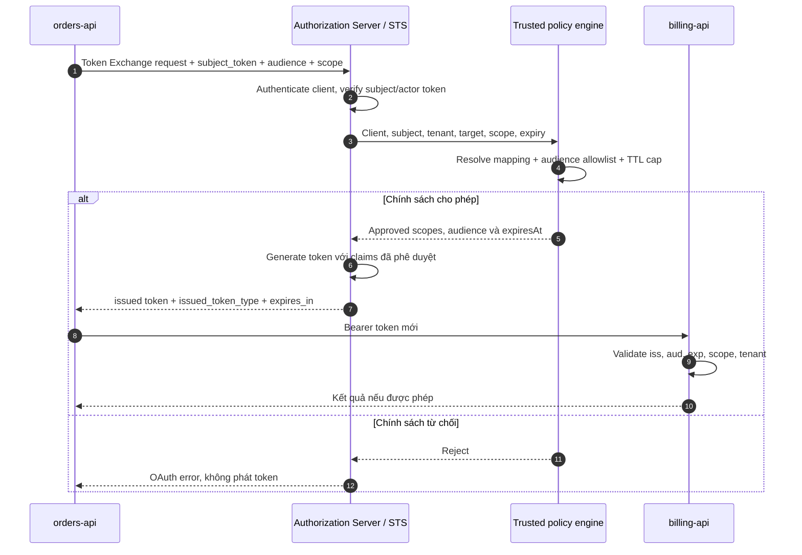
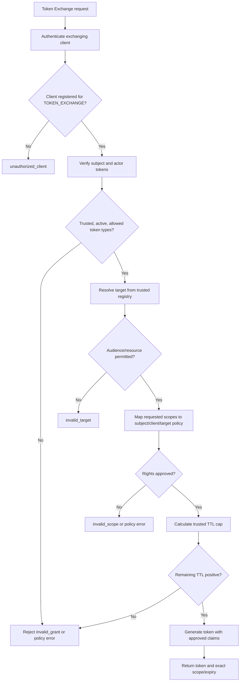

# Giới hạn scope, audience và TTL của token được cấp sau trao đổi

## 1. Vì sao Token Exchange phải giới hạn quyền?

Trong chương **Token Exchange** của module **SPRING_SECURITY_OAUTH2_OIDC_AUTHORIZATION_SERVER**, chúng ta học cách thiết kế, cấu hình, bảo mật, kiểm thử và vận hành OAuth 2.0/OpenID Connect Authorization Server bằng Spring Security và Spring Authorization Server trong ứng dụng Spring Boot.

Giả sử `orders-api` có Access Token của người dùng để đọc đơn hàng. Muốn gọi `billing-api` nhằm lấy trạng thái hóa đơn, dịch vụ không nên chuyển nguyên token đầu vào sang API khác và yêu cầu bên đó chấp nhận mọi quyền. Một token được cấp cho `orders-api` có thể có audience, scope và thời gian sống không phù hợp với `billing-api`.

**OAuth 2.0 Token Exchange** theo RFC 8693 cho phép client đã được kiểm soát gửi một **subject token** tới Authorization Server (đóng vai trò Security Token Service, STS) để xin token **mới**, có quyền và đối tượng nhận được xác định theo policy.

Ví dụ:

```text
subject_token:
    iss   = https://auth.example.com
    sub   = user-123
    aud   = orders-api
    scope = orders.read orders.write
    exp   = 10:20

Token Exchange lúc 10:15:
    exchanging client = orders-api
    requested audience = billing-api
    requested scope = invoice.read

Token được cấp nếu policy cho phép:
    iss   = https://auth.example.com
    sub   = user-123
    aud   = billing-api
    scope = invoice.read
    exp   = 10:18
```

**Không được suy luận** rằng `orders.read` tự động cho phép `invoice.read`: tên scope thuộc hai API khác nhau và chỉ có **quy tắc ánh xạ quyền đã được phê duyệt** mới hợp thức hóa chuyển đổi đó. Ngược lại, nếu source token hoặc client không được phép thì request phải bị từ chối.

Ba trục của bài:

1. **Scope:** token mới chỉ mang những quyền được yêu cầu, được phép và thực sự cần thiết.
2. **Audience/resource:** token mới chỉ dành cho Resource Server/target đã được Authorization Server chấp thuận.
3. **TTL:** hạn dùng của token mới phải được ràng buộc với chính sách client, target, nguồn quyền và phiên.

### Mục tiêu học tập

Sau bài này, bạn có thể:

- Phân tích RFC 8693 và các tham số `subject_token`, `audience`, `resource`, `scope`, `requested_token_type`.
- Thiết kế policy downscope và ánh xạ quyền xuyên API, không cấp quyền chỉ dựa vào yêu cầu của client.
- Kiểm soát audience bằng trusted registry/allowlist và cấu hình Resource Server xác minh `aud`.
- Tính thời hạn đầu ra từ hạn của subject/actor token, policy target/client và absolute session cap.
- Đăng ký client Token Exchange với Spring Authorization Server và phân biệt grant validation với JWT claim customization.
- Viết ma trận test bảo đảm các trường hợp tăng quyền, chuyển sang target cấm, token nguồn hết hạn và chuỗi trao đổi đệ quy bị xử lý đúng.

## 2. RFC 8693: request, response và giới hạn giao thức

### 2.1. Request tại Token Endpoint

```http
POST /oauth2/token HTTP/1.1
Host: auth.example.com
Authorization: Basic <base64-client-credentials>
Content-Type: application/x-www-form-urlencoded

grant_type=urn%3Aietf%3Aparams%3Aoauth%3Agrant-type%3Atoken-exchange&
subject_token=<source-access-token>&
subject_token_type=urn%3Aietf%3Aparams%3Aoauth%3Atoken-type%3Aaccess_token&
requested_token_type=urn%3Aietf%3Aparams%3Aoauth%3Atoken-type%3Aaccess_token&
audience=billing-api&
scope=invoice.read
```

Các dòng form body được xuống dòng để dễ đọc; request thật phải form-encode đúng. Trong production cần HTTPS và client authentication theo đăng ký/chính sách.

| Tham số | RFC 8693 | Ý nghĩa |
| --- | --- | --- |
| `grant_type` | Bắt buộc | URN `urn:ietf:params:oauth:grant-type:token-exchange`. |
| `subject_token` | Bắt buộc | Token đại diện chủ thể mà client muốn trao đổi thay mặt. |
| `subject_token_type` | Bắt buộc | Loại token đầu vào, thường là `urn:ietf:params:oauth:token-type:access_token`. |
| `requested_token_type` | Tùy chọn | Loại token mong muốn; khi không gửi, server quyết định theo khả năng/policy. |
| `audience` | Tùy chọn | Định danh logic của dịch vụ đích; có thể xuất hiện nhiều lần. |
| `resource` | Tùy chọn | URI của target resource/service; có thể xuất hiện nhiều lần. |
| `scope` | Tùy chọn | Tập scope client xin cho target, phân tách bằng dấu cách. |
| `actor_token` và `actor_token_type` | Tùy chọn | Bằng chứng về actor khi có delegation. |
| Client authentication | Theo chính sách AS | Cần nhận diện exchanging client; một hệ thống có thể yêu cầu confidential client. |

**Optional theo RFC không có nghĩa server bắt buộc chấp nhận request thiếu tham số.** Ví dụ một hệ thống có thể yêu cầu đúng một `audience` và ít nhất một scope để giới hạn quyền, dù RFC 8693 không bắt buộc hai tham số này trong mọi request.

### 2.2. Token response

```json
{
  "access_token": "<new-exchanged-access-token>",
  "issued_token_type": "urn:ietf:params:oauth:token-type:access_token",
  "token_type": "Bearer",
  "expires_in": 180,
  "scope": "invoice.read"
}
```

- `issued_token_type` chỉ loại security token được phát hành theo RFC 8693.
- `token_type` chỉ cách sử dụng Access Token trong OAuth; `Bearer` là ví dụ.
- `expires_in` phản ánh thời gian còn hiệu lực của token đầu ra tính bằng giây.
- `scope` phản ánh quyền đã cấp thực tế; nếu khác tập scope client yêu cầu, RFC 8693 yêu cầu trả trường này.

Không nhầm `issued_token_type` với `token_type`, hoặc coi token đầu ra là Refresh Token khi request không yêu cầu/không được policy cho phép.

### 2.3. Subject token không mặc nhiên bị tiêu thụ

RFC 8693 **không quy định** việc thực hiện exchange phải làm subject token/actor token mất hiệu lực (trừ khi loại token có ngữ nghĩa dùng một lần hoặc policy khác quy định). Token đầu vào và đầu ra cũng không tự có quan hệ thu hồi chặt.

Vì vậy một hệ thống yêu cầu “thu hồi token gốc là mọi token đã trao đổi bị từ chối ngay” phải thiết kế thêm provenance, revocation propagation, kiểm tra trạng thái hoặc TTL ngắn. **Không dựa vào RFC 8693 để tự động có tính năng này.**

## 3. Chủ thể, client, actor và target phải được phân biệt

| Vai trò | Ví dụ | Kiểm tra bắt buộc theo kiến trúc |
| --- | --- | --- |
| **Subject** | `user-123` | Identity và quyền của subject token đã được issuer tin cậy xác nhận. |
| **Exchanging client** | `orders-api` | Client đã xác thực, được đăng ký `token-exchange` và target/scopes được phép. |
| **Actor** nếu có | Dịch vụ hành động đại diện user | Bằng chứng actor hợp lệ, delegation policy và quan hệ với subject. |
| **Target** | `billing-api` | Dịch vụ đích có trong allowlist, được phép theo client/subject/tenant. |
| **Authorization Server/STS** | `https://auth.example.com` | Cơ quan phát hành token mới sau khi đánh giá nguồn và policy. |
| **Resource Server** | Billing API | Kiểm tra token thật và quyền tại endpoint nghiệp vụ. |

Client authentication thành công chứng minh **client đang gọi token endpoint**, không tự chứng minh user chấp thuận chuyển token sang mọi đích. Nếu có actor token, không cho client tự điền một claim `act` không được kiểm chứng rồi làm như đây là bằng chứng delegation.



Thứ tự quan trọng: **authenticate → verify input → authorize target/right → calculate expiry → issue token → validate at resource**. Không ghép token đầu ra chỉ bằng cách lấy các request parameters rồi đưa vào claims.

### 3.1. Ba bất biến cần giữ

```text
I1: Rights(output) must not exceed trusted policy for subject + client + actor + target.
I2: Audiences(output) must be in approvedTargets(client, subject, tenant).
I3: ExpiresAt(output) must not exceed all applicable trusted expiry caps.
```

Lưu ý quyền giữa hai API có thể khác tên scope, nên “không vượt quyền” phải được định nghĩa bằng **policy mapping**, không nhất thiết là phép giao hai tập chuỗi gốc.

## 4. Downscope: giới hạn quyền của token đầu ra

### 4.1. Scope trong request chỉ là đề nghị

`scope=invoice.read` được client gửi không tự đủ để server cấp `invoice.read`. Một policy hợp lệ nên kiểm tra:

1. `RegisteredClient` có được phép dùng Token Exchange và target này không?
2. `subject_token` có chữ ký/issuer/trạng thái/thời hạn hợp lệ không, và token có được phép làm nguồn exchange trong trust context này không?
3. Người dùng/chủ thể có quyền tương ứng ở tenant/resource không?
4. `billing-api` có định nghĩa scope này và cho phép client request không?
5. Nếu có actor, actor có được phép hành động thay subject không?
6. Có hạn chế khác như tenant isolation, service role, elevated authorization hoặc approval không?

Một cách mô hình hóa:

```text
S_requested      = scopes mà client muốn có tại target
S_target_allowed = scopes target cho phép
S_client_allowed = scopes mà exchanging client được phép xin tại target
S_subject_mapped = quyền subject đã được ánh xạ hợp lệ sang target
S_actor_allowed  = quyền actor khi có delegation

S_output ⊆ S_requested ∩ S_target_allowed
                       ∩ S_client_allowed
                       ∩ S_subject_mapped
                       ∩ S_actor_allowed (nếu áp dụng)
```

Không cấp toàn bộ quyền của `RegisteredClient.getScopes()` rồi bỏ qua scope nguồn: registered scopes chỉ là **giới hạn tối đa của client**, không phải bằng chứng chủ thể có đủ quyền.

### 4.2. Scope cùng namespace: có thể dùng phép giao

```text
subject scope: reports.read reports.write
client allow:  reports.read
target allow:  reports.read
request:       reports.read reports.write

permitted output: reports.read
```

Nếu server cho phép trả một tập con thay vì từ chối toàn bộ request, response phải nêu scope thực được cấp; client không được giả định mọi scope xin đều được chấp nhận.

### 4.3. Scope khác namespace: cần mapping đã phê duyệt

`orders-api` có `orders.read`, trong khi `billing-api` định nghĩa `invoice.read`. Lấy giao chuỗi sẽ ra rỗng, nhưng đó không phải lúc nào cũng là kết quả policy đúng.

| Quyền nguồn đáng tin | Exchanging client | Target | Quyền đầu ra tối đa nếu policy cho phép |
| --- | --- | --- | --- |
| `orders.read` | `orders-api` | `billing-api` | `invoice.read`, chỉ cùng tenant. |
| `orders.write` | `orders-api` | `billing-api` | **Không tự suy ra** `invoice.write`. |
| `employee.read` | `orders-api` | `billing-api` | Không có mapping. |
| `orders.read` | `unknown-client` | `billing-api` | Không có mapping. |

Phải kiểm tra ý nghĩa thực tế của việc đọc hóa đơn có thực sự được ủy quyền từ quyền đọc đơn hàng hay không. **Tên scope cùng hậu tố `.read` không đủ** để chứng minh hai quyền tương đương.

### 4.4. Scope không thay thế quyền trên từng tài nguyên

Một token `scope=invoice.read` vẫn có thể chỉ được phép đọc hóa đơn thuộc `tenant-a` hoặc một tập đơn hàng nhất định. Resource Server phải kiểm tra resource ownership, subject, actor, tenant và các yêu cầu nghiệp vụ khác, không chỉ kiểm tra một chuỗi scope.

### 4.5. Ngăn leo thang qua chuỗi exchange

```text
orders.read → invoice.read → payments.write → admin.all
```

Nếu mỗi lần exchange chỉ xét token gần nhất, một chuỗi mapping thiếu kiểm soát có thể dẫn đến privilege escalation. Policy cần quản lý provenance, loại subject token được chấp nhận, target được phép, chain depth và giới hạn quyền gốc; không tự cho phép mọi exchanged token lại được exchange.

## 5. Audience/resource: token phải dùng đúng đích

### 5.1. Phân biệt các định danh

| Giá trị | Ví dụ | Ý nghĩa |
| --- | --- | --- |
| `audience` trong request | `billing-api` | Tên logic của target service. |
| `resource` trong request | `https://api.example.com/billing` | URI target resource/service. |
| `aud` trong JWT | `["billing-api"]` | Bên nhận dự kiến của token **do server phát hành**. |
| `iss` trong JWT | `https://auth.example.com` | Định danh của Authorization Server. |
| `scope` trong JWT | `invoice.read` | Quyền cụ thể ở target đã phê duyệt. |

`audience` và `resource` là **input chưa tin cậy**. Một target registry có thể ánh xạ `https://api.example.com/billing` thành `billing-api`; sau đó server ghi `aud=["billing-api"]`. Không tự gán trực tiếp request `resource` vào JWT `aud` nếu chưa đối chiếu registry.

### 5.2. Allowlist theo client

| Client | Target được phép | Scope được phép | Các target cấm |
| --- | --- | --- | --- |
| `orders-api` | `billing-api` | `invoice.read` | `payments-admin`, `security-admin`. |
| `orders-api` | `analytics-api` | `metrics.read` | `security-admin`. |
| `reporting-worker` | `analytics-api` | `metrics.read` | `billing-api` trừ khi có policy mới. |
| Client không đăng ký | Không | Không | Tất cả. |

Nếu `orders-api` gửi `audience=payments-admin`, server phải từ chối dù client secret đúng và subject token còn hạn. RFC 8693 định nghĩa lỗi **`invalid_target`** cho trường hợp target yêu cầu không thể được đáp ứng.

### 5.3. Cẩn trọng với nhiều audience và nhiều scopes

RFC 8693 cho phép nhiều `resource` hoặc `audience`; khi xin một tập scope trên nhiều target, request có thể mang ngữ nghĩa **tích Descartes giữa scopes và targets**, làm phạm vi quyền rộng hơn dự kiến.

```text
audience = billing-api
audience = analytics-api
scope = invoice.read metrics.read
```

Nếu không có nhu cầu cụ thể, chính sách an toàn là **một audience duy nhất** mỗi lần trao đổi; từ chối yêu cầu nhiều audience, target không có trong registry hoặc sự mâu thuẫn `resource`/`audience`. Khi có nhu cầu nhiều audience, phải kiểm tra từng cặp (target, scope) theo policy và Resource Server phải hiểu rõ cách xác minh.

### 5.4. Resource Server phải xác minh aud

Một JWT đúng chữ ký nhưng `aud=["orders-api"]` **không được** chấp nhận bởi `billing-api`. Nếu API chỉ kiểm tra `iss` và `exp` mà bỏ `aud`, bước giới hạn target ở Authorization Server mất tác dụng thực tế.

`aud=billing-api` vẫn chưa thay thế tenant isolation. Token cho user tenant B không được dùng đọc dữ liệu tenant A chỉ vì cùng audience. API phải kiểm tra tenant/subject/ownership hoặc actor policy.

## 6. TTL đầu ra: tránh kéo dài phiên không có chủ đích

### 6.1. Một token có thể chịu nhiều giới hạn

Giả sử yêu cầu exchange lúc 10:15:

| Ràng buộc | Thời hạn còn lại |
| --- | --- |
| Subject Token đã xác minh | 5 phút, hết hạn 10:20. |
| Actor Token nếu có | 90 giây, hết hạn 10:16:30. |
| `TokenSettings` của exchanging client | 10 phút. |
| Policy của `billing-api` | 3 phút. |
| Absolute session/delegation deadline | 8 phút. |

Với policy **output không vượt mọi nguồn hạn chế còn hiệu lực**, kết quả chỉ được sống **tối đa 90 giây**. Nếu không có actor token và các điều kiện khác giữ nguyên, giới hạn sẽ là 3 phút.

### 6.2. Công thức chính sách minh họa

```text
issuedAt = now
expiresAtOutput = min(
    now + clientConfiguredTtl,
    now + targetMaxTtl,
    verifiedSubjectExpiresAt,
    verifiedActorExpiresAt (nếu có),
    absoluteDelegationDeadline (nếu có)
)
ttlOutput = expiresAtOutput - now
```

Nếu `ttlOutput <= 0`, **không phát token**. Có thể từ chối cả khi TTL quá ngắn so với ngưỡng tối thiểu vận hành đã được phê duyệt, thay vì sinh token vô dụng.

**Phân biệt chuẩn và policy:** RFC 8693 không bắt buộc token mới phải có `exp` không vượt `exp` của token nguồn. Nó cho phép các triển khai quyết định vòng đời phù hợp. Công thức trên là **một chính sách bảo mật khuyến nghị** để tránh vô tình kéo dài quyền.

### 6.3. Tránh “refresh bằng Token Exchange”

```text
10:00 source exp 10:10
10:09 exchange A exp 10:39 nếu cho TTL mới 30 phút
10:38 exchange B exp 11:08 nếu chấp nhận A làm nguồn
...
```

Nếu exchange lặp mà cứ reset TTL, session hoặc quyền gốc 10 phút có thể bị kéo dài vô hạn. Khi sản phẩm yêu cầu absolute session lifetime, phải ràng buộc output vào **deadline gốc** được xác minh và giới hạn depth/target của chuỗi trao đổi.

### 6.4. Helper Java tính expiry từ hạn đã được xác minh

```java
import java.time.Clock;
import java.time.Duration;
import java.time.Instant;
import java.util.Objects;

public final class ExchangeExpiry {
    private ExchangeExpiry() {}

    public static Instant calculate(
            Clock clock,
            Duration clientTtl,
            Duration targetTtl,
            Instant verifiedSubjectExpiry,
            Instant verifiedActorExpiry,
            Instant absoluteSessionExpiry) {

        Objects.requireNonNull(clock);
        Objects.requireNonNull(clientTtl);
        Objects.requireNonNull(targetTtl);
        Objects.requireNonNull(verifiedSubjectExpiry);

        if (clientTtl.isZero() || clientTtl.isNegative()
                || targetTtl.isZero() || targetTtl.isNegative()) {
            throw new IllegalArgumentException("TTL must be positive");
        }

        Instant now = clock.instant();
        Instant expiry = min(now.plus(clientTtl), now.plus(targetTtl));
        expiry = min(expiry, verifiedSubjectExpiry);

        if (verifiedActorExpiry != null) {
            expiry = min(expiry, verifiedActorExpiry);
        }
        if (absoluteSessionExpiry != null) {
            expiry = min(expiry, absoluteSessionExpiry);
        }
        if (!expiry.isAfter(now)) {
            throw new IllegalArgumentException("Source/session has expired");
        }
        return expiry;
    }

    private static Instant min(Instant a, Instant b) {
        return a.isBefore(b) ? a : b;
    }
}
```

Hàm nhận **trusted expiration times**; nó không xác minh chữ ký hay introspection. `verifiedSubjectExpiry` không được lấy từ JWT payload chưa verify hoặc tham số `exp` mà client tự gửi. Token nguồn không có expiry có thể bị từ chối nếu profile bảo mật yêu cầu thời hạn hữu hạn.

### 6.5. Consistency giữa JWT, response và introspection

Với JWT, `exp` phải bằng/không vượt `approvedExpiresAt` theo policy, còn `expires_in` trong response phải mô tả thời gian thực còn hiệu lực (có thể chênh lệch nhỏ do làm tròn/độ trễ). Với opaque token, trạng thái và kết quả introspection phải thể hiện cùng hạn dùng, không được chỉ tùy biến `exp` của một JWT không tồn tại.

Clock skew cho phép Resource Server dung sai nhỏ khi kiểm tra thời gian nhưng **không phải ngân sách để Authorization Server nới dài `exp`** của token đầu ra.

## 7. Kết hợp ba ràng buộc trong cùng một policy decision

### 7.1. Vì sao không đánh giá độc lập?

Trong Token Exchange, scope `invoice.read` chỉ có ý nghĩa đối với target `billing-api`. TTL 3 phút có thể phù hợp với billing nhưng quá dài cho một target nhạy cảm hơn; quyền của actor cũng có thể chỉ hợp lệ trong một tenant.

Do đó một policy ra quyết định nên nhận **một tập dữ liệu đầy đủ** và trả về kết quả đồng nhất:

```text
INPUT ĐÃ XÁC THỰC:
    registeredClient            = orders-api
    subjectIssuer               = https://auth.example.com
    subjectId                   = user-123
    subjectAudience             = orders-api
    subjectScopes               = [orders.read]
    subjectExpiresAt            = 10:20
    subjectTenant               = tenant-a
    actorId / actorExpiresAt     = optional

INPUT TỪ REQUEST (CHƯA ĐƯỢC TIN):
    requestedAudiences          = [billing-api]
    requestedResources          = []
    requestedScopes             = [invoice.read]
    requestedTokenType          = access_token

POLICY OUTPUT:
    approvedAudience            = billing-api
    grantedScopes               = [invoice.read]
    approvedExpiresAt           = 10:18
    approvedSubject/Actor/Tenant claims
    decision                    = ACCEPT
```

Nếu không thể cấp chính xác quyền và target cần thiết, policy có thể **từ chối** thay vì “hạ” ngẫu nhiên thành một token mà client không hiểu. Nếu policy hỗ trợ cấp scope subset, response phải phản ánh rõ tập được cấp.

### 7.2. Ma trận quyết định

| Source được xác minh | Client | Audience | Scope xin | Kết quả policy | TTL ví dụ |
| --- | --- | --- | --- | --- | --- |
| `orders.read`, còn 5 phút | `orders-api` | `billing-api` | `invoice.read` | Cho phép nếu mapping/tenant hợp lệ. | 3 phút. |
| `orders.read`, còn 30 giây | `orders-api` | `billing-api` | `invoice.read` | Cho phép nếu tất cả điều kiện khác đúng. | Tối đa 30 giây. |
| `orders.read` | `orders-api` | `billing-api` | `invoice.write` | Không có quyền ghi được ánh xạ. | Không cấp. |
| `orders.read` | `orders-api` | `payments-admin` | `admin.all` | Target cấm. | Không cấp. |
| `orders.read` | `unknown-client` | `billing-api` | `invoice.read` | Client không được phép. | Không cấp. |
| Subject đã hết hạn | `orders-api` | `billing-api` | `invoice.read` | Source không còn hiệu lực. | Không cấp. |
| Subject tenant B | `orders-api` tenant A | `billing-api` tenant A | `invoice.read` | Cross-tenant trái policy. | Không cấp. |

### 7.3. Policy với tham số tùy chọn

`scope`, `resource` và `audience` có thể optional theo RFC, nhưng một Authorization Server phục vụ nhiều API nên có default **không cấp quá quyền**. Ví dụ:

- Bắt buộc đúng **một `audience`**; nếu không có hoặc có nhiều hơn một thì từ chối.
- Nếu không có `scope`, chỉ cấp scope tối thiểu được cấu hình cho client/target hoặc từ chối; **không cấp toàn bộ source scopes**.
- Chỉ nhận `resource` có thể ánh xạ tới registry tin cậy; không biến mọi URL client cung cấp thành audience hợp lệ.
- Chỉ hỗ trợ requested token type là OAuth Access Token nếu chưa có thiết kế cho các security token types khác.

Đây là **policy nội bộ** chứ không phải lời khẳng định RFC 8693 bắt buộc mọi server hành xử như vậy.

## 8. Cấu hình Token Exchange trong Spring Authorization Server

### 8.1. Những class trong pipeline

Spring Authorization Server 1.3+ có các thành phần xử lý Token Exchange. Với dòng 1.5.x, tài liệu API có các lớp:

| Thành phần | Vai trò |
| --- | --- |
| `OAuth2TokenEndpointFilter` | Nhận POST tới Token Endpoint. |
| `OAuth2TokenExchangeAuthenticationConverter` | Chuyển form request thành token authentication object. |
| `OAuth2TokenExchangeAuthenticationToken` | Giữ subject/actor token, resources, audiences, scopes và client principal của request. |
| `OAuth2TokenExchangeAuthenticationProvider` | Xử lý grant Token Exchange cùng authorization service/token generator. |
| `RegisteredClientRepository` | Kiểm tra client đã đăng ký đúng grant, phương thức xác thực, scopes và settings. |
| `OAuth2AuthorizationService` | Truy xuất/lưu authorization/token state theo khả năng triển khai. |
| `OAuth2TokenGenerator` | Tạo token dựa trên `OAuth2TokenContext`. |
| `OAuth2TokenCustomizer` | Tùy biến claims trong quá trình tạo token (JWT hoặc dạng khác tùy context). |

**Có provider mặc định không có nghĩa tự động có policy đầy đủ về ánh xạ quyền theo audience, chặn exchange đệ quy hoặc cap TTL theo input.** Cần đối chiếu đường xử lý thực tế của phiên bản Spring Authorization Server dùng trong dự án và thêm policy qua extension point phù hợp.

### 8.2. Đăng ký confidential exchanging client

Ví dụ Java cho client `orders-api`:

```java
import java.time.Duration;
import java.util.UUID;
import org.springframework.security.crypto.password.PasswordEncoder;
import org.springframework.security.oauth2.core.AuthorizationGrantType;
import org.springframework.security.oauth2.core.ClientAuthenticationMethod;
import org.springframework.security.oauth2.core.OAuth2TokenFormat;
import org.springframework.security.oauth2.server.authorization.client.RegisteredClient;
import org.springframework.security.oauth2.server.authorization.settings.TokenSettings;

public final class ExchangeClientRegistration {

    private ExchangeClientRegistration() {}

    public static RegisteredClient ordersApi(
            PasswordEncoder encoder,
            String secretFromSecretManager) {

        return RegisteredClient.withId(UUID.randomUUID().toString())
                .clientId("orders-api")
                .clientSecret(encoder.encode(secretFromSecretManager))
                .clientAuthenticationMethod(
                        ClientAuthenticationMethod.CLIENT_SECRET_BASIC)
                .authorizationGrantType(AuthorizationGrantType.TOKEN_EXCHANGE)
                .scope("invoice.read")
                .tokenSettings(TokenSettings.builder()
                        .accessTokenTimeToLive(Duration.ofMinutes(10))
                        .accessTokenFormat(OAuth2TokenFormat.SELF_CONTAINED)
                        .build())
                .build();
    }
}
```

Lưu ý:

- `AuthorizationGrantType.TOKEN_EXCHANGE` hiện diện trong các phiên bản Spring Security hỗ trợ (từ dòng 6.3). Không tự đem code này vào phiên bản cũ rồi giả định có class/constant tương tự.
- Đây là **client registration**, chưa đủ để chạy một Authorization Server hoàn chỉnh; còn cần issuer, endpoint security chain, `RegisteredClientRepository`, `OAuth2AuthorizationService`, JWK/JWT generator hoặc những bean tương ứng.
- `scope("invoice.read")` thể hiện khả năng client được đăng ký **xin** quyền, không chứng minh subject có quyền này.
- Baseline TTL 10 phút từ `TokenSettings` **không tự bảo đảm** output TTL ≤ subject remaining lifetime hoặc target cap 3 phút.
- Secret phải được cấp và lưu an toàn. Không nhúng client secret vào SPA/mobile hoặc repository public.
- Không nên thêm `AUTHORIZATION_CODE` hay `REFRESH_TOKEN` cho exchanging client nếu nhu cầu/policy không yêu cầu.

### 8.3. Đọc request trong tầng xác thực

`OAuth2TokenExchangeAuthenticationToken` cung cấp các getter:

```java
// MINH HỌA: request là authentication token do framework parse.
OAuth2TokenExchangeAuthenticationToken request = ...;

String source = request.getSubjectToken();
String sourceType = request.getSubjectTokenType();
String requestedType = request.getRequestedTokenType();
Set<String> scopes = request.getScopes();
Set<String> audiences = request.getAudiences();
Set<String> resources = request.getResources();
```

`getSubjectToken()` trả chuỗi token **chưa đồng nghĩa đã xác minh**. Đừng parse JWT payload từ đây rồi ra quyết định cấp token mà không kiểm tra chữ ký, issuer, expiry, loại token nguồn/đầu ra và những điều kiện trust khác.

### 8.4. Tích hợp policy trước khi tạo token

Theo tài liệu cấu hình Token Endpoint, `OAuth2TokenEndpointConfigurer` có các extension points như `authenticationProviders(...)`, `authenticationProvider(...)` và `accessTokenRequestConverters(...)`. Một kiến trúc có policy nghiêm ngặt cần đặt kiểm tra target/scope/expiry **trong luồng xử lý grant trước khi gọi token generator**.

Quy trình thực thi nên gồm:

1. **Client authentication:** xác định `RegisteredClient`, kiểm tra `TOKEN_EXCHANGE`.
2. **Subject/actor verification:** chỉ chấp nhận source token types và issuer được tin, kiểm tra chữ ký/introspection, audience/expiry/revocation khi policy yêu cầu.
3. **Exchange policy:** xác minh ánh xạ source → target, scopes và tenant, tính `approvedExpiresAt`.
4. **Token generation:** dùng kết quả policy đáng tin để sinh Access Token với `aud`, scope và `exp` không vượt giới hạn.
5. **Persistence/response:** trạng thái token, response `scope`/`expires_in` và introspection nhất quán.

**Không tùy tiện thay `OAuth2TokenExchangeAuthenticationProvider` mặc định bằng provider tự viết chỉ kiểm tra `scope`**: dễ vô tình bỏ các bước xử lý token nguồn và client có sẵn. Nếu cần custom provider hoặc decorator, phải đối chiếu chính xác constructor/API, hỗ trợ token types và các phép kiểm tra trong version đang chạy rồi mới triển khai/kiểm thử.

## 9. Java: kiểm tra scope/target trước khi cấp token

### 9.1. Helper fail-closed

Ví dụ dưới đây là hàm kiểm tra **đã có ánh xạ quyền từ source token đáng tin sang target**. Nó không tự xác minh signature, không trực tiếp nhận HTTP request và không được xem là toàn bộ implementation:

```java
import java.util.Set;

public final class BillingExchangePolicy {

    private static final Set<String> ALLOWED_SCOPES =
            Set.of("invoice.read");

    private BillingExchangePolicy() {}

    public static Set<String> authorize(
            String authenticatedClient,
            Set<String> requestedAudiences,
            Set<String> requestedScopes,
            Set<String> trustedMappedSubjectScopes) {

        if (!"orders-api".equals(authenticatedClient)) {
            throw new IllegalArgumentException("Client not allowed");
        }
        if (!Set.of("billing-api").equals(requestedAudiences)) {
            throw new IllegalArgumentException("Target not allowed");
        }
        if (requestedScopes.isEmpty()
                || !ALLOWED_SCOPES.containsAll(requestedScopes)
                || !trustedMappedSubjectScopes.containsAll(requestedScopes)) {
            throw new IllegalArgumentException("Scopes not allowed");
        }
        return Set.copyOf(requestedScopes);
    }
}
```

Trong production, `trustedMappedSubjectScopes` phải đến từ policy nguồn đã được xác minh, không được gán bằng chính `requestedScopes`. Nếu client yêu cầu `invoice.write` hoặc thêm một audience thứ hai, helper từ chối thay vì cấp quyền rộng hơn.

`IllegalArgumentException` dùng cho ví dụ thuần Java. Khi tích hợp Token Endpoint, chuyển lỗi thành `OAuth2AuthenticationException`/`OAuth2Error` thích hợp và trả một phản hồi OAuth được kiểm soát; không đưa raw token hoặc chi tiết trust policy vào error response.

### 9.2. Thứ tự kiểm tra



`invalid_target` là error code được RFC 8693 đưa ra. Các lỗi khác phụ thuộc loại vi phạm và behavior của provider/framework, nên không dựa vào đúng một status code để suy ra nguyên nhân từ phía client.

## 10. JwtEncodingContext: tùy biến claims nhưng không thay policy

### 10.1. Dữ liệu được framework cung cấp

`JwtEncodingContext` cho phép đọc:

```java
context.getRegisteredClient();
context.getAuthorizationGrant();
context.getAuthorizationGrantType();
context.getAuthorizedScopes();
context.getTokenType();
context.getClaims();
```

`context.getAuthorizationGrant()` có thể là `OAuth2TokenExchangeAuthenticationToken`, trong đó `getAudiences()` và `getScopes()` vẫn thể hiện **tham số client yêu cầu**. Chỉ `context.getAuthorizedScopes()` và những kết quả policy đáng tin đã được xử lý trước đó mới là cơ sở để tạo claim quyền đầu ra.

### 10.2. Mẫu customizer phòng vệ cho target xác định

Đoạn code sau **giả định tầng xử lý grant đã xác minh subject, ánh xạ quyền, tenant và expiry**. Nó bổ sung kiểm tra fail-closed cho một client/target và đặt đúng audience, nhưng **không tự thực hiện toàn bộ policy**:

```java
import java.util.List;
import java.util.Set;

import org.springframework.context.annotation.Bean;
import org.springframework.security.oauth2.core.AuthorizationGrantType;
import org.springframework.security.oauth2.core.OAuth2AuthenticationException;
import org.springframework.security.oauth2.core.OAuth2Error;
import org.springframework.security.oauth2.core.OAuth2TokenType;
import org.springframework.security.oauth2.server.authorization.authentication.OAuth2TokenExchangeAuthenticationToken;
import org.springframework.security.oauth2.server.authorization.token.JwtEncodingContext;
import org.springframework.security.oauth2.server.authorization.token.OAuth2TokenCustomizer;

@Bean
OAuth2TokenCustomizer<JwtEncodingContext> billingExchangeCustomizer() {
    return context -> {
        if (!OAuth2TokenType.ACCESS_TOKEN.equals(context.getTokenType())
                || !AuthorizationGrantType.TOKEN_EXCHANGE
                        .equals(context.getAuthorizationGrantType())) {
            return;
        }

        if (!(context.getAuthorizationGrant()
                instanceof OAuth2TokenExchangeAuthenticationToken request)
                || !"orders-api".equals(
                        context.getRegisteredClient().getClientId())
                || !request.getAudiences().equals(Set.of("billing-api"))) {
            throw new OAuth2AuthenticationException(
                    new OAuth2Error("invalid_target"));
        }

        if (!context.getAuthorizedScopes().equals(Set.of("invoice.read"))) {
            throw new OAuth2AuthenticationException(
                    new OAuth2Error("invalid_scope"));
        }

        context.getClaims().audience(List.of("billing-api"));
    };
}
```

**Không đem bean này vào sản phẩm rồi tuyên bố hệ thống an toàn chỉ nhờ nó.** Nó không xác minh source token, subject/actor/tenant, không áp TTL cap theo subject và không có policy mapping thực sự. Đó là những việc phải có **trước khi gọi token generator**.

Nếu dự án đã có `OAuth2TokenCustomizer<JwtEncodingContext>`, tích hợp logic vào customizer hiện hành để tránh cạnh tranh bean không kiểm soát. Với Access Token opaque, cần cách gắn metadata/expiry ở đường phát hành opaque token, **không chỉ thay JWT claims**.

### 10.3. Đưa TTL được phê duyệt vào token generation

Sau khi policy trả về một `approvedExpiresAt` đáng tin, generator có thể đặt:

```java
// PSEUDOCODE trong bước token generation đã có trusted policy result.
context.getClaims().expiresAt(approvedExpiresAt);
```

Nhưng cần bảo đảm **JWT `exp`, `OAuth2Authorization` state, introspection và `expires_in` trong response** mô tả cùng một hạn dùng. Chỉ sửa claim cuối quy trình có thể không bảo đảm metadata lưu trữ/response luôn đồng nhất; nếu version framework chưa có điểm tích hợp expiry thích hợp, phải tùy biến provider/token generator ở đúng giai đoạn.

## 11. Resource Server phải kiểm tra issuer, audience và scope

### 11.1. Cấu hình issuer

Ứng dụng `billing-api` sử dụng Spring Security Resource Server. Cấu hình `issuer-uri`:

```yaml
spring:
  security:
    oauth2:
      resourceserver:
        jwt:
          issuer-uri: https://auth.example.com
```

`issuer-uri` giúp xác định issuer tin cậy và cấu hình JWT validation theo Spring Security, nhưng **không thay thế** kiểm tra audience cụ thể của billing API.

### 11.2. Thêm audience validator

```java
import java.util.List;

import org.springframework.context.annotation.Bean;
import org.springframework.security.oauth2.core.DelegatingOAuth2TokenValidator;
import org.springframework.security.oauth2.core.OAuth2Error;
import org.springframework.security.oauth2.core.OAuth2TokenValidator;
import org.springframework.security.oauth2.core.OAuth2TokenValidatorResult;
import org.springframework.security.oauth2.jwt.Jwt;
import org.springframework.security.oauth2.jwt.JwtDecoder;
import org.springframework.security.oauth2.jwt.JwtDecoders;
import org.springframework.security.oauth2.jwt.JwtValidators;
import org.springframework.security.oauth2.jwt.NimbusJwtDecoder;

@Bean
JwtDecoder billingJwtDecoder() {
    String trustedIssuer = "https://auth.example.com";
    NimbusJwtDecoder decoder =
            (NimbusJwtDecoder) JwtDecoders.fromIssuerLocation(trustedIssuer);

    OAuth2TokenValidator<Jwt> audienceValidator = jwt -> {
        List<String> audiences = jwt.getAudience();
        if (audiences.contains("billing-api")) {
            return OAuth2TokenValidatorResult.success();
        }
        return OAuth2TokenValidatorResult.failure(
                new OAuth2Error("invalid_token", "Wrong audience", null));
    };

    decoder.setJwtValidator(new DelegatingOAuth2TokenValidator<>(
            JwtValidators.createDefaultWithIssuer(trustedIssuer),
            audienceValidator));
    return decoder;
}
```

Trong các phiên bản phù hợp, `JwtDecoders.fromIssuerLocation(...)` trả implementation JWT decoder dùng được để áp validator. Nếu ứng dụng đang có một `JwtDecoder` khác, hãy mở rộng bean tương ứng thay vì tạo trùng. Trong production cần issuer HTTPS và public JWKS có thể truy cập từ Resource Server.

### 11.3. Giới hạn quyền ở endpoint

```java
import org.springframework.context.annotation.Bean;
import org.springframework.http.HttpMethod;
import org.springframework.security.config.Customizer;
import org.springframework.security.config.annotation.web.builders.HttpSecurity;
import org.springframework.security.web.SecurityFilterChain;

@Bean
SecurityFilterChain billingApiChain(HttpSecurity http) throws Exception {
    http.authorizeHttpRequests(authorize -> authorize
            .requestMatchers(HttpMethod.GET, "/api/invoices/**")
            .hasAuthority("SCOPE_invoice.read")
            .anyRequest().denyAll())
        .oauth2ResourceServer(oauth -> oauth.jwt(Customizer.withDefaults()));
    return http.build();
}
```

API vẫn cần kiểm tra hóa đơn thuộc `sub`, tenant và quyền nghiệp vụ. Không cấp quyền chỉ vì có token JWT ký hợp lệ hoặc một chuỗi scope. ID Token từ OIDC client không được sử dụng thay Access Token ở billing.

## 12. Thực hành gửi Token Exchange request

### 12.1. Chuẩn bị môi trường

Giả sử môi trường thử nghiệm có:

```text
Authorization Server: https://auth.example.com
Exchanging client:   orders-api (client_secret_basic)
Target:              billing-api
Requested scope:     invoice.read
Trusted subject:     Access Token còn hiệu lực, policy cho phép exchange
```

Token nguồn phải thật sự được issuer tin cậy phát hành và thỏa validation; không tạo JWT tự ký với `sub` tùy ý rồi mong Authorization Server chấp nhận.

### 12.2. Gửi POST bằng PowerShell

```powershell
$subjectToken = '<trusted-subject-access-token>'
$clientSecret = $env:DEMO_ORDERS_CLIENT_SECRET

curl.exe -sS -X POST 'https://auth.example.com/oauth2/token' `
  -u "orders-api:$clientSecret" `
  -H 'Content-Type: application/x-www-form-urlencoded' `
  --data-urlencode 'grant_type=urn:ietf:params:oauth:grant-type:token-exchange' `
  --data-urlencode "subject_token=$subjectToken" `
  --data-urlencode 'subject_token_type=urn:ietf:params:oauth:token-type:access_token' `
  --data-urlencode 'requested_token_type=urn:ietf:params:oauth:token-type:access_token' `
  --data-urlencode 'audience=billing-api' `
  --data-urlencode 'scope=invoice.read'
```

Trong PowerShell, dấu backtick ở cuối dòng dùng để nối lệnh; các dòng trong khối lệnh trên đã sử dụng cú pháp này. Không chạy với secret production hoặc log token. `curl.exe -u` có thể khiến credential hiện trong process arguments, nên production nên dùng OAuth client library và secret injection phù hợp.

### 12.3. Kiểm tra kết quả

Nếu policy cho phép và source token hợp lệ, kiểm tra:

```text
issued_token_type = urn:ietf:params:oauth:token-type:access_token
token_type        = Bearer
scope             = invoice.read
expires_in        ≤ TTL policy đã phê duyệt
JWT iss           = https://auth.example.com
JWT aud           = billing-api
JWT scope         = invoice.read
JWT exp           ≤ min of trusted expiry caps
```

**Không phải server nào bật Token Exchange cũng tự có chính sách mapping/target/TTL như ví dụ.** Nếu request bị từ chối, kiểm tra client registration, source token support và policy thay vì tự tắt validation.

### 12.4. Yêu cầu vượt quyền

Thử thay `scope` thành `invoice.write`, hoặc `audience` thành `payments-admin`, hoặc bổ sung thêm một audience khác. Kết quả mong đợi: không phát Access Token vượt quyền; target không thể thỏa mãn có thể nhận `invalid_target`.

Nếu đã phát một JWT `aud=orders-api` có chữ ký hợp lệ, dùng JWT đó gọi `billing-api` để bảo đảm Resource Server từ chối. Đây là test rất quan trọng: nó chứng minh audience validation thực sự hoạt động ở bên nhận.

## 13. Ma trận kiểm thử giới hạn scope, audience và TTL

| Nhóm | Dữ liệu thử nghiệm | Kỳ vọng |
| --- | --- | --- |
| Happy path | Subject hợp lệ, client `orders-api`, `audience=billing-api`, `scope=invoice.read`. | Token đúng target/scope, TTL không vượt policy. |
| Client chưa xác thực | Secret sai hoặc không có phương thức client auth theo policy. | Không cấp token; thường `invalid_client`. |
| Client không được phép grant | `RegisteredClient` không đăng ký `TOKEN_EXCHANGE`. | Không cấp token; thường `unauthorized_client`. |
| Subject token sai loại | `subject_token_type` không thuộc các token types được hỗ trợ. | Từ chối, không tự hiểu mọi JWT là Access Token. |
| Subject sai issuer | Token do issuer ngoài trust registry phát hành. | Từ chối. |
| Subject sai chữ ký | JWT payload/chữ ký bị sửa hoặc key không tin cậy. | Từ chối. |
| Subject hết hạn | `exp ≤ now` sau khi xét validation thích hợp. | Không cấp output. |
| Subject không có expiry | Policy yêu cầu thời hạn hữu hạn. | Từ chối, không tạo token vô hạn. |
| Subject audience không được phép làm nguồn | Token nguồn dành cho API khác không thuộc trust context exchange. | Từ chối. |
| Subject bị thu hồi | Token bị revoke, state check xác nhận không còn active. | Từ chối theo chính sách. |
| Scope vượt policy | Xin `invoice.write` nhưng chỉ được mapping `invoice.read`. | Từ chối hoặc không cấp quyền vượt; response phản ánh scope thực tế. |
| Scope không biết | Xin `reports.root` tại `billing-api`. | Từ chối; scope không thuộc target. |
| Scope trống | Không gửi `scope` khi policy yêu cầu explicit scope. | Từ chối theo policy, không tự cấp mọi scope. |
| Mapping cross-API không có | Source có `orders.read` nhưng không được phép map sang invoice. | Không cấp `invoice.read`. |
| Target không cho phép | `audience=payments-admin`. | Từ chối, thường `invalid_target`. |
| Hai audiences | Request gồm billing và analytics khi policy chỉ cho single target. | Từ chối `invalid_target`. |
| Resource mâu thuẫn audience | `resource` ánh xạ billing nhưng `audience` là admin. | Từ chối. |
| JWT sai audience | Token output có chữ ký đúng, `aud=["orders-api"]`. | `billing-api` từ chối. |
| Audience đúng nhưng tenant sai | `aud=billing-api`, `tenant_id=tenant-b`, dữ liệu thuộc tenant A. | Từ chối theo tenant policy. |
| Target TTL chặt hơn | Subject còn 10 phút, target max 3 phút. | Output TTL ≤ 3 phút. |
| Subject sắp hết hạn | Subject còn 40 giây, target max 3 phút. | Output TTL ≤ 40 giây hoặc từ chối nếu quá ngắn. |
| Actor sắp hết hạn | Subject còn 10 phút, actor còn 30 giây. | Output TTL ≤ 30 giây theo delegation policy. |
| Session deadline | Absolute session hết hạn trước TTL target. | Không cấp token vượt hạn session. |
| Token type không hỗ trợ | `requested_token_type` không được provider/policy hỗ trợ. | Từ chối; không phát loại token khác trái kỳ vọng bảo mật. |
| Expires mismatch | JWT `exp` còn 90 giây, response `expires_in=600`. | Test phát hiện cấu hình/response không nhất quán. |
| Exchange đệ quy | Dùng token đã exchange để xin token khác ngoài chain policy. | Từ chối hoặc bảo toàn trusted rights/absolute expiry. |
| Revocation propagation | Thu hồi subject sau khi đã cấp output. | Kiểm tra cơ chế propagation thực tế; không mặc định RFC tự thu hồi output. |
| Opaque output | Phát `REFERENCE` Access Token nếu hỗ trợ. | Introspection nêu đúng `active`, scope, audience, expiry. |
| Nhiều instance | Client exchange trên node A, output được API xác minh với JWKS trên node B. | Issuer, keys, policy và persistence nhất quán. |

### 13.1. Kiểm thử phân tách lớp

- **Unit test policy thuần:** dùng `Clock.fixed` và tập policy đã tin cậy để kiểm tra từng ranh giới scope/target/expiry.
- **Integration test Token Endpoint:** xác thực client, source token hợp lệ/sai, các tham số RFC 8693 và error response thực.
- **Integration test Token Generator:** khẳng định `aud`, `scope`, `exp`, `issued_token_type` và `expires_in` nhất quán.
- **Resource Server test:** JWT ký hợp lệ nhưng sai audience, scope, issuer, tenant hoặc đã hết hạn bị từ chối.
- **Security regression test:** khi thay provider/customizer, đảm bảo các check trước đó vẫn hoạt động; không chỉ xem happy path HTTP 200.

Khi cần thử token có chữ ký hợp lệ nhưng sai audience, hãy **tạo token thử nghiệm đúng quy trình ký của Authorization Server kiểm thử** với claims cố tình không phù hợp; sửa trực tiếp payload JWT sau khi ký sẽ làm chữ ký sai và không chứng minh được audience validation.

### 13.2. Test TTL tránh flakiness

`Clock.fixed` hoặc thời gian giả lập giúp test:

1. Source expires lúc 10:20, now 10:15, target cap 3 phút → output không muộn hơn 10:18.
2. Subject còn 30 giây → output không muộn hơn 10:15:30.
3. Actor expires lúc 10:15:10 → output không muộn hơn 10:15:10.
4. Source đã expired → helper từ chối.
5. Session absolute deadline trước source expiry → output không vượt session.

Đừng “ngủ 3 phút” trong mọi unit test khi có thể kiểm tra logic thời gian xác định. Integration test phải quan sát cả `exp` của token lẫn `expires_in` và trạng thái introspection khi áp dụng.

## 14. Các mối đe dọa bảo mật của Token Exchange

### 14.1. Token laundering và lateral movement

Một attacker đánh cắp Access Token vốn chỉ dùng cho `orders-api` có thể muốn đổi nó thành token dùng cho một API nhạy cảm khác. Nếu Authorization Server chấp nhận bất kỳ bearer token nào làm `subject_token` và cho phép chọn `audience` tự do, Token Exchange biến thành công cụ **di chuyển ngang** giữa các dịch vụ.

Các biện pháp:

- Xác thực và cho phép exchanging client một cách tường minh.
- Kiểm tra source token được phép làm input cho exchange, không chỉ chữ ký hợp lệ.
- Giới hạn target và loại token bằng allowlist, tenant và user/actor policy.
- Chỉ cấp scopes đã được mapping và chứng minh quyền.
- Cân nhắc DPoP/mTLS sender-constrained tokens khi thiết kế yêu cầu, thay vì phụ thuộc hoàn toàn vào bearer token dễ bị dùng lại.

### 14.2. Confused deputy

`orders-api` có thể được phép đọc hóa đơn thay người dùng nhưng không được phép tạo thanh toán. Nếu attacker làm service này gửi `audience=payments-admin` và `scope=payments.write` mà STS tin client một cách mù quáng, Authorization Server đã bị lợi dụng để cấp một credential cho thao tác ngoài mục đích.

Chặn tại **policy target + mapping quyền**, không chỉ trên một rule scope có tên giống nhau. API đích cũng phải thực hiện authorization nghiệp vụ.

### 14.3. Impersonation và delegation

Trong Token Exchange, **subject** có thể là người dùng hoặc một principal khác; **actor** là bên đang hành động thay subject trong những kịch bản delegation. RFC 8693 có khái niệm claim `act`, nhưng không phải mọi implementation tự xây delegation chain.

Nếu hệ thống sử dụng actor token, server phải kiểm tra loại token, issuer, signature/introspection, subject-actor relationship, expiration và policy của actor. Không tự copy actor ID từ body request vào JWT `act` rồi kết luận người đó/dịch vụ đó đã được ủy quyền.

### 14.4. Replay và chuỗi Exchange

`subject_token` có thể là bearer token được dùng nhiều lần cho tới khi hết hạn; exchange không tự tạo ngữ nghĩa “một lần” cho mọi token nguồn. Cần rate limit, TTL ngắn, sender constraints và kiểm toán theo rủi ro.

Với exchanged token đã phát hành, không nên mặc định cho phép exchange tiếp nhiều lần. Thiết kế provenance, hạn tuyệt đối, chain depth, audience transitions và quyền tối đa để tránh tích lũy đặc quyền hoặc kéo dài session ngoài chính sách ban đầu.

### 14.5. Thu hồi và khả năng quan sát

RFC 8693 không mặc định nối chặt trạng thái revoke token nguồn và token đầu ra. Nếu cần logout/thu hồi có hiệu lực nhanh:

- Lưu quan hệ provenance hoặc security event cần thiết.
- Dùng revocation/introspection/denylist hoặc policy kiểm tra trạng thái ở API.
- Áp TTL output ngắn theo yêu cầu bảo mật.
- Kiểm tra latency lan truyền event và cache của Resource Server.
- Tránh lưu nguyên token trong logs, metrics, tracing hay thông báo lỗi.

Các trường audit hữu ích: correlation ID, exchanging client đã xác thực, subject/actor reference đã được bảo vệ, issuer/tenant, target được phê duyệt, scope thực được cấp, TTL bucket, mã lỗi và thời gian xử lý.

## 15. Vận hành chính sách tại nhiều môi trường

### 15.1. Quản trị allowlist và mapping như dữ liệu bảo mật

Registry nên mô tả ít nhất:

```text
exchanging_client_id
trusted_subject_issuers
allowed_subject_token_types
allowed_subject_audiences_for_exchange
approved_target_audiences_and_resources
allowed_scope_mappings
tenant / actor constraints
client_max_ttl
target_max_ttl
absolute_delegation_limit
allow_chained_exchange
```

Đừng hardcode mapping quá rộng trong một `JwtEncodingContext` customizer mà không có quy trình review. Thay đổi target, scopes và TTL là thay đổi **quyền phát hành token**, cần quản lý phiên bản, kiểm thử và audit.

### 15.2. Đồng bộ issuer, key và policy

Trong hệ thống nhiều instance:

- Các node Authorization Server phải phục vụ issuer công khai nhất quán.
- Public JWKS, signing key rotation và các loại token được hỗ trợ phải được quản lý đúng.
- Registry target/scope policy nhất quán giữa các node, tránh node A cho phép target mà node B từ chối.
- Nếu policy dùng session/provenance/revocation state, repository cần khả năng lưu trữ/chia sẻ thích hợp.
- Resource Server phải cấu hình issuer, audience và validation phù hợp với token phát từ mọi node.

Thay hostname/issuer của token đầu ra có thể khiến API từ chối, dù scope và TTL hợp lệ.

### 15.3. Cache và giới hạn tần suất

Token Exchange có thể tăng lưu lượng tới Token Endpoint khi các microservice gọi nhau. Các client nên cache token **theo đúng tổ hợp chủ thể, actor, tenant, audience, scope và policy context**; không cache chung một exchanged token rồi dùng cho người dùng hoặc tenant khác.

Cache không được kéo dài quá `exp` thực, nên có biên an toàn khi refresh. Áp rate limiting, backoff và circuit breaker khi cần để giảm nguy cơ retry storm. Không retry vô hạn những yêu cầu bị `invalid_client`, `invalid_scope` hoặc `invalid_target`.

### 15.4. Migration và thay đổi TTL

Giảm `TokenSettings.accessTokenTimeToLive` hoặc target cap thường chỉ ảnh hưởng **token mới**. Exchanged token cũ có `exp` dài hơn có thể còn được Resource Server chấp nhận cho đến khi hết hạn hoặc có cơ chế thu hồi bổ sung. Khi giảm TTL:

1. Cập nhật policy và client/token generator theo quy trình có kiểm soát.
2. Kiểm tra `expires_in`/JWT `exp` của token cấp mới.
3. Xem xét tác động đến cache, tần suất exchange và latency API.
4. Đánh giá các token đã phát hành còn tồn tại và nhu cầu revoke theo rủi ro.
5. Giám sát tỉ lệ `invalid_grant`, `invalid_target`, `invalid_scope` và thời gian phát token.

## 16. Những hiểu nhầm cần tránh

1. **“Token Exchange đồng nghĩa với Refresh Token Grant.”** Sai: Token Exchange có thể thay target, scope, loại token và vai trò ủy quyền theo policy.
2. **“Client yêu cầu `scope=admin` thì server sẽ cấp.”** Sai: request scope chỉ là đề nghị.
3. **“Scope đầu ra nhất thiết là giao hai tập chuỗi.”** Không luôn đúng: có thể cần mapping xuyên namespace.
4. **“Có `audience=billing-api` thì JWT tự có `aud=billing-api`.”** Không nên giả định; phải kiểm tra quá trình phát hành và token thực.
5. **“JWT đúng chữ ký thì API nào cũng dùng được.”** Sai: Resource Server phải kiểm tra audience, issuer, expiry và quyền.
6. **“Token Exchange tự giới hạn TTL theo input.”** Không được RFC 8693 bảo đảm; cần policy rõ ràng.
7. **“Một token đã exchange luôn có thể dùng để exchange lần nữa.”** Sai khi chain policy cấm hoặc vượt absolute lifetime.
8. **“Thu hồi subject tự thu hồi mọi output token.”** Không phải tính năng mặc định của RFC.
9. **“Exchanging client và subject là một.”** Sai; actor còn có thể là thực thể thứ ba.
10. **“JwtEncodingContext là đủ để giải quyết cả validation lẫn quyền.”** Sai: kiểm tra nguồn và policy phải diễn ra trước phát hành.
11. **“Audience đủ để cách ly tenant.”** Sai: cần tenant/resource ownership checks riêng.
12. **“Đã có issuer-uri thì Resource Server tự kiểm tra audience mong muốn.”** Không thể mặc định, phải cấu hình validator phù hợp.
13. **“Đổi TokenSettings sẽ làm token cũ hết hạn sớm.”** Sai: token đã phát hành có vòng đời/`exp` riêng.

## 17. Bài tập thực hành

### Bài 1 — Mapping quyền giữa hai API

Cho `orders-api` giữ subject token `orders.read` và muốn xin `invoice.read` tại `billing-api`. Hãy xác định yêu cầu về client, subject, actor, target registry, scope mapping và tenant. Giải thích vì sao chỉ dựa vào hậu tố `.read` là không đủ.

### Bài 2 — Target không được phép

Đặt policy chỉ nhận đúng một target `billing-api`. Thử `audience=payments-admin`, thiếu `audience` và hai audience trong cùng request. Xác định khi nào nên trả `invalid_target` và kiểm tra không phát token.

### Bài 3 — TTL cap với Clock.fixed

Dùng helper `ExchangeExpiry.calculate`. Cho subject còn 5 phút, actor còn 90 giây, client TTL 10 phút và billing cap 3 phút. Kiểm tra output ≤ 90 giây. Tiếp tục thử subject còn 30 giây, subject đã hết hạn và deadline phiên sớm hơn các hạn khác.

### Bài 4 — Resource Server audience validation

Tạo token thử nghiệm có chữ ký hợp lệ của test Authorization Server với `aud=orders-api`; gửi đến `billing-api` và kiểm tra bị từ chối. Sau đó dùng token đúng `aud=billing-api` nhưng không có `invoice.read` để kiểm tra scope authorization vẫn độc lập.

### Bài 5 — So sánh JWT với opaque Access Token

Nếu hỗ trợ cả `SELF_CONTAINED` và `REFERENCE`, kiểm tra rằng output token chứa cùng ràng buộc quyền, target và TTL ở các đường xác minh JWT/introspection. Giải thích vì sao chỉ viết một `JwtEncodingContext` customizer không bảo đảm chính sách cho opaque token.

### Bài 6 — Chuỗi Token Exchange kéo dài phiên

Một source token hết hạn 10:10, nhưng service A exchange lúc 10:09 để lấy token 30 phút rồi service B lại exchange lúc 10:38. Phân tích vì sao đây là session extension không có chủ đích. Thiết kế absolute expiry, quyền nguồn/provenance và chain policy để chặn.

### Checklist hoàn thành

- [ ] Phân biệt các tham số RFC 8693 và `issued_token_type`/`token_type` của response.
- [ ] Phân biệt subject, exchanging client, actor, target và issuer của token.
- [ ] Biết scope request là đề nghị, scope output phải được phê duyệt theo target.
- [ ] Phân biệt giao scope cùng namespace và mapping quyền giữa API.
- [ ] Giới hạn audience/resource theo registry đáng tin và cân nhắc rủi ro multi-audience.
- [ ] Xác minh Resource Server từ chối token sai `aud` dù chữ ký hợp lệ.
- [ ] Tính TTL output không vượt các trusted expiry caps theo policy.
- [ ] Hiểu RFC 8693 không tự bảo đảm TTL cap và revocation propagation.
- [ ] Đăng ký `RegisteredClient` có `TOKEN_EXCHANGE` và cơ chế client authentication phù hợp.
- [ ] Hiểu `JwtEncodingContext` là nơi tùy biến claims, không thay thế policy trước phát hành.
- [ ] Viết test từ chối scope cao, target sai, source hết hạn và exchange đệ quy.

## 18. Tài liệu chuẩn và tham khảo

- [RFC 8693 — OAuth 2.0 Token Exchange](https://www.rfc-editor.org/rfc/rfc8693) — request/response, scope, audience/resource, subject/actor token, `issued_token_type` và `invalid_target`.
- [RFC 6749 — OAuth 2.0 Authorization Framework](https://www.rfc-editor.org/rfc/rfc6749) — token endpoint, client authentication và extension grants.
- [RFC 8707 — Resource Indicators for OAuth 2.0](https://www.rfc-editor.org/rfc/rfc8707) — yêu cầu token theo resource.
- [RFC 9068 — JWT Profile for OAuth 2.0 Access Tokens](https://www.rfc-editor.org/rfc/rfc9068) — biểu diễn và xác minh JWT Access Token.
- [RFC 9700 — OAuth 2.0 Security Best Current Practice](https://www.rfc-editor.org/rfc/rfc9700) — bảo vệ OAuth hiện đại.
- [RFC 7662 — OAuth 2.0 Token Introspection](https://www.rfc-editor.org/rfc/rfc7662) — xác minh reference/opaque token.
- [RFC 7009 — OAuth 2.0 Token Revocation](https://www.rfc-editor.org/rfc/rfc7009) — revocation khi được hỗ trợ.
- [Spring Authorization Server — Protocol Endpoints](https://docs.spring.io/spring-authorization-server/reference/protocol-endpoints.html) — Token Endpoint, converters, providers và extension points.
- [Spring Authorization Server — Core Model Components](https://docs.spring.io/spring-authorization-server/reference/core-model-components.html) — `RegisteredClient`, `TokenSettings`, `OAuth2TokenContext` và token generator.
- [Spring Authorization Server API — OAuth2TokenExchangeAuthenticationToken](https://docs.spring.io/spring-authorization-server/reference/api/java/org/springframework/security/oauth2/server/authorization/authentication/OAuth2TokenExchangeAuthenticationToken.html) — getter subject/actor/audience/resources/scopes.
- [Spring Security — JWT Resource Server](https://docs.spring.io/spring-security/reference/servlet/oauth2/resource-server/jwt.html) — xác minh chữ ký, issuer, audience và claims.
- [Spring Security — OAuth2 Client Grant Support](https://docs.spring.io/spring-security/reference/servlet/oauth2/client/authorization-grants.html) — hỗ trợ Token Exchange phía client trong phiên bản tương ứng.

**Kết luận:** token được cấp sau Token Exchange chỉ nên mang **scope đã ánh xạ và phê duyệt**, **audience/resource hợp lệ đúng target**, cùng **TTL không vượt ngân sách quyền đáng tin** theo policy. Spring Authorization Server cung cấp các thành phần giao thức và token generation; ứng dụng chịu trách nhiệm tích hợp validation, policy và đảm bảo Resource Server thực sự xác minh những giới hạn đó. Không đánh đồng “trao đổi token thành công” với “đã giới hạn quyền an toàn” nếu chưa kiểm thử cả ba trục scope, audience và thời hạn.
