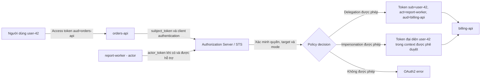
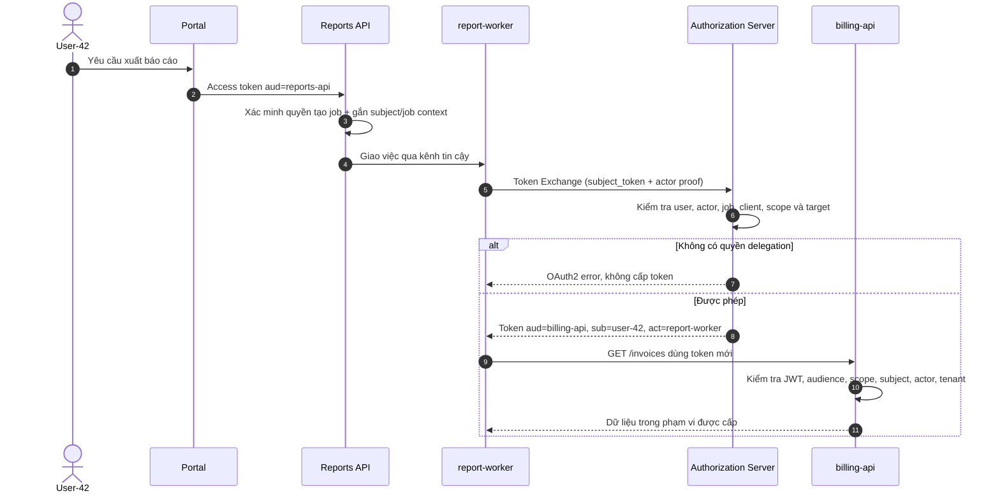

# Phân biệt delegation, impersonation và chính sách cho từng trường hợp

Trong hệ thống microservices, người dùng có thể gọi API Gateway, Gateway tiếp tục gọi một backend, rồi backend lại gọi một dịch vụ khác. Ở mỗi bước, hệ thống cần trả lời: **“Ai là người có quyền gốc, ai đang thực hiện yêu cầu, và quyền nào được phép chuyển tiếp?”** Nếu chỉ chuyển nguyên access token giữa các dịch vụ, token có thể sai `audience`, thừa quyền, hoặc không cho Resource Server biết dịch vụ nào thực sự thao tác. Nếu chỉ dùng token của dịch vụ, ngữ cảnh người dùng có thể biến mất. **OAuth 2.0 Token Exchange (RFC 8693)** cung cấp giao thức để đổi một token đầu vào lấy một token khác phù hợp hơn với đối tượng nhận và chính sách bảo mật.

Hai ngữ nghĩa quan trọng là **delegation** (thực thi **thay mặt** một chủ thể nhưng giữ danh tính của bên đang hành động) và **impersonation** (được phép **hành động như** chủ thể khác trong một phạm vi quyền xác định). Chúng có thể cùng dùng HTTP token exchange grant, nhưng **không đồng nghĩa**, không thể suy ra chỉ từ việc token exchange trả `200 OK` và không được cấp quyền giống nhau một cách máy móc.

Bài học thuộc chương **Token Exchange** của module **SPRING_SECURITY_OAUTH2_OIDC_AUTHORIZATION_SERVER**. Mục tiêu là học cách thiết kế, cấu hình, bảo mật, kiểm thử và vận hành Authorization Server với **Spring Security**, **Spring Authorization Server** và **Spring Boot**, đồng thời xây dựng **chính sách khác nhau cho delegation và impersonation**, kiểm tra chính xác danh tính chủ thể/actor, và ngăn lỗi confused deputy hoặc privilege escalation.

> **Nguyên tắc:** Token Exchange là một **yêu cầu cấp token mới cần được Authorization Server phê duyệt theo chính sách**. Sở hữu `subject_token` không tự cấp quyền impersonate chủ thể trong token; có `actor_token` không tự có quyền delegate; một token đã được ký hợp lệ cũng không có nghĩa AS được phép cấp mọi `audience`/`scope` mà client xin.

## 1. Bối cảnh: vì sao phải đổi token thay vì chuyển thẳng?

Giả sử:

- **`portal-web`**: OAuth2 Client/OIDC Relying Party nơi người dùng `user-42` đăng nhập;
- **`orders-api`**: Resource Server nhận yêu cầu đọc đơn hàng của user;
- **`report-worker`**: dịch vụ xử lý báo cáo thay mặt user hoặc theo tác vụ đã được ủy quyền;
- **`billing-api`**: Resource Server đích, chỉ chấp nhận token có `aud=billing-api` và quyền `invoices.read`;
- **`identity.example.com`**: Authorization Server kiêm Security Token Service (STS) cho token exchange.

User đưa token tới `orders-api`. Token đó có thể mang `aud=orders-api` và `scope=orders.read`; nó **không nên được gửi nguyên vẹn** đến `billing-api` vì `billing-api` là audience khác. Một dịch vụ có nhu cầu chính đáng có thể yêu cầu AS đổi token thành token **riêng cho billing-api**, scope hẹp, thời hạn ngắn và mô tả rõ người dùng/actor.



Sơ đồ mô tả **các khả năng về chính sách**, không nói mọi request đồng thời có ba kết quả. Actor có thể là một dịch vụ đang thực hiện thao tác; cần xác minh actor theo mô hình tin cậy. Trong thực tế không nên chuyển token nhạy cảm qua URL hoặc công khai giá trị token trong trace.

### 1.1. Token Exchange không phải những thứ sau

| Cơ chế | Khác gì so với Token Exchange? |
|---|---|
| **Authorization Code + PKCE** | Cấp token sau một authorization flow có người dùng; token exchange đổi credential đã có theo chính sách |
| **Refresh Token grant** | Dùng refresh token hợp lệ để xin token tiếp theo; không tự chuyển actor/audience/subject |
| **Client Credentials grant** | Client lấy token cho danh tính/quyền của **chính client**, thường không có user |
| **Forwarding Bearer token** | Chuyển cùng token sang dịch vụ khác; dễ sai audience, khó giới hạn quyền và mất ranh giới tin cậy |
| **Token introspection** | Kiểm tra một token đang active và metadata, không cấp token mới |
| **OIDC ID Token** | Xác thực thông tin sự kiện đăng nhập của user cho RP; **không phải** access token để trao đổi/gọi API theo mặc định |
| **Đặt header X-User-Id** | Dữ liệu do caller tự cung cấp, không phải bằng chứng một user đã ủy quyền |

Không cần token exchange cho mọi lời gọi giữa hai backend. Nếu công việc thực sự chỉ mang quyền dịch vụ, **Client Credentials** với audience/scope đúng thường đơn giản và phù hợp hơn.

## 2. Hai ngữ nghĩa cốt lõi của RFC 8693

### 2.1. Delegation — “A hành động thay mặt B”

**Delegation** nghĩa là chủ thể B ủy quyền cho A thực hiện **một phần hành động có giới hạn**; **A vẫn có danh tính riêng** và người nhận token có thể biết A là người thực thi đại diện cho B.

Ví dụ: `user-42` cho phép `report-worker` đọc hóa đơn để xuất báo cáo, nhưng không cho phép chuyển tiền hoặc sửa thông tin thanh toán. Token phát hành theo delegation có thể mang:

```json
{
  "iss": "https://identity.example.com",
  "sub": "user-42",
  "aud": ["billing-api"],
  "scope": "invoices.read",
  "act": {
    "sub": "report-worker"
  },
  "exp": 1794850600
}
```

Đây là **payload JWT minh họa**, không phải JWT được ký. `sub` là chủ thể có quyền gốc; `act.sub` là bên thực sự đang hành động. **Authorization Server phải xác minh** mối quan hệ ủy quyền và scope/audience; không chỉ copy giá trị `act` do caller tự khai.

Resource Server có thể ghi audit: **“report-worker đọc hóa đơn thay mặt user-42”**. Khi chính sách yêu cầu người dùng có quyền xem hóa đơn **và** worker được ủy quyền cho hành động đó, kiểm tra phải bao gồm cả hai. Delegation không tự biến mọi quyền của user thành quyền của worker.

### 2.2. Impersonation — “A được hành động như B”

**Impersonation** nghĩa là A được cấp quyền **đại diện như chính B trong phạm vi quyền được cho phép**; với Resource Server nhận token, A có thể **không phân biệt được** với B trong ngữ cảnh đó. Token ví dụ:

```json
{
  "iss": "https://identity.example.com",
  "sub": "user-42",
  "aud": ["billing-api"],
  "scope": "invoices.read",
  "exp": 1794850600
}
```

Trong ví dụ, không có claim `act`, nên chỉ dựa vào token này, `billing-api` **không thể biết** một nhân viên hỗ trợ, service hay user trực tiếp đang dùng nó. Đây là đặc trưng cần được quản trị rất chặt chẽ: **đừng dùng impersonation cho tác vụ mà audit/authorization bắt buộc phải phân biệt actor**.

Impersonation có thể hữu ích trong phạm vi hạn chế, ví dụ một công cụ hỗ trợ nội bộ được phê duyệt để tái hiện trải nghiệm đọc-only của khách hàng, hay tích hợp một hệ thống cũ chỉ hiểu một danh tính. Tuy nhiên, **quyền impersonate phải được cấp riêng, thường có phê duyệt, giới hạn thời gian, phạm vi và audit tại AS**. Không nên cho phép “đăng nhập như bất kỳ người dùng nào” chỉ vì dịch vụ có client secret hợp lệ.

### 2.3. Bảng so sánh trực tiếp

| Tiêu chí | **Delegation** | **Impersonation** |
|---|---|---|
| Ngữ nghĩa | A thực hiện thay mặt B | A được thực hiện như B trong context được cấp |
| Danh tính của actor | **Được giữ lại/biểu diễn rõ**, ví dụ `act` | Có thể **không hiển thị** với Resource Server |
| Chủ thể quyền gốc | B, thường ở claim `sub` | B, thường ở claim `sub` |
| Quyền áp dụng | Quyền B đã có **và** quyền B được phép giao A, thêm giới hạn AS/RS | Quyền B trong **phạm vi impersonation** được AS cấp; không mặc nhiên toàn bộ quyền |
| Audit ở API | Có thể ghi B và A nếu token cung cấp actor | API có thể chỉ thấy B; cần audit bổ sung phía AS/đường tin cậy |
| Nguy cơ nổi bật | Confused deputy, escalation qua chuỗi actor, quên kiểm tra actor | Che danh tính thực thi, lạm dụng quyền thay người khác |
| Ứng dụng thường hợp lý | On-behalf-of service-to-service có truy vết actor | Hỗ trợ/quản trị đặc biệt, legacy compatibility khi được duyệt |
| Mức kiểm soát nên dùng | Actor authorization, scope/audience giảm quyền, chain bounds, TTL ngắn | Allowlist đặc biệt, phê duyệt, giới hạn mục tiêu, TTL rất ngắn, audit tăng cường |

### 2.4. Hai kiểu token không tự phân biệt bằng grant_type

Cả hai đều có thể yêu cầu cùng grant:

```text
grant_type = urn:ietf:params:oauth:grant-type:token-exchange
```

**Không tồn tại một grant_type riêng tên “delegation” hoặc “impersonation” trong RFC 8693.** Kết quả phụ thuộc token đầu vào, actor, policy, loại token phát hành và cách biểu diễn claim. Một token chỉ mang `sub=user-42` chưa chứng minh nó an toàn cho delegation, vì thiếu thông tin actor mà Resource Server cần.

## 3. Bốn vai trò phải kiểm tra độc lập

Trong token exchange, cần phân biệt **requesting client**, **subject**, **actor** và **target resource**:

| Vai trò | Ví dụ | Bằng chứng từ đâu? |
|---|---|---|
| Requesting OAuth2 Client | `orders-api` hoặc `report-worker` gọi token endpoint | Client authentication và `RegisteredClient` |
| Subject | `user-42` | `subject_token` được AS xác minh |
| Actor | `report-worker` | `actor_token` được AS xác minh hoặc nguồn danh tính actor tin cậy theo policy |
| Target service | `billing-api` | `audience`/`resource` được yêu cầu **và** mapping tài nguyên do AS kiểm soát |

**Client authentication không luôn đồng nghĩa actor authorization.** Ví dụ client HTTP là gateway, nhưng actor được yêu cầu là một worker khác; AS phải kiểm tra vì sao gateway được phép yêu cầu token với actor đó. Ngược lại, một `actor_token` hợp lệ không cho phép client bất kỳ sử dụng actor token để đi impersonate người khác.

### 3.1. Subject token là gì?

Theo RFC 8693, `subject_token` là **token đại diện cho bên mà request được thực hiện thay mặt**. Đây là tham số bắt buộc, cùng với `subject_token_type`. Token có thể là access token hoặc loại security token khác theo chính sách AS/STS; **không được cho rằng chỉ cần parse được JWT là đủ**.

AS phải kiểm tra tính hợp lệ theo loại token: issuer tin cậy, chữ ký/introspection, thời hạn, trạng thái thu hồi, loại token, audience/được phép dùng làm đầu vào exchange, issuer trust boundary và principal binding.

### 3.2. Actor token là gì?

`actor_token` mô tả bên **sẽ hành động thay mặt chủ thể**; `actor_token_type` là bắt buộc khi `actor_token` có mặt, và không được gửi khi không có `actor_token`. Cả hai token cần validation và policy riêng. Trong RFC 8693, `actor_token` là tham số **tùy chọn về cú pháp**; tuy nhiên **delegation có thể xác minh được phải có danh tính actor tin cậy và được biểu diễn đúng trong token xuất ra**. Không được tự kết luận actor là ai chỉ vì có chuỗi `actor_id` trong request.

Nếu một deployment muốn suy actor từ client authentication thay vì từ `actor_token`, đó phải là **thiết kế policy có ràng buộc và được kiểm thử**, chứ không phải hành vi mặc định cần suy diễn từ RFC.

### 3.3. Chứng minh “được phép hành động” khác “đã hành động”

Một actor có danh tính hợp lệ **chưa chắc được phép** thực thi thay mặt subject. AS còn phải có bằng chứng ủy quyền: consent phù hợp, quyền quản trị, allowlist delegation, policy theo tenant, hoặc claim đã được cấp và kiểm chứng. Claim `may_act` là một tín hiệu có thể hỗ trợ quyết định này nhưng không thay việc xác minh các điều kiện còn lại.

## 4. Hợp đồng HTTP Token Exchange theo RFC 8693

Token Exchange là **OAuth 2.0 extension grant** được gửi bằng `POST` tới token endpoint với body `application/x-www-form-urlencoded`. Client authentication áp dụng theo cơ chế OAuth 2.0 đang được AS chấp nhận.

### 4.1. Các tham số

| Tham số | Theo RFC 8693 | Ý nghĩa |
|---|---|---|
| `grant_type` | **Bắt buộc** | `urn:ietf:params:oauth:grant-type:token-exchange` |
| `subject_token` | **Bắt buộc** | Token của chủ thể quyền gốc |
| `subject_token_type` | **Bắt buộc** | Loại token đầu vào, ví dụ URN access token |
| `actor_token` | Tùy chọn | Token của bên đang hành động |
| `actor_token_type` | Bắt buộc **khi có actor_token**, cấm nếu không có | Loại actor token |
| `audience` | Tùy chọn | Tên logic của target service; có thể lặp theo RFC, nhưng policy cần giới hạn |
| `resource` | Tùy chọn | URI tuyệt đối của resource đích, không fragment; có thể lặp theo RFC |
| `scope` | Tùy chọn | Scope mong muốn trong ngữ cảnh resource đích |
| `requested_token_type` | Tùy chọn | Loại token muốn AS phát hành; nếu bỏ qua AS tự chọn theo policy |

Các URN thường gặp:

```text
Token Exchange grant:
  urn:ietf:params:oauth:grant-type:token-exchange

Access token type:
  urn:ietf:params:oauth:token-type:access_token

JWT type:
  urn:ietf:params:oauth:token-type:jwt
```

`requested_token_type=...:access_token` nói rằng client muốn **loại token được dùng như OAuth access token**. Nó **không** quyết định JWT hay opaque ở mức triển khai nếu định dạng cụ thể không được yêu cầu/được hỗ trợ. Cũng không được dùng ID Token OIDC như một access token đầu vào chỉ vì ID Token là JWT.

### 4.2. Ví dụ request delegation

Ví dụ `report-worker` trao đổi subject token của `user-42` và actor token đại diện cho chính worker để nhận token cho `billing-api`:

```http
POST /oauth2/token HTTP/1.1
Host: identity.example.com
Authorization: Basic <REDACTED_CLIENT_AUTH>
Content-Type: application/x-www-form-urlencoded
Accept: application/json

grant_type=urn%3Aietf%3Aparams%3Aoauth%3Agrant-type%3Atoken-exchange
&subject_token=REDACTED_USER_ACCESS_TOKEN
&subject_token_type=urn%3Aietf%3Aparams%3Aoauth%3Atoken-type%3Aaccess_token
&actor_token=REDACTED_WORKER_ACCESS_TOKEN
&actor_token_type=urn%3Aietf%3Aparams%3Aoauth%3Atoken-type%3Aaccess_token
&requested_token_type=urn%3Aietf%3Aparams%3Aoauth%3Atoken-type%3Aaccess_token
&audience=billing-api
&scope=invoices.read
```

Đây là ví dụ **HTTP được ngắt dòng nhằm dễ đọc**, không phải body có thể dán nguyên trạng: client thực tế phải form-encode mọi giá trị theo UTF-8 và gửi một body hợp lệ. `REDACTED_...` là placeholder; không đưa token thật vào hướng dẫn hoặc log. Dữ liệu actor/token có được hỗ trợ và cách biểu diễn delegation phụ thuộc **policy và implementation** của AS.

### 4.3. Phản hồi thành công

```http
HTTP/1.1 200 OK
Content-Type: application/json
Cache-Control: no-store
Pragma: no-cache

{
  "access_token": "REDACTED_EXCHANGED_ACCESS_TOKEN",
  "issued_token_type": "urn:ietf:params:oauth:token-type:access_token",
  "token_type": "Bearer",
  "expires_in": 300,
  "scope": "invoices.read"
}
```

Theo RFC 8693, `access_token` (trường chứa token được phát, dù đôi khi token được trả có thể là loại security token khác), `issued_token_type` và `token_type` là những trường bắt buộc của response. `expires_in` được khuyến nghị; `scope` cần được trả khi phạm vi cấp thực tế khác requested scope. `issued_token_type` mô tả **loại token phát hành**; `token_type=Bearer` mô tả **cách sử dụng** token trong HTTP. Chúng không thay thế nhau.

**Một exchange thành công không mặc định cấp refresh token.** RFC 8693 cho phép theo điều kiện triển khai, nhưng trao đổi một credential ngắn hạn sang token dùng ở backend khác thường không cần refresh token; nếu cấp, phải định nghĩa vòng đời và revocation rõ ràng.

### 4.4. Token Exchange không tự thay đổi token đầu vào

Việc exchange thường **không tự tiêu hủy `subject_token` hay `actor_token`** và không mặc nhiên tạo liên kết thu hồi tự động giữa input và output. Nếu muốn revoke token nguồn khiến token đã đổi mất hiệu lực, cần **thiết kế propagation, TTL ngắn, introspection/denylist hoặc policy check riêng**. Không giả định mọi token do AS cấp trên cùng chuỗi được thu hồi cùng lúc.

## 5. Claim `act` và `may_act`: khác nhau về thời điểm và ý nghĩa

### 5.1. `act` — actor đang thực hiện delegation

Trong RFC 8693, claim **`act`** biểu diễn actor hiện tại:

```json
{
  "sub": "user-42",
  "aud": "billing-api",
  "scope": "invoices.read",
  "act": {
    "sub": "report-worker"
  }
}
```

Đây là token **đã được AS quyết định phát hành** theo ngữ nghĩa delegation; actor đã được xác minh. Với token JWT, RS có thể dùng `sub` và **actor hiện tại** ở `act.sub` để áp dụng authorization rule và audit.

### 5.2. `may_act` — bên được phép trở thành actor

Claim **`may_act`** mô tả một bên **có thể được phép** acting on behalf of subject:

```json
{
  "iss": "https://identity.example.com",
  "sub": "user-42",
  "aud": ["token-exchange-service"],
  "may_act": {
    "sub": "report-worker"
  }
}
```

Đây là **ví dụ tín hiệu cho AS** khi xét token exchange; không phải token đã trao quyền truy cập `billing-api` cho worker. AS phải xác minh issuer/audience/token integrity và các điều kiện bổ sung như actor hiện tại, client được phép, policy, scope và resource đích. **Client không thể tự thêm `may_act` vào JSON rồi được coi là đã ủy quyền**; claim chỉ đáng tin khi thuộc credential đã được xác minh từ issuer phù hợp.

| | `act` | `may_act` |
|---|---|---|
| Trả lời | “Ai **đang** acting on behalf of subject?” | “Ai **có thể được phép** trở thành actor?” |
| Dùng điển hình | Trong **issued token**/introspection để RS áp dụng rule, audit | Trong **subject token**/introspection để AS tham khảo quyền delegation/impersonation |
| Có tự cấp quyền? | **Không**: RS vẫn kiểm tra target/scope và policy | **Không**: AS còn phải xác minh toàn bộ điều kiện |
| Nguồn tin | Claim đã được AS/issuer tin cậy phát hành | Claim đã được issuer tin cậy phát hành |

Trong claim `may_act`, các thông tin nhận diện như `iss` và `sub` có thể cần để phân biệt actor giữa issuer; các thuộc tính `exp`/`aud`/`nbf` **bên trong `may_act`** không đóng vai trò như top-level claims hợp lệ của JWT. Không tự thiết kế “may_act.exp” rồi mặc nhận framework sẽ kiểm soát hết hạn quyền ủy quyền.

### 5.3. Delegation nhiều bước và nested `act`

Nếu `service-A` nhận ủy quyền của user, rồi ủy quyền tiếp cho `service-B` theo chính sách, JWT có thể biểu diễn lịch sử:

```json
{
  "sub": "user-42",
  "aud": ["billing-api"],
  "scope": "invoices.read",
  "act": {
    "sub": "service-B",
    "act": {
      "sub": "service-A"
    }
  }
}
```

**Actor ngoài cùng `service-B` là actor hiện tại**. `service-A` nằm trong nested `act` là actor trước đó, phục vụ **lịch sử/quan sát**, không được đối xử như actor hiện tại khi quyết định quyền. RFC 8693 yêu cầu nơi dùng token **chỉ** xét các top-level claims và current actor tại `act` ngoài cùng cho access-control; nested prior actors chỉ mang tính thông tin.

Do đó một rule kiểu “trong chuỗi `act` có service-A có quyền admin nên service-B được admin” là **sai và nguy hiểm**. Hãy kiểm tra chính service-B, target/resource và quyền delegation còn hiệu lực; giới hạn số bước, scope và TTL.

## 6. Chính sách cấp token: tránh nhân quyền ngoài ý muốn

**Token Exchange không phải phép hợp (union) của mọi quyền** trong subject token, actor token và client registration. Một mô hình decision an toàn cần **giới hạn theo cả chuỗi điều kiện**:

```text
Requested rights
    ∩ Subject's eligible rights
    ∩ Actor's delegated/impersonation rights
    ∩ Requesting client's token-exchange policy
    ∩ Target resource's allowed rights
    ∩ Current account/tenant/risk/consent/assurance policy
    = Upper bound of rights that AS may issue
```

Đây là **mô hình tư duy**, không phải công thức set intersection áp dụng máy móc cho mọi hệ thống: tên scope có thể khác giữa các resource và policy có thể phụ thuộc thuộc tính dữ liệu. Nhưng nó nhấn mạnh quy tắc **không nâng quyền chỉ vì một bên có scope rộng**.

### 6.1. Policy matrix theo loại trao đổi

| Trường hợp | Actor/subject | Điều kiện bắt buộc | Khuyến nghị |
|---|---|---|---|
| **Delegation user → service** | User B, service A | Có quyền thực hiện thay B, audience/scope đã giảm, actor được xác minh, current user policy | **Ưu tiên cho on-behalf-of** khi cần audit |
| **Delegation service → service** | Workload B, workload A | Quan hệ service-to-service được cấp, không mở rộng tenant/permissions | Token ngắn hạn, mỗi workload có ID |
| **Multi-hop delegation** | User/workload B, nhiều actor | Mỗi hop được phép, actor hiện tại rõ, chống tự mở rộng phạm vi | Hạn chế hop, TTL, chuỗi actor và cross-domain |
| **Impersonation hỗ trợ quản trị** | Operator A hoạt động như user B | Approval/RBAC riêng, mục đích, target, TTL, audit chi tiết | Chỉ phạm vi **rất hẹp**, read-only khi có thể |
| **Impersonation để tương thích legacy** | Trusted service A hoạt động như B | Legacy không hiểu actor, ràng buộc bù trừ, giám sát | Lập kế hoạch thay bằng delegation có actor khi có thể |
| **Client tự làm việc** | Chỉ A, không có B | Client Credentials và policy workload | **Không ép** vào delegation/impersonation |

### 6.2. Ràng buộc `audience`, `resource` và `scope`

Một token `aud=orders-api` không nên tự được chuyển thành token có `aud=billing-api` nếu AS không có quan hệ tin cậy và policy cấp quyền cho bước đó. Nếu client đề nghị nhiều audience cùng lúc, quyền yêu cầu được hiểu theo **scope ở tất cả target**; phạm vi có thể nở rất nhanh. Với mô hình least privilege, thường nên chỉ phát token **cho một target service chính** khi không có lý do rõ ràng để dùng đa target.

Các quy tắc gợi ý:

1. Mapping `audience/resource → backend/API` phải từ cấu hình **tin cậy phía AS**.
2. Client không được tùy ý yêu cầu target của tenant khác.
3. Không nhận wildcard scope/target như một quyền chung cho mọi API.
4. Token mới chỉ có scope/resource mà **subject, actor, requesting client và target policy** cùng chấp nhận.
5. Thời hạn token mới nên ngắn, không kéo dài quyền quá thời hạn/bối cảnh được cấp.
6. Resource Server kiểm tra **audience thực tế trong token**, không chỉ nhìn request tới đúng URL.

### 6.3. Policy không chỉ là scope

Ngoài scopes, dịch vụ có thể cần điều kiện: cùng tenant, người dùng còn enabled, đơn hàng thuộc phòng ban được phép, request chưa vượt giới hạn số tiền, thiết bị rủi ro thấp, có MFA gần đây hoặc nhiệm vụ chưa hết hạn. Một token chỉ có `scope=payments.approve` không tự hợp thức hóa thanh toán cho một tài khoản khác.

## 7. Delegation cụ thể: user đặt tác vụ, worker đọc hóa đơn

**Yêu cầu:** User `user-42` nhấn “Xuất báo cáo”. `portal-web` gọi `reports-api`; `report-worker` thực hiện tác vụ và cần đọc hóa đơn từ `billing-api`. Không muốn worker có toàn bộ quyền đăng nhập của user.

### 7.1. Thiết kế luồng



Trong kiến trúc nhiều tầng, **subject token phải được cấp/đưa tới worker bằng luồng được thiết kế an toàn**. Không nhét token gốc vào một message queue không mã hóa hoặc log. Nếu worker chạy rất lâu sau thời điểm user click, cần xem token gốc còn hiệu lực không, quyền delegation có còn và tác vụ offline có được phép không; không dùng lại token hết hạn rồi ép AS cấp token mới.

### 7.2. Chính sách delegation minh họa

```yaml
# PSEUDOCODE chính sách do ứng dụng tự định nghĩa,
# KHÔNG phải thuộc tính Spring Authorization Server mặc định.
tokenExchangePolicies:
  report-export:
    mode: delegation
    requestingClient: report-worker
    subjectType: end-user
    actor: report-worker
    allowedAudience: billing-api
    allowedScopes:
      - invoices.read
    requireDelegationEvidence: true
    requireSameTenant: true
    maxLifetimeSeconds: 300
    maxDelegationDepth: 2
    permitImpersonation: false
```

YAML chỉ diễn giải policy. Nếu muốn sử dụng thật, cần xây schema, validator, cơ chế lưu cấu hình/approval và kiểm thử. `maxDelegationDepth`, `requireDelegationEvidence` là **trường custom**, Spring Authorization Server không tự hiểu các thuộc tính đó.

### 7.3. Resource Server kiểm tra cả hai danh tính

`billing-api` có thể yêu cầu:

```text
issuer == trusted AS
audience contains billing-api
scope contains invoices.read
sub corresponds to an enabled, eligible user
act.sub == report-worker
report-worker authorized to act for sub on this tenant/job
requested invoices belong to allowed tenant
token lifetime/other restrictions satisfied
```

Trường hợp `sub` có quyền đọc hóa đơn nhưng actor không được delegation tới `billing-api` vẫn **phải bị từ chối**. Ngược lại, actor có scope rộng cũng không được dùng token của một user không có quyền dữ liệu đó để vượt chính sách.

## 8. Impersonation cụ thể: công cụ hỗ trợ xem như người dùng

**Yêu cầu:** Một nhân viên hỗ trợ đã được xác thực bằng MFA cần xem giao diện đọc-only của khách hàng để điều tra lỗi hiển thị, nhưng không được đặt lệnh thanh toán, thay mật khẩu hoặc xuất dữ liệu nhạy cảm.

### 8.1. Vì sao impersonation nguy hiểm hơn?

Nếu token phát ra chỉ chứa `sub=user-42`, backend legacy có thể coi request như chính người dùng gửi. Vì vậy chính sách impersonation phải bảo vệ **đường cấp token** và có audit riêng để phân biệt hành động của nhân viên hỗ trợ. Mặc định nên dùng delegation có `act` nếu API hỗ trợ actor; chỉ dùng impersonation khi đã xác định chính xác nhu cầu.

### 8.2. Quy trình cấp quyền đề xuất

1. **Nhân viên hỗ trợ xác thực mạnh** với MFA phù hợp và quyền support-impersonation chuyên biệt.
2. **Chọn đúng khách hàng/tenant**, nhập mục đích, mã ticket hoặc case hợp lệ; phải kiểm tra quyền truy cập của người hỗ trợ vào đúng tenant.
3. Có **phê duyệt bổ sung** khi tổ chức yêu cầu (four-eyes/break-glass), khóa chức năng ngoài read-only.
4. AS xác minh subject token, danh tính operator, requesting client, policy và trạng thái user đích.
5. Chỉ cấp token **audience cụ thể, scope thấp, TTL rất ngắn**, không mặc định refresh token.
6. Ghi **audit riêng an toàn tại AS**: actor thực, subject bị impersonate, ticket, thời điểm, target, scope, kết quả phê duyệt.
7. Resource Server hoặc gateway giới hạn endpoint read-only và đánh giá quyền theo policy; nếu không thể phân biệt actor ở RS, cần bổ sung lớp kiểm soát ngoài token.
8. Kết thúc phiên/ticket hoặc thu hồi quyền support phải ngăn token mới; token đang tồn tại được xử lý theo SLA thu hồi.

### 8.3. Policy minh họa

```yaml
# PSEUDOCODE - KHÔNG là cấu hình Spring mặc định.
tokenExchangePolicies:
  support-view:
    mode: impersonation
    requestingClient: support-console-backend
    requiredOperatorRole: SUPPORT_IMPERSONATE_READONLY
    requireOperatorMfa: true
    requireTicketApproval: true
    targetSubjectType: end-user
    allowedAudience: customer-profile-api
    allowedScopes:
      - profile.read
    maxLifetimeSeconds: 120
    allowRefreshToken: false
    allowCrossTenant: false
    requireIndependentAudit: true
```

**Điểm bất biến:** Thành công trong việc xác thực operator/client chưa đủ; **operator phải được phép impersonate đúng subject, target và hành động**. Không có API dạng `POST /impersonate?userId=...` cho một admin client chung được phép bất kỳ user ID nào mà không kiểm tra quyền cụ thể.

### 8.4. Cảnh báo về khả năng quan sát

Trong impersonation, Resource Server có thể không biết actor thật. Một audit record chỉ ghi “user-42 cập nhật dữ liệu” sẽ **gây hiểu sai** nếu request do operator tạo. Nếu hệ thống cần chống chối bỏ, phát hiện gian lận hoặc phân trách nhiệm chính xác, impersonation không phù hợp nếu không có cơ chế audit tin cậy bù trừ. Khi có thể, chuyển sang **delegation với actor hiện rõ**.

## 9. Chính sách cho chuỗi delegation và cross-domain

Delegation có thể trải qua nhiều dịch vụ:

```text
user-42 -> service-A -> service-B -> service-C -> billing-api
```

Không cho phép “đã có act thì muốn delegate bao nhiêu lần cũng được”. Mỗi bước tăng rủi ro **mất ngữ cảnh, giảm khả năng audit, nở audience và scope**. Một thiết kế an toàn cần:

- **Mỗi hop được AS cho phép** đối với actor hiện tại, target tiếp theo và scope tương ứng.
- **Giới hạn số hop** và tuổi token, bảo đảm không mở rộng quyền so với policy nguồn.
- **Xác minh actor chain** được issuer tin cậy phát, không nhận JSON do client tự ghép.
- **Không dùng nested prior actor để nâng quyền**: access-control dựa vào subject/top-level claims và **current actor**.
- **Phân vùng tenant và issuer**: token của tenant A không được exchange thành token tenant B chỉ vì subject string trùng.
- **Kiểm soát target substitution**: không cho caller thay `audience` từ API đọc sang API ghi khi không có authorization.
- **Kiểm soát federation giữa tổ chức**: nếu đổi token qua issuer khác, cần trust model cho issuer/key/claim mapping/revocation và rule riêng, không mặc định chấp nhận issuer mới.

### 9.1. Khi nào nên dừng delegation?

Nếu actor mới không có bằng chứng được quyền nhận ủy quyền tiếp, token ban đầu không còn active, user đã thu hồi quyền, tenant không còn cho phép, hoặc scope đích không có mapping rõ, **AS phải từ chối**. Đừng cố “cứ cấp token rồi để RS tự xét” nếu việc cấp đã vi phạm chính sách delegation.

### 9.2. Identity mapping trong liên kết nhiều issuer

Hai issuer có thể cùng phát `sub=user-42` cho **hai người khác nhau**. Danh tính không thể nhận diện duy nhất chỉ bằng chuỗi `sub`; cần xem cặp **issuer + subject**, tenant hoặc định danh được federation mapping đáng tin cậy thiết lập. Không chuyển opaque token/JWT từ issuer không tin cậy thành quyền trên AS nội bộ chỉ dựa trên email hoặc display name.

## 10. Tích hợp Spring Authorization Server: khả năng và ranh giới

Ở các phiên bản Spring Authorization Server có hỗ trợ OAuth 2.0 Token Exchange, **`OAuth2TokenEndpointFilter`** và token endpoint configuration có thể dùng **`OAuth2TokenExchangeAuthenticationConverter`** và **`OAuth2TokenExchangeAuthenticationProvider`** trong danh sách mặc định. Tài liệu **Spring Authorization Server Reference – Protocol Endpoints** công bố grant `urn:ietf:params:oauth:grant-type:token-exchange` cùng hai thành phần này.

**Điều đó không có nghĩa Spring mặc định thực thi policy delegation/impersonation riêng của tổ chức**, quản lý approval, nested `act`, actor entitlement hoặc cross-tenant mapping. Cần kiểm tra tính năng và giới hạn của **phiên bản đang chạy**, rồi bổ sung chính sách vào điểm mở rộng phù hợp và test toàn flow. Không phát hành JWT với `act` chỉ bằng cách để client tự khai actor trong parameter tùy ý.

### 10.1. RegisteredClient phải được phép token exchange

Ví dụ khai báo grant theo URI chuẩn:

```java
AuthorizationGrantType tokenExchange = new AuthorizationGrantType(
    "urn:ietf:params:oauth:grant-type:token-exchange");

RegisteredClient worker = RegisteredClient.withId(
        "report-worker-internal-id")
    .clientId("report-worker")
    .clientSecret(passwordEncoder.encode(secretFromSecureStore))
    .clientAuthenticationMethod(
        ClientAuthenticationMethod.CLIENT_SECRET_BASIC)
    .authorizationGrantType(tokenExchange)
    .scope("invoices.read")
    .build();
```

Đây là đoạn mã **tạo registration** minh họa: `secretFromSecureStore` phải được cấp an toàn, imports và bean đầy đủ cần được bổ sung. Nếu phiên bản thư viện có hằng số `AuthorizationGrantType.TOKEN_EXCHANGE` thì có thể dùng hằng số đó; tạo trực tiếp từ URN giúp thấy rõ ý nghĩa chuẩn. **Việc khai báo grant và scope chưa đủ** để cho phép request cụ thể theo delegation/impersonation. AS còn phải xác minh subject token, actor, audience và policy.

### 10.2. Điểm mở rộng token endpoint

Khung cấu hình Spring Authorization Server với DSL hỗ trợ `HttpSecurity.with(...)`:

```java
@Bean
@Order(1)
SecurityFilterChain authorizationServerChain(HttpSecurity http)
        throws Exception {
    OAuth2AuthorizationServerConfigurer authorizationServer =
        OAuth2AuthorizationServerConfigurer.authorizationServer();

    http.securityMatcher(authorizationServer.getEndpointsMatcher())
        .with(authorizationServer, server -> server
            .tokenEndpoint(endpoint -> {
                // Có thể dùng:
                // endpoint.authenticationProviders(providers -> { ... });
                // để tùy biến validator/provider theo version đang dùng.
            }))
        .authorizeHttpRequests(auth ->
            auth.anyRequest().authenticated());

    return http.build();
}
```

Đây **không phải dự án có thể chạy ngay**: cần `RegisteredClientRepository`, issuer/settings, `OAuth2AuthorizationService`, ký token/JWK nếu phát JWT, security chain, nguồn identity và policy. Dùng `authenticationProviders(...)` cần biết rõ provider mặc định nào đang có để **giữ lại validation chuẩn** và không vô tình cho token exchange bỏ qua client authentication/subject validation.

### 10.3. Policy enforcement nên đặt ở đâu?

| Nhu cầu | Vị trí kiến trúc | Không nên |
|---|---|---|
| Parse request RFC 8693 | `AuthenticationConverter` của token exchange | Viết controller riêng bỏ qua token filter chain |
| Xác thực requesting client | Client authentication filter/providers | Tin `client_id`/client secret từ request mà không xác minh |
| Xác minh `subject_token`/`actor_token` | Provider/validator dùng issuer keys/introspection/trust | Chỉ Base64-decode token rồi tin claims |
| Xác định delegation hay impersonation | **Policy engine** xét client, subject, actor, target và phê duyệt | Mặc định mọi request có user token đều được impersonate |
| Tính audience, scope, TTL, actor claim | Issuance policy trước token generation | Để token customizer tự quyết định toàn bộ quyền ở bước cuối |
| Thêm claims chuẩn đã xác minh | Token generator/customizer đúng loại token | Copy thẳng input `act`/`may_act` chưa tin cậy |
| API authorization | Spring Security Resource Server + business policy | Chỉ xem token có chữ ký đúng mà bỏ audience/actor |

### 10.4. Pseudocode quyết định cấp token

```java
// PSEUDOCODE: các kiểu/biến bên dưới do ứng dụng định nghĩa.
ExchangeRequest request = parseTokenExchange(httpRequest);
RegisteredClient client = authenticatedRequestingClient();

VerifiedSubject subject = subjectTokenVerifier.verify(
    request.subjectToken(), request.subjectTokenType());
VerifiedActor actor = request.hasActorToken()
    ? actorTokenVerifier.verify(
        request.actorToken(), request.actorTokenType())
    : actorPolicy.resolveFromTrustedContext(client);

ExchangePolicyDecision decision = exchangePolicy.evaluate(
    client, subject, actor, request.audience(),
    request.resource(), request.scope());

if (!decision.allowed()) {
    throw oauthError(decision.protocolErrorCode());
}

// Phát token mới CHỈ dựa trên quyết định đã xác minh:
// subject, actor, audience, scope, TTL, mode và tenant.
return tokenIssuer.issue(decision);
```

**Không có sẵn** các class `ExchangeRequest`, `VerifiedSubject`, `VerifiedActor`, `ExchangePolicyDecision` ở ví dụ này; code diễn đạt **thứ tự bảo mật** chứ không phải implementation copy-paste. Nếu token actor không được hỗ trợ, không được âm thầm tạo impersonation với quyền rộng làm fallback cho một yêu cầu delegation.

## 11. Spring Security OAuth2 Client và Resource Server

### 11.1. Phía client muốn token exchange

Spring Security OAuth2 Client có hỗ trợ Token Exchange grant ở các phiên bản phù hợp, gồm client response handler kiểu **`RestClientTokenExchangeTokenResponseClient`** và grant request tương ứng. Tuy nhiên, việc cấu hình token exchange client **không tự đăng ký quyền exchange** ở Authorization Server. Cần xác định rõ nguồn `subject_token`, tùy chọn actor token và resource/audience.

Ví dụ **HTTP-level** của phần client rất rõ ràng:

```text
1. Caller đã có subject token hợp lệ cho transaction cần exchange.
2. Backend lấy subject token từ ngữ cảnh đáng tin, không từ query string.
3. Backend tự xác thực với AS tại /oauth2/token.
4. Backend gửi Token Exchange grant + subject token (+ actor proof).
5. AS xác minh policy và trả token mới cho audience đích.
6. Backend gọi Resource Server bằng token MỚI, không dùng token nguồn sai audience.
```

Client phải xử lý token exchange failure theo OAuth2 error, giới hạn retry, tránh lưu raw subject token/actor token vào audit/trace và không cache token mới mà bỏ qua **subject/actor/audience/scope** trong cache key.

### 11.2. Phía Resource Server kiểm tra JWT

Với JWT self-contained, Spring Security Resource Server có thể xác minh chữ ký, issuer, thời hạn và ánh xạ scope, nhưng **chính sách delegation/impersonation không tự xuất hiện chỉ nhờ cấu hình `issuer-uri`**.

Ví dụ kiểm tra một token đã xác minh:

```java
// PSEUDOCODE đặt trong authorization policy của Resource Server.
Jwt jwt = (Jwt) authentication.getPrincipal();

String user = jwt.getSubject();                 // sub của token
Map<String, Object> act = jwt.getClaim("act"); // có thể null

if (policy.requiresDelegation()) {
    if (act == null || !policy.currentActorAllowed(act, user)) {
        deny();
    }
}

requireAudience(jwt, "billing-api");
requireScope(authentication, "invoices.read");
requireTenantAndObjectAuthorization(user, act, requestedInvoice);
```

Các hàm `deny`, `requireAudience`, `requireScope` và `requireTenantAndObjectAuthorization` là **hàm giả định**, cần triển khai có kiểm thử. Không giả định `authentication.getPrincipal()` luôn là `Jwt`: nếu dự án dùng opaque token/introspection hoặc custom converter thì principal có kiểu khác. **API phải kiểm tra current actor**, không sử dụng nested prior actors cho quyết định quyền.

### 11.3. Token không chứa actor có được coi là direct user?

**Không mặc định.** Với API chấp nhận impersonation, token `sub=user-42` không có `act` có thể được phát do impersonation hoặc do user gọi trực tiếp; chỉ từ token đó có thể **không phân biệt được**. Nếu policy bắt buộc phân biệt direct user và support-impersonation, hãy yêu cầu **dấu hiệu/phân luồng tin cậy được AS phát và kiểm chứng**, hoặc chuyển sang delegation có actor rõ ràng. Không suy luận “không có `act` nghĩa chắc chắn là user trực tiếp thao tác”.

## 12. Những mối đe dọa đặc thù

### 12.1. Confused deputy

Một service có quyền rộng bị dụ dùng quyền của chính nó cho requester không đủ quyền. Ví dụ `report-worker` được đọc hóa đơn toàn công ty, nhận yêu cầu từ user thuộc tenant A rồi đổi token để đọc hóa đơn tenant B. Nếu AS chỉ kiểm tra worker có `invoices.read`, user có thể **lạm dụng service như deputy** để vượt chính sách tenant.

**Phòng tránh:** kiểm tra cả subject, actor, requesting client, tenant và target; token mới phải ràng buộc scope/audience đúng quyền được ủy quyền. RS vẫn kiểm tra authorization nghiệp vụ trên từng hóa đơn.

### 12.2. Impersonation không được phê duyệt

Nếu AS cấp token mang `sub=admin` cho mọi client có subject token bất kỳ, đó là **privilege escalation nghiêm trọng**. Client authentication chỉ nói “đây là app X”, không nói app X được impersonate admin hay bất kỳ user nào. Dùng allowlist/approval cụ thể, kiểm tra actor và quyền của người đích; từ chối mặc định.

### 12.3. Token substitution và issuer confusion

Kẻ tấn công có thể đưa ID Token thay access token, token từ issuer khác, JWT ký bởi khóa ngoài trust store, token có `aud` sai, token expired hoặc token của client khác. AS phải xác minh đúng **loại token, issuer, key, audience/binding, token active/revocation và quyền dùng nó trong exchange**. Không tin claims được parse nhưng chưa xác minh.

### 12.4. Lạm dụng target và scope

Kẻ tấn công giữ subject token chỉ dành cho API đọc, yêu cầu `audience=payments-api` và `scope=payments.approve`. Hệ thống phải **từ chối**, dù token gốc được AS ký hợp lệ. Không phát token đa audience quá rộng khi policy chỉ cho một service.

### 12.5. Replay, token leakage và token chaining

Subject/actor token và token mới đều là credential. Bảo vệ HTTPS, không log raw token, không nhét token vào URL/queue không an toàn, hạn thời gian ngắn, kiểm soát khả năng dùng lại, mTLS/DPoP khi phù hợp và được hỗ trợ. Token exchange không mặc định cung cấp cơ chế **single-use** cho token đầu vào; nếu ứng dụng cần, phải thiết kế riêng.

### 12.6. Thu hồi user hoặc actor

User có thể bị khóa sau khi token nguồn được cấp; actor có thể bị gỡ quyền delegation. AS cần kiểm tra policy hiện hành khi exchange và xử lý access token mới/đã phát theo SLA. **RFC 8693 không tự liên kết thu hồi giữa input và output token**; phải xây propagation, TTL, introspection hoặc current-state authorization.

## 13. Mã lỗi và phản hồi khi bị từ chối

Token exchange failure ở token endpoint là **OAuth2 JSON error** phù hợp RFC 6749/RFC 8693, không phải redirect người dùng đến trang login.

| Điều kiện | Mã lỗi thường dùng | Ghi chú |
|---|---|---|
| Request thiếu `subject_token`/token type, sai cú pháp | `invalid_request` | RFC 8693 yêu cầu khi token exchange request không hợp lệ |
| Subject/actor token không hợp lệ hoặc không được chấp nhận theo policy | `invalid_request` | RFC 8693 §2.2.2 quy định mã này cho trường hợp đó |
| Requested `audience`/`resource` không được đáp ứng | `invalid_target` | Mã riêng RFC 8693, được khuyến nghị |
| Client authentication không hợp lệ | `invalid_client` | Xử lý theo cơ chế client authentication |
| Requesting client không được dùng grant | `unauthorized_client` | Check `RegisteredClient.authorizationGrantTypes` |
| Grant type không hỗ trợ | `unsupported_grant_type` | Tùy phiên bản/cấu hình |
| Scope không hợp lệ hoặc không được cấp | `invalid_scope` hoặc mã thích hợp | Phải kiểm tra request, target và policy |
| Resource Server nhận exchanged token sai audience | `invalid_token` (Bearer error) | Lỗi tại RS, không phải token exchange grant error |

RFC 8693 có các quy tắc mã lỗi đặc thù; **không ép mọi lỗi vào `invalid_grant` chỉ vì đang dùng OAuth2 extension grant**. Đồng thời không phản chiếu vào `error_description` giá trị subject/actor token, secret, PII hoặc chi tiết policy nội bộ.

Ví dụ:

```http
HTTP/1.1 400 Bad Request
Content-Type: application/json
Cache-Control: no-store

{
  "error": "invalid_target",
  "error_description": "Requested target is not permitted"
}
```

Phản hồi này minh họa AS từ chối target. Mã/status cụ thể phải phù hợp nguyên nhân và cấu hình triển khai, nhưng **client không được cố chuyển sang impersonation để né kiểm tra delegation**.

## 14. Vòng đời và thu hồi của token đã trao đổi

Một token exchange **không kéo dài vô hạn** hay tự hồi sinh user session. Thiết kế cần phân biệt:

| Đối tượng | Khi hết hạn/thu hồi | Tác động mặc định |
|---|---|---|
| Subject token | Hết hạn, bị thu hồi hoặc user mất quyền | Yêu cầu exchange mới phải bị đánh giá lại; token output trước đó không tự mất hiệu lực |
| Actor token | Hết hạn, actor bị khóa/thu hồi quyền | Không được cấp delegation tiếp; token output cũ cần policy riêng |
| Exchanged access token | Hết hạn/được revoke theo mô hình hỗ trợ | RS từ chối khi kiểm tra đúng thời hạn/trạng thái |
| Requesting client credential | Bị rotation/khóa | Ngăn request exchange mới; JWT đã phát có thể còn hạn |
| User login session/consent | Hết hạn/thu hồi | Có thể yêu cầu reauthorization; không tự revoke toàn bộ output JWT |

Khuyến nghị:

- Chọn **TTL ngắn**, nhất là token cho API nhạy cảm, service đa hop hoặc impersonation.
- **Không mặc định cấp refresh token** cho exchange; nếu có, áp dụng chính sách explicit và giải thích khi quyền nguồn không còn.
- Có chính sách **revocation propagation** cho các sự kiện quan trọng và đo thời gian tối đa token output còn tác dụng.
- Nếu cần ngăn tức thì, cân nhắc RS kiểm tra denylist/security version/policy hiện tại hoặc introspection theo thiết kế.
- Không coi `issued_token_type` hay `act` tự mang nghĩa session/MFA vừa được xác minh.

## 15. Kiểm thử tích hợp delegation và impersonation

Kiểm thử đúng cần đi qua **Spring Security filter chain**, token exchange grant tại `/oauth2/token` và **Resource Server JWT/introspection validation**. Unit-test riêng phương thức tạo `act` chưa chứng minh AS kiểm tra actor hoặc policy.

### 15.1. Ma trận kiểm thử quan trọng

| Tình huống | Kết quả bắt buộc |
|---|---|
| Client đăng ký token exchange, subject hợp lệ, actor hợp lệ, policy delegation cho phép | Cấp token `aud` đúng, scope hẹp, `sub` và `act` đúng |
| Client không được dùng token exchange grant | Không cấp token; lỗi client/grant phù hợp |
| Subject token sai chữ ký hoặc issuer | Từ chối, không cấp token |
| Subject token hết hạn hoặc bị thu hồi | Từ chối theo policy/token validity |
| Actor token sai chữ ký/issuer hoặc sai type | Từ chối, không tin actor self-asserted |
| Actor hợp lệ nhưng **không được delegation** cho subject | Từ chối |
| Client HTTP đúng nhưng actor token trỏ sang service khác không được phép | Từ chối |
| User có scope đọc, actor có quyền ghi | Không phát scope ghi vượt quyền user/delegation |
| Subject thuộc tenant A, target tài nguyên tenant B | Không cấp quyền cross-tenant |
| Token gốc `aud=orders-api`, client xin `aud=billing-api` không được cấp | Từ chối với lỗi target phù hợp |
| Client xin đồng thời nhiều resource/audience vượt chính sách | Không cấp token rộng; có thể `invalid_target` |
| Delegation 2 hop hợp lệ | Current actor và nested history đúng |
| Delegation hop quá giới hạn | Từ chối, không phát token |
| RS nhận delegation token nhưng `act` bị thiếu | Từ chối nếu endpoint yêu cầu actor |
| RS dùng prior actor thay vì current actor để cho quyền | **Phải thất bại**; không khai thác nested `act` |
| Impersonation không được bật cho client | Từ chối, không chuyển thành token chỉ có `sub=user` |
| Impersonation đúng client nhưng thiếu approval/MFA/ticket | Từ chối |
| Impersonation được duyệt trong giới hạn read-only | Chỉ cấp token TTL ngắn/scope read-only/target được duyệt |
| Token impersonation dùng để gọi API ghi | RS từ chối |
| User/actor bị khóa sau issuance | Exchange mới bị từ chối; output token cũ theo revocation SLA |
| Thông tin token trong log/error | Không chứa raw token/secret |

### 15.2. MockMvc minh họa positive path

Với môi trường test đã cấu hình token exchange, confidential client `report-worker`, subject/actor token hợp lệ và policy delegation được phê duyệt:

```java
@SpringBootTest
@AutoConfigureMockMvc
class TokenExchangePolicyTests {
    @Autowired
    MockMvc mvc;

    @Test
    void validDelegationReturnsAudienceScopedToken() throws Exception {
        String subjectToken = fixtureSubjectAccessToken();
        String actorToken = fixtureActorAccessToken();

        mvc.perform(post("/oauth2/token")
                .with(httpBasic("report-worker", "test-client-secret"))
                .contentType(MediaType.APPLICATION_FORM_URLENCODED)
                .param("grant_type",
                    "urn:ietf:params:oauth:grant-type:token-exchange")
                .param("subject_token", subjectToken)
                .param("subject_token_type",
                    "urn:ietf:params:oauth:token-type:access_token")
                .param("actor_token", actorToken)
                .param("actor_token_type",
                    "urn:ietf:params:oauth:token-type:access_token")
                .param("audience", "billing-api")
                .param("scope", "invoices.read"))
            .andExpect(status().isOk())
            .andExpect(jsonPath("$.access_token").isNotEmpty())
            .andExpect(jsonPath("$.issued_token_type").value(
                "urn:ietf:params:oauth:token-type:access_token"));
    }
}
```

Đây là **test khung**, yêu cầu imports JUnit/Spring Test, fixture token được ký và có trust đúng, policy engine/AS configuration cùng bean phát token. `fixtureSubjectAccessToken()` và `fixtureActorAccessToken()` là hàm fixture tự triển khai; nếu phiên bản/triển khai không hỗ trợ actor token hoặc dùng policy khác, phải cấu hình thích hợp thay vì bỏ qua kiểm tra. Test chỉ xác minh body sơ bộ; **còn cần decode/introspect token được phát và kiểm tra chính xác `sub`, `act`, `aud`, scope và TTL**.

### 15.3. Negative tests cần cách ly nguyên nhân

Để test policy actor, hãy giữ client authentication, subject token và audience **đều hợp lệ**, chỉ thay actor thành một actor không được ủy quyền. Nếu client secret cũng sai, AS có thể từ chối sớm bằng `invalid_client` và test **không chứng minh** actor policy hoạt động.

Tương tự, khi test target không được phép, subject và actor cần hợp lệ, chỉ đổi `audience`. Với impersonation, test cần chứng minh **có approval đúng subject/target** mới được cấp token, chứ không chỉ xem HTTP 200.

### 15.4. Test authorization thực tại Resource Server

Nên dùng JWT đã ký thực trong integration test hoặc môi trường tương đương, cấu hình issuer/audience/decoder và rule actor. Hai token cùng chữ ký hợp lệ nhưng một có `aud=billing-api` và một có `aud=orders-api` phải cho kết quả khác nhau tại `billing-api`. Token delegation có `act.sub=report-worker` với subject `user-42` phải được kiểm tra đúng tenant/quyền; token chỉ có `sub=user-42` không được chấp nhận vào endpoint bắt buộc actor.

**Không chỉ mock authorities có sẵn rồi kết luận việc xác thực claim `act`/audience đã được bảo đảm**; mock có thể đi vòng qua JWT decoder.

## 16. Audit, giám sát và quyền riêng tư

Một service-to-service flow có thể không có browser, nhưng vẫn cần audit đủ để trả lời **ai, thay mặt ai, để làm gì, đến tài nguyên nào, trong khoảng thời gian nào**.

| Sự kiện | Nên ghi | Không ghi |
|---|---|---|
| `token_exchange_requested` | Request ID, client ID, target, mode yêu cầu, timestamp | Raw subject_token/actor_token |
| `delegation_approved` | Subject/actor đã pseudonymize khi cần, policy ID, scope/aud thực cấp | Access token, secret, full JWT payload |
| `impersonation_approved` | Operator, subject, ticket, approval, duration và action limits | Mật khẩu, OTP, secret |
| `token_exchange_denied` | Mã lỗi, rule/policy ID nội bộ, client ID | Internal stack trace, token content trong error_description |
| `delegation_chain_depth_exceeded` | Current actor, depth và policy context ở mức cần thiết | Raw nested token chain |
| `rs_action_performed` | Subject và current actor được xác minh, resource ID, decision | Unredacted PII vượt nhu cầu audit |

Đối với impersonation, audit tại AS và các gateway liên quan cần cho phép liên kết yêu cầu sử dụng token với **operator thực tế**, vì Resource Server có thể chỉ nhìn thấy danh tính subject. Với delegation nhiều hop, lưu lịch sử các hop theo chính sách, nhưng **không cấp quyền dựa trên prior actors**.

### 16.1. Giám sát hành vi đáng ngờ

- Tăng đột biến số lần token exchange hoặc token exchange bị từ chối.
- Client xin audience/scope ngoài allowlist hoặc cố đổi mode delegation → impersonation.
- Một actor cố hành động cho quá nhiều subject/tenant trong thời gian ngắn.
- Subject/actor token từ issuer lạ hoặc có số lần replay đáng ngờ.
- Impersonation không có ticket/phê duyệt hợp lệ hoặc vượt TTL.
- Sai khác giữa claim actor trong token và audit issuance.

Giám sát phải phân biệt lỗi cấu hình, lỗi chính sách và sự cố hạ tầng; không khắc phục bằng cách **mở rộng allowlist cho mọi client**.

## 17. Checklist ra quyết định trước production

1. **Chọn đúng semantics:** có cần biết actor thực hay không? Nếu có, ưu tiên **delegation**.
2. **Định nghĩa subject/actor/client:** danh tính được xác minh từ nguồn nào? Có xem issuer + subject + tenant thay vì chỉ tên hiển thị?
3. **Kiểm tra bằng chứng delegation:** consent, `may_act` tin cậy, entitlement hoặc policy cho đúng actor–subject–client?
4. **Giới hạn impersonation:** có approval/MFA/ticket, target/scope read-only khi có thể, TTL ngắn, audit và revocation SLA?
5. **Grant registration:** requesting client được phép token exchange và phương thức client authentication phù hợp?
6. **Token validity:** AS xác minh loại, issuer, chữ ký/introspection, audience, expiry và token state cho cả subject/actor?
7. **Target policy:** `resource`/`audience` có map vào target đã đăng ký? Có giới hạn multi-target?
8. **Least privilege:** token mới không nâng quyền user/actor, chỉ cấp scope và resource cần thiết?
9. **Claim correctness:** `sub`, `act`, `may_act` và nested actor phản ánh bằng chứng thật? Không dùng nested prior actor để quyết định quyền?
10. **Resource Server enforcement:** có xác minh signature/issuer/time/audience/scope cùng subject–current actor–tenant?
11. **Token lifecycle:** TTL ngắn, không tự cấp refresh token, sự kiện revoke nguồn có propagation/TTL phù hợp?
12. **Multi-hop/federation:** depth limit, trust giữa issuer, identity mapping và chống replay được kiểm thử?
13. **Audit và riêng tư:** có correlation ID, operator/subject/actor, mục đích và policy nhưng không lưu raw token?
14. **Hỗ trợ Spring đúng phiên bản:** kiểm tra token exchange converter/provider/client response support và các API tùy biến?
15. **Integration test đủ nhánh:** delegation, impersonation, wrong actor, cross-tenant, invalid_target, nested history, old token và concurrency?

## 18. Bài tập tình huống và câu hỏi tự kiểm tra

**Tình huống A — Dịch vụ xuất báo cáo:** `report-worker` muốn đọc hóa đơn thay cho user, cần biết actor nào đã đọc. Hãy chọn semantics, claim cần có, policy chặn khi user không có `invoices.read` và trường hợp `audience=billing-api` không được phép.

**Tình huống B — Nhân viên hỗ trợ:** Một nhân viên cần xem giao diện như khách hàng để debug, API legacy không đọc `act`. Thiết kế điều kiện để cho phép impersonation trong thời gian ngắn, ngăn sửa dữ liệu và lưu audit để phân biệt operator với khách hàng.

**Tình huống C — Chuỗi dịch vụ:** User ủy quyền cho A, A cho B, B gọi API với token có nested `act`. API chỉ nên dùng **actor nào** để quyết định quyền? Tại sao không dùng actor nằm sâu trong lịch sử?

**Tình huống D — Token bị thu hồi:** Subject token bị thu hồi sau khi exchanged token được phát. Resource Server xác minh offline token mới còn hạn. Nó có bắt buộc tự từ chối không? Cần điều chỉnh kiến trúc nào nếu yêu cầu chặn tức thì?

**Gợi ý:** A dùng delegation, phát token có `sub=user` và `act=report-worker` với scope/aud đã kiểm tra. B dùng impersonation chỉ khi thực sự cần, kết hợp approval, MFA, TTL, read-only, audit bổ sung. C chỉ xét current actor ngoài cùng và top-level claims cho access control. D không tự động; cần revocation propagation/denylist/introspection, quyền động hoặc TTL theo SLA.

## 19. Tổng kết

- **Delegation** nghĩa là A hành động **thay mặt** B nhưng **vẫn được nhận diện là A**. Với JWT, `sub` đại diện chủ thể quyền gốc và `act` biểu diễn actor hiện tại.
- **Impersonation** nghĩa là A được phép hành động **như B** trong một phạm vi quyền xác định, có thể khiến Resource Server không phân biệt được actor; vì vậy cần hạn chế mạnh và audit đặc biệt.
- **RFC 8693 Token Exchange** sử dụng cùng `grant_type=urn:ietf:params:oauth:grant-type:token-exchange` cho các ngữ nghĩa, với `subject_token` bắt buộc, `actor_token` tùy chọn trong cú pháp và các tham số target/scope/loại token. **Grant type không tự quyết định mode.**
- **`act`** nói ai đang acting; **`may_act`** là tín hiệu ai có thể được phép acting; cả hai phải do issuer tin cậy phát và được policy kiểm chứng. **Nested prior actor không dùng để cấp quyền**.
- **Spring Authorization Server** hỗ trợ token exchange ở các phiên bản thích hợp, nhưng **quy tắc actor/subject, delegation approval, impersonation, tenant, audience và least privilege** vẫn phải được thiết kế, thực thi và kiểm thử riêng.
- Không mở rộng scope/target qua token exchange, không tin token chưa xác minh, không mặc định input-token revocation sẽ tự thu hồi token output và không dùng impersonation để che danh tính thực thi khi API cần audit.

Nắm chắc khác biệt **delegation vs impersonation** giúp xây dựng luồng OAuth2/OIDC trao đổi token giữa các dịch vụ có thể giải thích được, dễ kiểm toán và chống privilege escalation, đồng thời giữ đúng ranh giới giữa xác thực client, quyền người dùng, actor và API nhận token.

## 20. Tài liệu tham khảo

- [RFC 8693 — OAuth 2.0 Token Exchange](https://www.rfc-editor.org/rfc/rfc8693.html): §1.1 delegation/impersonation; §2.1/2.2 request/response; §4 `act`, `may_act`, `scope` và `client_id`; §5 Security Considerations.
- [RFC 6749 — The OAuth 2.0 Authorization Framework](https://www.rfc-editor.org/rfc/rfc6749): client authentication, token endpoint, extension grant và OAuth2 error.
- [RFC 6750 — OAuth 2.0 Bearer Token Usage](https://www.rfc-editor.org/rfc/rfc6750): dùng access token tại Resource Server và error semantics.
- [RFC 9700 — OAuth 2.0 Security Best Current Practice](https://www.rfc-editor.org/rfc/rfc9700): giới hạn token, kiểm tra redirect/resource và các khuyến nghị bảo mật.
- [RFC 7662 — OAuth 2.0 Token Introspection](https://www.rfc-editor.org/rfc/rfc7662): kiểm tra opaque token và thông tin chủ thể/actor khi deployment hỗ trợ.
- [RFC 9068 — JWT Profile for OAuth 2.0 Access Tokens](https://www.rfc-editor.org/rfc/rfc9068): profile JWT access token, audience và claim validation.
- [Spring Authorization Server — Protocol Endpoints](https://docs.spring.io/spring-authorization-server/reference/protocol-endpoints.html): token endpoint, `OAuth2TokenExchangeAuthenticationConverter`/`Provider`, các điểm cấu hình mở rộng.
- [Spring Security — OAuth2 Client Authorization Grant Support](https://docs.spring.io/spring-security/reference/servlet/oauth2/client/authorization-grants.html): Token Exchange client và `RestClientTokenExchangeTokenResponseClient`.
- [Spring Security — OAuth2 Resource Server](https://docs.spring.io/spring-security/reference/servlet/oauth2/resource-server/index.html): JWT/introspection validation và kiểm soát truy cập API.
