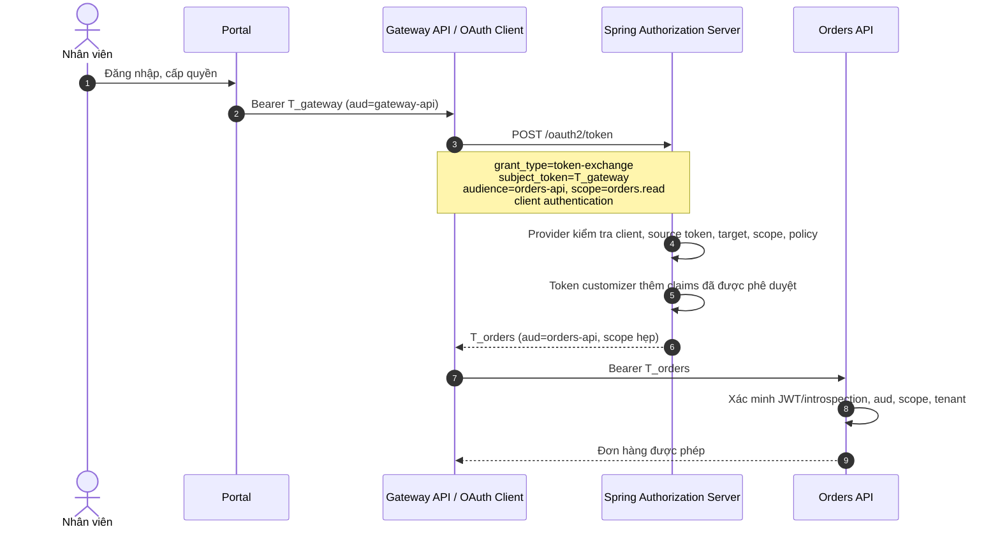
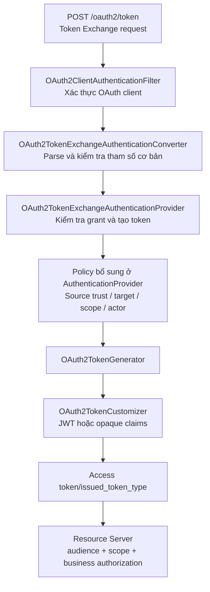
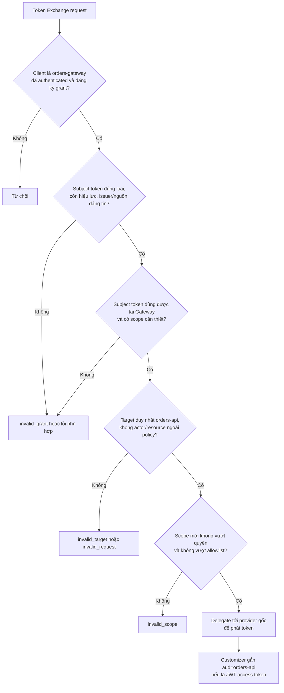

# Tùy chỉnh provider và token customizer cho yêu cầu Token Exchange

**OAuth 2.0 Token Exchange (RFC 8693)** cho phép một OAuth client trình một security token đang có để xin một token mới với **đối tượng nhận, quyền và ngữ cảnh thực thi** phù hợp hơn. Một tình huống phổ biến là API Gateway nhận access token từ người dùng rồi cần gọi dịch vụ Orders ở phía sau: thay vì chuyển nguyên token của Gateway sang Orders API, Gateway yêu cầu Authorization Server phát một token **dành riêng cho Orders API**, có scope nhỏ hơn và thời gian sống ngắn hơn.

Trong Spring Boot dùng **Spring Security** và **Spring Authorization Server**, tính năng này đi qua `/oauth2/token` với grant type `urn:ietf:params:oauth:grant-type:token-exchange`. Từ Spring Authorization Server 1.3, framework có `OAuth2TokenExchangeAuthenticationConverter` và `OAuth2TokenExchangeAuthenticationProvider` cho grant này. Tuy nhiên, **hỗ trợ giao thức không đồng nghĩa mọi hình thức ủy quyền giữa dịch vụ đều an toàn theo mặc định**. Các quyết định như client nào được đổi token, token nguồn nào được tin, audience đích nào được phép, scope nào có thể giữ lại, actor có được đại diện cho subject hay không vẫn cần được thiết kế và kiểm thử.

Bài thuộc chương **Token Exchange** của mô-đun **SPRING_SECURITY_OAUTH2_OIDC_AUTHORIZATION_SERVER**, phục vụ việc học cách thiết kế, cấu hình, bảo mật, kiểm thử và vận hành OAuth 2.0/OpenID Connect Authorization Server với Spring Security và Spring Authorization Server trong Spring Boot. Chủ đề trực tiếp là **tùy chỉnh AuthenticationProvider và OAuth2TokenCustomizer cho một yêu cầu Token Exchange** — hai điểm mở rộng có trách nhiệm khác nhau và không nên trộn lẫn.

> **Ranh giới kiến trúc:** Provider quyết định **có cho phép đổi token không và theo ngữ cảnh nào**; token customizer quyết định **biểu diễn các claims/header được phép của token mới**. Không dùng customizer để sửa một yêu cầu chưa được xác minh thành token có quyền rộng hơn.

## 1. Kịch bản: Gateway đổi token để gọi Orders API

Một nhân viên đã đăng nhập ứng dụng Portal bằng Authorization Code + PKCE. Portal gửi access token `T_gateway` đến **Gateway API**. Gateway cần gọi **Orders API** để đọc những đơn hàng được phép, nhưng token `T_gateway` có audience là `gateway-api`, **không dành cho Orders API**.

Gateway có thể đóng vai **OAuth confidential client** và yêu cầu Token Exchange:

1. Gateway xác thực client của chính nó tại Token Endpoint.
2. Gateway gửi `subject_token=T_gateway`, cho biết loại token và yêu cầu token cho `orders-api`.
3. Authorization Server xác minh token nguồn, client, scope, mục đích và policy chuyển tiếp.
4. Nếu được phép, Authorization Server phát `T_orders` với `aud=orders-api`, scope chỉ `orders.read` và TTL ngắn.
5. Gateway dùng `T_orders` khi gọi Orders API. Orders API kiểm tra issuer, audience, scope và quyền trên bản ghi.



**Không chuyển nguyên `T_gateway` đến Orders API** khi audience không phù hợp. Nếu Orders chấp nhận một token không dành cho mình chỉ vì chữ ký hợp lệ, hệ thống dễ gặp lỗi *confused deputy* hoặc token forwarding trái chính sách.

### 1.1. Exchange khác refresh hoặc client credentials

| Grant/cơ chế | Đầu vào | Đầu ra | Ý nghĩa |
|---|---|---|---|
| Authorization Code | Authorization code + PKCE/client auth | Access token, có thể ID/refresh token | Cấp quyền ban đầu sau tương tác người dùng |
| Refresh Token | Refresh token của authorization đã có | Access token mới | Gia hạn quyền tiếp tục theo chính sách |
| Client Credentials | Client authentication | Access token của workload | Không có subject người dùng cuối mặc định |
| **Token Exchange** | `subject_token`, optional `actor_token` + client authentication | Token mới phù hợp target/policy | Chuyển/thu hẹp ngữ cảnh sử dụng token |
| Token relay | Chuyển nguyên access token nguồn | Không tạo token mới | Chỉ phù hợp nếu Resource Server đích được phép nhận token nguồn |

**Token Exchange không phải refresh token có thêm `audience`.** RFC 8693 quy định một giao thức chuyển đổi token độc lập; không tự làm mất hiệu lực token đầu vào, không tự bảo đảm mọi token mới liên kết vòng đời với token nguồn và không tự tạo quyền thay mặt người dùng.

## 2. Các tham số RFC 8693 quan trọng khi tùy chỉnh

Request Token Exchange sử dụng `application/x-www-form-urlencoded` tại Token Endpoint:

```http
POST /oauth2/token HTTP/1.1
Host: login.example.com
Authorization: Basic <base64(gateway-client-id:client-secret)>
Content-Type: application/x-www-form-urlencoded

grant_type=urn%3Aietf%3Aparams%3Aoauth%3Agrant-type%3Atoken-exchange&
subject_token=<urlencoded-source-access-token>&
subject_token_type=urn%3Aietf%3Aparams%3Aoauth%3Atoken-type%3Aaccess_token&
requested_token_type=urn%3Aietf%3Aparams%3Aoauth%3Atoken-type%3Aaccess_token&
audience=orders-api&
scope=orders.read
```

Body đã chia dòng để dễ đọc; khi thực thi phải encode thành form body đúng chuẩn. Các placeholder không phải credential có thể sử dụng. Đối với confidential client, `Authorization: Basic` là xác thực **OAuth client đang thực hiện exchange**, khác với danh tính trong subject token.

| Tham số | Bắt buộc theo RFC? | Vai trò | Điều cần kiểm tra |
|---|---|---|---|
| `grant_type` | Có | Chọn Token Exchange Grant | Chính xác URN và client đã đăng ký grant |
| `subject_token` | Có | Token nguồn đại diện cho subject | Tính xác thực, issuer, audience, expiry, trạng thái, quyền |
| `subject_token_type` | Có | Loại token nguồn | Có hỗ trợ loại đó và validator tương ứng không? |
| `requested_token_type` | Không | Loại token muốn nhận | Nếu được yêu cầu, có nằm trong loại được phép phát? |
| `audience` | Không | Bên nhận dự kiến của token mới | Cho phép đúng target, không tin tùy ý |
| `resource` | Không | URI tài nguyên đích | Chống đổi token sang API ngoài allowlist |
| `scope` | Không | Scope token mới cần có | Không leo thang so với token nguồn/policy |
| `actor_token` | Không | Token nhận diện thực thể hành động thay subject | Kiểm tra actor và quan hệ ủy quyền |
| `actor_token_type` | Có khi có actor token | Loại token actor | Không thiếu/không xuất hiện vô cớ |

Có thể có nhiều `audience` hoặc `resource` theo RFC. Trong một sản phẩm chỉ cho phép **một** API đích, nên từ chối yêu cầu mơ hồ hoặc nhiều target thay vì âm thầm chọn một.

### 2.1. Hai URN dễ bị nhầm

```text
urn:ietf:params:oauth:token-type:access_token
urn:ietf:params:oauth:token-type:jwt
```

`access_token` nghĩa là **một OAuth access token**, có thể là JWT hoặc opaque đối với client. `jwt` nêu cụ thể **loại biểu diễn JWT**; nó không tự nói JWT đó dùng được như access token của issuer nội bộ. Token nguồn kiểu access token của chính Authorization Server và JWT assertion của một issuer ngoài cần **đường tin cậy/validation khác nhau**.

Không tự quyết định loại token chỉ bằng việc chuỗi có ba phần ngăn bởi dấu chấm. Cần kiểm tra đúng `subject_token_type` đã khai báo và áp cơ chế xác minh tương ứng.

### 2.2. RFC không tự quyết định hành vi impersonation/delegation

- **Impersonation:** token mới có ngữ cảnh subject, bên nhận có thể không biết có một tác nhân trung gian nếu chính sách không biểu diễn actor.
- **Delegation:** một tác nhân được phép hành động **thay** subject với ranh giới rõ ràng. RFC 8693 mô tả claim `act` để biểu diễn actor trong token phù hợp.
- **Downscoping:** token mới có audience/scope hẹp hơn; không tự chứng minh có ủy quyền đại diện nếu không xác minh quan hệ giữa client và subject.

**Không tự copy `sub` rồi thêm `act` từ chuỗi `actor_token` chưa được xác minh.** Actor phải được xác thực và được phép đại diện cho subject, và Resource Server phải hiểu/phân quyền theo ngữ cảnh đó.

## 3. Phân chia trách nhiệm giữa converter, provider và customizer



Sơ đồ biểu diễn các **trách nhiệm**, không phải lời khẳng định customizer là bước kiểm tra quyền diễn ra độc lập sau provider. Provider xây token context, gọi generator; customizer được **generator** gọi trong quá trình phát token. Policy phải được kiểm tra **trước** khi generator tạo token, không chỉ “gắn claim cho đẹp”.

| Lớp | Có nên làm ở đây? | Không nên làm |
|---|---|---|
| `AuthenticationConverter` | Đọc `grant_type`, `subject_token`, type, `resource`/`audience`/`scope` thành token request | Ra quyết định cuối cùng về quyền hoặc tin raw token |
| `AuthenticationProvider` | Xác minh grant, source token, client, actor, target và policy; chỉ trả thành công khi được phép | Bỏ qua validation vì client đã authenticated |
| `OAuth2TokenGenerator` | Tạo access token theo token context/token settings | Cấp scope mới từ raw query ngoài policy |
| `OAuth2TokenCustomizer<JwtEncodingContext>` | Thêm/sửa JWT claims/header dựa trên **ngữ cảnh đã được phép** | Coi `getAuthorizationGrant()` chứa token chưa kiểm tra là bằng chứng để tăng quyền |
| `OAuth2TokenCustomizer<OAuth2TokenClaimsContext>` | Bổ sung claims của opaque access token | Tự phát JWT hoặc thay provider |
| Resource Server | Xác minh token mới đúng API đích và object-level authorization | Tin mọi token từ issuer bất kể audience |

### 3.1. Những thành phần mặc định của Spring

Từ Spring Authorization Server 1.3, `OAuth2TokenEndpointFilter` cấu hình mặc định:

- `OAuth2TokenExchangeAuthenticationConverter` để đọc Token Exchange request;
- `OAuth2TokenExchangeAuthenticationProvider` để xử lý grant;
- `OAuth2AccessTokenResponseAuthenticationSuccessHandler` và `OAuth2ErrorAuthenticationFailureHandler` để trả HTTP/OAuth response.

Provider mặc định **không cần viết lại** nếu chính sách hệ thống phù hợp khả năng của nó. Nên bắt đầu bằng test các hành vi mặc định của phiên bản đã khóa trước khi quyết định thêm logic.

**Quan trọng về API:** `OAuth2TokenExchangeAuthenticationProvider` là lớp `final` ở dòng Spring Authorization Server 1.5.x; API public có constructor và phương thức `authenticate()/supports()`, **không có `setAuthenticationValidator(...)` như provider Client Credentials**. Muốn áp thêm policy trước xử lý, có thể **bọc provider**, hoặc thay bằng provider tự triển khai có kiểm thử toàn diện. Không viết ví dụ gọi setter không tồn tại.

## 4. Thiết kế chính sách Token Exchange trước khi viết code

Giả sử chính sách sản phẩm rất hẹp:

- Chỉ confidential client `orders-gateway` được gọi Token Exchange.
- `subject_token` phải là **access token còn hiệu lực được Authorization Server hiện tại biết đến**, không phải JWT tự xưng từ issuer bên ngoài.
- Token nguồn phải **dành cho Gateway API** (`aud=gateway-api`) và có scope `orders.read`.
- Chỉ xin target `audience=orders-api`; không cho `resource` khác hoặc nhiều audience.
- Chỉ phát `requested_token_type=access_token`, không chấp nhận actor token ở giai đoạn này.
- Scope xin phải đúng `orders.read` (hoặc tập con theo chính sách), không được tự cấp `orders.write`.
- Token mới có `aud=orders-api`, TTL ngắn và chỉ được Orders API sử dụng.



Thiết kế trên là **một policy ví dụ**, không phải quy tắc chung áp cho mọi deployment. Nếu doanh nghiệp cho phép actor, external issuer hoặc nhiều resource, cần mở rộng cả validation lẫn mô hình claims; không chỉ mở allowlist request.

### 4.1. Quy tắc ít quyền nhất

Một exchange không nên tự nâng quyền:

```text
scope_issued ⊆ scope_subject_token ∩ scope_client_registered ∩ scope_target_policy
```

Đây là **chính sách khuyến nghị cho kịch bản downscoping**, không phải công thức bắt buộc của mọi Token Exchange profile. Nếu một use case cho phép biến đổi quyền theo mapping nghiệp vụ, việc tăng hoặc chuyển đổi quyền phải dựa trên quyết định tin cậy có thể kiểm toán, không chỉ trên request tự khai báo.

**Audience đầu vào** và **audience đầu ra** cũng phải được xác minh riêng. Một token nguồn dành cho `billing-api` không được tự đổi thành token Orders chỉ vì caller gửi `audience=orders-api`.

## 5. Đăng ký một client được phép thực hiện Token Exchange

`RegisteredClient` phải khai báo grant mới. Ví dụ dùng confidential client, client secret lấy từ kho an toàn:

```java
package example.authorizationserver.config;

import java.time.Duration;

import org.springframework.security.oauth2.core.AuthorizationGrantType;
import org.springframework.security.oauth2.core.ClientAuthenticationMethod;
import org.springframework.security.oauth2.server.authorization.client.RegisteredClient;
import org.springframework.security.oauth2.server.authorization.settings.TokenSettings;

RegisteredClient gateway = RegisteredClient.withId("orders-gateway-registration")
        .clientId("orders-gateway")
        .clientSecret(passwordEncoder.encode(gatewaySecret))
        .clientAuthenticationMethod(
                ClientAuthenticationMethod.CLIENT_SECRET_BASIC)
        .authorizationGrantType(AuthorizationGrantType.TOKEN_EXCHANGE)
        .scope("orders.read")
        .tokenSettings(TokenSettings.builder()
                .accessTokenTimeToLive(Duration.ofMinutes(3))
                .build())
        .build();
```

Đoạn trên minh họa builder và giả định `passwordEncoder`, `gatewaySecret` đã được cung cấp từ cấu hình bảo mật. Nó không phải một class Java có thể chạy độc lập: khai báo phải được đặt trong phương thức và đăng ký qua `RegisteredClientRepository`. `AuthorizationGrantType.TOKEN_EXCHANGE` có trong Spring Security 6.3+ (tương ứng giai đoạn Spring Authorization Server 1.3+); với dependency khác phải kiểm tra API thực tế.

Không cần `redirect_uri` cho Token Exchange thuần back-channel, vì không chạy flow chuyển hướng trình duyệt. Không dùng `ClientAuthenticationMethod.NONE` cho backend có thể bảo vệ credential khi hệ thống cần kiểm soát workload. Phân tách `orders-gateway` khỏi các OAuth client khác để giới hạn quyền, rotation và audit.

### 5.1. Ba danh tính khác nhau

- **Client đang đổi token**: `orders-gateway`, được xác thực tại Token Endpoint bằng credential của Gateway.
- **Subject của token nguồn**: có thể là người dùng `user-123` hoặc workload đã được xác thực trong authorization gốc.
- **Actor** (nếu có): thực thể đại diện cho subject theo chính sách delegation.

Đừng lấy `client.getClientId()` và gán làm `sub` của token mới chỉ vì client thực hiện exchange. Làm vậy có thể đánh mất user subject; ngược lại, không được giả định mọi exchange có subject người dùng khi token nguồn thuộc một workload.

## 6. Tùy chỉnh provider đúng extension point

Spring Authorization Server cho phép truy cập danh sách các `AuthenticationProvider` đang được cấu hình tại `OAuth2TokenEndpointConfigurer.authenticationProviders(...)`. Đây là điểm để **tìm và thay thế** provider Token Exchange bằng wrapper có chính sách.

### 6.1. Vì sao không chỉ .authenticationProvider(newProvider)?

Nếu gọi:

```java
tokenEndpoint.authenticationProvider(customProvider);
```

thì đây là thao tác **thêm** provider. Khi một provider mặc định **cũng hỗ trợ `OAuth2TokenExchangeAuthenticationToken`** và được thử trước, request có thể đã được xử lý thành công **mà không đi qua policy mới**. Không nên dựa vào thứ tự provider mơ hồ khi cấu hình giới hạn bảo mật.

Thay vào đó, truy cập danh sách defaults và **thay provider tương ứng tại chỗ**:

```java
@Bean
@Order(1)
SecurityFilterChain authorizationServerSecurityFilterChain(
        HttpSecurity http,
        OAuth2AuthorizationService authorizations) throws Exception {

    OAuth2AuthorizationServerConfigurer as =
            OAuth2AuthorizationServerConfigurer.authorizationServer();

    http
        .securityMatcher(as.getEndpointsMatcher())
        .with(as, server -> server
            .tokenEndpoint(tokenEndpoint -> tokenEndpoint
                .authenticationProviders(providers -> {
                    boolean replaced = false;

                    for (int i = 0; i < providers.size(); i++) {
                        AuthenticationProvider current = providers.get(i);

                        if (current instanceof OAuth2TokenExchangeAuthenticationProvider) {
                            providers.set(i, new GuardedTokenExchangeProvider(
                                    current, authorizations));
                            replaced = true;
                        }
                    }

                    if (!replaced) {
                        throw new IllegalStateException(
                            "Không tìm thấy provider Token Exchange mặc định");
                    }
                })))
        .authorizeHttpRequests(authorize -> authorize
            .anyRequest().authenticated());

    return http.build();
}
```

Các import của Spring Security/Spring Authorization Server và các bean nền tảng đã được lược bỏ; ví dụ dùng để minh họa **cấu hình provider list**. `GuardedTokenExchangeProvider` được định nghĩa ở mục tiếp theo.

**Đặc tính đáng chú ý:** `OAuth2TokenExchangeAuthenticationProvider` là `final` nên không thể kế thừa để override `authenticate`. Bọc nó bằng một `AuthenticationProvider` riêng giúp giữ lại hành vi mặc định ở phần xử lý grant sau khi chính sách bổ sung đã duyệt.

Không đăng ký thêm một provider cùng loại mà không bảo đảm provider mặc định đã bị loại/thay thế. Đặt unit/integration test xác nhận request không hợp lệ **thật sự** đi qua guard và bị từ chối.

### 6.2. Wrapper giới hạn client, token nguồn và target

Ví dụ dưới đây áp dụng **chính sách rất hẹp ở mục 4**: chỉ `orders-gateway`, subject token thuộc authorization store nội bộ, đúng audience và scope. Với external JWT hoặc actor token, request bị từ chối thay vì tự đoán cách xác minh.

```java
package example.authorizationserver.security;

import java.util.Collection;
import java.util.Map;
import java.util.Set;

import org.springframework.security.authentication.AuthenticationProvider;
import org.springframework.security.core.Authentication;
import org.springframework.security.oauth2.core.AuthorizationGrantType;
import org.springframework.security.oauth2.core.OAuth2ErrorCodes;
import org.springframework.security.oauth2.core.OAuth2TokenType;
import org.springframework.security.oauth2.core.OAuth2AuthenticationException;
import org.springframework.security.oauth2.server.authorization.OAuth2Authorization;
import org.springframework.security.oauth2.server.authorization.OAuth2AuthorizationService;
import org.springframework.security.oauth2.server.authorization.authentication.OAuth2ClientAuthenticationToken;
import org.springframework.security.oauth2.server.authorization.authentication.OAuth2TokenExchangeAuthenticationToken;
import org.springframework.security.oauth2.server.authorization.client.RegisteredClient;

public final class GuardedTokenExchangeProvider implements AuthenticationProvider {

    private static final String ACCESS_TOKEN_TYPE =
            "urn:ietf:params:oauth:token-type:access_token";

    private final AuthenticationProvider delegate;
    private final OAuth2AuthorizationService authorizations;

    public GuardedTokenExchangeProvider(
            AuthenticationProvider delegate,
            OAuth2AuthorizationService authorizations) {
        this.delegate = delegate;
        this.authorizations = authorizations;
    }

    @Override
    public boolean supports(Class<?> authentication) {
        return delegate.supports(authentication);
    }

    @Override
    public Authentication authenticate(Authentication authentication) {
        if (!(authentication instanceof OAuth2TokenExchangeAuthenticationToken request)) {
            return null;
        }

        if (!(request.getPrincipal() instanceof OAuth2ClientAuthenticationToken client)
                || !client.isAuthenticated()
                || client.getRegisteredClient() == null) {
            throw deny(OAuth2ErrorCodes.INVALID_CLIENT);
        }

        RegisteredClient registered = client.getRegisteredClient();

        if (!"orders-gateway".equals(registered.getClientId())
                || !registered.getAuthorizationGrantTypes().contains(
                        AuthorizationGrantType.TOKEN_EXCHANGE)) {
            throw deny(OAuth2ErrorCodes.UNAUTHORIZED_CLIENT);
        }

        // Kịch bản này chỉ nhận access token của chính AS.
        if (!ACCESS_TOKEN_TYPE.equals(request.getSubjectTokenType())
                || (request.getRequestedTokenType() != null
                        && !ACCESS_TOKEN_TYPE.equals(request.getRequestedTokenType()))) {
            throw deny(OAuth2ErrorCodes.INVALID_REQUEST);
        }

        // Actor token và resource URI không nằm trong profile của demo.
        if (request.getActorToken() != null
                || request.getActorTokenType() != null
                || !request.getResources().isEmpty()) {
            throw deny(OAuth2ErrorCodes.INVALID_REQUEST);
        }

        if (!request.getAudiences().equals(Set.of("orders-api"))) {
            // RFC 8693 có lỗi invalid_target cho target không hợp lệ.
            throw deny("invalid_target");
        }

        Set<String> requestedScopes = request.getScopes();
        if (!requestedScopes.equals(Set.of("orders.read"))
                || !registered.getScopes().containsAll(requestedScopes)) {
            throw deny(OAuth2ErrorCodes.INVALID_SCOPE);
        }

        // Chỉ tin access token hiện diện và còn active trong store nội bộ.
        OAuth2Authorization source = authorizations.findByToken(
                request.getSubjectToken(), OAuth2TokenType.ACCESS_TOKEN);

        if (source == null || source.getAccessToken() == null
                || !source.getAccessToken().isActive()) {
            throw deny(OAuth2ErrorCodes.INVALID_GRANT);
        }

        if (!source.getAccessToken().getToken().getScopes()
                .containsAll(requestedScopes)) {
            throw deny(OAuth2ErrorCodes.INVALID_SCOPE);
        }

        Map<String, Object> claims = source.getAccessToken().getClaims();
        Object rawAudience = claims != null ? claims.get("aud") : null;

        if (!(rawAudience instanceof Collection<?> audience)
                || !audience.contains("gateway-api")) {
            throw deny(OAuth2ErrorCodes.INVALID_GRANT);
        }

        // Giữ nguyên các kiểm tra của provider Spring Authorization Server.
        return delegate.authenticate(authentication);
    }

    private static OAuth2AuthenticationException deny(String code) {
        return new OAuth2AuthenticationException(code);
    }
}
```

**Đây là mẫu hạn chế chức năng để học và kiểm thử, không phải một policy engine hoàn chỉnh.** Mã đòi hỏi input access token đã được Authorization Server này lưu trong `OAuth2AuthorizationService` và có claim `aud` trong metadata. Nếu application phát opaque token không lưu claim audience hoặc cấu hình issuer khác, cần thiết kế lại cách lấy thông tin tin cậy; **không bỏ kiểm tra `aud` chỉ để test qua**.

**Ranh giới bảo mật của ví dụ:**

- Không tự parse JWT qua Base64URL rồi coi claims là tin cậy.
- Không chấp nhận `actor_token` khi chưa có quy trình xác minh/ủy quyền delegation.
- Không chấp nhận `resource` hoặc nhiều target chưa được sản phẩm hỗ trợ.
- Không cho caller tăng scope vượt token nguồn.
- Dùng nguồn sự thật `OAuth2AuthorizationService`, kiểm tra token active và delegated provider.
- Chỉ cho đúng một client đổi token sang đúng một API theo policy cứng của demo.

Ngoài ra, production còn cần kiểm tra **authorization của caller đối với token nguồn**, subject/tenant, khả năng chuyển tiếp token cho client này, token binding, TTL/absolute lifetime và policy thu hồi. Chỉ sở hữu một token nguồn và có client credential không phải bằng chứng cho phép impersonate bất kỳ subject nào.

### 6.3. Validation khi token nguồn là JWT của issuer ngoài

Wrapper ví dụ **không hỗ trợ** việc đem một JWT từ issuer ngoài đổi token tại Authorization Server nội bộ. Nếu cần federated exchange, phải bổ sung bước **xác minh token nguồn riêng**:

1. Chỉ tin issuer rõ ràng trong allowlist, kiểm tra chữ ký theo JWKS đáng tin.
2. Giới hạn thuật toán và khóa, kiểm tra `iss`, `aud`, `exp`, `nbf` và loại token.
3. Kiểm tra revocation/introspection nếu nguồn hỗ trợ và use case cần.
4. Chuẩn hóa subject/tenant và các claim được phép chuyển tiếp.
5. Kiểm tra quyền client thực hiện exchange từ nguồn này sang target này.
6. Sinh token mới từ **facts đã xác minh**, không từ raw payload.
7. Thiết kế đặc biệt nếu cần bridging giữa identity providers, tránh nhầm JWT assertion với OAuth access token.

Không thay thế các bước trên bằng `JwtDecoder` cấu hình nguồn khóa của chính Authorization Server nếu JWT **do issuer khác phát hành**. Việc framework có `OAuth2TokenExchangeAuthenticationToken.getSubjectTokenType()` không làm JWT từ mọi issuer tự trở nên đáng tin.

## 7. Token customizer: làm đúng phần việc tạo claims

### 7.1. JWT access token: OAuth2TokenCustomizer<JwtEncodingContext>

Khi `RegisteredClient.tokenSettings.accessTokenFormat` là `SELF_CONTAINED` và `JwtGenerator` được cấu hình, `JwtEncodingContext` cho phép chỉnh claims và JWS headers của JWT **trước khi ký**.

Trong policy hẹp ở mục 4 và wrapper đã giới hạn chỉ `orders-gateway` → `orders-api`, một customizer an toàn có thể phát hành JWT với audience cố định:

```java
package example.authorizationserver.config;

import java.util.List;

import org.springframework.context.annotation.Bean;
import org.springframework.context.annotation.Configuration;
import org.springframework.security.oauth2.core.AuthorizationGrantType;
import org.springframework.security.oauth2.core.OAuth2TokenType;
import org.springframework.security.oauth2.server.authorization.token.JwtEncodingContext;
import org.springframework.security.oauth2.server.authorization.token.OAuth2TokenCustomizer;

@Configuration(proxyBeanMethods = false)
public class ExchangeJwtClaimsConfiguration {

    @Bean
    OAuth2TokenCustomizer<JwtEncodingContext> tokenExchangeJwtCustomizer() {
        return context -> {
            if (!AuthorizationGrantType.TOKEN_EXCHANGE.equals(
                    context.getAuthorizationGrantType())) {
                return;
            }
            if (!OAuth2TokenType.ACCESS_TOKEN.equals(context.getTokenType())) {
                return;
            }
            if (!"orders-gateway".equals(
                    context.getRegisteredClient().getClientId())) {
                return;
            }

            // Provider policy trước đó chỉ cho target orders-api.
            context.getClaims().audience(List.of("orders-api"));
            context.getClaims().claim("token_use", "exchanged_access");
        };
    }
}
```

**Điều kiện quan trọng:** Đây là **một customizer dành cho một profile đã được provider duyệt**. Nó gắn `aud` theo chính sách cố định, không viết `context.getClaims().audience(request.getAudiences())` từ request chưa được xác minh. Nếu client có nhiều target hợp lệ, provider nên ra quyết định target cụ thể và chuyển nó thành một **policy decision tin cậy** để generator/customizer sử dụng, thay vì đọc raw parameter ở cuối.

Không tự gán `sub` bằng `client_id` hay “copy” `act` từ request. Cần xác minh sự liên hệ giữa subject/actor/target qua provider và kiểm tra emitted claims bằng integration test.

### 7.2. Opaque access token: OAuth2TokenCustomizer<OAuth2TokenClaimsContext>

Nếu `TokenSettings.getAccessTokenFormat()` là `OAuth2TokenFormat.REFERENCE`, access token thường là opaque; `JwtEncodingContext` **không xử lý token đó**. Có thể dùng customizer dành cho `OAuth2AccessTokenGenerator`:

```java
@Bean
OAuth2TokenCustomizer<OAuth2TokenClaimsContext> tokenExchangeOpaqueCustomizer() {
    return context -> {
        if (!AuthorizationGrantType.TOKEN_EXCHANGE.equals(
                context.getAuthorizationGrantType())
                || !OAuth2TokenType.ACCESS_TOKEN.equals(
                        context.getTokenType())) {
            return;
        }

        if (!"orders-gateway".equals(
                context.getRegisteredClient().getClientId())) {
            return;
        }

        // Opaque token có claims lưu server-side để introspection dùng.
        context.getClaims().claim("aud", List.of("orders-api"));
        context.getClaims().claim("token_use", "exchanged_access");
    };
}
```

Đoạn trên cần đặt trong cấu hình class với import `java.util.List`, `OAuth2TokenClaimsContext` và `OAuth2TokenCustomizer`. Khi token opaque, Resource Server phải có cách **lấy và kiểm tra audience** thông qua introspection/metadata tin cậy; API không thể tự parse một chuỗi opaque để đọc claims.

### 7.3. Khi nào bean customizer tự được áp dụng?

Trong cấu hình mặc định mà bạn **không tự đăng ký `OAuth2TokenGenerator`**:

- Bean `OAuth2TokenCustomizer<JwtEncodingContext>` được framework gắn vào `JwtGenerator` khi có JWT generator phù hợp.
- Bean `OAuth2TokenCustomizer<OAuth2TokenClaimsContext>` được gắn vào `OAuth2AccessTokenGenerator` cho opaque access token.

Nếu bạn tự tạo `DelegatingOAuth2TokenGenerator` hoặc các generator riêng, phải **gắn các customizer tường minh** vào generator đúng loại. Đăng ký bean customizer rồi tự thay toàn bộ token generator nhưng quên wiring có thể khiến claim `aud` không được thêm như mong đợi.

Khi đã có customizer khác cho JWT, không khai báo nhiều bean không được phối hợp mà giả định tất cả sẽ tự hợp nhất. Xây một customizer tổng hợp hoặc một cách hợp nhất rõ ràng, chú ý không ghi đè claims bảo mật của nhau.

### 7.4. Ví dụ wiring thủ công với token generator

```java
@Bean
OAuth2TokenGenerator<?> tokenGenerator(
        JwtEncoder jwtEncoder,
        OAuth2TokenCustomizer<JwtEncodingContext> jwtCustomizer,
        OAuth2TokenCustomizer<OAuth2TokenClaimsContext> opaqueCustomizer) {

    JwtGenerator jwtGenerator = new JwtGenerator(jwtEncoder);
    jwtGenerator.setJwtCustomizer(jwtCustomizer);

    OAuth2AccessTokenGenerator accessTokenGenerator =
            new OAuth2AccessTokenGenerator();
    accessTokenGenerator.setAccessTokenCustomizer(opaqueCustomizer);

    OAuth2RefreshTokenGenerator refreshTokenGenerator =
            new OAuth2RefreshTokenGenerator();

    return new DelegatingOAuth2TokenGenerator(
            jwtGenerator, accessTokenGenerator, refreshTokenGenerator);
}
```

Đây là phương án **khi thật sự cần custom token generator**, không phải bước bắt buộc bên cạnh cơ chế autoconfiguration. `JwtEncoder` phải được cấu hình với khóa ký phù hợp; cần thêm imports từ `org.springframework.security.oauth2.server.authorization.token` và `org.springframework.security.oauth2.jwt`. Nếu thay generator, phải chạy regression test cho các grant khác (`authorization_code`, `refresh_token`, `client_credentials`...) để tránh ảnh hưởng ngoài ý muốn.

## 8. Tại sao customizer không đủ để bảo vệ Token Exchange?

Một anti-pattern:

```java
// KHÔNG AN TOÀN nếu không có policy đã xác minh ở provider:
return context -> {
    if (AuthorizationGrantType.TOKEN_EXCHANGE.equals(
            context.getAuthorizationGrantType())) {
        OAuth2TokenExchangeAuthenticationToken request =
                context.getAuthorizationGrant();

        context.getClaims().audience(
                List.copyOf(request.getAudiences()));
        context.getClaims().claim("scope",
                String.join(" ", request.getScopes()));
    }
};
```

Nguy cơ: request có thể chứa `audience=billing-admin-api` và `scope=payments.write`. Nếu customizer trực tiếp sao chép giá trị vào token mà không có quyết định cấp quyền đáng tin từ provider, đó là **sự leo thang quyền qua token generation**. Cũng không thể coi `getAuthorizationGrant()` trong customizer là bằng chứng rằng mọi trường của request đã được kiểm tra đúng với policy sản phẩm.

**Thiết kế đúng:**

- Provider kiểm tra client, subject token, actor, target, scope và authorization.
- Context của generator chỉ chứa `authorizedScopes` và thông tin đáng tin được provider cho phép.
- Customizer thêm claims từ **trusted policy decision**, không tự ra quyết định ủy quyền mới.
- Resource Server từ chối token không dành cho mình hoặc không đủ quyền nghiệp vụ.

### 8.1. Nên đưa gì vào token đầu ra?

Tùy loại token và policy, các claims có thể gồm:

| Claim | Ý nghĩa | Nguồn sự thật |
|---|---|---|
| `iss` | Authorization Server phát token | Issuer cấu hình |
| `sub` | Chủ thể token đại diện | Subject đã được xác minh/ủy quyền |
| `aud` | Resource Server dự kiến | Quyết định target đã qua provider policy |
| `scope`/`scp` | Quyền được cấp | Tập scope đã thẩm định, không vượt quyền |
| `exp`/`iat` | Thời hạn token mới | Token settings và giới hạn bổ sung |
| `jti` | Định danh token mới | Token generator, nếu dùng |
| `client_id`/`azp` | Định danh client theo profile | Đăng ký/client context đã xác thực |
| `act` | Actor thực hiện thay subject | Actor token đã xác minh và delegation policy |
| `token_use` | Nhãn nội bộ minh họa loại token | Policy của sản phẩm |

Không tự thêm claim `may_act` hoặc `act` để “hợp thức hóa” một quan hệ delegation chưa được kiểm tra. Không đưa toàn bộ claims nguồn, group, email, tenant list hoặc các thông tin cá nhân không cần thiết vào token mới.

### 8.2. TTL đầu ra và vòng đời token nguồn

Token Exchange theo RFC 8693 không tự khiến token nguồn hết hiệu lực. Token mới cũng không mặc nhiên chết cùng token nguồn nếu nguồn bị revoke sau đó. Với hệ thống nhạy cảm, cân nhắc:

```text
expiresAt_issued = min(
    now + target_access_token_TTL,
    expiresAt_subject_token,
    absolute_authorization_limit
)
```

Đây là **một chính sách thiết kế khuyến nghị**, không phải behavior mặc định được bảo đảm bởi `TokenSettings`. Nếu muốn hạn expiry token mới theo token nguồn, phải triển khai/enforce bằng extension point phù hợp và test rõ ràng. Đổi claims `exp` bừa bãi ở customizer mà không bảo đảm token model, persistence và provider đồng bộ có thể gây bất nhất.

Khi subject token bị thu hồi sau exchange, cần một chính sách riêng cho token đã phát: TTL ngắn, introspection, lưu quan hệ provenance, event-driven revocation hoặc cơ chế phù hợp. Không quảng cáo rằng token đầu ra tự bị revoke theo nguồn chỉ vì dùng RFC 8693.

## 9. Xử lý actor_token và delegation khi mở rộng use case

Kịch bản ban đầu không nhận actor token. Nếu yêu cầu mới là “Billing Worker hành động thay user để gọi Orders API”, cần thiết kế:

1. Xác thực **actor token** theo `actor_token_type`: issuer, chữ ký, `aud`, expiry, revocation.
2. Xác minh actor được phép thực hiện yêu cầu trên behalf of subject — ví dụ policy dựa vào quan hệ tin cậy, resource/tenant, `may_act` hoặc hệ thống ủy quyền riêng.
3. Đảm bảo requested target và scope được chấp thuận cho cả subject và actor theo policy.
4. Tạo token đầu ra biểu diễn rõ `sub` và `act`, ví dụ `act.sub` là actor ID khi profile cho phép.
5. Resource Server xử lý `act` và giới hạn quyền phù hợp; không coi nó chỉ là nhãn log.
6. Kiểm tra chain delegation nếu actor có thể tiếp tục token exchange ở những tầng sau.

Ví dụ claims **minh họa** cho một token delegation đã được policy duyệt:

```json
{
  "iss": "https://login.example.com",
  "sub": "user-123",
  "aud": ["orders-api"],
  "scope": "orders.read",
  "act": {
    "sub": "billing-worker"
  },
  "token_use": "exchanged_access"
}
```

Không coi JSON này là JWT hoàn chỉnh hoặc mẫu luôn phải phát. `act` có thể có nested actor claims trong chuỗi delegation theo RFC 8693. Không được thêm `act` chỉ bằng cách lấy `actor_token` và giải mã payload mà không xác minh chữ ký/trust.

### 9.1. External JWT subject/actor

Khi token nguồn đến từ IdP bên ngoài, cần nêu rõ trust boundary: issuer đáng tin, đối tượng nhận, token type, signature algorithm, JWK rotation, subject mapping và cross-tenant rules. Việc nhận một JWT hợp lệ **chưa đủ** để tin rằng client có quyền đổi nó sang access token của issuer nội bộ. Đây là nguy cơ **token laundering** nếu AS không kiểm soát.

### 9.2. Impersonation không giống delegation

Ở impersonation, Resource Server có thể chỉ thấy subject. Ở delegation, Resource Server có thể cần biết actor nào đã hành động thay subject để ghi audit/phân quyền. Bất kể hình thức, phải có quyết định ủy quyền rõ ràng trước khi tạo token. Không dùng claim `act` như một phép “chuyển quyền tự động”.

## 10. Ví dụ HTTP và cách đọc response

### 10.1. Exchange request hợp lệ theo profile ví dụ

```bash
curl --request POST "https://login.example.com/oauth2/token" \
  --user "$GATEWAY_CLIENT_ID:$GATEWAY_CLIENT_SECRET" \
  --header "Content-Type: application/x-www-form-urlencoded" \
  --data-urlencode "grant_type=urn:ietf:params:oauth:grant-type:token-exchange" \
  --data-urlencode "subject_token=$GATEWAY_ACCESS_TOKEN" \
  --data-urlencode "subject_token_type=urn:ietf:params:oauth:token-type:access_token" \
  --data-urlencode "requested_token_type=urn:ietf:params:oauth:token-type:access_token" \
  --data-urlencode "audience=orders-api" \
  --data-urlencode "scope=orders.read"
```

Lệnh giả định **confidential client đã đăng ký Token Exchange**, subject token phù hợp policy và audience gốc `gateway-api`. Không log tham số token hoặc client secret trong terminal/CI/APM; `curl --user` cũng có thể làm credential xuất hiện trong thông tin tiến trình theo môi trường.

### 10.2. Response token theo RFC 8693

Ví dụ:

```json
{
  "access_token": "<exchanged-access-token>",
  "issued_token_type": "urn:ietf:params:oauth:token-type:access_token",
  "token_type": "Bearer",
  "expires_in": 180,
  "scope": "orders.read"
}
```

`issued_token_type` nêu loại security token được phát; `token_type` mô tả cách trình token khi gọi API, chẳng hạn Bearer. Không nhầm `issued_token_type` với `subject_token_type`. Response không có nghĩa API sẽ tự tin token: Orders API còn phải kiểm tra audience, signature/introspection, expiry và permission.

### 10.3. Một số lỗi cần nhận diện

| Trường hợp | Lỗi thường gặp | Bảo đảm cần có |
|---|---|---|
| Client authentication sai | `invalid_client` | Không phát token, không lộ secret |
| Client không có grant Token Exchange | `unauthorized_client` | Grant allowlist được thực thi |
| Thiếu `subject_token`/type | `invalid_request` | Không tạo context rỗng để cấp token |
| Token nguồn sai/expired/revoked | `invalid_grant` hoặc lỗi tương ứng policy | Không phát token |
| Audience/resource target không được phép | `invalid_target` theo RFC 8693 | Không nhận target do caller tự chọn |
| Scope vượt quyền/không hợp lệ | `invalid_scope` | Không tăng quyền |
| Actor không được hỗ trợ | `invalid_request` hoặc lỗi phù hợp | Không tự nhận actor chưa xác minh |
| Requested token type không được hỗ trợ | `invalid_request`/`unsupported_token_type` tùy profile | Không phát loại token ngoài policy |
| Provider/customizer bị bỏ qua | Token vẫn phát nhưng thiếu aud/policy | Test wiring và đóng ứng dụng khi thiếu guard |

Mã lỗi cụ thể phụ thuộc điểm phát hiện, converter/provider và phiên bản. **Không viết test rằng mọi lỗi đều có cùng HTTP body**, nhưng phải assert **không phát access token khi request không hợp lệ**.

## 11. Kiểm thử: không chỉ kiểm tra token có thêm claim

### 11.1. Ma trận bảo mật cho provider

| Test case | Input/điều kiện | Kỳ vọng |
|---|---|---|
| Happy path | Gateway được phép, source active, audience/scope đúng | Cấp token mới đúng target |
| Không có client auth | Request không xác thực client | Từ chối |
| Client sai grant | Client không đăng ký `TOKEN_EXCHANGE` | Từ chối |
| Client khác Gateway | `client_id` không nằm trong policy | Từ chối |
| Subject token không tồn tại | Token không có trong trusted authorization store | Từ chối |
| Subject token expired | `OAuth2Authorization.Token.isActive()` false | Từ chối |
| Subject token revoked | Đã invalidated | Từ chối |
| Subject audience sai | `aud=billing-api` thay vì `gateway-api` | Từ chối |
| Subject scopes thiếu | Không có `orders.read` | Từ chối |
| Scope xin vượt | `orders.write`/`payments.admin` | Từ chối |
| Target audience khác | `audience=admin-api` | `invalid_target` hoặc lỗi phù hợp |
| Nhiều audience | `orders-api` + `payments-api` | Từ chối theo policy một target |
| Resource không được hỗ trợ | Gửi `resource=...` | Từ chối |
| Actor chưa hỗ trợ | Có `actor_token` | Từ chối |
| Subject type lạ | `subject_token_type=jwt` trong profile chỉ access token | Từ chối |
| Requested type lạ | Token type ngoài allowlist | Từ chối |
| Token nguồn của client khác | Không có bằng chứng chuyển tiếp phù hợp | Từ chối theo policy bổ sung |
| Đồng thời/replay | Cùng source token đổi nhiều lần khi policy giới hạn | Không vượt quota/quyền |
| Token input bị thu hồi sau exchange | Thử dùng token đầu ra sau revocation | Hành vi đúng chính sách revocation đã thiết kế |

**Test một mình wrapper** chưa đủ, vì provider gốc còn kiểm tra các điều kiện grant và persistence. **Test một mình customizer** cũng chưa đủ, vì customizer có thể bổ sung `aud` cho một token mà server **không nên phát**.

### 11.2. Kiểm thử claims của JWT đầu ra

Với JWT access token:

1. Decode bằng public key/JWKS phù hợp và xác minh chữ ký.
2. Assert `iss` là Authorization Server dự kiến.
3. Assert `aud` chỉ chứa `orders-api` trong profile này.
4. Assert token có `orders.read` và không chứa `orders.write`.
5. Assert `exp` phù hợp TTL đã đăng ký và không dài quá policy đặc biệt nếu đã triển khai.
6. Assert `sub` đại diện đúng subject đã được cấp phép, không bị thay bằng tên client tùy tiện.
7. Assert `act` vắng mặt trong profile không hỗ trợ actor, hoặc có dữ liệu actor đã xác minh khi profile tương ứng được bật.
8. Assert `token_use` chỉ là nhãn; Resource Server vẫn thực thi kiểm tra thật.

Với opaque token, không assert payload JWT: dùng introspection hoặc token metadata từ authorization store, và đảm bảo Resource Server kiểm tra claims trả về qua trust channel phù hợp.

### 11.3. Kiểm thử việc thay provider thật sự có tác dụng

Một regression test quan trọng: gửi Token Exchange request với client khác `orders-gateway` nhưng có `subject_token` hoàn toàn hợp lệ. Nếu vẫn nhận token, wrapper **không được áp dụng** hoặc policy bị bypass. Đặt test ngay sau cấu hình `authenticationProviders(...)` để phát hiện trường hợp nhầm `authenticationProvider(...)` chỉ thêm provider mới.

Nên kiểm tra số lượng provider Token Exchange sau cấu hình và không để provider mặc định còn ở vị trí có thể xử lý trước guard. Không dựa vào kết quả test JWT customizer để kết luận provider security pass.

### 11.4. Test cross-grant regression

Việc can thiệp Token Endpoint hoặc token generator có thể ảnh hưởng:

- Authorization Code + PKCE;
- Refresh Token;
- Client Credentials;
- Device Code (nếu bật);
- OIDC ID token (nếu bật).

Thêm test phát token qua các grant đang được sản phẩm sử dụng để chứng minh Token Exchange wrapper không chặn nhầm các grant khác và token customizer không gắn `aud=orders-api` vào mọi loại token.

## 12. Unit test minh họa cho wrapper

Pseudocode/JUnit intent:

```java
@Test
void blocksExchangeToUnexpectedAudience() {
    // Fixture: client orders-gateway đã authenticated, grant TOKEN_EXCHANGE.
    // Subject token active, nhưng request đòi target admin-api.
    OAuth2TokenExchangeAuthenticationToken request =
            new OAuth2TokenExchangeAuthenticationToken(
                "urn:ietf:params:oauth:token-type:access_token",
                "test-subject-token",
                "urn:ietf:params:oauth:token-type:access_token",
                authenticatedClient,
                null,
                null,
                Set.of(),
                Set.of("admin-api"),
                Set.of("orders.read"),
                Map.of());

    assertThatThrownBy(() -> guardedProvider.authenticate(request))
        .isInstanceOf(OAuth2AuthenticationException.class);

    // Verify(delegate, never()).authenticate(...) nếu dùng mock:
    // Policy phải từ chối trước khi delegate.
}
```

Các biến `authenticatedClient`, `guardedProvider` và test assertions cần được tạo trong fixture thực; ví dụ không tự chạy nếu thiếu test setup. Có thể dùng Mockito để kiểm tra delegate không được gọi khi policy từ chối, và HTTP integration test để kiểm tra provider list được thay đúng.

### 12.1. Test token customizer trong ngữ cảnh đã được chấp thuận

Dựng `JwtEncodingContext` từ fixture hợp lệ hoặc chạy end-to-end Token Exchange; xác minh chỉ grant `TOKEN_EXCHANGE` + token type `ACCESS_TOKEN` của `orders-gateway` có audience `orders-api`. Một token cấp bằng `client_credentials` cho billing API không được bất ngờ mang audience Orders do customizer lỏng điều kiện.

Khi hệ thống sử dụng opaque access token, test customizer tương ứng và introspection. Không dựa vào giả định cả hai loại customizer được gọi cho một token.

## 13. Vận hành và quan sát một Token Exchange service

### 13.1. Log đủ để điều tra, không lộ token

Nên ghi các trường có kiểm soát:

- Correlation/request ID;
- Client ID đã xác thực và grant type;
- Mã target đã được policy quyết định;
- Nhóm lỗi: source invalid, target denied, scope denied, unsupported actor/type;
- Token issue latency, error rate và tổng số exchanges;
- Metadata provenance có tính riêng tư thấp theo chính sách.

**Không log nguyên** `subject_token`, `actor_token`, access/refresh token, client assertion, client secret, cookie hoặc các claims định danh nhạy cảm. Nếu cần truy vết token, dùng mã tham chiếu nội bộ hoặc hash/HMAC có quản lý an toàn; không cho phép khôi phục token từ log.

### 13.2. Chống lạm dụng và replay

Bởi exchange có thể cho phép tạo nhiều token đầu ra từ một subject token, server cần xác định:

- Caller có thể đổi token bao nhiêu lần trong một cửa sổ thời gian?
- Một token nguồn có thể được đổi sang bao nhiêu audience?
- Có cần one-time-use/rate limit/replay detection riêng không?
- Nếu input bị revoke, các output có bị revoke hoặc chờ TTL không?
- Có cần chống recursion: Orders token lại được dùng để xin token cho Gateway, gây vòng quyền?
- Có cần sender-constrained token để tránh lạm dụng khi bearer token bị lộ?

RFC 8693 không tự buộc việc exchange làm mất hiệu lực input token. Việc giới hạn số lần exchange, provenance graph và phản ứng sự cố cần được thiết kế ở ứng dụng/STS policy.

### 13.3. Key management và multi-node

Nếu AS phát JWT, các node phải ký bằng nguồn khóa hợp lệ và công bố JWKS đồng nhất; Resource Server chỉ tin issuer/JWKS được cấu hình. Nếu dùng `OAuth2AuthorizationService` để xác minh subject token và lưu token đầu ra, các node cần kho authorization chia sẻ, có persistence và transaction phù hợp. Đánh giá consistency khi token vừa bị thu hồi hoặc khi nhiều exchange đồng thời.

### 13.4. Lộ trình rollout an toàn

1. Chốt profile: client/issuer/source token types/targets/scopes và actor support.
2. Đăng ký client mới với `TOKEN_EXCHANGE`, hạn chế quyền.
3. Viết provider guard **deny-by-default** và test các trường hợp từ chối.
4. Đăng ký customizer phù hợp JWT hay opaque, có test claims.
5. Cấu hình Resource Server kiểm tra audience/scope, không chỉ chữ ký.
6. Chạy staging end-to-end với token từ nguồn thật, revoke và nhiều node.
7. Giới hạn rate, log an toàn, giám sát `invalid_target`/`invalid_grant`.
8. Rollout theo client/target, không mở wildcard audience khi có sự cố.
9. Có phương án thu hồi client/authorization và dừng exchange nhanh khi bị khai thác.

## 14. Lỗi cấu hình và cách chẩn đoán

| Hiện tượng | Nguyên nhân thường gặp | Cách xử lý |
|---|---|---|
| `unauthorized_client` | Client chưa đăng ký `TOKEN_EXCHANGE` | Kiểm tra `RegisteredClient.authorizationGrantTypes` |
| `invalid_client` | Secret/client assertion sai | Kiểm tra client authentication độc lập với subject |
| Token Exchange vẫn thành công khi audience sai | Đã **thêm** guard sau provider gốc thay vì thay provider | Dùng `authenticationProviders(list -> ...)`, test guard thực thi |
| Token mới thiếu `aud` | Customizer không được wire hoặc format opaque | Kiểm tra `TokenSettings.accessTokenFormat` và generator |
| Token mới có `aud` từ request bất kỳ | Copy raw audiences trong customizer | Đưa quyết định target về provider policy |
| Exchange external JWT thất bại | Provider/store chỉ chấp nhận token nội bộ | Thiết kế external issuer trust riêng, không tắt validation |
| Token dùng được ở API không phải target | Resource Server không kiểm tra audience | Bổ sung audience validator |
| Scope bị tăng khi exchange | Policy không đối chiếu scope nguồn/đăng ký/target | Enforce scope intersection/mapping tin cậy |
| Token mới có subject là Gateway thay vì user | Dùng `getPrincipal().getName()` không đúng ngữ cảnh | Kiểm tra semantics context, subject đã xác minh |
| Actor claim sai | Sao chép actor token chưa xác minh | Bổ sung actor validation và delegation policy |
| Provider custom ném HTML 500 | Không map sang OAuth2AuthenticationException hoặc exception handler sai | Trả OAuth error theo Token Endpoint |
| Sau deploy, auth code grant lỗi | Thay token generator không giữ các generator cần thiết | Regression test các grant |
| Cluster A đổi được, B không | Authorization store/JWKS/client policy không đồng bộ | Persistence và config nhất quán |
| Subject revoked nhưng output còn hạn | Không có revocation propagation | TTL ngắn/provenance/introspection theo yêu cầu |
| Tăng CPU/DB do exchange nhiều | Unlimited exchange/rate | Rate limit theo client/token/target và audit |

## 15. Bài tập thực hành và tiêu chí nghiệm thu

**Bài toán:** Gateway API nhận token nguồn của người dùng với `aud=gateway-api` và scope `orders.read`. Chỉ client `orders-gateway` được đổi token để gọi Orders API. Token đầu ra có `aud=orders-api`, chỉ `orders.read`, TTL 3 phút. Không hỗ trợ actor/external JWT/multi-target ở giai đoạn đầu.

**Yêu cầu thực hiện:**

1. Tạo `RegisteredClient` riêng cho Gateway với `TOKEN_EXCHANGE`, xác thực confidential và scope tối thiểu.
2. Viết các test token nguồn active/expired/revoked, audience đúng/sai, scope đúng/sai.
3. Dùng `tokenEndpoint.authenticationProviders(...)` để **thay** default Token Exchange provider bằng wrapper, không chỉ thêm một provider mới.
4. Delegate tới provider mặc định sau khi policy pass; không viết Token Endpoint controller riêng.
5. Dùng `OAuth2TokenCustomizer<JwtEncodingContext>` gắn `aud=orders-api` cho đúng grant, client và token type; thử đổi sang opaque và kiểm tra customizer loại tương ứng.
6. Kiểm tra `sub` và nếu sau này hỗ trợ delegation thì `act` theo định danh đã xác minh; không copy raw input.
7. Chạy curl/integration test exchange thực, xác minh `issued_token_type` và JWT claims.
8. Gọi Orders API: token có audience sai hoặc thiếu scope bị từ chối.
9. Chứng minh các grant khác không bị ảnh hưởng.
10. Ghi audit an toàn và có kế hoạch thu hồi token/đăng ký khi xảy ra sự cố.

**Điều kiện đạt:** Chỉ request đúng client + token nguồn tin cậy + target + scope mới được cấp token; JWT/opaque đầu ra có claims đúng; provider không bị bypass; Resource Server từ chối token dùng sai audience; không có credential/token thật xuất hiện trong log.

## 16. Câu hỏi tự đánh giá

1. Vì sao Token Exchange khác với refresh token và client credentials?
2. `subject_token_type=access_token` có bắt buộc giá trị `subject_token` là JWT không?
3. `requested_token_type`, `issued_token_type` và `token_type` có cùng ý nghĩa không?
4. Vì sao kiểm tra client authentication thành công chưa đủ để cho phép exchange?
5. `OAuth2TokenExchangeAuthenticationProvider` có thể subclass hoặc gọi `setAuthenticationValidator` trực tiếp ở Spring Authorization Server 1.5.x không?
6. Vì sao dùng `authenticationProvider(custom)` để thêm một provider có thể khiến policy bị bypass?
7. Những kiểm tra nào phải diễn ra **trước** khi gọi delegate?
8. Làm thế nào để tránh Token Exchange nâng `orders.read` thành `orders.write`?
9. Vì sao không nên để JWT customizer chép `audience` từ raw request?
10. `JwtEncodingContext` và `OAuth2TokenClaimsContext` phù hợp cho loại access token nào?
11. Khi tự xây `OAuth2TokenGenerator`, vì sao cần wire customizer tường minh?
12. Khác biệt giữa impersonation và delegation là gì? `act` cần được tạo từ đâu?
13. Exchange token có tự vô hiệu subject token đầu vào và tự revoke output khi input bị thu hồi không?
14. Cần các test nào để chứng minh provider guard thực sự được gọi và Resource Server kiểm tra audience đúng?
15. Khi cần nhận external JWT subject token, những yếu tố issuer/audience/key/subject mapping nào phải đánh giá?

## 17. Tài liệu tham khảo chính thức

- [RFC 8693 — OAuth 2.0 Token Exchange](https://www.rfc-editor.org/rfc/rfc8693): grant type, `subject_token`, `actor_token`, `resource`, `audience`, `issued_token_type`, lỗi `invalid_target` và semantics impersonation/delegation.
- [Spring Authorization Server — Protocol Endpoints](https://docs.spring.io/spring-authorization-server/reference/protocol-endpoints.html): Token Endpoint và cách cấu hình `authenticationProviders(...)`.
- [Spring Authorization Server — Core Model / Components](https://docs.spring.io/spring-authorization-server/reference/core-model-components.html): `RegisteredClient`, `OAuth2TokenContext`, `OAuth2TokenGenerator` và hai dạng `OAuth2TokenCustomizer`.
- [Spring Authorization Server 1.5 — OAuth2TokenExchangeAuthenticationProvider API](https://docs.spring.io/spring-authorization-server/docs/1.5.x/api/org/springframework/security/oauth2/server/authorization/authentication/OAuth2TokenExchangeAuthenticationProvider.html): lớp final, constructor và các phương thức hỗ trợ.
- [Spring Authorization Server 1.5 — OAuth2TokenExchangeAuthenticationToken API](https://docs.spring.io/spring-authorization-server/docs/1.5.x/api/org/springframework/security/oauth2/server/authorization/authentication/OAuth2TokenExchangeAuthenticationToken.html): các trường request (subject, actor, resource, audience, scopes).
- [Spring Security — Token Exchange OAuth2 Client](https://docs.spring.io/spring-security/reference/servlet/oauth2/client/authorization-grants.html): client request flow, subject token resolver và actor token resolver.
- [RFC 9068 — JWT Profile for OAuth 2.0 Access Tokens](https://www.rfc-editor.org/rfc/rfc9068): tham khảo cách biểu diễn và kiểm tra access token JWT khi áp dụng profile.

**Ghi nhớ:** Token Exchange là một **quyết định ủy quyền mới**, không chỉ là thay claim `aud`. Trong Spring Authorization Server, hãy kiểm soát yêu cầu tại `OAuth2TokenExchangeAuthenticationProvider` hoặc một wrapper **thay thế đúng vị trí của provider mặc định**, xác minh client, token nguồn, actor, target và scope trước khi cấp token. `OAuth2TokenCustomizer` chỉ thêm các claims/header **từ quyết định đã được cho phép** cho JWT hoặc opaque access token. Khi triển khai thật, yêu cầu kiểm thử cả đường từ chối, quản lý token provenance/thu hồi và Resource Server validation để tránh biến Token Exchange thành cơ chế leo thang quyền giữa dịch vụ.
