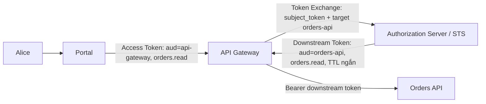
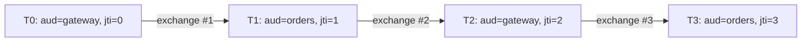
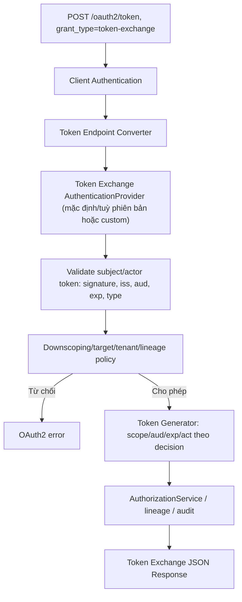

# Ngăn mở rộng đặc quyền, lạm dụng token trung gian và vòng lặp trao đổi

## 1. Mục tiêu và tình huống thực tế

Trong chương **Token Exchange** của module `SPRING_SECURITY_OAUTH2_OIDC_AUTHORIZATION_SERVER`, chúng ta tập trung vào việc **không cho một token hợp lệ bị đổi thành token có quyền cao hơn, dùng cho hệ thống không được phép hoặc được tái trao đổi vô hạn qua các dịch vụ**. Đây là kỹ năng thiết yếu để thiết kế, cấu hình, bảo mật, kiểm thử và vận hành **OAuth 2.0/OpenID Connect Authorization Server bằng Spring Security và Spring Authorization Server trong Spring Boot**.

Giả sử người dùng `alice` đăng nhập vào Portal; Portal gọi **API Gateway** với Access Token có scope `orders.read`. Gateway cần một Access Token khác để gọi **Orders API** thay mặt Alice. Một **Security Token Service (STS)**, có thể được triển khai qua Authorization Server, nhận token nguồn, xác minh và phát token cho đúng API đích.



**Luồng hợp lệ:** Gateway chỉ được đổi sang token có quyền phù hợp với Alice, policy của Gateway và Orders API. **Luồng nguy hiểm:** Gateway xin `orders.admin` dù subject chỉ có `orders.read`; hoặc đổi sang `billing-api` không được phép; hoặc lặp `Gateway → Orders → Gateway` để tạo token mới với thời hạn được “làm tươi” liên tục.

Sau bài này, người học có thể:

1. Giải thích các trường quan trọng của RFC 8693 và ranh giới tin cậy của Token Exchange.
2. Phân biệt subject, actor, client đang gọi STS, impersonation và delegation.
3. Định nghĩa các bất biến giới hạn quyền, audience, resource, tenant, thời hạn và loại token đầu ra.
4. Chặn **confused deputy**, **token laundering**, lạm dụng token trung gian, replay và **exchange loop**.
5. Đặt logic bảo vệ tại đúng tầng Spring Authorization Server; kiểm thử policy và luồng HTTP.
6. Quan sát, điều tra sự cố và thu hồi token mà không để lộ credential qua log/trace.

**Phiên bản:** API cụ thể của Spring Authorization Server/Spring Security thay đổi theo dòng phát hành. Ví dụ Java sử dụng cấu trúc `RegisteredClient` quen thuộc với Spring Boot 3.x, Spring Security 6.x và Spring Authorization Server 1.x **khi phiên bản đang dùng hỗ trợ Token Exchange**. Luôn kiểm tra tài liệu và extension point của đúng phiên bản trước khi áp dụng.

## 2. Token Exchange theo RFC 8693

Token Exchange sử dụng Token Endpoint với grant type:

```text
urn:ietf:params:oauth:grant-type:token-exchange
```

Một request minh họa từ Gateway đã được xác thực:

```http
POST /oauth2/token HTTP/1.1
Host: auth.example.com
Authorization: Basic <gateway-client-credentials>
Content-Type: application/x-www-form-urlencoded

grant_type=urn:ietf:params:oauth:grant-type:token-exchange&
subject_token=<trusted-subject-access-token>&
subject_token_type=urn:ietf:params:oauth:token-type:access_token&
audience=orders-api&
resource=https%3A%2F%2Fapi.example.com%2Forders&
scope=orders.read&
requested_token_type=urn:ietf:params:oauth:token-type:access_token
```

| Tham số | Ý nghĩa | Rủi ro cần kiểm soát |
| --- | --- | --- |
| `grant_type` | Chọn grant Token Exchange | Client không được đăng ký grant này |
| `subject_token` | Token đại diện subject cần được trao đổi | Token giả, bị đánh cắp, hết hạn hoặc sai trust domain |
| `subject_token_type` | Loại subject token; bắt buộc theo RFC 8693 | Đánh tráo ID Token hoặc token khác thành Access Token |
| `actor_token`/`actor_token_type` | Token về actor khi yêu cầu delegation, nếu áp dụng | Mạo danh actor hoặc tự thêm quyền đại diện |
| `audience` | Tên logic của bên nhận token | Mở rộng quyền truy cập API bất kỳ |
| `resource` | URI xác định tài nguyên đích | Dynamic target, SSRF hoặc resource không được phép |
| `scope` | Quyền yêu cầu ở đầu ra | Nâng quyền từ read lên write/admin |
| `requested_token_type` | Loại token đầu ra mong muốn | Xin loại credential mạnh hơn, ví dụ Refresh Token |

`subject_token` và `subject_token_type` là **bắt buộc**. Nhiều trường khác tùy chọn theo RFC hoặc chính sách của STS. Việc client gửi một tên audience hay scope **không chứng minh client được phép nhận chúng**. Khi có cả `actor_token` và `actor_token_type`, cần xác minh tính nhất quán và quyền delegation.

Response thành công cho yêu cầu Access Token có thể là:

```json
{
  "access_token": "<downstream-access-token>",
  "issued_token_type": "urn:ietf:params:oauth:token-type:access_token",
  "token_type": "Bearer",
  "expires_in": 180,
  "scope": "orders.read"
}
```

`issued_token_type` mô tả **loại token thực sự được phát hành** theo RFC 8693. `token_type` mô tả cách dùng Access Token, chẳng hạn `Bearer`. Không suy luận Refresh Token/ID Token tự động xuất hiện; chúng phải tuân chính sách riêng. Mọi giá trị trên đều là ví dụ, không phải kết quả chạy.

### 2.1. Tiêu chuẩn không thay thế chính sách cấp quyền

RFC 8693 định nghĩa cơ chế giao thức nhưng để **Authorization Server/STS** quyết định:

- Client nào được thực hiện Token Exchange.
- Loại token nào được chấp nhận làm nguồn hoặc được phát hành.
- Subject/actor/issuer nào đáng tin và được phép delegation.
- Audience/resource/scope đầu ra nào phù hợp.
- Chính sách thời hạn, revocation, lineage và số bước trao đổi.

**Không phải mọi request hợp lệ về cú pháp đều phải được chấp thuận.**

## 3. Chủ thể và trách nhiệm: client, subject, actor, target

Một giao dịch trao đổi có thể liên quan bốn danh tính:

| Đối tượng | Ví dụ | Bằng chứng đáng tin |
| --- | --- | --- |
| **Client gọi Token Endpoint** | `api-gateway` | Client authentication và `RegisteredClient` |
| **Subject** | Người dùng `alice` | Subject token đã xác minh chữ ký, issuer, audience, thời gian và quyền |
| **Actor** | Gateway hành động thay Alice | Actor token hoặc bằng chứng actor được policy chấp nhận, quyền delegation |
| **Target Resource Server** | `orders-api` | Audience/resource được định nghĩa trong allowlist và validate ở API |

### 3.1. Impersonation so với delegation

**Impersonation**: token đích đại diện subject; bên nhận nhìn thấy danh tính subject theo profile phát hành, trong khi STS vẫn cần audit ai yêu cầu. **Delegation**: token đích thể hiện có actor đang hành động thay subject. RFC 8693 có claim `act` để mô tả actor và `may_act` để diễn đạt một actor có thể được phép hành động, trong bối cảnh đáng tin.

Đừng nhầm:

- **Client đã authenticate** không có nghĩa nó được impersonate mọi user.
- **`actor_token` được gửi tới** không có nghĩa actor đã được subject ủy quyền.
- **`act` hoặc `may_act` trong JWT** chỉ đáng tin sau khi xác minh token và trust relationship, không phải sau khi decode JSON.
- **Token có `sub=alice`** không có nghĩa Gateway tự động được gọi mọi API bằng quyền của Alice.

Nếu delegation hợp lệ, STS nên giữ thông tin actor cần thiết trong token/profile hoặc audit. Resource Server phải xác minh được **chủ thể được đại diện và bên thực hiện hành động**, theo quy tắc nghiệp vụ. Không dùng một header `X-Actor` do client tự gửi để thay claim đáng tin.

### 3.2. Confused deputy

Giả sử Gateway có quyền nội bộ `orders.admin`, nhưng Alice chỉ được `orders.read`. Nếu STS dựa duy nhất vào danh tính Gateway để cấp token `orders.admin` thay mặt Alice, Gateway đã trở thành **confused deputy**: một dịch vụ có quyền mạnh bị lợi dụng để làm việc mà subject không được phép.

**Phòng vệ:** kiểm tra đồng thời quyền của subject, client/actor, target Resource Server và mục đích request. Một yếu tố hợp lệ **không thể bù** cho yếu tố khác bị từ chối.

## 4. Bảng mô hình đe dọa

| Đe dọa | Ví dụ | Biện pháp chính |
| --- | --- | --- |
| Mở rộng đặc quyền | `orders.read` → `orders.write` | Downscoping, scope mapping có kiểm soát |
| Audience widening | Đổi token từ Gateway sang Billing/Admin tùy ý | Target allowlist và kiểm tra `aud` ở Resource Server |
| Cross-tenant | Token tenant A đổi thành tenant B | Ràng buộc tenant từ nguồn đáng tin |
| Token laundering | JWT không tin cậy được đổi thành JWT do issuer nội bộ ký | Validate issuer, chữ ký, token type, audience và trust registry |
| Confused deputy | Client có quyền mạnh làm việc thay user quyền yếu | Giao của subject + actor/client + resource policy |
| Đánh cắp token trung gian | Downstream Access Token lọt qua log/trace | TTL ngắn, không log credential, sender-constraining nếu phù hợp |
| Delegation forgery | Client tự khai `actor=admin-service` | Xác minh actor token và quyền `may_act`/policy |
| Replay/abuse | Một source token sinh hàng nghìn token đích | Rate limiting, quota và audit |
| Exchange loop | A → B → A → B, token mới có `jti` mới | Hop limit, lineage, visited audience, TTL monotonic |
| Target injection/SSRF | `resource` trỏ localhost/metadata endpoint | Không tự fetch URI do client nhập; allowlist và SSRF protection |

Các tình huống là **threat model cần kiểm tra**, không hàm ý Spring Authorization Server mặc định thiếu bảo vệ.

## 5. Sáu bất biến bảo mật

### 5.1. Không được tạo quyền mạnh hơn quyền nguồn

Nếu source và target dùng cùng ý nghĩa scope, áp dụng chính sách bảo thủ:

```text
Scopes(token đích)
  ⊆ Scopes(subject token đã được cấp)
  ∩ Scopes(client hoặc actor được phép sử dụng)
  ∩ Scopes(target Resource Server chấp thuận)
```

Đây là **bất biến khuyến nghị cho downscoping**, không phải công thức bắt buộc của mọi mô hình RFC 8693. Nếu source có `orders.summary.read` nhưng target dùng `orders.read`, không thể chỉ lấy giao tên chuỗi; cần **bảng ánh xạ quyền được duyệt, chứng minh quyền thực tế không rộng hơn nguồn**. Nếu không thể chứng minh, từ chối.

Không coi scope bỏ trống là “tất cả scope” hoặc mặc nhiên dùng scope mạnh nhất của `RegisteredClient`.

### 5.2. Không được chọn target tùy ý

```text
requestedAudience thuộc allowlist(client, trustDomain)
requestedResource thuộc allowlist(requestedAudience)
issuedToken.aud = target đã được policy phê duyệt
```

Client được phép exchange sang Orders không mặc nhiên được phép đổi sang Billing. Đầu ra phải có audience phù hợp, và Resource Server phải từ chối JWT có chữ ký hợp lệ nhưng `aud` không thuộc nó.

### 5.3. Không tự kéo dài thời hạn ủy quyền

Một chính sách hardening bảo thủ:

```text
expiresAt(token đích) <= min(
  expiresAt(subject token),
  expiresAt(actor token nếu policy yêu cầu),
  now + targetTokenTtlLimit
)
```

Quy tắc này **không do RFC 8693 bắt buộc với mọi use case**. Nếu hệ thống muốn token đích sống lâu hơn nguồn, phải thiết kế quyền ủy quyền và vòng đời riêng, không để việc exchange nhiều lần vô tình gia hạn token mãi mãi.

### 5.4. Không được đổi subject hoặc tenant khi thiếu chứng cứ

`sub`, `tenant_id`, actor và quyền được lấy từ dữ liệu **đã xác minh**, không từ `sub`/`tenant` do caller tự truyền. Chỉ cho phép thay đổi subject/tenant nếu có **quy tắc delegation hoặc mapping rõ ràng**, được kiểm tra và ghi audit. Trong mô hình phổ biến, tenant của token đích phải khớp tenant của subject và chính sách Resource Server.

### 5.5. Không được trao đổi thành vòng lặp không kiểm soát

Tổ chức cần xác định **hop limit** và đồ thị trust cho phép. Ví dụ `Gateway → Orders` hợp lệ, nhưng `Orders → Gateway` bị cấm; hoặc mọi token đã qua một target sẽ không được quay lại target đó trong cùng exchange chain.

### 5.6. Mặc định từ chối

Khi không xác minh được issuer, token type, audience nguồn, chữ ký, client/actor, scope, tenant, target hoặc lineage, phải **từ chối**. Không bỏ qua bước kiểm tra vì introspection/JWKS/database không khả dụng. Không “thử issuer khác” theo dữ liệu token chưa đáng tin.

## 6. Chính sách ra quyết định theo nhiều chiều

Một hàm ra quyết định có thể xem xét:

```text
allowExchange(
    authenticatedClient,
    validatedSubjectToken,
    validatedActorToken?,       // nếu có delegation
    requestedAudience,
    requestedResource,
    requestedScopes,
    requestedTokenType,
    tenantContext,
    trustedExchangeLineage
)
```

Ví dụ chỉ cho Gateway lấy token cho Orders:

| Thuộc tính | Quy định ví dụ | Hành động nếu sai |
| --- | --- | --- |
| OAuth2 client | `api-gateway`, authenticated, có Token Exchange Grant | Từ chối |
| Subject issuer | `https://auth.example.com` | Từ chối |
| Subject audience | `api-gateway` theo trust contract | Từ chối |
| Target audience | Chỉ `orders-api` | `invalid_target` |
| Target resource | Chỉ `https://api.example.com/orders` | `invalid_target` |
| Tenant | Tenant trong ngữ cảnh đáng tin phải đúng với subject | Từ chối |
| Scope đích | Chỉ `orders.read`, subject cũng phải có quyền này | `invalid_scope` |
| Token type | Chỉ Access Token | Từ chối |
| TTL | Tối đa 3 phút và không quá thời hạn nguồn | Hạn chế hoặc từ chối |
| Lineage | Tối đa 2 hop, không quay lại audience đã qua | Từ chối |

Các giá trị **3 phút, 2 hop, client và endpoint** là chính sách minh họa, không phải defaults của framework/RFC.

### 6.1. Vì sao quyền client không thay quyền subject?

Nếu `api-gateway` đăng ký `orders.read orders.write`, nhưng Alice chỉ có `orders.read`, STS không được cấp `orders.write`. Ngược lại, Alice có `orders.write` nhưng Gateway chỉ được `orders.read` thì cũng không được cấp quyền ghi. Sau khi token được cấp, Orders API vẫn cần xác minh authorization trên **đơn hàng cụ thể**, không chỉ kiểm tra tên scope.

### 6.2. Mapping scope khác tên giữa hai hệ thống

```text
Source scope: orders.summary.read
Target scope: orders.read
```

Việc ánh xạ trên có thể **nâng quyền** nếu target `orders.read` cho phép đọc toàn bộ đơn hàng, còn source chỉ cho phép xem bản tóm tắt. Không được tự động ánh xạ theo tiền tố chuỗi. Thiết kế mapping chính xác (ví dụ token đích có thêm claim `data_level=summary` được Resource Server kiểm tra), kèm review chủ API và test âm tính.

## 7. Xác thực token nguồn trước khi đọc quyền

**Decode JWT không phải validate JWT.** Không đọc Base64URL payload rồi tin `sub`, `iss`, `aud`, `scope`, `act` hoặc `may_act`.

1. **Loại token:** `subject_token_type` phải đúng và được STS hỗ trợ. Không dùng ID Token làm Access Token.
2. **Issuer:** chỉ chấp nhận `iss` trong trust registry được phê duyệt.
3. **Chữ ký, thuật toán, khóa:** xác minh signature và `alg` theo allowlist. Không chấp nhận `alg=none`; không tin `jku`/`x5u` tự khai.
4. **Thời gian:** kiểm tra `exp`, `nbf` và clock skew hợp lý; không exchange token hết hạn.
5. **Audience nguồn:** token phải có audience được trust contract chấp nhận cho use case exchange; ký đúng chưa đủ.
6. **Quyền, subject, tenant:** có nguồn đáng tin; nếu thiếu chứng cứ → từ chối.
7. **Trạng thái thu hồi:** dùng introspection/trust contract hoặc giải pháp trạng thái phù hợp; hiểu giới hạn JWT validation offline.
8. **Sender constraint:** nếu token ràng buộc DPoP/mTLS, phải xác minh proof of possession tại yêu cầu exchange.
9. **Actor token:** nếu có, xác minh độc lập và kiểm tra delegation; client authentication không thay actor authorization.

Các RFC tham khảo hữu ích: **RFC 9068** cho JWT Access Token Profile và **RFC 8725** cho JWT security best practices.

### 7.1. Đừng biến dữ liệu client thành URL tải khóa

Nếu STS lấy `iss` hoặc `jku` từ JWT chưa xác minh rồi tự động gọi URL đó để lấy JWKS, có thể dẫn đến **SSRF** và **token laundering**: kẻ tấn công phát JWT bằng khóa của mình và thuyết phục STS nội bộ chấp nhận.

Hãy cấu hình **issuer/JWKS/introspection endpoint/algorithm/expected audience** trong trust registry được quản trị. Không thêm issuer mới chỉ vì xuất hiện một token có `iss` mới.

## 8. Token trung gian và các lớp chống lạm dụng

### 8.1. Token không được dùng ở API sai audience

Gateway nhận token `aud=orders-api` rồi gửi sang Billing API. Billing phải từ chối ngay cả khi chữ ký hợp lệ và token chưa hết hạn. Resource Server cần validate issuer, loại token, signature, `aud`, `exp`, scopes và chính sách tài nguyên.

### 8.2. Token không tự cho phép exchange tiếp

Orders API cầm downstream token của Gateway rồi gửi lại Token Endpoint để xin `aud=billing-api`. STS phải kiểm tra **client gọi request này** có được exchange hay không và có quyền chuyển từ audience nguồn sang target hay không. Token do cùng issuer ký không tự tạo giấy phép đổi sang mọi nơi.

### 8.3. Token không được đổi thành credential mạnh hơn

Ví dụ một request cố xin:

```text
requested_token_type=urn:ietf:params:oauth:token-type:refresh_token
```

Nếu kiến trúc chỉ cần Access Token ngắn hạn, **từ chối** request này. `requested_token_type` là nguyện vọng của client, không phải quyền cấp Refresh Token. Không biến một Access Token bị lộ thành credential dài hạn.

### 8.4. Token Exchange không mặc nhiên là single-use

**RFC 8693 không quy định mọi `subject_token` chỉ được exchange một lần** như Authorization Code. Một token nguồn có thể được exchange nhiều lần theo policy. Tuy nhiên, STS nên có rate limit, quota, phát hiện bất thường và tùy tình huống có cơ chế chống replay/single-use có chủ đích. Không tự áp quy tắc single-use của Authorization Code cho tất cả Token Exchange.

### 8.5. Không ghi token trung gian vào log

Tránh log `subject_token`, `actor_token`, token mới, client secret, JWT thô hoặc URL nhạy cảm. Dùng correlation ID, client/issuer/target đã xác minh, loại lỗi, policy version, TTL/hop count và dấu vết audit không chứa credential.

## 9. Ngăn vòng lặp A → B → A và giới hạn số hop

### 9.1. Vì sao chỉ kiểm tra `jti` trùng là chưa đủ?

Giả sử STS phát token mới sau mỗi exchange, và mỗi token có `jti` mới:



Tất cả `jti` đều khác nhau, nên kiểm tra “đã từng thấy `jti` hiện tại chưa?” **không phát hiện cycle**. Cần theo dõi cả **audience/resource đã đi qua** và số hop của **cùng một chuỗi trao đổi**.

Ví dụ dữ liệu nội bộ được STS quản lý:

```text
exchange_chain_id = "chain-opaque-id-generated-by-sts"
visited_audiences = ["api-gateway", "orders-api"]
hop_count = 1
```

Request tiếp theo muốn đổi token về `api-gateway` bị từ chối vì `api-gateway` đã nằm trong `visited_audiences`. Nếu token sau đã tồn tại một hop, policy có thể từ chối khi vượt `max_hops=2`.

### 9.2. Tính tin cậy của lineage

Các cách triển khai khả thi:

- **State server-side**: STS lưu quan hệ token nguồn–token đích, chain ID, hop count và visited audiences trong kho authorization/audit; lần exchange tiếp theo tra cứu metadata này.
- **Claim do issuer ký**: token đích chứa lineage claim, được issuer bảo vệ và xác minh ở lần exchange tiếp theo.
- **Kết hợp hai cách**: claim cho quyết định nhanh, kho state cho concurrency, revocation và kiểm toán.

**Không cho client tự đặt lại `hop_count=0` hoặc `visited=[]` bằng form parameter.** Nếu source token của một issuer khác không có lineage được tin cậy, phải dùng trust contract riêng hoặc **mặc định từ chối re-exchange không thể chứng minh**.

Với RFC 8693, claim `act` có thể cho biết chuỗi actor, nhưng **không tự động thay thế** một bộ đếm hops hay đồ thị audience đã được duyệt. Một actor có thể đi qua nhiều tài nguyên và một tài nguyên có thể được truy cập bởi nhiều actor; cần chính sách tường minh.

### 9.3. Giới hạn độ sâu và TTL

| Kiểm soát | Giá trị ví dụ | Lý do |
| --- | --- | --- |
| Max hops | 2 lần exchange | Không tạo đường chuyển đổi vô hạn |
| Cycle prevention | Target chưa từng nằm trong visited audiences | Chặn A → B → A |
| One-way trust edge | Gateway → Orders được; Orders → Gateway bị chặn | Không tạo cạnh ngược không có nghiệp vụ |
| TTL monotonic | Token sau không sống lâu hơn token nguồn | Không kéo dài quyền qua mỗi hop |
| Downscoping mỗi hop | Scope đầu ra không vượt quyền có thể chứng minh | Tránh quyền tăng dần qua chuỗi |
| Audit theo chain | Chain ID + policy version + audience sequence | Truy vết mà không log token |

Đây là **chính sách ví dụ**, không phải giới hạn hop bắt buộc của RFC 8693. Với hệ thống cần quay lại một dịch vụ đã đi qua do nghiệp vụ hợp lệ, nên thiết kế một luồng callback/token riêng hoặc ngoại lệ có điều kiện và review thay vì tắt toàn bộ cycle detection.

## 10. Cấu hình client được phép Token Exchange

Trong Spring Authorization Server, một biện pháp nền tảng là **chỉ cho những client đã được phê duyệt dùng grant Token Exchange**. Ví dụ tạo `RegisteredClient`:

```java
import java.time.Duration;
import java.util.UUID;

import org.springframework.security.oauth2.core.AuthorizationGrantType;
import org.springframework.security.oauth2.core.ClientAuthenticationMethod;
import org.springframework.security.oauth2.server.authorization.client.RegisteredClient;
import org.springframework.security.oauth2.server.authorization.settings.TokenSettings;

// Ví dụ đăng ký lần đầu; chưa phải @Bean/repository hoàn chỉnh.
AuthorizationGrantType exchangeGrant = new AuthorizationGrantType(
        "urn:ietf:params:oauth:grant-type:token-exchange");

RegisteredClient gateway = RegisteredClient.withId(UUID.randomUUID().toString())
        .clientId("api-gateway")
        .clientName("API Gateway")
        .clientSecret("{bcrypt}<valid-bcrypt-hash-from-secret-manager>")
        .clientAuthenticationMethod(ClientAuthenticationMethod.CLIENT_SECRET_BASIC)
        .authorizationGrantType(exchangeGrant)
        .scope("orders.read")
        .tokenSettings(TokenSettings.builder()
                .accessTokenTimeToLive(Duration.ofMinutes(3))
                .build())
        .build();
```

**Giới hạn quan trọng:**

1. Chuỗi `{bcrypt}<...>` chỉ là placeholder; không phải hash có thể dùng để xác thực. Trong production phải có secret thực được băm và quản lý đúng cách, hoặc dùng phương thức xác thực phù hợp khác như `private_key_jwt`.
2. Grant type và scope registration **chưa đủ** để quyết định target audience/resource, subject delegation, tenant, TTL nguồn, `act`, `may_act` hay chống exchange loop.
3. `accessTokenTimeToLive(Duration.ofMinutes(3))` đặt chính sách token của client; để **không vượt thời hạn token nguồn**, provider/service cần áp thêm `min(...)` đã nêu.
4. `UUID.randomUUID()` chỉ dùng tại lúc đăng ký mới; khi dùng kho bền vững, ID phải được lưu ổn định qua các lần triển khai.
5. Client được phép dùng `authorization_code` hoặc `client_credentials` **không mặc nhiên** được phép Token Exchange.

### 10.1. Đặt kiểm soát ở Token Endpoint, không ở Authorization Endpoint

Token Exchange là một grant tại `POST /oauth2/token`. Pipeline khái quát:



Khi phiên bản đang sử dụng hỗ trợ Token Exchange, có thể cấu hình các thành phần tại **`OAuth2TokenEndpointConfigurer`**. Nếu cần custom grant/provider, phải khai báo converter và provider phù hợp, bảo đảm `AuthenticationManager` gọi đúng thứ tự và không bỏ qua validation.

Phác thảo extension point:

```java
// Đặt trong cấu hình OAuth2AuthorizationServerConfigurer tương ứng.
.tokenEndpoint(tokenEndpoint -> tokenEndpoint
    .authenticationProviders(providers -> {
        // Xác định provider Token Exchange thực tế của phiên bản đang chạy.
        // Bổ sung enforcement theo extension point được hỗ trợ.
        // Không thay thế các bước validate client, subject token và actor token.
    })
)
```

Đây chỉ là **đoạn cấu hình minh họa**, không phải một statement Java đứng độc lập, không bảo đảm phiên bản nào cũng tự cài đặt mọi policy của RFC 8693. Đừng tạo thêm provider có cùng `supports(...)` nhưng sai thứ tự rồi vô tình khiến policy không chạy. Nếu chưa có built-in grant hỗ trợ mục tiêu, phải triển khai extension grant có kiểm thử an ninh.

**Không đặt quyết định cấp quyền chỉ trong `AuthenticationConverter`**: converter chủ yếu đọc form request. Validation nguồn, policy target, actor delegation, TTL và token issuance cần nằm ở provider/service đáng tin sau client authentication và trước khi ký token.

## 11. Ví dụ Java: lớp chính sách downscoping riêng

Lớp Java 17 sau chỉ nhận **dữ liệu được giả định đã xác thực**. Nó là ví dụ *policy core* có thể unit test mà không chạy HTTP. Nó **không** tự xác minh JWT, không đọc `RegisteredClientRepository`, không cấp JWT, không xử lý actor delegation và không thay thế một Token Exchange `AuthenticationProvider` hoàn chỉnh.

```java
import java.time.Duration;
import java.time.Instant;
import java.util.Set;

public final class DownscopingExchangePolicy {

    // Các giá trị phải được dựng từ subject token đã xác minh.
    public record Subject(
            String issuer,
            String subjectId,
            String tenantId,
            String audience,
            Set<String> scopes,
            Instant expiresAt) {
        public Subject {
            scopes = Set.copyOf(scopes);
        }
    }

    // Kết quả client authentication và registration đáng tin.
    public record Caller(
            String clientId,
            boolean authenticated,
            boolean exchangeGrantAllowed,
            Set<String> allowedScopes) {
        public Caller {
            allowedScopes = Set.copyOf(allowedScopes);
        }
    }

    public record RequestedTarget(
            String audience,
            String resource,
            String tenantId,
            Set<String> scopes) {
        public RequestedTarget {
            scopes = Set.copyOf(scopes);
        }
    }

    // Metadata lineage do STS quản lý hoặc xác minh bằng chữ ký.
    public record TrustedLineage(
            int previousHops,
            Set<String> visitedAudiences) {
        public TrustedLineage {
            visitedAudiences = Set.copyOf(visitedAudiences);
        }
    }

    public record Decision(
            String targetAudience,
            Set<String> permittedScopes,
            Instant expiresAt,
            int nextHop) {}

    public static final class PolicyDenied extends RuntimeException {
        private final String oauthError;

        PolicyDenied(String oauthError) {
            super("Token exchange rejected by policy");
            this.oauthError = oauthError;
        }

        public String oauthError() {
            return oauthError;
        }
    }

    private static void require(boolean condition, String oauthError) {
        if (!condition) {
            throw new PolicyDenied(oauthError);
        }
    }

    public Decision authorize(
            Subject subject,
            Caller caller,
            RequestedTarget target,
            TrustedLineage lineage,
            Instant now) {

        require(caller.authenticated()
                && caller.exchangeGrantAllowed()
                && "api-gateway".equals(caller.clientId()), "unauthorized_client");

        require("https://auth.example.com".equals(subject.issuer())
                && "api-gateway".equals(subject.audience()), "invalid_grant");
        require(subject.expiresAt().isAfter(now), "invalid_grant");

        require("orders-api".equals(target.audience())
                && "https://api.example.com/orders".equals(target.resource()),
                "invalid_target");
        require(subject.tenantId().equals(target.tenantId()), "invalid_target");

        require(lineage.previousHops() >= 0
                && lineage.previousHops() < 2
                && !lineage.visitedAudiences().contains(target.audience()),
                "invalid_target");

        require(!target.scopes().isEmpty()
                && Set.of("orders.read").containsAll(target.scopes())
                && subject.scopes().containsAll(target.scopes())
                && caller.allowedScopes().containsAll(target.scopes()),
                "invalid_scope");

        // Giới hạn TTL: tối đa 3 phút, không sống quá subject token.
        Instant maximum = now.plus(Duration.ofMinutes(3));
        Instant expiresAt = subject.expiresAt().isBefore(maximum)
                ? subject.expiresAt() : maximum;
        require(expiresAt.isAfter(now), "invalid_grant");

        return new Decision(
                target.audience(),
                Set.copyOf(target.scopes()),
                expiresAt,
                lineage.previousHops() + 1);
    }
}
```

### 11.1. Những giả định an ninh của đoạn mã

- **Subject**, **Caller**, **TrustedLineage** phải do server dựng từ kết quả xác minh JWT/introspection, client authentication và metadata do STS kiểm soát. Không deserialize chúng từ request của caller rồi tin ngay.
- Ví dụ khóa cứng issuer, client, audience, target và scope để thấy rõ chính sách **allowlist**. Production có thể dùng policy registry nhưng phải quản lý version và phê duyệt, không mở accept-all.
- `subject.audience=api-gateway` được chấp nhận vì **trust contract của ví dụ** cho phép token dành cho Gateway làm subject token. Trong hệ thống khác, STS có thể chỉ chấp nhận token có audience riêng cho STS.
- Lớp này **không triển khai actor delegation**. Nếu có `actor_token` hoặc `may_act`, provider phải xác minh và truyền actor policy đã xác thực; đừng bỏ qua vì mẫu này không đề cập actor.
- `TrustedLineage` là dữ liệu do STS xác minh, không phải `hop_count` do client có quyền sửa.
- So khớp tenant bằng chuỗi chỉ là một điều kiện; quyền truy cập tài nguyên theo tenant phải tiếp tục được kiểm tra ở Orders API.
- Mã lỗi được chọn là **policy mapping minh họa**; provider thật có thể chọn lỗi OAuth2 phù hợp theo semantics và hợp đồng giao thức đang áp dụng.

### 11.2. Tích hợp quyết định vào provider/token generator

Sơ đồ:

```text
Token request đã parse
  -> Xác thực client gọi STS
  -> Validate subject token và actor token (nếu có)
  -> Lấy Verified Subject / Actor / Trust Lineage
  -> DownscopingExchangePolicy.authorize(...)
  -> Tạo token từ Decision (aud, scope, exp, sub, act nếu delegation)
  -> Lưu authorization/lineage và audit
  -> Trả OAuth2 Token Exchange response
```

Adapter/provider có thể chuyển lỗi policy thành OAuth2 error:

```java
import org.springframework.security.oauth2.core.OAuth2AuthenticationException;
import org.springframework.security.oauth2.core.OAuth2Error;

// Phần của provider adapter; không phải một AuthenticationProvider hoàn chỉnh.
try {
    var decision = policy.authorize(
            validatedSubject, authenticatedCaller,
            requestedTarget, trustedLineage, now);
    // Chỉ phát token theo decision và quyền đã xác minh.
} catch (DownscopingExchangePolicy.PolicyDenied denied) {
    throw new OAuth2AuthenticationException(new OAuth2Error(
            denied.oauthError(), "Token exchange was not permitted", null));
}
```

Các biến trong ví dụ là **giá trị đã được dựng ở lớp adapter**. Nếu không có validation issuer/chữ ký/audience/sender proof và actor binding đầy đủ, gọi policy riêng **chưa tạo thành Token Exchange bảo mật**.

## 12. Unit test chính sách chống leo thang và vòng lặp

Ví dụ JUnit 5 kiểm tra invariant của `DownscopingExchangePolicy`:

```java
import java.time.Instant;
import java.util.Set;

import org.junit.jupiter.api.Test;
import static org.junit.jupiter.api.Assertions.assertEquals;
import static org.junit.jupiter.api.Assertions.assertThrows;

class DownscopingExchangePolicyTest {

    private final DownscopingExchangePolicy policy = new DownscopingExchangePolicy();
    private final Instant now = Instant.parse("2026-11-16T00:00:00Z");

    private DownscopingExchangePolicy.Subject source() {
        return new DownscopingExchangePolicy.Subject(
                "https://auth.example.com", "alice",
                "tenant-a", "api-gateway",
                Set.of("orders.read"), now.plusSeconds(120));
    }

    private DownscopingExchangePolicy.Caller caller() {
        return new DownscopingExchangePolicy.Caller(
                "api-gateway", true, true,
                Set.of("orders.read", "orders.write"));
    }

    private DownscopingExchangePolicy.RequestedTarget request(Set<String> scopes) {
        return new DownscopingExchangePolicy.RequestedTarget(
                "orders-api", "https://api.example.com/orders",
                "tenant-a", scopes);
    }

    private DownscopingExchangePolicy.TrustedLineage initialLineage() {
        return new DownscopingExchangePolicy.TrustedLineage(
                0, Set.of("api-gateway"));
    }

    @Test
    void allowsReadWithoutExtendingSourceTtl() {
        var decision = policy.authorize(
                source(), caller(), request(Set.of("orders.read")),
                initialLineage(), now);
        assertEquals(Set.of("orders.read"), decision.permittedScopes());
        assertEquals(now.plusSeconds(120), decision.expiresAt());
        assertEquals(1, decision.nextHop());
    }

    @Test
    void rejectsScopeEscalation() {
        var denied = assertThrows(
                DownscopingExchangePolicy.PolicyDenied.class,
                () -> policy.authorize(
                        source(), caller(), request(Set.of("orders.write")),
                        initialLineage(), now));
        assertEquals("invalid_scope", denied.oauthError());
    }

    @Test
    void rejectsReturningToVisitedAudience() {
        var denied = assertThrows(
                DownscopingExchangePolicy.PolicyDenied.class,
                () -> policy.authorize(
                        source(), caller(), request(Set.of("orders.read")),
                        new DownscopingExchangePolicy.TrustedLineage(
                                1, Set.of("api-gateway", "orders-api")),
                        now));
        assertEquals("invalid_target", denied.oauthError());
    }

    @Test
    void rejectsExpiredSubject() {
        var expired = new DownscopingExchangePolicy.Subject(
                "https://auth.example.com", "alice",
                "tenant-a", "api-gateway",
                Set.of("orders.read"), now.minusSeconds(1));
        var denied = assertThrows(
                DownscopingExchangePolicy.PolicyDenied.class,
                () -> policy.authorize(
                        expired, caller(), request(Set.of("orders.read")),
                        initialLineage(), now));
        assertEquals("invalid_grant", denied.oauthError());
    }
}
```

**Giới hạn:** các test này chỉ kiểm tra logic thuần với giá trị đầu vào **được giả định đã xác minh**. Chúng không chứng minh hệ thống đã validate JWT, actor token, client authentication, anti-SSRF, target claims hoặc Resource Server authorization. Cần integration test theo đúng Token Endpoint và cụm triển khai.

## 13. Ma trận integration test và kiểm thử an ninh

| # | Tình huống | Kết quả mong đợi |
| --- | --- | --- |
| 1 | Gateway hợp lệ, subject `orders.read`, target Orders, scope `orders.read` | Cấp token đích với `aud`, `scope`, `exp` đúng policy |
| 2 | Subject chỉ có read, xin write/admin | Từ chối; không phát token |
| 3 | Client không đăng ký Token Exchange Grant | Từ chối `unauthorized_client` hoặc lỗi giao thức phù hợp |
| 4 | Sai client authentication | `invalid_client` hoặc từ chối phù hợp |
| 5 | Subject token hết hạn, chữ ký sai hoặc bị thu hồi | Từ chối trước khi phát token |
| 6 | Đưa ID Token nhưng khai `subject_token_type=access_token` | Từ chối token type sai |
| 7 | Issuer không thuộc trust registry | Từ chối; không tự tải JWKS từ URL client điều khiển |
| 8 | `audience=billing-api` hoặc resource ngoài allowlist | `invalid_target` hoặc lỗi policy tương ứng |
| 9 | Token thuộc tenant A, xin token tenant B | Từ chối |
| 10 | Actor token giả/sai, actor không được subject cho phép | Từ chối delegation |
| 11 | Xin Refresh Token dù policy chỉ cấp Access Token | Từ chối |
| 12 | Subject còn 90 giây, target policy 180 giây | `exp` token đích không vượt nguồn theo invariant đã chọn |
| 13 | A → B → A, mỗi hop `jti` mới | Chặn cycle nhờ audience/lineage |
| 14 | Vượt max hops | Từ chối trước khi ký token |
| 15 | Gửi exchange hàng loạt | Rate limit/quota/audit hoạt động |
| 16 | Resource Server nhận `aud` khác | API từ chối dù chữ ký hợp lệ |
| 17 | Hai request exchange đồng thời | Không vượt quota, lineage/authorization state nhất quán |
| 18 | Token đầu ra có `act` theo delegation | Actor chain chỉ đến từ nguồn đáng tin và policy cho phép |

### 13.1. Thứ tự kiểm thử HTTP đầy đủ

1. Khởi chạy Authorization Server trong môi trường test với issuer, keys và `RegisteredClient` riêng.
2. Sinh **subject token thật** của issuer/trust domain test; đừng chỉ xây chuỗi JWT giả.
3. Gửi request Token Exchange bằng client authentication hợp lệ.
4. Xác minh `issued_token_type`, `token_type`, `scope`, `expires_in` và claims đầu ra `iss`, `aud`, `sub`, `exp`, `act` (nếu delegation).
5. Gửi token đích tới Orders API để xác minh **Resource Server thực sự từ chối quyền vượt scope/audience/tenant**.
6. Lặp request với client/issuer/target/tenant/scope sai; kiểm tra không có token nào được phát hành.
7. Dùng token đầu ra làm `subject_token` ở hop tiếp theo, đo chống cycle/hop.
8. Test khi dịch vụ JWKS/introspection/storage gặp lỗi và test lại qua nhiều node.

### 13.2. Curl minh họa

```bash
curl -i -X POST 'https://auth-test.example.com/oauth2/token' \
  -u 'api-gateway:<test-client-secret>' \
  -H 'Content-Type: application/x-www-form-urlencoded' \
  --data-urlencode 'grant_type=urn:ietf:params:oauth:grant-type:token-exchange' \
  --data-urlencode 'subject_token=<trusted-test-access-token>' \
  --data-urlencode 'subject_token_type=urn:ietf:params:oauth:token-type:access_token' \
  --data-urlencode 'resource=https://api.example.com/orders' \
  --data-urlencode 'audience=orders-api' \
  --data-urlencode 'scope=orders.read' \
  --data-urlencode 'requested_token_type=urn:ietf:params:oauth:token-type:access_token'
```

Các giá trị `<...>` là placeholder; không đưa secret/token thật vào chat, ticket, CI log, ảnh chụp hoặc shell history dùng chung. Lệnh chỉ thành công khi Authorization Server **hỗ trợ và đã cấu hình** grant/token trust policy phù hợp.

## 14. Mã lỗi và cách chẩn đoán

| Mã lỗi / triệu chứng | Điều cần điều tra | Cách xử lý |
| --- | --- | --- |
| `invalid_client` | Client secret/assertion/method sai | Xác nhận registration và client authentication |
| `unauthorized_client` | Chưa được phép Token Exchange | Kiểm tra grant được đăng ký và phê duyệt |
| `invalid_request` | Thiếu `subject_token`, type sai cú pháp, tham số trùng/lỗi | Xem request converter; không nới parser |
| `invalid_grant` | Subject token không hợp lệ, không còn active hoặc không đáng tin | Kiểm tra issuer, chữ ký, `exp`, audience, revocation |
| `invalid_target` | Resource/audience không được phép hoặc không phục vụ được | Kiểm tra target allowlist và mapping |
| `invalid_scope` | Scope vượt quyền của subject/client/target | Kiểm tra giao quyền và mapping |
| `server_error` | Lỗi ký token, introspection, database hoặc policy engine | Điều tra an toàn; không fail-open |
| Exchange lặp cùng chain | Token laundering, vòng lặp hoặc retry sai | Kiểm tra chain ID, hop count, visited audiences |
| Billing chấp nhận token của Orders | Resource Server không kiểm tra `aud` | Sửa validation đầu vào ở API |

`invalid_target` là mã được RFC 8693 nêu cho resource/audience không được chấp nhận hoặc không thể thực hiện. Các mã còn lại cần được ánh xạ theo quy tắc OAuth2, cách provider xử lý và hợp đồng giao thức. **Bảng là hướng dẫn chẩn đoán**, không phải cam kết mapping cứng cho mọi phiên bản.

Đừng tiết lộ token, subject/tenant nhạy cảm hoặc policy nội bộ trong `error_description`. Giữ thông điệp công khai chung; dành thông tin chi tiết cho log có kiểm soát.

## 15. Vận hành và audit token trung gian

Nên ghi nhận bằng dữ liệu **không chứa credential**:

| Tín hiệu | Tác dụng |
| --- | --- |
| Correlation ID, exchange-chain ID | Liên kết các hop và request |
| Issuer, loại token nguồn, client ID/actor đã xác thực | Truy vết trust boundary |
| Audience/resource đích và scope đã duyệt | Phát hiện cấp nhầm quyền |
| Hop count, policy version, TTL quyết định | Phát hiện vòng lặp và nâng hạn |
| Lỗi OAuth2, số lần từ chối, latency | Chẩn đoán và phát hiện lạm dụng |
| Revoke/rotation/incident event | Điều tra sự cố và thu hồi |

Không dùng raw Access/Refresh Token, subject/actor token, client assertion, `code_verifier` hay secret làm nhãn metric. Với `sub` hoặc `jti` có thể liên kết danh tính, áp dụng retention và biện pháp giả danh/giới hạn quyền truy cập phù hợp.

### 15.1. Biện pháp vận hành bổ sung

- **Rate limit** theo client/target/issuer và chính sách, kết hợp cảnh báo burst.
- **Short-lived downstream token**, audience duy nhất hoặc danh sách cực hẹp.
- **Sender-constraining** (mTLS/DPoP) khi profile và kiến trúc hỗ trợ.
- **Issuer key management** và JWKS có kiểm soát; không tải khóa từ nguồn không tin.
- **Revocation/introspection** khi cần vô hiệu gần thời gian thực. JWT đã phát hành có thể còn hợp lệ tới `exp` nếu API chỉ xác minh offline.
- **Policy versioning/approval** trước khi thêm resource, scope mapping, quyền impersonation/delegation hoặc nới max hops.
- **Môi trường độc lập** về issuer, keys, client registry và authorization store; không đổi token test sang production.

### 15.2. Retry sau lỗi mạng

Nếu client bị timeout sau khi STS đã cấp token, việc retry có thể sinh một token đích mới theo chính sách. **RFC 8693 không mặc định exchange là one-time**; tùy use case có thể bổ sung quota, idempotency ở tầng ứng dụng hoặc chống replay. Không tạo retry storm và không bỏ các kiểm tra quyền để hỗ trợ retry.

Nếu nguồn bị thu hồi, cần xét **các token downstream đã phát hành**. Chúng có thể còn được Resource Server chấp nhận nếu chữ ký và `exp` hợp lệ mà không có cơ chế revocation bổ sung.

## 16. Checklist bảo mật trước production

1. **Trust registry:** issuer, key, thuật toán, token type, audience nguồn và trạng thái revocation rõ ràng.
2. **Client authentication:** xác định client đang gọi; grant Token Exchange được đăng ký riêng.
3. **Subject/actor:** validate nguồn và quyền delegation, không tin `act`/`may_act` từ dữ liệu thô.
4. **Giới hạn scope:** đầu ra không mạnh hơn quyền có thể chứng minh; mapping cross-API có review.
5. **Target allowlist:** không lấy audience/resource tùy ý từ request; token đầu ra được ràng buộc đúng API.
6. **Giữ tenant:** không chuyển tenant/subject trái phép; Resource Server còn kiểm tra quyền trên tài nguyên.
7. **Không nâng token type:** chặn loại credential không được phép như Refresh Token sống dài.
8. **TTL policy:** không gia hạn vô hạn qua exchange, và xem xét giới hạn bởi token nguồn.
9. **Loop prevention:** lineage đáng tin, max hops, visited audiences, không chỉ `jti`.
10. **Giám sát:** quota, rate limit, audit policy decision, không log token.
11. **Integration test:** kiểm tra token đầu ra và Resource Server thật, gồm cả trường hợp bị từ chối.
12. **HA/concurrency:** storage/lineage/revocation nhất quán qua nhiều node; fail-closed khi phụ thuộc lỗi.
13. **Vòng đời:** có phê duyệt thêm target/client, rollback và quy trình thu hồi token.
14. **Upgrade:** đối chiếu thay đổi Token Exchange provider/generator/claims khi nâng Spring Security hoặc Spring Authorization Server.

## 17. Bài tập và câu hỏi tự đánh giá

**Bài tập A — Downscoping.** Subject có `orders.read`, Gateway đăng ký `orders.read orders.write`, Orders API cho cả hai scope. Tính scope đầu ra theo invariant bảo thủ và giải thích vì sao không được cấp write.

**Bài tập B — Cross-audience.** Source token có `aud=api-gateway`; Gateway xin `aud=billing-api` nhưng policy chỉ cho `orders-api`. Mô tả điểm kiểm tra và mã lỗi RFC 8693 phù hợp.

**Bài tập C — Exchange loop.** Lineage có `visited=[api-gateway,orders-api]` và hop count 1. Token mới có `jti` khác; vì sao request xin `aud=api-gateway` vẫn phải bị từ chối?

**Bài tập D — Token laundering.** Kẻ tấn công đưa JWT có `iss=https://malicious.invalid` và `jku` trỏ đến server của mình. Thiết kế trust registry và kiểm thử để STS không phát token nội bộ từ JWT đó.

**Bài tập E — TTL.** Subject token còn 90 giây, target policy là 3 phút. Nếu chính sách không gia hạn nguồn, token đích được sống tối đa bao lâu?

**Bài tập F — Delegation.** Alice ủy quyền Gateway gọi Orders. Phân biệt `sub`, client authentication, actor, `act` và `may_act`; thiết kế cách Orders biết người thực hiện hành động.

**Câu hỏi ôn tập:**

1. Vì sao subject token hợp lệ chưa đủ để exchange sang mọi audience?
2. `resource` và `audience` khác nhau thế nào, và vì sao đều phải được policy duyệt?
3. Vì sao Token Exchange không mặc nhiên chỉ-đổi-một-lần như Authorization Code?
4. Vì sao quyền của `RegisteredClient` không thể thay quyền của subject?
5. Làm sao kiểm tra mapping scope khác tên không tạo leo thang quyền?
6. `act` và `may_act` giúp biểu diễn điều gì, có tự động cấp quyền delegation không?
7. Điều gì xảy ra nếu Resource Server không kiểm tra `aud`?
8. Vì sao kiểm tra `jti` trùng không phát hiện A → B → A?
9. Nếu client xin `requested_token_type=refresh_token`, STS có nghĩa vụ cấp không?
10. Những test nào chứng minh chống cross-tenant, target widening và vòng lặp exchange?
11. Vì sao không được tự fetch JWKS từ `jku` chưa đáng tin?
12. Nếu nguồn bị thu hồi, token downstream đã cấp luôn mất hiệu lực tức thì không?

## 18. Tài liệu tham khảo

- [RFC 8693 — OAuth 2.0 Token Exchange](https://www.rfc-editor.org/rfc/rfc8693)
- [RFC 8693 — Token Exchange Request and Response](https://www.rfc-editor.org/rfc/rfc8693#section-2)
- [RFC 8693 — Actor and May-Act Claims](https://www.rfc-editor.org/rfc/rfc8693#section-4)
- [RFC 8707 — Resource Indicators for OAuth 2.0](https://www.rfc-editor.org/rfc/rfc8707)
- [RFC 9068 — JWT Profile for OAuth 2.0 Access Tokens](https://www.rfc-editor.org/rfc/rfc9068)
- [RFC 8725 — JWT Best Current Practices](https://www.rfc-editor.org/rfc/rfc8725)
- [RFC 9700 — OAuth 2.0 Security Best Current Practice](https://www.rfc-editor.org/rfc/rfc9700)
- [Spring Authorization Server — Protocol Endpoints](https://docs.spring.io/spring-authorization-server/reference/protocol-endpoints.html)
- [Spring Authorization Server — Core Model Components](https://docs.spring.io/spring-authorization-server/reference/core-model-components.html)
- [Spring Authorization Server — Configuration Model](https://docs.spring.io/spring-authorization-server/reference/configuration-model.html)
- [Spring Security — Servlet OAuth2 Resource Server](https://docs.spring.io/spring-security/reference/servlet/oauth2/resource-server/index.html)

**Ghi nhớ:** Token Exchange là **chuyển đổi quyền trong một ranh giới tin cậy**, không phải cách tạo thêm token có quyền mạnh hơn. STS phải xác minh subject/actor/client, giới hạn scope/audience/resource/tenant, kiểm soát thời hạn và lineage, ngăn trao đổi tuần hoàn; Resource Server phải xác minh token dành đúng cho mình. Không tin `scope`, `audience`, `act` hoặc `hop_count` chỉ vì chúng xuất hiện trong request; quyết định phát token phải dựa trên dữ liệu đã xác thực và policy được duyệt.
