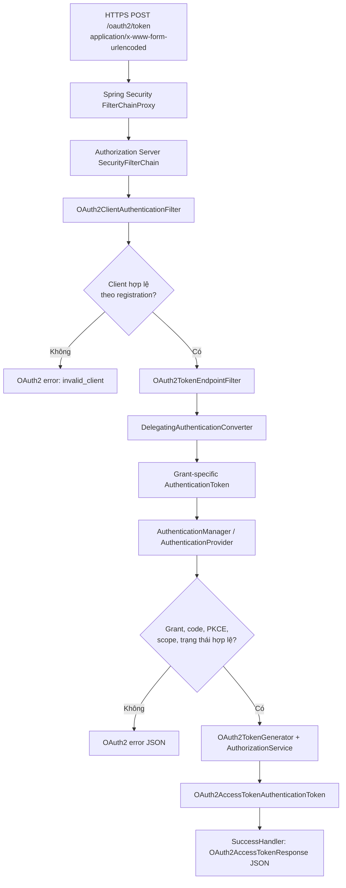

# Định dạng yêu cầu và phản hồi OAuth2 Token Endpoint

## 1. Token Endpoint giải quyết vấn đề gì?

Trong OAuth 2.0, **Token Endpoint** là nơi client gửi một **access token request** để nhận access token, xin access token mới bằng refresh token hoặc thực hiện một authorization grant được Authorization Server hỗ trợ. Trong Spring Authorization Server, đường dẫn mặc định thường là **`POST /oauth2/token`**.

Ví dụ: ứng dụng **Orders Web** đã nhận authorization code sau khi người dùng đồng ý cấp quyền. Backend của Orders Web gửi code tới Token Endpoint và được trả JSON chứa `access_token`, thời gian sống, loại token cùng các trường tùy theo grant/chính sách. Một dịch vụ **Reports Worker** không có người dùng cuối lại gửi `grant_type=client_credentials` tới **cùng endpoint**, nhưng request body, phương thức xác thực client và token response có thể khác.

Điều quan trọng là **không nhầm giao thức HTTP ở Token Endpoint với một REST API nhận JSON tùy ý**. Theo OAuth 2.0, request token chuẩn sử dụng HTTP POST, các tham số thường được mã hóa bằng **`application/x-www-form-urlencoded`**, và phản hồi token hoặc lỗi được biểu diễn bằng **JSON**.

Bài thuộc chương **Token Endpoint** trong module `SPRING_SECURITY_OAUTH2_OIDC_AUTHORIZATION_SERVER`, phục vụ mục tiêu **thiết kế, cấu hình, bảo mật, kiểm thử và vận hành OAuth 2.0/OpenID Connect Authorization Server bằng Spring Security và Spring Authorization Server trong ứng dụng Spring Boot**.

### Sau bài này, bạn có thể

1. Viết đúng HTTP request tới `/oauth2/token` cho các grant phổ biến.
2. Phân biệt **client authentication** với các trường xác minh **authorization grant**.
3. Đọc đúng token response JSON: `access_token`, `token_type`, `expires_in`, `refresh_token`, `scope` và `id_token` nếu có OIDC.
4. Phân biệt lỗi OAuth như `invalid_client`, `invalid_grant`, `unauthorized_client` và `invalid_scope`.
5. Hiểu pipeline `OAuth2ClientAuthenticationFilter` → `OAuth2TokenEndpointFilter` → converter/provider/handler của Spring Authorization Server.
6. Kiểm thử chuẩn HTTP và tránh lỗi Content-Type, Basic auth, encoding, PKCE, caching và logging.

> **Phạm vi phiên bản:** Ví dụ DSL tập trung vào **Spring Authorization Server 1.5.x / Spring Security 6.x**. Một số grant và tên package/configurer thay đổi hoặc được tích hợp vào Spring Security 7.x. Hãy đối chiếu dependency đang dùng trước khi chép code hoặc kết luận một extension grant được bật mặc định.

## 2. Hợp đồng HTTP cơ bản

| Thành phần | Giá trị mong đợi | Lý do |
| --- | --- | --- |
| **Endpoint URI** | `/oauth2/token` theo cấu hình mặc định | Client lấy URI công khai từ metadata/discovery hoặc cấu hình đáng tin |
| **HTTP method** | **`POST`** | Không đưa credentials, code hay refresh token vào query string của GET |
| **Transport** | **HTTPS/TLS** ngoài mạng | Bảo vệ client secret, authorization code và token trên đường truyền |
| **Content-Type request** | **`application/x-www-form-urlencoded`** | Định dạng tham số token request theo RFC 6749 |
| **Authorization header** | Tùy phương thức xác thực client, ví dụ `Basic ...` | Không phải mọi client đều sử dụng client secret |
| **Body** | Tối thiểu có `grant_type` và các tham số riêng của grant | Provider xác định loại yêu cầu cần xử lý |
| **Success response** | Thường **`200 OK` + `application/json`** | Các trường token ở mức cao nhất của JSON object |
| **Error response** | JSON chứa `error`, thường HTTP 400 hoặc HTTP 401 tùy lỗi | Cho client xác định nguyên nhân theo OAuth, không phải trang HTML login |
| **Cache control** | `Cache-Control: no-store` và `Pragma: no-cache` với response nhạy cảm | Tránh cache trung gian/trình duyệt lưu token |

`/oauth2/token` là đường dẫn **tương đối theo servlet context/reverse proxy**. Nếu issuer công khai là `https://login.example.com/auth` và proxy xử lý tiền tố `/auth`, Token Endpoint bên ngoài có thể là `https://login.example.com/auth/oauth2/token`. Không dùng URL `http://localhost:9000` của backend trong client production.

### 2.1. Ví dụ request ngắn nhất có ý nghĩa

Một confidential client đã đăng ký `client_credentials` có thể gửi:

```http
POST /oauth2/token HTTP/1.1
Host: auth.example.com
Authorization: Basic <BASE64_OF_CLIENT_CREDENTIALS>
Content-Type: application/x-www-form-urlencoded
Accept: application/json

grant_type=client_credentials&scope=reports.read
```

Ở đây `Basic` là **client authentication**, `grant_type=client_credentials` chỉ là **kiểu authorization grant**. Basic được mã hóa Base64 để truyền header, **không phải mã hóa bảo mật**; phải dùng TLS, quản lý secret an toàn và tránh ghi header vào log.

### 2.2. Form encoding khác JSON như thế nào?

Body hợp lệ cho request phía trên:

```text
grant_type=client_credentials&scope=reports.read
```

Body không tương đương:

```json
{
  "grant_type": "client_credentials",
  "scope": "reports.read"
}
```

Gửi JSON với `Content-Type: application/json` **không phải định dạng yêu cầu token chuẩn RFC 6749**. Bộ lọc token endpoint mặc định của Spring Authorization Server được thiết kế để nhận tham số request theo giao thức; đừng xây client gửi JSON rồi sửa server để xử lý sai chuẩn nếu không có extension được thiết kế riêng.

## 3. Từng lớp xử lý request trong Spring Authorization Server



Các vai trò chính:

1. **`OAuth2ClientAuthenticationFilter`** đọc Basic, secret trong form, JWT client assertion, mTLS hoặc thông tin public client theo phương thức đã đăng ký. Nó xác thực **danh tính client**, không trực tiếp cấp access token.
2. **`OAuth2TokenEndpointFilter`** nhận request token tại HTTP POST/URI tương ứng; không thay bằng form login hay controller tự chế.
3. **`AuthenticationConverter`** tạo authentication request cho grant type, ví dụ `OAuth2AuthorizationCodeAuthenticationToken` hoặc `OAuth2ClientCredentialsAuthenticationToken`.
4. **`AuthenticationProvider`** xác minh code/refresh token/device code, grant type, PKCE, scope và các điều kiện tùy grant.
5. **`OAuth2TokenGenerator`** tạo token được yêu cầu bởi luồng xử lý; **`OAuth2AuthorizationService`** quản lý authorization/token state.
6. **Success/error handler** tạo phản hồi JSON theo OAuth 2.0; trong các dòng hiện đại có `OAuth2AccessTokenResponseAuthenticationSuccessHandler` và `OAuth2ErrorAuthenticationFailureHandler`.

Trong Spring Authorization Server 1.5.x, các converter/provider mặc định được tài liệu liệt kê cho `authorization_code`, `refresh_token`, `client_credentials`, Device Code và Token Exchange. **Sự tồn tại của một converter/provider không có nghĩa mọi client đều được phép dùng grant đó**: `RegisteredClient` và chính sách server vẫn quyết định.

### 3.1. Client authentication trước grant validation

| Bước | Ví dụ dữ liệu | Điều được kiểm tra |
| --- | --- | --- |
| Client identification | `client_id=orders-web` | Tìm đúng `RegisteredClient` |
| Client authentication | HTTP Basic, `private_key_jwt`, mTLS hoặc `none` | Bằng chứng hợp lệ và phương thức được đăng ký |
| Grant selection | `grant_type=authorization_code` | Converter/provider thích hợp có được kích hoạt không |
| Grant authorization | Code, `code_verifier`, `redirect_uri`, scope | Client được phép dùng grant và dữ liệu có liên kết hợp lệ không |
| Token issuance | Access token, optional refresh/ID token | Chính sách phát hành và loại token đúng grant |

Một client gửi **secret đúng** vẫn có thể bị `invalid_grant` nếu code đã dùng; ngược lại, một code hợp lệ không cho phép confidential client bỏ qua xác thực client ở Token Endpoint.

## 4. Bảng tham số HTTP request theo từng grant

| Grant | `grant_type` | Trường đặc trưng | Client authentication |
| --- | --- | --- | --- |
| **Authorization Code** | `authorization_code` | `code`, `redirect_uri` khi áp dụng, `code_verifier` nếu PKCE đã sử dụng | Confidential client: method đã đăng ký; public client: `client_id` và PKCE, không có secret |
| **Client Credentials** | `client_credentials` | `scope` tùy chọn theo policy | Confidential client phải xác thực |
| **Refresh Token** | `refresh_token` | `refresh_token`, `scope` tùy chọn và không được mở rộng quyền | Theo loại client và policy |
| **Device Code** | `urn:ietf:params:oauth:grant-type:device_code` | `device_code`, `client_id` cho public client khi cần | Theo registration và loại client |
| **Token Exchange** (nếu hỗ trợ) | `urn:ietf:params:oauth:grant-type:token-exchange` | `subject_token`, `subject_token_type`; có thể có `audience`, `resource`, `scope` | Theo policy của extension và registration |

Không gửi tất cả trường của bảng cho mọi grant. Ví dụ `code_verifier` là tham số của authorization code exchange có PKCE, **không** phải tham số xác thực Client Credentials. `refresh_token` chỉ sử dụng khi đã có refresh token được server thực sự phát hành.

## 5. Authorization Code: request có client secret hoặc PKCE

### 5.1. Confidential client đổi code

Một backend web đã nhận code ở redirect URI đăng ký:

```http
POST /oauth2/token HTTP/1.1
Host: auth.example.com
Authorization: Basic <BASE64_OF_ORDERS_WEB_CREDENTIALS>
Content-Type: application/x-www-form-urlencoded

grant_type=authorization_code&
code=AUTH_CODE_EXAMPLE&
redirect_uri=https%3A%2F%2Forders.example.com%2Flogin%2Foauth2%2Fcode%2Forders-web&
code_verifier=PKCE_VERIFIER_EXAMPLE
```

Các dòng body được **xuống dòng để diễn giải**; request thực tế cần form body hợp lệ và không chứa dòng mới làm hỏng giá trị. Với request này:

- `code` phải **chưa hết hạn, chưa sử dụng và gắn với đúng client**.
- `redirect_uri` phải khớp giá trị trong authorization request khi được gửi ở bước đó; không được tự thay đổi callback khi đổi code.
- `code_verifier` phải thỏa kiểm tra PKCE nếu transaction đã dùng PKCE (với confidential client cũng nên dùng PKCE).
- Client authentication phải đúng phương thức đăng ký, ví dụ `client_secret_basic` hoặc `private_key_jwt`.

**Không thêm `client_secret` vào query string của Token Endpoint.** Khi dùng Basic, client secret nằm trong header Authorization; khi có nhu cầu `client_secret_post` thì gửi body form theo registration, không kết hợp hai phương thức trong cùng request.

### 5.2. Public client dùng Authorization Code + PKCE

SPA hoặc native app không giữ được secret dài hạn. Registration dùng `ClientAuthenticationMethod.NONE`, thường bắt buộc PKCE S256. Token request minh họa:

```http
POST /oauth2/token HTTP/1.1
Host: auth.example.com
Content-Type: application/x-www-form-urlencoded

grant_type=authorization_code&
client_id=orders-spa&
code=AUTH_CODE_EXAMPLE&
redirect_uri=https%3A%2F%2Forders.example.com%2Fcallback&
code_verifier=PKCE_VERIFIER_EXAMPLE
```

`client_id` là **định danh**, không phải secret. `code_verifier` là giá trị ngẫu nhiên riêng cho giao dịch, không được gửi tại authorization endpoint, không ghi log và không chia sẻ giữa các lần đăng nhập. Khi dùng S256, challenge là `BASE64URL(SHA256(ASCII(code_verifier)))`.

**PKCE không tự bảo đảm phát refresh token.** Hành vi phát refresh token cho public client phụ thuộc chính sách và phiên bản; ví dụ hướng dẫn chính thức của Spring Authorization Server 1.5.x không cấp refresh token cho public client trong luồng SPA được mô tả.

### 5.3. Response có ID Token khi nào?

Với **OpenID Connect Authorization Code Flow** hợp lệ có scope `openid` và server đã bật OIDC, token response có thể chứa **`id_token`** ngoài access token. Nó phục vụ **xác minh kết quả đăng nhập End-User tại OIDC Client**, không thay thế access token khi gọi API.

```json
{
  "access_token": "ACCESS_TOKEN_EXAMPLE",
  "token_type": "Bearer",
  "expires_in": 600,
  "id_token": "HEADER.PAYLOAD.SIGNATURE",
  "scope": "openid profile"
}
```

Trong OIDC Core, ID Token là thành phần bắt buộc của một token response thành công thuộc OIDC Authorization Code Flow. **Không suy ra rằng mọi request tới OAuth2 Token Endpoint, mọi grant, hay mọi request có trường `scope=openid` đều phải nhận ID Token**.

## 6. Client Credentials: request máy với máy

Một service có thể gửi:

```http
POST /oauth2/token HTTP/1.1
Host: auth.example.com
Authorization: Basic <BASE64_CLIENT_CREDENTIALS>
Content-Type: application/x-www-form-urlencoded

grant_type=client_credentials&scope=reports.read
```

Nếu hợp lệ, response điển hình:

```json
{
  "access_token": "ACCESS_TOKEN_FOR_REPORTS_API",
  "token_type": "Bearer",
  "expires_in": 600,
  "scope": "reports.read"
}
```

**Không có End-User authentication**, nên không có ID Token theo OIDC. RFC 6749 mục 4.4.3 khuyến nghị **không cấp refresh token** cho Client Credentials (`SHOULD NOT`); provider mặc định của Spring Authorization Server không cấp refresh token trong flow này. Service có thể xác thực lại và xin access token mới khi cần.

**Không dùng Client Credentials trực tiếp trong JavaScript/browser với secret hard-code**: secret nhúng vào ứng dụng phân phối cho người dùng không còn là credential bí mật.

## 7. Refresh Token: request và chính sách scope

Khi client đã được **cấp refresh token hợp lệ**, nó có thể gửi:

```http
POST /oauth2/token HTTP/1.1
Host: auth.example.com
Authorization: Basic <BASE64_CLIENT_CREDENTIALS>
Content-Type: application/x-www-form-urlencoded

grant_type=refresh_token&
refresh_token=REFRESH_TOKEN_EXAMPLE&
scope=orders.read
```

Các điều kiện cần kiểm tra:

1. Client thực sự được phép dùng `AuthorizationGrantType.REFRESH_TOKEN`.
2. Refresh token đã được phát, còn hiệu lực, không bị thu hồi và **gắn với đúng client/authorization**.
3. Client authentication phù hợp với loại client và chính sách.
4. `scope` gửi thêm (nếu có) không được yêu cầu quyền **vượt quá phạm vi ban đầu**; khi không gửi, dùng phạm vi đã được cấp theo chuẩn/chính sách.
5. Rotation, TTL, replay detection và trạng thái token được áp dụng theo implementation.

Response có thể trả `refresh_token` mới nếu rotation được hỗ trợ/được bật, hoặc tiếp tục dùng token cũ theo policy:

```json
{
  "access_token": "NEW_ACCESS_TOKEN",
  "token_type": "Bearer",
  "expires_in": 600,
  "refresh_token": "NEW_REFRESH_TOKEN",
  "scope": "orders.read"
}
```

Không suy từ cấu hình `refreshTokenTimeToLive` hoặc `reuseRefreshTokens(false)` rằng máy chủ đã phát refresh token ban đầu. Với client không nhận refresh token trong Authorization Code response, không được “tự tạo” một refresh token để gửi đi.

## 8. Device Authorization: device code polling

Với RFC 8628, thiết bị nhận `device_code` từ **Device Authorization Endpoint**, sau đó lặp POST đến Token Endpoint:

```http
POST /oauth2/token HTTP/1.1
Host: auth.example.com
Content-Type: application/x-www-form-urlencoded

grant_type=urn%3Aietf%3Aparams%3Aoauth%3Agrant-type%3Adevice_code&
device_code=DEVICE_CODE_EXAMPLE&
client_id=living-room-tv
```

Ví dụ dành cho **public device client**; confidential device client phải xác thực bằng credential đã đăng ký. Các lỗi riêng của polling:

| `error` | Ý nghĩa | Client cần làm |
| --- | --- | --- |
| `authorization_pending` | Người dùng chưa chấp thuận/từ chối | Tiếp tục polling theo interval |
| `slow_down` | Polling quá nhanh hoặc server yêu cầu giảm tốc | Tăng interval ít nhất 5 giây |
| `access_denied` | Người dùng từ chối cấp quyền | Dừng polling |
| `expired_token` | Device code hết hạn | Dừng và tạo giao dịch mới nếu người dùng yêu cầu |

Trong RFC 8628, nếu `interval` không được công bố, dùng khoảng **5 giây**. Các lỗi này nằm trong phản hồi **OAuth error JSON**, không phải redirect browser tới trang login. **User code được nhập trên browser thứ hai**, không phải trường của token request.

## 9. Extension grant: Token Exchange không phải định dạng mới cho mọi client

Spring Authorization Server ở các dòng hiện đại có thể hỗ trợ `urn:ietf:params:oauth:grant-type:token-exchange` (RFC 8693). Một request có thể trông như:

```http
POST /oauth2/token HTTP/1.1
Host: auth.example.com
Authorization: Basic <BASE64_CLIENT_CREDENTIALS>
Content-Type: application/x-www-form-urlencoded

grant_type=urn%3Aietf%3Aparams%3Aoauth%3Agrant-type%3Atoken-exchange&
subject_token=SUBJECT_TOKEN_EXAMPLE&
subject_token_type=urn%3Aietf%3Aparams%3Aoauth%3Atoken-type%3Aaccess_token&
audience=reports-api
```

Theo extension RFC 8693, phản hồi thành công có thể kèm `issued_token_type`, `token_type` và những trường đặc thù. Đây là **extension grant**, không phải lý do tự thêm `subject_token` vào request authorization code hoặc Client Credentials.

Chỉ gửi request này khi server và client đã được cấu hình cho token exchange, policy trust/audience/delegation được xác lập và resource server hiểu token nhận được. Không suy rằng mọi phiên bản Spring đều hỗ trợ token exchange mặc định.

## 10. Client Authentication: header, form body hay JWT assertion?

Định dạng **grant request** và phương thức **client authentication** là hai chiều độc lập. Registered client có thể đăng ký:

| Method | Client gửi ở đâu? | Ghi chú |
| --- | --- | --- |
| `client_secret_basic` | `Authorization: Basic ...` | Phổ biến cho confidential backend; yêu cầu TLS và secret protection |
| `client_secret_post` | `client_id`, `client_secret` trong form body | Tương thích nhưng dễ lộ trong body logging; không nên ưu tiên |
| `private_key_jwt` | `client_assertion_type`, `client_assertion` | JWT assertion ký bằng **khóa riêng của client** |
| `client_secret_jwt` | JWT assertion ký bằng shared secret | Phải giới hạn thuật toán/TTL và kiểm tra chữ ký, audience |
| `tls_client_auth` / `self_signed_tls_client_auth` | Certificate trong TLS handshake | Kiểm soát binding chứng chỉ và ranh giới tin cậy proxy |
| `none` | `client_id` trong form body khi protocol cần | Public client; không dùng secret, PKCE cần cho Authorization Code |

### 10.1. Client secret trong body

Chỉ khi client đăng ký `client_secret_post`:

```http
POST /oauth2/token HTTP/1.1
Host: auth.example.com
Content-Type: application/x-www-form-urlencoded

grant_type=client_credentials&
client_id=reports-worker&
client_secret=SECRET_VALUE&
scope=reports.read
```

Đừng vừa gửi `Authorization: Basic` vừa gửi `client_secret` trong body để “tăng độ an toàn”. RFC 6749 không cho client sử dụng nhiều hơn một phương thức xác thực trong một token request.

### 10.2. Private key JWT assertion

Ví dụ client xác thực bằng JWT assertion:

```http
POST /oauth2/token HTTP/1.1
Host: auth.example.com
Content-Type: application/x-www-form-urlencoded

grant_type=client_credentials&
client_assertion_type=urn%3Aietf%3Aparams%3Aoauth%3Aclient-assertion-type%3Ajwt-bearer&
client_assertion=SIGNED_CLIENT_ASSERTION_JWT&
scope=reports.read
```

Trong assertion có thể có `iss`, `sub`, `aud`, `iat`, `exp` và `jti` theo hồ sơ JWT client authentication. **Client assertion không phải ID Token** và không phải access token. Server phải xác minh chữ ký/thuật toán theo khóa đáng tin gắn với `RegisteredClient`, audience và hiệu lực; tránh tin JWKS URL do client tự gửi mà chưa được đăng ký.

### 10.3. URL-encoding client credentials trong Basic

Với `client_secret_basic`, client ID và secret không nên được ghép tùy tiện thành `Base64(client_id + ":" + secret)` nếu chứa ký tự đặc biệt. **RFC 6749, mục 2.3.1 quy định encode từng thành phần theo `application/x-www-form-urlencoded` trước khi ghép thành Basic credentials**. Dùng thư viện OAuth2 chuẩn của Spring để tránh sai encoding, đặc biệt với `+`, `:`, `%`, dấu cách và Unicode.

## 11. Token response thành công: JSON và ý nghĩa từng trường

Theo RFC 6749, mục 5.1, một response token điển hình:

```http
HTTP/1.1 200 OK
Content-Type: application/json;charset=UTF-8
Cache-Control: no-store
Pragma: no-cache

{
  "access_token": "ACCESS_TOKEN_EXAMPLE",
  "token_type": "Bearer",
  "expires_in": 3600,
  "refresh_token": "REFRESH_TOKEN_IF_ISSUED",
  "scope": "orders.read"
}
```

**Ví dụ minh họa**, không phải mọi response phải có refresh token hoặc scope. `refresh_token` chỉ xuất hiện nếu server thực sự cấp; với Client Credentials mặc định thường không có.

| Trường | Kiểu JSON | Có bắt buộc không? | Lưu ý |
| --- | --- | --- | --- |
| `access_token` | **string** | Bắt buộc trong phản hồi access token thành công chuẩn | Credential cần giữ bí mật; có thể là JWT hoặc opaque |
| `token_type` | **string** | Bắt buộc | Thường `Bearer`; Resource Server xử lý theo scheme |
| `expires_in` | **number** | Được khuyến nghị mạnh (RECOMMENDED theo RFC 6749) | Thời gian sống tính bằng giây, không phải timestamp Unix |
| `refresh_token` | **string** | Tùy chọn | Có thể không được cấp theo grant, client type, policy |
| `scope` | **string** | Tùy trường hợp | Các scope cách nhau bằng **dấu cách**, không phải JSON array |
| `id_token` | **string** | Theo giao thức OIDC, không phải trường bắt buộc của OAuth2 thuần | JWT cho OIDC Client xác minh End-User |
| `issued_token_type` | **string** | Theo RFC 8693 khi token exchange | Không phải trường chuẩn của mọi OAuth2 grant |
| Extension fields | Tùy tiêu chuẩn | Tùy hỗ trợ | Client cần bỏ qua response parameter không nhận biết theo RFC 6749 |

**Chú ý ba kiểu dữ liệu:** `expires_in` là số JSON, trong khi `scope` là chuỗi phân tách bằng dấu cách và `access_token` là chuỗi. Một ứng dụng tự chế response `"expires_in":"3600"` hoặc `"scope":["orders.read"]` có thể không tương thích với OAuth2 client chuẩn.

### 11.1. Scope trong response

Theo RFC 6749, `scope` là **bắt buộc khi phạm vi được cấp khác phạm vi client đã yêu cầu**, và là tùy chọn nếu giống nhau. Khi client cần dùng scope để kiểm soát UI/logic, nên kiểm tra kết quả cấp thực tế thay vì mặc định mọi scope trong request được chấp thuận.

Nếu client gửi `scope=orders.read orders.write` nhưng server chỉ cấp `orders.read` theo chính sách, response cần phản ánh phạm vi được cấp. Không để client tự suy ra quyền từ tham số request ban đầu.

### 11.2. Không suy định dạng Access Token từ JSON wrapper

Một access token có thể là:

- **JWT** (self-contained), để Resource Server xác minh chữ ký, issuer, audience, `exp`, scope và policy.
- **Opaque/reference token**, để Resource Server xác minh bằng introspection hoặc cơ chế trust khác.

Hai loại có thể cùng xuất hiện dưới trường JSON `access_token`. Không dùng `String.split(".")` trên token rồi tin payload; với JWT cần xác minh chữ ký và đầy đủ claims theo policy. Nếu muốn đổi định dạng access token trong Spring, dùng `TokenSettings`/token generator phù hợp, không đổi media type của HTTP response.

### 11.3. Token response không phải login session

Token Endpoint trả token cho OAuth client. Nó không giống response `Set-Cookie` của trang form login và không tự tạo phiên web cho từng Resource Server. OIDC ID Token giúp client xác minh login result khi flow OIDC hợp lệ, còn access token phục vụ API.

## 12. Error response: JSON đúng chuẩn và HTTP status

Theo RFC 6749, mục 5.2, lỗi Token Endpoint thường được trả dưới dạng:

```http
HTTP/1.1 400 Bad Request
Content-Type: application/json;charset=UTF-8
Cache-Control: no-store
Pragma: no-cache

{
  "error": "invalid_grant"
}
```

Các trường lỗi chuẩn:

| Trường | Ý nghĩa | Bắt buộc? |
| --- | --- | --- |
| `error` | Mã lỗi OAuth như `invalid_grant` | **Có** |
| `error_description` | Mô tả cho client nếu chính sách cho phép | Không |
| `error_uri` | URL tài liệu hỗ trợ lỗi | Không |

**Không** trả stack trace, mật khẩu, secret, authorization code, token đã nhập hoặc thông tin “client này không tồn tại” vào `error_description`. Lỗi bảo mật nên được ghi nội bộ với correlation ID và che dữ liệu nhạy cảm.

### 12.1. Những mã lỗi quan trọng

| `error` | Ví dụ nguyên nhân | Lớp thường phát hiện |
| --- | --- | --- |
| `invalid_request` | Thiếu `grant_type`, có tham số trùng/malformed hoặc request không hợp lệ | Converter/validator |
| `invalid_client` | Client secret/JWT assertion/chứng chỉ không hợp lệ, client auth method không đúng | Client Authentication Filter/provider |
| `invalid_grant` | Authorization code sai/hết hạn/dùng lại, redirect URI/PKCE binding không đúng, refresh token không hợp lệ | Grant-specific provider |
| `unauthorized_client` | Client không được phép sử dụng grant đã yêu cầu | Grant provider/registration policy |
| `unsupported_grant_type` | Server không hỗ trợ `grant_type` được gửi | Converter/provider hoặc token endpoint policy |
| `invalid_scope` | Scope thiếu quyền, không hợp lệ hoặc vượt chính sách | Grant validator/provider |
| `authorization_pending`, `slow_down` | Device Grant chưa hoàn tất hoặc polling quá nhanh | Device Code provider |
| `access_denied`, `expired_token` | Device Grant bị từ chối/hết hạn | Device Code provider |

**Mã lỗi chính xác** phụ thuộc giai đoạn, grant, phiên bản và cách custom handler. Ví dụ HTTP 401 với `invalid_client` không đồng nghĩa mọi lỗi đều là 401. Đừng viết client coi mọi 400/401 là “mật khẩu người dùng sai”.

### 12.2. Khi nào dùng HTTP 401 và WWW-Authenticate?

Theo RFC 6749, lỗi Token Endpoint mặc định thường là **HTTP 400**. Khi client authentication thất bại, Authorization Server **có thể dùng HTTP 401**. Nếu client đã thử xác thực bằng `Authorization` header, phản hồi 401 phải bao gồm header `WWW-Authenticate` phù hợp với phương thức xác thực.

Phản hồi minh họa với Basic:

```http
HTTP/1.1 401 Unauthorized
WWW-Authenticate: Basic realm="oauth2"
Content-Type: application/json
Cache-Control: no-store
Pragma: no-cache

{
  "error": "invalid_client"
}
```

Không suy rằng request thiếu `Authorization` header luôn phải trả 401: public client hợp lệ có thể sử dụng `ClientAuthenticationMethod.NONE` cho những grant được phép. Phải xác minh registration và grant trước khi kết luận lỗi.

## 13. Encoding: những lỗi nhỏ dẫn đến invalid_request/invalid_grant

### 13.1. Percent-encoding của form body

Với `application/x-www-form-urlencoded`:

- Dấu `&` phân tách các cặp `name=value`.
- Dấu `=` phân tách tên và giá trị.
- Dấu cách thường biểu diễn bằng `+` hoặc `%20` khi được encode theo quy tắc thích hợp.
- Dấu `+` **thật trong dữ liệu** phải được encode thành `%2B` nếu không nó có thể bị giải mã thành dấu cách.
- Dấu `%` cần encode đúng; không tự encode hai lần.
- URI trong `redirect_uri` phải được encode thành giá trị form field, không cắt mất các tham số query.

Ví dụ `scope=openid profile` cần nằm trong một form field:

```text
scope=openid+profile
```

Không gửi:

```json
{"scope":["openid","profile"]}
```

vì token request chuẩn không dùng một JSON array cho scopes.

### 13.2. Đừng tự nối chuỗi query

Nếu một redirect URI là:

```text
https://orders.example.com/callback?channel=web&theme=dark
```

thì trong form body nó phải là **một giá trị đã encode**, không được biến `&theme=dark` thành một tham số khác của token request:

```text
redirect_uri=https%3A%2F%2Forders.example.com%2Fcallback%3Fchannel%3Dweb%26theme%3Ddark
```

Nên dùng OAuth2 client library/HTTP form encoder, không tự ghép `grant_type=...&redirect_uri=...` bằng string interpolation.

### 13.3. Trùng tham số, thiếu grant_type, HTTP GET

Test các request:

```text
grant_type=client_credentials&grant_type=authorization_code
grant_type=
POST /oauth2/token với Content-Type: application/json
GET /oauth2/token?grant_type=client_credentials
```

Các trường hợp này không nên được xử lý như một request token bình thường. Response cụ thể có thể là OAuth error hoặc HTTP-level 405/415 tùy lớp từ chối và phiên bản; test nên kiểm tra **không phát token** và **không rò credential**, thay vì ép tất cả lỗi HTTP phải mang một mã OAuth duy nhất.

## 14. Cấu hình Token Endpoint trong Spring Authorization Server

### 14.1. SecurityFilterChain và tokenEndpoint DSL

Ví dụ tập trung vào điểm cấu hình giao thức, sử dụng Spring Authorization Server 1.x:

```java
import org.springframework.context.annotation.Bean;
import org.springframework.context.annotation.Configuration;
import org.springframework.core.annotation.Order;
import org.springframework.security.config.annotation.web.builders.HttpSecurity;
import org.springframework.security.oauth2.server.authorization.config.annotation.web.configurers.OAuth2AuthorizationServerConfigurer;
import org.springframework.security.web.SecurityFilterChain;

@Configuration
class AuthorizationServerSecurityConfiguration {

    @Bean
    @Order(1)
    SecurityFilterChain authorizationServerSecurityFilterChain(HttpSecurity http)
            throws Exception {

        OAuth2AuthorizationServerConfigurer server =
                OAuth2AuthorizationServerConfigurer.authorizationServer();

        http
            .securityMatcher(server.getEndpointsMatcher())
            .with(server, authorizationServer ->
                authorizationServer.tokenEndpoint(tokenEndpoint -> {
                    // Mặc định đã có converter, provider và JSON handlers.
                    // Chỉ thêm custom converter/provider khi cần extension.
                })
            )
            .authorizeHttpRequests(authorize ->
                authorize.anyRequest().authenticated());

        return http.build();
    }
}
```

Đây là **khung cấu hình**, chưa phải ứng dụng chạy độc lập. Máy chủ còn cần `RegisteredClientRepository`, `OAuth2AuthorizationService`, `AuthorizationServerSettings`, token generator/key store, nguồn xác thực người dùng cho các browser flows và các bean cần thiết theo phiên bản.

### 14.2. Những điểm mở rộng chính xác

| Phương thức của `OAuth2TokenEndpointConfigurer` | Công dụng |
| --- | --- |
| `accessTokenRequestConverter(...)` | Thêm converter cho một loại token request |
| `accessTokenRequestConverters(...)` | Tùy chỉnh danh sách converter mặc định và converter bổ sung |
| `authenticationProvider(...)` | Thêm provider để xử lý/kiểm tra một grant |
| `authenticationProviders(...)` | Tùy chỉnh danh sách provider |
| `accessTokenResponseHandler(...)` | Thay/bao bọc handler sau khi grant authentication thành công |
| `errorResponseHandler(...)` | Tùy chỉnh handler cho `OAuth2AuthenticationException` |

Chẳng hạn, nếu tổ chức có một **extension grant theo chuẩn/hợp đồng riêng**, cần converter cho tham số request và provider để xác minh authorization; không thể chỉ thêm một trường JSON vào response rồi xem như đã hỗ trợ grant.

**Lưu ý:** Mặc định của framework đã thực hiện OAuth response serialization. Khi thay handler, phải giữ `Content-Type`, `Cache-Control`/`Pragma`, cấu trúc JSON, HTTP status và nguyên tắc không lộ credential. Việc ghi response bằng controller tùy biến có thể làm sai chuẩn hoặc bỏ qua kiểm tra grant.

### 14.3. Thay token endpoint URI

`AuthorizationServerSettings` cho phép tùy biến đường dẫn endpoint:

```java
@Bean
AuthorizationServerSettings authorizationServerSettings() {
    return AuthorizationServerSettings.builder()
            .issuer("https://auth.example.com")
            .tokenEndpoint("/oauth2/token")
            .build();
}
```

Ở đây `/oauth2/token` là mặc định, đưa ra chỉ để minh họa nơi cấu hình. Với context path `/auth`, không cộng thừa `/auth` vào `tokenEndpoint(...)` nếu servlet/proxy đã chịu trách nhiệm tiền tố.

Khi đổi URL public, phải cập nhật metadata/discovery và client registration. **Đừng sinh issuer khác nhau theo request hostname chưa tin cậy**; điều đó có thể phá kiểm tra issuer của Client/Resource Server.

## 15. Cấu hình RegisteredClient, scope và TokenSettings

Ví dụ registration cho M2M:

```java
RegisteredClient reportsClient = RegisteredClient.withId(
                UUID.randomUUID().toString())
        .clientId("reports-worker")
        .clientSecret(encodedClientSecret) // đã được PasswordEncoder mã hóa
        .clientAuthenticationMethod(
                ClientAuthenticationMethod.CLIENT_SECRET_BASIC)
        .authorizationGrantType(AuthorizationGrantType.CLIENT_CREDENTIALS)
        .scope("reports.read")
        .tokenSettings(TokenSettings.builder()
                .accessTokenTimeToLive(Duration.ofMinutes(10))
                .build())
        .build();
```

`encodedClientSecret` là giá trị đã được chuẩn bị từ secret manager, **không phải chuỗi mật khẩu hard-code**. Trong production, lưu client registrations bền vững và có chính sách rotation/thu hồi.

### 15.1. Client registration không được bỏ qua

Ngay cả khi body có `grant_type=client_credentials` và client xác thực thành công, grant sẽ bị từ chối nếu `RegisteredClient` không cho phép `AuthorizationGrantType.CLIENT_CREDENTIALS`. Tương tự, một scope không được đăng ký không trở nên hợp lệ chỉ vì client có secret đúng.

### 15.2. TokenSettings ảnh hưởng nội dung nào?

`TokenSettings` kiểm soát TTL và định dạng token theo những tính năng framework hỗ trợ, nhưng không tự tạo:

- ID Token cho grant không có End-User authentication.
- Refresh Token trong flow mà provider/chính sách không phát hành.
- Scope vượt quyền đăng ký.
- Audience tùy ý từ request chưa được kiểm chứng.

Với access token JWT, custom claims có thể được bổ sung qua `OAuth2TokenCustomizer<JwtEncodingContext>` nếu phù hợp. **Token customizer không phải Token Endpoint response handler**: nó tùy chỉnh claims trước khi mã hóa token, còn response handler trả các trường JSON/HTTP.

## 16. Thực hành bằng curl không lộ secret

### 16.1. Client Credentials

Trong môi trường thử nghiệm, dùng biến môi trường thay vì đặt secret thẳng trong command history:

```bash
curl --request POST "https://auth.example.com/oauth2/token" \
  --user "$CLIENT_ID:$CLIENT_SECRET" \
  --header "Accept: application/json" \
  --data-urlencode "grant_type=client_credentials" \
  --data-urlencode "scope=reports.read"
```

`--data-urlencode` giúp encode đúng form field; curl thiết lập form Content-Type phù hợp. Tuy vậy, **`--user` có thể lộ thông tin qua danh sách process hoặc log công cụ tùy môi trường**. Trong production/CI, dùng OAuth2 client library và cơ chế secret injection an toàn thay vì sao chép lệnh chứa credential.

### 16.2. Authorization Code + PKCE cho public client

```bash
curl --request POST "https://auth.example.com/oauth2/token" \
  --header "Content-Type: application/x-www-form-urlencoded" \
  --data-urlencode "grant_type=authorization_code" \
  --data-urlencode "client_id=orders-spa" \
  --data-urlencode "code=$AUTH_CODE" \
  --data-urlencode "redirect_uri=https://orders.example.com/callback" \
  --data-urlencode "code_verifier=$CODE_VERIFIER"
```

Đây là minh họa public client đã được đăng ký `none` và một authorization transaction có PKCE. Nếu client là confidential, phải bổ sung client authentication theo method đăng ký. Không dùng code giả hoặc verifier không khớp rồi kết luận server cấu hình sai chỉ vì nhận `invalid_grant`.

### 16.3. Refresh Token

```bash
curl --request POST "https://auth.example.com/oauth2/token" \
  --user "$CLIENT_ID:$CLIENT_SECRET" \
  --data-urlencode "grant_type=refresh_token" \
  --data-urlencode "refresh_token=$REFRESH_TOKEN"
```

Chỉ thử khi client đã thực sự được cấp refresh token. Các lệnh dùng dữ liệu thử nghiệm, không chạy với token production trong terminal chia sẻ hoặc môi trường ghi session.

## 17. Kiểm thử token endpoint theo hợp đồng HTTP

| Ca thử | Request | Kết quả cần xác minh |
| --- | --- | --- |
| **Client Credentials hợp lệ** | POST form + Basic, grant/scope được phép | HTTP 200, `access_token` và `token_type` đúng kiểu |
| **Đúng Content-Type** | `application/x-www-form-urlencoded` | Converter đọc được tham số |
| **Sai Content-Type** | Gửi JSON thay vì form | Không cấp token; HTTP/OAuth error theo implementation |
| **Sai method** | GET `/oauth2/token` | Không cấp token; không đưa credential vào URL |
| **Thiếu grant_type** | POST form không có `grant_type` | Error, không tạo token |
| **Trùng grant_type** | Gửi hai giá trị `grant_type` | Không âm thầm chọn một giá trị rồi cấp token |
| **Secret sai** | Basic secret không hợp lệ | `invalid_client`/HTTP status và header phù hợp |
| **Phương thức auth chưa đăng ký** | Basic khi chỉ cho `private_key_jwt` | Bị từ chối client authentication |
| **Confidential client bỏ secret** | `client_credentials` không auth | Không phát token |
| **Public code + PKCE đúng** | `none` + code + verifier hợp lệ | Có access token; không yêu cầu secret giả |
| **PKCE verifier sai** | Sai `code_verifier` | Không phát token, thường `invalid_grant` |
| **Code đã dùng** | Gửi lại cùng `code` | Từ chối replay |
| **Redirect URI sai** | Token request không khớp authorization | Từ chối, không cấp token |
| **Grant không được phép** | Client xin `refresh_token`/`client_credentials` trái registration | `unauthorized_client` hoặc lỗi giao thức phù hợp |
| **Scope vượt quyền** | Xin `reports.admin` khi chỉ có `reports.read` | Không phát token với scope trái phép |
| **Refresh token hết hạn** | Dùng refresh credential cũ | Không phát token, thường `invalid_grant` |
| **Device pending** | Poll device code trước consent | `authorization_pending` JSON, client tiếp tục theo interval |
| **Device slow_down** | Poll quá nhanh | `slow_down` và tăng interval |
| **Scope response** | Granted scope khác requested scope | `scope` thể hiện đúng quyền được cấp |
| **Không cache token** | Success response | `Cache-Control: no-store`, `Pragma: no-cache` |
| **Lỗi không lộ thông tin** | Invalid client/grant | Không trả raw secret/code/token hay stack trace |
| **OIDC auth code** | `openid`, client/user/grant hợp lệ | `id_token` hợp lệ theo OIDC, không dùng thay access token |
| **M2M không có ID Token** | Client Credentials chuẩn | Không tự xuất hiện `id_token` |
| **Reverse proxy/TLS termination** | Gọi public HTTPS URL | Metadata/issuer/URI nhất quán, không redirect sang backend nội bộ |
| **Nhiều instance** | Code sinh ở node A, đổi ở B | Authorization state và signing keys nhất quán |
| **Upgrade version** | Chạy cùng test suite hai phiên bản | Phát hiện thay đổi converters/providers/status/token fields |

### 17.1. Kiểm thử theo ba lớp

**Protocol test** kiểm tra method, content type, form encoding, JSON shape, headers, OAuth error code. **Integration test** kiểm tra client registration, client authentication, code/refresh/device state và token issuance thực tế. **Resource Server test** kiểm tra token đã phát có đúng issuer/audience/scope/chữ ký hay không.

Không thể kết luận Token Endpoint an toàn chỉ vì `POST /oauth2/token` trả HTTP 200. Nếu Resource Server không kiểm tra audience, token có thể bị sử dụng sai API dù HTTP response hoàn toàn hợp lệ.

### 17.2. JSON assertions minh họa

```java
// Pseudocode: test helpers được giả định tồn tại.
var response = exchangeClientCredentials("reports-worker", "reports.read");

assertThat(response.status()).isEqualTo(200);
assertThat(response.json().get("access_token")).isNotNull();
assertThat(response.json().get("token_type")).isEqualTo("Bearer");
assertThat(response.json().has("id_token")).isFalse();
assertThat(response.json().has("refresh_token")).isFalse();
assertThat(response.header("Cache-Control")).contains("no-store");
```

Đoạn code chỉ thể hiện **ý định kiểm thử**, không phải lớp JUnit có thể biên dịch độc lập. Test nên dùng thời gian/token/key fixture có thể kiểm soát, không dựa vào sleep lâu hoặc mã/token production.

## 18. Bảo mật và vận hành Token Endpoint

### 18.1. Không để credential lọt vào logs

Không log:

- `Authorization: Basic ...`, client secret hoặc client assertion JWT.
- `code`, `code_verifier`, `refresh_token`, `device_code`.
- `access_token`, `id_token` và refresh token trong response.

Chỉ nên ghi correlation ID, grant type, client đã được xử lý theo chính sách, mã lỗi, độ trễ và thông số tổng hợp. Request body logging, reverse proxy access logs, APM/tracing và exception messages phải được kiểm soát.

### 18.2. Rate limit và chống lạm dụng

Token Endpoint là mục tiêu của credential stuffing, brute-force client credentials, refresh token replay và device polling abuse. Cần kết hợp:

1. TLS và kiểm soát proxy đáng tin.
2. Rate limiting theo client/workload và dấu hiệu bất thường, không chỉ IP.
3. Tài khoản/secret/keys có rotation và quyền tối thiểu.
4. Refresh token TTL, rotation/replay detection khi grant đó được hỗ trợ.
5. Device polling tuân thủ interval; server trả `slow_down` khi phù hợp.
6. Cảnh báo và cơ chế chặn khi có nhiều `invalid_client`/`invalid_grant` bất thường.

### 18.3. Tránh lỗi retry

Authorization code thường **chỉ dùng một lần**. Nếu client đã gửi code và mạng mất response, gửi lại code có thể nhận `invalid_grant`; **không** suy ra server “phải trả lại cùng token” hoặc retry vô hạn. Refresh token rotation cũng có vấn đề retry/concurrency riêng; dùng OAuth library và storage nhất quán để tránh dùng token đã bị rotate.

Với Client Credentials, việc xin lại token thường dễ kiểm soát hơn vì client có thể xác thực lại; vẫn cần cache và backoff để tránh Token Endpoint bị quá tải.

### 18.4. CORS và browser public client

Nếu SPA gửi Token Request trực tiếp từ origin khác, Authorization Server có thể cần CORS policy phù hợp trên Token Endpoint. **CORS không thay thế OAuth client authentication, redirect URI validation hoặc PKCE**; CORS được cấu hình sai không phải lý do bỏ bảo mật server. Giới hạn origin được phép theo nhu cầu cụ thể, không mở wildcard tùy tiện với credential.

## 19. Troubleshooting nhanh

| Hiện tượng | Khả năng gây lỗi | Kiểm tra đầu tiên |
| --- | --- | --- |
| HTTP 415/400 khi POST | Sai `Content-Type` hoặc body JSON | Có dùng form-urlencoded và encode đúng không? |
| HTTP 405/404 | Dùng GET hoặc sai route/context path | Public token URI, proxy rewrite, method |
| `invalid_client` | Method/secret/JWT assertion/certificate sai | `RegisteredClient.clientAuthenticationMethods` và client auth filter |
| `invalid_grant` khi đổi code | Code hết hạn/dùng lại, redirect URI hoặc PKCE sai | Client ID, redirect URI, verifier, authorization state |
| `unauthorized_client` | Client chưa đăng ký grant | `RegisteredClient.authorizationGrantTypes` |
| `invalid_scope` | Scope ngoài phạm vi | Registered scopes/policy và grant validator |
| POST token bị 302 sang `/login` | Rơi sai SecurityFilterChain hoặc HTML entry point toàn cục | Matcher/order, token endpoint error handler |
| `access_token` không có `refresh_token` | Grant/client/policy không cấp refresh | Phân biệt response thành công với quyền dùng refresh grant |
| Không có `id_token` | Không phải OIDC code flow hoặc OIDC chưa bật | `openid`, grant, End-User và OIDC config |
| `expires_in` có vẻ sai | TTL config, policy hoặc clock skew | `TokenSettings`, môi trường issuer/token claims |
| JWT được API từ chối | Issuer/audience/chữ ký/exp/scope không phù hợp | Token decoder, JWKS, resource server validators |
| Scope response bị đổi | Server cấp subset khác request | Xem `scope` thực tế, không đoán quyền |
| Token endpoint trả dữ liệu JSON bất thường | Custom handler/extension sai chuẩn | JSON shape, Content-Type, cache-control, version |
| Thay API path sau proxy gây 404 | Context path/prefix lặp hoặc thiếu | `AuthorizationServerSettings`, trusted forwarded headers |

**Quy trình điều tra:** kiểm tra HTTP method và URL → content type/encoding → client authentication → grant/PKCE/authorization state → token issuance → JSON/headers → Resource Server validation. Tránh sửa token generator khi lỗi thực chất là một dấu `+` chưa được encode.

## 20. Tình huống tổng hợp: hai client, một Token Endpoint

Một công ty có:

- **Orders Web:** confidential OIDC client; người dùng đăng nhập bằng Authorization Code + PKCE, backend đổi code tại `/oauth2/token`.
- **Reports Worker:** confidential service; dùng Client Credentials để chạy báo cáo định kỳ.
- **Orders API / Reports API:** Resource Servers; kiểm tra access token và quyền riêng.

**Orders Web** gửi:

```text
POST /oauth2/token
Authorization: Basic <orders-web-credentials>
Content-Type: application/x-www-form-urlencoded

grant_type=authorization_code&code=...&redirect_uri=...&code_verifier=...
```

Nếu yêu cầu OIDC hợp lệ, server có thể trả access token, ID token và có thể refresh token theo policy. Orders Web xác minh ID token cho login; Orders API nhận **access token** có audience/scope phù hợp.

**Reports Worker** gửi:

```text
POST /oauth2/token
Authorization: Basic <reports-worker-credentials>
Content-Type: application/x-www-form-urlencoded

grant_type=client_credentials&scope=reports.read
```

Nó chỉ cần access token M2M, không có ID Token do không có người dùng cuối; mặc định không có Refresh Token. Khi token gần hết hạn, worker xác thực lại để lấy token mới và dùng token cho Reports API.

**Bài học thiết kế:** **một URI Token Endpoint có thể phục vụ nhiều grant**, nhưng **validation, client authentication, response fields và lifecycle** phải tuân theo từng grant. Đừng xây một JSON response cố định cho tất cả client.

## 21. Checklist trước production

- [ ] Client dùng đúng HTTPS public URI của Token Endpoint từ metadata/config đáng tin.
- [ ] HTTP method là `POST`, body `application/x-www-form-urlencoded`, encode đúng các trường đặc biệt.
- [ ] Chỉ dùng một phương thức client authentication đã đăng ký; không gửi secret qua URL/log.
- [ ] Authorization Code dùng PKCE/redirect URI đúng giao dịch; code chỉ được đổi một lần.
- [ ] Client Credentials được giới hạn scope/audience và có cache/xin lại token khi hết hạn.
- [ ] Refresh grant chỉ dùng khi đã được cấp refresh token, có TTL/rotation/revocation phù hợp.
- [ ] Token response JSON có `access_token`/`token_type`, đúng kiểu dữ liệu, field optional chỉ khi thực sự cấp.
- [ ] OIDC ID Token chỉ xuất hiện khi có OIDC flow/user authentication thích hợp.
- [ ] OAuth error JSON có `error`; `invalid_client`/HTTP status/`WWW-Authenticate` được kiểm thử.
- [ ] Response nhạy cảm có `Cache-Control: no-store` và `Pragma: no-cache`.
- [ ] Code tùy chỉnh không phá converter/provider/handler mặc định hoặc bỏ qua client validation.
- [ ] Logging/metrics không chứa credential/token; có rate limit, threat monitoring và backoff.
- [ ] Tất cả instance có authorization storage/signing keys nhất quán; Resource Server xác minh issuer/audience/scope.
- [ ] Có integration tests cho success/error của từng grant và test hồi quy khi nâng cấp phiên bản.

## 22. Tổng kết

Token Endpoint không đơn thuần là một REST API trả token. Nó có **hợp đồng HTTP chuẩn hóa**:

1. **Request:** HTTPS **POST**, body **form-urlencoded**, chứa `grant_type` và các tham số phù hợp; client authentication được thực hiện độc lập theo registration.
2. **Success:** HTTP **200 JSON** với `access_token`, `token_type`, thường `expires_in`; `refresh_token`, `scope`, `id_token` chỉ có theo grant/chuẩn/chính sách.
3. **Error:** **JSON chứa `error`**, HTTP status/header theo tình huống; không redirect client máy sang login HTML và không lộ thông tin nhạy cảm.
4. **Spring:** `OAuth2ClientAuthenticationFilter` và `OAuth2TokenEndpointFilter` phối hợp converter, provider, token generator và success/error handler; tùy chỉnh ở đúng lớp để giữ bảo mật và tương thích.

Nếu nhớ được sự khác nhau giữa **client authentication**, **authorization grant validation** và **token response serialization**, bạn có thể chẩn đoán hầu hết lỗi giao tiếp Token Endpoint mà không vô tình phá vỡ OAuth 2.0/OIDC.

### Tài liệu tham khảo

- [RFC 6749 — OAuth 2.0 Authorization Framework, Token Endpoint (mục 3.2 và mục 5)](https://www.rfc-editor.org/rfc/rfc6749)
- [RFC 6750 — OAuth 2.0 Bearer Token Usage](https://www.rfc-editor.org/rfc/rfc6750)
- [RFC 7636 — Proof Key for Code Exchange (PKCE)](https://www.rfc-editor.org/rfc/rfc7636)
- [RFC 8628 — OAuth 2.0 Device Authorization Grant](https://www.rfc-editor.org/rfc/rfc8628)
- [RFC 8693 — OAuth 2.0 Token Exchange](https://www.rfc-editor.org/rfc/rfc8693)
- [RFC 9700 — OAuth 2.0 Security Best Current Practice](https://www.rfc-editor.org/rfc/rfc9700)
- [OpenID Connect Core 1.0 — Token Endpoint và ID Token](https://openid.net/specs/openid-connect-core-1_0.html)
- [Spring Authorization Server — Protocol Endpoints](https://docs.spring.io/spring-authorization-server/reference/protocol-endpoints.html)
- [Spring Authorization Server — Configuration Model](https://docs.spring.io/spring-authorization-server/reference/configuration-model.html)
- [Spring Authorization Server — Core Model Components](https://docs.spring.io/spring-authorization-server/reference/core-model-components.html)
- [Spring Authorization Server 1.5.8 — OAuth2TokenEndpointConfigurer API](https://docs.spring.io/spring-authorization-server/reference/api/java/org/springframework/security/oauth2/server/authorization/config/annotation/web/configurers/OAuth2TokenEndpointConfigurer.html)
- [Spring Security — OAuth2 Client Authorization Grants](https://docs.spring.io/spring-security/reference/servlet/oauth2/client/authorization-grants.html)
