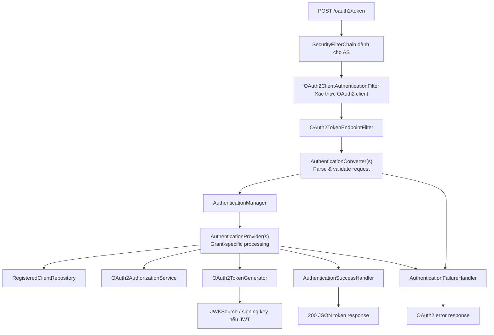
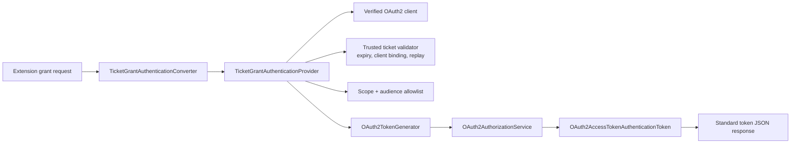
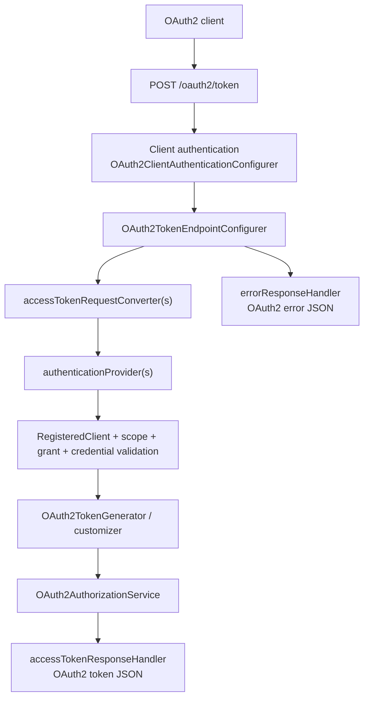

# OAuth2TokenEndpointConfigurer và các điểm mở rộng

## 1. Mục tiêu và bối cảnh

Trong chương **Token Endpoint** của module **SPRING_SECURITY_OAUTH2_OIDC_AUTHORIZATION_SERVER**, `OAuth2TokenEndpointConfigurer` là điểm cấu hình của Spring Authorization Server (SAS) giúp ứng dụng điều khiển **cách nhận yêu cầu cấp token, lựa chọn authentication provider, tạo phản hồi thành công và xử lý phản hồi lỗi** tại endpoint token.

Bài học phục vụ mục tiêu thiết kế, cấu hình, bảo mật, kiểm thử và vận hành **OAuth 2.0/OpenID Connect (OIDC) Authorization Server** bằng **Spring Security**, **Spring Authorization Server** và **Spring Boot**. Không phải dự án nào cũng cần tùy biến Token Endpoint: bộ converter, provider và handler mặc định đã xử lý các grant chuẩn được phiên bản SAS hỗ trợ. Mở rộng chỉ có giá trị khi có **một yêu cầu giao thức hoặc tích hợp cụ thể**, được bảo vệ và kiểm thử đầy đủ.

Sau bài này, bạn có thể:

- Xác định vị trí của `OAuth2TokenEndpointConfigurer` trong `OAuth2AuthorizationServerConfigurer` và `SecurityFilterChain`.
- Phân biệt `OAuth2TokenEndpointFilter`, `AuthenticationConverter`, `AuthenticationProvider`, `AuthenticationSuccessHandler` và `AuthenticationFailureHandler`.
- Sử dụng đúng các điểm mở rộng `accessTokenRequestConverter(s)`, `authenticationProvider(s)`, `accessTokenResponseHandler` và `errorResponseHandler`.
- Thiết kế extension grant theo nguyên tắc **xác thực client trước, kiểm tra grant/scope, xác minh bằng chứng, ngăn replay, sau đó mới phát token**.
- Biết khi nào nên dùng `OAuth2TokenCustomizer`/`OAuth2TokenGenerator` thay vì sửa token response handler.
- Thiết kế kiểm thử, phân loại lỗi OAuth2 và vận hành Token Endpoint mà không làm lộ credential/token.

**Phạm vi API:** Mã ví dụ hướng tới cấu hình DSL phổ biến của **Spring Authorization Server 1.x**, **Spring Security 6.x** và **Spring Boot 3.x**. Danh sách grant mặc định và signature của API có thể thay đổi theo phiên bản. Trước khi đưa code vào production, đối chiếu tài liệu và dependency thực tế. Ví dụ extension grant dùng `urn:example:params:oauth:grant-type:ticket` là **grant minh họa nội bộ**, không phải grant đã được tiêu chuẩn hóa.

## 2. Token Endpoint thuộc chặng nào trong OAuth 2.0?

Token Endpoint là địa chỉ client gửi yêu cầu **đổi authorization code**, **làm mới token**, **dùng Client Credentials** hoặc các grant được hỗ trợ để nhận token. Đường dẫn mặc định phổ biến của SAS là `POST /oauth2/token`; có thể thay đường dẫn qua `AuthorizationServerSettings`.



Đây là sơ đồ **trách nhiệm khái niệm**. Trong thực tế, client authentication có filter/provider riêng chạy trong Spring Security filter chain; các exception và thứ tự nội bộ tùy cấu hình. Không suy rằng request nào cũng đi qua cùng converter hoặc mọi grant đều sinh refresh token.

| Chặng | Thành phần | Trách nhiệm |
| --- | --- | --- |
| Chọn endpoint HTTP | `SecurityFilterChain` + `OAuth2TokenEndpointFilter` | Bảo đảm request token đi vào đúng xử lý của AS. |
| Xác thực client | `OAuth2ClientAuthenticationFilter` và client authentication providers | Chứng minh danh tính client theo phương thức đã đăng ký; bảo vệ confidential clients. |
| Parse token request | `AuthenticationConverter` | Phân loại `grant_type`, kiểm tra cấu trúc tham số và tạo authentication token mô tả yêu cầu. |
| Xử lý grant | `AuthenticationProvider` | Kiểm tra client/grant, code hoặc bằng chứng khác, scope và authorization state. |
| Sinh/lưu token | `OAuth2TokenGenerator<?>`, `OAuth2AuthorizationService` | Phát token theo settings; lưu state và metadata khi cần. |
| Trả kết quả | Success/error handlers | Tuân thủ HTTP status, JSON fields và OAuth2 error semantics. |

**Phân biệt điểm mở rộng:** Tùy biến **xác thực client** nằm chủ yếu ở `OAuth2ClientAuthenticationConfigurer`; tùy biến **token grant request** nằm ở `OAuth2TokenEndpointConfigurer`. Không gắn xử lý `client_secret_basic` vào converter của một extension grant rồi vô tình bỏ qua authentication chain chuẩn.

## 3. `OAuth2TokenEndpointConfigurer` nằm trong DSL nào?

Trong SAS 1.x, `OAuth2AuthorizationServerConfigurer` tổ chức cấu hình các endpoint của Authorization Server. `tokenEndpoint(...)` là nơi cấu hình Token Endpoint:

```java
@Configuration(proxyBeanMethods = false)
@EnableWebSecurity
public class AuthorizationServerSecurityConfig {

    @Bean
    @Order(1)
    SecurityFilterChain authorizationServerChain(HttpSecurity http)
            throws Exception {

        OAuth2AuthorizationServerConfigurer authorizationServer =
                OAuth2AuthorizationServerConfigurer.authorizationServer();

        http
            .securityMatcher(authorizationServer.getEndpointsMatcher())
            .with(authorizationServer, as -> as
                    .tokenEndpoint(token -> {
                        // Extension points chỉ đăng ký khi thật sự cần.
                    })
                    .oidc(Customizer.withDefaults()))
            .authorizeHttpRequests(authorize ->
                    authorize.anyRequest().authenticated())
            .exceptionHandling(exceptions ->
                    exceptions.defaultAuthenticationEntryPointFor(
                            new LoginUrlAuthenticationEntryPoint("/login"),
                            new MediaTypeRequestMatcher(MediaType.TEXT_HTML)))
            .oauth2ResourceServer(oauth2 ->
                    oauth2.jwt(Customizer.withDefaults()));

        return http.build();
    }

    @Bean
    @Order(2)
    SecurityFilterChain applicationChain(HttpSecurity http)
            throws Exception {

        http.authorizeHttpRequests(authorize ->
                    authorize.anyRequest().authenticated())
            .formLogin(Customizer.withDefaults());

        return http.build();
    }
}
```

**Ý nghĩa:** `getEndpointsMatcher()` giới hạn chain AS tới endpoint do configurer quản lý. Chain ứng dụng phục vụ `/login` và các trang tương tác. `.oidc(...)` bật OIDC nhưng cần các bean ký/giải mã token phù hợp và các thành phần hạ tầng khác. Cấu hình bên trên là **bộ khung**, chưa đăng ký client, authorization service, JWKSource, issuer hay user authentication.

Khi chỉ cần Authorization Code, Refresh Token hoặc Client Credentials theo mặc định, **không cần khai báo từng converter/provider bằng tay**. SAS cấu hình chúng theo những grant/chức năng được hỗ trợ. Việc đăng ký thêm converter/provider sai có thể thay đổi thứ tự xử lý hoặc tạo một đường cấp token ngoài ý muốn.

## 4. Sáu điểm mở rộng của `OAuth2TokenEndpointConfigurer`

### 4.1. Bảng tổng hợp

| API cấu hình | Kiểu đầu vào | Mục đích | Rủi ro khi dùng sai |
| --- | --- | --- | --- |
| `accessTokenRequestConverter(...)` | `AuthenticationConverter` | Bổ sung converter phân tích một dạng token request, thường cho extension grant. | Nhận nhầm grant chuẩn, bỏ qua kiểm tra tham số, lộ dữ liệu nhạy cảm. |
| `accessTokenRequestConverters(...)` | `Consumer<List<AuthenticationConverter>>` | Truy cập và điều chỉnh danh sách converters đã cấu hình. | Xóa/thay thứ tự converter chuẩn, gây sai xử lý grant. |
| `authenticationProvider(...)` | `AuthenticationProvider` | Bổ sung provider xử lý một authentication token/grant riêng. | Phát token khi chưa xác minh client, ticket, scope hoặc chống replay. |
| `authenticationProviders(...)` | `Consumer<List<AuthenticationProvider>>` | Truy cập và điều chỉnh danh sách providers. | Bỏ provider chuẩn, chọn provider sai hoặc gây xung đột `supports(...)`. |
| `accessTokenResponseHandler(...)` | `AuthenticationSuccessHandler` | Tùy biến cách xử lý token request thành công. | Response không đúng JSON OAuth2, thiếu header chống cache hoặc lộ token. |
| `errorResponseHandler(...)` | `AuthenticationFailureHandler` | Tùy biến cách trả OAuth2 error response. | Sai HTTP status/error code, lộ stack trace/secret hoặc biến lỗi xác thực thành redirect. |

Các phương thức số ít thường thuận tiện để **thêm** converter/provider. Biến thể số nhiều giúp xem/chỉnh danh sách sâu hơn, vì vậy phải đặc biệt cẩn trọng với thứ tự và các thành phần mặc định. Không coi converter và provider là hai cách làm thay thế nhau: chúng đảm nhận **hai bước khác nhau**.

### 4.2. Nguyên tắc lựa chọn điểm mở rộng

- Muốn thêm **một grant type mới**: thường cần **cả request converter lẫn authentication provider**.
- Muốn điều chỉnh **claim access token JWT**: thường dùng `OAuth2TokenCustomizer<JwtEncodingContext>`, không sửa success handler.
- Muốn thay **thuật toán/cách sinh token**: đánh giá `OAuth2TokenGenerator<?>` và token settings, không tự tạo token trong servlet controller.
- Muốn thay **client authentication method**: xem `clientAuthentication(...)` và provider tương ứng, không bỏ qua bước client authentication ở Token Endpoint.
- Muốn ghi **audit/metrics**: ưu tiên event/service layer hoặc decorate handler đã tuân thủ giao thức; không tự trả token JSON chỉ để ghi thêm một dòng log.
- Muốn thay **endpoint path/issuer**: dùng `AuthorizationServerSettings`, không sửa converter để nhận một URL tự nghĩ ra.

## 5. `AuthenticationConverter`: phân tích request, chưa cấp token

`AuthenticationConverter#convert(HttpServletRequest)` nhận request HTTP và trả một đối tượng `Authentication` thể hiện grant request, hoặc `null` nếu converter **không xử lý loại request này**.

Trong Token Endpoint:

1. Converter đọc `grant_type` và xác định request có thuộc grant mình phụ trách không.
2. Nếu grant không khớp, trả `null` để converter khác xử lý.
3. Nếu grant khớp nhưng tham số thiếu/trùng/không hợp lệ, trả lỗi `invalid_request` theo hợp đồng, **không trả `null` để “cho qua”**.
4. Nếu request hợp lệ về **cấu trúc**, tạo authentication token chứa các giá trị cần để provider xác minh.
5. **Không** thực hiện cấp token, truy vấn tùy tiện dữ liệu nhạy cảm hoặc tin credential chỉ vì request có một `client_id`.

### 5.1. Converter mặc định và extension grant

Các grant tiêu biểu như `authorization_code`, `refresh_token`, `client_credentials` và Device Code Grant (khi được framework hỗ trợ) có converter/provider tương ứng. Tập grant mặc định còn phụ thuộc **phiên bản SAS và phần giao thức đã bật**; không tự suy rằng extension như token exchange được bật ở mọi phiên bản.

Với một grant nội bộ ví dụ:

```http
POST /oauth2/token HTTP/1.1
Host: auth.example.com
Authorization: Basic <CLIENT_CREDENTIALS>
Content-Type: application/x-www-form-urlencoded

grant_type=urn:example:params:oauth:grant-type:ticket&ticket=ONE_TIME_TRUSTED_TICKET
```

Converter phải nhận đúng `grant_type`, kiểm tra một giá trị `ticket` hợp lệ về dạng và chuyển tới provider xử lý. `ticket` là credential nhạy cảm; không log raw giá trị.

### 5.2. Authentication token cho extension grant

Đây là ví dụ **loại authentication request**, chưa chứa logic xác minh ticket hay phát token:

```java
public final class TicketGrantAuthenticationToken
        extends OAuth2AuthorizationGrantAuthenticationToken {

    public static final AuthorizationGrantType GRANT_TYPE =
            new AuthorizationGrantType(
                    "urn:example:params:oauth:grant-type:ticket");

    public TicketGrantAuthenticationToken(
            Authentication clientPrincipal, String ticket) {

        super(GRANT_TYPE, clientPrincipal, Map.of("ticket", ticket));
    }

    public String getTicket() {
        return (String) getAdditionalParameters().get("ticket");
    }
}
```

`OAuth2AuthorizationGrantAuthenticationToken` biểu diễn **yêu cầu một grant** và giữ principal của client đã được xác thực bởi lớp trước đó. Nó **không chứng minh ticket hợp lệ** và không phải access token được phát hành.

### 5.3. Converter kiểm tra form parameter

```java
public final class TicketGrantAuthenticationConverter
        implements AuthenticationConverter {

    @Override
    public Authentication convert(HttpServletRequest request) {
        String grantType = request.getParameter(
                OAuth2ParameterNames.GRANT_TYPE);

        if (!TicketGrantAuthenticationToken.GRANT_TYPE
                .getValue().equals(grantType)) {
            return null;
        }

        String[] tickets = request.getParameterValues("ticket");

        if (tickets == null || tickets.length != 1
                || !StringUtils.hasText(tickets[0])) {
            throw new OAuth2AuthenticationException(
                    new OAuth2Error(OAuth2ErrorCodes.INVALID_REQUEST));
        }

        Authentication clientPrincipal =
                SecurityContextHolder.getContext()
                        .getAuthentication();

        return new TicketGrantAuthenticationToken(
                clientPrincipal, tickets[0]);
    }
}
```

Mã lược `import`, minh họa ý tưởng kiểm tra **đúng một** ticket. Với triển khai thực tế, converter còn phải kiểm tra `grant_type` trùng lặp, request có content type phù hợp, tham số dư theo policy và giới hạn độ dài đầu vào. Tránh sử dụng `getParameter(...)` đơn lẻ như bằng chứng đủ rằng request không có giá trị lặp. Những validation này thuộc **cấu trúc request**; tính hợp lệ và single-use của ticket thuộc provider/service.

**Không bao giờ** chấp nhận ticket chỉ vì có chuỗi không rỗng. Ticket phải được một nguồn có thẩm quyền phát hành, gắn với client/recipient/scope/time và có cơ chế xác minh chống replay, nếu không extension grant trở thành đường cấp token trái phép.

## 6. `AuthenticationProvider`: xác thực bằng chứng và xử lý grant

`AuthenticationProvider` nhận authentication token từ converter, kiểm tra mọi điều kiện giao thức/nghiệp vụ và chỉ trả authentication result thành công khi yêu cầu đủ điều kiện.

### 6.1. Hợp đồng tối thiểu

Một provider cho `TicketGrantAuthenticationToken` có thể có cấu trúc:

```java
public final class TicketGrantAuthenticationProvider
        implements AuthenticationProvider {

    private final TrustedOneTimeTicketService ticketService;
    private final OAuth2TokenGenerator<?> tokenGenerator;
    private final OAuth2AuthorizationService authorizationService;

    public TicketGrantAuthenticationProvider(
            TrustedOneTimeTicketService ticketService,
            OAuth2TokenGenerator<?> tokenGenerator,
            OAuth2AuthorizationService authorizationService) {

        this.ticketService = ticketService;
        this.tokenGenerator = tokenGenerator;
        this.authorizationService = authorizationService;
    }

    @Override
    public boolean supports(Class<?> authentication) {
        return TicketGrantAuthenticationToken.class
                .isAssignableFrom(authentication);
    }

    @Override
    public Authentication authenticate(Authentication authentication) {
        TicketGrantAuthenticationToken grant =
                (TicketGrantAuthenticationToken) authentication;

        // Bước 1: Bắt buộc có client principal đã xác thực.
        // Bước 2: Tra RegisteredClient, kiểm tra grant type.
        // Bước 3: Xác minh và tiêu thụ ticket một lần, gắn đúng client.
        // Bước 4: Giới hạn scopes/audience theo chính sách server.
        // Bước 5: Gọi tokenGenerator, lưu OAuth2Authorization.
        // Bước 6: Trả OAuth2AccessTokenAuthenticationToken.
        // Đây là khung mô tả thứ tự kiểm soát, không phải
        // implementation cấp token dùng được trong production.
        throw new UnsupportedOperationException(
                "Implement audited ticket grant validation first");
    }
}
```

`TrustedOneTimeTicketService` là **interface giả định của ứng dụng**, không phải bean SAS có sẵn. Provider mẫu cố ý **không phát token**: một ví dụ cấp token hoàn chỉnh mà không có cơ chế chứng minh ticket tin cậy và tiêu thụ nguyên tử sẽ tạo cảm giác an toàn giả.

### 6.2. Các bất biến bảo mật của provider

| Kiểm tra | Phải xảy ra trước khi cấp token | Hậu quả nếu thiếu |
| --- | --- | --- |
| Client principal đã xác thực | Có; không tin `client_id` form | Client giả danh hoặc không được xác thực có thể xin token. |
| Client có quyền dùng grant | Có; đối chiếu `RegisteredClient.authorizationGrantTypes` | Client dùng grant ngoài đăng ký. |
| Ticket/chứng cứ còn hạn và được phát bởi nguồn đáng tin | Có | Ticket giả hoặc bị đánh cắp có thể được dùng. |
| Ticket gắn đúng client và intended recipient | Có | Ticket của client A bị đổi bởi client B. |
| Ticket chỉ dùng một lần, được consume atomically | Có | Replay hoặc race tạo nhiều token. |
| Scope được phép | Có; giới hạn theo registered scopes và policy | Token có quyền vượt phạm vi được phê duyệt. |
| Audience phù hợp Resource Server | Có; do AS kiểm soát | Cross-resource token replay. |
| Token generator/authorization service hoạt động | Có | Trả token chưa được lưu/tracking đúng chính sách. |
| Error semantics chuẩn | Có | API client nhận lỗi không dự đoán được, có thể lộ dữ liệu. |

Khi tự triển khai, provider thường cần `RegisteredClientRepository`, `OAuth2AuthorizationService`, `OAuth2TokenGenerator<?>`, một verifier/ticket store đáng tin và `AuthorizationServerContext`. **Không làm lại cơ chế xác thực client** bên trong grant bằng một phép so khớp tùy tiện, và không bao giờ dùng `Authenticated=true` do input từ client tự gán.

### 6.3. Kết quả cấp token của provider

Sau khi xác thực mọi điều kiện, provider thường tạo access token qua `OAuth2TokenGenerator<?>` với `OAuth2TokenContext` phù hợp, lưu `OAuth2Authorization` và trả authentication result dạng `OAuth2AccessTokenAuthenticationToken`. Response handler của framework sau đó tạo HTTP JSON đúng chuẩn.

Nếu generator sinh JWT, token context phải phản ánh **đúng registered client, principal, grant type, authorized scopes, token type và AS context**. Nếu triển khai refresh token hoặc OIDC ID token theo extension, các điều kiện phải được thiết kế riêng; **không tự cấp refresh/ID token như mặc định** chỉ vì một extension grant thành công.

## 7. Đăng ký converter và provider bằng Token Endpoint DSL

Khi đã có các implementation an toàn, đăng ký chúng:

```java
@Bean
@Order(1)
SecurityFilterChain authorizationServerChain(
        HttpSecurity http,
        TicketGrantAuthenticationConverter ticketConverter,
        TicketGrantAuthenticationProvider ticketProvider)
        throws Exception {

    OAuth2AuthorizationServerConfigurer as =
            OAuth2AuthorizationServerConfigurer.authorizationServer();

    http
        .securityMatcher(as.getEndpointsMatcher())
        .with(as, authorizationServer ->
                authorizationServer.tokenEndpoint(tokenEndpoint ->
                        tokenEndpoint
                            .accessTokenRequestConverter(ticketConverter)
                            .authenticationProvider(ticketProvider)))
        .authorizeHttpRequests(authorize ->
                authorize.anyRequest().authenticated());

    return http.build();
}
```

Đoạn này cho thấy cách **ghép extension point**, không phải toàn bộ Authorization Server. Phải có client authentication chain, hạ tầng JWT/authorization, registered clients, login nếu cần; `TicketGrantAuthenticationProvider` mẫu ở mục trước cần được triển khai thật và kiểm thử mới có thể xử lý request thành công.

### 7.1. Biến thể điều chỉnh danh sách

Có thể dùng các phương thức nhận consumer:

```java
tokenEndpoint
    .accessTokenRequestConverters(converters -> {
        // Được phép xem/điều chỉnh danh sách converters.
        // Ví dụ kiểm tra thứ tự để tránh converter custom
        // chiếm request của authorization_code.
    })
    .authenticationProviders(providers -> {
        // Được phép xem/điều chỉnh providers.
        // Không xóa provider chuẩn khi không thật sự cần.
    });
```

**Cẩn thận:** Đây là ví dụ về callback nhận danh sách; không nên sao chép mã này vào nơi chưa có biến `tokenEndpoint`. Khi cần điều chỉnh thứ tự, phải kiểm tra chính xác hợp đồng của phiên bản SAS và các converter/provider đã đăng ký. Một converter trả `Authentication` cho mọi request sẽ chặn converter đúng, còn một provider có `supports(...)` quá rộng có thể xử lý nhầm grant.

### 7.2. Tránh khai báo trùng extension

Nếu cùng một converter được gắn nhiều lần hoặc hai provider đều `supports` một loại token nhưng có logic trái nhau, hành vi phụ thuộc cách `AuthenticationManager` lựa chọn/tiếp tục provider. Cần kiểm soát một đường xử lý rõ ràng cho mỗi grant và xây test xác minh converter/provider không tác động các grant khác.

Một cách tổ chức dễ kiểm soát là gom các extension grant theo module riêng, đăng ký một converter và một provider cho mỗi grant type; policy kiểm tra client/scope/ticket nằm trong service chuyên biệt, không dồn hết vào lambda của DSL.

## 8. Tùy biến response thành công: khi nào thực sự cần?

`accessTokenResponseHandler(AuthenticationSuccessHandler)` cho phép thay cách Token Endpoint phản hồi khi authentication thành công.

Trong luồng chuẩn, handler phải trả **HTTP 200**, nội dung JSON với `access_token`, `token_type`, `expires_in` và các trường phù hợp, đồng thời bảo đảm không cache response nhạy cảm:

```http
HTTP/1.1 200 OK
Content-Type: application/json
Cache-Control: no-store
Pragma: no-cache

{
  "access_token": "<REDACTED>",
  "token_type": "Bearer",
  "expires_in": 300,
  "scope": "orders.read"
}
```

**Đừng thay success handler chỉ để thêm một claim vào JWT.** JWT đã được sinh **trước khi** handler xử lý response. Thêm trường JSON `role` không làm access token được Resource Server xác minh có claim `role`.

### 8.1. Trường hợp nên giữ handler mặc định

- Chỉ muốn gắn `aud`/`roles` vào access token JWT.
- Chỉ muốn điều chỉnh TTL của token.
- Chỉ muốn thay định dạng JWT/opaque.
- Chỉ muốn lưu audit hoặc tăng counter metric mà không thay payload giao thức.
- Chỉ muốn hiển thị một trường mới ở API Resource Server.

Trong các trường hợp đó, cân nhắc token settings, customizer, generator hoặc metric/event phù hợp. Handler mặc định giúp bảo toàn các chi tiết protocol ít được chú ý: content type, no-store headers, JSON serialization và status code.

### 8.2. Nếu bắt buộc phải thay handler

Thứ tự an toàn:

1. Xác định hợp đồng OAuth2 response và hành vi chuẩn của phiên bản SAS.
2. Dùng handler đã được kiểm chứng/ủy quyền cho việc **ghi response thực tế**.
3. Nếu thêm audit, tránh thu thập raw token, refresh token hoặc serialized `Authentication`.
4. Bảo đảm không viết response hai lần; không trộn redirect HTML với JSON token response.
5. Kiểm thử đúng status, header `Cache-Control: no-store`, `Pragma: no-cache`, JSON fields và lỗi network/serialization.
6. Không mở CORS toàn cục hoặc ghi token vào query URL chỉ để tương thích một client không đúng chuẩn.

Có thể đăng ký custom handler bằng:

```java
tokenEndpoint.accessTokenResponseHandler(customSuccessHandler);
```

`customSuccessHandler` phải là `AuthenticationSuccessHandler` được ứng dụng triển khai và kiểm thử. Đây là đoạn DSL minh họa, không phải bean có sẵn của framework.

## 9. Tùy biến error handler và giữ đúng OAuth2 error contract

`errorResponseHandler(AuthenticationFailureHandler)` quyết định cách trả lỗi của Token Endpoint. Khi không tùy biến, SAS trả lỗi theo giao thức; ứng dụng chỉ nên thay handler khi có yêu cầu cụ thể về interoperability hoặc audit có thể kiểm thử.

| Lỗi | Nguyên nhân thường gặp | Hành vi mong muốn |
| --- | --- | --- |
| `invalid_request` | Thiếu/trùng tham số, dữ liệu sai định dạng | HTTP lỗi với JSON OAuth2; không trả token. |
| `invalid_client` | Client secret/method/assertion không hợp lệ | Từ chối client authentication; HTTP status/header tuân chuẩn. |
| `invalid_grant` | Code/refresh token/ticket không hợp lệ, hết hạn, dùng lại hoặc sai binding | Không phát token, không tiết lộ chủ sở hữu credential. |
| `unauthorized_client` | Client không được phép dùng grant | Không cho grant vượt đăng ký. |
| `unsupported_grant_type` | Grant không được AS hỗ trợ | Không tự chuyển sang grant yếu hơn. |
| `invalid_scope` | Scope ngoài quyền hoặc không hợp lệ | Không cấp quyền rộng hơn yêu cầu được phê duyệt. |
| `server_error` | Lỗi xử lý nội bộ/hạ tầng | Không lộ stack trace, secret hay chi tiết database. |

Ví dụ HTTP khi authorization code không hợp lệ:

```http
HTTP/1.1 400 Bad Request
Content-Type: application/json
Cache-Control: no-store
Pragma: no-cache

{"error":"invalid_grant"}
```

Với lỗi client authentication, HTTP 401 và `WWW-Authenticate` phù hợp có thể cần thiết tùy cơ chế. Không ép mọi lỗi Token Endpoint trả 200 hoặc redirect browser sang `/login`; đây là API cấp token, không phải trang login tương tác.

### 9.1. Cách suy nghĩ về custom error handler

```java
tokenEndpoint.errorResponseHandler(customErrorHandler);
```

Handler cần chuyển exception sang lỗi OAuth2 theo quy định, loại bỏ dữ liệu nhạy cảm, giữ `Cache-Control: no-store` và không mô tả khác biệt quá chi tiết kiểu “client ID tồn tại nhưng secret sai”. Với audit, log **mã lỗi đã chuẩn hóa** và correlation ID; không ghi raw `code`, `refresh_token`, `client_secret`, ticket, JWT hoặc full request/response body.

Nếu muốn client hiểu lỗi dễ hơn, ưu tiên tài liệu hóa `error` và các kịch bản khôi phục. Không nhúng error description chứa PII/stack trace vào JSON public.

## 10. Tùy biến nội dung token: dùng đúng extension point

### 10.1. JWT access token claims

Khi muốn thêm `aud` hoặc claim được quản lý bởi AS, dùng `OAuth2TokenCustomizer<JwtEncodingContext>`:

```java
@Bean
OAuth2TokenCustomizer<JwtEncodingContext> jwtTokenCustomizer() {
    return context -> {
        if (!OAuth2TokenType.ACCESS_TOKEN.equals(
                context.getTokenType())) {
            return;
        }

        if (AuthorizationGrantType.CLIENT_CREDENTIALS.equals(
                context.getAuthorizationGrantType())) {

            String clientId =
                    context.getRegisteredClient().getClientId();

            // Chính sách allowlist phía server, không lấy aud
            // trực tiếp từ request mà chưa xác minh.
            if ("orders-worker".equals(clientId)) {
                context.getClaims().audience(List.of("orders-api"));
            }
        }
    };
}
```

**Cẩn thận:** Claim trong **OIDC ID token** có mục đích khác access token. Vì vậy kiểm tra `ACCESS_TOKEN` trước khi sửa audience của JWT access token, không vô tình thay `aud` của ID token. Khi dùng nhiều JWT customizers hoặc token generator tự tạo, phải xác định cách ghép các customizer theo phiên bản framework.

Khi yêu cầu audience policy cho nhiều clients, không chỉ bỏ qua client không có mapping rồi phát JWT với audience không rõ đích. Chính sách có thể từ chối grant trong provider trước khi sinh token, hoặc dùng lớp kiểm tra tin cậy khác, kèm integration test xác minh fail-closed.

### 10.2. Opaque access token và tùy biến claims

Nếu access token dùng định dạng `OAuth2TokenFormat.REFERENCE`, `OAuth2TokenCustomizer<OAuth2TokenClaimsContext>` có thể giúp thêm claims của access token opaque khi dùng `OAuth2AccessTokenGenerator` thích hợp. Khi đó Resource Server thường cần introspection hoặc bộ xác minh token state tương ứng.

Không cho rằng customizer cho `JwtEncodingContext` cũng áp dụng nguyên vẹn với opaque token. Ngược lại, một `OAuth2TokenCustomizer<OAuth2TokenClaimsContext>` không tự biến ID token OIDC thành JWT mới.

### 10.3. Khi nào tự đăng ký `OAuth2TokenGenerator<?>`?

Ví dụ khi phải phối hợp generator đặc thù hoặc cần thay cách mã hóa token theo chính sách. Nhưng nếu tự tạo bean generator, cần duy trì khả năng sinh những token mà AS đang hỗ trợ: JWT access token, opaque access token, refresh token và OIDC ID token khi cần. Không tạo generator chỉ xử lý access token rồi vô tình làm flow refresh/OIDC thất bại.

`OAuth2TokenGenerator` là **lớp sinh token**, còn `OAuth2TokenEndpointConfigurer` là **lớp cấu hình pipeline xử lý request**. Việc đặt đúng extension point giúp không làm sai hợp đồng giao thức.

## 11. Những bean và cấu hình liên quan nhưng không phải method của Token Endpoint DSL

| Thành phần | Vai trò | Thường cấu hình ở đâu? |
| --- | --- | --- |
| `RegisteredClientRepository` | Client ID, grant types, client authentication, scopes, token settings | Bean hạ tầng. |
| `OAuth2AuthorizationService` | Lưu code, token, trạng thái authorization | Bean in-memory hoặc JDBC/implementation riêng. |
| `OAuth2AuthorizationConsentService` | Consent của người dùng với client | Bean hạ tầng khi grant cần consent. |
| `OAuth2TokenGenerator<?>` | Sinh JWT, access/refresh token | Bean hoặc cấu hình mặc định của SAS. |
| `JWKSource<SecurityContext>` | Cung cấp private signing key/public JWKS | Bean hạ tầng khi ký JWT. |
| `JwtDecoder` | Xác minh JWT cho tính năng cần thiết (ví dụ OIDC) | Bean hạ tầng. |
| `AuthorizationServerSettings` | Issuer và endpoint path | Bean cấu hình AS. |
| `OAuth2ClientAuthenticationConfigurer` | Authentication method của client, converter/provider, handler | `clientAuthentication(...)` trong AS DSL. |
| `OAuth2TokenEndpointConfigurer` | Grant request converter/provider và token response handlers | `tokenEndpoint(...)` trong AS DSL. |

### 11.1. Khác biệt giữa `clientAuthentication` và `tokenEndpoint`

Một confidential client `orders-backend` gửi `Authorization: Basic ...` để xác thực, **sau đó** dùng `grant_type=client_credentials` để xin token.

- Khi secret sai: lỗi **client authentication** (`invalid_client`).
- Khi secret đúng nhưng grant không được đăng ký: lỗi **grant authorization** (`unauthorized_client`).
- Khi scope vượt đăng ký: lỗi **grant/scope policy** (`invalid_scope`).
- Khi code đã dùng: lỗi **grant state** (`invalid_grant`).

Không gom các lỗi này thành một lỗi “mật khẩu sai” hoặc cố xử lý tất cả trong cùng converter.

### 11.2. Thay đường dẫn endpoint

Nếu Token Endpoint phải dùng một path khác:

```java
@Bean
AuthorizationServerSettings authorizationServerSettings() {
    return AuthorizationServerSettings.builder()
            .issuer("https://auth.example.com")
            .tokenEndpoint("/oauth2/token")
            .build();
}
```

Đây là ví dụ định nghĩa tường minh path mặc định; để dùng path khác có thể thay giá trị phù hợp và cập nhật metadata/gateway/client config. Không hard-code một URL mới trong converter mà bỏ qua `AuthorizationServerSettings` và `SecurityFilterChain`.

## 12. Quy trình thiết kế extension grant an toàn

Trước khi viết code, hãy trả lời:

1. **Vì sao grant chuẩn không đáp ứng?** Nếu Authorization Code + PKCE, Client Credentials, Device Code hoặc Refresh Token phù hợp, ưu tiên dùng chuẩn.
2. **Bằng chứng được phát hành bởi ai?** Ticket hoặc assertion phải có nguồn tin cậy và hợp đồng xác minh.
3. **Ticket gắn với client nào?** Không dùng ticket của client khác.
4. **Ticket đại diện cho ai?** Có delegation của người dùng cuối hay chỉ là workload? Phải nêu rõ để không tự nâng quyền.
5. **Scope và audience do ai quyết định?** AS kiểm soát, không phải caller tự khai.
6. **Replay được ngăn thế nào?** Ticket một lần cần cơ chế consume nguyên tử, kể cả nhiều node.
7. **Thời gian sống ra sao?** Dùng server clock, TTL ngắn và policy xử lý skew.
8. **Token response chứa gì?** Không tự cấp refresh token hoặc ID token khi không có điều kiện.
9. **Error semantics nào?** Phân biệt malformed request, invalid client, invalid grant và server fault.
10. **Cần observability nào?** Audit và metrics chỉ dùng mã định danh an toàn, không log credential.

Một cách tổ chức:



**Không chọn làm ngắn đường đi** bằng việc tự tạo JWT trong converter, chép `scope` client gửi vào token mà không kiểm tra hoặc skip persistence khi grant đòi hỏi lưu trạng thái. Extension grant là một bề mặt phát token có rủi ro cao, cần review/kiểm thử riêng.

## 13. Kiểm thử những điểm mở rộng

### 13.1. Ma trận converter/provider

| Test case | Converter | Provider | Kỳ vọng |
| --- | --- | --- | --- |
| `grant_type` không phải grant của converter | Trả `null` | Không được gọi provider custom | Converter chuẩn khác xử lý request phù hợp. |
| `grant_type` đúng nhưng thiếu ticket | Báo `invalid_request` | Không phát token | Không bỏ qua validation bằng cách trả `null`. |
| Có nhiều `ticket` | Từ chối request không hợp lệ | Không phát token | Không chọn ngẫu nhiên giá trị đầu/ cuối. |
| Ticket quá dài hoặc có ký tự không được phép | Từ chối sớm | Không phát token | Không gây quá tải parser/store. |
| Client không xác thực | Converter có thể tạo request token | Provider từ chối `invalid_client` | Không phát token. |
| Client không được đăng ký custom grant | Có request | Provider từ chối `unauthorized_client` | Không phát token. |
| Ticket sai, hết hạn hoặc sai client | Có request | Provider từ chối `invalid_grant` | Không tiết lộ chủ sở hữu ticket. |
| Ticket đã dùng | Có request | Provider từ chối replay | Không phát token bổ sung. |
| Scopes vượt allowlist | Có request | Provider từ chối hoặc thu hẹp theo policy rõ | Không có scope vượt quyền. |
| Chính sách audience chưa có | Có request | Fail closed | Không phát token dành cho tài nguyên không xác định. |
| Ticket hợp lệ | Tạo đúng authentication request | Provider sinh/lưu token, trả result | Handler chuẩn trả JSON OAuth2. |
| Hai request cùng ticket | Có thể chạy đồng thời | Verifier consume atomic | Không dùng ticket hai lần. |

### 13.2. Kiểm thử các grant chuẩn không bị ảnh hưởng

Sau khi đăng ký extension mới, phải chạy lại ít nhất:

- Authorization Code + PKCE hợp lệ và sai verifier.
- Refresh Token Grant hợp lệ, expired/invalidated token.
- Client Credentials hợp lệ, scope không cho phép.
- Device Code Grant nếu hệ thống đang bật.
- OIDC token generation và ID token validation khi có `openid`.
- Client authentication Basic/POST/private-key JWT nếu đang hỗ trợ.

Mục tiêu là chứng minh converter/provider mới **không chiếm request** của grant chuẩn và không làm biến mất handler/default provider. Đừng chỉ kiểm tra extension grant thành công.

### 13.3. Spring Security Test/MockMvc

Một test request sai tham số có thể có cấu trúc:

```java
@Test
void extensionGrantRejectsMissingTicket() throws Exception {
    mockMvc.perform(post("/oauth2/token")
            .contentType(
                    MediaType.APPLICATION_FORM_URLENCODED)
            .param("grant_type",
                    "urn:example:params:oauth:grant-type:ticket")
            .with(httpBasic("trusted-client", "test-secret")))
        .andExpect(status().isBadRequest())
        .andExpect(jsonPath("$.error")
                .value("invalid_request"));
}
```

Mã này **không phải test tự chạy độc lập**: phải khởi tạo test context có custom converter/provider, registered client được phép grant, client secret đúng encoder và các bean hạ tầng cần thiết. Nếu client authentication thất bại trước converter, test sẽ thấy `invalid_client` thay vì `invalid_request`; đó là khác biệt quan trọng cần kiểm tra bằng fixture.

Khi kiểm thử end-to-end, dùng cả integration test với database thật hoặc Testcontainers cho ticket consume/authorization persistence. Một mock verifier trả success không chứng minh single-use an toàn khi có race.

### 13.4. Kiểm thử response handlers

Nếu custom handler được đăng ký, kiểm thử:

| Trường hợp | Khẳng định |
| --- | --- |
| Token cấp thành công | HTTP 200, Content-Type JSON, `access_token` và `token_type` chính xác. |
| Token nhạy cảm | `Cache-Control: no-store`, `Pragma: no-cache` theo policy. |
| Grant sai | JSON `error` phù hợp, không có access token. |
| Client authentication thất bại | Status/header OAuth2 phù hợp, không chuyển browser đến login HTML. |
| Xử lý exception | Không lộ stack trace, secret, full token trong response/log. |
| Gửi response hai lần | Không có lỗi double-write, mixed content hoặc response header sai. |
| Thay handler | Các grant chuẩn vẫn trả response tương thích client OAuth2. |

## 14. Vận hành và quan sát Token Endpoint

### 14.1. Các chỉ số hữu ích

- Lưu lượng `POST /oauth2/token` theo grant type và mã lỗi đã chuẩn hóa.
- Tỷ lệ `invalid_client`, `invalid_grant`, `invalid_scope`, `unsupported_grant_type`.
- P50/P95/P99 latency cho client authentication, grant validation, token generation và authorization persistence.
- Kết quả kiểm tra signing key/KMS/JWKS và lỗi token generator.
- Tỷ lệ ticket hết hạn/replay bị từ chối theo nhóm đã được ẩn danh.
- Số lượng custom provider/extension được bật trên từng instance, cấu hình version và rollout consistency.

**Không ghi vào log/metrics:** `Authorization` Basic header, `client_secret`, authorization code, refresh token, access token, custom ticket, `code_verifier`, private key hoặc toàn bộ `OAuth2Authorization`. Dùng correlation ID **không chứa credential** và giới hạn quyền truy cập audit.

### 14.2. Hệ thống nhiều instance

Khi AS chạy nhiều node:

- `RegisteredClientRepository`/scope policy phải thống nhất.
- `OAuth2AuthorizationService` phải chia sẻ state khi grant cần truy xuất và cập nhật token.
- Ticket store của extension phải hỗ trợ **consume một lần nguyên tử trên nhiều node**.
- Signing key/JWKS, `issuer`, token settings và clock policy phải tương thích.
- Converter/provider custom phải cùng version và được bật nhất quán trên các instance.
- Rolling deployment không được làm request lúc được xử lý, lúc báo `unsupported_grant_type` ngoài ý muốn.

Nếu một client nhận token sau khi ticket đã được sử dụng ở node khác, cần xem đây là **lỗi bảo mật về concurrency**, không phải sự cố UX đơn thuần.

### 14.3. Triaging lỗi thường gặp

| Triệu chứng | Nguyên nhân khả dĩ | Kiểm tra |
| --- | --- | --- |
| `POST /oauth2/token` trả 404 | Sai endpoint path, matcher hoặc order chain | `AuthorizationServerSettings`, `getEndpointsMatcher()`. |
| Endpoint trả HTML login | Application chain bắt trước, authentication entry point sai | Chain AS, client authentication flow. |
| `unsupported_grant_type` | Chưa đăng ký converter/provider, grant type không khớp hoặc không hỗ trợ | `grant_type` và token endpoint DSL. |
| `invalid_request` với extension grant | Converter nhận request nhưng thiếu/trùng tham số | Request validation và encoding. |
| `invalid_client` | Client auth thất bại | `RegisteredClient`, secret/method, client filter configurer. |
| `unauthorized_client` | Client không có quyền dùng extension grant | Allowed grant types trong registered client. |
| `invalid_grant` | Ticket/code expired, replay hoặc sai client binding | Authorization/ticket state và policy. |
| 200 nhưng Resource Server từ chối JWT | Sai `iss`, `aud`, chữ ký hoặc scope | Token customizer, JWKS, Resource Server validator. |
| Không có ID token | OIDC chưa bật, thiếu `openid` hoặc token generator sai | OIDC settings và token type. |
| Response thiếu `Cache-Control: no-store` | Custom handler không giữ HTTP contract | Success/error handler và integration test. |
| Extension grant làm hỏng code/refresh | Converter/provider bắt request quá rộng hoặc đã xóa defaults | Converter return `null`, `supports` và list order. |
| Token bị lộ trong log | Log raw request/response body | Redaction ở gateway, filters, tracing, handlers. |

## 15. Những anti-pattern cần tránh

| Anti-pattern | Vì sao nguy hiểm | Thay thế |
| --- | --- | --- |
| Viết `@PostMapping("/oauth2/token")` tự phát JWT | Bỏ qua client authentication/provider/state/error handling chuẩn | Cấu hình SAS và extension point phù hợp. |
| Converter trả authentication cho mọi request | Chiếm các grant không thuộc mình | Chỉ xử lý đúng `grant_type`; trả `null` khi không khớp. |
| Provider không kiểm tra registered client/grant | Client bất kỳ nhận token | Ràng buộc client principal, allowlist và policy. |
| Dùng ticket một lần mà chỉ `findById` rồi `delete` riêng | Race/replay giữa request đồng thời | Consume atomic với transaction/locking. |
| Copy requested scope vào token không kiểm tra | Privilege escalation | Giới hạn theo registered scopes và policy. |
| Đọc audience từ tham số tùy ý | Token dành cho resource chưa cấp quyền | Client–resource allowlist phía AS. |
| Sửa JWT claim trong success handler | Lúc này JWT đã được sinh; JSON không thay chữ ký JWT | `OAuth2TokenCustomizer` trước bước sinh token. |
| Custom handler trả HTML redirect cho token request | Không tương thích OAuth2 và có thể lộ token | Giữ JSON/HTTP OAuth2 contract. |
| Xóa tất cả providers chuẩn để dễ thêm một grant | Làm hỏng `authorization_code`, refresh, device, v.v. | Bổ sung riêng converter/provider. |
| Log token response vì debug | Rò rỉ credential | Structured logs đã redaction. |

## 16. Checklist nghiệm thu

- [ ] Cấu hình `OAuth2AuthorizationServerConfigurer.tokenEndpoint(...)` trong đúng AS `SecurityFilterChain`.
- [ ] Hiểu chức năng riêng của `AuthenticationConverter`, `AuthenticationProvider` và response handlers.
- [ ] Chỉ thêm converter/provider cho grant mới khi có nhu cầu và contract bảo mật rõ.
- [ ] Converter trả `null` khi grant không khớp; từ chối tham số sai/trùng của grant mình xử lý.
- [ ] Provider xác minh client principal, grant được đăng ký, ticket/credential hợp lệ, scope và audience.
- [ ] Credential một lần được consume nguyên tử và chống replay, kể cả nhiều instance.
- [ ] Token được tạo bởi `OAuth2TokenGenerator<?>` và lưu đúng `OAuth2AuthorizationService` khi cần.
- [ ] Không tự sinh access/ID/refresh token ngoài chính sách grant.
- [ ] Dùng `OAuth2TokenCustomizer` để sửa claims, không sửa response JSON để giả lập claims.
- [ ] Success/error handlers giữ OAuth2 status, JSON fields và no-store cache headers.
- [ ] Không lộ token, code, ticket, verifier hoặc client secret qua log/trace/HTTP error.
- [ ] Đã kiểm thử extension grant success/failure cùng các grant chuẩn còn hoạt động.
- [ ] Đã kiểm thử sai client, grant không cho phép, request malformed, credential expired/replay và scope vượt quyền.
- [ ] Resource Server kiểm tra chữ ký, issuer, audience, expiry và scope độc lập.
- [ ] Hạ tầng nhiều instance thống nhất policies, signing keys, persistence và version extension.
- [ ] Chưa coi build/test snippet hay việc ghi Markdown là hoàn thành QA chuyên môn toàn module.

## 17. Tổng kết



**`OAuth2TokenEndpointConfigurer` là công cụ nối pipeline xử lý Token Endpoint chứ không phải nơi bỏ qua chính sách giao thức.** Với các grant chuẩn, ưu tiên cấu hình mặc định của Spring Authorization Server. Khi cần extension grant, phải bổ sung converter và provider có hợp đồng rõ, giữ client authentication, allowlist, expiry, single-use và đúng cách sinh/lưu token; chỉ thay response handlers khi có yêu cầu thực sự cần. Tách đúng trách nhiệm giữa cấu hình endpoint, token generation, persistence và Resource Server giúp Authorization Server bằng Spring Security/Spring Boot vừa linh hoạt mở rộng vừa an toàn khi vận hành.
