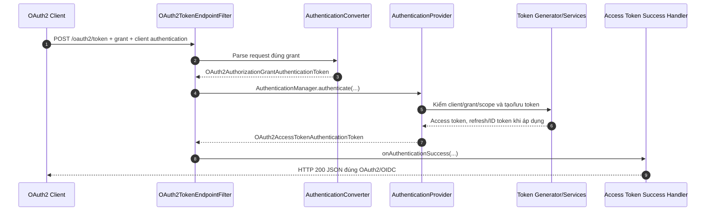

# Tùy chỉnh phản hồi thành công mà vẫn giữ cấu trúc giao thức

## Mục tiêu bài học

Trong chương **Token Endpoint** của module **SPRING_SECURITY_OAUTH2_OIDC_AUTHORIZATION_SERVER**, chúng ta tìm hiểu cách tùy chỉnh **phản hồi cấp token thành công** mà vẫn tuân thủ hợp đồng OAuth 2.0/OpenID Connect (OIDC), bằng **Spring Security** và **Spring Authorization Server** trong ứng dụng **Spring Boot**.

Một hệ thống có thể cần bổ sung trường mở rộng để chẩn đoán phiên bản chính sách, hỗ trợ tích hợp đối tác hoặc điều chỉnh một chi tiết phản hồi. Tuy nhiên, Token Endpoint **không phải API JSON tùy ý**: thư viện OAuth2 Client, OIDC Relying Party và các thành phần downstream dựa vào tên trường, kiểu dữ liệu, trạng thái HTTP, cache headers, giá trị token và quy tắc của từng grant.

Sau bài học, bạn có thể:

- Mô tả chính xác luồng `OAuth2TokenEndpointFilter` → converter → provider → success handler.
- Nhận biết các trường `access_token`, `token_type`, `expires_in`, `refresh_token`, `scope`, `id_token` và trường mở rộng của grant tương ứng.
- Dùng `OAuth2TokenEndpointConfigurer.accessTokenResponseHandler(...)` với `OAuth2AccessTokenResponseAuthenticationSuccessHandler` để giữ bộ xử lý chuẩn.
- Dùng `setAccessTokenResponseCustomizer(...)` và `OAuth2AccessTokenResponse.Builder.additionalParameters(...)` khi cần bổ sung metadata **không nhạy cảm**.
- Phân biệt **tham số response ngoài JSON** với **claims bên trong JWT/opaque token**, với việc thay đổi `TokenSettings` hoặc xác minh grant.
- Viết test contract cho token response của `client_credentials`, `authorization_code`, `refresh_token`, Device Flow và OIDC khi chúng được hỗ trợ.
- Bảo vệ token, refresh token và ID Token khỏi rò rỉ qua log, APM, gateway, cache và các response handler tự viết.

> **Tình huống xuyên suốt:** Authorization Server phát hành access token cho `inventory-worker`. Nhóm vận hành muốn thêm trường `policy_version` vào JSON phản hồi thành công để client biết phiên bản hợp đồng chính sách. Yêu cầu bắt buộc: giữ nguyên `access_token`/`token_type`/`expires_in`, không thay scope/token đã cấp, không lộ dữ liệu nội bộ và không ảnh hưởng client OIDC hoặc các grant khác.

## 1. Đừng coi Token Endpoint như REST controller thông thường

Trong OAuth2, Token Endpoint là nơi client đổi một authorization grant hoặc credential phù hợp thành token. Mặc định Spring Authorization Server thường cung cấp `POST /oauth2/token`; path này có thể đổi qua `AuthorizationServerSettings.tokenEndpoint(...)`.

Những grant phổ biến mà framework hỗ trợ tùy phiên bản:

- `authorization_code`: đổi authorization code lấy token; kiểm tra code, `redirect_uri`, PKCE và xác thực client theo registration.
- `refresh_token`: đổi refresh token hợp lệ lấy access token mới, có thể xoay vòng refresh token theo chính sách.
- `client_credentials`: confidential client tự xác thực để xin access token cho máy với máy.
- `urn:ietf:params:oauth:grant-type:device_code`: thiết bị poll sau khi người dùng xác minh Device Flow.
- `urn:ietf:params:oauth:grant-type:token-exchange`: extension token exchange nếu được hỗ trợ và đăng ký.

Một số grant hoặc extension có trường phản hồi riêng. Không được sửa một success handler theo giả định **“mọi phản hồi token đều chỉ gồm ba trường”**.

### 1.1. Đường xử lý chuẩn trong Spring Authorization Server



Vai trò từng tầng:

| Thành phần | Nhiệm vụ | Khi nào nên tùy chỉnh? |
|---|---|---|
| `AuthenticationConverter` | Chuyển HTTP request thành đối tượng xác thực grant. | Muốn mở rộng cách parse/validate request đặc thù. |
| `AuthenticationProvider` | Xác thực grant, áp chính sách và tạo kết quả token. | Muốn thay logic grant hay chính sách đã được đánh giá. |
| `OAuth2TokenGenerator` / `OAuth2TokenCustomizer` | Tạo token hoặc thay claims/header phù hợp. | Muốn thêm `aud`, role/tenant claim trong token theo chính sách. |
| `OAuth2TokenEndpointFilter` | Điều phối request và success/failure handling. | Thường giữ mặc định. |
| `AuthenticationSuccessHandler` | Chuyển kết quả đã xác thực thành HTTP token response. | Muốn thêm response metadata an toàn, header phù hợp. |
| `AuthenticationFailureHandler` | Trả OAuth2 error, không phải success. | Cần chính sách lỗi có kiểm thử chuẩn riêng. |

**Nếu chỉ muốn thêm claim vào JWT, đừng biến success handler thành nơi sửa JWT**: sau khi token đã được ký, sửa chuỗi JWT sẽ làm sai chữ ký, phá kiểm tra `aud`/`iss` hoặc lệch dữ liệu đã lưu trong `OAuth2AuthorizationService`.

## 2. Hợp đồng Token Endpoint theo RFC 6749

RFC 6749 **mục 5.1** quy định phản hồi thành công cấp access token với HTTP **200 OK**, body dạng **`application/json`**, các tên trường theo chuẩn và quy tắc cache-control. Ví dụ minh họa:

```http
HTTP/1.1 200 OK
Content-Type: application/json;charset=UTF-8
Cache-Control: no-store
Pragma: no-cache

{
  "access_token": "EXAMPLE_ACCESS_TOKEN_NOT_REAL",
  "token_type": "Bearer",
  "expires_in": 300,
  "scope": "inventory.read"
}
```

Các giá trị chỉ là ví dụ và **không phải token thực**. JSON thành công phải là object ở cấp cao nhất; các trường không được tùy tiện bọc trong `data` hoặc `result`.

### 2.1. Trường nào bắt buộc, trường nào có điều kiện?

| Trường | Kiểu dữ liệu JSON | Quy tắc/thực hành |
|---|---|---|
| `access_token` | String | **BẮT BUỘC** với phản hồi cấp access token theo RFC 6749 mục 5.1. Giá trị phải chính là token đã cấp. |
| `token_type` | String | **BẮT BUỘC**, ví dụ `Bearer`; phải khớp loại token thực. |
| `expires_in` | Number (giây) | **KHUYẾN NGHỊ** theo RFC 6749; nên trả khi có TTL. Không dùng chuỗi `"300"` nếu client cần kiểu số. |
| `refresh_token` | String | Tùy grant/chính sách; **không** tự thêm khi không có refresh token hợp lệ. |
| `scope` | String | Thường trả khi phạm vi thực cấp khác scope client yêu cầu; không tự thay bằng quyền đăng ký hoặc nhãn hiển thị. |
| `id_token` | String | Trường của **OIDC Token Response** trong những tình huống OIDC yêu cầu; không phải trường bắt buộc của mọi OAuth2 grant. |
| `issued_token_type` | String | Có thể **bắt buộc** trong Token Exchange theo RFC 8693; không làm rơi khi thêm extension. |
| Trường mở rộng có kiểm soát | String/number/boolean theo hợp đồng | Chỉ thêm nếu không xung đột trường chuẩn, không chứa bí mật và được tài liệu hóa. |

**Điểm dễ nhầm về `scope`:** RFC 6749 quy định `scope` tùy chọn khi phạm vi cấp giống phạm vi client yêu cầu; nếu khác, trường này phải có để client biết phạm vi thực tế. Không dùng success handler để quảng cáo scope mà provider chưa cấp.

### 2.2. Header không được mất khi thay success handler

RFC 6749 yêu cầu khi response chứa token, credential hoặc dữ liệu nhạy cảm:

- `Cache-Control: no-store`.
- `Pragma: no-cache`.
- Content type đúng định dạng JSON và trạng thái HTTP phù hợp.
- Không thêm cơ chế public/shared HTTP cache cho token response.

Nếu gateway/CDN/ingress ghi đè `Cache-Control` thành `public, max-age=...`, đó là **lỗi bảo mật**, ngay cả khi Java handler tạo JSON đúng. Token có thể bị lưu hoặc phát lại cho client khác.

### 2.3. Không thay lỗi thành success

OAuth2 Token Endpoint có **error response riêng** theo RFC 6749 mục 5.2:

```http
HTTP/1.1 400 Bad Request
Content-Type: application/json
Cache-Control: no-store
Pragma: no-cache

{"error":"invalid_grant"}
```

Với `invalid_client` và client cố xác thực qua HTTP `Authorization` header, có yêu cầu `401` và `WWW-Authenticate` phù hợp. Đừng “chuẩn hóa REST response” bằng cách trả `200 {"success":false,...}` cho lỗi, vì thư viện OAuth2 Client có thể hiểu nhầm hoặc không phân tích đúng.

## 3. Các trường thay đổi theo grant và OIDC

Một success handler hoạt động trên **nhiều loại grant**; cần hiểu sự khác nhau trước khi thêm trường.

### 3.1. Client Credentials

Ví dụ:

```json
{
  "access_token": "EXAMPLE_M2M_TOKEN",
  "token_type": "Bearer",
  "expires_in": 300,
  "scope": "inventory.read"
}
```

RFC 6749 mục 4.4.3 quy định **SHOULD NOT** cấp refresh token cho `client_credentials`. Đừng dùng handler tự thêm `refresh_token` từ session hay database để “cho tiện”. Grant này cũng không tự có ID Token, login session hoặc user consent.

### 3.2. Authorization Code + PKCE

```json
{
  "access_token": "EXAMPLE_ACCESS_TOKEN",
  "token_type": "Bearer",
  "expires_in": 600,
  "refresh_token": "EXAMPLE_REFRESH_TOKEN_WHEN_ISSUED",
  "scope": "orders.read"
}
```

`refresh_token` ở trên là **minh họa khi grant/client policy thực sự cấp nó**; một public client có thể có chính sách refresh token khác confidential client và phiên bản framework. PKCE được kiểm chứng **trước success handler**, không thể được “bổ sung” bằng cách sửa JSON.

### 3.3. OpenID Connect: giữ `id_token`

Một OIDC token response từ Authorization Code flow có thể chứa ID Token:

```json
{
  "access_token": "EXAMPLE_ACCESS_TOKEN",
  "token_type": "Bearer",
  "expires_in": 600,
  "id_token": "EXAMPLE_SIGNED_ID_TOKEN",
  "scope": "openid profile"
}
```

`id_token` phải có nội dung, chữ ký và các claim theo OIDC Core (ví dụ `iss`, `sub`, `aud`, `exp`, `iat`; `nonce` khi áp dụng), không thể thay bằng user profile JSON hoặc access token. Không tự bỏ `id_token` khi chèn `additionalParameters`.

**Phân biệt:** ID Token xác thực người dùng cho OIDC Client; access token dùng với Resource Server. Không gửi ID Token tới API thay cho access token. Một Token Endpoint có thể dùng cùng success handler cho cả client OIDC và client OAuth2 thuần, nên mọi extension phải giữ hành vi của cả hai.

### 3.4. Refresh Token

Với `grant_type=refresh_token`, token response phải phản ánh access token mới, expiry và scope thực tế. Nếu server bật **refresh token rotation**, response có thể chứa refresh token mới; không giữ refresh token cũ chỉ vì dễ tương thích.

Bản ghi authorization/persistence phải nhất quán với token thực cấp. Không tự cấp `refresh_token` bằng success handler: giá trị sẽ không có trạng thái tương ứng ở `OAuth2AuthorizationService` và có thể gây rủi ro replay.

### 3.5. Device Code và Token Exchange

- Device Flow chỉ trả access token khi người dùng đã hoàn tất verify/consent. Các lỗi `authorization_pending`, `slow_down`, `access_denied` và `expired_token` xảy ra ở **error path của Token Endpoint**, không phải success handler.
- RFC 8693 Token Exchange định nghĩa các trường đặc thù như `issued_token_type`. Khi có extension này, không xóa các `additionalParameters` mà provider đã tạo để đáp ứng hợp đồng grant.
- Với token ràng buộc người gửi (mTLS/DPoP hoặc profile tương ứng), ý nghĩa `token_type`, binding và cách client dùng token phụ thuộc giao thức. Không ép thành `Bearer` nếu loại token thực không phải Bearer.

## 4. Điểm mở rộng chính: `accessTokenResponseHandler(...)`

`OAuth2TokenEndpointConfigurer` cung cấp các hook cho request và response. Đối với chủ đề bài học, hook quan trọng là:

```java
tokenEndpoint.accessTokenResponseHandler(authenticationSuccessHandler);
```

Tài liệu Spring Authorization Server mô tả `accessTokenResponseHandler(...)` nhận một `AuthenticationSuccessHandler` để xử lý `OAuth2AccessTokenAuthenticationToken` và trả `OAuth2AccessTokenResponse`. Handler mặc định là `OAuth2AccessTokenResponseAuthenticationSuccessHandler`; failure handler mặc định là `OAuth2ErrorAuthenticationFailureHandler`.

| Hook | Trách nhiệm | Có phải nơi thay JSON thành công? |
|---|---|---|
| `accessTokenRequestConverter(...)` | Parse token request, mở rộng request grant. | Không. |
| `authenticationProvider(...)` | Xác thực grant, phát/lưu token. | Không; kết quả provider ảnh hưởng nội dung token. |
| `accessTokenResponseHandler(...)` | Serialize phản hồi thành công. | **Có**; nên kế thừa cơ chế chuẩn qua handler mặc định. |
| `errorResponseHandler(...)` | Trả OAuth2 error. | Không phải success. |

### 4.1. Phương án ưu tiên: giữ nguyên handler mặc định

Nếu không có trường extension thực sự cần thiết, **không cài một handler mới**. Framework đã xử lý content type, HTTP status, body và các additional parameters của grant. Thêm code không có mục đích rõ chỉ tăng nguy cơ làm rơi `id_token`, sai `expires_in` hoặc mất cache headers.

Cần hỏi trước khi tùy biến:

1. Đây có phải **trường top-level của JSON Token Response** không?
2. Nó có phải thông tin **phía client được phép thấy** và không nhạy cảm không?
3. Có một chuẩn OAuth2/OIDC hoặc extension profile quy định tên trường sẵn không?
4. Có cần field này với **tất cả grant/client** hay chỉ một nhóm?
5. Có test chứng minh client thực tế xử lý hoặc bỏ qua trường mở rộng an toàn không?

## 5. Tùy chỉnh an toàn với `OAuth2AccessTokenResponseAuthenticationSuccessHandler`

Từ **Spring Authorization Server 1.3+**, handler `OAuth2AccessTokenResponseAuthenticationSuccessHandler` cung cấp `setAccessTokenResponseCustomizer(Consumer<OAuth2AccessTokenAuthenticationContext>)`. Context cho phép lấy `OAuth2AccessTokenAuthenticationToken` và builder `OAuth2AccessTokenResponse.Builder`, vì vậy có thể bổ sung extension field **trước khi handler chuẩn serialize**.

### 5.1. Ví dụ: thêm `policy_version` cho một client cụ thể

Đoạn Java dưới áp dụng cho API của Spring Authorization Server **1.3–1.5.x** và Spring Security tương ứng, trong một ứng dụng Spring Boot đã có đủ các Bean của Authorization Server.

```java
package com.example.authserver.config;

import java.util.LinkedHashMap;
import java.util.Map;

import org.springframework.context.annotation.Bean;
import org.springframework.context.annotation.Configuration;
import org.springframework.core.annotation.Order;
import org.springframework.security.config.annotation.web.builders.HttpSecurity;
import org.springframework.security.oauth2.server.authorization.authentication.OAuth2AccessTokenAuthenticationToken;
import org.springframework.security.oauth2.server.authorization.config.annotation.web.configurers.OAuth2AuthorizationServerConfigurer;
import org.springframework.security.oauth2.server.authorization.web.authentication.OAuth2AccessTokenResponseAuthenticationSuccessHandler;
import org.springframework.security.web.SecurityFilterChain;

@Configuration(proxyBeanMethods = false)
public class TokenResponseConfiguration {

    @Bean
    @Order(1)
    SecurityFilterChain authorizationServerSecurityFilterChain(
            HttpSecurity http) throws Exception {

        var authorizationServer =
                OAuth2AuthorizationServerConfigurer.authorizationServer();

        var responseHandler =
                new OAuth2AccessTokenResponseAuthenticationSuccessHandler();

        responseHandler.setAccessTokenResponseCustomizer(context -> {
            OAuth2AccessTokenAuthenticationToken result =
                    context.getAuthentication();

            // BẮT ĐẦU từ additional parameters do provider phát hành:
            // Chúng có thể chứa id_token hoặc trường của extension grant.
            Map<String, Object> additional =
                    new LinkedHashMap<>(result.getAdditionalParameters());

            if ("inventory-worker".equals(
                    result.getRegisteredClient().getClientId())) {

                // Chỉ bổ sung metadata không nhạy cảm, tên không trùng
                // các trường chuẩn. Không thay đổi giá trị token.
                additional.putIfAbsent("policy_version", "2026-11");
            }

            context.getAccessTokenResponse().additionalParameters(additional);
        });

        http.securityMatcher(authorizationServer.getEndpointsMatcher())
            .with(authorizationServer, configurer -> configurer
                    .tokenEndpoint(endpoint ->
                            endpoint.accessTokenResponseHandler(responseHandler)))
            .authorizeHttpRequests(authorize ->
                    authorize.anyRequest().authenticated());

        return http.build();
    }
}
```

Đây là **khung cấu hình Token Endpoint**, chưa phải toàn bộ Authorization Server chạy được: cần `RegisteredClientRepository`, `OAuth2AuthorizationService`, `JWKSource`, `AuthorizationServerSettings`, login/security chain khác nếu dùng Authorization Code, và OIDC nếu cần ID Token. Không trộn package từ Spring Security 7.x với Spring Authorization Server 1.x; hãy đối chiếu class theo dependency thực tế.

**Vì sao cách này an toàn hơn tự ghi JSON?**

- Vẫn dùng `OAuth2AccessTokenResponseAuthenticationSuccessHandler` và serializer mà Spring cung cấp.
- `result.getAdditionalParameters()` giữ các tham số provider đã tạo, nhất là `id_token` của OIDC và `issued_token_type` của extension nếu có.
- `context.getAccessTokenResponse().additionalParameters(...)` chỉ bổ sung phần mở rộng; không thay `access_token`, `token_type`, `expires_in` hoặc `scope` đã được builder chuẩn xây dựng.
- Áp dụng có điều kiện cho client có nhu cầu đã được phê duyệt; không thêm thông tin mới cho mọi client một cách vô ý.
- Tên `policy_version` không phải trường chuẩn OAuth2; client có thể bỏ qua nếu không biết.

**Cẩn trọng về `additionalParameters(...)`:** tùy theo builder implementation, lời gọi này có thể **thay thế tập additional parameters**, không phải luôn merge. Vì vậy phải copy `result.getAdditionalParameters()` trước khi thêm field. Không viết `additionalParameters(Map.of("policy_version", "..."))` nếu điều đó làm mất `id_token` hoặc trường extension do provider cung cấp.

### 5.2. Đảm bảo response cuối cùng đúng hợp đồng

Ví dụ client `inventory-worker` có thể nhận:

```http
HTTP/1.1 200 OK
Content-Type: application/json
Cache-Control: no-store
Pragma: no-cache

{
  "access_token": "EXAMPLE_ACCESS_TOKEN",
  "token_type": "Bearer",
  "expires_in": 300,
  "scope": "inventory.read",
  "policy_version": "2026-11"
}
```

Trường `policy_version` là ví dụ metadata công khai **không dùng để phân quyền**, không phản ánh secret hoặc trạng thái DB nội bộ. Không dùng nó thay cho `scope`, `aud`, consent hoặc policy của Resource Server. Những client tuân thủ RFC 6749 cần bỏ qua trường không nhận diện; tuy nhiên vẫn phải kiểm thử thư viện client thực tế vì một số client parser tùy biến quá chặt.

### 5.3. Vì sao không tạo trường `success: true` hoặc bọc trong `data`?

Cấu trúc như sau **không tuân thủ Token Response chuẩn**:

```json
{
  "success": true,
  "data": {
    "access_token": "EXAMPLE_ACCESS_TOKEN",
    "token_type": "Bearer"
  }
}
```

OAuth2 Client tìm `access_token` và `token_type` ở **top-level**. Nếu bị bọc trong `data`, client chuẩn có thể không tìm thấy, dù response là HTTP 200. Tương tự, không dùng tên `accessToken`, `expiresIn` thay cho tên snake_case mà RFC đã quy định.

Nếu tổ chức có quy ước REST response chung, hãy **loại Token Endpoint ra khỏi quy tắc wrapper JSON** bằng cấu hình MVC/filter phù hợp thay vì sửa thư viện OAuth2 Client để hiểu một hợp đồng sai chuẩn.

## 6. Thêm header hoặc audit mà không thay body

Không phải mọi nhu cầu quan sát đều cần thêm field JSON. Với correlation ID, có thể sử dụng middleware/gateway được kiểm soát để sinh và truyền header `X-Request-ID` an toàn. Không mã hóa secret, client ID nhạy cảm hoặc access token vào request ID.

Nếu cần bọc success handler để đo metrics, delegation phải giữ nguyên:

```java
var standard =
        new OAuth2AccessTokenResponseAuthenticationSuccessHandler();

AuthenticationSuccessHandler measured = (request, response, authentication) -> {
    long startedNanos = System.nanoTime();
    try {
        standard.onAuthenticationSuccess(request, response, authentication);
    } finally {
        // Chỉ ghi endpoint, status và latency; không toString(authentication).
        metrics.recordTokenResponseLatency(System.nanoTime() - startedNanos);
    }
};

// Sử dụng: tokenEndpoint.accessTokenResponseHandler(measured)
```

Ở đây `metrics` là một component ứng dụng **giả định**, không phải API mặc định của Spring Authorization Server. Đoạn mã rút gọn phải được đặt vào cấu hình phù hợp, thêm imports nếu dùng trực tiếp.

**Hạn chế:** handler được gọi **sau khi authentication thành công**. Metrics ở đây không bao phủ mọi lỗi authentication/provider hoặc request bị từ chối ở client-authentication filter. Nếu cần đo tất cả response, dùng filter/observability đã được thiết kế với redaction, tránh tự tạo handler vừa sửa JSON vừa log token.

### 6.1. Giữ phản hồi không được cache

Khi thêm headers hoặc observer, không làm mất:

```http
Cache-Control: no-store
Pragma: no-cache
Content-Type: application/json
```

Không thêm `ETag` cho token response để proxy/cache tái sử dụng kết quả; không cho phép CDN cache OAuth2 tokens. Tránh HTTP body logging ở gateway/APM, kể cả với status 200.

## 7. Phân biệt tùy chỉnh response với tùy chỉnh JWT claims

Nếu cần `tenant_id` hoặc `permissions` **bên trong access token** để Resource Server kiểm tra, hãy dùng `OAuth2TokenCustomizer` tại thời điểm tạo token, không dùng token response handler.

### 7.1. Ví dụ: claim không nhạy cảm trong JWT access token

```java
import org.springframework.context.annotation.Bean;
import org.springframework.context.annotation.Configuration;
import org.springframework.security.oauth2.server.authorization.OAuth2TokenType;
import org.springframework.security.oauth2.server.authorization.token.JwtEncodingContext;
import org.springframework.security.oauth2.server.authorization.token.OAuth2TokenCustomizer;

@Configuration(proxyBeanMethods = false)
class JwtClaimsConfiguration {

    @Bean
    OAuth2TokenCustomizer<JwtEncodingContext> jwtCustomizer() {
        return context -> {
            if (OAuth2TokenType.ACCESS_TOKEN.equals(context.getTokenType())) {
                context.getClaims().claim("service_class", "inventory");
            }
        };
    }
}
```

Ví dụ chỉ minh họa vị trí thêm claim; không nên gắn claim `service_class=inventory` lên mọi token trong hệ thống thực. Phải giới hạn theo `RegisteredClient`, grant và chính sách, kiểm soát loại token `ACCESS_TOKEN`, và cấu hình để claim có ý nghĩa kiểm chứng cho đúng Resource Server.

| Nhu cầu | Thành phần phù hợp |
|---|---|
| Thêm `policy_version` trong **JSON top-level** chỉ để client hiển thị | `accessTokenResponseCustomizer` / response handler. |
| Thêm `aud`, `tenant_id` hoặc role trong **JWT access token** để API xác minh | `OAuth2TokenCustomizer<JwtEncodingContext>` cùng policy/validator. |
| Tùy chỉnh claims của opaque access token | `OAuth2TokenCustomizer<OAuth2TokenClaimsContext>` khi generator hỗ trợ. |
| Thay TTL token | `RegisteredClient.tokenSettings.accessTokenTimeToLive` hoặc policy/generator phù hợp. |
| Thay scope được cấp | Grant provider/policy khi request được xử lý; không sửa `scope` ở JSON mà bỏ lưu trạng thái. |
| Cấp refresh token mới | Grant/provider và `OAuth2AuthorizationService` theo policy rotation. |
| Cấp ID Token theo OIDC | OIDC grant/token generator, giữ response field `id_token`. |
| Chuyển `token_type` sang DPoP/mTLS profile | Hỗ trợ giao thức sender-constraining end-to-end, không đổi chuỗi bằng tay. |

**Nếu thay `expires_in` ở JSON mà không thay `expiresAt` của access token**, client sẽ cache token quá lâu/quá ngắn; nếu thay `scope` mà không thay quyền đã cấp, client và Resource Server sẽ có cách hiểu khác nhau. Success handler không được dùng để “vá” token policy đã sai.

### 7.2. Tránh xử lý dữ liệu nhạy cảm ở metadata mở rộng

Không đưa các trường sau vào Token Response:

- Mật khẩu, client secret, client assertion hoặc private key.
- Hash/token fingerprint có thể dùng để định danh hoặc tra cứu token ngoài dự kiến.
- Mã authorization code, verifier/challenge, cookie, session ID.
- Nội dung database nội bộ, khóa KMS, tên node/pod có thông tin bảo mật.
- PII không cần thiết như email, số điện thoại, danh sách role không thuộc hợp đồng cần thiết.

Client nhận response có thể log toàn bộ JSON trong một thư viện debug. Vì vậy, **metadata thêm vào phải được đánh giá như dữ liệu có thể đến tay toàn bộ người sở hữu client**, không chỉ như một trường “nội bộ”.

## 8. Quy trình triển khai an toàn từng bước

Giả sử yêu cầu chính thức là thêm `policy_version` cho `inventory-worker`. Quy trình:

1. **Xác định hợp đồng:** tên `policy_version`, ý nghĩa, kiểu String, giá trị không nhạy cảm, ai cần đọc và có bắt buộc client phải hiểu hay không.
2. **Kiểm tra version:** xác minh đang dùng Spring Authorization Server 1.3+ nếu muốn sử dụng `setAccessTokenResponseCustomizer(...)`; đối chiếu package phù hợp. Nếu dùng dòng tích hợp Spring Security 7.x, đối chiếu API docs của dòng đó.
3. **Giữ handler chuẩn:** dùng `OAuth2AccessTokenResponseAuthenticationSuccessHandler`, không tự dựng HTTP body bằng `response.getWriter().write(...)`.
4. **Bảo toàn additional parameters:** bắt đầu từ `OAuth2AccessTokenAuthenticationToken.getAdditionalParameters()`, không tạo map trống rồi làm mất `id_token` hoặc trường extension.
5. **Chọn client:** dùng `RegisteredClient` đã xác thực từ authentication result, không tin `client_id` tự gửi trong query/header sau khi provider đã xử lý.
6. **Giới hạn field:** chỉ thêm metadata được duyệt, tránh trùng các trường chuẩn hoặc tạo tên trường mà client SDK hiểu sai.
7. **Test đúng grant:** chạy `client_credentials`, `authorization_code`, `refresh_token` và OIDC/Device/Token Exchange nếu ứng dụng hỗ trợ.
8. **Quan sát HTTP bên ngoài proxy:** kiểm status, headers, JSON top-level, không cache, không lộ token trong log/trace.
9. **Triển khai canary/rolling:** theo dõi lỗi parse response và OAuth2 Client SDK, hỗ trợ rollback bằng việc bỏ extension và khôi phục handler mặc định.
10. **Tài liệu hóa:** mô tả trường mở rộng với đối tác và bảo đảm client không phụ thuộc nó để xác minh token hoặc phân quyền API.

### 8.1. Có nên thêm extension cho tất cả client?

Không nhất thiết. Nếu extension chỉ dành cho một tích hợp, giới hạn bằng `RegisteredClient` hoặc một feature flag được kiểm soát. Một client OIDC thông thường không cần biết policy version của `inventory-worker`; mở rộng cho toàn bộ client có thể tạo rủi ro disclosure hoặc incompatibility không cần thiết.

Mỗi grant có thể có additional parameters riêng; nếu extension ảnh hưởng tên đã được chuẩn hoá như `id_token`, `issued_token_type` hoặc `cnf` trong profile đặc biệt, cần kiểm tra theo tiêu chuẩn tương ứng trước khi sửa.

## 9. Kiểm thử hợp đồng JSON và HTTP

Tùy chỉnh Token Endpoint cần kiểm **cấu trúc giao thức**, không chỉ `status=200`.

### 9.1. Ma trận kiểm thử tối thiểu

| Trường hợp | Kỳ vọng |
|---|---|
| `client_credentials` đúng client/secret/grant/scope | 200 JSON, `access_token` và `token_type` String không rỗng, `expires_in` number hợp lý; có extension nếu client đủ điều kiện. |
| Client không thuộc nhóm mở rộng | Response vẫn chuẩn, không bị thêm `policy_version` ngoài chính sách. |
| Authorization Code + PKCE thành công | Access token, scope và các trường optional đúng grant; không mất refresh token nếu đã phát. |
| OIDC Authorization Code | **`id_token` vẫn hiện diện** khi luồng OIDC yêu cầu; issuer/audience/signature của ID Token hợp lệ. |
| Refresh Token + rotation | Response phản ánh access token và refresh token mới khi policy cấp; không tự trả token cũ sai trạng thái. |
| Device Code sau approval | Token response chuẩn, trước approval lỗi `authorization_pending`; handler success không can thiệp error. |
| Token Exchange nếu bật | `issued_token_type` và các trường extension bắt buộc được giữ. |
| Grant sai hoặc client secret sai | Lỗi OAuth2 đúng error code và HTTP status/challenge theo chuẩn, không bị trả 200. |
| Token hết hạn hoặc scope thay đổi | JSON phản ánh token/authorization thực tế, không sửa TTL/scope giả. |
| Reverse proxy/CDN | `Cache-Control: no-store`, `Pragma: no-cache` không bị xóa/ghi đè. |
| Nhiều replica | Response field extension có chính sách nhất quán, issuer/token signing state đồng bộ. |
| Client parser cũ | Tiếp tục đọc các trường chuẩn, bỏ qua field extension nếu không biết. |
| Logs/tracing | Không có access/refresh/ID token, client secret hay raw body của Token Endpoint. |

### 9.2. Ví dụ MockMvc cho client credentials

Giả định app test có `RegisteredClient` `inventory-worker` với `CLIENT_SECRET_BASIC`, grant `CLIENT_CREDENTIALS`, scope `inventory.read`, secret test `test-secret` và đầy đủ các Bean Authorization Server.

```java
@SpringBootTest
@AutoConfigureMockMvc
class TokenResponseContractTest {

    @Autowired
    MockMvc mvc;

    @Test
    void clientCredentialsKeepsOAuth2ResponseContract() throws Exception {
        mvc.perform(post("/oauth2/token")
                .with(httpBasic("inventory-worker", "test-secret"))
                .contentType(MediaType.APPLICATION_FORM_URLENCODED)
                .param("grant_type", "client_credentials")
                .param("scope", "inventory.read"))
            .andExpect(status().isOk())
            .andExpect(content().contentTypeCompatibleWith(
                    MediaType.APPLICATION_JSON))
            .andExpect(header().string(
                    "Cache-Control",
                    org.hamcrest.Matchers.containsString("no-store")))
            .andExpect(header().string("Pragma", "no-cache"))
            .andExpect(jsonPath("$.access_token")
                    .isNotEmpty())
            .andExpect(jsonPath("$.token_type")
                    .value("Bearer"))
            .andExpect(jsonPath("$.expires_in")
                    .isNumber())
            .andExpect(jsonPath("$.policy_version")
                    .value("2026-11"))
            .andExpect(jsonPath("$.refresh_token")
                    .doesNotExist());
    }
}
```

Imports, fixture và error scenarios được lược bỏ để làm rõ assertions. Trường `policy_version` chỉ xuất hiện nếu đã cài ví dụ customizer tương ứng. Kiểm tra response thực tế có thể cần linh hoạt với header kết hợp; một số môi trường sẽ thêm directive khác cùng `no-store`, nên test không nên bắt cache header phải **chỉ** bằng một giá trị khi nhiều directive hợp lệ.

Nếu Token Endpoint đã được tùy chỉnh path, sửa `post("/oauth2/token")` theo `AuthorizationServerSettings` và kiểm thử từ public URL qua gateway.

### 9.3. Test OIDC tránh làm mất `id_token`

Đối với một OIDC Authorization Code flow thực sự được bật, thực hiện authorize/login/consent, lấy authorization code hợp lệ rồi POST tới Token Endpoint với đúng client authentication/PKCE. Sau đó kiểm tra:

```java
// Assertions minh họa sau khi nhận token response OIDC thành công:
.andExpect(jsonPath("$.access_token").isNotEmpty())
.andExpect(jsonPath("$.token_type").value("Bearer"))
.andExpect(jsonPath("$.id_token").isNotEmpty())
```

Không fake OIDC ID Token bằng cách thêm trường `id_token` trong success handler. Phải kiểm tra JWT ID Token thực được signer tạo và có `iss`/`aud`/`sub`/`exp`/`iat` theo OIDC Core. Nếu `additionalParameters(Map.of(...))` làm mất ID Token, đó là regression nghiêm trọng.

### 9.4. Kiểm thử compatibility với client thật

- Spring Security OAuth2 Client: dùng `ClientRegistration`/`OAuth2AuthorizedClientManager` thực hiện grant và parse response.
- Client bên thứ ba: thử SDK có strict JSON schema hoặc không biết `policy_version`.
- Test tích hợp thêm field, bỏ field, đổi giá trị metadata (khi không làm sai hợp đồng).
- Không đặt yêu cầu client phải đọc extension mới nếu chưa có phiên bản hợp đồng chính thức.
- Nếu client giữ cache metadata/authorized client, kiểm tra token issuance và parsing qua rolling deploy.

## 10. Những lỗi thiết kế phổ biến

| Hiện tượng hoặc ngộ nhận | Vấn đề | Cách giải quyết |
|---|---|---|
| Bọc JSON trong `data`/`result` | OAuth2 Client không tìm thấy `access_token` top-level. | Giữ JSON theo RFC 6749. |
| Đổi `expires_in` từ number sang string | Client tính expiry sai hoặc parser lỗi. | Giữ số giây dạng JSON number. |
| Bỏ `token_type` vì client “biết là Bearer” | Vi phạm trường bắt buộc. | Luôn giữ `token_type` đúng loại. |
| Thêm `refresh_token` giả | Không có state/token thực, gây lỗi hoặc rủi ro bảo mật. | Chỉ provider/generator cấp token theo policy. |
| Bỏ `id_token` khi thêm extension | OIDC Client không xác thực phiên đăng nhập được. | Merge existing additional parameters. |
| Xóa `issued_token_type` trong token exchange | Phá hợp đồng RFC 8693. | Giữ trường extension do grant provider cung cấp. |
| Sửa JWT sau ký trong success handler | Chữ ký token không hợp lệ; state lệch. | Dùng `OAuth2TokenCustomizer` trước ký. |
| Tăng `expires_in` chỉ trong JSON | Client tưởng token còn hạn trong khi Resource Server từ chối. | Điều chỉnh `TokenSettings`/token lifecycle đúng nguồn. |
| Trả `200` cho `invalid_client` | Phá RFC 6749/error handling. | Giữ failure handler chuẩn. |
| Thêm `Cache-Control: public` | Token có thể bị cache tại proxy/CDN. | Bắt buộc no-store, no-cache và kiểm hạ tầng. |
| Log `authentication.toString()` | Có thể ghi token, secret/claim và dữ liệu nội bộ. | Log sự kiện đã redact, không log body/token. |
| Handler success tự phát token | Không lưu đúng authorization state/rotation. | Token phải được provider/generator tạo, success handler chỉ serialize. |

## 11. Bài tập thực hành

**Bối cảnh:** Authorization Server dùng issuer `https://auth.example.com`, có hai client:

- `inventory-worker`: `client_credentials`, `inventory.read`, `client_secret_basic`.
- `employee-portal`: OIDC Authorization Code + PKCE, có thể nhận ID Token.

Yêu cầu sản phẩm: thêm `policy_version="2026-11"` chỉ cho `inventory-worker` và tuyệt đối không phá OAuth2/OIDC clients.

Thực hiện:

1. Kiểm tra `OAuth2TokenEndpointConfigurer`, xác định handler mặc định, `OAuth2AccessTokenAuthenticationToken` và context builder.
2. Cấu hình `OAuth2AccessTokenResponseAuthenticationSuccessHandler` và `setAccessTokenResponseCustomizer(...)`.
3. Copy `result.getAdditionalParameters()` sang map mới, thêm field `policy_version` theo RegisteredClient đã xác thực, đưa lại vào builder.
4. Test `client_credentials` thành công và sai secret; giữ `access_token`, `token_type`, `expires_in`, 200/error status cùng cache headers.
5. Test một client khác không nhận extension ngoài chính sách.
6. Test OIDC Authorization Code với `openid`, xác nhận `id_token` và PKCE hoạt động bình thường.
7. Test Refresh Token, Device Code và Token Exchange nếu hệ thống đã bật, đặc biệt trường phản hồi riêng và các error paths.
8. Thử cố tình thay response thành `{"data":{...}}` và ghi nhận client OAuth2 không xử lý được; hoàn nguyên thay đổi.
9. Thử thay `expires_in` giả và giải thích hậu quả; chỉ thay TTL đúng ở `TokenSettings`.
10. Kiểm tra ingress/gateway/observability: không cache Token Endpoint, không log secret/token/response body.
11. Viết ADR ngắn: mục đích extension, phân loại dữ liệu, phiên bản SDK, rollback, kiểm thử, phạm vi client.

**Tiêu chí hoàn thành:** Token Endpoint vẫn trả hợp đồng JSON theo RFC/OIDC, chỉ có extension an toàn đã phê duyệt, mọi token/grant hoạt động như trước và client SDK thực tế không bị regression.

## 12. Checklist trước khi bàn giao

- [ ] Đã phân biệt Token Response JSON với claims trong token và dữ liệu authorization state.
- [ ] Phản hồi thành công trả HTTP 200, JSON object top-level, `access_token` và `token_type` đúng chuẩn.
- [ ] `expires_in` là số giây hợp lý; `scope` là phạm vi đã cấp, không phải scope tự quảng cáo.
- [ ] `refresh_token` chỉ có khi grant/provider thực cấp; Client Credentials không phụ thuộc refresh token.
- [ ] OIDC ID Token được giữ khi giao thức yêu cầu; `issued_token_type` của Token Exchange được giữ nếu dùng.
- [ ] `Cache-Control: no-store`, `Pragma: no-cache` và Content-Type JSON không bị bỏ hoặc ghi đè.
- [ ] Success handler mặc định được giữ thông qua `OAuth2AccessTokenResponseAuthenticationSuccessHandler`.
- [ ] Nếu gọi `additionalParameters(...)`, đã giữ các parameters provider có sẵn, không đè trường chuẩn.
- [ ] Không dùng success handler để đổi token value/TTL/scope hoặc tạo refresh token mới.
- [ ] Nếu cần JWT claims, dùng token customizer trước khi ký và kiểm Resource Server validation.
- [ ] Extension metadata không có PII/credential và chỉ được phát cho client được cho phép.
- [ ] Success/error handler vẫn tách biệt, HTTP status và `WWW-Authenticate` tuân thủ giao thức.
- [ ] MockMvc và E2E test có happy path, wrong-secret, OIDC/Device/Refresh khi hỗ trợ.
- [ ] Đã kiểm tra SDK client cũ, gateway no-store, redaction và metrics.
- [ ] Có rollout/rollback và tài liệu contract của trường mở rộng.

## Tổng kết

Trong Spring Authorization Server, **`OAuth2TokenEndpointConfigurer.accessTokenResponseHandler(...)`** là điểm mở rộng hậu xử lý để tùy chỉnh HTTP response khi cấp token thành công. Cách an toàn là **dùng lại `OAuth2AccessTokenResponseAuthenticationSuccessHandler`** và, khi phiên bản hỗ trợ, `setAccessTokenResponseCustomizer(...)` để bổ sung metadata đã được phê duyệt qua `OAuth2AccessTokenResponse.Builder.additionalParameters(...)`.

Bất kể tùy chỉnh gì, phản hồi OAuth2 vẫn phải giữ `access_token`, `token_type`, các trường tùy grant/OIDC, đúng status, Content-Type và cache headers. **Không sửa claims/TTL/token ở lớp serialize response**. Những thay đổi thuộc nội dung token phải được xử lý ở token generator/customizer và kiểm chứng trên Resource Server. Chỉ đánh dấu triển khai hoàn tất sau khi client SDK thực tế, E2E và security tests đều đạt.

## Tài liệu tham khảo

1. [RFC 6749, mục 5.1 — Successful Token Response](https://www.rfc-editor.org/rfc/rfc6749#section-5.1): `access_token`, `token_type`, `expires_in`, `refresh_token`, `scope`, JSON và cache headers.
2. [RFC 6749, mục 5.2 — Error Response](https://www.rfc-editor.org/rfc/rfc6749#section-5.2): OAuth2 error codes và HTTP status.
3. [Spring Authorization Server 1.x — Protocol Endpoints](https://docs.spring.io/spring-authorization-server/reference/protocol-endpoints.html): `OAuth2TokenEndpointConfigurer`, `accessTokenResponseHandler`, filter, converter/provider và handler mặc định.
4. [Spring Authorization Server 1.5.x — OAuth2TokenEndpointConfigurer API](https://docs.spring.io/spring-authorization-server/reference/api/java/org/springframework/security/oauth2/server/authorization/config/annotation/web/configurers/OAuth2TokenEndpointConfigurer.html): các hook tùy chỉnh Token Endpoint.
5. [Spring Authorization Server — OAuth2AccessTokenResponseAuthenticationSuccessHandler API](https://docs.spring.io/spring-authorization-server/docs/current/api/org/springframework/security/oauth2/server/authorization/web/authentication/OAuth2AccessTokenResponseAuthenticationSuccessHandler.html): `setAccessTokenResponseCustomizer`.
6. [Spring Authorization Server — OAuth2AccessTokenAuthenticationContext API](https://docs.spring.io/spring-authorization-server/docs/current/api/org/springframework/security/oauth2/server/authorization/authentication/OAuth2AccessTokenAuthenticationContext.html): `getAuthentication()` và `getAccessTokenResponse()`.
7. [Spring Authorization Server — Core Model / Components](https://docs.spring.io/spring-authorization-server/reference/core-model-components.html): `OAuth2TokenCustomizer`, JWT/opaque token generator và `TokenSettings`.
8. [Spring Authorization Server — Custom JWT Claims](https://docs.spring.io/spring-authorization-server/reference/guides/how-to-custom-claims-authorities.html): ví dụ dùng `JwtEncodingContext`.
9. [OpenID Connect Core 1.0](https://openid.net/specs/openid-connect-core-1_0.html): OIDC Token Response, `id_token` và ID Token validation.
10. [RFC 8693 — OAuth 2.0 Token Exchange](https://www.rfc-editor.org/rfc/rfc8693): `issued_token_type` và phản hồi extension grant.
11. [RFC 8628 — Device Authorization Grant](https://www.rfc-editor.org/rfc/rfc8628): thiết bị polling Token Endpoint và các error codes.
12. [Spring Security — OAuth2 Authorization Server Protocol Endpoints](https://docs.spring.io/spring-security/reference/servlet/oauth2/authorization-server/protocol-endpoints.html): đối chiếu API khi sử dụng dòng Spring Security tích hợp Authorization Server.

