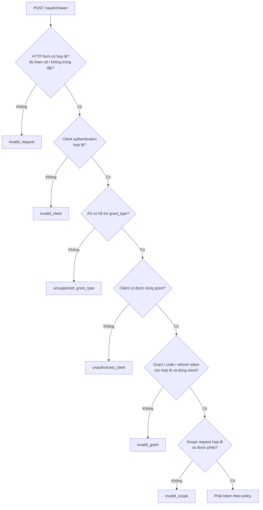
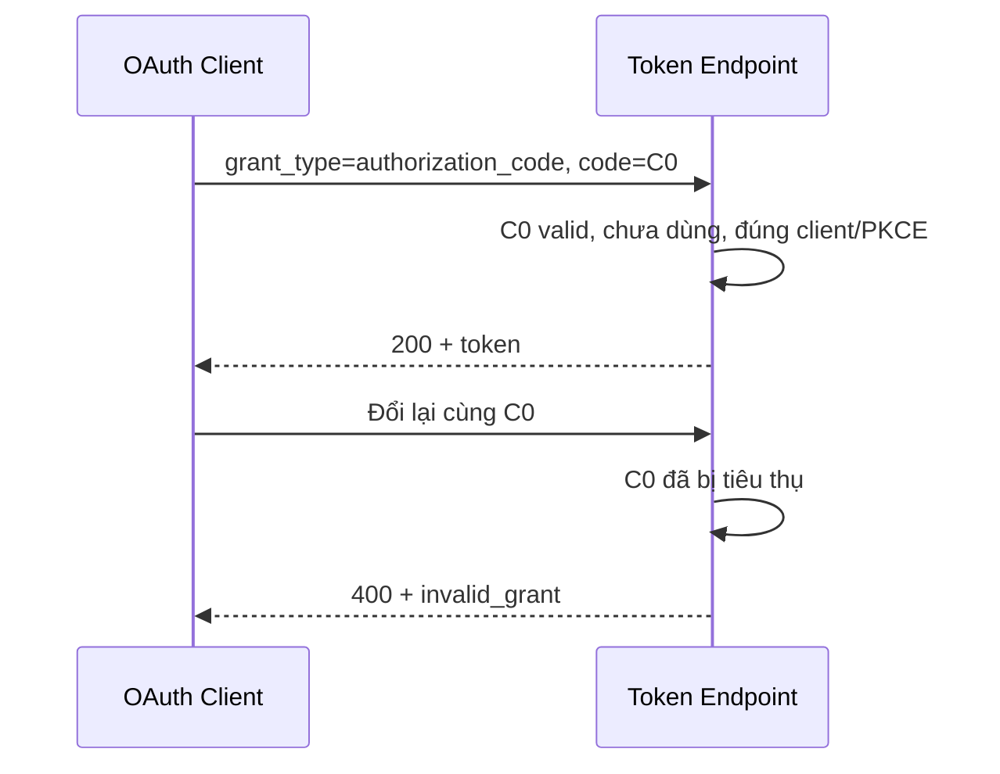
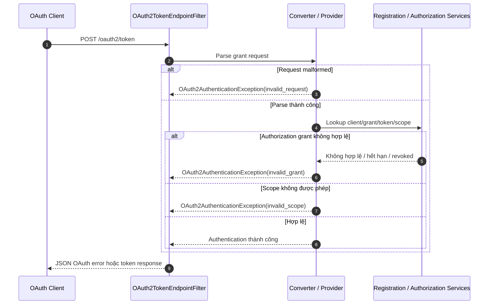
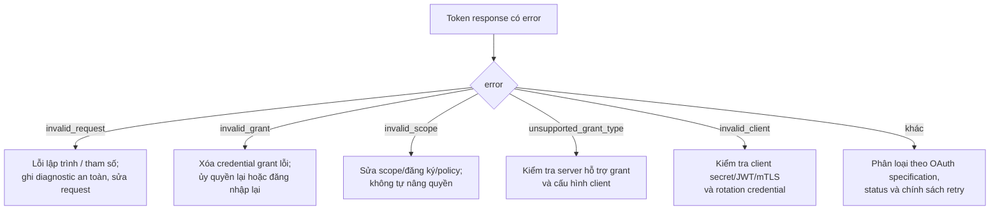

# Chuẩn hóa invalid_request, invalid_grant, invalid_scope và unsupported_grant_type

Trong **Spring Security OAuth2/OIDC Authorization Server** chạy trên Spring Boot, Token Endpoint (`/oauth2/token`) là nơi client đổi authorization code, sử dụng refresh token, yêu cầu token bằng client credentials hoặc thực hiện các grant khác đã được máy chủ hỗ trợ. Khi request bị từ chối, việc trả đúng **OAuth 2.0 error code** quan trọng không kém việc phát token đúng: client dựa vào mã lỗi để quyết định sửa request, khởi động lại đăng nhập, giảm scope hay báo lỗi cấu hình.

Bốn mã lỗi thường xuyên bị dùng sai là **`invalid_request`, `invalid_grant`, `invalid_scope` và `unsupported_grant_type`**. Chúng không phải bốn cách diễn đạt tùy ý của một HTTP 400. Mỗi mã thể hiện một ranh giới kiểm tra khác nhau theo **RFC 6749, mục 5.2**, và việc dùng sai làm cho client retry vô ích, che giấu lỗi bảo mật hoặc gây khó khăn khi kiểm thử.

Bài thuộc chương **Token Endpoint** của module **SPRING_SECURITY_OAUTH2_OIDC_AUTHORIZATION_SERVER**, với mục tiêu học cách thiết kế, cấu hình, bảo mật, kiểm thử và vận hành OAuth 2.0/OpenID Connect Authorization Server bằng Spring Security và Spring Authorization Server trong ứng dụng Spring Boot.

**Sau bài học, bạn có thể:**

1. Diễn giải chính xác bốn mã lỗi và phân biệt chúng với `invalid_client`, `unauthorized_client`, `access_denied` và lỗi riêng của extension grant.
2. Xác định lỗi tại bước parse HTTP request, kiểm tra grant/token, kiểm tra scope hay kiểm tra khả năng hỗ trợ grant.
3. Chuẩn hóa status, body JSON, header và nội dung mô tả lỗi mà không tiết lộ token, code hoặc client secret.
4. Hiểu đường đi lỗi trong Spring Authorization Server và cách tùy biến grant mà vẫn giữ semantics OAuth.
5. Xây dựng ma trận kiểm thử âm tính/dương tính, đo lường vận hành và thiết kế phản ứng thích hợp ở OAuth client.

## 1. Token Endpoint và luồng phát sinh lỗi

Một request token thông dụng là POST đến địa chỉ được công bố trong Authorization Server metadata, ví dụ:

```http
POST /oauth2/token HTTP/1.1
Host: login.example.com
Authorization: Basic <ENCODED_CLIENT_CREDENTIALS>
Content-Type: application/x-www-form-urlencoded

grant_type=authorization_code&code=<AUTHORIZATION_CODE>&redirect_uri=https%3A%2F%2Fportal.example.com%2Flogin%2Foauth2%2Fcode%2Fsas&code_verifier=<PKCE_VERIFIER>
```

Đây là ví dụ mô tả **confidential client**; body được viết thành một dòng để minh họa cách encode thực tế. Token Endpoint cần xử lý nhiều lớp trước khi phát token.



Sơ đồ là **mô hình phân loại**, không phải cam kết thứ tự của mọi filter/provider. Trên thực tế, việc xác thực client, parse grant và validation phụ thuộc grant và phiên bản Spring Authorization Server. Nếu request sai nhiều điều kiện cùng lúc, lỗi quan sát được thường là lỗi của bước **thất bại trước**, không nhất thiết là lỗi mà người kiểm thử mong đợi.

**Nguyên tắc kiểm thử:** muốn xác minh riêng `invalid_scope`, hãy cung cấp client authentication, grant và các tham số khác hợp lệ. Nếu cố tình dùng sai secret đồng thời với scope không hợp lệ, server có thể trả `invalid_client` trước khi đọc scope.

## 2. Bốn mã lỗi khác nhau ở đâu?

| Mã lỗi | Bản chất | Tình huống điển hình | Hướng xử lý của client |
| --- | --- | --- | --- |
| **`invalid_request`** | Request thiếu, lặp, sai cấu trúc hoặc dùng tham số không hợp lệ về mặt cú pháp/định dạng. | Thiếu `grant_type`; gửi nhiều `grant_type`; gửi nhiều phương thức client authentication không hợp lệ. | Sửa cách dựng HTTP request và tham số, không retry y nguyên. |
| **`invalid_grant`** | **Authorization grant/refresh token đã nộp** không hợp lệ, hết hạn, bị thu hồi, không khớp redirect URI hoặc được cấp cho client khác. | Authorization code đã dùng; code hết hạn; refresh token bị rotation thay thế; `redirect_uri` không khớp giao dịch. | Bỏ grant/token không thể dùng; xin cấp quyền mới hoặc đăng nhập lại theo trường hợp. |
| **`invalid_scope`** | Scope được yêu cầu không hợp lệ, không được biết đến, sai định dạng hoặc vượt phạm vi được phép. | `scope=orders.admin` không đăng ký; refresh request đòi quyền cao hơn quyền đã cấp. | Sửa scope/đăng ký hoặc giới hạn quyền; không tăng quyền bằng cách retry. |
| **`unsupported_grant_type`** | **Authorization Server không hỗ trợ** giá trị `grant_type` yêu cầu. | Gửi extension grant chưa cài converter/provider; gửi một grant type không được server triển khai. | Sửa loại grant hoặc triển khai/habilitate hỗ trợ tương ứng trên AS. |

Bốn mã trên thường xuất hiện trong **HTTP 400** theo RFC 6749 `5.2. Ngoại lệ quan trọng là những **mã lỗi khác**, chẳng hạn `invalid_client`, có quy tắc status/challenge riêng. Không được khẳng định mọi lỗi của Token Endpoint đều phải là HTTP 400.

### 2.1. Một ví dụ để nhớ lâu

Giả sử client `orders-portal` dùng Authorization Code + PKCE:

- Gửi thiếu `code` trong request đổi mã → **`invalid_request`** (thiếu tham số bắt buộc).
- Gửi code hợp lệ về cấu trúc nhưng đã đổi thành công trước đó → **`invalid_grant`** (grant không còn dùng được).
- Dùng refresh token hợp lệ rồi yêu cầu thêm scope `orders.admin` ngoài quyền đã cấp → **`invalid_scope`** (nội dung quyền đề nghị không hợp lệ).
- Dùng `grant_type=urn:example:unsupported-grant` mà AS chưa triển khai → **`unsupported_grant_type`**.

Nếu client đã được nhận diện nhưng **không được đăng ký một grant mà server vẫn hỗ trợ**, lỗi phù hợp thường là **`unauthorized_client`**, **không phải `unsupported_grant_type`**.

## 3. Khuôn dạng phản hồi lỗi theo RFC 6749 `5.2

Một error response của Token Endpoint dùng JSON và tối thiểu có trường **`error`**.

```http
HTTP/1.1 400 Bad Request
Content-Type: application/json;charset=UTF-8
Cache-Control: no-store
Pragma: no-cache

{
  "error": "invalid_grant",
  "error_description": "The authorization grant is invalid."
}
```

Đây là response **minh họa**. Khi triển khai, Spring Authorization Server có thể đưa vào hoặc bỏ các trường mô tả tùy trường hợp và phiên bản; không nên thiết kế client phụ thuộc vào chuỗi tiếng Anh cụ thể.

| Trường | Theo RFC 6749 `5.2 | Ý nghĩa |
| --- | --- | --- |
| `error` | **Bắt buộc** | Mã lỗi máy đọc được, ví dụ `invalid_grant`. |
| `error_description` | **Tùy chọn** | Giải thích ngắn, nhằm hỗ trợ xử lý lỗi. Không phải mã để client điều khiển logic. |
| `error_uri` | **Tùy chọn** | URI trỏ tới tài liệu hướng dẫn về lỗi. Không dùng để chuyển hướng trình duyệt tự động. |

**Không** trả authorization code, refresh token, access token, password, client secret hoặc nội dung JWT vào `error_description`. Mô tả phải phù hợp tập ký tự an toàn theo RFC 6749; nếu cần hướng dẫn chi tiết bằng tiếng Việt, hãy cung cấp trang tài liệu quản trị hoặc thông điệp UI riêng, không nhét stack trace hoặc dữ liệu nội bộ vào JSON giao thức.

Với phản hồi chứa token, RFC 6749 yêu cầu `Cache-Control: no-store` và `Pragma: no-cache`; dùng cùng nguyên tắc không cache cho lỗi token endpoint cũng là lựa chọn bảo vệ tốt vì request/response có liên quan đến credential. Kiểm tra header thật qua proxy/CDN.

### 3.1. Token Endpoint lỗi không giống Authorization Endpoint lỗi

Lỗi của **Authorization Endpoint** trong tương tác trình duyệt có thể được đưa về `redirect_uri` **đã xác minh**, ví dụ `error=access_denied` kèm `state`. Ngược lại, Token Endpoint thường trả **JSON trực tiếp** cho HTTP client gọi token request, không chuyển hướng người dùng đến callback.

```text
Authorization Endpoint:  GET /oauth2/authorize
  -> Có thể redirect error về callback đã được kiểm tra

Token Endpoint:          POST /oauth2/token
  -> HTTP response JSON chứa "error" và mã HTTP thích hợp
```

Đừng lấy cách xử lý `access_denied` ở consent screen rồi dùng `302 Location` cho lỗi đổi authorization code. Token Endpoint phải hạn chế tiết lộ dữ liệu và không nhận `redirect_uri` tự do làm nơi trả lỗi.

### 3.2. Có nên thêm mã lỗi ứng dụng như TOKEN_EXPIRED không?

Trong OAuth response chuẩn, `error` phải giữ mã giao thức phù hợp. Ví dụ:

```json
{
  "error": "invalid_grant",
  "error_description": "The authorization grant is invalid."
}
```

Không thay bằng:

```json
{
  "error": "TOKEN_EXPIRED_IN_DATABASE",
  "java_exception": "TokenLookupException",
  "internal_sql": "SELECT * FROM ..."
}
```

Client OAuth khác có thể không hiểu mã tự tạo và phản hồi thứ hai còn tiết lộ hệ thống nội bộ. Nếu tổ chức cần chẩn đoán sâu, hãy dùng **server-side structured logs** với correlation ID và thông tin đã che, không đưa dữ liệu nhạy cảm vào response.

Extension grant có thể định nghĩa lỗi phù hợp theo specification của chính extension, nhưng phải giữ semantics và khả năng tương tác của OAuth thay vì đổi tên lỗi chuẩn theo sở thích ứng dụng.

## 4. invalid_request — request không hợp lệ về cấu trúc

Theo RFC 6749, `invalid_request` bao gồm request thiếu tham số bắt buộc, có tham số không hợp lệ, một tham số xuất hiện nhiều lần, dùng nhiều credential/phương thức xác thực client không hợp lệ hoặc request bị sai cấu trúc.

### 4.1. Thiếu grant_type

Ví dụ POST chỉ có `code`:

```http
POST /oauth2/token HTTP/1.1
Host: login.example.com
Authorization: Basic <ENCODED_CLIENT_CREDENTIALS>
Content-Type: application/x-www-form-urlencoded

code=<SOME_CODE>
```

Vì `grant_type` bắt buộc ở Token Endpoint, server phải từ chối request. Đây là lỗi **thiếu định nghĩa grant**, không phải một `unsupported_grant_type` vì chưa có giá trị để xác định loại grant muốn dùng.

Response khái niệm:

```json
{
  "error": "invalid_request",
  "error_description": "Missing required parameter."
}
```

### 4.2. Tham số bị lặp

Ví dụ:

```http
POST /oauth2/token HTTP/1.1
Host: login.example.com
Content-Type: application/x-www-form-urlencoded
Authorization: Basic <ENCODED_CLIENT_CREDENTIALS>

grant_type=client_credentials&grant_type=authorization_code
```

Không lấy “giá trị đầu tiên” hoặc “giá trị cuối cùng” theo mặc định HTTP parser rồi xử lý như bình thường. Các converter/provider cần kiểm soát số lượng tham số quan trọng; request có nhiều giá trị làm thay đổi ngữ nghĩa phải bị từ chối.

### 4.3. Tham số grant còn thiếu

Với `authorization_code`, client cần gửi `code`; nếu flow yêu cầu PKCE còn cần `code_verifier` tại token request. Trường hợp thiếu tham số bắt buộc thường dẫn tới `invalid_request`. Khi **có verifier nhưng không khớp** challenge đã đăng ký, lỗi có thể là `invalid_grant` vì ràng buộc của authorization code không hợp lệ. Hành vi chi tiết phụ thuộc validation của bản SAS và cấu hình PKCE; kiểm thử riêng từng trường hợp.

Với `refresh_token`, không có tham số `refresh_token` khi yêu cầu grant cũng là request thiếu dữ liệu. Nếu tham số có mặt nhưng giá trị không tồn tại, đã hết hạn hoặc bị revoke, đó là trường hợp `invalid_grant`.

### 4.4. Không nhầm với invalid_client

Nếu một confidential client gửi `Authorization: Basic ...` với secret sai, nguyên nhân là **xác thực client thất bại** → `invalid_client`, không nên gán `invalid_request` chỉ vì header chứa mật khẩu không đúng.

Nếu request đưa **hai cơ chế client authentication cùng lúc** không hợp lệ, RFC liệt kê đây là một trường hợp request malformed; trên thực tế bước xác thực client và bộ lọc cụ thể có thể trả `invalid_request` hoặc `invalid_client` tùy dạng lỗi/phương thức. Điều quan trọng là **không được chấp nhận hai danh tính mâu thuẫn** hoặc bỏ qua credential sai rồi tiếp tục.

## 5. invalid_grant — grant hoặc token đã nộp không hợp lệ

`invalid_grant` thường là lỗi gặp nhiều nhất ở Authorization Code và Refresh Token flows. Nó không phải lời khẳng định rằng “server không hỗ trợ grant type”; nó có nghĩa **grant credential cụ thể** không thể dùng thành công.

### 5.1. Authorization code hết hạn

```text
10:00:00  Authorization Endpoint phát code C0 (TTL 2 phút)
10:03:00  Client gửi C0 tới /oauth2/token
=> C0 đã hết hạn; không cấp token
=> invalid_grant
```

Không “sửa” bằng cách tăng TTL code lên hàng giờ hoặc cho phép code cũ đổi lại. Client nên bắt đầu một Authorization Code Flow mới.

### 5.2. Authorization code đã sử dụng

Code chỉ được dùng **một lần**:



Nếu đổi code thành công nhưng phản hồi token bị mất, retry y nguyên có thể nhận `invalid_grant`. Client không được dựa vào việc “cùng code retry sẽ có cùng token” trừ khi một cơ chế idempotency riêng đã được thiết kế an toàn; thường cần khởi tạo lại authorization flow.

### 5.3. Redirect URI không khớp với giao dịch

Giả sử client bắt đầu request bằng callback:

```text
https://portal.example.com/login/oauth2/code/sas
```

nhưng khi đổi code gửi:

```text
https://portal.example.com/login/oauth2/code/sas/
```

Khác dấu `/` cuối có thể khiến binding redirect URI không khớp và dẫn tới `invalid_grant`, dù authorization code còn TTL. Không được bỏ kiểm tra để “linh hoạt theo proxy”.

Đối với request authorization có `redirect_uri`, token exchange cần ràng buộc URI đúng theo giao thức. Client nên giữ cùng callback canonical giữa authorization request và token request.

### 5.4. Client không phải chủ sở hữu grant

Một code hoặc refresh token được phát hành cho client A không được client B đem đổi, kể cả khi B xác thực bằng secret hợp lệ của chính mình. Lỗi grant bị ràng buộc sai client → `invalid_grant` (sau khi client B đã được xác thực).

Không đưa thông báo kiểu “code này thuộc client A, subject Alice, tạo lúc 10:03” ra ngoài. Sự khác biệt giữa token không tồn tại và token của client khác phải không làm lộ dữ liệu quản trị vượt mức.

### 5.5. Refresh token đã thay thế hoặc bị revoke

Với `TokenSettings.reuseRefreshTokens(false)`, một refresh thành công có thể phát R1 thay R0. Sau đó gửi lại R0 phải bị từ chối theo trạng thái authorization; lỗi thường thấy là `invalid_grant`.

```text
R0 --refresh thành công--> R1
R0 --refresh lần nữa--> invalid_grant (token cũ không còn active)
R1 --refresh hợp lệ--> R2 (nếu chính sách cho phép)
```

Lưu ý: **rotation khác replay detection**. Một kết quả `invalid_grant` của R0 không chứng minh server đã nhận biết đây là replay nguy hiểm hoặc đã thu hồi cả token family. Nếu yêu cầu phát hiện reuse/revoke toàn chuỗi, cần thiết kế lưu lịch sử/token family, xử lý atomic concurrency và audit riêng; không giả định một cờ `reuseRefreshTokens(false)` tự thực hiện tất cả.

### 5.6. Không phải mọi invalid_grant đều do hacker

Những nguyên nhân vận hành thường gặp:

- Callback bị proxy làm thay đổi scheme/host/path.
- Authorization code hết hạn vì mạng chậm hoặc client xử lý trễ.
- Client đổi cùng code hai lần do retry không đúng.
- Refresh token cũ còn trong DB của một instance client; token mới chưa được lưu.
- Authorization state in-memory bị mất sau restart.
- Hai requests refresh đồng thời dùng một refresh token đã bị rotation.

Server cần ghi metric để điều tra; client nên coi grant cũ là không thể sử dụng cho đến khi có bằng chứng khác, **không tự retry vô hạn** với cùng code/refresh token.

## 6. invalid_scope — quyền được yêu cầu không hợp lệ

`invalid_scope` cho biết scope trong request không phù hợp với các quy tắc của AS. Nó có thể bị từ chối khi scope sai định dạng, không được biết đến, không có trong registration hoặc vượt phạm vi authorization được cấp.

### 6.1. Client Credentials xin scope chưa đăng ký

Giả sử client `reporting-service` chỉ được đăng ký:

```java
.scope("reports.read")
```

Nhưng request:

```http
POST /oauth2/token HTTP/1.1
Host: login.example.com
Authorization: Basic <VALID_CLIENT_CREDENTIALS>
Content-Type: application/x-www-form-urlencoded

grant_type=client_credentials&scope=reports.admin
```

Grant `client_credentials` vẫn được AS hỗ trợ và client có thể được phép sử dụng nó, nhưng `reports.admin` vượt scopes đã đăng ký → `invalid_scope`, **không phải `unsupported_grant_type` hoặc `invalid_grant`**.

### 6.2. Refresh token không được tăng quyền

Client từng được cấp `orders.read` và có refresh token R0. Sau đó gửi:

```http
POST /oauth2/token HTTP/1.1
Host: login.example.com
Authorization: Basic <VALID_CLIENT_CREDENTIALS>
Content-Type: application/x-www-form-urlencoded

grant_type=refresh_token&refresh_token=<R0>&scope=orders.read%20orders.write
```

Nếu `orders.write` không nằm trong authorization đã cấp, client không được tự thêm nó bằng refresh. Theo RFC 6749 `6, scope của refresh request không được chứa scope chưa được resource owner cấp ban đầu. Khi không thỏa điều kiện scope, trả `invalid_scope` theo kiểm tra thích hợp.

Phân biệt hai trường hợp:

- **Refresh token R0 đã hết hạn/không hợp lệ** → `invalid_grant`.
- **R0 hợp lệ nhưng scope xin vượt quyền được cấp** → `invalid_scope`.

Nếu cả hai lỗi cùng xảy ra, server có thể phát hiện grant invalid trước khi tới scope validation; test cần sử dụng token hợp lệ khi muốn kiểm tra `invalid_scope`.

### 6.3. Scope là dữ liệu chính sách, không chỉ là chuỗi

Một scope được đăng ký cho client chưa đủ để API cho phép truy cập mọi đối tượng thuộc scope. Resource Server còn cần xác minh issuer, audience, expiration, scope và quyền trên dữ liệu/tenant thực tế.

Cũng không thể lấy scope từ query/body tự khai để tăng quyền. Khi mở rộng grant hoặc tùy biến token generator, phải giữ logic kiểm tra registered scopes, authorization scopes và policy.

**Lưu ý:** nếu client xin nhiều scope mà AS được phép cấp tập con, phản hồi thành công cần thể hiện scopes thực tế theo giao thức. Nhưng server không nên âm thầm cấp quyền rộng hơn yêu cầu hoặc che lỗi cấu hình nghiêm trọng bằng cách tự nới scopes.

## 7. unsupported_grant_type — máy chủ không hỗ trợ loại grant

`grant_type` chỉ ra **cách client muốn xin token**. Mỗi loại grant cần được AS hỗ trợ bằng cơ chế xử lý tương ứng.

Ví dụ:

```http
POST /oauth2/token HTTP/1.1
Host: login.example.com
Authorization: Basic <VALID_CLIENT_CREDENTIALS>
Content-Type: application/x-www-form-urlencoded

grant_type=urn%3Aexample%3Agrant%3Anot-supported
```

Nếu AS không triển khai grant này, lỗi phù hợp là:

```json
{
  "error": "unsupported_grant_type"
}
```

Không cần thử xem “authorization code đã hết hạn” hay “scope đúng không”: **server chưa có nghĩa vụ xử lý loại grant** đó.

### 7.1. Unsupported khác unauthorized

Giả sử server hỗ trợ `client_credentials`, nhưng registered client `web-portal` chỉ cho phép `authorization_code`:

```text
Server supports client_credentials = true
Client web-portal registered client_credentials = false

Request grant_type=client_credentials
=> unauthorized_client (client không được phép dùng grant)
```

Ngược lại:

```text
Server supports urn:example:grant:not-supported = false

Request grant_type=urn:example:grant:not-supported
=> unsupported_grant_type
```

Trong Spring Authorization Server, một grant extension có thể cần **request converter**, **authentication provider**, token generation policy và client registration phù hợp. Chỉ thêm một `AuthorizationGrantType` vào `RegisteredClient` **không làm server tự hiểu một grant chưa được triển khai**.

### 7.2. Version-sensitive: đừng đoán mọi grant được hỗ trợ

Những grant phổ biến trong Spring Authorization Server có thể gồm Authorization Code, Refresh Token, Client Credentials và các extension tùy version/cấu hình như Device Authorization hay Token Exchange. Khả năng cụ thể thay đổi theo **phiên bản thư viện và cấu hình endpoint**.

Với một request token-exchange bị `unsupported_grant_type`, cần xác minh:

1. Grant đó có được bản SAS đang chạy hỗ trợ hoặc đã cài extension chưa?
2. Request converter có nhận đúng `grant_type` URI chưa?
3. Authentication provider tương ứng có được cấu hình trong Token Endpoint chưa?
4. Client có được đăng ký grant đó không?
5. Policy và token generator có xử lý token đúng không?

Nếu grant **đã được triển khai và nhận diện**, nhưng chỉ client hiện tại không được dùng, lỗi thích hợp có thể chuyển sang `unauthorized_client` thay vì `unsupported_grant_type`.

## 8. Hai mã dễ nhầm: invalid_client và unauthorized_client

Dù bài tập trung vào bốn mã lỗi, muốn chuẩn hóa đúng phải hiểu thêm ít nhất hai mã sau.

| Mã | Nguyên nhân chính | Ví dụ |
| --- | --- | --- |
| `invalid_client` | Xác thực client thất bại hoặc thiếu thông tin xác thực trong trường hợp bắt buộc. | Client secret sai, `private_key_jwt` assertion sai, mTLS certificate không khớp client. |
| `unauthorized_client` | Client đã được nhận diện/xác thực nhưng không được phép dùng grant type được yêu cầu. | Client chỉ cho `authorization_code` cố gọi `client_credentials`. |

Với HTTP Basic client authentication, RFC 6749 yêu cầu khi xác thực bằng `Authorization` header bị lỗi thì response có **HTTP 401** và header `WWW-Authenticate` phù hợp. Một error response điển hình:

```http
HTTP/1.1 401 Unauthorized
WWW-Authenticate: Basic realm="oauth2"
Content-Type: application/json

{
  "error": "invalid_client"
}
```

Đây là minh họa; giá trị realm/challenge tùy cấu hình. Không tự trả HTTP 400 cho mọi lỗi bằng một global error handler, vì điều đó có thể làm sai semantics `invalid_client`.

**Không viết logic “cứ không đổi được token là invalid_grant”.** Nếu client secret sai, giữ `invalid_client`. Nếu grant không được server nhận diện, giữ `unsupported_grant_type`. Nếu client không được phép dùng grant đã nhận diện, giữ `unauthorized_client`.

## 9. Spring Authorization Server xử lý lỗi ở đâu?

Trong Spring Authorization Server, Token Endpoint được xử lý trong **Spring Security filter chain** chứ không phải là một `@RestController` thông thường do bạn tự tạo. Những thành phần liên quan (tên class/extension point có thể khác nhau theo bản thư viện) gồm:

| Thành phần | Trách nhiệm |
| --- | --- |
| `OAuth2TokenEndpointFilter` | Nhận HTTP request đến token endpoint, chọn converter/manager và phản hồi thành công/thất bại. |
| Các `AuthenticationConverter` cho từng grant | Parse tham số, xác định grant và kiểm tra cấu trúc request. |
| Các `AuthenticationProvider` cho từng grant | Xác minh grant/token, client và scopes theo trách nhiệm của provider. |
| `RegisteredClientRepository` | Tra client, authentication methods, grant types, scopes và `TokenSettings`. |
| `OAuth2AuthorizationService` | Tra authorization code, refresh token, token state và ràng buộc với client. |
| `OAuth2TokenGenerator` | Phát token sau khi request hợp lệ. |
| `OAuth2TokenEndpointConfigurer` | Cấu hình converters, providers và xử lý token endpoint theo API bản SAS. |

### 9.1. Đường đi lỗi



Đây là sơ đồ khái niệm, không buộc mọi lỗi đi qua cùng một service. Đặc biệt, **client authentication** có thể chạy qua filter/chain riêng trước khi token grant provider thực hiện công việc. Vì vậy khi debug, hãy xác định lỗi bắt đầu từ *converter*, *client authentication provider*, *grant provider* hay lớp persistence.

### 9.2. Ưu tiên giữ default behavior

Khi dùng các grant chuẩn được Spring Authorization Server hỗ trợ, thường **không cần tự viết lại** JSON error response. Framework đã có xử lý OAuth2 error. Tùy biến nên được giới hạn cho một yêu cầu đã xác định: thêm metric, tracing, hoặc quy tắc kiểm tra một custom grant.

Nếu bạn cấu hình `OAuth2TokenEndpointConfigurer.errorResponseHandler(...)` hoặc tương đương, phải bảo đảm:

- Không biến mọi lỗi thành `invalid_request`.
- Không đổi `invalid_client` thành HTTP 400 khi cần 401/challenge.
- Không trả stack trace, raw token hoặc secret.
- Không mất `Content-Type` JSON và quy tắc no-store/cache.
- Không vô tình dùng MVC `@ControllerAdvice` để bắt lỗi ở một filter mà nó không quản lý.
- Không chuyển Token Endpoint response thành HTML hoặc HTTP redirect.
- Không tạo thông điệp lỗi khác nhau tiết lộ liệu một code/token của người dùng nào đó tồn tại hay không.

Bất kỳ thay đổi nào ở error handler đều cần integration test **cả bốn lỗi của bài** lẫn `invalid_client`/`unauthorized_client`.

### 9.3. Cách phát lỗi chuẩn trong custom AuthenticationProvider

Khi viết **custom grant**, có thể phát `OAuth2AuthenticationException` mang `OAuth2Error` và mã lỗi tiêu chuẩn.

Ví dụ **một helper nhỏ, không phải toàn bộ provider**:

```java
import org.springframework.security.oauth2.core.OAuth2AuthenticationException;
import org.springframework.security.oauth2.core.OAuth2Error;
import org.springframework.security.oauth2.core.OAuth2ErrorCodes;

final class TokenGrantErrors {

    private TokenGrantErrors() {
    }

    static OAuth2AuthenticationException invalidRequest() {
        return new OAuth2AuthenticationException(
            new OAuth2Error(OAuth2ErrorCodes.INVALID_REQUEST));
    }

    static OAuth2AuthenticationException invalidGrant() {
        return new OAuth2AuthenticationException(
            new OAuth2Error(OAuth2ErrorCodes.INVALID_GRANT));
    }

    static OAuth2AuthenticationException invalidScope() {
        return new OAuth2AuthenticationException(
            new OAuth2Error(OAuth2ErrorCodes.INVALID_SCOPE));
    }

    static OAuth2AuthenticationException unsupportedGrantType() {
        return new OAuth2AuthenticationException(
            new OAuth2Error(OAuth2ErrorCodes.UNSUPPORTED_GRANT_TYPE));
    }
}
```

Provider tùy biến có thể dùng:

```java
if (grantCredential == null || grantCredential.isBlank()) {
    throw TokenGrantErrors.invalidRequest();
}

if (!verifiedGrant.isActive()) {
    throw TokenGrantErrors.invalidGrant();
}

if (!allowedScopes.containsAll(requestedScopes)) {
    throw TokenGrantErrors.invalidScope();
}
```

**Đây là pseudocode gần Java** cho logic trong provider: `verifiedGrant` và `requestedScopes` tượng trưng cho các giá trị **đã được xác thực và kiểm tra** từ request/authorization state. Không có hai biến này tự xuất hiện trong Spring; ví dụ chỉ cho thấy **khi nào** cần ném đúng lỗi. Phần converter, client authentication, grant registration, token generation và lưu authorization state vẫn phải thực hiện theo API SAS của phiên bản đang dùng.

Với `unsupported_grant_type`, thường Token Endpoint quyết định khi **không có converter/provider hỗ trợ grant**. Một provider đã nhận diện grant của mình nhưng phát hiện client không có quyền dùng grant đó nên trả `unauthorized_client` theo chính sách, không nên giả rằng grant “không được hỗ trợ”.

## 10. Chuẩn hóa mã lỗi cho từng grant

Một bảng phân loại giúp đội phát triển và kiểm thử thống nhất trước khi viết code.

| Grant / điều kiện | Lỗi nên kiểm tra | Ghi chú |
| --- | --- | --- |
| Authorization Code: thiếu `code` | `invalid_request` | Thiếu tham số bắt buộc. |
| Authorization Code: code không tồn tại | `invalid_grant` | Grant không thể dùng. |
| Authorization Code: code hết hạn | `invalid_grant` | Không kéo dài TTL để che lỗi. |
| Authorization Code: code đã dùng | `invalid_grant` | Code chỉ dùng một lần. |
| Authorization Code: `redirect_uri` không khớp | `invalid_grant` | Ràng buộc grant; nếu URI malformed về cú pháp có thể bị kiểm tra như `invalid_request`. |
| Authorization Code: PKCE verifier sai | `invalid_grant` | Bằng chứng trao đổi code không hợp lệ. |
| Authorization Code: thiếu `code_verifier` khi bắt buộc | `invalid_request` hoặc lỗi request theo validator | Kiểm thử theo version/config. |
| Refresh Token: thiếu `refresh_token` | `invalid_request` | Tham số bắt buộc. |
| Refresh Token: expired/revoked/replaced | `invalid_grant` | Token không còn active. |
| Refresh Token: token thuộc client khác | `invalid_grant` | Sau khi caller được xác thực. |
| Refresh Token: scope vượt quyền đã cấp | `invalid_scope` | Chỉ xét khi refresh token hợp lệ. |
| Client Credentials: scope không đăng ký | `invalid_scope` | Client không thể tự nâng scope. |
| Mọi grant: thiếu `grant_type` | `invalid_request` | Không biết request yêu cầu grant gì. |
| Mọi grant: lặp `grant_type` | `invalid_request` | Tránh HTTP parameter pollution. |
| Mọi grant: `grant_type` chưa được AS hỗ trợ | `unsupported_grant_type` | Cần grant handler/extension phù hợp. |
| Grant được AS hỗ trợ nhưng client không được đăng ký | `unauthorized_client` | Không nhầm unsupported. |
| Confidential client sai secret/JWT assertion | `invalid_client` | Không nhầm invalid_grant. |
| Token Exchange extension: target bị cấm | `invalid_target` theo RFC 8693 | Lỗi riêng extension, không ép mọi lỗi vào bốn mã chính. |

**Thứ tự phát hiện lỗi là một điều kiện kiểm thử:** một request có nhiều sai sót thường bị dừng ngay ở bước đầu tiên. Bảng trên mô tả nguyên nhân **nếu các điều kiện trước đó đều hợp lệ**, không phải lời hứa server sẽ kiểm tra tất cả lỗi rồi chọn một mã ưu tiên toàn cục.

## 11. Tình huống HTTP và curl để tự kiểm chứng

### 11.1. invalid_request: thiếu grant_type

```bash
curl --silent --show-error --include \
  --user "orders-portal:$PORTAL_CLIENT_SECRET" \
  --header "Content-Type: application/x-www-form-urlencoded" \
  --data-urlencode 'code=some-code' \
  'https://login.example.com/oauth2/token'
```

Kỳ vọng: request bị từ chối với `invalid_request` vì thiếu `grant_type` nếu client authentication đã hợp lệ.

### 11.2. invalid_grant: authorization code không tồn tại

```bash
curl --silent --show-error --include \
  --user "orders-portal:$PORTAL_CLIENT_SECRET" \
  --header "Content-Type: application/x-www-form-urlencoded" \
  --data-urlencode 'grant_type=authorization_code' \
  --data-urlencode 'code=not-a-real-code' \
  --data-urlencode \
    'redirect_uri=https://portal.example.com/login/oauth2/code/sas' \
  --data-urlencode 'code_verifier=VERIFIER_FOR_TEST' \
  'https://login.example.com/oauth2/token'
```

Kỳ vọng: `invalid_grant` nếu client được đăng ký grant và các điều kiện parse hợp lệ. `VERIFIER_FOR_TEST` là placeholder; không sử dụng nó làm một PKCE verifier thật. Nếu verifier bị coi là malformed trước khi kiểm tra code, server có thể trả lỗi request theo implementation. Integration test chuyên biệt cần dùng verifier hợp lệ khi muốn cô lập lỗi code.

### 11.3. invalid_scope: client credentials yêu cầu quyền lạ

Giả sử `reporting-service` được đăng ký `client_credentials` và chỉ có `reports.read`:

```bash
curl --silent --show-error --include \
  --user "reporting-service:$REPORTING_CLIENT_SECRET" \
  --header "Content-Type: application/x-www-form-urlencoded" \
  --data-urlencode 'grant_type=client_credentials' \
  --data-urlencode 'scope=reports.admin' \
  'https://login.example.com/oauth2/token'
```

Kỳ vọng: `invalid_scope`, miễn là client authentication, grant registration và request format khác đều hợp lệ.

### 11.4. unsupported_grant_type: máy chủ không biết grant

```bash
curl --silent --show-error --include \
  --user "orders-portal:$PORTAL_CLIENT_SECRET" \
  --header "Content-Type: application/x-www-form-urlencoded" \
  --data-urlencode 'grant_type=urn:example:grant:not-supported' \
  'https://login.example.com/oauth2/token'
```

Kỳ vọng: `unsupported_grant_type` khi AS thật sự không hỗ trợ giá trị này và client authentication không thất bại trước.

**Lưu ý chung:** đây là các **request thử nghiệm**, không chứa credential/token thật trong tài liệu. Trên hệ thống thật, dùng HTTPS, bảo vệ shell history và biến môi trường, không bật HTTP verbose hoặc đưa token vào log. Khi kiểm thử âm tính, sử dụng môi trường/test account được phép thay vì cố kiểm tra trên client production.

## 12. Kiểm thử tự động bằng Spring Security Test / MockMvc

Một hệ thống cần test từ HTTP request thật qua filter chain, không chỉ test helper trả `OAuth2Error` đúng.

### 12.1. Ví dụ assertion cho invalid_grant

Đoạn dưới đây là **trích đoạn** từ một integration test đã khởi tạo Spring Boot app, registered client `orders-portal` và mock authorization state cần thiết:

```java
import static org.springframework.security.test.web.servlet.request
    .SecurityMockMvcRequestPostProcessors.httpBasic;
import static org.springframework.test.web.servlet.request
    .MockMvcRequestBuilders.post;
import static org.springframework.test.web.servlet.result
    .MockMvcResultMatchers.jsonPath;
import static org.springframework.test.web.servlet.result
    .MockMvcResultMatchers.status;

import org.junit.jupiter.api.Test;
import org.springframework.beans.factory.annotation.Autowired;
import org.springframework.http.MediaType;
import org.springframework.test.web.servlet.MockMvc;

class TokenEndpointErrorTests {

    @Autowired
    MockMvc mockMvc;

    @Test
    void expiredOrUnknownAuthorizationCodeReturnsInvalidGrant()
            throws Exception {

        mockMvc.perform(post("/oauth2/token")
                .with(httpBasic("orders-portal", "test-client-secret"))
                .contentType(MediaType.APPLICATION_FORM_URLENCODED)
                .param("grant_type", "authorization_code")
                .param("code", "unknown-code")
                .param("redirect_uri",
                    "https://portal.example.com/login/oauth2/code/sas")
                .param("code_verifier",
                    "sufficiently-long-test-pkce-verifier-1234567890"))
            .andExpect(status().isBadRequest())
            .andExpect(jsonPath("$.error").value("invalid_grant"));
    }
}
```

**Trích đoạn chưa tự chạy độc lập:** class phải được đặt trong test có `@SpringBootTest`/`@AutoConfigureMockMvc` hoặc cấu hình MockMvc tương đương và có bean AS đầy đủ; secret trong test phải khớp registration đã mã hóa. Tên test đề cập cả code hết hạn và không tồn tại, nhưng request cụ thể đang dùng **code không tồn tại**. Một test hết hạn thực sự cần tạo code hợp lệ rồi điều khiển clock/expiration.

Với custom grant, hãy test converter/provider trực tiếp **và** integration test qua Token Endpoint để tránh trường hợp provider ném đúng error nhưng filter/handler lại trả sai status hoặc body.

### 12.2. Ma trận test âm tính và kiểm tra bất biến bảo mật

| Trường hợp | Assertion chính | Điều không được xảy ra |
| --- | --- | --- |
| Thiếu `grant_type` | `$.error == invalid_request` | Không phát token. |
| Trùng `grant_type` | `invalid_request` theo validator | Không chọn âm thầm một grant rồi cấp quyền. |
| Code hết hạn | `invalid_grant` | Không phát token cho code cũ. |
| Code đã dùng | `invalid_grant` | Không tái sử dụng code. |
| Redirect URI không khớp | `invalid_grant` | Không bỏ qua binding của code. |
| Refresh token bị revoke | `invalid_grant` | Không tạo access token mới. |
| Refresh token bị rotation thay | `invalid_grant` khi dùng lại token cũ | Không hồi sinh token cũ. |
| Scope chưa đăng ký | `invalid_scope` | Không phát scope mới. |
| Scope của refresh vượt quyền ban đầu | `invalid_scope` | Không nâng quyền thông qua refresh. |
| Grant chưa được triển khai | `unsupported_grant_type` | Không coi là client credentials tùy tiện. |
| Grant được hỗ trợ nhưng client không được phép | `unauthorized_client` | Không cho phép client dùng grant ngoài registration. |
| Secret sai | `invalid_client`, status/challenge phù hợp | Không phát token, không lộ secret. |
| Request bị sửa nhiều lỗi cùng lúc | Lỗi fail-fast theo kiểm tra thực tế | Không phát token và không tiết lộ trạng thái nhạy cảm. |
| Handler custom trả token error | JSON/HTTP semantics chuẩn | Không mất `WWW-Authenticate` của invalid_client cần thiết. |
| Lỗi gửi qua reverse proxy | Status/body/cache header không bị sửa sai | Không redirect sang trang HTML tùy ý. |

Một integration test mạnh nên kiểm tra ít nhất **HTTP status, Content-Type, `error`, absence of access_token/refresh_token**, và các header liên quan, đồng thời kiểm tra **authorization state không bị cập nhật trái phép**. Không chỉ assert chuỗi `error_description` — mô tả có thể thay đổi khi nâng cấp Spring.

### 12.3. Kiểm thử không tự che lỗi bằng custom exception handler

Nhiều ứng dụng có `@RestControllerAdvice` chung:

```java
// PHẢN VÍ DỤ: không dùng làm chính sách chung cho mọi lỗi OAuth.
@ExceptionHandler(Exception.class)
ResponseEntity<Map<String, String>> onAnyFailure(Exception ex) {
    return ResponseEntity.badRequest()
        .body(Map.of("error", "invalid_request"));
}
```

Với Spring Security filter chain, handler này không nhất thiết bắt được lỗi Token Endpoint; nếu bằng cách nào đó nó can thiệp vào lỗi OAuth, nó có thể **đánh đồng invalid_client, invalid_grant và server error**. Hãy giữ đường xử lý OAuth chuẩn trong filter/AuthenticationFailureHandler và dùng global advice cho MVC endpoints bình thường.

## 13. Phản ứng phù hợp phía OAuth client

Client nên phân loại bằng **`error`**, không dựa vào `error_description`. Một quyết định xử lý điển hình:



### 13.1. Không retry mù với invalid_grant

Với refresh token rotation, client tiếp tục gửi refresh token cũ có thể tạo nhiều lỗi `invalid_grant` và, nếu hệ thống có replay detection, có thể làm token family bị thu hồi. Hãy xử lý refresh **single-flight**, cập nhật token mới một cách nguyên tử và yêu cầu re-authorization khi credential không thể dùng tiếp.

### 13.2. Không tự đổi scope để vượt chính sách

`invalid_scope` không phải lời mời gửi lại với scope `admin` hoặc nhiều biến thể cho đến khi AS chấp nhận. Client phải dùng scope đã được đăng ký và đã được user/chính sách cấp. Nếu sản phẩm cần quyền mới, phải qua quy trình cấp quyền/consent phù hợp.

### 13.3. Phân biệt lỗi cấu hình và lỗi hạ tầng

Một số response không phải lỗi OAuth `400`, ví dụ proxy trả `502/503`, client timeout hoặc DNS/TLS failure. Với lỗi mạng tạm thời, có thể retry theo backoff, nhưng **không retry cùng authorization code đã có khả năng được tiêu thụ** như một request an toàn/idempotent. Đối với refresh token rotation, mất response sau khi AS commit có thể khiến refresh token cũ không còn hợp lệ.

Cần thiết kế retry đặc thù theo grant, trạng thái token và hợp đồng idempotency của hệ thống; không áp dụng một rule “mọi lỗi POST đều retry 3 lần”.

## 14. Bảo mật, quan sát và vận hành lỗi

### 14.1. Không biến error_description thành kênh rò rỉ

Tránh các thông điệp:

```text
code=abc123 was issued to alice@example.com at 2026-11-16T...
refresh_token=... exists in database record id=...
client_secret for orders-portal is wrong; expected hash=...
tenant=payroll-private, scope=salary.admin was denied for user X
```

Nên dùng mô tả ngắn và mã `error` chuẩn. Chi tiết điều tra phải nằm trong **log máy chủ được phân quyền**, kết hợp correlation ID, và không lưu giá trị thô của authorization code/token/secret.

### 14.2. Metric gợi ý

| Metric | Ý nghĩa vận hành |
| --- | --- |
| `oauth_token_requests_total` theo grant và kết quả | Theo dõi tỷ lệ thành công/thất bại. |
| `oauth_token_invalid_request_total` | Phát hiện lỗi client integration, HTTP parameter pollution. |
| `oauth_token_invalid_grant_total` | Phát hiện code hết hạn, retry sai, refresh rotation race hoặc token bị revoke. |
| `oauth_token_invalid_scope_total` | Nhận diện sai scope registration/policy. |
| `oauth_token_unsupported_grant_total` | Phát hiện client gọi grant chưa được server hỗ trợ sau deploy. |
| `oauth_token_invalid_client_total` | Theo dõi authentication failure, secret rotation và dấu hiệu thử credential. |
| `oauth_token_latency_seconds` | Theo dõi chậm do authorization DB, crypto, policy, token generation. |

Tránh gắn raw `code`, refresh token, client secret, user ID hoặc IP có cardinality cực lớn làm metric label. Nếu cần quan sát theo client, chỉ dùng client identifier đã được quản trị và cân nhắc ẩn danh trong hệ thống nhiều tenant.

### 14.3. Tách lỗi người dùng và lỗi vận hành

- **`invalid_request` tăng đột biến:** có thể do client SDK đổi cách encode tham số, request parameter bị lặp hoặc proxy làm mất content type.
- **`invalid_grant` tăng:** có thể do AS restart làm mất in-memory authorization state, clock lệch, login flow chậm, refresh token rotation race hoặc retry code.
- **`invalid_scope` tăng:** có thể do rollout scope mới chưa đăng ký ở AS hoặc chính sách tenant thay đổi.
- **`unsupported_grant_type` tăng:** có thể do client rollout trước khi AS có provider tương ứng hoặc request nhầm issuer/môi trường.
- **`invalid_client` tăng:** có thể do client secret hết hạn, xoay khóa JWT chưa đồng bộ, mTLS certificate không khớp hoặc client khai sai authentication method.

Đừng giải quyết bằng cách chuyển tất cả lỗi thành HTTP 200 kèm `success=false`: điều đó phá hợp đồng OAuth và khiến client/lớp proxy không xử lý đúng.

### 14.4. Multi-instance và version mismatch

Khi Spring Authorization Server có nhiều instance, các instance phải dùng **issuer, client registrations, grant support, scopes/policies, signing keys và authorization state** nhất quán. Một instance có converter/provider Token Exchange còn instance khác không có có thể gây `unsupported_grant_type` ngẫu nhiên. Một instance chưa thấy authorization code/refresh token do repository không chia sẻ có thể gây `invalid_grant` ngẫu nhiên.

Khi nâng cấp phiên bản, kiểm thử lại body/status/headers các lỗi; không dựa vào string của `error_description`. Cập nhật client và AS có thứ tự, hỗ trợ rollback và theo dõi tỷ lệ lỗi ở từng instance.

## 15. Bài thực hành phân loại lỗi

Một nhóm phát triển có ba clients:

| Client | Grant được đăng ký | Scope được đăng ký |
| --- | --- | --- |
| `portal-web` | `authorization_code`, `refresh_token` | `openid`, `profile`, `orders.read` |
| `reports-worker` | `client_credentials` | `reports.read` |
| `legacy-batch` | `client_credentials` | `batch.read` |

Bốn HTTP requests sau cùng gửi tới Token Endpoint (giả sử client authentication đã hợp lệ):

**Yêu cầu A**

```text
grant_type=authorization_code
redirect_uri=https://portal.example.com/callback
(code bị thiếu)
```

**Yêu cầu B**

```text
grant_type=refresh_token
refresh_token=R0
(R0 từng hợp lệ nhưng đã bị rotation thay bởi R1)
```

**Yêu cầu C**

```text
grant_type=client_credentials
scope=reports.admin
(client reports-worker chỉ được reports.read)
```

**Yêu cầu D**

```text
grant_type=urn:example:grant:not-implemented
```

Hãy xác định mã lỗi tương ứng và giải thích tại sao:

1. Request A là lỗi cấu trúc hay grant hết hạn?
2. Request B có được phép đổi tiếp vì TTL của R0 chưa hết không?
3. Request C có được cấp scope mới chỉ vì client xác thực thành công không?
4. Request D khác thế nào với client `portal-web` gọi `client_credentials` mà AS vẫn hỗ trợ?
5. Nếu A đồng thời gửi client secret sai, lỗi nào có thể xuất hiện trước?
6. Nếu bạn viết global handler để trả `invalid_request` cho mọi exception, điều gì hỏng ở client và kiểm thử?
7. Nếu B lỗi do token store in-memory mất sau restart, có nên kết luận ngay là attacker đang replay refresh token không?
8. Tại sao client không nên retry nguyên request A/B đến khi được HTTP 200?

**Đáp án định hướng:** A → `invalid_request`; B → `invalid_grant`; C → `invalid_scope`; D → `unsupported_grant_type`. Nếu grant được AS hỗ trợ nhưng client không được dùng, mã liên quan là `unauthorized_client`. Nếu client authentication thất bại, cần xem `invalid_client` và quy tắc HTTP status/challenge.

## 16. Checklist chuẩn hóa Token Endpoint

- [ ] Đã xác định ranh giới parse request, client authentication, grant support, grant validation và scope validation.
- [ ] Thiếu/trùng tham số quan trọng được phân loại `invalid_request`; request không tự chấp nhận tham số mâu thuẫn.
- [ ] Authorization code/refresh token hết hạn, bị dùng, bị revoke hoặc sai binding được từ chối bằng `invalid_grant` theo ngữ cảnh.
- [ ] Scope sai/ngoài quyền được phép bị từ chối bằng `invalid_scope`, không bị nâng quyền qua refresh/client credentials.
- [ ] Grant chưa được server hỗ trợ dùng `unsupported_grant_type`; grant được hỗ trợ nhưng client không được phép dùng `unauthorized_client`.
- [ ] Client authentication thất bại dùng `invalid_client`, có status và `WWW-Authenticate` phù hợp theo phương thức.
- [ ] Response lỗi có `error` chuẩn, JSON Content-Type, status phù hợp và cache control an toàn.
- [ ] `error_description` ngắn, không chứa credential, token, raw code, PII nhạy cảm hoặc exception nội bộ.
- [ ] Không chuyển Token Endpoint error thành `302` đến callback hoặc HTTP 200 với JSON ứng dụng tùy ý.
- [ ] Giữ handler/converter/provider chuẩn của Spring Authorization Server khi không cần tùy biến.
- [ ] Custom grant chỉ phát lỗi theo tiêu chuẩn và xử lý đúng authentication, token binding, scopes, registration.
- [ ] Test endpoint thật bao phủ ít nhất bốn mã chính cùng `invalid_client` và `unauthorized_client`.
- [ ] Client phân loại theo `error`, không phụ thuộc chuỗi mô tả; tránh retry code/refresh token không idempotent.
- [ ] Metrics/logs có correlation ID và không tiết lộ token/secret; theo dõi tỷ lệ lỗi khi nâng cấp.
- [ ] Multi-instance có chung registration, authorization state, grant handlers và chính sách scope.
- [ ] Đã kiểm tra lỗi ở các lớp proxy/TLS, nhận biết chúng không nhất thiết là JSON OAuth.

**Ghi nhớ:** `invalid_request` nói **request được tạo sai**; `invalid_grant` nói **grant/token được nộp không còn hợp lệ**; `invalid_scope` nói **quyền được yêu cầu không hợp lệ hoặc vượt chính sách**; `unsupported_grant_type` nói **Authorization Server không hỗ trợ loại grant đó**. Trong Spring Authorization Server, hãy để bộ lọc/validator giao thức phát mã đúng, không gom mọi lỗi thành một mã chung. Client, API, log và kiểm thử sẽ vận hành an toàn hơn khi ranh giới lỗi được diễn đạt rõ ràng.

**Tài liệu tham khảo:**

- [RFC 6749 — The OAuth 2.0 Authorization Framework](https://www.rfc-editor.org/rfc/rfc6749.html): mục **5.2** (Error Response), mục 4.1.3–4.1.4 (Authorization Code Token Request), mục 4.4 (Client Credentials), mục 6 (Refreshing an Access Token).
- [RFC 7636 — Proof Key for Code Exchange](https://www.rfc-editor.org/rfc/rfc7636.html): kiểm tra `code_verifier` và ràng buộc authorization code.
- [RFC 7009 — OAuth 2.0 Token Revocation](https://www.rfc-editor.org/rfc/rfc7009.html): trạng thái và thu hồi token.
- [RFC 9700 — OAuth 2.0 Security Best Current Practice](https://www.rfc-editor.org/rfc/rfc9700.html): bảo vệ token, client authentication và hạn chế replay.
- [Spring Authorization Server — Protocol Endpoints](https://docs.spring.io/spring-authorization-server/reference/protocol-endpoints.html): Token Endpoint, converter/provider và các điểm tùy biến.
- [Spring Authorization Server — Core Model and Components](https://docs.spring.io/spring-authorization-server/reference/core-model-components.html): `RegisteredClient`, `OAuth2AuthorizationService` và `TokenSettings`.
- [Spring Security — OAuth 2.0 Core](https://docs.spring.io/spring-security/reference/servlet/oauth2/index.html): `OAuth2Error`, `OAuth2AuthenticationException` và tích hợp OAuth.

