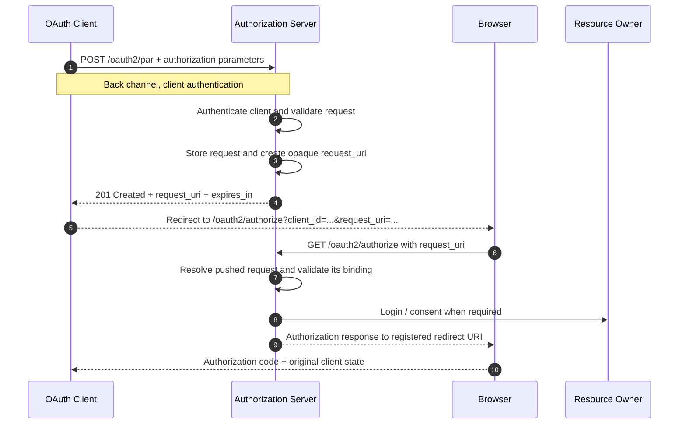

# Cấu hình Pushed Authorization Request Endpoint

## 1. PAR giải quyết vấn đề gì?

Trong mô-đun **SPRING_SECURITY_OAUTH2_OIDC_AUTHORIZATION_SERVER**, chúng ta học cách thiết kế, cấu hình, bảo mật, kiểm thử và vận hành OAuth 2.0/OpenID Connect Authorization Server bằng **Spring Security**, **Spring Authorization Server** và **Spring Boot**. Bài này tập trung cấu hình **Pushed Authorization Request Endpoint (PAR Endpoint)** theo RFC 9126.

Với Authorization Code Flow thông thường, ứng dụng chuyển hướng trình duyệt đến Authorization Server bằng một URL chứa các tham số như:

- `client_id`, `response_type=code`;
- `redirect_uri` và `scope`;
- `state`;
- `code_challenge`, `code_challenge_method`;
- các tham số mở rộng của OpenID Connect hoặc ứng dụng.

URL có thể dài và chứa dữ liệu nhạy cảm về ngữ cảnh đăng nhập, giao dịch hoặc quyền được yêu cầu. Những tham số này có thể xuất hiện trong browser history, access log của proxy, hệ thống phân tích URL hoặc thông tin referrer nếu triển khai không cẩn thận.

**Pushed Authorization Requests (PAR)** thay đổi cách truyền request: client gửi toàn bộ authorization request trực tiếp tới Authorization Server qua một HTTP POST ở kênh back channel. Server xác thực client, kiểm tra request và trả về một tham chiếu ngắn có tên **`request_uri`**. Sau đó client chỉ chuyển hướng trình duyệt bằng tham chiếu này để tiếp tục Authorization Code Flow.



PAR giúp:

1. **Giảm dữ liệu trên front channel:** các tham số authorization request không cần nằm trong query string dài của browser redirect.
2. **Xác thực client sớm:** Authorization Server nhận request trực tiếp từ client và áp dụng client authentication trước khi người dùng được chuyển tới trang đăng nhập.
3. **Kiểm tra request sớm:** redirect URI, scope và các tham số có thể được xác minh trước khi bắt đầu tương tác với người dùng.
4. **Ràng buộc request với client:** request URI được tạo ngẫu nhiên và gắn với client đã đẩy request.
5. **Hỗ trợ chính sách bảo mật cao:** Authorization Server có thể yêu cầu một client hoặc toàn bộ client chỉ khởi tạo authorization qua PAR.

**PAR không thay thế** Authorization Code Flow, PKCE, `state`, consent, kiểm tra redirect URI hoặc xác thực token ở Resource Server. PAR chỉ thay đổi cách authorization request được chuyển tới và tham chiếu lại ở Authorization Server.

## 2. Các thuật ngữ và endpoint cần phân biệt

| Thành phần | Vai trò |
| --- | --- |
| **PAR Endpoint** | Nhận authorization request bằng HTTP POST từ client |
| **Authorization Endpoint** | Tiếp tục luồng ủy quyền qua browser, login, consent và trả authorization response |
| **Token Endpoint** | Đổi authorization code thành access token/ID token theo grant |
| `request_uri` | Tham chiếu ngắn tới authorization request đã được đẩy lên server |
| `client_id` | Định danh OAuth client đã đăng ký |
| `state` | Giá trị do client tạo để ràng buộc authorization response với request của client |
| `code_challenge` | Giá trị PKCE được lưu trong pushed request, đối chiếu với verifier khi đổi code |
| `expires_in` | Thời gian sống còn lại của request URI, tính bằng giây |

### PAR không phải JAR

Hai chuẩn có thể được dùng cùng nhau nhưng giải quyết những vấn đề khác nhau:

- **PAR (RFC 9126):** client đẩy authorization request tới server, nhận lại một request URI tham chiếu tới dữ liệu đã lưu.
- **JAR (RFC 9101):** authorization request được đóng gói thành Request Object, có thể ký và/hoặc mã hóa để bảo vệ tính toàn vẹn và tính bí mật của nội dung.

PAR không mặc định mã hóa payload như JAR. TLS bảo vệ kênh truyền; dữ liệu sau khi nhận được lưu tại server và không cần được công bố cho bên thứ ba qua `request_uri`. Khi hệ thống cần cả bảo vệ nội dung Request Object lẫn giảm dữ liệu front channel, có thể kết hợp JAR và PAR theo cấu hình client/server tương thích.

### Phân biệt hai loại URI

- `redirect_uri` là callback của client, nơi Authorization Server trả authorization code hoặc lỗi sau khi xác minh chính xác theo registration.
- `request_uri` là tham chiếu do PAR Endpoint phát hành, dùng tại Authorization Endpoint để lấy lại request đã được lưu.

Không dùng `request_uri` như redirect URI, không tự tạo một URL đoán được để thay thế tham chiếu server đã cấp.

## 3. RFC 9126: hợp đồng của PAR Endpoint

PAR Endpoint là HTTP API nhận **POST** với body có định dạng:

```http
Content-Type: application/x-www-form-urlencoded
```

Encoding là UTF-8. URL của PAR Endpoint **MUST dùng HTTPS**. Endpoint nhận các tham số có thể sử dụng tại Authorization Endpoint theo OAuth 2.0 và các extension tương ứng, ví dụ PKCE, Resource Indicators và OpenID Connect.

### Các bước server phải thực hiện

1. Xác thực client theo cùng phương thức được dùng tại Token Endpoint. Với confidential client, ví dụ có thể là `client_secret_basic`, `private_key_jwt` hoặc mTLS theo đăng ký; public client dùng phương thức phù hợp với loại client và chính sách.
2. Từ chối nếu request PAR tự gửi tham số `request_uri`. Tham chiếu này phải do server tạo sau khi nhận request.
3. Kiểm tra authorization request như khi xử lý ở Authorization Endpoint, chẳng hạn client hợp lệ, redirect URI đã đăng ký và scope được phép. Nếu một kiểm tra không thể thực hiện tại thời điểm push, server phải bảo đảm kiểm tra đó vẫn được thực hiện khi xử lý authorization request.
4. Nếu request hợp lệ, tạo request URI ngẫu nhiên, không thể đoán, gắn với client đã gửi request và lưu request tương ứng trong thời gian ngắn.
5. Trả HTTP 201 Created cùng JSON có `request_uri` và `expires_in`.

### Response thành công theo RFC

```http
HTTP/1.1 201 Created
Content-Type: application/json
Cache-Control: no-cache, no-store
Pragma: no-cache

{
  "request_uri": "urn:ietf:params:oauth:request_uri:6esc_11ACC5bwc014ltc14eY22c",
  "expires_in": 60
}
```

`request_uri` phải chứa một phần được sinh từ nguồn ngẫu nhiên mật mã mạnh, đủ khó để đoán hoặc vét cạn. Nó phải được ràng buộc với client đã gửi request. `expires_in` là số nguyên dương thể hiện thời gian sống của tham chiếu; RFC nêu thời hạn thường khá ngắn, ví dụ khoảng 5–600 giây, nhưng giá trị thực tế do Authorization Server quyết định.

`request_uri` là **tham chiếu opaque** đối với client. Client không được giải mã hoặc tự dựng nội dung bên trong. Dữ liệu authorization request cần được server giữ lại và lấy ra bằng tham chiếu đó.

### Những tham số thường được đẩy lên

```text
client_id=orders-web
response_type=code
redirect_uri=https://orders.example.com/callback
scope=openid orders.read
state=<random-client-state>
nonce=<random-oidc-nonce>
code_challenge=<S256-challenge>
code_challenge_method=S256
```

Đây là ví dụ cấu trúc, không phải mọi client đều cần `nonce` hoặc scope `openid`. Các tham số xác thực client được gửi theo phương thức đăng ký, thường ở HTTP Authorization header hoặc assertion body tương ứng; chúng phục vụ **client authentication**, không phải một phần dữ liệu authorization mà client muốn người dùng chấp thuận.

**Không gửi `request_uri` trong PAR request.** Server chỉ phát hành tham chiếu sau khi xác thực và xử lý thành công request.

## 4. Vòng đời request URI

Sau khi nhận response PAR, client chuyển hướng user agent đến Authorization Endpoint, thường bằng:

```http
GET /oauth2/authorize?client_id=orders-web&request_uri=urn%3Aietf%3Aparams%3Aoauth%3Arequest_uri%3A6esc_11ACC5bwc014ltc14eY22c HTTP/1.1
Host: auth.example.com
```

Authorization Server dùng `request_uri` để lấy lại dữ liệu đã lưu, kiểm tra tham chiếu thuộc đúng client và còn hạn, rồi tiếp tục xử lý authorization request. Client **không cần gửi lại** toàn bộ scope, redirect URI, state và PKCE challenge trên browser URL.

### Các trạng thái điển hình

| Trạng thái | Hành vi |
| --- | --- |
| Request PAR hợp lệ, mới tạo | Server phát `request_uri` và thời hạn |
| Request URI chưa hết hạn, đúng client | Có thể dùng để tiếp tục Authorization Endpoint |
| Request URI hết hạn | Server phải từ chối như request không hợp lệ |
| Request URI bị sửa hoặc đoán | Không tìm thấy/không xác minh được; từ chối |
| Client khác sử dụng URI | Từ chối vì tham chiếu phải gắn với client đã push |
| Request URI được gửi lại | Authorization Server SHOULD xử lý như tham chiếu một lần; RFC cho phép cân nhắc duplicate do browser reload |

Vì PKCE challenge và `state` thường duy nhất theo mỗi authorization request, client **MUST chỉ sử dụng một `request_uri` một lần**. Authorization Server SHOULD coi URI là one-time-use, nhưng có thể cho phép request lặp lại trong trường hợp browser reload/refresh để tránh làm hỏng trải nghiệm người dùng. Request URI đã hết hạn MUST bị từ chối.

### Phân biệt với authorization code

| `request_uri` | Authorization code |
| --- | --- |
| Được phát hành sau PAR | Được phát hành sau khi authorization request và tương tác người dùng hoàn tất |
| Tham chiếu tới dữ liệu authorization request đã lưu | Grant trung gian để đổi lấy token |
| Dùng tại Authorization Endpoint | Dùng tại Token Endpoint |
| Thời hạn ngắn theo chính sách PAR | Thời hạn ngắn theo chính sách authorization code |
| Ràng buộc với client đã push | Ràng buộc với client và các điều kiện của authorization code |

PAR thành công **không đồng nghĩa người dùng đã đăng nhập, consent đã được cấp hoặc access token đã được phát hành**.

## 5. Hỗ trợ PAR trong Spring Authorization Server

Theo API reference hiện hành, các thành phần PAR của Spring Authorization Server có từ **phiên bản 1.5**. Những lớp và API quan trọng gồm:

| Thành phần | Vai trò |
| --- | --- |
| `AuthorizationServerSettings` | Khai báo URL/URI của PAR Endpoint |
| `OAuth2PushedAuthorizationRequestEndpointConfigurer` | Tùy biến converter, provider, success handler và error handler |
| `OAuth2PushedAuthorizationRequestEndpointFilter` | Nhận HTTP request tại PAR Endpoint |
| `OAuth2AuthorizationCodeRequestAuthenticationConverter` | Chuyển tham số HTTP thành authentication request phù hợp |
| `OAuth2PushedAuthorizationRequestAuthenticationProvider` | Xử lý pushed request, kiểm tra và lưu trạng thái |
| `OAuth2PushedAuthorizationRequestAuthenticationToken` | Biểu diễn PAR authentication request và thông tin request URI |
| `OAuth2AuthorizationService` | Kho lưu authorization state được provider sử dụng |

**Kiểm tra phiên bản trước khi cấu hình:** nếu project đang dùng Spring Authorization Server thấp hơn 1.5, các lớp PAR nêu trên có thể chưa tồn tại. Hãy nâng cấp theo dependency management tương thích với Spring Boot/Spring Security của project; không chép riêng một JAR phiên bản mới vào ứng dụng đang dùng các module Spring khác phiên bản.

Trong Spring Authorization Server 1.5.x, endpoint mặc định là:

| Endpoint | URI mặc định |
| --- | --- |
| Authorization Endpoint | `/oauth2/authorize` |
| Pushed Authorization Request Endpoint | `/oauth2/par` |
| Token Endpoint | `/oauth2/token` |

PAR Endpoint được cấu hình trong authorization server security chain. Nếu không có yêu cầu thay đổi hành vi, converter, provider, response handler và error handler mặc định đã cung cấp đường xử lý chuẩn.

## 6. Cấu hình endpoint và security filter chain

### 6.1. Khai báo `AuthorizationServerSettings`

`AuthorizationServerSettings` là component bắt buộc của Authorization Server. Trong cấu hình mặc định, PAR Endpoint đã có URI `/oauth2/par`. Bạn có thể khai báo rõ endpoint và issuer để tài liệu hóa cấu hình hoặc thay đổi đường dẫn:

```java
package com.example.authserver;

import org.springframework.context.annotation.Bean;
import org.springframework.context.annotation.Configuration;
import org.springframework.security.oauth2.server.authorization.settings.AuthorizationServerSettings;

@Configuration
public class AuthorizationServerEndpointConfig {

    @Bean
    AuthorizationServerSettings authorizationServerSettings() {
        return AuthorizationServerSettings.builder()
                .issuer("https://auth.example.com")
                .authorizationEndpoint("/oauth2/authorize")
                .pushedAuthorizationRequestEndpoint("/oauth2/par")
                .tokenEndpoint("/oauth2/token")
                .build();
    }
}
```

Nếu ứng dụng đã có một bean `AuthorizationServerSettings`, hãy bổ sung `pushedAuthorizationRequestEndpoint(...)` vào bean hiện hữu thay vì tạo bean thứ hai. Khi sử dụng `@Import(OAuth2AuthorizationServerConfiguration.class)`, cấu hình tối thiểu có thể tự đăng ký settings mặc định nếu ứng dụng chưa cung cấp bean riêng.

Nếu muốn thay endpoint thành `/oauth2/v1/par`, cần cập nhật đồng bộ:

- `AuthorizationServerSettings`;
- Authorization Server metadata mà client dùng để discovery;
- URL client gọi ở back channel;
- URL được phép qua API gateway, reverse proxy, firewall và monitoring;
- kiểm thử discovery và request thực tế.

Không hard-code URL cũ ở client sau khi đổi path. Client nên lấy endpoint từ metadata của đúng issuer khi triển khai discovery.

### 6.2. Đăng ký PAR Endpoint trong SecurityFilterChain

Ví dụ cấu hình PAR với API của Spring Authorization Server 1.5.x:

```java
package com.example.authserver;

import org.springframework.context.annotation.Bean;
import org.springframework.context.annotation.Configuration;
import org.springframework.core.annotation.Order;
import org.springframework.security.config.Customizer;
import org.springframework.security.config.annotation.web.builders.HttpSecurity;
import org.springframework.security.oauth2.server.authorization.config.annotation.web.configurers.OAuth2AuthorizationServerConfigurer;
import org.springframework.security.web.SecurityFilterChain;

@Configuration
public class AuthorizationServerSecurityConfig {

    @Bean
    @Order(1)
    SecurityFilterChain authorizationServerSecurityFilterChain(HttpSecurity http)
            throws Exception {

        OAuth2AuthorizationServerConfigurer authorizationServerConfigurer =
                OAuth2AuthorizationServerConfigurer.authorizationServer();

        http
            .securityMatcher(authorizationServerConfigurer.getEndpointsMatcher())
            .with(authorizationServerConfigurer, authorizationServer ->
                authorizationServer
                    .pushedAuthorizationRequestEndpoint(Customizer.withDefaults())
            );

        return http.build();
    }
}
```

Đoạn code này thể hiện cấu hình endpoint; nó không thay thế các bean bắt buộc của Authorization Server như `RegisteredClientRepository`, `AuthorizationServerSettings`, authorization service, JWK source/token generator và cấu hình xác thực người dùng cho Authorization Code Flow. Nếu project đang dùng cấu hình tối thiểu bằng `OAuth2AuthorizationServerConfiguration`, hãy kiểm tra filter chain thực tế trước khi thêm chain thứ hai.

`getEndpointsMatcher()` gom các endpoint của Authorization Server, trong đó có PAR ở phiên bản hỗ trợ. Không tạo controller MVC riêng cho `/oauth2/par` hoặc thêm một endpoint cùng path bên ngoài filter chain, vì như vậy có thể bỏ qua client authentication và validation của framework.

### 6.3. Các điểm mở rộng của PAR Endpoint

`OAuth2PushedAuthorizationRequestEndpointConfigurer` cung cấp các điểm mở rộng:

| API | Mục đích |
| --- | --- |
| `pushedAuthorizationRequestConverter(...)` | Thêm converter để đọc request HTTP |
| `pushedAuthorizationRequestConverters(...)` | Truy cập danh sách converter mặc định để thêm, bỏ hoặc thay đổi converter |
| `authenticationProvider(...)` | Thêm provider xử lý PAR authentication |
| `authenticationProviders(...)` | Truy cập danh sách provider mặc định để cấu hình |
| `pushedAuthorizationResponseHandler(...)` | Tùy biến response khi PAR thành công |
| `errorResponseHandler(...)` | Tùy biến cách trả OAuth error khi xử lý thất bại |

Filter mặc định sử dụng converter dựa trên `OAuth2AuthorizationCodeRequestAuthenticationConverter`, provider `OAuth2PushedAuthorizationRequestAuthenticationProvider`, success handler nội bộ và error handler OAuth2. Chỉ tùy biến những điểm thực sự cần cho chính sách của hệ thống; giữ nguyên các thành phần mặc định giúp giảm nguy cơ bỏ sót quy tắc giao thức.

### 6.4. Bổ sung validation nghiệp vụ nhưng giữ kiểm tra mặc định

Spring Authorization Server cung cấp `setAuthenticationValidator(...)` trên `OAuth2PushedAuthorizationRequestAuthenticationProvider`. Validator mặc định kiểm tra `redirect_uri` và `scope`. Nếu thêm kiểm tra nghiệp vụ, phải **giữ lại** hai kiểm tra mặc định và nối thêm rule của ứng dụng.

Ví dụ khung cấu hình provider:

```java
import java.util.List;
import java.util.function.Consumer;

import org.springframework.security.authentication.AuthenticationProvider;
import org.springframework.security.oauth2.server.authorization.authentication.OAuth2AuthorizationCodeRequestAuthenticationContext;
import org.springframework.security.oauth2.server.authorization.authentication.OAuth2AuthorizationCodeRequestAuthenticationValidator;
import org.springframework.security.oauth2.server.authorization.authentication.OAuth2PushedAuthorizationRequestAuthenticationProvider;

private Consumer<List<AuthenticationProvider>> configureParProviders() {
    return providers -> providers.forEach(provider -> {
        if (provider instanceof OAuth2PushedAuthorizationRequestAuthenticationProvider parProvider) {
            Consumer<OAuth2AuthorizationCodeRequestAuthenticationContext> validator =
                    OAuth2AuthorizationCodeRequestAuthenticationValidator.DEFAULT_REDIRECT_URI_VALIDATOR
                            .andThen(OAuth2AuthorizationCodeRequestAuthenticationValidator.DEFAULT_SCOPE_VALIDATOR)
                            .andThen(this::validateApplicationPolicy);

            parProvider.setAuthenticationValidator(validator);
        }
    });
}
```

Sau đó truyền consumer này vào:

```java
authorizationServer.pushedAuthorizationRequestEndpoint(par ->
        par.authenticationProviders(configureParProviders()));
```

`validateApplicationPolicy` là hàm do ứng dụng tự định nghĩa, nhận `OAuth2AuthorizationCodeRequestAuthenticationContext` để kiểm tra quy tắc bổ sung như tenant, client tier, scope nhạy cảm hoặc điều kiện giao dịch. Nếu không hợp lệ, validator phải ném `OAuth2AuthorizationCodeRequestAuthenticationException` với OAuth error phù hợp.

Đây là **khung mở rộng**, không phải một policy hoàn chỉnh có thể copy nguyên xi. Không thay validator mặc định bằng một hàm chỉ kiểm tra nghiệp vụ riêng; nếu làm vậy, request có thể bỏ qua kiểm tra redirect URI hoặc scope mà framework cung cấp.

## 7. Client authentication và đăng ký client

PAR request được gửi trực tiếp từ OAuth client tới Authorization Server. RFC 9126 yêu cầu xác thực client theo cách tương ứng với Token Endpoint. Với confidential client, Authorization Server phải xác minh credential theo phương thức đăng ký; public client không có secret để giữ kín và phải tuân thủ mô hình public client cùng PKCE.

### 7.1. Đăng ký một confidential web client

Ví dụ registration cho ứng dụng `orders-web`:

```java
import java.util.UUID;

import org.springframework.security.crypto.password.PasswordEncoder;
import org.springframework.security.oauth2.core.AuthorizationGrantType;
import org.springframework.security.oauth2.core.ClientAuthenticationMethod;
import org.springframework.security.oauth2.server.authorization.client.RegisteredClient;
import org.springframework.security.oauth2.server.authorization.settings.ClientSettings;

RegisteredClient ordersWeb = RegisteredClient
        .withId(UUID.randomUUID().toString())
        .clientId("orders-web")
        .clientSecret(passwordEncoder.encode("lab-only-change-this-secret"))
        .clientAuthenticationMethod(ClientAuthenticationMethod.CLIENT_SECRET_BASIC)
        .authorizationGrantType(AuthorizationGrantType.AUTHORIZATION_CODE)
        .redirectUri("https://orders.example.com/callback")
        .scope("openid")
        .scope("orders.read")
        .clientSettings(ClientSettings.builder()
                .requireProofKey(true)
                .requireAuthorizationConsent(true)
                .build())
        .build();
```

Đây là đoạn tạo registration để minh họa; cần lưu qua `RegisteredClientRepository`. Secret chỉ dùng cho môi trường lab, production phải lấy từ secret manager và lưu giá trị được mã hóa bằng `PasswordEncoder`. `InMemoryRegisteredClientRepository` phù hợp phát triển/kiểm thử, còn hệ thống production cần repository bền vững như JDBC hoặc triển khai tương đương.

**PAR không phải grant type riêng.** Client vẫn đăng ký `authorization_code` cho luồng đổi code lấy token. PAR là endpoint nhận authorization request trước khi browser bắt đầu luồng đó. Không thêm một grant giả như `pushed_authorization_request` vào `RegisteredClient.authorizationGrantTypes`.

### 7.2. Cấu trúc PAR request

Request mẫu của confidential client:

```http
POST /oauth2/par HTTP/1.1
Host: auth.example.com
Authorization: Basic <base64-encoded-client-id-and-secret>
Content-Type: application/x-www-form-urlencoded

client_id=orders-web
&response_type=code
&redirect_uri=https%3A%2F%2Forders.example.com%2Fcallback
&scope=openid%20orders.read
&state=CLIENT_STATE
&nonce=OIDC_NONCE
&code_challenge=PKCE_S256_CHALLENGE
&code_challenge_method=S256
```

Các chuỗi `CLIENT_STATE`, `OIDC_NONCE` và `PKCE_S256_CHALLENGE` là placeholder. Client phải tự tạo giá trị ngẫu nhiên phù hợp cho từng authorization request. Secret được gửi qua phương thức client authentication, không đặt trong URL.

Lưu ý:

- PAR Endpoint nhận POST với `application/x-www-form-urlencoded`, không dùng GET để đẩy request.
- Request cần chứa `client_id` cùng các tham số authorization phù hợp.
- `request_uri` **không được** gửi trong body của PAR request.
- Không gửi authorization request qua HTTP thường; endpoint PAR bắt buộc HTTPS.
- Nếu client dùng `private_key_jwt` hoặc mTLS, thay header Basic bằng cách xác thực tương ứng.
- Không dùng `client_secret_post` chỉ vì dễ thử bằng curl; nếu tổ chức cho phép phương thức này, phải bảo vệ body và log, đồng thời ưu tiên phương thức phù hợp với chính sách bảo mật.

### 7.3. Public client và PKCE

Một native app hoặc SPA không thể giữ secret dùng chung một cách đáng tin cậy. PAR không biến public client thành confidential client. Với public client:

- dùng `ClientAuthenticationMethod.NONE` theo registration phù hợp;
- gửi `client_id` để server nhận diện client;
- bắt buộc PKCE theo chính sách, ưu tiên `S256`;
- ràng buộc authorization code với `code_verifier`;
- giới hạn redirect URI theo yêu cầu dành cho loại ứng dụng.

Khi client gửi PAR, nó vẫn cần tạo và giữ `code_verifier` ở phía client; PAR chỉ lưu request chứa `code_challenge` trên server.

### 7.4. Những gì phải được xác minh tại PAR Endpoint

| Kiểm tra | Mục tiêu |
| --- | --- |
| Client authentication/identification | Request đến từ client được đăng ký theo phương thức đã khai báo |
| Client có Authorization Code grant | Client được phép sử dụng luồng mà request đang yêu cầu |
| Redirect URI | Callback khớp chính xác với URI đã đăng ký hoặc quy tắc đặc thù được phép |
| Scope | Client chỉ xin các quyền được registration và policy cho phép |
| PKCE | Challenge/method hợp lệ theo chính sách client |
| Tham số OIDC | `openid`, `nonce` và extension được xử lý theo cấu hình OIDC |
| Không có request_uri đầu vào | Chỉ server được quyền phát hành tham chiếu PAR |
| Giới hạn request | Kích thước body, số tham số và tần suất request nằm trong ngưỡng |

Việc client authentication thành công không đồng nghĩa mọi scope, redirect URI hoặc tham số mở rộng đều hợp lệ. PAR Endpoint cần kiểm tra authorization request trước khi phát hành tham chiếu.

## 8. Yêu cầu client phải dùng PAR (PAR-only policy)

RFC 9126 cho phép Authorization Server quy định PAR là **cách duy nhất** để khởi tạo authorization request, ở cấp toàn server hoặc từng client. Nếu client thuộc diện bắt buộc PAR gửi authorization request trực tiếp tới Authorization Endpoint mà không có `request_uri` hợp lệ được PAR Endpoint phát hành, server phải từ chối với lỗi `invalid_request`.

RFC định nghĩa metadata:

| Metadata | Ý nghĩa |
| --- | --- |
| `pushed_authorization_request_endpoint` | URL của PAR Endpoint |
| `require_pushed_authorization_requests` ở server metadata | Boolean cho biết server chỉ nhận authorization request qua PAR hay không |
| `require_pushed_authorization_requests` ở client metadata | Boolean cho biết client cụ thể chỉ được khởi tạo authorization bằng PAR hay không |

### Phân biệt năng lực PAR và chính sách bắt buộc PAR

- Chỉ công bố `pushed_authorization_request_endpoint` nghĩa là server **có hỗ trợ PAR**; client có thể lựa chọn sử dụng.
- Công bố `require_pushed_authorization_requests=true` nghĩa là server yêu cầu PAR đối với chính sách/phạm vi được mô tả.
- Một client có thể cần PAR bắt buộc ngay cả khi server không bắt tất cả client khác dùng PAR.

**Lưu ý khi dùng Spring Authorization Server:** `AuthorizationServerSettings` cấu hình URI endpoint; mô hình `RegisteredClient` tiêu chuẩn không có field riêng tên `requirePushedAuthorizationRequests`. Không giả định rằng chỉ gọi `pushedAuthorizationRequestEndpoint(...)` là đã tự động chặn authorization request trực tiếp.

Nếu hệ thống yêu cầu PAR-only, cần triển khai chính sách ở đường xử lý Authorization Endpoint và quản lý cờ bắt buộc PAR trong cấu hình client/policy của ứng dụng. Chính sách phải kiểm tra request URI thực sự do PAR Endpoint phát hành, còn hạn, chưa bị sử dụng trái phép và gắn với đúng client. Chỉ kiểm tra “query string có tham số `request_uri`” là **không đủ**: attacker có thể tự gửi một chuỗi bất kỳ.

Metadata discovery cũng phải phản ánh chính sách thực tế. Nếu phiên bản SAS hoặc cấu hình metadata hiện tại không phát hành `require_pushed_authorization_requests`, hãy bổ sung qua điểm mở rộng metadata tương ứng và kiểm thử nội dung discovery; không để metadata nói “không bắt buộc” trong khi server âm thầm từ chối request không PAR.

### Kiểm thử chính sách PAR-only

| Request | Chính sách không bắt buộc PAR | Client/server bắt buộc PAR |
| --- | --- | --- |
| Authorization request trực tiếp, không có `request_uri` | Có thể được xử lý nếu mọi validation khác hợp lệ | Từ chối bằng `invalid_request` |
| Authorization request có `request_uri` PAR hợp lệ | Tiếp tục theo request đã lưu | Tiếp tục theo request đã lưu |
| `request_uri` không tồn tại hoặc không do PAR phát hành | Từ chối | Từ chối |
| `request_uri` thuộc client khác | Từ chối | Từ chối |
| `request_uri` hết hạn | Từ chối | Từ chối |

Nếu không có nhu cầu PAR-only, đừng tự bật chính sách này. Nếu có, phải kiểm thử cả direct authorization request và request dùng URI hợp lệ để tránh cấu hình chỉ chặn client vô tình hoặc làm hỏng browser flow.

## 9. Thực hành gửi PAR request

### 9.1. Chuẩn bị

Ví dụ thực hành giả định:

- Authorization Server chạy tại `https://auth.example.com`;
- PAR Endpoint tại `/oauth2/par`;
- Authorization Endpoint tại `/oauth2/authorize`;
- client `orders-web` được đăng ký `authorization_code`, redirect URI `https://orders.example.com/callback`, scope `orders.read`;
- confidential client có credential hợp lệ và PKCE được yêu cầu.

Hãy tạo `state` và PKCE verifier/challenge mới cho mỗi lần chạy. Không dùng lại giá trị từ request cũ. Với `S256`:

```text
code_challenge =
  BASE64URL_NO_PADDING(SHA256(ASCII(code_verifier)))
```

Client phải giữ `code_verifier` ở nơi an toàn để gửi khi đổi authorization code sau này.

### 9.2. Gửi HTTP request trực tiếp

```http
POST /oauth2/par HTTP/1.1
Host: auth.example.com
Authorization: Basic <base64-client-credentials>
Content-Type: application/x-www-form-urlencoded

client_id=orders-web
&response_type=code
&redirect_uri=https%3A%2F%2Forders.example.com%2Fcallback
&scope=orders.read
&state=CLIENT_STATE
&code_challenge=PKCE_CHALLENGE
&code_challenge_method=S256
```

Nếu thành công, response có dạng:

```json
{
  "request_uri": "urn:ietf:params:oauth:request_uri:opaque-random-value",
  "expires_in": 60
}
```

Giá trị `expires_in=60` ở đây chỉ là ví dụ. Client phải dùng thời hạn thực server trả về, không hard-code 60 giây.

### 9.3. Thử trong PowerShell

Ví dụ sau dùng biến môi trường lab để tránh ghi secret trực tiếp vào source:

```powershell
$clientSecret = $env:LAB_ORDERS_WEB_SECRET
if ([string]::IsNullOrWhiteSpace($clientSecret)) {
    throw "Can cau hinh LAB_ORDERS_WEB_SECRET truoc khi chay"
}
$rng = [Security.Cryptography.RandomNumberGenerator]::Create()
$stateBytes = New-Object byte[] 32
$verifierBytes = New-Object byte[] 32
$rng.GetBytes($stateBytes)
$rng.GetBytes($verifierBytes)
$rng.Dispose()

$clientState = [Convert]::ToBase64String($stateBytes)
$codeVerifier = [Convert]::ToBase64String($verifierBytes).TrimEnd('=').Replace('+', '-').Replace('/', '_')

$sha = [Security.Cryptography.SHA256]::Create()
$challengeBytes = $sha.ComputeHash(
    [Text.Encoding]::ASCII.GetBytes($codeVerifier))
$codeChallenge = [Convert]::ToBase64String($challengeBytes).TrimEnd('=').Replace('+', '-').Replace('/', '_')
$sha.Dispose()

$parJson = curl.exe -sS `
    -u ("orders-web:" + $clientSecret) `
    -H "Content-Type: application/x-www-form-urlencoded" `
    --data-urlencode "client_id=orders-web" `
    --data-urlencode "response_type=code" `
    --data-urlencode "redirect_uri=https://orders.example.com/callback" `
    --data-urlencode "scope=orders.read" `
    --data-urlencode "state=$clientState" `
    --data-urlencode "code_challenge=$codeChallenge" `
    --data-urlencode "code_challenge_method=S256" `
    "https://auth.example.com/oauth2/par"

$par = $parJson | ConvertFrom-Json
if ([string]::IsNullOrWhiteSpace($par.request_uri)) {
    throw "PAR request khong thanh cong; kiem tra OAuth error"
}

$encodedRequestUri = [uri]::EscapeDataString($par.request_uri)
$authorizationUrl = "https://auth.example.com/oauth2/authorize?client_id=orders-web&request_uri=$encodedRequestUri"

[pscustomobject]@{
    RequestUri = $par.request_uri
    ExpiresIn = $par.expires_in
    AuthorizationUrl = $authorizationUrl
}
```

Ví dụ trên minh họa cách tạo giá trị ngẫu nhiên và gọi endpoint. Trong production, ưu tiên HTTP client có cơ chế quản lý credential an toàn, TLS verification đầy đủ, không bật verbose logging và không để secret/token trong process arguments hoặc shell history. Tránh in `request_uri` vào log vận hành vì nó là tham chiếu có thể tiếp tục authorization flow trong thời hạn hiệu lực.

### 9.4. Chuyển trình duyệt đến Authorization Endpoint

Client sử dụng URI vừa nhận:

```text
GET https://auth.example.com/oauth2/authorize
    ?client_id=orders-web
    &request_uri=<URL-ENCODED-PAR-REQUEST-URI>
```

Authorization Server khôi phục request đã lưu và tiếp tục login/consent theo chính sách. Khi thành công, browser được chuyển về `redirect_uri` đã đăng ký với authorization code và `state` ban đầu của client. Client phải kiểm tra `state` ở callback, sau đó đổi code tại Token Endpoint bằng `code_verifier` và client authentication phù hợp.

**Không gửi lại** `scope`, `redirect_uri` hoặc `code_challenge` dưới dạng tham số thay thế trên browser URL. Dữ liệu chuẩn phải đến từ pushed request đã được server xác thực và lưu.

### 9.5. Kiểm tra metadata

Client có thể khám phá endpoint qua Authorization Server Metadata theo RFC 8414. Tài liệu metadata cần công bố `pushed_authorization_request_endpoint` với URL công khai có thể truy cập được. Nếu issuer hỗ trợ OpenID Connect Discovery, client cũng có thể đọc metadata từ endpoint discovery OIDC tương ứng.

Sau khi thay path PAR, hãy kiểm tra metadata trả đúng URL bên ngoài mà client phải gọi, đặc biệt khi server chạy sau reverse proxy hoặc có context path. Không lấy URL nội bộ của container/pod để đưa cho client bên ngoài.

## 10. Xử lý lỗi và chẩn đoán

| Lỗi/hiện tượng | Nguyên nhân thường gặp | Hướng kiểm tra |
| --- | --- | --- |
| `invalid_client` | Client authentication thất bại, secret/assertion sai hoặc client không xác định | Kiểm tra client ID, authentication method, credential, đồng hồ và cấu hình JWKS/mTLS |
| `unauthorized_client` | Client không được phép sử dụng Authorization Code Flow hoặc chính sách PAR | Kiểm tra `RegisteredClient.authorizationGrantTypes` và policy của client |
| `invalid_request` | Thiếu tham số, gửi `request_uri` trong PAR body, sai định dạng hoặc request không đáp ứng chính sách | Kiểm tra form body và các tham số RFC 9126 |
| `invalid_scope` | Scope không được đăng ký hoặc bị policy từ chối | Đối chiếu scope yêu cầu với client registration và scope validator |
| `invalid_redirect_uri` hoặc `invalid_request` | Redirect URI không khớp hoặc không được phép | Kiểm tra URI đã đăng ký, scheme, host, port, path và ký tự |
| HTTP 404 tại `/oauth2/par` | Sai phiên bản, path hoặc filter chain không chứa PAR endpoint | Kiểm tra Spring Authorization Server 1.5+, settings, security matcher và proxy routing |
| HTTP 401/403 | Client authentication hoặc authorization rule của filter chain không phù hợp | Kiểm tra client authentication filter và thứ tự security chain |
| HTTP 201 nhưng browser flow thất bại | Request URI hết hạn, client không khớp hoặc request bị thay đổi | Kiểm tra thời hạn, client binding và state được lưu |
| `request_uri` không dùng được lần hai | Server áp dụng one-time-use hoặc tham chiếu đã hết hạn | Tạo PAR request mới; không tái sử dụng URI cũ |
| Browser URL vẫn rất dài | Client vẫn gửi các tham số authorization trực tiếp thay vì chỉ gửi client ID và request URI | Kiểm tra URL redirect do client xây dựng |
| Discovery thiếu PAR endpoint | Metadata endpoint chưa công bố hoặc client đọc sai issuer/discovery URL | Kiểm tra RFC 8414/OIDC metadata và cấu hình settings |

### Một số nguyên tắc khi xử lý lỗi

- Không nới redirect URI thành wildcard chỉ để một request PAR bị lỗi có thể chạy.
- Không tắt client authentication khi nhận `invalid_client`.
- Không bỏ scope validator để khắc phục `invalid_scope`.
- Không gia hạn vô hạn `request_uri` chỉ để giải quyết browser mở chậm.
- Không trả stack trace, client secret, raw request hoặc token trong OAuth error response.
- Ghi correlation ID và loại lỗi đã phân loại để truy vết; che các tham số nhạy cảm.

## 11. Bảo mật, lưu trữ và vận hành

### 11.1. Bảo vệ request URI

`request_uri` phải có entropy đủ mạnh và không thể đoán thực tế. Authorization Server cần:

- sinh tham chiếu bằng bộ sinh ngẫu nhiên mật mã mạnh;
- ràng buộc tham chiếu với client đã xác thực và request gốc;
- đặt thời hạn ngắn, trả `expires_in` chính xác;
- từ chối tham chiếu hết hạn hoặc không tồn tại;
- có cơ chế chống replay phù hợp với yêu cầu one-time-use;
- tránh ghi raw request URI vào access log, analytics và exception log.

Đừng dùng ID tuần tự, timestamp, client ID nối với số tăng dần hoặc hash không có secret làm request URI. Người khác có thể đoán hoặc vét cạn những giá trị có cấu trúc.

### 11.2. Chống open redirect và giả mạo client

PAR cho phép server xác thực client trước khi chấp nhận request, nhưng không có nghĩa client được tự đăng ký redirect URI mới trong mọi request. RFC 9126 yêu cầu Authorization Server chỉ chấp nhận redirect URI mới trong pushed request từ client đã được xác thực và theo policy. Với registration thông thường, so khớp redirect URI đã đăng ký chính xác.

Không tin `client_id`, `redirect_uri` hoặc scope chỉ vì chúng nằm trong POST body. Server phải lấy registration từ repository đáng tin, xác thực client, rồi mới kiểm tra các tham số request.

### 11.3. Giới hạn tài nguyên và chống lạm dụng

PAR Endpoint là back-channel API, vì vậy nên áp dụng:

- rate limit theo client ID, địa chỉ nguồn và các tín hiệu rủi ro;
- giới hạn kích thước HTTP body, số tham số và độ dài từng giá trị;
- giới hạn số PAR request đang còn hiệu lực cho một client;
- TTL ngắn và tác vụ dọn dữ liệu đã hết hạn;
- metric theo client/endpoint/outcome để phát hiện lạm dụng;
- giới hạn số lần lỗi xác thực để giảm brute force credential.

Đừng dùng một rate limit toàn cục quá thấp khiến các client hợp lệ cùng thời điểm không thể đăng nhập; cũng không để một client gửi hàng triệu PAR request tạo áp lực lên kho authorization.

### 11.4. Lưu trữ trong bộ nhớ và nhiều instance

Provider PAR của Spring Authorization Server làm việc với `OAuth2AuthorizationService` để lưu trạng thái cần thiết cho authorization request đã được đẩy lên. Trong môi trường nhiều node, các instance phải truy cập được cùng trạng thái:

| Kiểu lưu | Đặc điểm |
| --- | --- |
| In-memory | Phù hợp demo/test đơn node; mất dữ liệu khi restart và không chia sẻ giữa instance |
| JDBC/shared database | Phù hợp hệ thống cần lưu bền vững và nhiều node; cần schema đúng phiên bản, transaction, index và cleanup |
| Distributed store/custom service | Có thể đáp ứng độ trễ hoặc quy mô riêng; phải bảo đảm atomicity, TTL, client binding và replay protection |

Nếu client push request ở node A rồi browser tiếp tục ở node B, node B phải tra được đúng request URI và thời hạn. Sticky session không thay thế được kho trạng thái dùng chung nếu hệ thống có failover hoặc cần tính sẵn sàng cao.

### 11.5. Kiểm tra lại authorization request

Authorization Server **MUST xác thực authorization request phát sinh từ PAR như các authorization request khác**. RFC cho phép bỏ qua một số bước đã thực hiện khi push nếu server biết chắc request là PAR request và request/policy không bị sửa theo cách ảnh hưởng kết quả. Khi tùy biến provider hoặc tối ưu hiệu năng, không bỏ validation mà không có cơ chế chứng minh các điều kiện đó.

### 11.6. Các chỉ số vận hành nên theo dõi

- Tổng PAR request thành công và thất bại theo client;
- số request URI đang còn hiệu lực và thời gian tồn tại thực tế;
- tỷ lệ URI hết hạn trước khi browser dùng;
- tỷ lệ lỗi client authentication, invalid scope và redirect URI;
- số request URI bị gửi lại hoặc client binding không khớp;
- độ trễ của repository và PAR provider;
- số request bị rate limit hoặc vượt giới hạn kích thước.

Không ghi raw client secret, authorization code, access/refresh token, cookie, PKCE verifier hoặc toàn bộ PAR body vào log. Nếu cần debug, dùng correlation ID và metadata đã lọc.

## 12. Kiểm thử, bài tập và checklist triển khai

### 12.1. Ma trận kiểm thử

| ID | Kịch bản | Kết quả cần đạt |
| --- | --- | --- |
| PAR-01 | Confidential client hợp lệ gửi request đúng | HTTP 201, có `request_uri` và `expires_in` |
| PAR-02 | Client authentication sai | Từ chối; không phát request URI |
| PAR-03 | Client không tồn tại | Từ chối; không tạo authorization state |
| PAR-04 | Client không được phép Authorization Code Flow | Từ chối request |
| PAR-05 | Thiếu `client_id` hoặc `response_type` | Từ chối request không hợp lệ |
| PAR-06 | Gửi `request_uri` trong body PAR | Từ chối theo RFC 9126 |
| PAR-07 | Redirect URI không được đăng ký | Từ chối; không phát tham chiếu |
| PAR-08 | Scope vượt registration | Từ chối bằng lỗi scope phù hợp |
| PAR-09 | PKCE challenge hợp lệ | Request được lưu với challenge tương ứng |
| PAR-10 | PKCE method không được cho phép | Từ chối theo chính sách client/server |
| PAR-11 | Request URI ngẫu nhiên, không đoán được | Kiểm tra không dùng ID tuần tự hoặc giá trị có thể suy ra |
| PAR-12 | Browser dùng đúng request URI và client | Authorization flow tiếp tục |
| PAR-13 | Browser dùng request URI của client khác | Từ chối |
| PAR-14 | Browser dùng request URI hết hạn | Từ chối |
| PAR-15 | Browser dùng lại URI đã dùng | Hành vi phù hợp chính sách one-time/reload và RFC |
| PAR-16 | Direct authorization request khi PAR không bắt buộc | Tiếp tục nếu request hợp lệ |
| PAR-17 | Direct authorization request khi client bắt buộc PAR | Từ chối `invalid_request` |
| PAR-18 | Metadata discovery | Công bố đúng PAR endpoint và chính sách tương ứng |
| PAR-19 | Restart Authorization Server với JDBC | Request còn hạn vẫn tra được theo thiết kế |
| PAR-20 | Push ở node A, tiếp tục ở node B | Node B tra được request URI từ kho dùng chung |
| PAR-21 | Request body vượt kích thước giới hạn | Từ chối trước khi tạo trạng thái lưu |
| PAR-22 | Client gửi PAR request với tần suất bất thường | Rate limit và metric được kích hoạt |
| PAR-23 | Reverse proxy thay đổi host/scheme | Discovery và request URI dùng đúng URL công khai |
| PAR-24 | Authorization request được đẩy lên có scope/redirect đúng nhưng thay đổi policy trước khi dùng | Server vẫn bảo đảm validation lại hoặc chứng minh request không bị ảnh hưởng |

### 12.2. Bài tập thực hành

Thiết lập một Authorization Server có `orders-web` và một Resource Server `orders-api`:

1. Đăng ký `orders-web` với Authorization Code, PKCE S256, redirect URI cố định và scope `orders.read`.
2. Khai báo PAR endpoint tại `/oauth2/par`.
3. Gửi request PAR hợp lệ, lưu `request_uri` và `expires_in`.
4. Dùng browser tiếp tục tại Authorization Endpoint bằng `client_id` và `request_uri`.
5. Hoàn tất login/consent, nhận authorization code và đổi token bằng PKCE verifier.
6. Thử lại request URI sau khi hết hạn và request URI với client ID khác.
7. Bật PAR-only cho client trong policy riêng, kiểm thử direct authorization request bị từ chối.
8. Chuyển repository sang shared storage, thử push ở node A và tiếp tục ở node B.

### 12.3. Câu hỏi tự kiểm tra

**Câu 1.** PAR có phải grant type thay thế `authorization_code` không?  
**Đáp án:** Không. PAR là endpoint nhận authorization request; client vẫn dùng Authorization Code Flow nếu đó là grant đã đăng ký.

**Câu 2.** Có thể gửi `request_uri` trong body POST tới PAR Endpoint không?  
**Đáp án:** Không. Server tạo tham chiếu sau khi nhận và xác minh pushed request.

**Câu 3.** Response thành công của PAR có HTTP status nào?  
**Đáp án:** RFC 9126 quy định HTTP 201 Created cùng JSON chứa `request_uri` và `expires_in`.

**Câu 4.** Có thể dùng `request_uri` cho nhiều lần authorize khác nhau không?  
**Đáp án:** Client MUST chỉ dùng một lần; server SHOULD coi URI là one-time-use, có thể cân nhắc duplicate do browser reload. URI hết hạn phải bị từ chối.

**Câu 5.** Chỉ bật `pushedAuthorizationRequestEndpoint(...)` đã buộc mọi client dùng PAR chưa?  
**Đáp án:** Chưa. Cần chính sách PAR-only ở cấp server/client, chặn authorization request trực tiếp và công bố metadata tương ứng.

**Câu 6.** PAR có thay thế PKCE hoặc `state` không?  
**Đáp án:** Không. PKCE và state vẫn có vai trò riêng trong bảo vệ authorization code và ràng buộc response với request của client.

### 12.4. Checklist trước production

- [ ] Dùng phiên bản Spring Authorization Server có hỗ trợ PAR (1.5 trở lên theo API reference được đối chiếu).
- [ ] `AuthorizationServerSettings` khai báo issuer và PAR endpoint đúng URL công khai.
- [ ] PAR Endpoint chỉ phục vụ HTTPS, qua reverse proxy/gateway được cấu hình tin cậy.
- [ ] Client được đăng ký grant Authorization Code và phương thức client authentication phù hợp.
- [ ] Redirect URI, scope, PKCE và tham số OIDC được kiểm tra.
- [ ] PAR request không nhận tham số `request_uri` từ client.
- [ ] Request URI có entropy mạnh, gắn với client, có TTL ngắn và chống replay.
- [ ] Response thành công trả HTTP 201, JSON và cache-control no-store.
- [ ] Authorization Endpoint khôi phục đúng request từ request URI và vẫn bảo đảm validation cần thiết.
- [ ] Chính sách PAR-only được triển khai và metadata công bố đúng nếu tổ chức yêu cầu.
- [ ] Dữ liệu PAR được lưu bằng repository phù hợp với restart, failover và nhiều instance.
- [ ] Có giới hạn body, rate limit, cleanup và metric vận hành.
- [ ] Không log raw credential, token, code, PKCE verifier hoặc toàn bộ PAR body.
- [ ] Có negative test cho client sai, redirect/scope sai, URI hết hạn, URI của client khác và replay.

### Bản đồ ghi nhớ

```text
OAuth Client
   |
   | POST /oauth2/par
   | client authentication + authorization parameters
   v
PAR Endpoint (Spring Authorization Server)
   |
   +--> Validate client / redirect_uri / scope / PKCE
   |
   +--> Save request in authorization state
   |
   +--> Generate client-bound opaque request_uri + expires_in
   |
   v
HTTP 201 Created
   |
   v
Browser -> /oauth2/authorize?client_id=...&request_uri=...
   |
   v
Authorization Endpoint resolves pushed request
   |
   v
Login / Consent -> Authorization Code
   |
   v
POST /oauth2/token -> Access Token / ID Token (if OIDC)
```

**Điểm cần ghi nhớ:** PAR Endpoint cho phép client gửi authorization request qua back channel và nhận lại một `request_uri` ngắn, có thời hạn và được ràng buộc với client. Trong Spring Authorization Server 1.5+, cấu hình endpoint bằng `AuthorizationServerSettings` và tùy biến bằng `OAuth2PushedAuthorizationRequestEndpointConfigurer`. Để vận hành an toàn, cần giữ client authentication, redirect/scope/PKCE validation, quản lý request URI, lưu trữ dùng chung và chính sách PAR-only nếu hệ thống yêu cầu.

## Tài liệu chuẩn để đối chiếu

- [RFC 9126 — OAuth 2.0 Pushed Authorization Requests](https://www.rfc-editor.org/rfc/rfc9126): giao thức PAR, request URI, client binding, response và security considerations.
- [Spring Authorization Server — Protocol Endpoints](https://docs.spring.io/spring-authorization-server/reference/protocol-endpoints.html): PAR endpoint configurer, converter, provider, response/error handler và validation.
- [Spring Authorization Server — Configuration Model](https://docs.spring.io/spring-authorization-server/reference/configuration-model.html): cấu hình filter chain và `AuthorizationServerSettings`.
- [Spring Authorization Server — AuthorizationServerSettings API](https://docs.spring.io/spring-authorization-server/reference/api/java/org/springframework/security/oauth2/server/authorization/settings/AuthorizationServerSettings.html): URI mặc định và builder cho PAR endpoint.
- [Spring Authorization Server — OAuth2PushedAuthorizationRequestAuthenticationProvider API](https://docs.spring.io/spring-authorization-server/reference/api/java/org/springframework/security/oauth2/server/authorization/authentication/OAuth2PushedAuthorizationRequestAuthenticationProvider.html): provider xử lý pushed authorization request.
- [RFC 8414 — OAuth 2.0 Authorization Server Metadata](https://www.rfc-editor.org/rfc/rfc8414): discovery metadata của Authorization Server.
- [RFC 7636 — Proof Key for Code Exchange (PKCE)](https://www.rfc-editor.org/rfc/rfc7636): ràng buộc authorization code với client.
- [RFC 9101 — JWT-Secured Authorization Request (JAR)](https://www.rfc-editor.org/rfc/rfc9101): Request Object có thể kết hợp với PAR.
