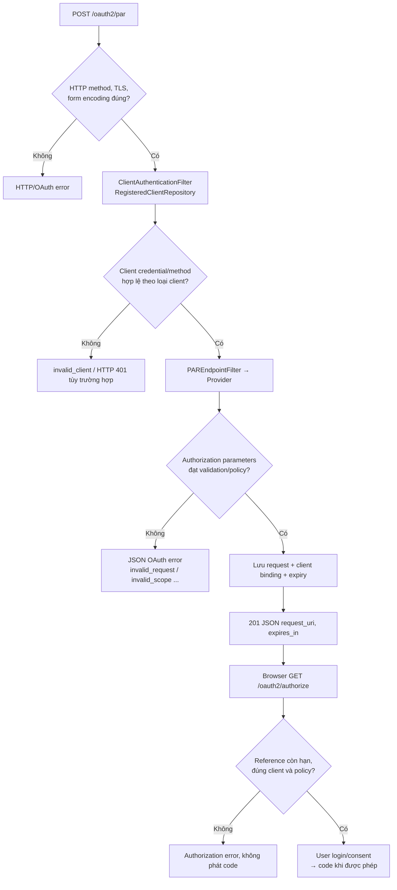
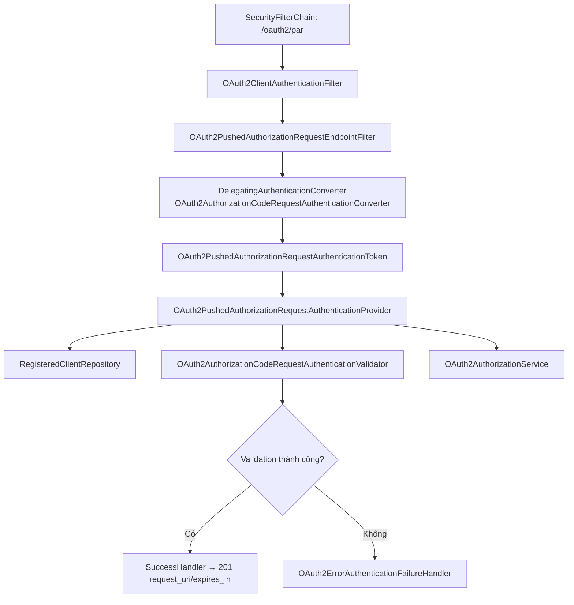

# Xác thực client và kiểm tra các tham số authorization được đẩy lên

## 1. Tại sao PAR cần xác thực client và kiểm tra request ngay từ đầu?

Trong OAuth 2.0 Authorization Code Flow truyền thống, OAuth Client chuyển trình duyệt tới `/oauth2/authorize` với các tham số trong URL, chẳng hạn `client_id`, `redirect_uri`, `scope`, `state` và `code_challenge`. Trình duyệt đi qua nhiều thành phần, khiến request có thể bị chỉnh sửa, lộ trong lịch sử URL hoặc vượt giới hạn chiều dài URL.

**Pushed Authorization Requests (PAR, RFC 9126)** thêm một bước **back-channel**: client gửi toàn bộ tham số authorization trực tiếp tới **PAR Endpoint** qua HTTPS. Authorization Server kiểm tra client và các tham số **trước khi** cung cấp một `request_uri` ngắn hạn để trình duyệt mang tới Authorization Endpoint.

Ví dụ: backend **Orders Web** muốn người dùng cấp quyền `orders.read`. Thay vì để browser mang toàn bộ authorization request, Orders Web gửi một POST đến `https://login.example.com/oauth2/par`. Nếu request hợp lệ, server trả `request_uri`. Browser chỉ cần đi đến `/oauth2/authorize?client_id=orders-web&request_uri=...`.

PAR giúp đẩy nhiều bước kiểm tra sang kênh trực tiếp giữa client và Authorization Server, nhưng **không thay thế xác thực người dùng, PKCE, consent hoặc kiểm tra lại yêu cầu tại Authorization Endpoint khi cần**.

Bài thuộc chương **PAR** của module `SPRING_SECURITY_OAUTH2_OIDC_AUTHORIZATION_SERVER`. Mục tiêu là học **thiết kế, cấu hình, bảo mật, kiểm thử và vận hành OAuth 2.0/OpenID Connect Authorization Server bằng Spring Security và Spring Authorization Server trong ứng dụng Spring Boot**, tập trung vào **xác thực client và validation của authorization request được đẩy lên**.

### Sau bài này, bạn cần làm được

1. Phân biệt danh tính **OAuth Client**, **người dùng cuối** và hai request tại **PAR Endpoint** và **Authorization Endpoint**.
2. Viết HTTP POST form-encoded đúng RFC 9126, có client authentication theo loại client.
3. Giải thích từng bước kiểm tra `client_id`, `response_type`, `redirect_uri`, `scope`, PKCE, `state` và các extension OIDC/JAR.
4. Hiểu `request_uri` phải gắn với client, có thời hạn ngắn và được quản lý để chống đoán/phát lại.
5. Cấu hình và tùy biến `OAuth2PushedAuthorizationRequestEndpointConfigurer` trong Spring Authorization Server 1.x mà không bỏ qua validator mặc định.
6. Tạo integration tests cho yêu cầu hợp lệ, lỗi client authentication, lỗi tham số và việc dùng lại `request_uri`.

> **Phạm vi phiên bản:** Ví dụ Java tập trung vào **Spring Authorization Server 1.5.x / Spring Security 6.x**. Ở Spring Security 7.x, DSL/package có thể khác; hãy đối chiếu tài liệu đúng phiên bản và không giả định thêm chính sách riêng khi chưa được cấu hình.

## 2. Hai endpoint, hai loại kiểm tra

| Điểm xử lý | Ai gọi? | Đầu vào điển hình | Điều quyết định |
| --- | --- | --- | --- |
| **PAR Endpoint** `POST /oauth2/par` | OAuth Client gọi trực tiếp qua HTTPS | Tham số authorization, `client_id` và client authentication khi áp dụng | Client được nhận diện/xác thực đúng phương thức? Request có đủ điều kiện được lưu dưới `request_uri`? |
| **Authorization Endpoint** `GET /oauth2/authorize` | Trình duyệt của người dùng | `client_id` và `request_uri` đã nhận | Reference còn hiệu lực/đúng client? Người dùng đã xác thực và consent chưa? Request còn phù hợp chính sách hiện tại không? |
| **Token Endpoint** `POST /oauth2/token` | OAuth Client gọi trực tiếp | Authorization code, redirect URI/PKCE, client authentication | Code và client hợp lệ? Có thể cấp access token và các token khác theo chính sách không? |

**Xác thực client** tại PAR Endpoint là một thao tác khác **đăng nhập người dùng**. Client secret hoặc client assertion tuyệt đối không được gửi qua trình duyệt tại `/oauth2/authorize`. Browser không cần và không được biết client secret của backend.

```mermaid
sequenceDiagram
    autonumber
    participant C as Orders Web / OAuth Client
    participant PAR as PAR Endpoint
    participant S as Authorization Storage
    participant B as Browser
    participant AU as Authorization Endpoint
    participant TOK as Token Endpoint
    actor U as Người dùng
    C->>PAR: POST /oauth2/par + client authentication<br/>authorization parameters
    PAR->>PAR: Xác thực client, kiểm tra request
    PAR->>S: Lưu tham số, client binding và expiry
    PAR-->>C: 201 JSON: request_uri + expires_in
    C-->>B: 302 /oauth2/authorize?client_id=...&request_uri=...
    B->>AU: GET /oauth2/authorize?client_id=...&request_uri=...
    AU->>S: Tra request_uri, kiểm tra client/expiry/replay
    S-->>AU: Authorization parameters đã đẩy lên
    AU->>AU: Kiểm tra lại theo policy nếu cần
    AU->>U: Login / consent theo yêu cầu
    U-->>AU: Xác thực và cho phép
    AU-->>B: 302 redirect_uri?code=...&state=...
    B->>C: Callback của client
    C->>C: So khớp state
    C->>TOK: POST /oauth2/token + code + PKCE/client auth
    TOK-->>C: Token response khi hợp lệ
```

Sơ đồ phân biệt rõ **PAR Endpoint**, **Authorization Endpoint** và **Token Endpoint**. `request_uri` **không phải authorization code** và chưa trao quyền truy cập API; chỉ sau khi người dùng hoàn tất ủy quyền thì client mới có thể đổi code tại Token Endpoint.

## 3. Cấu trúc HTTP của yêu cầu PAR

Theo **RFC 9126**, PAR Endpoint phải sử dụng HTTPS, nhận **POST** với body `application/x-www-form-urlencoded` mã hóa UTF-8. URI mặc định được Spring Authorization Server 1.5.x mô tả là `/oauth2/par`.

Ví dụ confidential client sử dụng `client_secret_basic`:

```http
POST /oauth2/par HTTP/1.1
Host: login.example.com
Authorization: Basic <ENCODED_CLIENT_CREDENTIALS>
Content-Type: application/x-www-form-urlencoded
Accept: application/json

response_type=code&client_id=orders-web&
redirect_uri=https%3A%2F%2Forders.example.com%2Flogin%2Foauth2%2Fcode%2Forders-web&
scope=openid%20profile%20orders.read&
state=RANDOM_STATE_PER_TRANSACTION&
code_challenge=BASE64URL_SHA256_CODE_VERIFIER&
code_challenge_method=S256&
nonce=RANDOM_NONCE_PER_OIDC_TRANSACTION
```

Body được **ngắt dòng để dễ đọc**; request thực tế phải là một chuỗi form-encoded hợp lệ. Đừng chèn newline giữa tên/giá trị tham số, và đừng gửi JSON body trong khi header ghi `application/x-www-form-urlencoded`.

### 3.1. Vì sao vẫn gửi client_id khi đã có Basic?

RFC 9126 yêu cầu `client_id` như một **authorization request parameter**, ngay cả khi client được xác thực qua phương thức khác. Server phải xác minh:

- Client ID trong request tồn tại và thuộc `RegisteredClient`.
- Kết quả client authentication tương ứng **chính client đó**.
- Không có mismatch giữa client ID đã xác thực và client ID trong nội dung được đẩy.

`client_id` chỉ là định danh, **không phải bí mật**. HTTP Basic, JWT assertion hoặc chứng chỉ là các dạng chứng minh danh tính dành cho confidential client.

### 3.2. Client authentication khác authorization parameters

| Nhóm | Tham số/header | Mục đích |
| --- | --- | --- |
| Client identification | `client_id` | Tìm bản ghi client và ràng buộc `request_uri` |
| Client authentication | `Authorization: Basic ...` hoặc `client_assertion_type` + `client_assertion`, mTLS | Chứng minh danh tính confidential client |
| Authorization request | `response_type`, `redirect_uri`, `scope`, `state` | Mô tả yêu cầu cấp quyền sắp được browser thực hiện |
| PKCE | `code_challenge`, `code_challenge_method` | Ràng buộc code exchange với verifier |
| OIDC | `nonce`, `prompt`, `max_age` hoặc `claims` khi áp dụng | Quy tắc xác thực người dùng/claims tương ứng |
| OAuth extension | `resource`, `authorization_details` hoặc `request` khi hỗ trợ | Bổ sung chỉ dẫn đối tượng tài nguyên, yêu cầu quyền hoặc JAR Request Object |

Các tham số **token request không phục vụ client authentication**, ví dụ `grant_type=refresh_token`, `code_verifier` hay `refresh_token`, không có ý nghĩa mặc định ở PAR Endpoint. **`request_uri` tuyệt đối không được gửi như một tham số bên trong pushed authorization request**; đây là dữ liệu server cấp **sau khi** chấp nhận request.

## 4. PAR response thành công: 201, request_uri và expires_in

Khi kiểm tra thành công, RFC 9126 yêu cầu **HTTP 201 Created** và JSON gồm `request_uri` và `expires_in`:

```http
HTTP/1.1 201 Created
Content-Type: application/json
Cache-Control: no-cache, no-store

{
  "request_uri": "urn:ietf:params:oauth:request_uri:random-reference-example",
  "expires_in": 60
}
```

**Hai thuộc tính quan trọng:**

- `request_uri` tham chiếu nội dung authorization đã được server chấp nhận; giá trị phải khó đoán, được **ràng buộc với client** đã gửi yêu cầu. Không có yêu cầu phải là một URL HTTP công khai để có thể truy cập qua GET.
- `expires_in` là **số JSON** chỉ thời gian hiệu lực tính bằng giây; RFC cho phép server chọn TTL ngắn, thường khoảng **5–600 giây**, không bắt buộc đúng 60.

Khi nhận response này, client chuyển browser tới Authorization Endpoint:

```http
GET /oauth2/authorize?client_id=orders-web&
request_uri=urn%3Aietf%3Aparams%3Aoauth%3Arequest_uri%3Arandom-reference-example HTTP/1.1
Host: login.example.com
```

Đây cũng là request **được xuống dòng để minh họa**. URL thật phải mã hóa `request_uri` như một query parameter. Browser không cần mang lại `redirect_uri`, `scope` hay `code_challenge` bên ngoài reference. Đừng cho các tham số bổ sung trong front-channel ghi đè các giá trị đã đẩy lên.

**Không nhầm:**

- `201` tại PAR **không đồng nghĩa** người dùng đã đăng nhập/chấp thuận.
- `request_uri` **không phải** `code`, `access_token`, `refresh_token` hay ID Token.
- `expires_in` của `request_uri` **không phải** thời hạn access token sau này.

## 5. Xác thực client theo phương thức đã đăng ký

RFC 9126 quy định tại PAR Endpoint áp dụng **các quy tắc client authentication như Token Endpoint** (RFC 6749). Nếu client là confidential, server cần kiểm tra phương thức đã đăng ký và bằng chứng của chính client đó.

| Method | Cách gửi tại PAR | Điểm xác minh |
| --- | --- | --- |
| `client_secret_basic` | `Authorization: Basic ...` | Secret đúng, chưa hết hạn, method được đăng ký |
| `client_secret_post` | `client_id` + `client_secret` trong form body | So khớp secret; tránh body logging |
| `private_key_jwt` | `client_assertion_type` + JWT `client_assertion` | Khóa công khai đăng ký, chữ ký, thuật toán, `iss/sub/aud/exp` |
| `client_secret_jwt` | JWT assertion ký bằng shared secret | Secret/thuật toán/claims và thời hạn hợp lệ |
| `tls_client_auth` | Certificate trong mTLS handshake | PKI và binding chứng chỉ với client đã đăng ký |
| `self_signed_tls_client_auth` | Chứng chỉ tự ký đã liên kết với registration | Chứng chỉ/trust binding theo RFC 8705 |
| `none` | Public client tự khai `client_id` | Không có bí mật dài hạn; vẫn phải kiểm tra registration, grant, redirect URI và PKCE |

### 5.1. Confidential client: chứng minh danh tính trước khi lưu request

Giả sử `orders-web` đăng ký `CLIENT_SECRET_BASIC`. Một request có đúng client ID nhưng sai Basic secret phải bị từ chối. Tương tự, gửi `client_secret_post` khi client chỉ cho phép `client_secret_basic` không được chấp nhận chỉ vì secret trông có vẻ đúng.

Đừng sử dụng nhiều phương thức client authentication trong cùng một request. Với Basic, credential được tạo theo quy tắc URL-encoding của RFC 6749 rồi chuyển thành header; Base64 **không bảo mật secret** nếu không có HTTPS.

### 5.2. JWT client assertion: cần kiểm tra audience thế nào?

Khi dùng `private_key_jwt` hoặc `client_secret_jwt`, JWT client assertion có các claim như `iss`, `sub`, `aud`, `exp` và có thể `jti`. Theo RFC 9126, **issuer URL của Authorization Server nên được client dùng làm audience**. Để tương thích, Authorization Server phải chấp nhận issuer identifier, Token Endpoint URL hoặc PAR Endpoint URL là giá trị audience xác định chính nó.

Ví dụ payload assertion:

```json
{
  "iss": "orders-web",
  "sub": "orders-web",
  "aud": "https://login.example.com",
  "iat": 1794000000,
  "exp": 1794000060,
  "jti": "unique-client-assertion-001"
}
```

Đây là **payload minh họa chưa ký**, không phải assertion dùng được. Server phải xác minh chữ ký bằng khóa công khai đáng tin đã liên kết với `RegisteredClient`, kiểm soát `alg/kid`, đồng hồ và replay policy. Không tự tải và tin một JWKS URL do client tùy ý gửi kèm request.

Một điểm tinh tế: JWT client assertion dùng để **xác thực client**. Nó không phải `request` JWT của **JWT-Secured Authorization Request (JAR)** và cũng không phải OIDC ID Token.

### 5.3. Public client: nhận diện khác với xác thực mật mã

RFC 9126 áp dụng quy tắc xác thực client tương ứng Token Endpoint; public client đăng ký `ClientAuthenticationMethod.NONE` không có shared secret/khóa riêng được tin làm bằng chứng. Với chúng, server **nhận diện qua `client_id`** và kiểm tra cấu hình/phân quyền; không nên mô tả request `none` là đã xác thực mạnh danh tính ứng dụng.

Vì `client_id` có thể bị bất kỳ ai biết, public client cần đặc biệt chú trọng `redirect_uri` cố định/đăng ký, PKCE S256, `state`, giới hạn rate và chính sách PAR. PAR không biến ứng dụng JavaScript/mobile phân phối cho người dùng thành confidential client.

### 5.4. Không gửi secret qua browser

Client authentication diễn ra ở **PAR back-channel**. Browser sau đó chỉ dùng `client_id` + `request_uri`. Không cho secret, assertion JWT hoặc certificate material vào query string, fragment, HTML, JavaScript hay redirect URI.

## 6. Chuỗi validation bắt buộc trước khi trả request_uri



Các kiểm tra được tách thành hai tầng:

1. **PAR-time validation:** yêu cầu có thể được lưu một cách hợp lệ không? Nó có khai đúng client, redirect URI, grant, scope, PKCE và các extension hợp lệ không?
2. **Authorization-time validation:** reference còn hạn/đúng client/chưa bị lạm dụng không? Chính sách client có thay đổi không? Người dùng đã xác thực, đáp ứng tương tác OIDC và cấp consent phù hợp chưa?

RFC 9126 cho phép **hoãn những phép kiểm tra không thể hoàn tất tại PAR** đến Authorization Endpoint, nhưng **không được bỏ qua vĩnh viễn**. Những bước đã kiểm tra tại PAR chỉ được bỏ qua khi server chứng minh request thực sự được đẩy và không có thay đổi dữ liệu/chính sách ảnh hưởng kết quả.

## 7. Kiểm tra từng tham số authorization

| Tham số | Kiểm tra quan trọng | Hậu quả nếu bỏ qua |
| --- | --- | --- |
| `client_id` | Bắt buộc; tồn tại, phù hợp credential/client đã xác định và request URI binding | Client impersonation/confused deputy |
| `response_type` | Hợp lệ, nằm trong response/grant type server và client hỗ trợ; với Authorization Code thường là `code` | Xử lý flow không được đăng ký |
| `redirect_uri` | Phù hợp danh sách đã đăng ký và chính sách URI; mặc định Spring validator kiểm tra redirect URI | Open redirect, đánh cắp authorization code |
| `scope` | Cú pháp phù hợp, nằm trong phạm vi được đăng ký và được phép | Cấp quyền quá mức |
| `state` | Client tự sinh giá trị ngẫu nhiên theo từng giao dịch; bảo toàn nguyên vẹn đến callback | CSRF/callback mix-up ở client |
| `code_challenge` | Có khi client/flow bắt buộc PKCE; định dạng challenge hợp lệ | Authorization code interception |
| `code_challenge_method` | Ưu tiên/áp dụng `S256` theo policy; không hạ cấp ngoài ý muốn | PKCE downgrade |
| `nonce` | Khi OIDC yêu cầu; client cần kiểm tra lại ID Token | Token injection/replay trong OIDC |
| `prompt`, `max_age`, `claims` | Cú pháp và policy khi dùng OIDC; tương tác còn cần xử lý sau | Không tuân yêu cầu xác thực người dùng |
| `resource`/`authorization_details` | Khi server có hỗ trợ; xác minh resource/audience/quyền theo trust policy | Token dùng sai API hoặc quyền nghiệp vụ vượt phạm vi |
| `request` | Nếu dùng JAR, xác thực/chứng thực Request Object đúng quy tắc | JWT giả mạo, mâu thuẫn claims |
| `request_uri` | **Không được xuất hiện trong pushed request** | Dùng reference thay cho dữ liệu đáng lẽ phải đẩy |

### 7.1. client_id phải nhất quán trên cả hai bước

Giả sử `orders-web` tạo PAR và nhận `request_uri=urn:...:abc`. Một browser request với `client_id=other-client&request_uri=urn:...:abc` phải bị từ chối: RFC 9126 **bắt buộc ràng buộc request URI với client tạo ra nó**.

Đừng tin `client_id` do browser truyền là đủ để chọn hoặc đổi quyền sở hữu reference. Khi tra `request_uri`, server phải đối chiếu định danh đã lưu và metadata của `RegisteredClient`.

### 7.2. redirect_uri phải đúng chính sách

Mặc định, Spring Authorization Server sử dụng validator đối với `redirect_uri` và `scope` của authorization code request. Trong cấu hình điển hình, redirect URI phải khớp registration, thường là **so khớp chuỗi chính xác**:

```text
Đã đăng ký:
https://orders.example.com/login/oauth2/code/orders-web

Yêu cầu hợp lệ:
https://orders.example.com/login/oauth2/code/orders-web

Yêu cầu không hợp lệ:
https://attacker.example/callback
https://orders.example.com/login/oauth2/code/orders-web/extra
```

**Ngoại lệ theo RFC 9126, mục 2.4:** Với **client thực sự có credential xác thực được**, Authorization Server **có thể** cho phép URI theo từng giao dịch ngoài danh sách đăng ký, với chính sách hạn chế rõ ràng. Đây là **quyền lựa chọn triển khai**, không phải hành vi mặc định phải bật, và **không** áp dụng tùy tiện cho public client. Khi không có nhu cầu thực sự, giữ so khớp URI đã đăng ký để giảm nguy cơ open redirect.

### 7.3. scope và quyền nghiệp vụ

`scope=orders.read` chỉ hợp lệ khi client được phép xin scope đó. Nếu request xin `orders.admin` nhưng client chỉ đăng ký `orders.read`, PAR nên từ chối sớm hoặc xử lý theo quy tắc scope/policy thích hợp, thay vì cấp một `request_uri` sẽ dẫn tới quyền admin sau login.

Các quyền liên quan nghiệp vụ như thanh toán, khoản tiền, tenant hoặc resource indicator phải được kiểm tra ở mức server policy, không nhận giá trị từ client một cách tin cậy chỉ vì PAR qua HTTPS.

### 7.4. PKCE không được đẩy code_verifier

Với Authorization Code + PKCE:

- Tại PAR: gửi `code_challenge` và `code_challenge_method=S256`.
- Tại Authorization Endpoint: dùng các giá trị đã lưu trong PAR, không sửa từ query browser.
- Tại Token Endpoint: client mới gửi `code_verifier` để chứng minh quyền đổi code.

**Không gửi `code_verifier` tại PAR/Authorization Endpoint**. Nó là bí mật giao dịch mà client phải giữ tới bước đổi code. PKCE giúp chống code interception và giảm nguy cơ thay thế giao dịch; `state` vẫn hữu ích để bảo vệ callback tương ứng.

### 7.5. state, nonce và validation thuộc về bên nào?

Authorization Server phải **bảo toàn và sử dụng đúng các tham số được đẩy**, kiểm tra cú pháp/chính sách cần thiết. Nhưng **OAuth Client** mới là bên sinh và **đối chiếu `state` khi callback quay về**. Với OIDC, client còn phải kiểm tra `nonce`/ID Token khi trường này áp dụng.

Không xem PAR là lý do bỏ `state` hoặc PKCE. PAR giảm khả năng browser thay đổi nội dung authorization request, **không giải quyết tất cả token substitution, login CSRF hay session attack**.

## 8. PAR và JAR: hai khái niệm khác nhau

**PAR (RFC 9126)** là **cách gửi** authorization parameters qua back-channel và nhận reference `request_uri`. **JAR (RFC 9101)** là **cách đóng gói** authorization parameters thành một **JWT Request Object** có thể ký và/hoặc mã hóa.

| Đặc tính | PAR | JAR |
| --- | --- | --- |
| Mục đích chính | Đẩy request trực tiếp, giảm phụ thuộc front-channel | Bảo vệ tính toàn vẹn/xác thực của Request Object theo JWT |
| Dạng dữ liệu điển hình | Form fields trong HTTP POST | JWT trong tham số `request` |
| Có thể dùng kết hợp? | **Có** | **Có** — push Request Object tới PAR |
| Có mặc nhiên được ký? | **Không**; HTTPS/client authentication khi áp dụng bảo vệ kênh | Có chữ ký khi chính sách JAR yêu cầu |
| Browser mang gì tiếp theo? | `client_id` + `request_uri` | Tùy cách sử dụng JAR/PAR |

### 8.1. Khi gửi tham số request của JAR

Theo RFC 9126, nếu sử dụng `request` chứa JWT Request Object tại PAR, **các tham số authorization khác phải nằm bên trong JWT**, không đồng thời nằm ngoài JWT dưới dạng form fields riêng. Ngoại lệ là các tham số dùng cho **client authentication** (ví dụ `client_assertion` và `client_assertion_type`) và những tham số theo hợp đồng của cơ chế xác thực client.

Ví dụ khái niệm:

```http
POST /oauth2/par HTTP/1.1
Host: login.example.com
Content-Type: application/x-www-form-urlencoded
Authorization: Basic <ENCODED_CLIENT_CREDENTIALS>

client_id=orders-web&request=SIGNED_REQUEST_OBJECT_JWT
```

Trong ví dụ `client_id` vẫn được yêu cầu theo RFC 9126; authorization parameters khác như `redirect_uri`, `scope`, `state` và `code_challenge` nằm **trong JWT**. Nếu client authentication và Request Object dùng các định danh khác nhau, server phải từ chối; server còn phải kiểm tra chữ ký/mã hóa, thời hạn và claims theo RFC 9101.

**Đừng nhầm hai JWT:**

- `client_assertion` JWT chứng minh client được quyền gửi request.
- `request` JWT mô tả **authorization request**.

Hai JWT có issuer/audience/key/policy khác nhau và không tự thay thế được nhau.

## 9. Lỗi và HTTP status tại PAR Endpoint

PAR nhận request từ **client**, không phải tương tác với người dùng cuối. Theo RFC 9126, khi có lỗi, endpoint thường trả **JSON OAuth error** theo định dạng tương tự Token Endpoint. Không chuyển sang trang login HTML chỉ vì tham số authorization thiếu hoặc client secret sai.

Phản hồi lỗi ví dụ:

```http
HTTP/1.1 400 Bad Request
Content-Type: application/json
Cache-Control: no-cache, no-store

{
  "error": "invalid_request"
}
```

| Tình huống | Phản hồi thường gặp | Điểm cần nhớ |
| --- | --- | --- |
| Sai secret/method hoặc JWT assertion | `invalid_client`, HTTP 400/401 theo client authentication | Không tiết lộ secret/client tồn tại hay không |
| `request_uri` xuất hiện trong POST PAR | `invalid_request` | RFC bắt buộc từ chối |
| `redirect_uri` thiếu/sai | `invalid_request` hoặc lỗi phù hợp | Không redirect lỗi tới URI không đáng tin |
| Client không được phép dùng grant/response type | `unauthorized_client` hoặc mã phù hợp | Kiểm tra registration/policy |
| Scope ngoài quyền | `invalid_scope` hoặc mã phù hợp | Không cấp scope trái policy |
| Signed Request Object bắt buộc nhưng thiếu/sai | `invalid_request`, HTTP 400 | Không silently fallback sang request không ký |
| HTTP method không phải POST | HTTP **405** | Theo RFC 9126 |
| Request vượt giới hạn kích thước | HTTP **413** | Theo RFC 9126 |
| Quá tần suất/giới hạn request | HTTP **429** | Theo RFC 9126 |

RFC 9126 nhấn mạnh **lỗi tương tác người dùng** như `consent_required` không được phát sinh trong **xử lý PAR ban đầu**, vì người dùng chưa tham gia bước này. Những tình huống cần login/consent thuộc Authorization Endpoint sau đó.

**Không báo chi tiết nhạy cảm** như secret sai hay client ID chưa tồn tại qua `error_description`. Ghi correlation ID, loại lỗi và metadata vận hành tối thiểu vào log nội bộ đã được bảo vệ.

## 10. request_uri: binding, thời gian sống và chống replay

Sau khi cấp `request_uri`, Authorization Server cần bảo vệ một **reference dùng để khôi phục đúng request gốc**.

| Ràng buộc | Quy tắc/cách kiểm tra |
| --- | --- |
| **Tính khó đoán** | Sinh bằng nguồn ngẫu nhiên mật mã đủ entropy |
| **Gắn với client** | RFC 9126 `MUST`: reference thuộc client đã đẩy request |
| **Thời hạn ngắn** | Hết `expires_in` phải bị từ chối |
| **Dùng một lần** | Client chỉ dùng một lần; server `SHOULD` xử lý one-time, có thể nới rất hạn chế cho browser reload |
| **Không sửa dữ liệu** | Browser không được ghi đè redirect URI/scope/PKCE đã lưu |
| **Kiểm tra lại policy** | Nếu client registration/policy thay đổi, không dùng kết quả validation cũ một cách mù quáng |
| **Tính nhất quán nhiều node** | PAR tại node A và Authorization Endpoint tại node B đều truy xuất đúng authorization state |

### 10.1. Tại sao không dùng reference làm URL chuyển hướng tùy ý?

Chuỗi `request_uri` có thể trông như URN, nhưng **không phải một đích mà client hoặc browser yêu cầu server tải qua HTTP**. Nếu implementation tự biến mọi `request_uri=https://...` thành fetch URL, có nguy cơ SSRF và tin dữ liệu ngoài vùng kiểm soát.

Nó cần ánh xạ tới authorization request do **chính Authorization Server** nhận, lưu và quản lý. Không cho client tự chỉ định một reference đã tồn tại trong POST PAR.

### 10.2. Replay và reload của browser

Client chỉ được sử dụng reference cho một authorization request. RFC khuyến nghị server coi reference là **single-use**, nhưng cho phép xử lý hợp lý các request lặp do reload/refresh browser. Không đồng nhất “cho phép reload” với cho phép một reference được dùng mãi hoặc bởi client khác.

Nếu request bị trùng/hết hạn, phản hồi lỗi và yêu cầu client **tạo PAR mới**, không tự hồi sinh authorization request đã tiêu thụ.

### 10.3. Đừng lẫn thời hạn PAR với thời hạn authorization code

`expires_in=60` của PAR response chỉ nói reference còn hiệu lực trong 60 giây kể từ lúc cấp. Authorization code được phát **sau khi người dùng đăng nhập/consent**, với lifetime khác. Không tăng tuổi `request_uri` lên hàng giờ để giải quyết vấn đề đăng nhập chậm nếu threat model không cho phép.

## 11. Tích hợp Spring Authorization Server: những thành phần tham gia

Spring Authorization Server 1.5.x cung cấp **`OAuth2PushedAuthorizationRequestEndpointConfigurer`** dưới `OAuth2AuthorizationServerConfigurer`.



Theo tài liệu chính thức, các thành phần mặc định gồm:

- **`OAuth2PushedAuthorizationRequestEndpointFilter`**: filter xử lý HTTP request ở PAR Endpoint.
- **`OAuth2AuthorizationCodeRequestAuthenticationConverter`**: thành phần chuyển authorization parameters sang authentication request mà PAR filter có thể xử lý.
- **`OAuth2PushedAuthorizationRequestAuthenticationProvider`**: thành phần xử lý pushed request và áp dụng validation, cùng những dịch vụ/cấu hình có liên quan.
- **`OAuth2AuthorizationCodeRequestAuthenticationValidator`**: validator mặc định cho **`redirect_uri` và `scope`** trong authorization code request.
- **Success handler**: trả response `201` với `request_uri`/`expires_in`.
- **`OAuth2ErrorAuthenticationFailureHandler`**: tạo OAuth error response ở nhánh lỗi.

**Cẩn trọng:** Hai kiểm tra `redirect_uri` và `scope` được tài liệu liệt kê rõ cho validator mặc định, nhưng còn nhiều kiểm tra protocol khác thuộc provider/luồng phía sau. Đừng giả định **mọi extension parameter** như `authorization_details`, `resource` hay một OIDC claim tùy biến đều được mặc định xác minh theo policy nghiệp vụ của bạn.

## 12. Cấu hình SecurityFilterChain và URI của PAR Endpoint

### 12.1. Mẫu cấu hình Spring Authorization Server 1.x

```java
import org.springframework.context.annotation.Bean;
import org.springframework.context.annotation.Configuration;
import org.springframework.core.annotation.Order;
import org.springframework.security.config.annotation.web.builders.HttpSecurity;
import org.springframework.security.oauth2.server.authorization.config.annotation.web.configurers.OAuth2AuthorizationServerConfigurer;
import org.springframework.security.web.SecurityFilterChain;

@Configuration
class AuthorizationServerSecurityConfiguration {

    @Bean
    @Order(1)
    SecurityFilterChain authorizationServerSecurityFilterChain(
            HttpSecurity http) throws Exception {

        OAuth2AuthorizationServerConfigurer server =
                OAuth2AuthorizationServerConfigurer.authorizationServer();

        http
            .securityMatcher(server.getEndpointsMatcher())
            .with(server, authorizationServer ->
                authorizationServer
                    .pushedAuthorizationRequestEndpoint(par -> {
                        // Các converter/provider/handler mặc định đã tồn tại.
                        // Chỉ tùy biến nếu có policy cần kiểm tra thêm.
                    })
            )
            .authorizeHttpRequests(authorize ->
                authorize.anyRequest().authenticated());

        return http.build();
    }
}
```

Đây là **khung filter chain**, chưa phải dự án tự chạy độc lập. Cần bổ sung `RegisteredClientRepository`, `OAuth2AuthorizationService`, `AuthorizationServerSettings` và các bean liên quan đến khóa/token/grant; nếu xử lý browser Authorization Code còn cần chain đăng nhập người dùng.

Không viết controller MVC cùng đường `POST /oauth2/par` để cấp `request_uri` thủ công rồi bỏ qua các thành phần Spring có sẵn.

### 12.2. Đặt public issuer và endpoint URI

```java
@Bean
AuthorizationServerSettings authorizationServerSettings() {
    return AuthorizationServerSettings.builder()
            .issuer("https://login.example.com")
            .pushedAuthorizationRequestEndpoint("/oauth2/par")
            .authorizationEndpoint("/oauth2/authorize")
            .tokenEndpoint("/oauth2/token")
            .build();
}
```

PAR Endpoint public phải dùng **HTTPS**. Nếu Authorization Server chạy sau reverse proxy hoặc có context path `/auth`, phải bảo đảm discovery, issuer và URL bên ngoài đúng, ví dụ `https://login.example.com/auth/oauth2/par`. Không cộng prefix hai lần vào `pushedAuthorizationRequestEndpoint(...)` khi proxy/servlet context đã xử lý.

Metadata chuẩn RFC 8414/RFC 9126 có thể công bố:

```json
{
  "issuer": "https://login.example.com",
  "pushed_authorization_request_endpoint": "https://login.example.com/oauth2/par",
  "authorization_endpoint": "https://login.example.com/oauth2/authorize",
  "require_pushed_authorization_requests": false
}
```

Đây là **trích lược minh họa**, không phải metadata tự động của mọi phiên bản. `require_pushed_authorization_requests` là metadata chính sách của chuẩn: khi `true`, server chỉ chấp nhận authorization request theo PAR trong phạm vi áp dụng. RFC còn có thuộc tính metadata **theo client** tương ứng; **không giả định** Spring Authorization Server 1.5.x có sẵn builder property cùng tên nếu chưa kiểm tra API. Nếu muốn bắt buộc PAR, phải thực thi policy ở cả Authorization Endpoint, không chỉ hiển thị một cờ JSON.

## 13. RegisteredClient và ClientSettings liên quan

Ví dụ confidential client dùng Authorization Code + PKCE:

```java
RegisteredClient ordersWeb = RegisteredClient.withId(
                UUID.randomUUID().toString())
        .clientId("orders-web")
        // Giá trị đã qua PasswordEncoder từ secret manager.
        .clientSecret(encodedClientSecret)
        .clientAuthenticationMethod(
                ClientAuthenticationMethod.CLIENT_SECRET_BASIC)
        .authorizationGrantType(AuthorizationGrantType.AUTHORIZATION_CODE)
        .authorizationGrantType(AuthorizationGrantType.REFRESH_TOKEN)
        .redirectUri(
                "https://orders.example.com/login/oauth2/code/orders-web")
        .scope("openid")
        .scope("profile")
        .scope("orders.read")
        .clientSettings(ClientSettings.builder()
                .requireProofKey(true)
                .requireAuthorizationConsent(true)
                .build())
        .build();
```

Các import/bean repository được lược bỏ; `encodedClientSecret` không phải chuỗi hard-code. `requireProofKey(true)` áp cho Authorization Code + PKCE, không đồng nghĩa bắt buộc PAR. `requireAuthorizationConsent(true)` áp chính sách consent, cũng không đồng nghĩa PAR được bật/bắt buộc.

### 13.1. Public client và giới hạn nhận diện

```java
RegisteredClient ordersSpa = RegisteredClient.withId(
                UUID.randomUUID().toString())
        .clientId("orders-spa")
        .clientAuthenticationMethod(ClientAuthenticationMethod.NONE)
        .authorizationGrantType(AuthorizationGrantType.AUTHORIZATION_CODE)
        .redirectUri("https://app.example.com/callback")
        .scope("orders.read")
        .clientSettings(ClientSettings.builder()
                .requireProofKey(true)
                .build())
        .build();
```

SPA không thể giữ client secret đáng tin; PAR request từ public client **không có bằng chứng danh tính mạnh chỉ dựa trên client ID**. Nếu triển khai cho SPA, cần kiểm thử CORS/trust boundary, bảo vệ PKCE và policy redirect. Đừng đặt secret vào JavaScript để “làm PAR an toàn hơn”.

### 13.2. PKCE và xác thực client có thể bổ sung cho nhau

Với confidential client, **client authentication** chứng minh bên gửi PAR sở hữu credential; **PKCE** ràng buộc lần đổi authorization code với `code_verifier`. Dù confidential client được xác thực qua Basic hoặc `private_key_jwt`, dùng PKCE khi thích hợp vẫn tăng khả năng chống code interception/injection.

## 14. Tùy chỉnh validator của pushed authorization request

### 14.1. Các extension point có sẵn

| DSL | Vai trò |
| --- | --- |
| `pushedAuthorizationRequestConverter(...)` | Thêm converter trích thông tin từ HTTP request |
| `pushedAuthorizationRequestConverters(...)` | Xem/tùy chỉnh danh sách converter |
| `authenticationProvider(...)` | Thêm provider xử lý pushed request |
| `authenticationProviders(...)` | Tùy chỉnh các provider hiện có, ví dụ gắn validator |
| `pushedAuthorizationResponseHandler(...)` | Xử lý response thành công |
| `errorResponseHandler(...)` | Trả OAuth error khi thất bại |

Nếu cần kiểm tra policy riêng (tenant/resource/audience), hãy **giữ validator bắt buộc của Spring** và bổ sung bước kiểm tra, thay vì thay toàn bộ bằng validator chỉ xem một trường.

### 14.2. Ví dụ nối validator bổ sung sau validator mặc định

Đoạn sau tập trung vào **cách đăng ký policy** trong Spring Authorization Server 1.x:

```java
@Bean
@Order(1)
SecurityFilterChain authorizationServerSecurityFilterChain(
        HttpSecurity http) throws Exception {

    OAuth2AuthorizationServerConfigurer server =
            OAuth2AuthorizationServerConfigurer.authorizationServer();

    http
        .securityMatcher(server.getEndpointsMatcher())
        .with(server, authorizationServer ->
            authorizationServer.pushedAuthorizationRequestEndpoint(par ->
                par.authenticationProviders(providers ->
                    providers.forEach(provider -> {
                        if (provider instanceof
                                OAuth2PushedAuthorizationRequestAuthenticationProvider p) {

                            Consumer<OAuth2AuthorizationCodeRequestAuthenticationContext>
                                    validation =
                                    new OAuth2AuthorizationCodeRequestAuthenticationValidator()
                                        .andThen(context -> {
                                            String clientId =
                                                    context.getRegisteredClient().getClientId();
                                            boolean forbiddenScope =
                                                    context.getAuthentication().getScopes()
                                                        .contains("payments.transfer");

                                            // Ví dụ policy riêng: Orders Web
                                            // không được xin quyền chuyển tiền.
                                            if ("orders-web".equals(clientId)
                                                    && forbiddenScope) {
                                                throw new
                                                    OAuth2AuthorizationCodeRequestAuthenticationException(
                                                        new OAuth2Error(
                                                            OAuth2ErrorCodes.INVALID_SCOPE),
                                                        null);
                                            }
                                        });

                            p.setAuthenticationValidator(validation);
                        }
                    })
                )
            )
        )
        .authorizeHttpRequests(authorize ->
            authorize.anyRequest().authenticated());

    return http.build();
}
```

Ví dụ dùng các type: `Consumer`, `OAuth2PushedAuthorizationRequestAuthenticationProvider`, `OAuth2AuthorizationCodeRequestAuthenticationContext`, `OAuth2AuthorizationCodeRequestAuthenticationValidator`, `OAuth2AuthorizationCodeRequestAuthenticationException`, `OAuth2Error` và `OAuth2ErrorCodes`; thêm import đúng package theo dependency. Đoạn code **chưa đủ bean để chạy server độc lập**.

**Vì sao cách này an toàn hơn?** `new OAuth2AuthorizationCodeRequestAuthenticationValidator()` chạy kiểm tra `redirect_uri` và `scope` mặc định **trước**, sau đó `andThen(...)` kiểm tra policy bổ sung. Không vô tình thay thế khả năng phát hiện open redirect hoặc scope trái registration bằng một `Consumer` chỉ xem `client_id`.

Đối với hệ thống có nhiều chính sách, có thể tách custom validator thành một lớp riêng, viết test đơn vị và dùng chung những chính sách thực sự phù hợp ở PAR và Authorization Endpoint. **Không tự bỏ validation tại Authorization Endpoint chỉ vì PAR đã từng thành công**.

## 15. Kiểm thử HTTP trực tiếp bằng curl

Ví dụ test confidential client (không dùng credential production):

```bash
curl --request POST "https://login.example.com/oauth2/par" \
  --user "$CLIENT_ID:$CLIENT_SECRET" \
  --header "Accept: application/json" \
  --data-urlencode "response_type=code" \
  --data-urlencode "client_id=orders-web" \
  --data-urlencode "redirect_uri=https://orders.example.com/login/oauth2/code/orders-web" \
  --data-urlencode "scope=openid profile orders.read" \
  --data-urlencode "state=STATE_GENERATED_FOR_TEST" \
  --data-urlencode "code_challenge=S256_CODE_CHALLENGE_GENERATED_FOR_TEST" \
  --data-urlencode "code_challenge_method=S256" \
  --data-urlencode "nonce=NONCE_GENERATED_FOR_TEST"
```

Lệnh dùng `--data-urlencode` để encode đúng form fields; `curl --user` có thể để lộ credential qua môi trường chạy/process/log, vì vậy production/CI nên dùng OAuth2 client library và cơ chế cấp bí mật phù hợp.

Không thay `code_challenge` bằng chuỗi placeholder trong test hợp lệ: PKCE challenge thực tế phải được tạo bằng một `code_verifier` ngẫu nhiên có định dạng/độ dài đúng chuẩn, sau đó mới dùng verifier ở Token Endpoint. Nếu test gặp lỗi vì challenge sai định dạng, đó là lỗi dữ liệu test, không chứng minh PAR bị hỏng.

### 15.1. Phân tách hai lần gọi HTTP

Lần 1: backend/client POST tới `/oauth2/par`, đọc JSON `request_uri`. Lần 2: browser dùng **`GET /oauth2/authorize`** với `client_id` và `request_uri`; không chạy `curl` giả làm browser rồi kết luận authorization đã hoàn tất khi chưa có login/consent.

Sau khi nhận authorization code tại callback của client, backend mới gọi **`POST /oauth2/token`** với code + PKCE verifier + client authentication phù hợp. PAR không thay Token Endpoint.

## 16. Ma trận kiểm thử xác thực client và validation

| Ca thử | Request/điều kiện | Kết quả mong đợi |
| --- | --- | --- |
| Confidential Basic hợp lệ | `client_id`/secret đúng, request hợp lệ | `201` JSON `request_uri` + `expires_in` |
| Secret sai hoặc hết hạn | Cùng client ID, sai credential | Từ chối `invalid_client`/status phù hợp, không cấp reference |
| Method chưa đăng ký | Gửi `client_secret_post` khi chỉ cho Basic | Từ chối client authentication |
| Basic và secret trong body cùng lúc | Nhiều phương thức trong một request | Không chấp nhận ambiguity |
| JWT assertion hợp lệ | Ký đúng bằng khóa đã đăng ký | PAR tiếp tục kiểm tra authorization parameters |
| JWT assertion sai audience/expiry/signature | `private_key_jwt` sai | Không cấp reference |
| Public `none` + PKCE | Client đã đăng ký, redirect/scope hợp lệ | Theo policy hỗ trợ public PAR; không đòi secret giả |
| Client ID không tồn tại | `client_id` bất kỳ | Từ chối và không tiết lộ metadata nhạy cảm |
| Client ID khác authenticated identity | Basic cho client A, body ghi client B | Từ chối |
| Thiếu client_id | Request không có định danh | Từ chối theo RFC 9126 |
| Thiếu/sai `response_type` | Không có grant/response type phù hợp | Không trả reference |
| Redirect URI chưa đăng ký | `redirect_uri` trỏ đến attacker | Từ chối, không redirect sang URI đó |
| Redirect URI chỉ khác dấu slash | Không khớp registration | Từ chối theo default exact matching policy |
| Scope vượt quyền | `scope=orders.admin` không được phép | `invalid_scope` hoặc lỗi phù hợp |
| PKCE bị thiếu khi bắt buộc | Không gửi challenge cho `requireProofKey(true)` | Bị từ chối ở bước validation phù hợp |
| PKCE challenge sai | Sai định dạng/`code_challenge_method` | Không được chấp nhận |
| `state` giao dịch khác | Callback không khớp state | OAuth Client từ chối callback; không bỏ bước này nhờ PAR |
| `request_uri` trong POST PAR | Client tự gửi reference | **Bắt buộc từ chối** |
| Request Object/JAR sai chữ ký | Signed JAR theo policy | Từ chối theo RFC 9101/PAR policy |
| Signed JAR bắt buộc nhưng thiếu | Client/AS policy yêu cầu JWT | HTTP 400 `invalid_request` |
| Gửi JSON thay form | `Content-Type: application/json` | Không cấp reference |
| Dùng GET tới PAR | Sai method | HTTP **405** |
| Body quá lớn | Vượt request size limit | HTTP **413** |
| Quá nhiều PAR requests | Vượt rate limit | HTTP **429** |
| Reference sai client | `client_id=B` + `request_uri` của A | Không phát code |
| Reference hết hạn | `request_uri` quá `expires_in` | Từ chối |
| Reference bị phát lại | Dùng nhiều lần trái policy | Từ chối hoặc reload exception đã kiểm soát |
| Browser đổi `scope` trên query | Request URI của A + `scope=admin` | Không ghi đè dữ liệu pushed |
| Client policy đổi giữa hai bước | Bỏ scope/redirect sau khi PAR thành công | Kiểm tra lại và từ chối khi không còn hợp lệ |
| Chưa đăng nhập tại authorization endpoint | PAR thành công, browser vô danh | Chuyển login/flow phù hợp; **không** cấp code trước authentication |
| Request `prompt=none` không thể đáp ứng | OIDC interactive requirement | Authorization Endpoint trả lỗi giao thức phù hợp, không PAR error `consent_required` |
| Nhiều instance | PAR node A, authorize node B | Reference/storage/expiry/client binding nhất quán |
| TLS/proxy thay đổi | Public issuer/prefix `/auth` | PAR URL và Authorization URL đúng, không lộ backend nội bộ |
| Nâng cấp Spring | Cùng test suite trên bản mới | Phát hiện thay đổi matcher, validator, status/metadata và request URI lifecycle |

### 16.1. Phân loại test

**HTTP protocol test**: POST form/UTF-8, status `201`/`400`/`401`/`405`/`413`/`429`, JSON fields, `Cache-Control` và lỗi không lộ bí mật.

**Spring integration test**: dùng `RegisteredClientRepository` thật của môi trường test, `OAuth2AuthorizationService`, client authentication methods và các provider/validator để kiểm tra reference được ràng buộc với đúng client.

**End-to-end test**: PAR → browser authorization/login/consent → callback của client → code exchange với PKCE và client authentication → Resource Server xác minh token/issuer/audience/scope. Không kết luận hệ thống đúng chỉ vì PAR trả 201.

### 16.2. Kiểm tra JSON response bằng assertion

```java
// Pseudocode test helper — không phải JUnit class hoàn chỉnh.
var response = sendPushedAuthorizationRequest("orders-web", validParameters);

assertThat(response.status()).isEqualTo(201);
assertThat(response.json().get("request_uri")).isNotBlank();
assertThat(response.json().get("expires_in")).isPositive();
assertThat(response.json().has("access_token")).isFalse();
assertThat(response.header("Cache-Control")).contains("no-store");
```

Trường `access_token` không xuất hiện trong PAR response vì đây **chưa phải bước cấp token**. Một integration test riêng phải chứng minh dùng reference với client khác/hết hạn/tham số bị sửa không thể phát authorization code.

## 17. Bảo mật PAR khi vận hành thực tế

### 17.1. Rate limiting, kích thước request và abuse

PAR làm việc trên kênh trực tiếp nên endpoint có thể bị lạm dụng để tạo hàng loạt reference và tiêu thụ storage. Thiết kế:

- Rate limit theo client identity, IP/tín hiệu rủi ro và quota phù hợp, không chỉ một IP.
- Giới hạn HTTP body size, request object size và số lượng tham số.
- TTL ngắn, cleanup kịp thời, giám sát số lượng request chờ.
- Không dành storage lâu dài cho request chưa được sử dụng nếu không có yêu cầu rõ ràng.

### 17.2. Chống lộ credential và request reference

Không log `Authorization` header, `client_secret`, `client_assertion`, `request` JWT, `state`, `nonce`, authorization code hoặc token raw. `request_uri` là reference ngắn hạn nhưng vẫn nên tránh ghi toàn bộ vào analytics/metric labels vì nó có thể bị dùng trong thời gian hiệu lực.

Với confidential client, bảo vệ secret/private key trong secret manager hoặc KMS; luân chuyển credential, phân quyền tối thiểu và giám sát `invalid_client`. Với mTLS qua proxy, chỉ tin certificate info đã được TLS stack tin cậy xác nhận và truyền qua hop an toàn.

### 17.3. Redirect URI và SSRF

Không nới lỏng validation `redirect_uri` chỉ vì client “đã dùng PAR”. Nếu nghiệp vụ cần redirect URI động, chỉ xét authenticated confidential client và áp allowlist/prefix/resource policy mạnh, theo RFC 9126 mục 2.4. Không để bất kỳ client nào đưa redirect URI trỏ tới attacker host rồi nhận authorization code.

Không tự động HTTP-fetch `request_uri` từ browser như một URL tùy ý. Reference phải được ánh xạ tới dữ liệu đã lưu thuộc Authorization Server.

### 17.4. Nhiều instance và consistency

Giả sử node A xử lý `POST /oauth2/par`, node B xử lý `GET /oauth2/authorize` và node C xử lý `POST /oauth2/token`. Chúng cần chia sẻ/tin tưởng:

1. Registered clients và chính sách grant/scope.
2. Authorization state/reference từ PAR và trạng thái authorization code.
3. Issuer/keys hoặc token services dùng chung cho token phát hành.
4. Session/consent khi Authorization Endpoint có login browser.

Repository in-memory riêng cho từng node có thể khiến PAR trả 201 nhưng Authorization Endpoint trả lỗi reference không tìm thấy. Gắn correlation ID an toàn giữa các hop để chẩn đoán.

## 18. Những nhầm lẫn phổ biến

| Nhận định | Đánh giá | Lý do |
| --- | --- | --- |
| “PAR trả 201 nghĩa là user đã đăng nhập.” | **Sai** | PAR chưa có tương tác người dùng |
| “Có `client_id` là client đã được xác thực mật mã.” | **Sai** | Public client có thể chỉ được nhận diện |
| “PAR thay thế PKCE.” | **Sai** | PKCE bảo vệ authorization code exchange |
| “Request URI là access token.” | **Sai** | Reference chỉ trỏ tới authorization request |
| “Có thể gửi `request_uri` trong POST PAR.” | **Sai** | RFC 9126 `MUST NOT` |
| “Browser được phép sửa `redirect_uri` sau khi PAR thành công.” | **Sai** | Phải dùng tham số đã lưu/validated |
| “PAR yêu cầu signed JAR trong mọi triển khai.” | **Sai** | JAR có thể kết hợp PAR nhưng không phải luôn bắt buộc |
| “Mọi redirect URI động đều được chấp nhận nhờ PAR.” | **Sai** | RFC cho phép tùy chọn giới hạn với authenticated clients; default thường exact |
| “Custom validator chỉ cần kiểm tra một scope, bỏ redirect URI.” | **Sai** | Phải giữ kiểm tra nền tảng và các bước còn lại |
| “Gửi Basic secret từ SPA là confidential.” | **Sai** | Secret nhúng vào browser không còn bí mật |
| “`expires_in` của request_uri là TTL access token.” | **Sai** | Là lifetime của PAR reference |
| “PAR bảo vệ toàn bộ browser login/consent.” | **Sai** | Vẫn cần xác thực user, session/CSRF/consent và validation tại authorization |

## 19. Chẩn đoán lỗi thường gặp

| Triệu chứng | Nguyên nhân đáng kiểm tra | Cách xác minh |
| --- | --- | --- |
| `POST /oauth2/par` trả 404 | Endpoint chưa cấu hình/chain không khớp, proxy sai prefix | Kiểm tra `AuthorizationServerSettings`, matcher, discovery |
| `invalid_client` | Secret/JWT assertion/mTLS sai hoặc client ID không khớp | Kiểm tra registration/method/issuer/audience, không log credential |
| `invalid_request` với `request_uri` | Client tự gửi reference ở bước push | Gỡ `request_uri` khỏi body PAR |
| `invalid_request` redirect URI | URI sai/không đăng ký hoặc policy custom | Đối chiếu chính xác redirect URI |
| `invalid_scope` | Scope vượt registration | Kiểm tra `RegisteredClient.scopes` và validator |
| 405/413/429 | Method/body/rate limit | Kiểm tra HTTP method, payload size/quota |
| PAR trả 201 nhưng browser nhận invalid_request | Reference hết hạn/sai client/lặp hoặc storage không nhất quán | Kiểm tra binding/TTL/one-time state |
| Browser báo mất PKCE | Challenge không được đẩy/lưu, query ghi đè | Kiểm tra PAR body, reference data, token exchange |
| Dùng PAR nhưng OAuth login chuyển sang client khác | Client/state confusion, request URI swapping | Kiểm tra client binding, `state`/PKCE |
| Backend trả HTTP URI sau reverse proxy | Sai issuer/forwarded headers/context path | Kiểm tra URL ngoài, TLS termination, metadata |
| PAR thành công mà consent bị từ chối | Người dùng/policy/consent thuộc bước sau | Không sửa PAR success handler để auto-approve |
| Custom validator làm chấp nhận URI lạ | Đã thay mất default redirect validator | Nối lại `OAuth2AuthorizationCodeRequestAuthenticationValidator` |

Trình tự debug hữu ích: **URI/method/TLS → client authentication → PAR converter → provider/validator → storage/binding/TTL → browser authorization → login/consent → token exchange**.

## 20. Tình huống tổng hợp: Orders Web và yêu cầu quyền truy cập

Một công ty có `orders-web` (backend confidential), `orders-api` (Resource Server) và Spring Authorization Server trên `https://login.example.com`.

1. **Đăng ký client:** `CLIENT_SECRET_BASIC`, `AUTHORIZATION_CODE`, redirect URI cố định, scopes `openid` và `orders.read`, `requireProofKey(true)`.
2. **Tạo request:** backend sinh `state`, `nonce`, `code_verifier` và `code_challenge` S256; giữ verifier ở phía client.
3. **Gọi PAR:** backend gửi authorization fields và Basic authentication tới `POST /oauth2/par` bằng HTTPS/form-encoded.
4. **Kiểm tra sớm:** Spring xác thực client, kiểm tra `client_id`, grant/response type, redirect URI, scope, PKCE và policy. Request sai bị từ chối trước khi browser bắt đầu.
5. **Lưu reference:** server cấp `201` với `request_uri` ngắn hạn ràng buộc client; backend chuyển browser tới `/oauth2/authorize` chỉ mang `client_id` và `request_uri`.
6. **Xác thực người dùng:** server tìm lại request, kiểm tra reference/chính sách, login/consent khi cần; chỉ sau đó phát authorization code về callback đã đăng ký.
7. **Đổi code:** backend xác minh `state`, gửi code và `code_verifier` tới Token Endpoint với client authentication. Access token được API xác minh issuer/audience/scope.
8. **Vận hành:** rate limit PAR, giới hạn storage TTL, dùng shared authorization service nhiều node, che request references/credentials trong logs và test hồi quy khi đổi phiên bản Spring.

Nếu một kẻ tấn công thay `request_uri` của Orders Web bằng reference khác, hệ thống cần kiểm tra **client binding**, thời hạn và replay policy. Đồng thời, client dùng `state` và PKCE để phát hiện giao dịch bị thay thế hoặc callback không tương ứng.

## 21. Checklist trước khi triển khai production

- [ ] PAR Endpoint công khai dùng **HTTPS**, đúng issuer, path/context và được công bố trong metadata.
- [ ] Chỉ nhận **POST** form-encoded UTF-8; không nhận `request_uri` như authorization parameter ở PAR.
- [ ] `client_id` bắt buộc và khớp danh tính đã xác thực; method đúng `RegisteredClient`.
- [ ] Confidential client bảo vệ Basic secret/JWT private key/mTLS; public client không có secret giả.
- [ ] `response_type`/grant, `redirect_uri`/`scope`/PKCE và extension parameters được validate đúng policy.
- [ ] Nếu custom validator, vẫn giữ kiểm tra `redirect_uri`/`scope` và các validation bắt buộc khác.
- [ ] `request_uri` khó đoán, bound với client, có TTL ngắn và chính sách one-time/reload an toàn.
- [ ] Authorization Endpoint kiểm tra lại reference/policy và thực hiện user authentication/consent.
- [ ] Browser không được ghi đè dữ liệu pushed; Client vẫn phải kiểm tra `state`/`nonce` và dùng PKCE.
- [ ] Signed JAR chỉ được yêu cầu/kiểm tra theo chính sách cụ thể; không nhầm với JWT client assertion.
- [ ] Response `201` có JSON `request_uri`/`expires_in`; lỗi có OAuth JSON, HTTP 405/413/429 khi áp dụng.
- [ ] Cấu hình reverse proxy/TLS termination và nhiều instance giữ storage/issuer/keys nhất quán.
- [ ] Không log client secret, request JWT, request reference raw, code/token; có rate limit/metrics an toàn.
- [ ] Integration test kiểm tra cả PAR thành công và authorization/code exchange, lẫn sai client/URI/scope/replay/expiry.

## 22. Tổng kết

**Bảo mật của PAR bắt đầu từ việc xác thực client và kiểm tra authorization request trước khi cấp `request_uri`.** Đây là ba nguyên tắc cần nhớ:

1. **Client authentication:** PAR áp dụng những phương thức xác thực tương ứng Token Endpoint; `client_id` bắt buộc nhưng **không tự là bí mật**.
2. **Authorization validation:** kiểm tra `response_type`, `redirect_uri`, `scope`, PKCE và các extension ngay khi có thể; không bao giờ nhận `request_uri` bên trong pushed request; kiểm tra tiếp ở Authorization Endpoint nếu cần.
3. **Reference lifecycle:** `201` trả `request_uri` có thời hạn ngắn, khó đoán, bound với client, dùng an toàn ở front-channel để khôi phục request, nhưng **không thay user login, consent, PKCE hay token issuance**.

Trong Spring Authorization Server, dùng `OAuth2PushedAuthorizationRequestEndpointConfigurer`, `OAuth2PushedAuthorizationRequestAuthenticationProvider` và validator mặc định như các điểm mở rộng **đúng lớp**. Cách này giúp giữ tương thích RFC 9126 mà không vô tình bỏ các ranh giới bảo mật của OAuth 2.0/OIDC.

### Tài liệu tham khảo

- [RFC 9126 — OAuth 2.0 Pushed Authorization Requests](https://www.rfc-editor.org/rfc/rfc9126)
- [RFC 9101 — The OAuth 2.0 Authorization Framework: JWT-Secured Authorization Request (JAR)](https://www.rfc-editor.org/rfc/rfc9101)
- [RFC 6749 — OAuth 2.0 Authorization Framework](https://www.rfc-editor.org/rfc/rfc6749)
- [RFC 7636 — Proof Key for Code Exchange (PKCE)](https://www.rfc-editor.org/rfc/rfc7636)
- [RFC 8705 — OAuth 2.0 Mutual-TLS Client Authentication](https://www.rfc-editor.org/rfc/rfc8705)
- [RFC 8707 — Resource Indicators for OAuth 2.0](https://www.rfc-editor.org/rfc/rfc8707)
- [RFC 9700 — OAuth 2.0 Security Best Current Practice](https://www.rfc-editor.org/rfc/rfc9700)
- [Spring Authorization Server 1.5.8 — Protocol Endpoints / Pushed Authorization Request Endpoint](https://docs.spring.io/spring-authorization-server/reference/protocol-endpoints.html)
- [Spring Authorization Server 1.5.8 — Configuration Model](https://docs.spring.io/spring-authorization-server/reference/configuration-model.html)
- [Spring Authorization Server — Core Model Components](https://docs.spring.io/spring-authorization-server/reference/core-model-components.html)
- [Spring Security — Authorization Server Configuration Model](https://docs.spring.io/spring-security/reference/servlet/oauth2/authorization-server/configuration-model.html)
