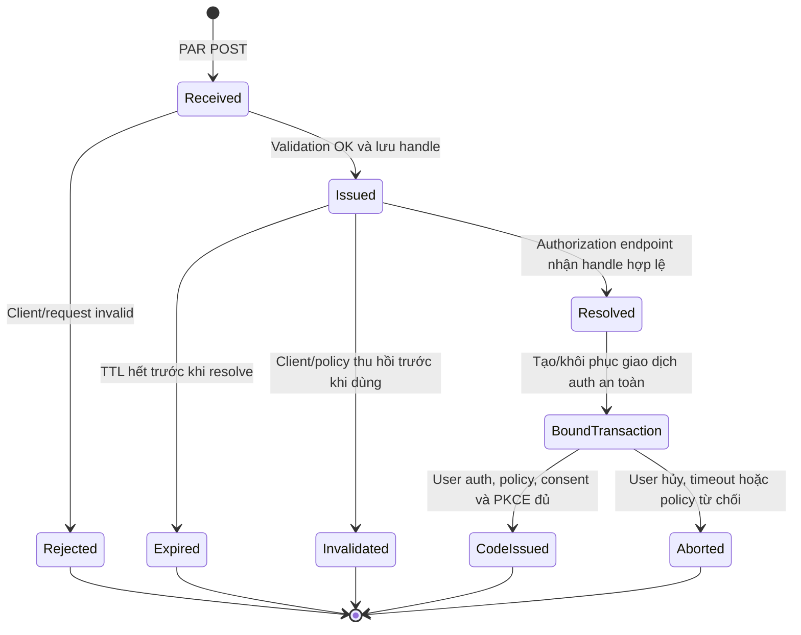

# Cấp request_uri và xử lý thời hạn yêu cầu

Trong luồng **OAuth 2.0 Authorization Code** truyền thống, OAuth2 Client thường gửi nhiều tham số qua trình duyệt đến Authorization Server: `client_id`, `redirect_uri`, `scope`, `state`, `code_challenge` và trong OpenID Connect (OIDC) còn có `nonce` hoặc các yêu cầu xác thực bổ sung. Khi ứng dụng cần truyền một authorization request dài hoặc nhạy cảm hơn, việc đặt toàn bộ tham số trong URL front channel tạo ra các vấn đề về độ dài, tính toàn vẹn và khả năng quan sát dữ liệu.

**Pushed Authorization Requests (PAR, RFC 9126)** bổ sung một bước: OAuth2 Client **gửi trước authorization request qua HTTPS đến PAR endpoint** của Authorization Server (AS). Nếu request được chấp nhận, AS trả về một **`request_uri` ngắn hạn** và **`expires_in`**. Sau đó Client chuyển hướng trình duyệt đến authorization endpoint, gửi **`client_id` và `request_uri`** để AS tìm lại authorization request đã lưu, thay vì gửi lại toàn bộ nội dung request trên URL.

Điểm quan trọng của bài học không chỉ là cách lấy giá trị `request_uri`, mà là cách **cấp phát, liên kết đúng client, lưu, kiểm tra thời hạn, xử lý sử dụng lại, dọn dữ liệu và vận hành trạng thái pending** trong Spring Authorization Server.

Bài học thuộc chương **PAR** của module **SPRING_SECURITY_OAUTH2_OIDC_AUTHORIZATION_SERVER** — học cách thiết kế, cấu hình, bảo mật, kiểm thử và vận hành OAuth 2.0/OpenID Connect Authorization Server bằng Spring Security và Spring Authorization Server trong Spring Boot.

> **Phân biệt ngay từ đầu:** `request_uri` do PAR endpoint cấp **không phải** `redirect_uri` của ứng dụng, **không phải authorization code**, **không phải access token** và **không phải refresh token**. `expires_in` trong phản hồi PAR là **thời gian hiệu lực của reference đến authorization request**, không phải TTL của access token.

## 1. PAR giải quyết bài toán gì?

Một authorization request truyền thống có thể trông như sau:

```http
GET /oauth2/authorize?response_type=code&client_id=portal-web&redirect_uri=https%3A%2F%2Fportal.example.com%2Flogin%2Foauth2%2Fcode%2Fcompany&scope=openid%20profile%20documents.read&state=STATE_RANDOM&code_challenge=PKCE_CHALLENGE&code_challenge_method=S256&nonce=NONCE_RANDOM HTTP/1.1
Host: identity.example.com
```

Các giá trị `STATE_RANDOM`, `PKCE_CHALLENGE` và `NONCE_RANDOM` là placeholder. Trong production, chúng phải được tạo và kiểm tra theo các tiêu chuẩn bảo mật tương ứng.

Với PAR, Client gửi các tham số đến một endpoint HTTPS riêng bằng back channel, nhận lại tham chiếu:

```http
HTTP/1.1 201 Created
Content-Type: application/json
Cache-Control: no-store
Pragma: no-cache

{
  "request_uri": "urn:ietf:params:oauth:request_uri:OPAQUE_RANDOM_HANDLE",
  "expires_in": 90
}
```

Rồi chỉ cần hướng trình duyệt tới:

```http
GET /oauth2/authorize?client_id=portal-web&request_uri=urn%3Aietf%3Aparams%3Aoauth%3Arequest_uri%3AOPAQUE_RANDOM_HANDLE HTTP/1.1
Host: identity.example.com
```

**Ý nghĩa:** Authorization Server đã nhận và lưu authorization request từ client qua kênh được bảo vệ, nên trình duyệt chỉ mang một reference. Việc này giảm nguy cơ tham số authorization bị sửa trên đường browser, giảm độ dài authorization URL và giúp AS áp dụng một số validation trước khi trình duyệt bắt đầu luồng đăng nhập.

**PAR không tự thực hiện** đăng nhập người dùng, MFA, consent, PKCE hay bảo vệ access token sau khi phát hành. Những bước đó vẫn cần được kiểm tra trong authorization flow.

### 1.1. PAR khác Request Object/JAR và JARM

| Cơ chế | Mục đích | Đầu ra/đặc điểm |
|---|---|---|
| **PAR — RFC 9126** | Đẩy authorization request trực tiếp tới AS trước bước browser redirect | AS cấp `request_uri` và `expires_in` |
| **JAR — RFC 9101** | Biểu diễn authorization request dưới dạng JWT Request Object, có thể ký/mã hóa | Tham số `request` hoặc tham chiếu `request_uri` theo profile |
| **JARM** | Bảo vệ **authorization response** (phản hồi code/error) dưới dạng JWT | Không thay PAR endpoint |
| **PKCE — RFC 7636** | Ràng buộc authorization code với client biết `code_verifier` | Không phát `request_uri` |
| **OIDC** | Xác thực người dùng và phát ID Token theo giao thức | Có thể kết hợp PAR/JAR, không đồng nghĩa PAR |

PAR có thể được dùng **cùng với Request Object** theo chính sách của AS. Một request được “push” qua PAR không có nghĩa AS phải bỏ kiểm tra chữ ký/JAR nếu deployment yêu cầu JAR.

## 2. Các chủ thể và ranh giới tin cậy

Giả sử:

- **`portal-web`**: confidential OAuth2 Client/OIDC Relying Party chạy trên backend Spring Boot.
- **`identity.example.com`**: Spring Authorization Server kiêm OP, hỗ trợ PAR và Authorization Code.
- **Trình duyệt**: user agent nhận redirect sau khi client lấy `request_uri`.
- **Người dùng**: đăng nhập, hoàn thành MFA/consent khi được yêu cầu.
- **`documents-api`**: Resource Server nhận access token sau khi flow hoàn tất.

| Thành phần | Biết hoặc làm gì? | Không nên làm gì? |
|---|---|---|
| OAuth2 Client backend | Tạo authorization parameters, xác thực với PAR endpoint khi áp dụng, nhận `request_uri`, tạo redirect | Chuyển secret/subject token vào query; tự sinh `request_uri` giả làm AS |
| PAR endpoint | Nhận request qua HTTPS, xác thực client theo policy, kiểm tra request, lưu tham chiếu, trả TTL | Xem request_uri như bằng chứng user đã consent |
| Authorization endpoint | Nhận `request_uri` từ trình duyệt, resolve đúng client và thời hạn, tiếp tục login/consent/code | Tin tham số thay thế từ URL trái với request đã push |
| Browser | Chỉ chuyển tham chiếu và nhận phản hồi giao thức | Quyết định scope/audience dựa trên giá trị tự khai |
| Người dùng | Xác thực và consent theo chính sách | Phải hoàn tất login trước khi client gửi PAR request |
| Resource Server | Kiểm tra token sau khi cấp | Dùng PAR handle như Bearer access token |

**Client authentication tại PAR endpoint** bảo vệ việc client gửi request và giúp AS gắn reference với đúng client. Theo chính sách/loại client, public client có những khác biệt về khả năng xác thực; **không được giả định public client có thể giữ client secret**. Với public client, PKCE và validation của AS vẫn đặc biệt quan trọng.

## 3. Luồng đầy đủ từ POST PAR đến cấp authorization code

```mermaid
sequenceDiagram
    autonumber
    actor U as Người dùng
    participant B as Browser
    participant C as portal-web (OAuth2 Client)
    participant PAR as PAR Endpoint (/oauth2/par)
    participant S as PAR Request Store
    participant AZ as Authorization Endpoint
    participant T as Token Endpoint

    U->>B: Mở chức năng cần đăng nhập
    B->>C: GET /documents
    C->>C: Tạo state, nonce, code_verifier và code_challenge
    C->>PAR: POST request parameters + client authentication
    PAR->>PAR: Xác thực client, kiểm tra PAR request
    PAR->>S: Lưu request, gắn client và thời hạn
    S-->>PAR: Opaque request_uri, expires_at
    PAR-->>C: 201 request_uri + expires_in
    C-->>B: 302 /oauth2/authorize?client_id=...&request_uri=...
    B->>AZ: GET /oauth2/authorize với request_uri
    AZ->>S: Resolve và kiểm tra client, TTL, lifecycle
    alt request_uri hết hạn, không hợp lệ hoặc không thuộc client
        S-->>AZ: Không chấp nhận reference
        AZ-->>B: OAuth authorization error / response an toàn
    else request_uri hợp lệ
        S-->>AZ: Authorization request đã được push
        AZ->>AZ: Xác minh user, MFA, policy và consent
        AZ-->>B: Redirect đến registered redirect_uri với code, state
        B->>C: OAuth callback
        C->>T: POST code + code_verifier + client auth
        T-->>C: Access token (+ ID Token nếu OIDC)
    end
```

Sơ đồ là **mô hình logic** để giải thích thời hạn và các thành phần. Cách Spring Authorization Server duy trì trạng thái khi user cần chuyển qua màn hình login/consent có thể gồm các transaction và persistence nội bộ khác; không được tự suy ra mọi bước là một lần đọc database duy nhất.

### 3.1. Tại sao cấp request_uri trước khi biết người dùng?

PAR request được **client** gửi trước khi browser bắt đầu tương tác với AS. Vì vậy PAR endpoint có thể biết:

- Client nào đang yêu cầu;
- `redirect_uri`, grant/response type, scopes;
- `state`, `code_challenge` và request object nếu được cung cấp;
- thời điểm request được chấp nhận và TTL đã cấp.

Nhưng PAR endpoint **chưa có bằng chứng** rằng người dùng đã login, đã MFA, đã consent hoặc có quyền dữ liệu tại Resource Server. Các quyết định đó phải được thực hiện sau, trong authorization transaction. **Không cấp authorization code tại PAR endpoint.**

## 4. HTTP POST tới Pushed Authorization Request endpoint

Đường dẫn PAR mặc định thường gặp trong Spring Authorization Server là **`/oauth2/par`**; URL thực tế phụ thuộc `AuthorizationServerSettings` và cấu hình/version đang dùng.

Một request minh họa từ confidential client:

```http
POST /oauth2/par HTTP/1.1
Host: identity.example.com
Authorization: Basic <REDACTED_CLIENT_AUTH>
Content-Type: application/x-www-form-urlencoded
Accept: application/json

response_type=code&client_id=portal-web&redirect_uri=https%3A%2F%2Fportal.example.com%2Flogin%2Foauth2%2Fcode%2Fcompany&scope=openid%20profile%20documents.read&state=STATE_RANDOM&code_challenge=PKCE_CHALLENGE&code_challenge_method=S256&nonce=NONCE_RANDOM
```

**Lưu ý:**

1. PAR endpoint dùng **POST**, form URL-encoded qua HTTPS.
2. Confidential client cần xác thực theo phương thức AS và registration cho phép, ví dụ `client_secret_basic`; không gửi secret trong URL.
3. Các tham số phải được encode đúng, đặc biệt là redirect URI, scope và chuỗi có dấu đặc biệt. HTTP client nên sử dụng bộ mã hóa form thay vì nối raw string thủ công.
4. `state` giúp OAuth2 Client kiểm tra callback và chống CSRF trong authorization response; `nonce` dùng trong OIDC khi áp dụng; PKCE dùng `code_challenge` ở authorization request và `code_verifier` tại token endpoint.
5. PAR endpoint **không nhận `request_uri` do client tự chọn để thay thế** request lưu của AS. AS mới là bên cấp handle tham chiếu.

### 4.1. Bảo đảm client được phép gửi PAR

AS cần kiểm tra theo registration/chính sách:

| Kiểm tra | Ví dụ | Lỗi nếu bỏ qua |
|---|---|---|
| Client có tồn tại? | `client_id=portal-web` | Có thể tạo storage vô hạn cho client giả |
| Phương thức client authentication được phép? | `client_secret_basic` | Kẻ khác mạo danh client |
| Client được dùng authorization grant? | `authorization_code` | Lưu request của grant trái policy |
| Redirect URI hợp lệ? | URI khớp registration | Nguy cơ redirect code sang attacker |
| Scope được phép? | `openid profile documents.read` | Scope vượt registration |
| PKCE và response type hợp lệ? | `S256`, `response_type=code` | Code flow thiếu bảo vệ |
| Request Object hợp lệ nếu dùng JAR? | Chữ ký, issuer/audience, time claims | Tin tham số JWT bị sửa hoặc hết hạn |
| Giới hạn tài nguyên? | Kích thước body, số request, TTL | DoS vào PAR storage |

Các bước kiểm tra ở PAR **không loại bỏ** validation bổ sung khi authorization endpoint xử lý request và cấp code. Những điều kiện phụ thuộc principal, consent hoặc trạng thái security hiện tại có thể chỉ đánh giá được về sau.

### 4.2. Client authentication và public client

PAR thường hữu ích cho confidential web client xác thực với PAR endpoint. Tuy nhiên, **PAR không chỉ dành cho confidential client**; public client có thể dùng theo khả năng hỗ trợ và chính sách của AS. Với public client:

- `client_id` là định danh công khai, **không phải bằng chứng bí mật**.
- Không nhúng `client_secret` vào SPA/mobile để “đủ điều kiện PAR”.
- Cần kiểm soát request_uri/client binding trong khả năng giao thức và PKCE, chống tampering/phishing.
- Kiểm tra RFC 9126, discovery metadata và yêu cầu bảo mật cụ thể của AS khi cho phép public client dùng PAR.

**Không suy ra** public client đã được xác thực mật mã chỉ vì AS cấp `request_uri` cho request chứa `client_id`.

## 5. Phản hồi thành công: `201 Created`, `request_uri` và `expires_in`

Theo RFC 9126, một response thành công của PAR endpoint có dạng:

```http
HTTP/1.1 201 Created
Content-Type: application/json
Cache-Control: no-store
Pragma: no-cache

{
  "request_uri": "urn:ietf:params:oauth:request_uri:RANDOM_OPAQUE_VALUE",
  "expires_in": 90
}
```

Hai field cần hiểu riêng:

| Field | Ý nghĩa | Không được hiểu thành |
|---|---|---|
| **`request_uri`** | Tham chiếu do AS cấp tới authorization request đã push | URL redirect của client; authorization code; token; endpoint tự do tải qua Internet |
| **`expires_in`** | Số giây hiệu lực mà AS công bố cho reference | TTL của access token, refresh token, browser session hoặc thời gian bắt buộc user phải hoàn thành MFA |

**`request_uri` là opaque:** Client cần giữ và truyền lại **nguyên giá trị**; không tách phần ngẫu nhiên ra để tự suy client, scopes hoặc thời gian hết hạn. Định dạng URN `urn:ietf:params:oauth:request_uri:...` giúp AS quản lý reference trong namespace dành cho PAR.

**`expires_in` là thời lượng, không phải timestamp.** Ví dụ `expires_in: 90` có nghĩa AS thông báo khoảng thời gian sống 90 giây cho reference. Client phải dùng giá trị từ response thay vì hardcode 90 giây; ví dụ này **không khẳng định Spring mặc định trả đúng 90 giây**.

### 5.1. Vì sao PAR trả 201 thay vì token response 200?

`201 Created` cho biết AS đã tiếp nhận và tạo một **tham chiếu server-side** tới request mới. Token endpoint, khi cấp token thành công, thường trả `200 OK` với `access_token`. Hai endpoint có hợp đồng và hành vi khác nhau:

```text
PAR:
  POST /oauth2/par
  -> 201 Created
  -> request_uri, expires_in

Authorization:
  GET /oauth2/authorize?client_id=...&request_uri=...
  -> user authentication/consent
  -> authorization code hoặc OAuth error

Token:
  POST /oauth2/token (grant_type=authorization_code)
  -> 200 OK nếu hợp lệ
  -> access_token (+ id_token trong OIDC flow tương ứng)
```

Không gửi `request_uri` trực tiếp tới Resource Server trong header Bearer và không coi nó như credential có thể dùng tại token endpoint.

### 5.2. Đừng ghi request_uri như một URL HTTP có thể GET

Một chuỗi bắt đầu bằng `urn:ietf:params:oauth:request_uri:` **không phải HTTPS URL** mà client cần tự gọi. Client đặt nó vào **tham số `request_uri` của authorization endpoint**. Việc dereference thực tế diễn ra **bên trong Authorization Server** theo storage/logic của AS.

Nếu một deployment mở rộng dùng định dạng khác, client vẫn phải theo discovery/profile/contract của issuer; không tự lấy nội dung từ URI lạ do đối tượng không tin cậy gửi.

## 6. Cấp request_uri an toàn: entropy, uniqueness và client binding

`request_uri` phải là một **reference khó đoán**, không phải chuỗi có thể dự đoán từ `client_id`, timestamp hoặc thứ tự tăng dần. Nếu người khác đoán được reference còn hiệu lực, họ có thể cố tái sử dụng một authorization transaction, tạo tình huống fixation, gây nhiễu luồng hoặc làm cạn tài nguyên.

Một cách hiểu về cấu trúc lưu trữ:

```text
opaqueHandle -> PAR record
    registeredClientId  = "registered-client-internal-id"
    clientId            = "portal-web"
    requestData         = validated immutable authorization request
    createdAt           = server timestamp
    expiresAt           = server timestamp
    lifecycleState      = ISSUED / RESOLVED / EXPIRED / INVALIDATED
```

Đây là **mô hình đề xuất để hiểu hệ thống**, không phải schema hay tên trường mặc định của Spring Authorization Server. AS có thể sử dụng cách lưu/mapping nội bộ khác tùy phiên bản.

### 6.1. Sinh handle

Nguyên tắc:

1. Sinh giá trị từ **cryptographically secure random number generator (CSPRNG)**, đủ entropy để chống đoán.
2. Dùng namespace/định dạng `request_uri` mà AS hỗ trợ, tạo reference duy nhất.
3. Lưu nguyên authorization request đã xác minh cùng metadata, hạn sử dụng và **định danh client được phép dùng**.
4. Không nhúng raw `client_secret`, user PII hoặc nội dung request nhạy cảm vào chính handle.
5. Không để caller chọn tùy ý handle hoặc chỉ sửa chuỗi bằng phép cộng timestamp để gia hạn.
6. Giới hạn độ dài handle/response để tránh abuse và xử lý encoding nhất quán.

**Ví dụ pseudocode, không phải API của Spring Authorization Server:**

```java
// PSEUDOCODE: ParStore, SecureHandle và ValidatedParRequest
// là các thành phần do ứng dụng tự thiết kế nếu tùy biến PAR storage.
String handle = secureHandleGenerator.newOpaqueHandle();
Instant expiresAt = clock.instant().plus(Duration.ofSeconds(ttlSeconds));

ParRecord record = new ParRecord(
    handle,
    registeredClient.getId(),
    immutableValidatedRequest,
    clock.instant(),
    expiresAt,
    ParState.ISSUED);

parStore.insertIfAbsent(record);  // unique key và atomic insert

return new ParResponse(
    "urn:ietf:params:oauth:request_uri:" + handle,
    ttlSeconds);
```

Không copy đoạn pseudocode này thành một custom PAR endpoint bỏ qua filter/provider framework. Trong ứng dụng Spring Authorization Server, **ưu tiên dùng endpoint và cơ chế cấp reference sẵn có của phiên bản đang triển khai**, chỉ custom persistence/validation khi thật sự cần.

### 6.2. Ràng buộc handle với client

Giả sử AS cấp request_uri cho `portal-web`. Trình duyệt sau đó gửi:

```http
GET /oauth2/authorize?client_id=other-client&request_uri=urn%3Aietf%3Aparams%3Aoauth%3Arequest_uri%3ARANDOM_OPAQUE_VALUE HTTP/1.1
Host: identity.example.com
```

**AS phải từ chối mismatch.** Không dùng request từ `portal-web` để hoàn tất một authorization request dưới danh tính `other-client`. Ràng buộc phải dựa trên thông tin đã xác minh và lưu server-side, không chỉ so khớp một chuỗi `client_id` có thể bị sửa.

Nếu môi trường đa tenant có các client ID trùng phạm vi hoặc issuer federation, metadata cần giữ **tenant/issuer boundary** thích hợp, tránh tra reference ở sai kho.

### 6.3. Không coi request_uri là bearer access token

Dù request_uri có thể mang tính **handle dùng để tiếp tục một giao dịch**, nó không chứng minh:

- User đang đăng nhập;
- User đã MFA hoặc consent;
- Client đã đổi authorization code thành access token;
- Resource Server đã cho phép dữ liệu;
- Bất kỳ ai nhìn thấy request_uri đều được phép truy cập API.

Hạn ngắn và binding client giảm rủi ro, nhưng không cho phép bỏ kiểm tra các điều kiện còn lại.

## 7. Thời hạn `expires_in`: cách tính và cách enforce

AS cần có một **thời điểm hết hạn xác định ở phía server**; client chỉ nhận một **khoảng thời gian hiệu lực**. Với mô hình lưu trữ có `createdAt` và `expiresAt`:

```text
createdAt = 2026-11-16T12:00:00Z
ttl       = 90 seconds
expiresAt = 2026-11-16T12:01:30Z

At 12:00:10Z -> still within TTL
At 12:01:30Z -> expired
At 12:01:31Z -> expired
```

Những mốc giờ chỉ minh họa cách kiểm tra và không phải giá trị cố định cho hệ thống của bạn. Nếu lưu thời gian bằng DB, cần đảm bảo timezone/precision thống nhất giữa các node.

### 7.1. Quy tắc kiểm tra ở authorization endpoint

Một hàm logic thường cần:

```java
// PSEUDOCODE: ParRecord/ParStore không là API công khai của SAS.
ParRecord record = parStore.findByRequestUri(requestUri);

if (record == null) {
    rejectReference();
}
if (!record.registeredClientId().equals(resolvedClient.getId())) {
    rejectReference();
}
if (!clock.instant().isBefore(record.expiresAt())) {
    rejectExpiredReference();
}
if (!record.isUsableAccordingToLifecycle()) {
    rejectConsumedOrInvalidatedReference();
}

// Sau khi lấy request hợp lệ, xử lý những điều kiện authorization còn lại.
continueAuthorization(record.validatedRequest());
```

Các hàm từ chối/tái sử dụng ở trên là placeholder. **Quan trọng:** Không chỉ dựa vào việc một bản ghi vẫn còn trong DB/cache. **TTL phải được kiểm tra khi resolve**, bởi cleanup job có thể đến chậm hoặc chưa chạy.

### 7.2. expires_in không phải deadline hoàn thành MFA/consent

Một điểm dễ nhầm:

> `expires_in` điều khiển **thời gian có thể sử dụng reference để bắt đầu/tiếp tục giải quyết authorization request theo thiết kế của AS**; nó **không trực tiếp đặt thời hạn access token và không bắt buộc người dùng phải nhập mật khẩu/MFA hay đồng ý mọi scope trong cùng số giây đó**.

Ví dụ AS cấp reference còn 90 giây:

- Client redirect browser sau 2 giây.
- Authorization endpoint nhận reference hợp lệ, tạo hoặc duy trì **authorization transaction** được kiểm soát.
- Người dùng cần 4 phút để đăng nhập/MFA.

Một AS có thể duy trì transaction đăng nhập/consent bằng **trạng thái riêng an toàn** sau khi reference được tiếp nhận hợp lệ, theo cách triển khai framework. **Không nên kéo dài tuổi request_uri một cách âm thầm** để cho phép mọi lần sử dụng lại chỉ vì người dùng đăng nhập lâu. Nếu flow hiện tại yêu cầu browser dereference lại request_uri sau khi TTL hết, cần thiết kế transaction resume hoặc khởi tạo PAR request mới, theo hợp đồng AS.

**Bài học:** Phân biệt **TTL của PAR handle** với **TTL của authorization transaction**, **authorization code**, **user session** và **access token**.

### 7.3. Vì sao client không được chỉ dựa vào đồng hồ của mình?

Client nhận `expires_in` và nên điều hướng browser **ngay khi có response thành công**. Nếu client đợi gần hết TTL mới redirect, độ trễ mạng, proxy, browser hoặc chênh thời gian có thể làm reference hết hạn lúc tới AS. Client có thể dùng TTL để kiểm soát cache và kế hoạch retry, nhưng **AS là bên quyết định cuối cùng** reference còn hiệu lực hay không.

Không tự tạo một request_uri mới từ handle cũ hoặc tăng `expires_in` ở client. Muốn có reference mới, client phải **gửi lại PAR request hợp lệ**, nhận một reference khác từ AS.

## 8. State machine cho vòng đời một PAR reference

Một triển khai an toàn có thể mô hình hóa trạng thái như sau:



Sơ đồ này là **đề xuất về vòng đời logic**, không khẳng định Spring Authorization Server sử dụng đúng các tên trạng thái hoặc tạo bảng như vậy. Một authorization transaction có thể tồn tại lâu hơn reference ban đầu theo thiết kế xác thực, nhưng phải giữ client, request parameters, session và security policy an toàn.

### 8.1. Dùng một lần hay nhiều lần?

Mô hình bảo mật thực tế nên **xử lý request_uri như reference ngắn hạn, hạn chế sử dụng lại**; với hệ thống cần chống replay mạnh, triển khai **single-use hoặc ràng buộc từng transaction** và kiểm thử điều kiện cạnh tranh. Để tuân thủ profile triển khai cụ thể, phải áp dụng quy tắc sử dụng lại mà RFC 9126, tài liệu SAS và các profile bảo mật bổ sung yêu cầu.

Nếu AS cần chuyển user qua nhiều bước login và consent, các bước đó nên dựa trên một **transaction đã được liên kết và kiểm soát**, không xem mọi GET tới URL chứa handle như một authorization request độc lập được phép tạo code mới.

### 8.2. Hai request đồng thời dùng một reference

Giả sử browser mở hai tab cùng authorization URL:

```text
T0  AS cấp PAR reference R1 cho portal-web.
T1  Tab A gửi GET /oauth2/authorize?request_uri=R1.
T1  Tab B cũng gửi GET /oauth2/authorize?request_uri=R1.
T2  Hai node AS cùng đọc R1 = ISSUED.
T3  Nếu không có atomic claim/transaction binding, hai nhánh cùng đi tiếp.
```

Nếu chính sách yêu cầu single-use, thao tác **claim/consume R1 phải nguyên tử** bằng transaction/compare-and-swap hoặc cơ chế tương đương. Không chỉ:

```text
if (record.isUnused()) {
    processRequest();
    record.markUsed();
}
```

vì hai node có thể cùng kiểm tra `isUnused()` trước khi node nào ghi. Với flow cần resume qua nhiều bước, tránh xóa transaction duy nhất quá sớm làm hỏng login/MFA hợp lệ; tách reference lifecycle và authorization transaction lifecycle.

### 8.3. Lý do phát hành reference mới

Client nên lấy PAR handle mới khi:

- Reference cũ hết hạn trước khi browser sử dụng;
- Một authorization attempt đã bị hủy/thất bại và client cần bắt đầu lại;
- State/nonce/PKCE challenge hoặc requested scopes thay đổi;
- Registered client/policy thay đổi khiến request cũ không phù hợp;
- AS từ chối handle đã dùng hoặc không còn tồn tại.

Không tái sử dụng một reference từ cache của user A cho user B hoặc từ một login transaction cũ sang một yêu cầu scope mới.

## 9. Tham số front channel sau PAR: không sửa yêu cầu đã push

Client chuyển hướng với `client_id` và `request_uri`:

```http
HTTP/1.1 302 Found
Location: https://identity.example.com/oauth2/authorize?client_id=portal-web&request_uri=urn%3Aietf%3Aparams%3Aoauth%3Arequest_uri%3ARANDOM_OPAQUE_VALUE
```

Authorization Server lấy tham số từ **bản PAR đã lưu**, không tin một tham số được chèn thêm trong browser URL để nâng quyền:

```http
GET /oauth2/authorize?client_id=portal-web&request_uri=urn%3Aietf%3Aparams%3Aoauth%3Arequest_uri%3ARANDOM_OPAQUE_VALUE&scope=admin HTTP/1.1
Host: identity.example.com
```

**Không được coi `scope=admin` bổ sung là một phần request đã xác minh tại PAR.** Theo cách xử lý request object/PAR, AS phải tuân thủ quy tắc nguồn tham số và phát hiện/xử lý xung đột, không cho browser override những tham số được gửi qua back channel.

### 9.1. request_uri khác redirect_uri

| Thuộc tính | `request_uri` | `redirect_uri` |
|---|---|---|
| Do ai cấp/khai báo? | **AS cấp sau POST PAR** | Client đăng ký/khai báo theo hợp đồng OAuth |
| Dùng ở đâu? | Browser gửi tới **AS authorization endpoint** | AS redirect browser về **OAuth2 Client callback** |
| Mục đích | Tham chiếu đến authorization request đã push | Đích nhận authorization code/error sau khi xử lý |
| Hiệu lực | Ngắn, theo `expires_in` và lifecycle | Theo client registration và policy; không tự sinh từ PAR TTL |
| Có thể đổi code/token không? | **Không** | Nhận code/error nhưng bản thân URI không phải code |
| Cách xác minh | Handle thuộc client, tồn tại, còn hiệu lực, lifecycle đúng | URI được phép theo client registration, so khớp chặt |

Không cho client gửi `redirect_uri` trùng với `request_uri` rồi giả định AS sẽ hiểu đúng. Đây là hai khái niệm độc lập.

### 9.2. state, nonce và PKCE vẫn phải gắn đúng

PAR giảm khả năng browser sửa request nhưng **không thay thế bảo vệ authorization response**:

- Client sinh và lưu `state` để đối chiếu callback.
- OIDC Client sinh/kiểm tra `nonce` khi áp dụng.
- Client tạo `code_verifier`, gửi `code_challenge` trong request, rồi trình `code_verifier` khi đổi code.
- AS kiểm tra client binding, redirect URI, scope, user authentication/consent và authorization code tại các bước thích hợp.

Không vì đã dùng PAR mà bỏ qua PKCE hoặc trả code về URI không đăng ký.

## 10. Cấu hình Spring Authorization Server: điểm cần kiểm tra

Các phiên bản Spring Authorization Server hỗ trợ PAR cung cấp **Pushed Authorization Request Endpoint** và điểm tùy chỉnh liên quan trong `OAuth2AuthorizationServerConfigurer`. Những thành phần/điểm mở rộng cần tra cứu theo phiên bản gồm:

- `OAuth2PushedAuthorizationRequestEndpointFilter` và converter/provider của endpoint;
- client authentication và `RegisteredClientRepository`;
- `AuthorizationServerSettings` để công bố đường dẫn endpoint;
- service dùng lưu/đọc trạng thái authorization/PAR;
- khả năng bật yêu cầu **PAR bắt buộc** theo `ClientSettings` hoặc cấu hình/profile tương ứng.

**Không dựa vào một tên class hoặc DSL chưa kiểm tra phiên bản** để kết luận AS đã bảo vệ đúng reference. Đặc biệt, PAR support và chi tiết lưu trạng thái có thể khác giữa các phiên bản Spring Authorization Server. Kiểm thử qua endpoint thật là bắt buộc trước production.

### 10.1. Khung cấu hình Authorization Server

```java
@Bean
@Order(1)
SecurityFilterChain authorizationServerChain(HttpSecurity http)
        throws Exception {

    OAuth2AuthorizationServerConfigurer authorizationServer =
        OAuth2AuthorizationServerConfigurer.authorizationServer();

    http.securityMatcher(authorizationServer.getEndpointsMatcher())
        .with(authorizationServer, server ->
            server.oidc(Customizer.withDefaults()))
        .authorizeHttpRequests(auth ->
            auth.anyRequest().authenticated());

    return http.build();
}
```

Đây là **khung cơ bản**, không phải cấu hình PAR hoàn chỉnh. Cần cấu hình `RegisteredClientRepository`, `OAuth2AuthorizationService`, issuer/settings, JWK/token generator, security chain cho user login và các bean khác. Với token endpoint/PAR endpoint cần xác thực client, phải dùng filter/entry point OAuth phù hợp chứ không redirect máy khách sang HTML form login khi client secret sai.

### 10.2. RegisteredClient và yêu cầu PAR

Một ví dụ client Authorization Code + PKCE:

```java
RegisteredClient portal = RegisteredClient.withId(
        "portal-web-internal-id")
    .clientId("portal-web")
    .clientSecret(passwordEncoder.encode(secretFromSecureStore))
    .clientAuthenticationMethod(
        ClientAuthenticationMethod.CLIENT_SECRET_BASIC)
    .authorizationGrantType(
        AuthorizationGrantType.AUTHORIZATION_CODE)
    .authorizationGrantType(
        AuthorizationGrantType.REFRESH_TOKEN)
    .redirectUri(
        "https://portal.example.com/login/oauth2/code/company")
    .scope(OidcScopes.OPENID)
    .scope(OidcScopes.PROFILE)
    .scope("documents.read")
    .clientSettings(ClientSettings.builder()
        .requireProofKey(true)
        .requireAuthorizationConsent(true)
        .build())
    .build();
```

Đây chỉ là phần registration: cần imports, bean, encoder và secret manager thích hợp. Nếu phiên bản Spring Authorization Server hỗ trợ **`ClientSettings.requirePushedAuthorizationRequests(true)`**, có thể sử dụng chính sách đó để yêu cầu client dùng PAR; xác minh method/property tồn tại trong version và cách enforce tại cả PAR/authorization endpoint. Nếu phiên bản không có API này, cần dùng cơ chế chính sách mà version/profile hỗ trợ, **không chỉ tự đặt biến YAML tên tương tự rồi cho rằng đã bật PAR bắt buộc**.

### 10.3. Đăng ký endpoint và discovery metadata

Client cần biết PAR endpoint từ cấu hình tin cậy hoặc discovery metadata do AS công bố. Với OAuth 2.0 Authorization Server Metadata, thuộc tính thường dùng là **`pushed_authorization_request_endpoint`**. Các metadata/policy khác có thể thông báo liệu AS yêu cầu PAR cho authorization request hay không, ví dụ `require_pushed_authorization_requests` theo các chuẩn liên quan.

```json
{
  "issuer": "https://identity.example.com",
  "authorization_endpoint": "https://identity.example.com/oauth2/authorize",
  "token_endpoint": "https://identity.example.com/oauth2/token",
  "pushed_authorization_request_endpoint": "https://identity.example.com/oauth2/par"
}
```

Đây là metadata **minh họa**, không phải phản hồi thực mà ứng dụng đã kiểm chứng. Client nên lấy endpoint từ discovery hoặc cấu hình issuer đáng tin, xác minh HTTPS/certificate/issuer. **Không làm theo PAR endpoint do request user tự gửi** để tránh gửi credential/token đến máy chủ giả mạo.

## 11. Cấu hình TTL và lưu trữ: những gì nên và không nên suy đoán

Khả năng điều chỉnh TTL PAR cụ thể phụ thuộc **phiên bản Spring Authorization Server và extension points**. Điều cần thiết về mặt kiến trúc:

1. Server **tạo TTL có giới hạn rõ** khi cấp handle.
2. Server **trả đúng `expires_in`** cho client.
3. Server **ghi/duy trì expiresAt hoặc trạng thái tương đương** với reference.
4. Server **enforce expiration khi nhận `request_uri`**, không chỉ tin cleanup.
5. Nếu dùng nhiều node, storage/lifecycle được chia sẻ hoặc đồng bộ phù hợp.
6. Nếu cần custom TTL, phải kiểm chứng cách hook thời hạn của phiên bản đang dùng; **không chỉnh trường nội bộ framework bằng reflection hoặc tự ghi bảng không rõ schema**.

### 11.1. Không có “TTL chuẩn cố định 90 giây”

Giá trị 90 trong bài chỉ là ví dụ. RFC 9126 trả `expires_in` để client biết thời hạn mà AS quyết định. Việc lựa chọn số giây phụ thuộc chính sách bảo mật/độ trễ triển khai. Client phải tôn trọng response thực:

```json
{
  "request_uri": "urn:ietf:params:oauth:request_uri:EXAMPLE",
  "expires_in": 60
}
```

Nếu AS trả 60, client không được mặc định dùng 90 hay 300. Server vẫn có quyền từ chối reference đã bị invalidated theo chính sách ngay cả khi thời gian danh nghĩa chưa hết.

### 11.2. Dùng bảng riêng, JDBC, Redis hay framework store?

Spring Authorization Server có các service lưu authorization và một số cơ chế quản lý trạng thái giao thức. Khi triển khai PAR:

- **Ưu tiên dùng đường mặc định/tích hợp chính thức** của phiên bản SAS đang triển khai.
- Nếu dùng JDBC, phải có schema/migration và transaction phù hợp; không tự suy đoán một bảng tên `oauth2_par_request` là bảng Spring tạo sẵn.
- Nếu dùng Redis/custom store, phải ràng buộc client, TTL, lifecycle và atomic consume; bật giới hạn kích thước/count.
- Nếu có nhiều AS node, tránh để reference tạo ở node A nhưng GET authorization ở node B không thể resolve.
- Không phụ thuộc duy nhất vào session browser của user để lưu PAR request, vì PAR được **client gửi qua back channel trước khi browser tương tác**.

### 11.3. TTL tại storage khác TTL giao thức

Ví dụ custom Redis có key TTL để tự dọn dữ liệu; **Redis TTL không nên là biện pháp duy nhất để quyết định token còn hiệu lực** nếu yêu cầu state/race phức tạp. Khi hệ thống có cache ở nhiều node, bản sao đã hết hạn hoặc đã tiêu thụ không được phép sống lại nhờ cache stale. Logic resolve vẫn cần đối chiếu `expiresAt`/lifecycle và nguồn trạng thái đáng tin.

## 12. Vấn đề multi-node và race conditions

Một deployment có thể có:

```text
Client POST /oauth2/par    -> AS node A
Browser GET /oauth2/authorize?request_uri=... -> AS node B
User POST consent          -> AS node C
Client POST /oauth2/token  -> AS node A
```

**Phải thiết kế trạng thái xuyên node**: nếu A chỉ lưu PAR request trong RAM, B có thể trả lỗi không tìm thấy handle. Một hệ thống shared persistence hoặc cơ chế affinity/replication được kiểm chứng là cần thiết, tùy khả năng hạ tầng.

### 12.1. Đồng bộ thời gian và TTL

Nếu các node dùng đồng hồ khác nhau, node B có thể coi reference hết hạn sớm hơn node A. Cần đồng bộ hệ thống thời gian và nhất quán biểu diễn `Instant`/epoch trong storage. Không cố sửa bằng cách cho phép mọi expired reference một khoảng grace rộng mà không đánh giá bảo mật. Nếu chấp nhận tolerance thì phải dựa trên policy và test.

### 12.2. Claim/consume nguyên tử

Ở hệ thống single-use, hai yêu cầu đồng thời từ browser hoặc retry không được cùng đánh dấu reference hợp lệ bằng một chuỗi read-then-write không bảo vệ. Dùng atomic update/compare-and-swap hoặc một transaction isolation phù hợp. Nếu dùng distributed cache, cần hiểu semantics atomic của store trên toàn cluster.

### 12.3. TTL và replication lag

PAR reference vừa phát có thể chưa xuất hiện ở replica mà authorization endpoint đang đọc. Với một reference sống ngắn, replication lag vài giây cũng đáng kể. Tùy storage, nên đọc từ nguồn nhất quán khi resolve hoặc có thiết kế đảm bảo read-after-write. Không giải quyết bằng cách tăng TTL vô hạn; điều đó làm kéo dài nguy cơ replay.

### 12.4. Cleanup an toàn

Cleanup quá sớm có thể phá transaction chưa được resolve; cleanup quá trễ có thể chiếm storage, nhưng **không được cho phép sử dụng reference chỉ vì nó chưa bị xóa**. Cleanup nên idempotent, batch theo expiry, có metrics và không ghi raw authorization request/token vào logs.

## 13. Xử lý lỗi và phản hồi khi request_uri hết hạn

PAR có **hai giai đoạn lỗi** khác nhau:

- **Giai đoạn POST PAR:** client authentication/request validation/storage error, trước khi có handle.
- **Giai đoạn GET authorization:** `request_uri` được trình duyệt gửi lại nhưng không tồn tại, đã hết hạn, bị tiêu thụ, sai client hoặc không còn hợp lệ.

### 13.1. Lỗi khi POST PAR

| Tình huống | Nhóm lỗi thường phù hợp | Hành động client |
|---|---|---|
| Client authentication sai | `invalid_client` | Kiểm tra registration/credential; không retry vô hạn |
| Client không được phép flow/parameter | `unauthorized_client` hoặc lỗi authorization request thích hợp | Sửa cấu hình/registration |
| `redirect_uri`/`response_type`/`scope` không hợp lệ | Lỗi OAuth2 như `invalid_request`, `unsupported_response_type`, `invalid_scope` tùy nguyên nhân | Không tự điều chỉnh sang URI chưa đăng ký |
| Request Object sai chữ ký/hết hạn (nếu JAR) | Lỗi JAR/authorization request tương ứng | Sửa request object; không bỏ validation |
| Quá kích thước hoặc tần suất | HTTP/OAuth error theo chính sách triển khai | Backoff, cảnh báo, tối ưu request |
| Lỗi persistence/AS không khả dụng | Server/network error | Retry có kiểm soát, không tạo session/cấp code “bù” |

Không phản chiếu raw `client_secret`, request object nhạy cảm, `state`/`nonce` hoặc token vào `error_description`. Nếu client authentication thất bại, HTTP status/challenge phải theo cơ chế client authentication được sử dụng; không coi mọi lỗi là 400 giống nhau.

### 13.2. Lỗi khi GET authorization với reference không hợp lệ

| Lỗi | Nguyên nhân | Phải bảo đảm |
|---|---|---|
| Unknown `request_uri` | Reference không tồn tại, sai issuer/storage | Không tìm request từ client khác hoặc tạo giá trị mặc định |
| Expired `request_uri` | Đã qua TTL/lifecycle | Không tiếp tục cấp authorization code từ handle hết hạn |
| Consumed/replayed `request_uri` | Trùng reference sau khi đã dùng theo policy | Không tạo transaction/code mới trái chính sách |
| Client mismatch | URL có `client_id` không khớp record | Không cấp code cho client sai |
| Revoked/invalidated request | Client/policy thay đổi hoặc request bị hủy | Không tiếp tục dựa trên reference cũ |
| Storage outage | Không thể resolve request chắc chắn | Từ chối an toàn, không fail-open |

Các profile liên quan Request Object có mã lỗi như `invalid_request_uri`; **mã lỗi, status và vị trí trả lỗi chính xác cần đối chiếu RFC/profile và phiên bản Spring Authorization Server**. Điều quan trọng là **không redirect tới `redirect_uri` chưa được xác minh**, đặc biệt khi AS chưa thể resolve PAR request để biết callback tin cậy.

### 13.3. Khi handle hết hạn, client làm gì?

Một xử lý hợp lý:

1. Client nhận lỗi liên quan reference expired/invalid theo hợp đồng.
2. Không cố tăng `expires_in` hoặc sửa chuỗi `request_uri`.
3. Tạo một **authorization transaction mới**, sinh `state`/`nonce`/PKCE challenge phù hợp và gửi lại POST PAR.
4. Nhận reference mới, redirect browser ngay.
5. Giới hạn số lần retry và bảo vệ trải nghiệm tránh redirect loop.

Nếu người dùng đã hoàn thành một bước login/MFA nhưng PAR handle hết hạn, hệ thống cần cơ chế resume an toàn hoặc bắt đầu authorization mới; **không tự chế tạo code** từ một controller chỉ vì user đã login.

## 14. Rủi ro bảo mật khi cấp và sử dụng PAR handle

### 14.1. Request URI leakage và fixation

`request_uri` có thể xuất hiện trong browser history, access log của AS, tracing hoặc error reporting. Dù bản thân reference không mang secret, **nó có thể tham chiếu một authorization transaction đang pending**. Nên:

- Cấp reference **ngẫu nhiên, khó đoán, ngắn hạn**.
- Ràng buộc với client, dùng lifecycle hạn chế replay và kiểm tra đầy đủ.
- Không hiển thị raw authorization parameters trở lại browser không cần thiết.
- Không log full query nếu chứa handle/state/nonce/PII nhạy cảm.
- Có chính sách `Referrer-Policy` và không đưa third-party tracker không cần thiết vào trang login/consent.

### 14.2. Không nhầm PAR với “không cần kiểm tra redirect_uri”

Một request được push qua back channel vẫn có thể chứa `redirect_uri` do client cấu hình sai hoặc độc hại. AS phải kiểm tra URI theo registered client, chính sách redirect chặt chẽ và không phản hồi code/error tới một đích không đáng tin.

### 14.3. Không làm PAR endpoint thành kho lưu trữ vô hạn

Kẻ tấn công có thể gửi nhiều PAR request để chiếm RAM/DB. Cần rate limit theo client/IP/risk policy, quota pending requests, body size limits, TTL ngắn, backpressure, cleanup và bảo vệ storage. Confidential client cần xác thực, nhưng **client hợp lệ bị lộ credential vẫn có thể gây DoS**.

### 14.4. Không tái sử dụng handle qua tenant hoặc người dùng

Reference thuộc về **authorization request của một client**, không phải một “vé đăng nhập dùng chung”. Nếu nhiều người dùng cùng truy cập authorization URL chứa cùng handle, bảo đảm trạng thái và chính sách không tạo việc chuyển sai `state`, PKCE verifier hoặc consent. Client nên tạo reference riêng cho mỗi authorization attempt, không cache dùng chung toàn site.

### 14.5. Ranh giới HTTPS và proxy

PAR request qua HTTPS có thể đi qua reverse proxy/API gateway kết thúc TLS. Tại điểm đó proxy có thể nhìn thấy headers/form body, nên phải redact `Authorization`/client secret và dữ liệu request nhạy cảm. Có thể cần TLS nội bộ và phân quyền mạng tùy threat model. Không tin forwarded host/scheme không được kiểm soát khi tạo endpoint/issuer URLs.

## 15. Ví dụ phía OAuth2 Client: quản lý response và redirect

Trong một backend Spring Boot, nên tận dụng **OAuth2 Client/JAR/PAR support của phiên bản Spring Security hoặc thư viện OAuth tương thích** khi đã có. Ví dụ pseudocode sau minh họa chính xác vòng đời request_uri:

```java
// PSEUDOCODE: HttpParClient, ParResponse, AuthorizationAttemptStore
// là các lớp của ứng dụng hoặc adapter, KHÔNG phải API Spring mặc định.
AuthorizationAttempt attempt = attemptFactory.newAttempt(
    "portal-web", "documents.read");

ParResponse pushed = parClient.post(
    "https://identity.example.com/oauth2/par",
    attempt.authorizationParameters(),
    confidentialClientAuthentication);

if (pushed.requestUri() == null || pushed.expiresInSeconds() <= 0) {
    throw new IllegalStateException("Invalid PAR response");
}

attemptStore.savePending(
    attempt.id(),
    attempt.state(),
    attempt.codeVerifier(),
    pushed.requestUri(),
    pushed.expiresInSeconds());

String authorizationUrl = UriComponentsBuilder
    .fromUriString("https://identity.example.com/oauth2/authorize")
    .queryParam("client_id", "portal-web")
    .queryParam("request_uri", pushed.requestUri())
    .build()
    .encode()
    .toUriString();

return redirectToBrowser(authorizationUrl);
```

**Không chạy nguyên trạng:** các lớp/method đặt tên như `attemptStore.savePending`, `redirectToBrowser`, `ParResponse` là minh họa. Mỗi request phải có `state` riêng và `code_verifier` phải được giữ bí mật ở Client, không gửi `code_verifier` tới PAR endpoint hoặc browser. Client phải xử lý lỗi OAuth, TLS, retry timeout và content type.

### 15.1. Client không nên lưu PAR handle quá lâu

`expires_in` có thể ngắn. Khi backend lưu pending attempt, không cache reference vĩnh viễn và không dùng lại reference đã thất bại. Nếu client cần tránh cache stale, có thể lưu deadline cục bộ để **chủ động khởi tạo lại** trước thời điểm dự kiến hết hạn; nhưng AS vẫn quyết định cuối cùng.

### 15.2. Vì sao không retry POST PAR vô hạn sau timeout?

Một timeout xảy ra sau khi AS đã ghi PAR record nhưng trước khi client nhận response. Nếu client retry, AS có thể tạo **reference thứ hai**. Điều đó không nhất thiết là vi phạm; nhưng nếu client tạo vô hạn pending records, storage có thể bị lạm dụng và state/PKCE transaction dễ rối. Cần backoff, timeout, giới hạn retry, correlation ID nội bộ và cleanup theo TTL.

Không tự giả định POST PAR là một thao tác idempotent có khóa chuẩn; nếu muốn idempotency ở lớp ứng dụng, cần thiết kế riêng phù hợp với giao thức và bảo mật.

## 16. Kiểm thử PAR response, TTL và binding

Kiểm thử đúng phải đi qua **PAR endpoint và authorization endpoint thực**. Unit test hàm random string hoặc thử `GET` một URI không đủ chứng minh client binding, validation và lifecycle hoạt động.

### 16.1. Ma trận kiểm thử

| Kịch bản | Kết quả cần xác minh |
|---|---|
| Client hợp lệ gửi POST PAR | Trả **201**, JSON có `request_uri` hợp lệ và `expires_in` dương |
| Client gửi Basic secret sai | Không cấp reference, lỗi client authentication thích hợp |
| Client thiếu quyền theo policy | Không cấp reference, trả lỗi phù hợp |
| `redirect_uri` không thuộc registered client | Không cấp reference hợp lệ/không redirect code sang URI đó |
| Scope không được đăng ký | Không phát quyền vượt registration |
| Thiếu/sai `response_type` | Request bị từ chối theo contract |
| Public client được hỗ trợ | Không yêu cầu fake secret, vẫn kiểm tra PKCE/client ID |
| PAR request quá dài | Endpoint áp dụng giới hạn body/DoS phù hợp |
| Client lấy reference rồi redirect ngay | AS resolve đúng request và tiếp tục login/consent |
| Browser sửa `scope` bên cạnh `request_uri` | Không thay đổi scopes của request đã push |
| Browser đổi `client_id` | Không được dùng reference của client khác |
| Reference không tồn tại | AS từ chối an toàn |
| Reference đã hết TTL | AS từ chối, không cấp code |
| Reference invalidated/consumed theo policy | AS không phát code trái lifecycle |
| Hai tab dùng cùng reference đồng thời | Không tạo nhiều transaction/code trái single-use policy |
| User mất vài phút login/MFA | Flow theo transaction/resume contract, không tự gia hạn handle |
| AS node A cấp, node B resolve | Hoạt động đúng nếu kiến trúc shared state/replication hỗ trợ |
| Cleanup job chậm | Reference quá hạn vẫn bị từ chối lúc resolve |
| Replica read lag | Không báo missing sai ngay sau khi phát hành khi thiết kế đòi read-after-write |
| Token endpoint sau authorization code | Vẫn kiểm tra PKCE, client auth, code một lần |
| Logging/trace | Không rò client secret, raw token hoặc authorization request PII |

### 16.2. MockMvc test phản hồi PAR thành công

Ví dụ khung test Spring Boot với một registered client `portal-web` đã cấu hình Authorization Code, redirect URI, scope và client secret thử nghiệm:

```java
@SpringBootTest
@AutoConfigureMockMvc
class PushedAuthorizationRequestTests {

    @Autowired
    MockMvc mvc;

    @Test
    void validPushedRequestReturnsOpaqueReference() throws Exception {
        mvc.perform(post("/oauth2/par")
                .with(httpBasic("portal-web", "test-client-secret"))
                .contentType(MediaType.APPLICATION_FORM_URLENCODED)
                .param("client_id", "portal-web")
                .param("response_type", "code")
                .param("redirect_uri",
                    "https://portal.example.com/login/oauth2/code/company")
                .param("scope", "openid profile documents.read")
                .param("state", "test-state-value")
                .param("code_challenge", "TEST_VALID_S256_CHALLENGE")
                .param("code_challenge_method", "S256")
                .param("nonce", "test-oidc-nonce"))
            .andExpect(status().isCreated())
            .andExpect(content().contentTypeCompatibleWith(
                MediaType.APPLICATION_JSON))
            .andExpect(jsonPath("$.request_uri").isNotEmpty())
            .andExpect(jsonPath("$.expires_in").isNumber());
    }
}
```

Đoạn code là **khung kiểm thử**, yêu cầu imports, bean Spring Authorization Server, RSA/JWK/issuer, registered client và test fixture tương ứng. **Thay `TEST_VALID_S256_CHALLENGE` bằng một challenge S256 thực hợp lệ** trước khi chạy; `test-client-secret` chỉ dùng trong môi trường test. Không hardcode giá trị này trong sản phẩm. Kết quả `201` là điều cần khẳng định theo hợp đồng PAR thành công, không phải `200` như token endpoint.

### 16.3. Kiểm thử TTL không cần chờ thật

Đối với custom PAR store hoặc lớp adapter có thể tiêm `Clock`:

```java
// PSEUDOCODE để mô tả test Clock, không biên dịch nguyên trạng.
Clock clock = fixedClock("2026-11-16T12:00:00Z");
ParResponse pushed = issuePar(validRequest, clock, 90);

assertThat(pushed.expiresInSeconds()).isEqualTo(90);

clock = fixedClock("2026-11-16T12:01:29Z");
assertThat(resolve(pushed.requestUri(), clock)).isUsable();

clock = fixedClock("2026-11-16T12:01:30Z");
assertThat(resolve(pushed.requestUri(), clock)).isRejectedAsExpired();
```

Đây là **thiết kế test cho logic TTL custom**. Với Spring Authorization Server mặc định nếu không có injectable clock qua public API, dùng cách kiểm thử mà phiên bản hỗ trợ hoặc tạo fixture expiration trực tiếp qua service có kiểm soát. **Không dùng hàng loạt `Thread.sleep(90_000)`** để kiểm thử expiry; vừa chậm vừa dễ flaky.

Nếu reference được cấu hình single-use, test TTL phải dùng một **reference mới cho mỗi lần resolve** hoặc kiểm thử riêng thứ tự consume/expiry. Không lấy reference đã tiêu thụ ở lần thử đầu rồi kết luận bước thứ hai bị từ chối là do TTL.

### 16.4. Test binding và replay

```text
Given:
  Client A đẩy authorization request hợp lệ, nhận request_uri=R1.
When:
  Browser gọi /oauth2/authorize?client_id=B&request_uri=R1.
Then:
  Không được cấp authorization code cho client B.

Given:
  R2 đã expired tại server.
When:
  Browser gọi authorization endpoint với R2.
Then:
  Không có code và không tự refresh thời hạn cho R2.

Given:
  R3 đã resolve/consume theo chính sách single-use.
When:
  Hai request khác tiếp tục dùng R3.
Then:
  Không được tạo authorization mới trái policy.

Given:
  Node A cấp R4; Node B xử lý authorization request.
When:
  R4 còn hạn và hệ thống hỗ trợ shared state.
Then:
  B resolve cùng request, không nhận nhầm dữ liệu của client khác.
```

**Đối với redirect URI không thể xác minh, test phải chứng minh không có redirect đến URI attacker.** Lỗi PAR handle không nên biến thành open redirect.

## 17. Quan sát vận hành mà không lộ request_uri hoặc credential

| Event/metric | Mục đích | Không được log |
|---|---|---|
| `par_request_received` | Số request PAR theo client và endpoint | Raw Authorization header/client secret |
| `par_request_accepted` | Tỷ lệ được chấp nhận, thời gian tạo record | Toàn bộ raw request body chứa PII |
| `par_reference_issued` | Thống kê TTL/version, request count | Giá trị `request_uri` nguyên văn trên hệ thống log rộng |
| `par_reference_resolved` | Đo tỷ lệ browser thực sự đến authorization endpoint | Raw handle và session cookie |
| `par_reference_expired` | Phát hiện lỗi mạng/browser redirect chậm | Raw request parameters |
| `par_reference_client_mismatch` | Cảnh báo misuse hoặc lỗi tích hợp | Token/credential |
| `par_reference_reused` | Phát hiện replay/race/duplicate GET | Toàn bộ link chứa reference |
| `par_store_unavailable` | Giám sát storage outage/latency | Dump database record nhạy cảm |
| `par_cleanup_backlog` | Giám sát dữ liệu hết hạn chưa được dọn | Tham số authorization có PII |

Có thể dùng **correlation ID nội bộ** hoặc mã record đã được pseudonymize để nối chuỗi sự kiện, nhưng không cần phát tán raw reference/token rộng rãi qua observability stack.

### 17.1. SLA nên đo

- Tỷ lệ POST PAR trả thành công và độ trễ p95/p99.
- Tỷ lệ reference hết hạn **trước khi browser bắt đầu authorization**.
- Tỷ lệ lỗi client mismatch/invalid reference và xu hướng có thể báo tấn công.
- Số pending references theo client, số expired records chưa cleanup.
- Tỷ lệ lỗi sau rolling deployment hoặc khi một AS node mất kết nối store.
- Sự khác biệt giữa **thời gian đến bước authorization endpoint** và **thời gian user hoàn tất MFA/consent**, để không nhầm lỗi TTL với tương tác người dùng chậm.

## 18. Sai lầm triển khai thường gặp

| Cách hiểu/làm sai | Hậu quả | Cách khắc phục |
|---|---|---|
| “request_uri là redirect_uri của ứng dụng” | Redirect sai endpoint hoặc open redirect | Phân biệt reference PAR với registered client callback |
| “expires_in là hạn access token” | Lỗi xử lý lifecycle, token cache | Tách PAR TTL khỏi code/token/session TTL |
| “Client tự tạo request_uri và ghi tham số vào URL” | AS không có record hoặc bị lợi dụng handle | Chỉ dùng giá trị AS cấp từ POST PAR |
| “Cứ có handle là user đã consent” | Có nguy cơ cấp code sớm | Vẫn kiểm tra login, MFA, consent, client và request |
| “Client_id trên URL không cần khớp record” | Cross-client request substitution | Binding tới registered client ID đã lưu |
| “Thêm scope vào query sau PAR sẽ được nhận” | Privilege escalation | Không cho override request đã push |
| “Chỉ xóa DB khi cleanup, không check expiry” | Có thể sử dụng record quá hạn | Enforce TTL trên mỗi lần resolve |
| “Mỗi AS node lưu PAR trong RAM riêng” | Redirect sang node khác không resolve được | Shared state/affinity đúng và test failover |
| “Mọi request_uri dùng lại mãi vẫn hợp lệ” | Replay và request fixation | Short TTL và lifecycle/single-use phù hợp profile |
| “Có PAR thì không cần PKCE” | Authorization code interception | Vẫn dùng PKCE theo loại client/chính sách |
| “Dùng secret của SPA để đăng nhập PAR endpoint” | Lộ credential trong browser | Public client + PKCE, policy PAR tương ứng |
| “Mở POST /oauth2/par không auth/rate limit” | Abuse storage và tạo reference hàng loạt | Client authentication khi áp dụng, quota/rate limit |
| “Để raw request_uri/secret vào log hỗ trợ” | Lộ pending transaction/credential | Redaction, correlation ID, retention |
| “Tăng TTL thật dài để không gặp lỗi login chậm” | Mở rộng cửa sổ replay | Tách handle TTL và interactive transaction lifecycle |
| “Chỉ test trả JSON, không test authorization endpoint” | Không phát hiện client mismatch/expiry/replay | Integration test hai endpoint và code flow |

## 19. Checklist trước khi đưa PAR vào production

1. **Đã xác minh phiên bản Spring Authorization Server hỗ trợ PAR chưa?** Đúng endpoint filter/converter/provider, DSL, discovery metadata và client policy?
2. **Client lấy endpoint từ nguồn tin cậy chưa?** HTTPS, issuer và certificate được xác thực, không theo endpoint do browser tự chỉ?
3. **PAR POST đúng chuẩn chưa?** `application/x-www-form-urlencoded`, client authentication, response type, registered redirect URI, scope, PKCE, state/nonce?
4. **`request_uri` khó đoán và đúng client không?** Có entropy, unique key, registered client binding, tenant isolation?
5. **`expires_in` nhất quán không?** Server trả giá trị dương, enforce expiresAt, không chỉ dựa cleanup?
6. **Đã phân biệt thời hạn PAR reference và login transaction chưa?** User hoàn tất MFA chậm không dẫn tới cơ chế gia hạn handle trái chính sách?
7. **Có kiểm soát replay/duplicate GET không?** Single-use hoặc transaction binding theo profile, atomicity trong multi-node?
8. **Storage có sẵn sàng đa node không?** Read-after-write, replication, TTL, transaction, backup/cleanup và rolling upgrade?
9. **Browser không thể sửa request đã push chứ?** Không override scope/redirect URI/response type từ query ngoài record?
10. **Error xử lý an toàn không?** Invalid/expired URI không tạo code và không redirect đến callback chưa xác minh?
11. **Có DoS protection không?** Rate limit, body size, quota per client và cleanup expired pending records?
12. **Logging đủ an toàn không?** Không ghi secret, raw token, request_uri hoặc PII ngoài nhu cầu; correlation ID phù hợp?
13. **Đã test positive/negative path chưa?** POST thành công 201, expiry, mismatch, replay, timeout, multi-node, redirect URI và PKCE?
14. **Có quy trình bắt đầu lại khi expired không?** Client tạo authorization attempt mới và POST PAR lại, giới hạn retry/redirect loop?
15. **Vẫn kiểm tra toàn bộ OAuth/OIDC flow không?** Login, MFA, consent, code một lần, client authentication và token validation?

## 20. Bài tập vận dụng

**Tình huống A — Client redirect quá chậm.** AS trả `expires_in=60`. Backend lưu handle trong cache 10 phút; trình duyệt mở URL sau 2 phút và gặp lỗi. Hãy xác định sai lầm, cách tái khởi tạo và cách tránh “redirect loop” nếu mạng tiếp tục chậm.

**Tình huống B — Hai AS instance.** POST PAR tới node A trả `request_uri`, nhưng browser GET authorization đến node B và B không thấy reference. Nêu cách dùng shared storage/consistency và test để chắc chắn vấn đề đã được giải quyết.

**Tình huống C — Thay scope trên URL.** Client push `documents.read`, attacker thêm `scope=documents.write` trong authorization URL. AS nên lấy scope từ đâu và vì sao không được sử dụng query mới để nâng quyền?

**Tình huống D — Người dùng MFA mất 4 phút.** Handle PAR có TTL 90 giây nhưng được browser gửi hợp lệ trong 2 giây đầu. Thiết kế nào giúp tiếp tục login/MFA mà không gia hạn request_uri tùy tiện? Phân biệt handle TTL với interactive authorization transaction TTL.

**Tình huống E — Replay.** Hai tab cùng mở link chứa reference R1. Nếu hệ thống có single-use policy, thao tác nào phải atomic? Test phải làm gì để chứng minh không phát sinh hai luồng trái quy tắc?

**Gợi ý:** A cần request_uri mới qua POST PAR và backoff/giới hạn vòng lặp; B cần state có thể resolve xuyên node; C dùng authorization request đã push và validated; D duy trì transaction an toàn riêng với client/session binding; E atomic consume/claim với concurrency tests.

## 21. Tổng kết

- **PAR (RFC 9126)** cho phép OAuth2 Client gửi authorization request qua back channel tới AS trước khi browser chuyển tới authorization endpoint.
- Thành công ở PAR endpoint trả **`201 Created`**, cùng **`request_uri`** là reference opaque do AS cấp và **`expires_in`** là thời lượng hiệu lực của reference.
- **`request_uri` khác `redirect_uri`, authorization code và token**. Client truyền reference vào `/oauth2/authorize` cùng `client_id`; AS tra lại request đã được lưu và liên kết đúng client.
- **Server là bên thực thi TTL**: reference quá hạn phải bị từ chối ngay cả khi record chưa cleanup. Client không tự kéo dài hạn, không đoán handle mới và nên điều hướng ngay sau khi nhận response.
- **TTL của PAR handle không đồng nghĩa thời gian đăng nhập/MFA/consent**. Luồng interactive có thể cần transaction persistence riêng để user hoàn tất sau khi handle đã được tiếp nhận hợp lệ.
- Vận hành an toàn cần **entropy, client binding, kiểm soát replay/single-use theo profile, atomicity, shared state đa node, giới hạn lưu trữ, monitoring và integration tests**.
- Spring Authorization Server cung cấp các thành phần PAR ở phiên bản hỗ trợ, nhưng **cấu hình và lifecycle thực tế phải được kiểm tra trên đúng phiên bản cùng hệ thống persistence đang chạy**. PAR không thay PKCE, user authentication, consent hoặc kiểm tra grant/token.

Nắm chắc quy trình cấp `request_uri` và xử lý hết hạn giúp thiết kế Authorization Server theo OAuth2/OIDC chính xác, tránh việc sử dụng reference sai client, hết TTL hoặc bị replay, đồng thời tạo trải nghiệm đăng nhập ổn định trên nhiều node Spring Boot.

## 22. Tài liệu tham khảo

- [RFC 9126 — OAuth 2.0 Pushed Authorization Requests](https://www.rfc-editor.org/rfc/rfc9126): PAR endpoint, request parameters, response `request_uri`/`expires_in`, client binding, authorization endpoint và Security Considerations.
- [RFC 6749 — The OAuth 2.0 Authorization Framework](https://www.rfc-editor.org/rfc/rfc6749): client authentication, authorization request, Authorization Code và token endpoint.
- [RFC 7636 — Proof Key for Code Exchange](https://www.rfc-editor.org/rfc/rfc7636): ràng buộc code với `code_verifier`/`code_challenge`.
- [RFC 9101 — The OAuth 2.0 JWT-Secured Authorization Request (JAR)](https://www.rfc-editor.org/rfc/rfc9101): Request Object, `request`, `request_uri` và các yêu cầu liên quan.
- [RFC 8414 — OAuth 2.0 Authorization Server Metadata](https://www.rfc-editor.org/rfc/rfc8414): discovery metadata và endpoint capabilities.
- [RFC 9700 — Best Current Practice for OAuth 2.0 Security](https://www.rfc-editor.org/rfc/rfc9700): bảo vệ OAuth2 và giảm thiểu rủi ro liên quan authorization request.
- [OpenID Connect Core 1.0](https://openid.net/specs/openid-connect-core-1_0.html): authorization request, `state`/`nonce` và yêu cầu OIDC.
- [Spring Authorization Server Reference](https://docs.spring.io/spring-authorization-server/reference/): các endpoint OAuth2/OIDC, pushed authorization request support, registered client và settings.
- [Spring Security Reference](https://docs.spring.io/spring-security/reference/): OAuth2 Client, Authorization Code + PKCE, SecurityFilterChain và các cơ chế xác thực.
