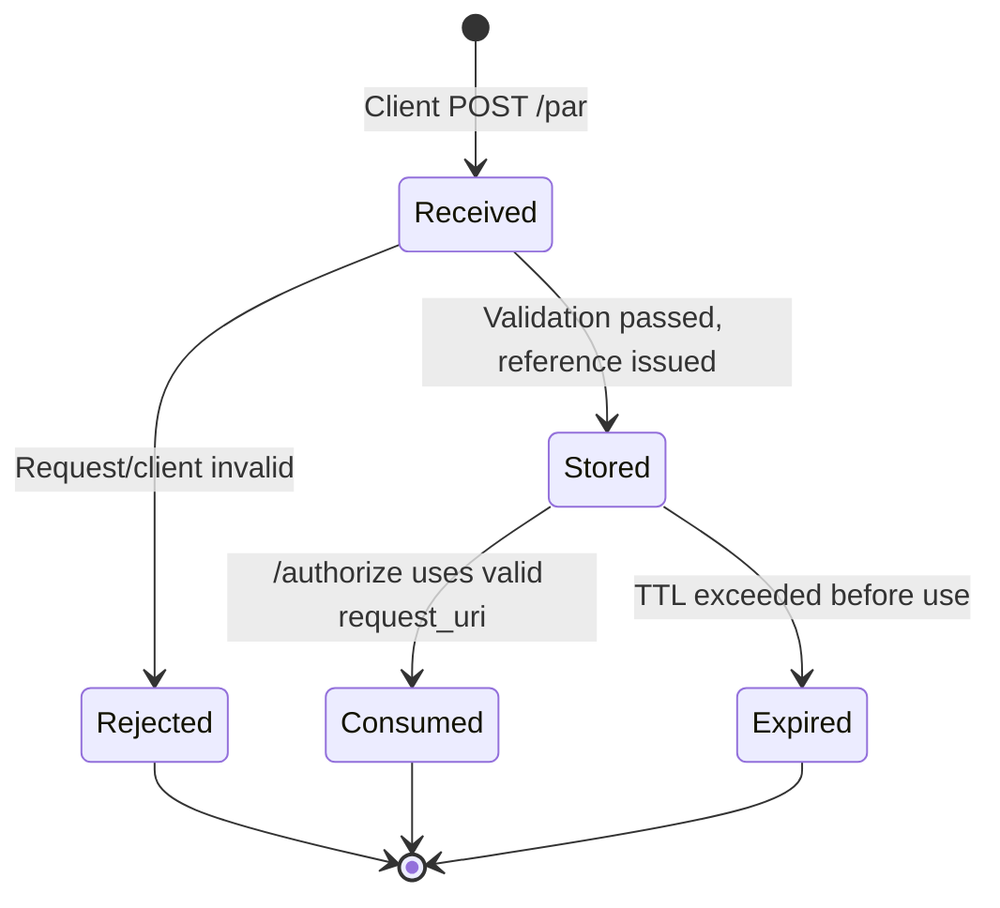
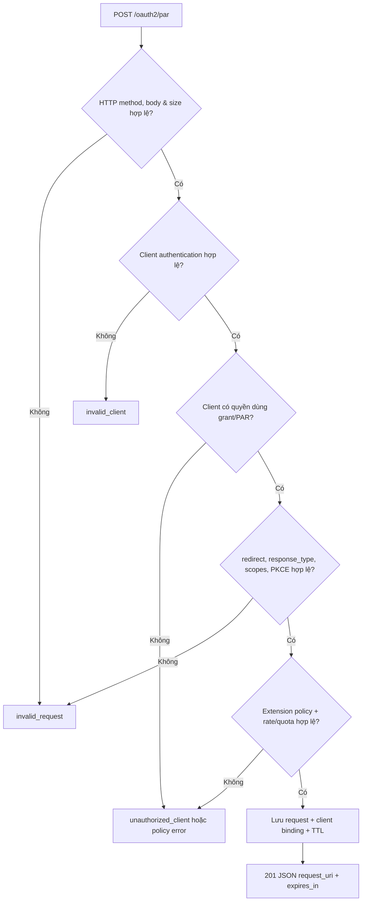
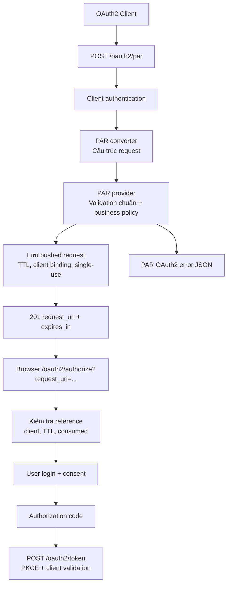

# Tùy chỉnh validation, provider và phản hồi lỗi của PAR

## 1. Mục tiêu và bối cảnh

Trong chương **PAR** (*Pushed Authorization Requests*) thuộc module **SPRING_SECURITY_OAUTH2_OIDC_AUTHORIZATION_SERVER**, chúng ta tìm hiểu cách mở rộng quá trình tiếp nhận, kiểm tra và phản hồi yêu cầu ủy quyền được **đẩy tới Authorization Server (AS) qua back channel**. Bài học gắn với mục tiêu thiết kế, cấu hình, bảo mật, kiểm thử và vận hành **OAuth 2.0/OpenID Connect Authorization Server** bằng **Spring Security**, **Spring Authorization Server (SAS)** và **Spring Boot**.

Theo **RFC 9126**, client gửi các tham số authorization request tới **Pushed Authorization Request Endpoint** trước, nhận về một `request_uri` có thời hạn, rồi chuyển trình duyệt người dùng tới Authorization Endpoint với `request_uri` đó. Mô hình này giảm việc để nhiều tham số nhạy cảm hoặc phức tạp đi qua front channel, đồng thời cho phép AS thẩm định yêu cầu trước khi browser tương tác.

Sau bài này, bạn có thể:

- Giải thích ranh giới giữa **PAR Endpoint**, **Authorization Endpoint**, **Token Endpoint** và luồng đăng nhập/consent.
- Phân tích quy trình `POST /oauth2/par`, HTTP `201 Created`, `request_uri` và `expires_in`.
- Xác định những kiểm tra bắt buộc đối với client, `redirect_uri`, `response_type`, scope, PKCE và request parameters.
- Nắm các điểm mở rộng của `OAuth2PushedAuthorizationRequestEndpointConfigurer`: converter, provider, success/error handler.
- Thêm validation nghiệp vụ mà **không thay thế hay vô hiệu các kiểm tra giao thức của SAS**.
- Thiết kế error response đúng OAuth 2.0, phân biệt `invalid_client` với request không hợp lệ, tránh rò thông tin.
- Kiểm thử request URI hết hạn, dùng lại, sai client, sai redirect, yêu cầu malformed, race condition và nhiều AS instance.

**Giả định:** Các ví dụ nhắm tới API phổ biến của **Spring Authorization Server 1.x / Spring Security 6.x / Spring Boot 3.x** có hỗ trợ PAR. Phiên bản cụ thể có thể khác về endpoint configurer, danh sách providers mặc định, phương thức tùy biến validation và auto-configuration. Khi áp dụng cần kiểm tra dependency thực tế.

> **Nguyên tắc xuyên suốt:** PAR **đẩy yêu cầu ủy quyền**, không trực tiếp phát authorization code hay access token. `request_uri` là tham chiếu đến một yêu cầu đã được AS chấp nhận; nó không thay `code_verifier`, xác thực người dùng, consent hoặc bước đổi code ở Token Endpoint.

## 2. PAR cải thiện điều gì và không giải quyết điều gì?

Trong Authorization Code Flow truyền thống, trình duyệt được chuyển đến một URL chứa `client_id`, `redirect_uri`, `scope`, `state`, `code_challenge` và có thể thêm các tham số OIDC hoặc extension khác. Client và AS cần bảo vệ tính toàn vẹn, phạm vi redirect và dữ liệu này.

**PAR tách yêu cầu thành hai bước:**

1. Client gửi **request parameters** tới PAR Endpoint qua HTTP POST từ kênh phù hợp, với **client authentication** nếu client là confidential.
2. AS xác minh client và request, lưu đối tượng authorization request trong trạng thái tạm thời rồi trả `request_uri`. Trình duyệt chỉ mang `client_id` và `request_uri` tới Authorization Endpoint để AS khôi phục yêu cầu.

```mermaid
sequenceDiagram
    autonumber
    actor U as Browser / Người dùng
    participant C as OAuth2/OIDC Client
    participant PAR as PAR Endpoint của AS
    participant STORE as PAR request state
    participant AUTH as Authorization Endpoint
    participant TOKEN as Token Endpoint
    C->>C: Sinh state và PKCE verifier/challenge
    C->>PAR: POST /oauth2/par + client credentials + authorization params
    PAR->>PAR: Xác minh client và request
    PAR->>STORE: Lưu request đã xác minh, TTL và ràng buộc client
    PAR-->>C: 201 request_uri, expires_in
    C-->>U: Redirect /oauth2/authorize?client_id=...&request_uri=...
    U->>AUTH: GET /oauth2/authorize với request_uri
    AUTH->>STORE: Tra, kiểm tra hiệu lực và client binding
    AUTH->>AUTH: User login, consent, policy
    AUTH-->>U: 302 về client với authorization code + state
    U->>C: Callback mang code + state
    C->>TOKEN: POST /oauth2/token với code, code_verifier
    TOKEN-->>C: Token response nếu hợp lệ
```

**PAR làm giảm** rủi ro tham số bị sửa trong browser redirect, URL quá dài và một số tình huống tiết lộ dữ liệu authorization request. Nhưng PAR **không tự động**:

- Ngăn mọi phishing, login CSRF hoặc lợi dụng consent.
- Bảo vệ một client bí mật nếu client credential đã bị lộ.
- Miễn kiểm tra `redirect_uri`, `scope`, `state` hay PKCE.
- Biến một yêu cầu chưa được chấp thuận thành authorization code hợp lệ.
- Thay các yêu cầu xác thực, lưu trạng thái và khóa ký của Authorization Server.

### 2.1. Phân biệt các giá trị trong luồng

| Giá trị | Phía tạo/giữ | Vai trò | Điểm bảo vệ |
| --- | --- | --- | --- |
| `request_uri` | AS phát sau PAR, client mang sang browser | Tham chiếu đến pushed authorization request đã được AS chấp nhận | Phải được ràng buộc với client, có TTL ngắn và dùng một lần theo RFC 9126 |
| `state` | Client sinh và lưu cho từng authorization flow | Giúp client gắn callback với request ban đầu | AS bảo toàn khi phản hồi; client phải kiểm tra khi nhận callback |
| `code_challenge` | Client tính từ verifier | Được gửi trong PAR request để AS lưu điều kiện PKCE | Thẩm định syntax/method, không thay bằng verifier |
| `code_verifier` | Client giữ kín theo flow | Được gửi ở Token Endpoint sau khi nhận authorization code | Kiểm tra tương ứng `code_challenge` |
| Authorization code | AS cấp sau login/consent hợp lệ | Credential ngắn hạn đổi token tại `/oauth2/token` | Ràng buộc client/redirect/PKCE, sử dụng một lần |
| Access/ID/refresh token | AS phát qua Token Endpoint khi đủ điều kiện | Credential để dùng API/đăng nhập/làm mới | Không xuất hiện trong PAR response |

`request_uri` **không phải authorization code**. Dùng `request_uri` để xin access token trực tiếp là sai giao thức.

## 3. HTTP contract của Pushed Authorization Request

### 3.1. Client gửi HTTP POST

Ví dụ confidential web client `portal-web` đã đăng ký Authorization Code Grant, callback và client authentication method `client_secret_basic`:

```http
POST /oauth2/par HTTP/1.1
Host: auth.example.com
Authorization: Basic <REDACTED_CLIENT_CREDENTIALS>
Content-Type: application/x-www-form-urlencoded
Accept: application/json

response_type=code&client_id=portal-web&redirect_uri=https%3A%2F%2Fportal.example.com%2Fcallback&scope=openid%20profile&state=RANDOM_STATE&code_challenge=PKCE_S256_CHALLENGE&code_challenge_method=S256
```

`POST /oauth2/par` là đường dẫn thường gặp của SAS; endpoint path thực tế có thể được cấu hình khác. **Không gửi raw `code_verifier`** trong PAR request. Client giữ nó đến lúc trao đổi code tại Token Endpoint.

**Confidential client** xác thực với AS bằng method đã đăng ký (Basic, private-key JWT, mTLS hoặc phương thức được hỗ trợ). **Public client** có thể gửi `client_id` theo chính sách AS khi được phép dùng PAR, nhưng không nhờ vậy trở thành confidential; cần PKCE, redirect URI hợp lệ và kiểm soát abuse. Không nhúng secret vào SPA/mobile rồi xem nó là bí mật.

### 3.2. PAR response thành công: 201 Created

Nếu request hợp lệ và được chấp nhận:

```http
HTTP/1.1 201 Created
Content-Type: application/json
Cache-Control: no-store

{
  "request_uri": "urn:ietf:params:oauth:request_uri:EXAMPLE_OPAQUE_REFERENCE",
  "expires_in": 90
}
```

Các giá trị chỉ là **minh họa**, không phải URI/token thật. `expires_in` biểu thị thời gian sống tính bằng giây của reference tính từ lúc response. Không giả định `90` giây là giá trị bắt buộc cho mọi sản phẩm; nó cần được đối chiếu với `AuthorizationServerSettings`, token/authorization store và chính sách phiên bản SAS.

`request_uri` có thể mang hình thức URN được AS hỗ trợ; client phải **dùng nguyên văn giá trị** do AS trả, không tự tạo, giải mã hoặc dựng đường dẫn nội bộ tới database.

### 3.3. Browser sử dụng `request_uri` ở Authorization Endpoint

Sau PAR, client đưa browser tới:

```http
GET /oauth2/authorize?client_id=portal-web&request_uri=urn%3Aietf%3Aparams%3Aoauth%3Arequest_uri%3AEXAMPLE_OPAQUE_REFERENCE HTTP/1.1
Host: auth.example.com
```

Ở bước này, AS khôi phục request đã được lưu từ `request_uri`, kiểm tra thời hạn, tính hợp lệ và liên kết với client. Sau đó mới diễn ra đăng nhập, consent, phát authorization code và redirect về callback.

**Không gửi lại toàn bộ `redirect_uri`, `scope`, `state` hoặc `code_challenge` qua front channel để sửa request đã push.** Nếu client muốn một bộ tham số khác, phải khởi tạo PAR request mới. AS không được để tham số front channel tùy ý ghi đè các tham số đã xác minh tại PAR Endpoint.

### 3.4. Sai khác với Authorization Endpoint thông thường

| Đặc tính | PAR Endpoint | Authorization Endpoint |
| --- | --- | --- |
| Request từ ai | OAuth2 client, qua back channel | Browser người dùng được chuyển hướng |
| HTTP method | POST | Thường GET |
| Client authentication | Confidential client phải dùng method thích hợp; public theo policy | Browser không gửi client secret |
| Kiểm tra request | Cấu trúc, client, redirect, response type, scope, PKCE và các extension | `request_uri` binding/TTL, login, consent và các kiểm tra giao thức tiếp theo |
| Trạng thái sinh ra | Reference `request_uri` ngắn hạn | Authorization code sau khi người dùng đủ điều kiện |
| Success response | HTTP 201 JSON `request_uri` và `expires_in` | HTTP redirect tới callback có `code`/`state` |
| Error response | OAuth2 error JSON, không phải redirect browser | Redirect error nếu callback đáng tin hoặc lỗi tại AS |

Không viết một controller `POST /oauth2/par` tự phát URI mà bỏ qua các converter/providers của SAS. Khi tích hợp, hãy giữ endpoint thuộc đúng `SecurityFilterChain` được bảo vệ.

## 4. Mô hình dữ liệu và vòng đời request URI

PAR Endpoint thường cần giữ một **bản ghi yêu cầu authorization đã được xác minh** để Authorization Endpoint tra lại. Đây là trạng thái riêng với session login của người dùng.



Sơ đồ là **mô hình tư duy**; không phải enum bắt buộc trong API SAS.

### 4.1. Bất biến bảo mật cần bảo toàn

- `request_uri` được **AS sinh ra**, không lấy URI tùy ý của client làm tham chiếu tin cậy.
- Reference phải **khó đoán**, có thời hạn ngắn, được bảo vệ khỏi enumeration.
- Mỗi `request_uri` gắn với **một pushed request và đúng client**.
- Authorization Endpoint phải kiểm tra `client_id` khớp client đã dùng ở PAR request.
- `request_uri` phải được xử lý **một lần** theo RFC 9126; thao tác đọc và đánh dấu sử dụng cần nhất quán khi nhiều request đồng thời.
- Không thể dùng lại URI đã hết hạn hoặc đã consumed.
- Nếu storage lỗi, AS không phát một `request_uri` không thể giải quyết sau đó.
- Sau khi reference được sử dụng hợp lệ, đăng nhập/consent và authorization code vẫn theo các quy tắc riêng.

### 4.2. Các thông tin cần lưu hoặc tái dựng

| Nhóm dữ liệu | Ý nghĩa |
| --- | --- |
| Reference ID/giá trị `request_uri` | Dùng tra pushed request |
| Registered client ID | Ràng buộc reference với client đã được xác minh |
| Authorized request parameters | `response_type`, `redirect_uri`, scopes, `state`, PKCE challenge/method, OIDC fields |
| Issued/expires time | Kiểm tra TTL |
| Consumed/invalidated state | Chặn replay |
| Metadata nội bộ | Phiên bản policy, audit correlation ID đã làm sạch, extension fields có thể cần |

Trong SAS, trạng thái được quản lý bằng các service/authorization model của framework phù hợp. **Không tự giả định** bảng JDBC mặc định hay field nào cũng cho phép mọi kiểu dữ liệu extension; nếu tự thay persistence, cần kiểm tra serialization, TTL, chỉ mục và tính nhất quán theo phiên bản.

### 4.3. PAR reference khác authorization code

Một `request_uri` được tiêu thụ tại Authorization Endpoint khi client/browser sử dụng pushed request. Authorization code chỉ được tạo **sau khi** người dùng đăng nhập/consent đáp ứng điều kiện; sau đó Token Endpoint mới đổi code lấy token. Hai đối tượng có TTL, mục đích và trạng thái replay riêng.

## 5. Threat model khi tùy chỉnh validation

Validation của PAR nằm ở nhiều tầng. Không nên gom tất cả thành một if statement hoặc chỉ thực hiện kiểm tra trên browser.



### 5.1. Bảng kiểm tra cần thiết

| Kiểm tra | Cần bảo vệ điều gì? | Lỗi điển hình |
| --- | --- | --- |
| HTTP method và content type | PAR chỉ nhận request theo giao thức, không nhận một URL tùy ý | `invalid_request` / HTTP method error |
| Tham số bắt buộc, trùng tham số | Không để parser chọn ngẫu nhiên một trong nhiều giá trị | `invalid_request` |
| Client authentication | Chỉ đúng client được push request; confidential client chứng minh credential | `invalid_client` |
| `client_id` khớp principal | Không để client A khai `client_id` của B | `invalid_client` hoặc `invalid_request` tùy trường hợp |
| Grant/response type | Client được đăng ký `authorization_code` và `response_type=code` nếu dùng code flow | `unauthorized_client` / `unsupported_response_type` |
| `redirect_uri` | Chống open redirect hoặc phát code đến domain khác | `invalid_request` |
| Requested scopes | Không cấp phạm vi ngoài đăng ký/policy | `invalid_scope` |
| PKCE `code_challenge`/method | Ngăn code interception; tuân `requireProofKey` | `invalid_request` |
| OIDC `nonce`/`prompt`/`max_age` nếu dùng | Giữ ngữ nghĩa OIDC hợp lệ, không bypass chính sách | `invalid_request` hoặc lỗi theo profile |
| Resource/audience extension | Không cho client chọn API không được phê duyệt | Từ chối bằng lỗi có ý nghĩa và được chuẩn hóa |
| Request length, số flow pending | Giảm DoS, state exhaustion | HTTP 413/429 hoặc OAuth error theo lớp điều tiết |
| Request URI uniqueness/TTL | Chặn reference đoán được, hết hạn hoặc reused | Lỗi ở `/authorize` khi reference invalid |

**Không mọi lỗi đều giống nhau:** Client secret sai nên được xử lý ở **client authentication**, không phải một validator trên authorization parameters. Còn redirect URI sai phải bị từ chối **trước** khi đưa URI vào response/flow.

### 5.2. Vì sao kiểm tra `redirect_uri` phải chính xác?

Giả sử `portal-web` chỉ đăng ký callback:

```text
https://portal.example.com/callback
```

Request cố push:

```text
redirect_uri=https://attacker.example/capture
```

AS không được chấp nhận và trả `request_uri` tương ứng. Không dùng so khớp prefix, wildcard tùy tiện hoặc redirect URI do client tự sửa sau PAR. Các quy tắc đặc thù cho native loopback redirect nếu được chuẩn/profile hỗ trợ cần có cấu hình và test riêng.

### 5.3. PKCE phải được kiểm tra từ PAR tới Token Endpoint

Với Authorization Code + PKCE:

1. Client sinh `code_verifier` và `code_challenge = BASE64URL(SHA256(ASCII(verifier)))`.
2. Client gửi `code_challenge` cùng `code_challenge_method=S256` **ở PAR request**.
3. AS lưu challenge trong authorization request và gắn vào `request_uri`.
4. Browser dùng `request_uri` để thực hiện authorize; AS không nhận challenge khác từ front channel để ghi đè.
5. Client nhận code, rồi gửi **verifier** ở `/oauth2/token`.
6. SAS kiểm tra verifier khớp challenge và các điều kiện code/client/redirect khác.

Không gửi `code_verifier` trong PAR, không tin `state` có thể thay PKCE, và không bỏ PKCE vì “PAR đã được client xác thực”. Confidential client vẫn nên dùng PKCE khi chính sách hỗ trợ.

## 6. Vị trí của `OAuth2PushedAuthorizationRequestEndpointConfigurer`

Spring Authorization Server cung cấp DSL cấu hình PAR bên trong `OAuth2AuthorizationServerConfigurer`. Ví dụ khung:

```java
@Configuration(proxyBeanMethods = false)
@EnableWebSecurity
public class AuthorizationServerSecurityConfig {

    @Bean
    @Order(1)
    SecurityFilterChain authorizationServerChain(
            HttpSecurity http) throws Exception {

        OAuth2AuthorizationServerConfigurer as =
                OAuth2AuthorizationServerConfigurer.authorizationServer();

        http
            .securityMatcher(as.getEndpointsMatcher())
            .with(as, authorizationServer ->
                    authorizationServer
                        .pushedAuthorizationRequestEndpoint(par -> {
                            // Customization points được thêm khi cần.
                        })
                        .oidc(Customizer.withDefaults()))
            .authorizeHttpRequests(auth ->
                    auth.anyRequest().authenticated())
            .exceptionHandling(exceptions ->
                    exceptions.defaultAuthenticationEntryPointFor(
                            new LoginUrlAuthenticationEntryPoint("/login"),
                            new MediaTypeRequestMatcher(MediaType.TEXT_HTML)))
            .oauth2ResourceServer(resourceServer ->
                    resourceServer.jwt(Customizer.withDefaults()));

        return http.build();
    }

    @Bean
    @Order(2)
    SecurityFilterChain applicationChain(
            HttpSecurity http) throws Exception {

        http.authorizeHttpRequests(auth ->
                    auth.anyRequest().authenticated())
            .formLogin(Customizer.withDefaults());

        return http.build();
    }
}
```

Đây là **bộ khung để nhìn vị trí PAR trong filter chain**, chưa phải một AS chạy độc lập. Cần thêm issuer, `RegisteredClientRepository`, `OAuth2AuthorizationService`, `OAuth2AuthorizationConsentService` khi thích hợp, JWKSource/keys/JWT decoder cho OIDC/JWT, cùng user authentication. Không viết một `@PostMapping("/oauth2/par")` khác để “đè” endpoint chuẩn.

**Lưu ý version:** Đối chiếu khả năng PAR của phiên bản SAS đang chạy. Nếu một API `pushedAuthorizationRequestEndpoint(...)` chưa có trong dependency, không tự dựng endpoint gần giống rồi coi đã hỗ trợ RFC 9126; cần chọn phiên bản có hỗ trợ hoặc triển khai theo một thiết kế đã review chuyên môn.

### 6.1. Client yêu cầu bắt buộc PAR

Với những phiên bản có `ClientSettings.requirePushedAuthorizationRequests(boolean)`, có thể cấu hình một client không được bypass PAR:

```java
RegisteredClient client = RegisteredClient
        .withId("portal-web-local-001")
        .clientId("portal-web")
        .clientSecret(passwordEncoder.encode(rawClientSecret))
        .clientAuthenticationMethod(
                ClientAuthenticationMethod.CLIENT_SECRET_BASIC)
        .authorizationGrantType(
                AuthorizationGrantType.AUTHORIZATION_CODE)
        .redirectUri("https://portal.example.com/callback")
        .scope(OidcScopes.OPENID)
        .scope(OidcScopes.PROFILE)
        .clientSettings(ClientSettings.builder()
                .requireProofKey(true)
                .requireAuthorizationConsent(true)
                .requirePushedAuthorizationRequests(true)
                .build())
        .build();
```

Đoạn code chỉ tạo `RegisteredClient`; client phải được đăng ký vào repository. `passwordEncoder` và `rawClientSecret` đến từ cấu hình/secret manager an toàn, không hard-code. Khi bật `requirePushedAuthorizationRequests(true)`, **phải kiểm thử trực tiếp** rằng một authorization request không có `request_uri` bị từ chối theo policy. Không coi flag này là bằng chứng cho mọi luồng/version nếu chưa test.

### 6.2. Cấu hình endpoint path và discovery

Khi ứng dụng có hỗ trợ, `AuthorizationServerSettings` có thể cho cấu hình path PAR:

```java
@Bean
AuthorizationServerSettings authorizationServerSettings() {
    return AuthorizationServerSettings.builder()
            .issuer("https://auth.example.com")
            .pushedAuthorizationRequestEndpoint("/oauth2/par")
            .build();
}
```

Path ở đây là giá trị minh họa thường gặp; issuer của production phải là HTTPS public URL, khớp discovery metadata và các token claims. Nếu đang chạy sau ingress, đảm bảo forwarded headers được làm sạch bởi proxy tin cậy; không để client sửa scheme/host qua header.

Trong metadata Authorization Server, client có thể khám phá trường `pushed_authorization_request_endpoint` khi server công bố PAR. Đồng thời các metadata về `require_pushed_authorization_requests` có ý nghĩa tùy server/profile; không tự dựa vào một URL hard-code nếu client hỗ trợ discovery chuẩn.

## 7. Những extension point của PAR Endpoint DSL

### 7.1. Bảng API

`OAuth2PushedAuthorizationRequestEndpointConfigurer` cung cấp các nhóm extension point phổ biến:

| API | Input | Tác dụng | Cần bảo vệ |
| --- | --- | --- | --- |
| `pushedAuthorizationRequestConverter(...)` | `AuthenticationConverter` | Bổ sung/điều chỉnh cách parse PAR request | Không nuốt lỗi malformed hoặc nhận nhầm request khác |
| `pushedAuthorizationRequestConverters(...)` | `Consumer<List<AuthenticationConverter>>` | Xem/điều chỉnh danh sách converters | Không xóa default converter hoặc đảo thứ tự thiếu kiểm thử |
| `authenticationProvider(...)` | `AuthenticationProvider` | Bổ sung provider xử lý authentication request | Không tự phát `request_uri` mà bỏ validation chuẩn |
| `authenticationProviders(...)` | `Consumer<List<AuthenticationProvider>>` | Xem/điều chỉnh danh sách providers | Tránh `supports(...)` quá rộng hoặc bypass default provider |
| `pushedAuthorizationResponseHandler(...)` | `AuthenticationSuccessHandler` | Tùy chỉnh PAR success response | Giữ HTTP 201, JSON `request_uri`/`expires_in` và no-store |
| `errorResponseHandler(...)` | `AuthenticationFailureHandler` | Tùy chỉnh phản hồi lỗi | Giữ OAuth2 error JSON, mã/status chính xác, không lộ credential |

Tên và chữ ký cụ thể cần được kiểm tra trên **phiên bản SAS đang dùng**. Dùng `OAuth2TokenEndpointConfigurer` thay cho PAR configurer sẽ không làm thay đổi parser/provider của `/oauth2/par`, vì hai endpoint có nhiệm vụ khác nhau.

### 7.2. Chọn đúng điểm mở rộng

- Muốn kiểm tra **một request parameter mới**: converter nhận dạng dữ liệu, provider hoặc policy service xác minh ngữ nghĩa.
- Muốn kiểm soát **client được dùng PAR với resource/audience nào**: thực thi policy dựa trên registered client đã xác thực.
- Muốn chống request body quá lớn hoặc tấn công tạo hàng loạt pushed request: dùng gateway/`OncePerRequestFilter` được bảo vệ, cùng quota phù hợp.
- Muốn kiểm tra PKCE/redirect/scope chuẩn: **giữ validator/provider của SAS**, chỉ bổ sung kiểm soát riêng.
- Muốn đổi response success nhưng vẫn chuẩn RFC: cần giữ `201 Created`, `request_uri`, `expires_in`, cache headers.
- Muốn thay cách sinh JWT/claim sau khi code được đổi: dùng token customizer/generator ở **Token Endpoint**, không sửa PAR success handler.
- Muốn thay client authentication: cấu hình `clientAuthentication(...)` và provider tương ứng, không chuyển sang tự so secret trong PAR converter.

**Không giải quyết một yêu cầu extension đơn giản bằng việc thay toàn bộ default provider.** Đây là đường dễ tạo bypass cho `redirect_uri`, scopes, PKCE và việc ràng buộc client.

## 8. Converter: nhận dạng và kiểm tra cấu trúc request

`AuthenticationConverter#convert(HttpServletRequest)` đọc form parameters và trả `Authentication` mô tả pushed request, hoặc `null` nếu converter không xử lý request. Nó **không** có quyền kết luận rằng user đã consent hoặc phát authorization code.

### 8.1. Kiểm tra cấu trúc trước khi kiểm tra ngữ nghĩa

Một converter phù hợp cần phân biệt:

- Request không thuộc kiểu nó xử lý → `null` để converter khác thử.
- Request thuộc kiểu nó xử lý nhưng thiếu/trùng tham số → `invalid_request`.
- Tham số đúng cú pháp nhưng chưa được cấp quyền → provider/service policy từ chối.
- Input quá dài hoặc nhiều trường không mong đợi → chặn theo giới hạn và cách phản hồi có kiểm soát.
- Có `request_uri` do client tự đưa vào ở PAR request với ý định ghi đè reference AS → từ chối theo profile; client không được tự chọn reference lưu trữ của AS.

### 8.2. Ví dụ bộ lọc kích thước request

Một điều kiện tương đối độc lập với parser là giới hạn độ lớn body. Có thể dùng **gateway** hoặc một filter chạy trước PAR để ngăn request phình quá lớn. Đoạn sau là minh họa một kiểm tra đơn giản ở tầng ứng dụng:

```java
public final class ParBodySizeGuard extends OncePerRequestFilter {

    private static final long MAX_DECLARED_LENGTH = 16 * 1024;

    @Override
    protected void doFilterInternal(
            HttpServletRequest request,
            HttpServletResponse response,
            FilterChain chain)
            throws ServletException, IOException {

        boolean parPath =
                "/oauth2/par".equals(request.getServletPath());

        if (parPath && request.getContentLengthLong() > MAX_DECLARED_LENGTH) {
            response.sendError(
                    HttpServletResponse.SC_REQUEST_ENTITY_TOO_LARGE);
            return;
        }

        chain.doFilter(request, response);
    }
}
```

**Giới hạn của ví dụ:** Header `Content-Length` có thể vắng mặt hoặc không phản ánh đủ dữ liệu sau xử lý chunked/proxy. Để có **giới hạn byte thực sự**, phải cấu hình giới hạn tại gateway/servlet container, cách đọc body có budget và điều kiện đối với transfer encoding. Không dựa hoàn toàn vào `getContentLengthLong()` để chống DoS. Đồng thời cần giới hạn số request, số pushed requests pending và độ dài từng tham số.

Khi đặt filter custom, kiểm tra thứ tự trong `SecurityFilterChain`; tránh đọc body khiến converter chuẩn không thể đọc lại, hoặc log raw form parameters chứa `state`/`nonce`/request object.

### 8.3. Ví dụ minh họa cách từ chối tham số trùng

```java
String[] redirectUris = request.getParameterValues(
        OAuth2ParameterNames.REDIRECT_URI);

if (redirectUris != null && redirectUris.length > 1) {
    throw new OAuth2AuthenticationException(
            new OAuth2Error(OAuth2ErrorCodes.INVALID_REQUEST));
}
```

Đây là **mẩu validation** để gắn vào converter/filter phù hợp, không phải một PAR converter đầy đủ. Không tự chuyển lỗi sang thành công khi có hai `redirect_uri` bằng cách chọn giá trị đầu hoặc cuối; sự khác biệt cách parse giữa AS và client/gateway có thể gây lỗi bảo mật.

## 9. Provider: thêm policy nhưng không bỏ qua validator chuẩn

`OAuth2PushedAuthorizationRequestAuthenticationProvider` (trong các phiên bản có PAR support tương ứng) xử lý xác minh pushed authorization request. Những điều kiện thông thường gồm: client đã được xác thực/được nhận diện hợp lệ, grant/response type, registered redirect URI, scope, PKCE và các điều kiện giao thức trước khi tạo request reference.

### 9.1. Validation nghiệp vụ bổ sung khác validation giao thức

Ví dụ tổ chức có yêu cầu:

- Chỉ client trong allowlist mới được push yêu cầu có scope nhạy cảm `payments.approve`.
- Một client chỉ được dùng redirect URI đã đăng ký **và** thuộc tập hostname đã phê duyệt.
- Client có quota PAR pending và rate limit riêng.
- Extension parameter `resource` nếu được hỗ trợ phải thuộc danh sách API đã được duyệt.
- Với OIDC policy đặc thù, `acr_values` hoặc `max_age` phải nằm trong phạm vi được hỗ trợ.
- Một số client bắt buộc PKCE S256 dù chưa có cấu hình chung cho toàn hệ thống.

Những điều kiện đó nên được thực thi **sau khi client được nhận diện đáng tin**, nhưng **trước khi request_uri được phát hành**. Không áp business policy bằng cách để provider chuẩn phát reference rồi mới cố hủy trong success handler; khi đó state có thể đã được lưu và gây sai luồng/rò rỉ.

### 9.2. Các cách tích hợp policy

Tùy phiên bản SAS, bạn có thể:

1. Dùng phương thức tùy chỉnh validator trên provider chuẩn **nếu API phiên bản hỗ trợ**, đảm bảo giữ các default validators cần thiết.
2. Bọc (**decorate**) provider chuẩn qua danh sách `authenticationProviders(...)` để chạy policy bổ sung trước khi ủy quyền provider chuẩn.
3. Thêm authentication provider riêng **chỉ khi** nó có contract đầy đủ, không nhận/return success cho request mà provider chuẩn phải kiểm tra.
4. Dùng filter/gateway riêng cho rate limit, giới hạn body hoặc policy không cần đọc toàn bộ giao thức.

Không tự giả định mọi provider của mọi phiên bản có cùng một setter `setAuthenticationValidator(...)`; nếu dùng setter cụ thể phải đối chiếu chữ ký và **kết hợp** default validation, không thay nó bằng một consumer chỉ kiểm tra nghiệp vụ.

### 9.3. Ví dụ decorator bảo vệ default provider

Đoạn sau minh họa **nguyên tắc bọc provider** mà không tự phát hành `request_uri`. Interface `ParAdmissionPolicy` là **service của ứng dụng**, không phải API có sẵn của SAS.

```java
@FunctionalInterface
public interface ParAdmissionPolicy {
    void validate(Authentication request);
}

public final class PolicyGuardedParProvider
        implements AuthenticationProvider {

    private final AuthenticationProvider delegate;
    private final ParAdmissionPolicy policy;

    public PolicyGuardedParProvider(
            AuthenticationProvider delegate,
            ParAdmissionPolicy policy) {
        this.delegate = delegate;
        this.policy = policy;
    }

    @Override
    public boolean supports(Class<?> authentication) {
        return delegate.supports(authentication);
    }

    @Override
    public Authentication authenticate(Authentication authentication) {
        // Chỉ gọi trên class authentication mà delegate hỗ trợ.
        // Policy phải lấy danh tính client từ authentication
        // đã được SAS xác thực, không từ client_id tự khai.
        policy.validate(authentication);

        // Để provider chuẩn thực hiện validation giao thức,
        // lưu pushed request và tạo response authentication.
        return delegate.authenticate(authentication);
    }
}
```

Đăng ký decorator vào danh sách providers nếu đã xác định đúng provider chuẩn trong phiên bản ứng dụng:

```java
authorizationServer.pushedAuthorizationRequestEndpoint(par ->
    par.authenticationProviders(providers -> {
        ListIterator<AuthenticationProvider> iterator =
                providers.listIterator();

        while (iterator.hasNext()) {
            AuthenticationProvider current = iterator.next();

            if (current instanceof
                    OAuth2PushedAuthorizationRequestAuthenticationProvider) {

                iterator.set(new PolicyGuardedParProvider(
                        current, parAdmissionPolicy));
            }
        }
    }));
```

Đoạn DSL là ví dụ trong ngữ cảnh biến `authorizationServer` và `parAdmissionPolicy` đã được cung cấp; để chạy cần có `@Configuration`, dependency và implementation `ParAdmissionPolicy`. **Không coi `policy.validate(authentication)` là đã có bảo mật** nếu implementation chỉ đọc `client_id` hoặc `scope` mà không kiểm tra nguồn đáng tin. Trước khi ủy quyền provider chuẩn, policy nên kiểm tra client principal, registered client, quota và extension inputs từ object đã được converter xử lý.

**Giới hạn quan trọng:** Decorator có thể làm thay đổi thứ tự và cách chọn provider, nhất là khi có nhiều provider cùng `supports(...)`. Chỉ thay đúng instance mong muốn, thử nghiệm mọi grant liên quan và xác minh không có đường bypass. Nếu cấu hình framework cho phép bổ sung validator vào provider một cách an toàn hơn, ưu tiên cơ chế đó.

### 9.4. Khi policy từ chối

Một policy có thể ném `OAuth2AuthenticationException` với error code đã chọn sau khi phân loại nguyên nhân:

```java
throw new OAuth2AuthenticationException(
        new OAuth2Error(
                OAuth2ErrorCodes.INVALID_REQUEST,
                "Authorization request is not permitted by policy",
                null));
```

Thông báo trên cố tình **không nêu** client secret, redirect URI nhạy cảm, user ID hoặc nội dung request. Một chính sách từ chối client chưa được xác thực phải đi qua client authentication và error semantics tương ứng (`invalid_client`), không biến mọi lỗi xác thực thành `invalid_request`.

## 10. Phân biệt validation của PAR và Authorization Endpoint

PAR có thể thẩm định các thông số **trước khi** user login, nhưng không làm Authorization Endpoint thành hình thức.

| Điều kiện | PAR Endpoint | Authorization Endpoint |
| --- | --- | --- |
| Client identity/registration | Kiểm tra client và method phù hợp | Kiểm tra `request_uri` gắn đúng client |
| Redirect URI/response type | Kiểm tra request | Sử dụng giá trị đã được xác minh, không cho override |
| Scope và PKCE | Kiểm tra syntax/allowlist/policy | Duy trì ràng buộc khi phát code |
| `request_uri` TTL/single-use | Sinh/lưu reference | Tra reference và đánh dấu sử dụng an toàn |
| Người dùng đăng nhập | Không cần tương tác login ở PAR | Xác thực principal/browser session |
| Consent | Không thể hoàn tất thay user tại PAR | User xem và xác nhận quyền theo policy |
| Authorization code | Không phát | Phát sau khi đủ điều kiện |
| Token | Không phát | Không phát token trực tiếp trong code flow; Token Endpoint cấp sau |

**Một PAR request được chấp nhận không đồng nghĩa người dùng đã cấp quyền.** Nếu user chưa login, từ chối consent, session hết hạn hoặc policy thay đổi, Authorization Endpoint vẫn có thể từ chối hoặc yêu cầu lại các bước cần thiết.

### 10.1. Không chấp nhận override từ browser

Nếu client đã push `scope=openid profile` và `redirect_uri=https://portal.example.com/callback`, browser không được thêm `scope=payments.approve` hoặc `redirect_uri=https://attacker.example/capture` để thay đổi pushed request. Authorization Endpoint chỉ dùng reference và client ID theo quy tắc RFC 9126 và profile đang áp dụng.

### 10.2. PAR không thay yêu cầu PKCE

PAR giúp AS nhận request qua back channel, nhưng authorization code vẫn có thể bị đánh cắp/tiêm trong browser callback. **PKCE S256** và `state` tiếp tục quan trọng; với confidential client, client authentication ở Token Endpoint vẫn cần được thực thi theo đăng ký.

## 11. Success handler: giữ đúng response của RFC 9126

`pushedAuthorizationResponseHandler(AuthenticationSuccessHandler)` cho phép tùy biến cách PAR Endpoint trả response thành công. Trong trường hợp bình thường, chỉ cần handler mặc định của SAS.

### 11.1. Success response chuẩn

```http
HTTP/1.1 201 Created
Content-Type: application/json
Cache-Control: no-store

{
  "request_uri": "urn:ietf:params:oauth:request_uri:REDACTED_REFERENCE",
  "expires_in": 90
}
```

Một handler custom vẫn phải giữ:

- HTTP `201 Created`.
- `Content-Type: application/json`.
- `request_uri` do AS sinh và gắn đúng client.
- `expires_in` thể hiện TTL còn hiệu lực theo contract.
- `Cache-Control: no-store` và những header bảo vệ response cần thiết.
- Không trả raw authorization request, client secret hoặc dữ liệu session trong body.

**Không thêm access token, authorization code hoặc ID token vào PAR response.** Khi muốn thêm claim JWT, sử dụng extension point ở giai đoạn token generation, không sửa PAR success handler.

### 11.2. Khi nào thật sự cần custom handler?

Các nhu cầu khả dĩ: tương thích response format trong một profile được chuẩn hóa, gắn header correlation/audit không nhạy cảm, hoặc giám sát latency mà không can thiệp body. Tuy nhiên, audit thường nên thực hiện qua service/event/metrics để giữ handler chuẩn.

Đăng ký handler trong DSL:

```java
authorizationServer.pushedAuthorizationRequestEndpoint(par ->
        par.pushedAuthorizationResponseHandler(customParSuccessHandler));
```

`customParSuccessHandler` là bean `AuthenticationSuccessHandler` do ứng dụng viết/kiểm thử, không phải bean tự động có sẵn.

**Không gọi handler mặc định rồi ghi thêm JSON lần thứ hai**: response có thể đã commit. Nếu wrap/ủy quyền handler, chỉ thực hiện logging/headers an toàn **trước khi** handler ghi response, hoặc dùng cơ chế response decorator đã được kiểm chứng.

## 12. Error handler: từ chối an toàn và giữ đúng HTTP/OAuth2 contract

`errorResponseHandler(AuthenticationFailureHandler)` cho phép ứng dụng điều chỉnh phản hồi lỗi của PAR. Phản hồi lỗi đi qua **back channel** về OAuth2 client, không phải redirect browser theo `redirect_uri`.

### 12.1. Mã lỗi điển hình

| Tình huống | Lỗi/phản hồi dự kiến | Lý do |
| --- | --- | --- |
| Thiếu `response_type` hoặc request malformed | `invalid_request`, thường HTTP 400 | Tham số authorization không hợp lệ |
| `redirect_uri` không khớp | `invalid_request`/lỗi tương ứng | Không thể chấp nhận redirect URI |
| Scope không được đăng ký | `invalid_scope`, thường HTTP 400 | Client không có quyền yêu cầu scope |
| Client không được dùng grant/flow | `unauthorized_client` | Grant bị hạn chế bởi registration/policy |
| Response type không được hỗ trợ | `unsupported_response_type` | Không tự chuyển sang flow khác |
| Client authentication thất bại | `invalid_client`, có thể HTTP 401/header tương ứng | Client chưa chứng minh danh tính |
| Client/par policy không cho phép extension input | `invalid_request` hoặc lỗi policy đã xác định | Không phát reference ngoài chính sách |
| Body quá lớn hoặc rate limit bị kích hoạt | Có thể HTTP 413/429 ở gateway/filter | Bảo vệ hạ tầng, không phải mọi trường hợp là lỗi OAuth2 |
| Kho PAR state lỗi | Lỗi server an toàn, HTTP 5xx thích hợp | Không trả reference chưa lưu được |

RFC và phần triển khai cụ thể quyết định status/header phù hợp cho từng lỗi. Không khẳng định tất cả lỗi luôn dùng một HTTP status, và không biến lỗi client authentication thành thành công giả.

### 12.2. Ví dụ lỗi request

```http
HTTP/1.1 400 Bad Request
Content-Type: application/json
Cache-Control: no-store

{
  "error": "invalid_request"
}
```

Nếu cần `error_description`, chỉ đưa mô tả trung tính, không có stack trace, raw `client_secret`, `request_uri`, `state`, `nonce`, `code_challenge` hoặc PII. Tránh dùng response công khai để xác nhận một client ID có tồn tại, một redirect URI riêng tư đã đăng ký hay một request object nhạy cảm đã được lưu.

### 12.3. Ví dụ lỗi client authentication

```http
HTTP/1.1 401 Unauthorized
Content-Type: application/json
Cache-Control: no-store
WWW-Authenticate: Basic realm="oauth2"

{
  "error": "invalid_client"
}
```

Ví dụ HTTP này mang tính minh họa cho **một phương thức client authentication**; header `WWW-Authenticate` và status thực tế phụ thuộc phương thức Basic/POST/JWT/mTLS và xử lý RFC tương ứng. Không copy nguyên header Basic cho mọi cách client authentication.

### 12.4. Những yêu cầu đối với custom error handler

```java
authorizationServer.pushedAuthorizationRequestEndpoint(par ->
        par.errorResponseHandler(customParErrorHandler));
```

Handler nên:

1. Giữ phân biệt lỗi **client authentication**, lỗi **authorization request** và lỗi **hạ tầng**.
2. Dùng JSON OAuth2 khi giao thức yêu cầu; không trả trang HTML login cho back-channel client.
3. Không redirect đến `redirect_uri` do request chưa được xác minh.
4. Giữ header chống cache và không log credential.
5. Không để handler nuốt exception rồi ghi `201 request_uri` khi validation thất bại.
6. Bảo toàn status/header authentication khi framework yêu cầu.
7. Có test cho từng lỗi và các proxy/client OAuth2 thực tế.

Nếu chỉ muốn thay thông điệp lỗi trong ứng dụng, ưu tiên tài liệu hóa `error` và dùng structured error mapping có kiểm chứng; đừng thay handler chỉ để viết một chuỗi JSON dễ gây sai chuẩn.

## 13. Ví dụ kiểm soát giới hạn tạo PAR

Một số hệ thống có confidential clients tự động gửi PAR với tốc độ cao. Kẻ tấn công sở hữu credential hoặc public client bị lạm dụng có thể tạo quá nhiều request_uri pending, gây tốn storage và giảm khả năng phục vụ.

### 13.1. Giới hạn nên áp dụng

| Chiều giới hạn | Công dụng | Rủi ro cần cân đối |
| --- | --- | --- |
| Theo authenticated client | Ngăn một workload tạo vô hạn pending requests | Tránh hard-code limit không phù hợp traffic hợp lệ |
| Theo IP/nguồn mạng | Giảm spam khi client chưa xác thực | NAT/proxy có thể gây false positive |
| Theo `redirect_uri`/scope risk level | Phát hiện request ngoài profile | Không dùng những giá trị do client tự khai như identity |
| Tổng pending `request_uri` | Giới hạn dung lượng state store | TTL/cleanup và capacity planning |
| Tổng lượng request PAR | Bảo vệ CPU/DB, rate limit toàn hệ thống | Phân biệt lỗi ứng dụng và sự cố hạ tầng |

Với nhiều instance, **rate limit counter phải được chia sẻ** hoặc áp tại gateway/Redis với cập nhật nguyên tử. Chỉ dùng một `ConcurrentHashMap` trong JVM sẽ không ngăn client phân tán request qua các node.

### 13.2. Pseudocode admission policy

```text
admitPushedAuthorizationRequest(authenticatedClient, request):
    require client identity verified according to registered method
    require client is allowed to use PAR and requested grant
    require request satisfies standard PAR validation

    if distributedQuota.exceeded(client.id):
        return safeRateLimitError()

    if policy.disallows(requestedResource, scopes, client):
        return safeOAuthError()

    persist request state with TTL and client binding
    return 201 request_uri + expires_in
```

Đây là logic khái niệm, **không phải API SAS chuẩn**. Trong code thật, cần đặt kiểm tra quota/policy ở **trước** thao tác phát reference và không tự thực hiện lệnh `persist` nếu provider chuẩn đã làm việc đó. Thứ tự kiểm tra identity và request validation phụ thuộc điểm tích hợp; quan trọng là không tin client ID chưa xác thực hoặc trả tham chiếu trước khi state được lưu.

## 14. Pushed request với JAR/JWT và các tham số mở rộng

PAR thường được nhắc cùng **JWT-Secured Authorization Request (JAR, RFC 9101)**. Hai cơ chế có liên quan nhưng **không đồng nhất**:

- **PAR (RFC 9126):** kênh back channel để **đẩy** authorization request và nhận reference.
- **JAR (RFC 9101):** cách biểu diễn và ký/mã hóa authorization request trong **request object JWT** theo profile.
- Có thể dùng PAR với request parameters thông thường; việc dùng JAR bên trong PAR phụ thuộc hỗ trợ và cấu hình của AS/client.
- Với request object, cần kiểm tra chữ ký, `iss`, `aud`, `exp`, `nbf`, thuật toán được phép và sự nhất quán của các tham số theo profile. Không chỉ parse JSON payload mà bỏ chữ ký.

### 14.1. Không trộn lẫn source of truth

Nếu request có cả tham số HTTP form và request object, quy tắc ưu tiên/đối chiếu phải theo chuẩn và profile được hỗ trợ. Không cho phép một `redirect_uri` từ nguồn ít tin cậy ghi đè URI đã được xác minh trong request object hoặc pushed state.

Nếu extension parameter `resource` được sử dụng (RFC 8707), không suy audience từ raw value rồi phát token cho API bất kỳ. AS phải kiểm tra client–resource allowlist và ràng buộc scope theo resource. Việc khai báo `resource` có hoạt động trong PAR cụ thể hay không phụ thuộc phiên bản SAS và extension được cấu hình.

### 14.2. Các bước bảo vệ request object

- Kiểm tra kích thước JWT/request object trước khi parse để tránh DoS.
- Chỉ chấp nhận thuật toán, key và issuer đáng tin.
- Kiểm tra thời hạn và chống replay khi profile yêu cầu.
- Không log raw request object có PII hoặc tham số nhạy cảm.
- Bảo đảm parser/validator tùy chỉnh không vô hiệu các kiểm tra PAR mặc định.
- Kiểm thử request object sai chữ ký, sai audience, hết hạn và mâu thuẫn với tham số khác.

## 15. Xử lý `request_uri` ở Authorization Endpoint và chống replay

### 15.1. Những tình huống phải từ chối

| Tình huống | Hành vi mong muốn |
| --- | --- |
| URI không tồn tại | Từ chối authorization request, không cấp code |
| URI hết hạn | Từ chối, client tạo PAR request mới |
| URI đã sử dụng | Từ chối replay theo single-use |
| URI thuộc client A nhưng `client_id=B` | Từ chối, không cấp code cho B |
| URI được client tự tạo, không do AS cấp | Từ chối |
| URI có form/encoding bất thường | Từ chối hoặc xử lý theo parser chuẩn, không tự sửa thành URI khác |
| URI lưu tại node A, browser tới node B | Hoạt động nếu dùng shared store phù hợp; nếu không phải báo lỗi an toàn |
| Hai browser request đồng thời cùng URI | Chỉ một lần được tiêu thụ theo chính sách, không tạo nhiều authorization code trái quy tắc |

**Đừng xem việc `findByToken` trả được authorization là đủ**: hiệu lực, client binding, TTL và trạng thái tiêu thụ cũng phải được kiểm tra. Nếu tự triển khai persistence, cần **atomic consume** hoặc cơ chế synchronization thích hợp.

### 15.2. Khác biệt giữa lỗi PAR và lỗi sử dụng URI

Lỗi **khi POST PAR** được trả trực tiếp cho OAuth2 client dưới dạng **HTTP OAuth error response**. Lỗi **khi browser dùng `request_uri` tại Authorization Endpoint** được xử lý theo chính sách Authorization Endpoint và có thể mang mã lỗi như `invalid_request_uri` ở những profile hỗ trợ. Không áp logic “luôn redirect lỗi về client” khi chưa xác minh được đích redirect hợp lệ.

**Không tạo “retry” bằng cách tái sử dụng cùng request_uri đã consumed**. Client cần phát PAR request mới, duy trì state/PKCE gắn với flow mới và xử lý callback tương ứng.

## 16. Kiểm thử PAR theo lớp

### 16.1. Kiểm thử thành công từ PAR đến token

1. Đăng ký confidential client cho `authorization_code`, redirect URI chính xác, scopes hợp lệ và `requirePushedAuthorizationRequests(true)` nếu phiên bản hỗ trợ.
2. Client tạo `state`, `code_verifier` và `code_challenge=S256`.
3. Client gửi `POST /oauth2/par` có client authentication và form parameters hợp lệ.
4. AS trả `201`, JSON gồm `request_uri` và `expires_in`; kiểm tra response không chứa access token/code.
5. Browser được redirect `/oauth2/authorize?client_id=...&request_uri=...`.
6. AS tìm pushed request; user login và consent nếu cần.
7. AS trả authorization code và `state` theo callback hợp lệ.
8. Client kiểm tra `state`, đổi code tại `/oauth2/token` với verifier và client authentication.
9. Token Endpoint cấp token đúng chính sách; kiểm tra code và `request_uri` không tái sử dụng.
10. Thử authorize trực tiếp không PAR với client yêu cầu PAR → phải bị từ chối.

### 16.2. Ma trận test cho PAR Endpoint

| Test case | Kỳ vọng |
| --- | --- |
| Client hợp lệ, request đúng | HTTP 201 JSON `request_uri`/`expires_in`, reference có thể sử dụng đúng một lần |
| Không có client authentication cho confidential client | `invalid_client`; không phát reference |
| Secret sai hoặc phương thức không được đăng ký | `invalid_client`; không phát reference |
| Client không được dùng `authorization_code` | `unauthorized_client`/lỗi tương ứng |
| `redirect_uri` sai | `invalid_request`/lỗi hợp lệ, không tạo reference |
| `response_type` không hỗ trợ | `unsupported_response_type` hoặc lỗi phù hợp |
| Scope ngoài đăng ký | `invalid_scope`, không phát reference |
| Thiếu PKCE khi bắt buộc | Request bị từ chối, không phát reference |
| PKCE method không phù hợp | Request bị từ chối |
| Trùng tham số quan trọng | `invalid_request`, không chọn ngẫu nhiên một giá trị |
| PAR request body quá lớn | Chặn an toàn, không làm cạn bộ nhớ |
| Policy riêng không cho scope/resource | Từ chối trước khi phát reference |
| Flood tạo PAR | Rate/quota limiter hoạt động theo client và nguồn mạng |
| Storage write thất bại | Không trả `201` với URI không thể tra cứu |
| Custom error handler | JSON/status/cache headers đúng, không lộ secret |

### 16.3. Ma trận test cho Authorization Endpoint sử dụng reference

| Test case | Kỳ vọng |
| --- | --- |
| `request_uri` hợp lệ, đúng client | Khôi phục pushed request và đi tiếp login/consent |
| `request_uri` ngẫu nhiên không tồn tại | Từ chối, không phát code |
| `request_uri` hết hạn | Từ chối, yêu cầu PAR mới |
| `request_uri` đã consumed | Từ chối replay |
| `client_id` sai | Từ chối, không chuyển quyền cho client khác |
| Browser thêm `scope`/`redirect_uri` khác | Không được override pushed request |
| Hai request cùng dùng một URI | Không có hai lần tiêu thụ hợp lệ ngoài policy |
| PAR lưu tại node A, authorize ở node B | Hoạt động với state store chung |
| Đã tạo PAR nhưng user từ chối consent | Không phát code |
| Callback code bị đánh cắp, verifier sai | Token Endpoint từ chối PKCE |
| JWT/JAR request object sai nếu bật JAR | Bị từ chối theo signature/claim policy |

### 16.4. Kiểm thử với MockMvc

Một mẫu test HTTP cho request thiếu tham số:

```java
@Test
void parRejectsMissingResponseType() throws Exception {
    mockMvc.perform(post("/oauth2/par")
            .contentType(MediaType.APPLICATION_FORM_URLENCODED)
            .param("client_id", "portal-web")
            .param("redirect_uri",
                    "https://portal.example.com/callback")
            .with(httpBasic("portal-web", testClientSecret)))
        .andExpect(status().isBadRequest())
        .andExpect(jsonPath("$.error")
                .value("invalid_request"));
}
```

Đây là **skeleton**: test context cần registered client hợp lệ, client authentication, security chains và các bean PAR hạ tầng của SAS. Nếu client secret sai hoặc không khớp encoder, request có thể bị `invalid_client` trước khi tới PAR validation. Cần chạy integration test đủ fixture để khẳng định kỳ vọng.

### 16.5. Kiểm thử nhiều node/concurrency

Dùng shared persistence và tạo PAR ở AS node A, sau đó điều hướng browser tới node B; kiểm tra reference được giải quyết đúng. Gửi hai authorize requests cùng `request_uri` gần đồng thời và xác nhận single-use policy. Với tùy chỉnh repository, đo tính nhất quán trong tình huống transaction rollback, timeouts, clock skew, failover và cleanup.

Test cần đo cả hành vi mặc định của framework ở phiên bản sử dụng và business policy bổ sung, không dựa vào test mock `Authentication` rồi khẳng định storage/replay an toàn.

## 17. Quan sát hệ thống và xử lý sự cố

### 17.1. Metrics nên có

| Nhóm | Chỉ số hữu ích | Không nên ghi |
| --- | --- | --- |
| PAR Endpoint | Request rate, latency P50/P95/P99, HTTP 201/error rate | Raw client secret, form body, request object |
| Client authentication | `invalid_client`, method mismatch, credential expired | Basic Authorization header/assertion |
| Request validation | `invalid_request`, `invalid_scope`, redirect mismatch count | Raw redirect chứa dữ liệu riêng, `state`/`nonce` |
| PAR storage | Save/lookup latency, pending count, TTL cleanup | Raw `request_uri`, toàn bộ authorization |
| Authorization Endpoint | URI invalid/expired/replayed, client binding failures | Raw request reference, session cookie |
| Policy/quotas | Reject count, quota exceed, client count theo nhãn an toàn | High-cardinality label chứa raw mã |
| End-to-end | Thời gian PAR→authorize→code→token | Authorization code, code_verifier, token body |

Dùng correlation ID **không chứa credential** để liên kết các sự kiện. Không nên dùng raw `request_uri` làm metrics label hoặc trace ID; đó là credential/reference nhạy cảm và gây cardinality rất cao.

### 17.2. Các lỗi vận hành phổ biến

| Triệu chứng | Nguyên nhân khả dĩ | Cách kiểm tra |
| --- | --- | --- |
| `POST /oauth2/par` trả 404 | Phiên bản SAS không hỗ trợ PAR, endpoint path/chain sai | Dependency version, `AuthorizationServerSettings` và matcher |
| PAR trả HTML login thay JSON | Security chain hoặc client authentication entry point không phù hợp | `@Order`, AS endpoint matcher và filters |
| `invalid_client` | Secret sai, method không đăng ký, assertion sai/hết hạn | Registered client và provider, không log credential |
| `invalid_request` | Thiếu/trùng tham số, format request/redirect sai | Form content type và converter |
| `201` nhưng `/authorize` không tìm thấy reference | Store local từng node, TTL quá ngắn, save không bền hoặc URI sai | Shared state, thời gian, storage |
| Direct authorize vẫn được dù client yêu cầu PAR | Flag/policy không áp hoặc bypass qua endpoint tùy chỉnh | Registered client settings và integration tests |
| Browser dùng URI lần hai vẫn thành công | Storage không invalidated/consume atomically | Race/transaction và provider mặc định |
| Authorization Endpoint nhận thay đổi scope từ URL | Custom handler/parameter merge sai | Ranh giới pushed request là source of truth |
| Custom error handler lộ token/stacktrace | Handler serialize toàn `Exception`/`Authentication` | Redaction và HTTP response contract |
| Client đã PAR nhưng callback báo state mismatch | Client mất state do session/tab, sai flow | Lưu request context theo từng authorization flow |
| JWT token bị API từ chối sau PAR thành công | Token `iss`/`aud`/scope hoặc signature không đúng | Token generation và Resource Server validation |
| PAR requests tăng đột biến | Abuse, polling nhầm PAR, client retry vô hạn | Rate limiting, client telemetry, TTL/quota |

### 17.3. Vận hành nhiều instance và thay đổi cấu hình

- Dùng chung hoặc đồng bộ chính xác client registration, PAR state và authorization persistence.
- Bảo đảm issuer HTTPS public và endpoint metadata nhất quán qua gateway.
- Duy trì chính sách scopes, PKCE, required PAR, TTL và validation trên mọi AS replica.
- Không bật một converter/provider mới chỉ trên một số node nếu client có thể đi qua load balancer bất kỳ.
- Khi đổi policy, kiểm tra tương thích của những `request_uri` đã phát nhưng chưa sử dụng; tránh tạo một khoảng thời gian yêu cầu bị chấp nhận ở node này và từ chối ở node khác.
- Có rollback và incident plan khi reference storage hoặc rate limiter gặp lỗi.

## 18. Những anti-pattern cần tránh

| Anti-pattern | Hậu quả | Cách đúng |
| --- | --- | --- |
| Dùng PAR như Token Endpoint và phát JWT trong response | Sai RFC, bypass login/consent | Chỉ trả `request_uri` và `expires_in` |
| Cho client đặt `request_uri` tùy ý | URI giả mạo, SSRF/open redirect hoặc lookup sai | AS phải sinh reference khó đoán |
| Tin client ID từ form thay vì client principal đã xác thực | Giả danh client | Kiểm tra client authentication và client binding |
| Chỉ validation ở front-channel | Request URI có thể chứa dữ liệu sai/không được phép | Validation tại PAR và kiểm tra reference tại Authorization Endpoint |
| Thay provider chuẩn bằng provider tự viết thiếu kiểm tra | Bypass redirect URI, scope, PKCE | Delegate/extend mà giữ default validation |
| Custom success handler phát response trước khi lưu state | Reference không thể sử dụng | Chỉ phản hồi sau persistence thành công |
| Cho browser override `scope` khi dùng URI | Privilege escalation | Pushed request là source of truth |
| Cho URI sống vô hạn hoặc dùng lại nhiều lần | Replay, state leakage | TTL ngắn và single-use |
| Custom error handler redirect tới URI chưa xác minh | Open redirect và rò thông tin | Back-channel JSON error |
| Ghi raw `request_uri`/client secret vào logs | Lộ reference/credential | Redaction + correlation ID riêng |
| Dùng in-memory PAR state khi scale-out không có session affinity/consistency phù hợp | Cross-node authorize thất bại | Shared persistence/HA design |
| Tắt PKCE vì có PAR | Code interception vẫn còn | Giữ PKCE và client binding |
| Bật bắt buộc PAR nhưng không test direct authorize | Client bypass cơ chế bắt buộc | Test direct authorize bị từ chối |

## 19. Checklist nghiệm thu

- [ ] AS có PAR Endpoint theo đúng phiên bản, được cấu hình trong AS `SecurityFilterChain`.
- [ ] Client credentials được xác minh đúng method, hoặc public client được nhận diện và kiểm soát theo policy.
- [ ] PAR chỉ nhận HTTP POST/form request hợp lệ, có giới hạn kích thước và chống parameter pollution.
- [ ] `response_type`, grant, `redirect_uri`, scopes và PKCE được thẩm định trước khi phát reference.
- [ ] Extension params và resource/audience được kiểm tra bằng allowlist phía AS.
- [ ] `request_uri` do AS sinh, khó đoán, gắn đúng client, có TTL ngắn và dùng một lần.
- [ ] `request_uri` lưu bền đủ để browser sử dụng, kể cả cross-node trong HA.
- [ ] Authorization Endpoint không cho các params front-channel ghi đè pushed request.
- [ ] User login/consent vẫn bắt buộc theo chính sách sau khi dùng `request_uri`.
- [ ] Success handler giữ HTTP 201, JSON `request_uri`/`expires_in` và no-store header.
- [ ] Error handler giữ OAuth2 errors, phân biệt invalid client và invalid request, không redirect URL tùy ý.
- [ ] Custom converter/provider không loại bỏ default validation hoặc chiếm luồng ngoài phạm vi.
- [ ] Required PAR policy được test, direct authorize không có `request_uri` bị từ chối.
- [ ] Không log client secret, request object, raw request URI, authorization code hoặc token.
- [ ] Có rate/quota limits, metrics an toàn và chiến lược cleanup.
- [ ] Đã kiểm thử malformed/duplicate params, sai redirect/scope/PKCE, expired/replayed/wrong-client URI và race.
- [ ] Đã kiểm thử PAR→authorize→code→token xuyên nhiều AS instance và dưới reverse proxy HTTPS.

## 20. Tổng kết kiến trúc



**Tùy chỉnh PAR an toàn nghĩa là bổ sung kiểm soát mà không phá vỡ hợp đồng RFC 9126 và các validator của Spring Authorization Server.** Converter xử lý cấu trúc request; provider giữ quyết định client/request/policy; success handler trả `201 request_uri` có TTL; error handler trả lỗi OAuth2 an toàn qua back channel. Sau đó Authorization Endpoint vẫn phải kiểm tra reference một lần, xác thực người dùng, consent và phát code; Token Endpoint mới cấp token theo PKCE/grant. Khi phân biệt đúng từng ranh giới, hệ thống Spring Boot có thể tận dụng PAR để giảm lộ tham số front channel, tăng khả năng kiểm soát client và vận hành OAuth2/OIDC Authorization Server nhất quán ở môi trường nhiều instance.
