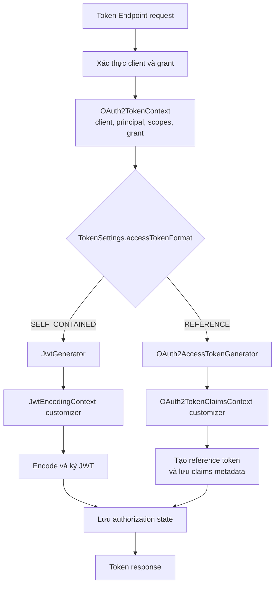
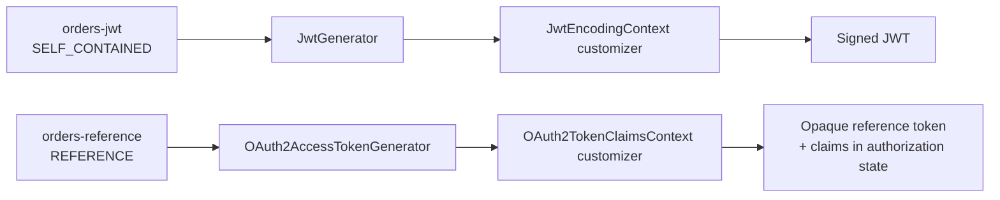

# OAuth2TokenCustomizer cho JWT và reference access token

Trong Spring Authorization Server, access token có thể được phát hành dưới dạng **JWT self-contained** hoặc **reference token (opaque)**. Cả hai đều có thể mang thông tin về subject, client và quyền truy cập, nhưng cách claims được tạo, lưu trữ và đọc lại khác nhau.

**`OAuth2TokenCustomizer`** là extension point cho phép ứng dụng bổ sung hoặc điều chỉnh claims trong quá trình phát hành token. Khi phát JWT, customizer nhận **`JwtEncodingContext`**; khi phát reference access token, customizer nhận **`OAuth2TokenClaimsContext`**. Hai context này phục vụ hai token generator khác nhau, vì vậy phải chọn đúng generic type và gắn customizer vào đúng generator.

Bài học thuộc chương **Token và claims** của module **SPRING_SECURITY_OAUTH2_OIDC_AUTHORIZATION_SERVER**, hướng tới thiết kế, cấu hình, bảo mật, kiểm thử và vận hành OAuth 2.0/OpenID Connect Authorization Server bằng Spring Security và Spring Authorization Server trong Spring Boot.

Sau bài học, bạn có thể:

- Phân biệt JWT access token và reference access token, hiểu claims được lưu và phân phối ra sao.
- Sử dụng `OAuth2TokenCustomizer` với `JwtEncodingContext` và `OAuth2TokenClaimsContext`.
- Chọn định dạng access token theo từng `RegisteredClient` bằng `TokenSettings.accessTokenFormat`.
- Bổ sung custom claims từ principal, client registration và dữ liệu nghiệp vụ đáng tin cậy.
- Giữ nguyên claims chuẩn như `iss`, `sub`, `aud`, `exp`, `iat` và `scope`.
- Cấu hình Resource Server xác minh JWT hoặc introspect opaque token, rồi sử dụng custom claims đúng cách.
- Kiểm thử token generator, introspection và các tình huống claim thiếu, sai nguồn hoặc vượt quyền.

## 1. OAuth2TokenCustomizer nằm ở đâu trong quá trình phát hành token?

Khi client gửi token request hợp lệ, Spring Authorization Server xác định grant, client, principal, scopes và authorization context. Token generator phù hợp tạo access token; customizer được gọi để bổ sung thông tin theo chính sách ứng dụng.



| Token format | Generator | Customizer context | Claims được sử dụng như thế nào? |
| --- | --- | --- | --- |
| JWT self-contained | `JwtGenerator` | `JwtEncodingContext` | Claims được đưa vào JWT và được bảo vệ bằng chữ ký JWS. |
| Reference/opaque | `OAuth2AccessTokenGenerator` | `OAuth2TokenClaimsContext` | Claims gắn với authorization/token metadata phía server, thường được trả cho Resource Server qua introspection. |

**Không thể dùng một customizer generic bất kỳ cho cả hai loại token.** Bean `OAuth2TokenCustomizer<JwtEncodingContext>` không tự tùy biến claims của reference token; `OAuth2TokenCustomizer<OAuth2TokenClaimsContext>` không sửa payload JWT do `JwtGenerator` ký.

## 2. JWT và reference access token khác nhau thế nào?

### 2.1. JWT self-contained

JWT thường gồm ba phần Base64URL:

```text
BASE64URL(header).BASE64URL(payload).BASE64URL(signature)
```

Payload có thể chứa `iss`, `sub`, `aud`, `exp`, `iat`, `scope` và custom claims. Resource Server có thể xác minh chữ ký bằng public key/JWKS và kiểm tra claims mà không cần gọi Authorization Server ở mỗi request, nếu chính sách cho phép xác minh offline.

JWT **không mặc định được mã hóa**. Người có token có thể đọc payload. Chữ ký bảo vệ tính toàn vẹn, không che nội dung; không đưa mật khẩu, secret, dữ liệu cá nhân nhạy cảm hoặc thông tin nội bộ không cần thiết vào claims.

### 2.2. Reference/opaque access token

Reference access token thường là một chuỗi khó đoán, không chứa claims có thể đọc trực tiếp:

```text
2YotnFZFEjr1zCsicMWpAA
```

Giá trị trên chỉ là minh họa. Resource Server không giải mã token thành JWT; nó gửi token tới **introspection endpoint** của Authorization Server. AS tra trạng thái authorization và trả metadata cho Resource Server đã được xác thực.

Claims tùy biến được lưu trong trạng thái authorization/token metadata theo cơ chế của Spring Authorization Server. Chúng có thể xuất hiện trong introspection response nếu token active và endpoint trả các claims đó.

### 2.3. So sánh theo góc nhìn vận hành

| Tiêu chí | JWT self-contained | Reference/opaque |
| --- | --- | --- |
| Đọc claims | Giải mã payload sau khi xác minh chữ ký. | Nhận claims qua introspection hoặc dịch vụ trạng thái tương đương. |
| Kiểm tra mỗi request | Có thể xác minh offline. | Thường gọi introspection hoặc cache kết quả. |
| Thu hồi trước `exp` | Không tự có hiệu lực tức thì với API chỉ xác minh JWT offline. | Có thể phản ánh trạng thái revoke nhanh hơn, tùy cache và availability. |
| Phụ thuộc AS | JWKS/khóa ký và chính sách cache. | Introspection endpoint và kho authorization state. |
| Bề mặt lộ claims | Claims nằm trong token client giữ. | Claims không nằm trong chuỗi opaque; được trả cho Resource Server được phép introspect. |
| Customizer | `OAuth2TokenCustomizer<JwtEncodingContext>` | `OAuth2TokenCustomizer<OAuth2TokenClaimsContext>` |

Token format là quyết định kiến trúc. Cần cân nhắc tải introspection, độ trễ, khả năng sẵn sàng, yêu cầu revoke và dữ liệu được phép tiết lộ.

## 3. Chọn access token format theo RegisteredClient

Trong Spring Authorization Server, định dạng access token được cấu hình qua `TokenSettings` của từng `RegisteredClient`:

- `OAuth2TokenFormat.SELF_CONTAINED`: access token dạng JWT.
- `OAuth2TokenFormat.REFERENCE`: access token dạng reference/opaque.

Ví dụ hai backend client có hai định dạng khác nhau:

```java
import java.time.Duration;

import org.springframework.security.oauth2.server.authorization.settings.OAuth2TokenFormat;
import org.springframework.security.oauth2.server.authorization.settings.TokenSettings;

TokenSettings jwtTokenSettings = TokenSettings.builder()
    .accessTokenFormat(OAuth2TokenFormat.SELF_CONTAINED)
    .accessTokenTimeToLive(Duration.ofMinutes(10))
    .build();

TokenSettings referenceTokenSettings = TokenSettings.builder()
    .accessTokenFormat(OAuth2TokenFormat.REFERENCE)
    .accessTokenTimeToLive(Duration.ofMinutes(5))
    .build();
```

Gắn policy vào client tương ứng:

```java
RegisteredClient jwtClient = RegisteredClient.withId("orders-jwt-id")
    .clientId("orders-jwt")
    .clientAuthenticationMethod(ClientAuthenticationMethod.CLIENT_SECRET_BASIC)
    .authorizationGrantType(AuthorizationGrantType.CLIENT_CREDENTIALS)
    .scope("orders.read")
    .tokenSettings(jwtTokenSettings)
    .build();

RegisteredClient referenceClient = RegisteredClient.withId("orders-reference-id")
    .clientId("orders-reference")
    .clientAuthenticationMethod(ClientAuthenticationMethod.CLIENT_SECRET_BASIC)
    .authorizationGrantType(AuthorizationGrantType.CLIENT_CREDENTIALS)
    .scope("orders.read")
    .tokenSettings(referenceTokenSettings)
    .build();
```

Đây là ví dụ registration, giả định secret được quản lý đúng và các bean Authorization Server khác đã tồn tại. Với repository bền vững, ID nội bộ cần ổn định.

**Lưu ý:** `accessTokenFormat` điều khiển định dạng access token của registered client. Nó không làm ID token OIDC trở thành opaque và không quyết định định dạng authorization code hay refresh token.

## 4. OAuth2TokenCustomizer cho JWT access token

### 4.1. JwtEncodingContext cung cấp gì?

`JwtEncodingContext` chứa ngữ cảnh phát hành JWT, gồm:

- `getRegisteredClient()`: client đang được xử lý.
- `getPrincipal()`: authentication principal gắn với grant.
- `getAuthorizationGrantType()`: loại grant, ví dụ authorization code hoặc client credentials.
- `getAuthorizedScopes()`: tập scopes đã được authorization.
- `getAuthorization()`: authorization state nếu có.
- `getTokenType()`: loại token đang tạo.
- `getClaims()`: builder để bổ sung/điều chỉnh JWT claims.
- `getJwsHeader()`: builder cho JWS header khi thật sự cần.

Một customizer nên kiểm tra `tokenType` trước khi thêm claims. Cùng `JwtGenerator` có thể được dùng cho JWT access token và ID token; nếu không lọc, claim dành cho API có thể vô tình xuất hiện trong ID token.

### 4.2. Ví dụ thêm tenant_id từ nguồn đáng tin cậy

Giả sử ứng dụng có service nội bộ `TenantDirectory` để xác định tenant từ authentication principal, registered client và grant type. Đây là interface nghiệp vụ của ứng dụng, **không phải class có sẵn của Spring Authorization Server**.

```java
package com.example.authserver.token;

import java.util.Optional;

import org.springframework.security.core.Authentication;
import org.springframework.security.oauth2.core.AuthorizationGrantType;
import org.springframework.security.oauth2.server.authorization.client.RegisteredClient;

public interface TenantDirectory {

    Optional<String> findTenantId(
        Authentication principal,
        RegisteredClient registeredClient,
        AuthorizationGrantType grantType
    );
}
```

Customizer cho JWT access token:

```java
package com.example.authserver.token;

import org.springframework.context.annotation.Bean;
import org.springframework.context.annotation.Configuration;
import org.springframework.security.oauth2.server.authorization.OAuth2TokenType;
import org.springframework.security.oauth2.server.authorization.token.JwtEncodingContext;
import org.springframework.security.oauth2.server.authorization.token.OAuth2TokenCustomizer;

@Configuration(proxyBeanMethods = false)
public class JwtAccessTokenCustomizerConfig {

    @Bean
    OAuth2TokenCustomizer<JwtEncodingContext> jwtAccessTokenCustomizer(
            TenantDirectory tenantDirectory) {

        return context -> {
            if (!OAuth2TokenType.ACCESS_TOKEN.equals(
                    context.getTokenType())) {
                return;
            }

            tenantDirectory.findTenantId(
                    context.getPrincipal(),
                    context.getRegisteredClient(),
                    context.getAuthorizationGrantType()
                )
                .ifPresent(tenantId ->
                    context.getClaims().claim("tenant_id", tenantId)
                );
        };
    }
}
```

Điểm quan trọng:

1. Chỉ thêm `tenant_id` cho `ACCESS_TOKEN`; không mặc định đưa claim này vào mọi JWT.
2. Tenant đến từ service phía server, không lấy trực tiếp từ query, form field hoặc header tùy ý của client.
3. Service cần phân biệt user principal và client principal. Với `client_credentials`, tenant phải được suy ra từ danh tính service/client đã xác thực hoặc registration; không giả định principal luôn là người dùng.
4. Nếu không xác định được tenant, không tạo giá trị mặc định rộng như `public`. Ứng dụng có thể từ chối phát token nếu tenant là điều kiện bắt buộc.
5. Không ghi đè `sub` bằng tenant ID. Subject và tenant là hai khái niệm khác nhau.

### 4.3. Chỉ bổ sung claims cần thiết

Có thể bổ sung claim phân loại mục đích hoặc phiên bản schema:

```java
context.getClaims()
    .claim("token_schema_version", 1)
    .claim("token_purpose", "orders-api");
```

Các giá trị này chỉ hữu ích nếu được gắn theo **policy server-side**. Nếu client có thể gửi `token_purpose=admin-api` và customizer sao chép trực tiếp, token có thể bị diễn giải sai.

Đối với scope, audience, subject và expiration, ưu tiên để generator và authorization policy chuẩn xử lý. Customizer chỉ nên thêm claim đặc thù khi có yêu cầu rõ ràng.

## 5. OAuth2TokenCustomizer cho reference access token

Reference token không mang JWT payload để Resource Server tự giải mã. `OAuth2AccessTokenGenerator` tạo token tham chiếu và lưu claims metadata cùng authorization state. Để bổ sung claims trong trường hợp này, dùng:

`OAuth2TokenCustomizer<OAuth2TokenClaimsContext>`

### 5.1. OAuth2TokenClaimsContext

Context này cung cấp ngữ cảnh cần thiết để tùy biến claims của reference access token, gồm registered client, principal, authorization grant type, authorized scopes, token type và claims builder.

Builder cho phép thêm claims vào tập claims được xây dựng cho access token. Không có payload JWT được ký để client đọc trực tiếp.

### 5.2. Ví dụ customizer cho opaque access token

Dùng cùng `TenantDirectory` đã mô tả:

```java
package com.example.authserver.token;

import org.springframework.context.annotation.Bean;
import org.springframework.context.annotation.Configuration;
import org.springframework.security.oauth2.server.authorization.OAuth2TokenType;
import org.springframework.security.oauth2.server.authorization.token.OAuth2TokenClaimsContext;
import org.springframework.security.oauth2.server.authorization.token.OAuth2TokenCustomizer;

@Configuration(proxyBeanMethods = false)
public class ReferenceAccessTokenCustomizerConfig {

    @Bean
    OAuth2TokenCustomizer<OAuth2TokenClaimsContext>
            referenceAccessTokenCustomizer(
                TenantDirectory tenantDirectory) {

        return context -> {
            if (!OAuth2TokenType.ACCESS_TOKEN.equals(
                    context.getTokenType())) {
                return;
            }

            tenantDirectory.findTenantId(
                    context.getPrincipal(),
                    context.getRegisteredClient(),
                    context.getAuthorizationGrantType()
                )
                .ifPresent(tenantId ->
                    context.getClaims().claims(claims ->
                        claims.put("tenant_id", tenantId)
                    )
                );
        };
    }
}
```

Trong customizer reference:

- `context.getClaims().claims(...)` cho phép thao tác với map claims được xây dựng cho access token.
- Claims được lưu cùng authorization/token metadata để AS có thể sử dụng khi introspect.
- Chuỗi opaque client nhận được không tự chứa `tenant_id`. Resource Server cần introspect token để nhận thông tin này.
- Nếu token hết hạn hoặc không active, Resource Server không được sử dụng claims đó để cấp quyền.

### 5.3. Vì sao customizer reference không sửa JWT?

`OAuth2TokenClaimsContext` được sử dụng bởi generator tạo reference access token. Nó không phải `JwtEncodingContext` và không có JWS header/payload builder. Nếu client đang được đăng ký `SELF_CONTAINED`, customizer reference không phải nơi bổ sung claim cho JWT.

Ngược lại, JWT customizer không thay thế việc lưu claims metadata cho reference token. Chọn đúng context theo **token format mà registered client đang dùng**.

## 6. Cấu hình cả hai customizer trong cùng Authorization Server

Một ứng dụng có thể phục vụ nhiều client với token format khác nhau:



Có thể khai báo hai bean customizer có generic type khác nhau trong cùng application context:

```java
@Bean
OAuth2TokenCustomizer<JwtEncodingContext> jwtCustomizer(
        TenantDirectory tenantDirectory) {
    // Claims cho JWT access token
}

@Bean
OAuth2TokenCustomizer<OAuth2TokenClaimsContext> referenceCustomizer(
        TenantDirectory tenantDirectory) {
    // Claims cho reference access token
}
```

Với cấu hình token generator chuẩn của phiên bản Spring Authorization Server đang sử dụng, đăng ký customizer bean theo đúng generic context được framework hỗ trợ. Nếu ứng dụng **tự tạo hoặc thay thế `OAuth2TokenGenerator`**, phải gắn customizer vào đúng generator; không giả định bean tự động được gọi.

Ví dụ wiring ở mức thành phần, chỉ dùng khi bạn chủ động quản lý generator:

```java
JwtGenerator jwtGenerator = new JwtGenerator(jwtEncoder);
jwtGenerator.setJwtCustomizer(jwtCustomizer);

OAuth2AccessTokenGenerator referenceGenerator =
    new OAuth2AccessTokenGenerator();
referenceGenerator.setAccessTokenCustomizer(referenceCustomizer);
```

Sau đó đưa các generator cần thiết vào `DelegatingOAuth2TokenGenerator` cùng những generator khác, ví dụ refresh token generator. Không thay thế generator mặc định bằng một cấu hình thiếu thành phần cần thiết.

**Tránh khai báo nhiều customizer cùng generic type với kỳ vọng Spring tự kết hợp thứ tự.** Nếu nhiều chính sách cùng ghi một claim, hợp nhất logic hoặc dùng service tổng hợp có thứ tự rõ ràng.

## 7. Không ghi đè claims chuẩn và không biến claim thành quyền tùy ý

JWT access token có thể chứa claims chuẩn:

| Claim | Ý nghĩa | Lưu ý |
| --- | --- | --- |
| `iss` | Issuer phát hành token. | Phải khớp issuer được Resource Server tin cậy. |
| `sub` | Subject của token. | Có thể là user hoặc client principal tùy grant. |
| `aud` | Audience/đối tượng nhận. | Resource Server phải kiểm tra audience của chính nó. |
| `exp` | Thời điểm hết hạn. | Validator từ chối token hết hạn theo clock-skew policy. |
| `iat` | Thời điểm phát hành. | Không tự suy ra session lifetime nếu không có policy. |
| `jti` | Định danh token nếu được phát hành. | Không tự tạo cơ chế revoke. |
| `scope` | Quyền OAuth được cấp. | Không thay thế authorization theo từng đối tượng. |

Claims mặc định cụ thể phụ thuộc token generator, grant và phiên bản. Customizer nên bổ sung claims nghiệp vụ, không thay thế claims chuẩn nếu không có yêu cầu giao thức rõ ràng.

Ví dụ nguy hiểm:

```java
// Không làm theo: ghi đè subject bằng dữ liệu request.
context.getClaims().claim("sub", request.getParameter("user"));

// Không làm theo: tạo mâu thuẫn với TTL do TokenSettings quản lý.
context.getClaims().claim(
    "exp",
    Instant.now().plus(Duration.ofDays(365)).getEpochSecond()
);
```

Muốn thay đổi TTL, cấu hình `TokenSettings`. Muốn thay đổi audience, thiết kế audience policy có kiểm soát. Muốn thay đổi subject, phải thay đổi luồng xác thực/ủy quyền phù hợp, không lấy từ input client.

### 7.1. Subject không luôn là người dùng

Trong `authorization_code`, principal thường đại diện người dùng đã xác thực. Trong `client_credentials`, principal đại diện client/service. Vì vậy không nên viết:

```java
String userId = context.getPrincipal().getName();
context.getClaims().claim("user_id", userId);
```

rồi áp dụng cho mọi grant và gọi giá trị đó là user ID. Với service principal, `getName()` có thể là client ID. Hãy phân loại theo `getAuthorizationGrantType()` và mô hình danh tính của ứng dụng.

### 7.2. Claim roles/authorities cần được chuẩn hóa

Nếu thêm roles vào JWT, hãy xác định:

- Roles lấy từ đâu và đã được xác minh tại thời điểm phát hành chưa?
- Role là global, tenant-specific hay resource-specific?
- Khi role bị thu hồi, token đang lưu hành còn hiệu lực đến bao giờ?
- Resource Server ánh xạ role string thành authority nào?
- Một role có được phép truy cập mọi bản ghi hay vẫn cần object-level policy?

Không sao chép toàn bộ `GrantedAuthority` thành claim chỉ vì tiện. Có thể có authority nội bộ không dành cho API hoặc tên role thay đổi giữa các service.

## 8. Claims và quyền riêng tư

| Loại dữ liệu | Khuyến nghị |
| --- | --- |
| Tenant ID không nhạy cảm | Có thể phù hợp nếu API cần xác định ranh giới tenant; lấy từ nguồn server-side. |
| Danh sách role ngắn, ổn định | Có thể dùng khi được chuẩn hóa và có chính sách thu hồi/TTL phù hợp. |
| Email, tên đầy đủ, số điện thoại | Chỉ thêm nếu API cần; tránh phát tán PII qua nhiều service. |
| Mật khẩu, client secret, private key | **Không bao giờ** đưa vào token claims. |
| Thông tin thanh toán/sức khỏe hoặc dữ liệu nghiệp vụ chi tiết | Không nhúng toàn bộ vào token; truy vấn nguồn dữ liệu được bảo vệ khi cần. |
| Dữ liệu request tự khai | Không tin; chỉ đưa vào token sau khi server xác minh và policy cho phép. |

JWT payload có thể được đọc bởi bất kỳ ai nắm token. Opaque token không hiển thị claims trực tiếp nhưng introspection endpoint có thể tiết lộ claims cho Resource Server được xác thực; vẫn phải giới hạn quyền introspection và response attributes.

**Không dùng custom claim để thay database lookup** khi dữ liệu thay đổi liên tục hoặc cần thu hồi ngay. Token là snapshot tại thời điểm phát hành.

## 9. Resource Server sử dụng claims như thế nào?

### 9.1. Với JWT access token

Resource Server có thể cấu hình issuer:

```yaml
spring:
  security:
    oauth2:
      resourceserver:
        jwt:
          issuer-uri: https://login.example.com
```

Sau khi chữ ký, issuer và thời hạn được xác minh, ứng dụng có thể đọc custom claim qua `Jwt`:

```java
import org.springframework.security.core.annotation.AuthenticationPrincipal;
import org.springframework.security.oauth2.jwt.Jwt;

@GetMapping("/orders/context")
Map<String, Object> context(@AuthenticationPrincipal Jwt jwt) {
    String tenantId = jwt.getClaimAsString("tenant_id");

    // Dùng tenantId trong service có kiểm tra quyền tài nguyên.
    return ordersContextService.describe(jwt.getSubject(), tenantId);
}
```

Đây là ví dụ minh họa; `ordersContextService` là service của ứng dụng. Trước khi dùng `tenant_id` để truy vấn, API phải xác minh token đến từ issuer tin cậy và kiểm tra quyền truy cập bản ghi.

**Issuer validation không tự bảo đảm audience validation.** Cần cấu hình validator phù hợp để yêu cầu `aud` chứa identifier của API đích. Nếu JWT có `tenant_id` nhưng Resource Server không kiểm tra issuer/audience, custom claim không tạo ra ranh giới bảo mật.

### 9.2. Với reference access token

Resource Server dùng introspection endpoint:

```yaml
spring:
  security:
    oauth2:
      resourceserver:
        opaquetoken:
          introspection-uri: https://login.example.com/oauth2/introspect
          client-id: shipping-api
          client-secret: ${SHIPPING_INTROSPECTION_SECRET}
```

Resource Server cần được đăng ký/cho phép introspect token theo policy của AS. Client secret là credential dùng xác thực với introspection endpoint; lưu trong secret manager/environment, không commit vào source code.

Sau introspection thành công, Spring Security tạo `OAuth2AuthenticatedPrincipal` với attributes từ response. Có thể đọc custom claim như sau:

```java
import org.springframework.security.core.annotation.AuthenticationPrincipal;
import org.springframework.security.oauth2.core.OAuth2AuthenticatedPrincipal;

@GetMapping("/orders/context")
Map<String, Object> context(
        @AuthenticationPrincipal OAuth2AuthenticatedPrincipal principal) {

    String tenantId = principal.getAttribute("tenant_id");
    return ordersContextService.describe(principal.getName(), tenantId);
}
```

Nếu custom claim được lưu và trả trong introspection response, Resource Server có thể đọc nó như attribute. Nếu không thấy claim, kiểm tra customizer reference đã được gọi, token được phát theo `REFERENCE` và introspection response có đưa claims metadata vào hay không.

### 9.3. Không dùng opaque token như JWT

```java
// Sai: reference token không phải JWT payload để decode.
String[] parts = opaqueToken.split("\\\\.");
```

Opaque token chỉ là reference tới trạng thái được AS quản lý. Resource Server phải introspect hoặc dùng cơ chế xác minh trạng thái tương đương. Tương tự, không gọi introspection cho JWT trong mọi request nếu hệ thống đã chọn mô hình offline validation, trừ khi policy yêu cầu kiểm tra trạng thái trực tiếp.

## 10. Audience, scope và custom claim phải thống nhất

Một custom claim như `tenant_id` không tự tạo audience. Một access token cho `orders-api` cần có `aud` phù hợp với API đó; token cho `shipping-api` cần được phát hành/ủy quyền cho Shipping.

- `scope` mô tả quyền OAuth được cấp.
- `aud` xác định đối tượng nhận token.
- `sub` xác định subject.
- `tenant_id` có thể chỉ tenant context đã được xác minh.
- `roles` có thể bổ sung thông tin vai trò theo policy.

Không phát JWT có `aud` quá rộng rồi dựa vào `tenant_id` để mọi API tự suy quyền. Mỗi API phải kiểm tra audience riêng; custom claim chỉ bổ sung ngữ cảnh, không xóa ranh giới tin cậy.

## 11. Kiểm thử OAuth2TokenCustomizer

Cần kiểm tra cả **customizer có được gọi đúng** và **Resource Server có tiêu thụ claims đúng**.

### 11.1. Ma trận kiểm thử

| Tình huống | Kết quả mong đợi |
| --- | --- |
| Client dùng `SELF_CONTAINED` | Access token là JWT và custom claims được ký trong payload. |
| Client dùng `REFERENCE` | Access token là opaque, không thể decode payload như JWT. |
| JWT access token | `JwtEncodingContext` customizer được gọi cho token type ACCESS_TOKEN. |
| JWT ID token | Không vô tình thêm API-only claims nếu đã lọc ACCESS_TOKEN. |
| Reference access token | `OAuth2TokenClaimsContext` customizer được gọi cho reference generator. |
| Tenant directory trả tenant hợp lệ | Claim `tenant_id` được thêm đúng. |
| Tenant directory không tìm thấy tenant | Không phát giá trị mặc định sai; nếu tenant bắt buộc thì policy từ chối token. |
| Client credentials | Principal được phân loại là client/service, không gán nhầm thành user ID. |
| Authorization code | Claims user/tenant lấy từ principal và dữ liệu server-side phù hợp. |
| Request tự gửi `tenant_id` khác | Customizer không tin giá trị tự khai của client. |
| Đổi token format JWT sang REFERENCE | Customizer tương ứng với generator mới được sử dụng. |
| Introspection opaque token | Claims metadata trả cho Resource Server được phép introspect. |
| Resource Server JWT | Chữ ký, issuer, audience, exp và scope được kiểm tra trước khi dùng custom claims. |
| Claim thiếu hoặc sai kiểu | API từ chối hoặc xử lý theo contract; không cast tùy tiện. |
| Nhiều customizer cùng generic type | Thứ tự/ghi đè được kiểm soát rõ. |
| Token đã phát hành trước khi policy đổi | Token cũ giữ claims snapshot; token mới áp dụng policy mới. |
| Token hết hạn/revoked | Resource Server không tiếp tục tin claims của token không còn active. |

### 11.2. Integration test JWT

Một test tích hợp nên:

1. Đăng ký client có `accessTokenFormat(SELF_CONTAINED)`.
2. Gửi token request hợp lệ.
3. Dùng `JwtDecoder` để **xác minh chữ ký** rồi mới đọc claims.
4. Assert `tenant_id` đến từ TenantDirectory test fixture.
5. Assert `iss`, `sub`, `aud`, `exp` và `scope` còn đúng.
6. Gửi token tới Resource Server và kiểm tra audience/scope/tenant policy.
7. Đảm bảo claim API-only không bị thêm vào ID token nếu ứng dụng phát OIDC ID token.

Không chỉ Base64 decode payload rồi kết luận token hợp lệ.

### 11.3. Integration test reference token

Một test reference token nên:

1. Đăng ký client có `accessTokenFormat(REFERENCE)`.
2. Gửi token request và nhận chuỗi opaque.
3. Gọi introspection endpoint bằng Resource Server client đã được phép.
4. Assert `active=true`, `scope` và custom claim `tenant_id` đúng.
5. Revoke token hoặc để token hết hạn rồi introspect lại; kiểm tra `active` không còn true theo trạng thái AS.
6. Xác nhận client không có quyền introspection không thể đọc claims.
7. Xác nhận opaque token không được xử lý bằng JWT decoder.

### 11.4. Test không tin input

Gửi request chứa `tenant_id=tenant-admin` hoặc header `X-Tenant-ID: tenant-admin` trong khi TenantDirectory trả `tenant-user`. Token được phát chỉ được chứa giá trị lấy từ nguồn server-side. Nếu request có tenant không hợp lệ, policy phải từ chối thay vì ghi đè claims.

## 12. Lỗi thường gặp và cách xử lý

### 12.1. JWT customizer không được gọi

Kiểm tra client dùng `SELF_CONTAINED`, `JwtGenerator` nằm trong token generator chain, bean customizer có đúng generic type và token request đang tạo đúng token type. Nếu tự thay `OAuth2TokenGenerator`, cần gắn customizer bằng setter tương ứng.

### 12.2. Reference token không có custom claim trong introspection

Kiểm tra `accessTokenFormat(REFERENCE)`, `OAuth2AccessTokenGenerator`, `OAuth2TokenCustomizer<OAuth2TokenClaimsContext>` và việc `setAccessTokenCustomizer` được cấu hình khi tự quản lý generator. Kiểm tra authorization state được lưu và introspection response có trả claims metadata hay không.

### 12.3. Claim xuất hiện trong ID token ngoài ý muốn

Customizer JWT có thể được gọi cho hơn một loại JWT. Kiểm tra `OAuth2TokenType.ACCESS_TOKEN` trước khi thêm claim dành riêng cho API. Nếu claim dành riêng OIDC ID token, dùng policy và token type tương ứng.

### 12.4. Resource Server không thấy tenant_id

Với JWT, xác minh token được phát sau khi customizer triển khai và Resource Server đọc đúng claim name/type. Với reference, xem introspection response và quyền introspection client. Đảm bảo claim không bị bỏ qua bởi mapping/claim conversion của ứng dụng.

### 12.5. Claims bị ghi đè hoặc mất

Tìm nhiều customizer cùng ghi một tên claim, custom token generator thay thế generator mặc định hoặc code ghi đè claims chuẩn. Hợp nhất logic theo thứ tự rõ ràng, không xóa toàn bộ claims map rồi chỉ thêm vài trường.

### 12.6. JWT có tenant_id nhưng truy cập sai tenant

Claim có thể đã được thêm đúng nhưng nguồn TenantDirectory hoặc policy Resource Server sai. Kiểm tra mapping principal→tenant, issuer, audience, tenant isolation và object-level authorization. Không coi việc claim tồn tại là bằng chứng user được phép đọc mọi bản ghi trong tenant.

### 12.7. Token format đổi nhưng client/API vẫn dùng cách cũ

JWT Resource Server không thể đọc opaque token; opaque Resource Server không tự introspect JWT theo contract reference. Đồng bộ thay đổi format với client, API, cache, secret introspection và rollout.

## 13. Vận hành và thay đổi claim schema

### 13.1. Claims là snapshot tại thời điểm phát hành

Khi customizer thêm `tenant_id` hoặc `roles`, token phản ánh dữ liệu server đọc **ở thời điểm phát hành**. Nếu user chuyển tenant, role bị thu hồi hoặc client đổi policy, token cũ có thể tiếp tục chứa claim cũ tới khi hết hạn hoặc bị kiểm tra trạng thái.

Nếu cần cập nhật nhanh:

- Dùng access token TTL ngắn hơn theo rủi ro.
- Với reference token, introspection/cache policy có thể giúp phản ánh trạng thái nhanh hơn.
- Với JWT, cân nhắc revoke/denylist hoặc truy vấn quyền động khi SLA yêu cầu.
- Không đưa toàn bộ quyền thay đổi liên tục vào token rồi kỳ vọng token tự cập nhật.

### 13.2. Versioning custom claims

Nếu Resource Server phụ thuộc schema claim, có thể phát version rõ ràng:

```json
{
  "tenant_id": "tenant-a",
  "token_schema_version": 2
}
```

Khi đổi schema:

1. Thêm phiên bản mới mà API có thể hiểu.
2. Triển khai Resource Server hỗ trợ schema cũ và mới trong giai đoạn chuyển tiếp.
3. Chuyển customizer phát schema mới.
4. Theo dõi token cũ hết hạn/revoke.
5. Gỡ hỗ trợ schema cũ sau thời gian tương thích.

Không đổi ý nghĩa claim đang được nhiều API sử dụng mà không có versioning và kiểm thử contract.

### 13.3. Quan sát nhưng không log token

Theo dõi số lượng token phát theo format, lỗi customizer, introspection latency, claims schema version và lỗi thiếu tenant. Log có thể chứa client ID, grant type, correlation ID và policy result đã được kiểm soát; không ghi raw JWT, opaque token, refresh token, client secret hoặc toàn bộ claims có PII.

Nếu customizer không truy vấn được TenantDirectory, cần quyết định rõ **fail closed** khi tenant là điều kiện bảo mật bắt buộc. Không nuốt exception rồi phát token thiếu tenant nếu Resource Server dựa vào claim đó để cách ly tenant.

## 14. Bài thực hành: cùng một claim trên hai token format

Một Authorization Server cấp token cho hai client:

| Client | Token format | API |
| --- | --- | --- |
| `orders-jwt` | `SELF_CONTAINED` | `orders-api` |
| `orders-reference` | `REFERENCE` | `orders-api` |

Cả hai cần claim `tenant_id` lấy từ TenantDirectory. Hãy thiết kế và trả lời:

1. Hai `TokenSettings` khác nhau như thế nào?
2. Vì sao JWT client cần `OAuth2TokenCustomizer<JwtEncodingContext>`?
3. Vì sao reference client cần `OAuth2TokenCustomizer<OAuth2TokenClaimsContext>`?
4. Nếu chỉ khai báo JWT customizer, reference token có nhận claim không?
5. Resource Server đọc `tenant_id` từ JWT và opaque token bằng cách nào?
6. Nếu TenantDirectory không tìm thấy tenant, có nên thêm `tenant_id=default` không?
7. Với `client_credentials`, `sub` đại diện ai? Có thể coi nó là user ID không?
8. Nếu claim `roles` bị thu hồi sau khi token được phát, API có biết ngay không?
9. Làm sao xác minh audience và scope trước khi dùng tenant claim để truy vấn?
10. Khi đổi schema `tenant_id`, cách rollout các API cũ và mới thế nào?

**Gợi ý:** hai token format dùng hai generator/context riêng, nhưng cùng một nguồn dữ liệu nghiệp vụ đáng tin. Resource Server cần cách xác minh tương ứng; custom claim chỉ bổ sung ngữ cảnh, không thay thế issuer/audience/scope hoặc authorization theo từng bản ghi.

## 15. Checklist triển khai OAuth2TokenCustomizer

- [ ] Mỗi client chọn access token format rõ ràng bằng `TokenSettings.accessTokenFormat`.
- [ ] JWT access token dùng `OAuth2TokenCustomizer<JwtEncodingContext>`.
- [ ] Reference access token dùng `OAuth2TokenCustomizer<OAuth2TokenClaimsContext>`.
- [ ] Customizer kiểm tra `OAuth2TokenType.ACCESS_TOKEN` khi claims chỉ dành cho API.
- [ ] Nếu thay token generator mặc định, customizer được gắn đúng `JwtGenerator` hoặc `OAuth2AccessTokenGenerator`.
- [ ] Claims lấy từ principal, registration và dữ liệu server-side đã xác minh; không copy trực tiếp từ request/header.
- [ ] Không ghi đè `iss`, `sub`, `aud`, `exp`, `iat` và `scope` khi không có thiết kế giao thức rõ.
- [ ] Đã phân biệt user principal với client/service principal theo grant type.
- [ ] Custom claims được giới hạn, không chứa secret hoặc PII không cần thiết.
- [ ] JWT Resource Server xác minh chữ ký, issuer, audience, expiration và scopes.
- [ ] Opaque Resource Server dùng introspection được xác thực và chỉ nhận metadata cần thiết.
- [ ] API không xem custom claim là quyền tuyệt đối; vẫn kiểm tra tenant và object-level authorization.
- [ ] Có test cho cả hai token format, customizer đúng context, introspection và token revoked/expired.
- [ ] Có chính sách khi claim source không khả dụng; fail closed nếu claim là điều kiện bảo mật.
- [ ] Claims schema có version/rollout plan nếu nhiều Resource Server cùng phụ thuộc.
- [ ] Logs/metrics không làm lộ raw token hoặc dữ liệu nhạy cảm trong claims.

**Ghi nhớ:** JWT và reference access token dùng **hai context customizer khác nhau**. `JwtEncodingContext` bổ sung claims vào JWT được ký; `OAuth2TokenClaimsContext` bổ sung claims vào metadata của reference token để Authorization Server quản lý và có thể trả qua introspection. Chọn đúng token format, đúng customizer và đúng nguồn dữ liệu là điều kiện để claims nhất quán; Resource Server vẫn phải xác minh token và thực thi authorization theo audience, scope, tenant và tài nguyên.

**Tài liệu tham khảo:**

- [Spring Authorization Server — How-to: Customize the JWT](https://docs.spring.io/spring-authorization-server/reference/guides/how-to-custom-claims-authorities.html): custom claims và `OAuth2TokenCustomizer<JwtEncodingContext>`.
- [Spring Authorization Server — Core Model and Components](https://docs.spring.io/spring-authorization-server/reference/core-model-components.html): `RegisteredClient`, `TokenSettings`, token generator và authorization state.
- [Spring Authorization Server — Protocol Endpoints](https://docs.spring.io/spring-authorization-server/reference/protocol-endpoints.html): Token Endpoint và token generation extension points.
- [Spring Security — OAuth2 Resource Server JWT](https://docs.spring.io/spring-security/reference/servlet/oauth2/resource-server/jwt.html): xác minh JWT, issuer và claims.
- [Spring Security — OAuth2 Resource Server Opaque Token](https://docs.spring.io/spring-security/reference/servlet/oauth2/resource-server/opaque-token.html): introspection và `OAuth2AuthenticatedPrincipal`.
- [RFC 6749 — OAuth 2.0 Authorization Framework](https://www.rfc-editor.org/rfc/rfc6749.html): access token, scope và token response.
- [RFC 7662 — OAuth 2.0 Token Introspection](https://www.rfc-editor.org/rfc/rfc7662.html): trạng thái token và metadata trả cho Resource Server.
- [RFC 7519 — JSON Web Token](https://www.rfc-editor.org/rfc/rfc7519.html): registered claims và cấu trúc JWT.

