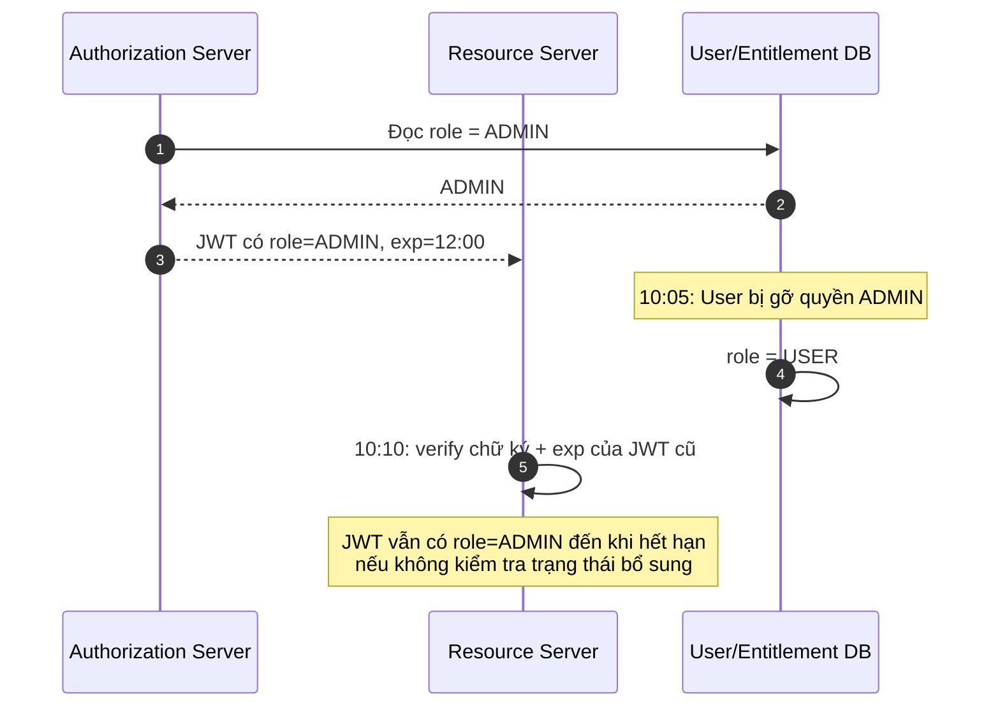

# Kiểm soát kích thước token, thông tin cá nhân và dữ liệu có thể thay đổi

## 1. Vì sao nội dung token cần được thiết kế cẩn thận?

Trong chương **Token và claims** của module **SPRING_SECURITY_OAUTH2_OIDC_AUTHORIZATION_SERVER**, chúng ta học cách thiết kế, cấu hình, bảo mật, kiểm thử và vận hành OAuth 2.0/OpenID Connect Authorization Server bằng Spring Security và Spring Authorization Server trong ứng dụng Spring Boot.

Khi Authorization Server phát hành JWT Access Token, việc thêm claim khá dễ: tên người dùng, email, số điện thoại, danh sách role, phòng ban, nhóm, tenant, địa chỉ và nhiều thuộc tính khác đều có thể được đưa vào payload. Nhưng token càng chứa nhiều dữ liệu thì:

- HTTP request giữa các dịch vụ càng lớn, dễ vượt giới hạn header hoặc proxy.
- Thông tin cá nhân được sao chép tới nhiều hệ thống và nhiều nơi lưu trữ hơn.
- Dữ liệu thay đổi có thể trở nên cũ trong khi token vẫn còn hiệu lực.
- Một thay đổi về cấu trúc claim có thể ảnh hưởng nhiều Resource Server và client.
- Khi token bị lộ, lượng dữ liệu mà người có token đọc được cũng tăng lên.

Vì vậy, thiết kế token không phải cuộc thi đưa được nhiều thông tin nhất vào JWT. Mục tiêu là **chỉ đưa những claims cần thiết cho mục đích sử dụng, với vòng đời và ranh giới tin cậy phù hợp**.

Ví dụ: một Access Token dùng để gọi `inventory-api` có thể chỉ cần `iss`, `sub`, `aud`, `exp` và `scope=inventory.read`. API có thể lấy thông tin hồ sơ người dùng từ một nguồn phù hợp khi thực sự cần. Không cần đính kèm toàn bộ tên, email, số điện thoại, địa chỉ nhà và lịch sử tài khoản vào mọi request.

### Mục tiêu học tập

Sau bài này, người học có thể:

1. Giải thích cấu trúc và các yếu tố ảnh hưởng kích thước JWT.
2. Phân biệt dữ liệu nên nằm trong Access Token, ID Token, UserInfo hoặc API hồ sơ.
3. Áp dụng nguyên tắc tối thiểu hóa thông tin cá nhân và tránh đưa bí mật vào claims.
4. Phân loại claims ổn định và dữ liệu có thể thay đổi; hiểu độ trễ cập nhật của self-contained token.
5. Chọn giữa JWT self-contained và opaque/reference token theo yêu cầu hiệu năng, trạng thái và thu hồi.
6. Dùng `OAuth2TokenCustomizer<JwtEncodingContext>` đúng phạm vi để thêm claims được phép.
7. Kiểm thử kích thước token, nội dung nhạy cảm, audience, scope, TTL và độ cũ của dữ liệu.

## 2. Cấu trúc JWT và những yếu tố làm token lớn

### 2.1. JWT ký số không đồng nghĩa JWT được mã hóa

Một JWT dạng JWS compact thường có ba phần:

```text
BASE64URL(protected-header)
.
BASE64URL(payload)
.
BASE64URL(signature)
```

Ví dụ:

```text
eyJhbGciOiJSUzI1NiIsImtpZCI6ImtleS0xIn0
.
eyJpc3MiOiJodHRwczovL2F1dGguZXhhbXBsZS5jb20iLCJzdWIiOiJ1c2VyLTEyMyJ9
.
<signature>
```

Base64URL chỉ là cách biểu diễn dữ liệu để truyền trong URL/header. Người sở hữu JWT thường có thể decode header và payload mà **không cần public key**. Chữ ký giúp phát hiện dữ liệu bị sửa và xác minh nguồn phát hành; nó **không che giấu** nội dung.

Nếu token là JWE thì dữ liệu được mã hóa theo một định dạng khác, nhưng mã hóa làm tăng độ phức tạp và thường tăng kích thước. JWE cũng không phải lý do để đưa password, private key hay dữ liệu không cần thiết vào token.

### 2.2. Kích thước đến từ đâu?

Kích thước JWT compact phụ thuộc vào:

- Header: `alg`, `kid`, `typ` và các tham số JOSE khác.
- Payload: tên claim, giá trị chuỗi, mảng, object lồng nhau, số lượng role/scope và dữ liệu Unicode.
- Signature: phụ thuộc thuật toán và kích thước khóa/chữ ký.
- Base64URL: làm dữ liệu nhị phân dài hơn so với JSON/binary gốc.

Với mỗi claim mới, không chỉ giá trị tăng kích thước; **tên claim, dấu ngoặc, dấu phẩy, dấu nháy và cấu trúc JSON** cũng chiếm byte.

Ví dụ payload gọn:

```json
{
  "iss": "https://auth.example.com",
  "sub": "u-8f21",
  "aud": ["inventory-api"],
  "scope": "inventory.read",
  "iat": 1790000000,
  "exp": 1790000600
}
```

Payload phình to:

```json
{
  "iss": "https://auth.example.com",
  "sub": "u-8f21",
  "aud": ["inventory-api"],
  "scope": "inventory.read",
  "name": "Nguyen Van A",
  "email": "user@example.com",
  "phone_number": "+84000000000",
  "home_address": "A long residential address ...",
  "roles": ["ROLE_USER", "ROLE_SUPPORT", "ROLE_REPORT_VIEWER"],
  "all_permissions": ["p1", "p2", "p3", "many-more-permissions"],
  "departments": ["dept-a", "dept-b", "dept-c"],
  "feature_flags": {
    "new_dashboard": true,
    "legacy_reports": false
  }
}
```

Ví dụ thứ hai vừa lớn hơn vừa làm lộ nhiều dữ liệu. Chỉ đưa một trường vào token khi Resource Server thực sự cần nó để xác thực hoặc phân quyền trong thời gian token còn hiệu lực.

### 2.3. Kích thước token ảnh hưởng đường truyền

JWT Access Token thường được gửi trong HTTP header:

```http
GET /api/inventory/items HTTP/1.1
Host: api.example.com
Authorization: Bearer <compact-access-token>
```

Token lớn làm tăng kích thước request ở **mọi lần gọi API**. Nếu một request đi qua API gateway, reverse proxy, service mesh và nhiều backend, header lớn có thể được sao chép qua nhiều chặng.

Không có một giới hạn byte phổ quát áp dụng cho mọi browser, HTTP server, reverse proxy, load balancer và service mesh. Một số hệ thống giới hạn tổng header, một số giới hạn từng header; request có thể bị từ chối với lỗi như `400`, `413` hoặc `431` tùy tầng và cấu hình. Cần đo trong hạ tầng thực tế thay vì dựa vào một con số mặc định.

## 3. Chọn đúng nơi chứa thông tin

### 3.1. Access Token, ID Token và UserInfo có mục đích khác nhau

| Nơi chứa | Bên tiêu thụ chính | Nội dung phù hợp |
| --- | --- | --- |
| **Access Token** | Resource Server/API | Claims cần để xác minh token và ra quyết định truy cập: issuer, subject, audience, thời hạn, scope/authority tối thiểu và thuộc tính phân vùng cần thiết. |
| **ID Token** | OIDC Client/Relying Party | Kết quả xác thực người dùng và claims OIDC mà client được phép nhận theo scope/chính sách. |
| **UserInfo Endpoint** | OIDC Client có Access Token phù hợp | Thông tin hồ sơ người dùng mà client cần lấy theo quyền và chính sách hiện hành. |
| **Profile/Directory API** | Backend có quyền gọi nguồn dữ liệu | Dữ liệu hồ sơ đầy đủ, dữ liệu thường xuyên thay đổi hoặc dữ liệu nghiệp vụ. |
| **Authorization/Entitlement Service** | Backend/Resource Server | Quyền động, quan hệ sở hữu, membership và policy cần trạng thái mới nhất. |

Access Token không phải bản sao hồ sơ người dùng. Nếu API chỉ cần biết chủ thể nào đang gọi, `sub` thường đã đủ; nếu cần biết scope, dùng scope/authority phù hợp. Nếu giao diện cần tên hiển thị, email hoặc ảnh đại diện, OIDC client có thể lấy các claims phù hợp từ ID Token/UserInfo theo scope và consent.

### 3.2. Không dùng ID Token thay Access Token

ID Token được phát hành cho OIDC client và có `aud` là client ID. Access Token được phát hành cho Resource Server và có audience phù hợp với API. Hai token có thể cùng là JWT nhưng **khác người nhận, mục đích và validation policy**.

Không gửi ID Token làm Bearer credential tới API chỉ vì nó chứa `sub`, `email` hoặc được ký bởi cùng Authorization Server. Resource Server phải kiểm tra đúng loại token, issuer, audience và quyền.

### 3.3. Scope không phải danh sách hồ sơ

`scope=profile email` thể hiện client yêu cầu quyền OIDC tương ứng; nó không có nghĩa mọi thông tin profile phải được nhồi vào Access Token. Các claims hồ sơ có thể được cung cấp trong ID Token/UserInfo theo quy tắc OIDC, consent và cấu hình. Cần kiểm tra chính xác nơi Spring Authorization Server đang đưa claims ra.

## 4. Tối thiểu hóa thông tin cá nhân

### 4.1. Vì sao PII trong JWT dễ bị sao chép?

Access Token thường đi qua nhiều thành phần: client, gateway, log middleware, tracing, API và cache. Dù ứng dụng không chủ động lưu payload, token có thể xuất hiện trong:

- HTTP authorization headers hoặc request dumps;
- log lỗi, trace, APM và công cụ hỗ trợ;
- bộ nhớ cache, crash report hoặc snapshot;
- thiết bị đầu cuối, trình duyệt hoặc storage của client;
- bản sao token trong các dịch vụ nhận token.

Khi JWT có email, số điện thoại, địa chỉ hoặc thông tin khác, mọi nơi có token có thể đọc được payload nếu token là JWS ký số thông thường. **Không cần khóa giải mã để decode payload JWS.**

### 4.2. Những trường nên cân nhắc loại khỏi Access Token

| Dữ liệu | Vì sao thường không nên đưa vào Access Token? | Cách thay thế |
| --- | --- | --- |
| Họ tên, tên hiển thị | Không cần cho phần lớn quyết định API; thay đổi theo hồ sơ. | UserInfo hoặc profile API. |
| Email, số điện thoại | Là thông tin cá nhân và có thể thay đổi/xác minh lại. | UserInfo hoặc profile service theo quyền. |
| Địa chỉ nhà, ngày sinh | Nhạy cảm hơn và hiếm khi cần ở mọi API. | API nghiệp vụ riêng, kiểm soát truy cập chặt. |
| Ảnh đại diện, ngôn ngữ, theme | Chủ yếu phục vụ giao diện. | Profile/preferences API hoặc cache client. |
| Lịch sử giao dịch, thông tin thanh toán | Dữ liệu nghiệp vụ lớn, thay đổi liên tục. | API dữ liệu chuyên biệt. |
| Danh sách tất cả role/permission | Có thể rất dài và thay đổi; làm token lớn. | Scope gọn, entitlement service hoặc reference token. |
| Password, password hash, OTP | Bí mật xác thực; tuyệt đối không phải token claims. | Không bao giờ phát hành dưới dạng claim. |
| Client secret, private key, refresh token khác | Credential có khả năng trao quyền. | Secret manager/key management, không đưa vào payload. |
| Dữ liệu nội bộ không cần cho API | Tạo thêm rò rỉ và phụ thuộc giữa dịch vụ. | Chỉ truy vấn ở hệ thống có thẩm quyền. |

Danh sách trên là nguyên tắc thiết kế; nếu một API có nhu cầu nghiệp vụ chính đáng với một thuộc tính cụ thể, phải ghi rõ mục đích, người tiêu thụ, thời hạn, mức độ nhạy cảm và kiểm soát truy cập.

### 4.3. Pseudonymous subject

`sub` nên là định danh ổn định trong phạm vi issuer/subject model và phù hợp với chính sách riêng tư. Không nhất thiết phải dùng email làm subject vì email có thể thay đổi, có thể được tái sử dụng và tiết lộ danh tính.

Một định danh opaque như `u-8f21` hoặc pairwise subject phù hợp hơn trong nhiều kiến trúc. Tuy nhiên, ID opaque không tự động làm dữ liệu ẩn danh: nếu hệ thống có bảng ánh xạ hoặc có thể liên kết với người thật, nó vẫn là dữ liệu có thể nhận diện trong ngữ cảnh đó.

### 4.4. JWT ký số không che giấu dữ liệu

Ví dụ payload:

```json
{
  "sub": "user-123",
  "email": "person@example.com",
  "scope": "orders.read"
}
```

Người có token có thể decode JSON này mà không cần secret hoặc private key. Chữ ký chỉ giúp kiểm tra tính toàn vẹn và nguồn phát hành. Nếu cần bảo mật nội dung giữa issuer và consumer theo một use case đặc biệt, có thể đánh giá JWE hoặc kênh truyền/lookup phù hợp; nhưng **ưu tiên không đưa dữ liệu không cần thiết vào token**. Mã hóa không loại bỏ yêu cầu tối thiểu hóa dữ liệu và quản lý khóa.

## 5. Phân loại claims ổn định và dữ liệu có thể thay đổi

### 5.1. Stable claims

Một số claims thường ổn định trong suốt vòng đời token:

- `iss`: issuer đã phát hành token.
- `sub`: chủ thể được biểu diễn theo mô hình định danh của issuer.
- `aud`: Resource Server/người nhận dự kiến.
- `iat`, `exp`, `nbf`: mốc thời gian của token.
- `jti`: định danh token nếu profile sử dụng.
- `client_id` hoặc claim tương đương: client được xác định theo profile token.

Các giá trị này vẫn cần được kiểm tra theo ngữ cảnh. Ví dụ `aud` có thể khác nhau giữa các API; `sub` có thể là user hoặc service principal tùy grant.

### 5.2. Mutable claims

Các dữ liệu sau có thể thay đổi trong khi JWT vẫn còn hiệu lực:

| Claim/dữ liệu | Có thể thay đổi khi nào? | Rủi ro nếu nhúng vào JWT dài hạn |
| --- | --- | --- |
| `roles` / `authorities` | User bị gỡ role, thay nhóm hoặc đổi chức năng. | API tiếp tục thấy quyền cũ đến khi token hết hạn hoặc bị kiểm tra trạng thái. |
| `tenant_id` / membership | User chuyển tổ chức, bị gỡ khỏi tenant. | Token cũ có thể truy cập sai ranh giới tenant nếu API chỉ tin claim cũ. |
| `account_status` | Tài khoản bị khóa hoặc đóng. | Token cũ vẫn có thể được chấp nhận nếu không kiểm tra trạng thái. |
| `subscription_tier` | Gói dịch vụ thay đổi/hết hạn. | Quyền tính năng bị stale. |
| `department` / `manager_id` | Thay đổi cơ cấu tổ chức. | Quyết định nghiệp vụ dựa trên dữ liệu cũ. |
| `feature_flags` | Tính năng bật/tắt theo thời gian. | Token mang snapshot cũ và tạo hành vi khó dự đoán. |
| `permissions` chi tiết | Quyền trên từng resource thay đổi thường xuyên. | Token rất lớn và quyền thu hồi chậm. |

### 5.3. JWT là snapshot tại thời điểm phát hành

Với self-contained JWT, Resource Server thường xác minh chữ ký và claims cục bộ mà không cần hỏi Authorization Server ở mỗi request. Điều đó có hiệu năng và khả năng hoạt động độc lập tốt, nhưng các claims động là **snapshot** tại thời điểm phát hành.



Đây không phải lỗi chữ ký. Token vẫn nguyên vẹn, nhưng dữ liệu trong token không còn phản ánh trạng thái hiện tại. **TTL ngắn giảm cửa sổ stale, không tự đảm bảo cập nhật tức thời.**

## 6. Chọn dữ liệu nào được nhúng vào token?

### 6.1. Một bảng quyết định thực tế

| Câu hỏi | Nếu “Có” | Nếu “Không” |
| --- | --- | --- |
| Resource Server cần claim để xác minh hoặc ra quyết định ở hầu hết request? | Cân nhắc đưa vào token với giá trị tối thiểu. | Để ở UserInfo/profile/API phù hợp. |
| Giá trị có thay đổi nhanh hoặc cần thu hồi tức thì? | Ưu tiên lookup/introspection hoặc cơ chế trạng thái. | Có thể cân nhắc snapshot với TTL phù hợp. |
| Claim chứa PII hoặc dữ liệu nhạy cảm? | Chứng minh mục đích, giảm độ chi tiết và consumer; thường tránh trong Access Token. | Vẫn kiểm tra nhu cầu và kích thước. |
| Claim có thể được suy ra từ scope hoặc `sub`? | Không lặp lại nếu không cần. | Đánh giá đưa vào nếu có ích cho API. |
| Claim là danh sách rất lớn? | Dùng entitlement service/reference token hoặc nhóm quyền gọn. | Kiểm tra kích thước tổng thể. |
| Mọi Resource Server đều cần cùng claim? | Có thể là ứng viên claim chung. | Đưa vào token chuyên biệt theo audience hoặc truy vấn tại dịch vụ cần. |

### 6.2. Access Token nên chứa quyền ở mức phù hợp

Ví dụ một API chỉ cần xác định:

```text
sub = user-123
aud = inventory-api
scope = inventory.read
exp = ...
```

Không cần đưa 300 permission chi tiết theo từng kho, từng sản phẩm và từng hành động nếu API có thể truy vấn entitlement theo `sub`/tenant hoặc sử dụng một quyền gọn phù hợp.

Ngược lại, nếu API cần kiểm tra offline một quyền tương đối ổn định và giới hạn thời gian chấp nhận được, một claim nhỏ có thể hợp lý. Quyết định cần dựa trên **mục đích, độ mới dữ liệu, số request và chi phí lookup**, không theo quy tắc “JWT phải chứa tất cả”.

### 6.3. Phân biệt dữ liệu định danh và dữ liệu phân quyền

`sub` trả lời “token đại diện cho ai/cái gì?”; `scope` hoặc authority trả lời “token được phép làm loại thao tác nào?”; claim `tenant_id` nếu cần có thể giúp giới hạn ngữ cảnh tổ chức. Đừng dùng một trường như `role=ADMIN` để thay mọi kiểm tra quyền nghiệp vụ, sở hữu dữ liệu và tenant.

## 7. Chiến lược xử lý dữ liệu có thể thay đổi

Không có một cách duy nhất phù hợp mọi hệ thống. Có thể kết hợp các lựa chọn:

| Chiến lược | Cách hoạt động | Ưu điểm | Đánh đổi |
| --- | --- | --- | --- |
| **TTL ngắn** | Token hết hạn nhanh, client lấy token mới. | Giảm thời gian dữ liệu stale. | Tăng tần suất cấp token; không thu hồi tức thời. |
| **Opaque/reference token + introspection** | Resource Server hỏi Authorization Server trạng thái token. | Quyền/trạng thái có thể được cập nhật tập trung. | Thêm network dependency và latency; cần cache có giới hạn. |
| **Entitlement/authorization API** | API lấy quyền hiện hành theo subject/resource. | Hỗ trợ quyền động và dữ liệu chi tiết. | Thêm lookup và cần kiểm soát tính nhất quán. |
| **UserInfo/profile API** | Client lấy thông tin hồ sơ khi cần. | Không nhân bản profile vào mọi Access Token. | Chỉ phù hợp dữ liệu hồ sơ và OIDC authorization tương ứng. |
| **Revocation/denylist** | API hoặc gateway kiểm tra token/`jti` bị thu hồi. | Có thể chặn token trước `exp`. | Cần state, đồng bộ và chi phí tra cứu. |
| **Version claim + online check** | Token mang `authz_ver`; API so với version hiện tại. | Claim nhỏ, có thể phát hiện quyền đã thay đổi. | Vẫn cần lookup hoặc cache version. |

### 7.1. TTL ngắn

TTL ngắn hữu ích khi quyền có thể thay đổi nhưng hệ thống vẫn muốn Resource Server xác minh JWT offline. Chọn TTL theo:

- tốc độ thay đổi quyền;
- mức độ thiệt hại nếu token cũ còn được chấp nhận;
- tải token endpoint và khả năng cache ở client;
- độ trễ clock giữa issuer và Resource Server;
- thời gian hoàn thành nghiệp vụ đang chạy.

Không giảm TTL xuống vài giây mà không đánh giá tải và trải nghiệm; cũng không để TTL dài chỉ để giảm số lần gọi token endpoint nếu quyền có tính nhạy cảm.

### 7.2. Opaque/reference token và introspection

Với opaque token, Resource Server không tự giải mã claims từ token. Nó gọi introspection endpoint để biết token có active hay không và các thuộc tính được phép sử dụng. Khi dữ liệu quyền thay đổi, Authorization Server có thể trả trạng thái mới hoặc inactive theo chính sách.

Trong Spring Authorization Server, `TokenSettings.accessTokenFormat(OAuth2TokenFormat.REFERENCE)` có thể cấu hình reference access token ở các phiên bản hỗ trợ. Resource Server cần introspection và client authentication phù hợp. Reference token thường nhỏ hơn khi truyền, nhưng mỗi lần introspection có chi phí mạng/cache và yêu cầu tính sẵn sàng của Authorization Server.

### 7.3. UserInfo hoặc profile API

Nếu mục đích là hiển thị tên/email/avatar cho giao diện, hãy dùng UserInfo trong OIDC khi client có scope/authorization thích hợp, hoặc profile API có quyền truy cập riêng. Không thêm những thông tin đó vào Access Token chỉ để tiết kiệm một lần gọi profile.

### 7.4. Version hóa quyền

Token có thể mang claim nhỏ `authz_ver` hoặc `entitlement_version`. Khi quyền thay đổi, hệ thống tăng version trong nguồn dữ liệu. Resource Server cần kiểm tra version hiện tại (trực tiếp hoặc qua cache có TTL) trước khi cho phép thao tác nhạy cảm.

Claim version **không tự tạo hiệu lực tức thời** nếu Resource Server không so sánh nó với nguồn trạng thái hiện tại.

## 8. Thiết kế claim schema nhỏ và ổn định

### 8.1. Ví dụ Access Token gọn

Một JWT Access Token cho inventory API có thể mang:

```json
{
  "iss": "https://auth.example.com",
  "sub": "u-8f21",
  "aud": ["inventory-api"],
  "iat": 1790000000,
  "exp": 1790000600,
  "jti": "7a8e...",
  "scope": "inventory.read",
  "tenant_id": "tenant-a"
}
```

`tenant_id` chỉ nên có nếu API thực sự cần nó để giới hạn tenant; Resource Server vẫn cần xác minh dữ liệu đích thuộc tenant đó. `sub` là định danh opaque trong ví dụ. Không có email/tên/số điện thoại vì inventory API không cần hồ sơ hiển thị.

### 8.2. Tên claim và namespace

Registered claims như `iss`, `sub`, `aud`, `exp`, `iat`, `nbf` và `jti` có ý nghĩa chuẩn. Custom claims nên:

- dùng tên rõ ràng, nhất quán và có namespace khi cần tránh xung đột;
- có kiểu dữ liệu ổn định (string, number, boolean, array/object theo schema);
- có tài liệu về issuer, consumer, mục đích, version và vòng đời;
- không đổi kiểu tùy tiện giữa các lần phát hành;
- tránh object lồng sâu và mảng quá lớn.

Ví dụ `tenant_id` là một custom claim có ngữ nghĩa rõ; `data` hoặc `context` là tên quá chung nếu không có schema đi kèm.

### 8.3. Version hóa schema

Nếu Resource Server cần xử lý thay đổi cấu trúc, có thể version hóa claim riêng hoặc profile token, nhưng tránh thêm version vào mọi claim khi không cần. Một thay đổi từ:

```json
{ "roles": ["ADMIN"] }
```

sang:

```json
{ "roles": { "global": ["ADMIN"], "tenant": ["EDITOR"] } }
```

có thể làm consumer cũ lỗi hoặc diễn giải sai quyền. Hãy triển khai tương thích ngược, kiểm thử consumer và có giai đoạn chuyển đổi. Đặc biệt, **không thay đổi ngữ nghĩa claim quyền mà không phối hợp với Resource Server**.

## 9. Tùy biến claims trong Spring Authorization Server

### 9.1. Vai trò của OAuth2TokenCustomizer

Spring Authorization Server cung cấp `OAuth2TokenCustomizer<JwtEncodingContext>` để tùy biến JWT khi token generator tạo token. Đây là nơi thích hợp để thêm claim có cấu trúc và giá trị đã được xác minh, chẳng hạn tenant identifier mà API cần.

Customizer không phải nơi tốt để:

- copy toàn bộ thuộc tính từ request hoặc principal vào token;
- thêm email, địa chỉ, số điện thoại chỉ vì chúng có sẵn;
- lấy role từ một nguồn chưa được xác minh;
- thực hiện network lookup không giới hạn cho mỗi lần ký token;
- thay thế toàn bộ logic xác minh client, grant, consent hoặc authorization.

### 9.2. Chỉ thêm tenant claim khi API cần

Ví dụ sử dụng một resolver đọc tenant từ nguồn server-side đáng tin. Resolver là abstraction của ứng dụng; nó không lấy tenant trực tiếp từ tham số HTTP do client gửi:

```java
import org.springframework.security.core.Authentication;
import org.springframework.security.oauth2.server.authorization.client.RegisteredClient;

public interface TrustedTenantResolver {
    String resolveTenantId(
            Authentication principal,
            RegisteredClient registeredClient);
}
```

Customizer:

```java
import org.springframework.context.annotation.Bean;
import org.springframework.security.oauth2.core.OAuth2TokenType;
import org.springframework.security.oauth2.server.authorization.token.JwtEncodingContext;
import org.springframework.security.oauth2.server.authorization.token.OAuth2TokenCustomizer;

@Bean
OAuth2TokenCustomizer<JwtEncodingContext> accessTokenClaims(
        TrustedTenantResolver tenantResolver) {

    return context -> {
        if (!OAuth2TokenType.ACCESS_TOKEN.equals(context.getTokenType())) {
            return;
        }

        String tenantId = tenantResolver.resolveTenantId(
                context.getPrincipal(), context.getRegisteredClient());

        if (tenantId != null && !tenantId.isBlank()) {
            context.getClaims().claim("tenant_id", tenantId);
        }
    };
}
```

Ví dụ chỉ thêm một claim nhỏ vào Access Token. Trong ứng dụng thực:

- Resolver phải kiểm tra principal/client có quan hệ với tenant đó theo policy.
- Nếu user thuộc nhiều tenant, không chọn tenant tùy tiện; phải có context đã được xác thực và được ủy quyền.
- Nếu token là client credentials, `context.getPrincipal()` có thể đại diện client thay vì user; resolver cần xử lý đúng loại grant.
- Nếu tenant membership thay đổi nhanh, cân nhắc không nhúng claim hoặc kết hợp TTL/version/online authorization.
- Không tạo bean customizer thứ hai cạnh tranh với customizer hiện có; kết hợp logic trong một nơi được kiểm soát.

### 9.3. Giới hạn customizer ở Access Token

`OAuth2TokenCustomizer<JwtEncodingContext>` có thể được dùng cho các JWT được tạo bởi token generator. Kiểm tra `OAuth2TokenType.ACCESS_TOKEN` giúp ví dụ chỉ thay đổi Access Token. Nếu ứng dụng tùy biến ID Token, hãy dùng đúng OIDC flow/claims policy và không sao chép logic Access Token một cách máy móc.

ID Token có audience là OIDC client; Access Token dành cho Resource Server. Một claim có thể phù hợp với một loại token nhưng không phù hợp với loại còn lại.

### 9.4. Không đưa toàn bộ principal vào claims

Tránh những cách làm như:

```java
// KHÔNG NÊN: ví dụ minh họa anti-pattern
context.getClaims().claim("user", principal.getPrincipal());
context.getClaims().claim("authorities", principal.getAuthorities());
```

Đối tượng principal có thể chứa nhiều thuộc tính nội bộ, thông tin cá nhân hoặc chi tiết triển khai không nên công khai. Hãy chọn từng claim bằng allowlist, xác định kiểu dữ liệu và mục đích của nó.

### 9.5. Claims mặc định và custom claims

Không xóa hoặc ghi đè các claims chuẩn do framework tạo ra nếu chưa hiểu hậu quả. Các trường `iss`, `sub`, `aud`, `iat`, `exp` và scope/claims cần thiết cho profile phải giữ đúng semantics. Customizer nên bổ sung một số claims đã phê duyệt và có test xác nhận output cuối.

## 10. TokenSettings và lựa chọn định dạng

### 10.1. JWT self-contained

Ví dụ cấu hình:

```java
import java.time.Duration;
import org.springframework.security.oauth2.core.OAuth2TokenFormat;
import org.springframework.security.oauth2.server.authorization.settings.TokenSettings;

TokenSettings jwtSettings = TokenSettings.builder()
        .accessTokenTimeToLive(Duration.ofMinutes(5))
        .accessTokenFormat(OAuth2TokenFormat.SELF_CONTAINED)
        .build();
```

JWT giúp Resource Server xác minh chữ ký cục bộ, giảm nhu cầu gọi Authorization Server ở mỗi request. Đổi lại, token mang snapshot claims; thay đổi role/tenant/account status có thể chưa có hiệu lực ở API đến khi token hết hạn hoặc có kiểm tra trạng thái bổ sung.

TTL 5 phút chỉ là ví dụ. Hãy cân bằng cửa sổ stale, tải token endpoint, cache và rủi ro của API.

### 10.2. Reference/opaque token

Ví dụ:

```java
TokenSettings referenceSettings = TokenSettings.builder()
        .accessTokenTimeToLive(Duration.ofMinutes(5))
        .accessTokenFormat(OAuth2TokenFormat.REFERENCE)
        .build();
```

Reference token thường là chuỗi opaque ngắn, không tự chứa toàn bộ claims có thể đọc được. Resource Server xác minh qua introspection. Điều này có thể giúp:

- giảm kích thước bearer credential trên đường truyền;
- kiểm tra trạng thái active và metadata tập trung;
- phản ánh thay đổi/revocation nhanh hơn, tùy cache và cách lưu trạng thái.

Đánh đổi là phụ thuộc mạng, tải introspection, độ sẵn sàng của Authorization Server và cache consistency. **Opaque token không tự động bảo đảm quyền luôn mới** nếu Resource Server cache kết quả introspection quá lâu.

### 10.3. So sánh

| Tiêu chí | JWT self-contained | Opaque/reference |
| --- | --- | --- |
| Kích thước gửi tới API | Tùy claims/signature, có thể lớn. | Thường nhỏ hơn. |
| Kiểm tra token | Xác minh chữ ký và claims cục bộ. | Introspection hoặc cơ chế trạng thái tương ứng. |
| Cập nhật quyền | Snapshot cho đến khi hết hạn/trạng thái bổ sung. | Có thể cập nhật tập trung, phụ thuộc cache. |
| Khả năng chịu lỗi Authorization Server | Resource Server có thể xác minh offline khi có key. | Cần chiến lược introspection/cache khi AS mất kết nối. |
| Thu hồi | Thường cần denylist/introspection hoặc TTL ngắn nếu muốn hiệu lực nhanh. | Có thể đánh dấu inactive ở nơi introspection kiểm tra. |
| Vận hành | Quản lý key rotation, issuer, audience và claim schema. | Quản lý introspection credentials, latency, cache và trạng thái token. |

Không chọn JWT chỉ vì “đang là xu hướng” hoặc opaque chỉ vì “ngắn hơn”. Hãy dựa vào consumer, kích thước, trạng thái động, yêu cầu offline và khả năng vận hành.

## 11. Đo kích thước và kiểm thử token

### 11.1. Đo compact token bằng byte

Token được truyền qua HTTP dưới dạng chuỗi compact. Nên đo số byte UTF-8 của **token thực tế sau encode**, không chỉ đo số trường hoặc số ký tự của một object Java trước khi serialize.

Helper:

```java
import java.nio.charset.StandardCharsets;

public final class TokenSize {
    private TokenSize() {}

    public static int utf8Bytes(String compactToken) {
        return compactToken.getBytes(StandardCharsets.UTF_8).length;
    }
}
```

Với compact JWT, các ký tự thường là ASCII nên số byte UTF-8 và số ký tự thường bằng nhau; vẫn nên đo byte để code dùng được với mọi biểu diễn token và dữ liệu kiểm thử.

### 11.2. Kiểm thử kích thước đầu ra

Một test đơn giản cho token đã được tạo trong integration test:

```java
import static org.junit.jupiter.api.Assertions.assertTrue;

import java.nio.charset.StandardCharsets;

import org.junit.jupiter.api.Test;

class AccessTokenSizeTest {

    @Test
    void accessTokenStaysWithinConfiguredBudget() {
        String accessToken = obtainAccessTokenFromTestAuthorizationServer();
        int actualBytes = accessToken.getBytes(StandardCharsets.UTF_8).length;
        int configuredBudgetBytes = 4096; // ngân sách riêng của test environment

        assertTrue(actualBytes <= configuredBudgetBytes,
                () -> "Access token is too large: " + actualBytes + " bytes");
    }

    private String obtainAccessTokenFromTestAuthorizationServer() {
        // Gọi fixture/client test của ứng dụng để nhận token thực tế.
        throw new UnsupportedOperationException("Provide test fixture");
    }
}
```

`4096` ở đây là **ngân sách ví dụ do dự án tự đặt cho test**, không phải giới hạn chuẩn của JWT hay giới hạn phổ quát của HTTP. Trong bài test thật, thay fixture placeholder bằng client/test helper hiện có và đặt ngưỡng theo hạ tầng đã đo.

### 11.3. Kiểm thử allowlist claims

Không chỉ kiểm tra token nhỏ; một token rất nhỏ nhưng chứa claim nhạy cảm vẫn không an toàn. Hãy decode token **trong test cục bộ** hoặc dùng đối tượng token sau generation để xác nhận:

- Chỉ có claims được phép theo schema.
- Không có `password`, `password_hash`, `client_secret`, private key hoặc credential.
- Access Token không mang profile claims không cần thiết như email/phone/address.
- `iss`, `sub`, `aud`, `exp` và scope có đúng ngữ nghĩa.
- Không có mảng permissions/roles vượt giới hạn thiết kế.
- Tenant/actor claims chỉ xuất hiện khi được xác minh và cần cho API.

Test cần có danh sách **claims cấm** và **claims cho phép**, không dựa vào việc đọc thủ công một token mẫu.

### 11.4. Kiểm thử dữ liệu stale

Kịch bản:

1. Phát JWT khi user có `ROLE_ADMIN` hoặc thuộc `tenant-a`.
2. Thay đổi role/membership trong nguồn dữ liệu.
3. Dùng token cũ gọi API.
4. Xác minh hành vi đúng với policy đã chọn: token cũ được chấp nhận đến TTL; hoặc API kiểm tra version/introspection và từ chối ngay.
5. Phát token mới và xác nhận claims phản ánh trạng thái hiện tại.

Không nên để test “đúng” bằng cách chỉ kiểm tra token mới. Mục tiêu là kiểm chứng **cửa sổ stale của token cũ**.

### 11.5. Kiểm thử toàn tuyến với proxy/gateway

Gửi request thực qua reverse proxy, gateway hoặc service mesh trong môi trường test với token ở kích thước ngân sách dự kiến. Đo:

- tổng kích thước HTTP request headers;
- lỗi ở proxy/server khi token vượt giới hạn;
- header forwarding giữa các chặng;
- log/tracing có vô tình ghi Authorization header không;
- hành vi cache khi token thay đổi hoặc hết hạn.

Giới hạn có thể được cấu hình khác nhau giữa client, gateway và API; kiểm tra **toàn tuyến**, không chỉ ứng dụng Spring Boot.

## 12. Những sai lầm thiết kế thường gặp

### 12.1. Đưa toàn bộ UserDetails vào Access Token

`UserDetails` phục vụ xác thực nội bộ của ứng dụng, không phải một schema JWT công khai. Đưa cả object vào token tạo coupling với class Java, làm token lớn và có thể lộ thuộc tính nội bộ. Chọn từng claim theo allowlist.

### 12.2. Dùng email làm subject

Email có thể đổi, có thể tái sử dụng và tiết lộ danh tính. `sub` nên tuân theo mô hình định danh ổn định của issuer; Resource Server không nên suy danh tính người dùng bằng email nếu không có lý do và chính sách rõ.

### 12.3. Nhúng danh sách quyền chi tiết không giới hạn

Hàng trăm role/permission theo từng tài nguyên làm token lớn và dễ stale. Cân nhắc scope gọn, entitlement API, opaque token hoặc một claim version nhỏ kèm kiểm tra online.

### 12.4. Tin claim động như dữ liệu hiện thời

JWT ký đúng vẫn có thể mang role/tenant đã bị thu hồi. Đừng nhầm **tính toàn vẹn của token** với **độ mới của dữ liệu**. Cần TTL, introspection, version check, revocation hoặc lookup phù hợp.

### 12.5. Nghĩ JWE giải quyết mọi vấn đề riêng tư

JWE che giấu payload với bên không có khóa giải mã, nhưng không giải quyết mục đích thu thập dữ liệu, thời hạn, quyền truy cập, consumer không cần dữ liệu hoặc quản lý khóa. Tối thiểu hóa claims vẫn là bước đầu.

### 12.6. Chỉ kiểm tra kích thước JSON payload

Kích thước cuối cùng còn header, chữ ký và Base64URL encoding. Đo token compact thực tế và request qua hạ tầng thật.

### 12.7. Tùy biến claims bằng cách copy request parameters

Request parameters là input chưa tin cậy. Không lấy `tenant_id`, `roles`, `aud` hoặc `exp` trực tiếp từ request rồi đưa vào JWT mà không xác minh/authorize. Claims đầu ra phải phản ánh quyết định server.

### 12.8. Thay đổi claim schema mà không phối hợp consumer

Đổi tên, kiểu hoặc ngữ nghĩa claim có thể làm Resource Server hiểu sai quyền hoặc lỗi runtime. Version hóa và kiểm thử tương thích trước khi phát hành.

## 13. Vận hành: logs, caches, rotation và privacy

### 13.1. Không log token hoặc PII không cần thiết

Không ghi raw Access Token, Refresh Token, ID Token, Authorization header, client secret, session cookie hay dữ liệu hồ sơ nhạy cảm vào logs/traces. Một log token bị lộ có thể trở thành credential có thể dùng lại.

Nên log correlation ID, client ID đã xác định, grant type, audience đã phê duyệt, kết quả policy và mã lỗi chuẩn hóa. Khi cần chẩn đoán claim, dùng test token giả lập hoặc log các trường đã được allowlist và giảm thiểu.

### 13.2. Cache token theo đúng ngữ cảnh

Nếu client cache Access Token, khóa cache cần phân biệt các yếu tố có thể làm thay đổi quyền:

- issuer và client;
- subject/actor nếu token đại diện người dùng hoặc delegation;
- audience/resource;
- scope thực được cấp;
- tenant và policy context cần thiết.

Không cache một token `billing-api` rồi dùng cho `inventory-api` hoặc tenant khác. Cache không được giữ token quá `exp`; cân nhắc clock skew và làm mới trước hạn một khoảng phù hợp.

### 13.3. Key rotation không sửa claim cũ

Xoay signing key thay đổi khóa dùng ký JWT mới, không tự thay payload hoặc xóa PII trong token đã phát hành. Token cũ có thể vẫn được chấp nhận khi public key cũ còn được công bố và token chưa hết hạn. Nếu token cũ chứa dữ liệu không nên có, cần đánh giá revoke/denylist, ngừng tin key theo kế hoạch và xử lý consumer; chỉ đổi key không bảo đảm mọi token cũ mất hiệu lực tức thì.

### 13.4. Quản trị claim schema

Mỗi custom claim quan trọng nên có tài liệu:

| Thuộc tính | Câu hỏi cần trả lời |
| --- | --- |
| Tên và kiểu | Tên claim là gì, string/number/array/object? |
| Mục đích | API nào cần và quyết định nào sử dụng? |
| Nguồn dữ liệu | Lấy từ nguồn server-side nào, đã xác minh ra sao? |
| Độ nhạy cảm | Có phải PII hoặc dữ liệu nội bộ không? |
| Độ mới | Thay đổi bao lâu một lần, token có thể stale bao lâu? |
| Consumer | Resource Server/client nào được phép đọc? |
| Vòng đời | TTL, revocation/versioning và migration thế nào? |
| Kích thước | Ngân sách byte và giới hạn mảng/object ra sao? |

Thay đổi schema claim là một thay đổi giao thức giữa Authorization Server và consumer; cần review, test và phát hành có kiểm soát.

## 14. Ví dụ thiết kế trước và sau

### 14.1. Trước: token như bản sao hồ sơ và quyền

```json
{
  "iss": "https://auth.example.com",
  "sub": "person@example.com",
  "aud": ["all-internal-apis"],
  "name": "Nguyen Van A",
  "email": "person@example.com",
  "phone_number": "+84000000000",
  "address": "Full residential address",
  "roles": ["ADMIN", "SUPPORT", "REPORTING", "BILLING"],
  "permissions": ["hundreds", "of", "resource", "permissions"],
  "department": "Finance",
  "account_status": "ACTIVE",
  "exp": 1790003600
}
```

Vấn đề:

- `sub` là email và làm lộ định danh cá nhân.
- `aud` quá rộng, không giới hạn rõ Resource Server.
- Token chứa profile PII không cần thiết cho mọi API.
- Danh sách role/permission lớn và có thể thay đổi.
- `account_status` có thể stale nếu tài khoản bị khóa sau khi token phát hành.
- Token có thể được gửi tới nhiều API và log/tracing.

### 14.2. Sau: token cho một API và một quyền cụ thể

```json
{
  "iss": "https://auth.example.com",
  "sub": "u-8f21",
  "aud": ["billing-api"],
  "iat": 1790000000,
  "exp": 1790000300,
  "jti": "token-id",
  "scope": "invoice.read",
  "tenant_id": "tenant-a"
}
```

API billing vẫn kiểm tra:

1. Chữ ký, issuer, audience và thời hạn.
2. Scope `invoice.read`.
3. `tenant_id` và subject có được truy cập hóa đơn cụ thể không.
4. Trạng thái tài khoản/quyền hiện hành nếu nghiệp vụ yêu cầu freshness cao.

Tên, email và số điện thoại được lấy từ profile service/UserInfo khi có nhu cầu và quyền tương ứng. Danh sách quyền chi tiết không bị lặp lại trong mọi request.

## 15. Bài tập và checklist

### Bài tập 1 — Đo token

Tạo hai Access Token: một token chỉ có claims chuẩn và scope; một token có thêm tên, email, phone, 100 roles và danh sách permissions. Đo byte của compact JWT thực tế và so sánh kích thước Authorization header.

### Bài tập 2 — Phân loại claims

Phân loại `sub`, `aud`, `exp`, `scope`, `email`, `department`, `tenant_id`, `roles`, `account_status` và `feature_flags` thành stable/mutable, PII/không PII, cần trong Access Token/để ở nguồn khác. Giải thích trường hợp ngoại lệ.

### Bài tập 3 — Kiểm thử stale authorization

Phát token với quyền `ROLE_ADMIN`, gỡ quyền ở nguồn dữ liệu và gọi API bằng token cũ. Thử các phương án TTL ngắn, introspection, version check và revocation; đo độ trễ để quyền bị thu hồi.

### Bài tập 4 — Tùy biến Spring Authorization Server

Dùng `OAuth2TokenCustomizer<JwtEncodingContext>` để thêm `tenant_id` lấy từ trusted resolver. Chứng minh tenant không được lấy trực tiếp từ query/body và customizer chỉ thêm claim vào Access Token theo điều kiện.

### Bài tập 5 — JWT và opaque token

Chạy hai cấu hình `SELF_CONTAINED` và `REFERENCE` nếu phiên bản dự án hỗ trợ. So sánh kích thước token, độ trễ API, khả năng thu hồi và độ mới dữ liệu qua introspection.

### Bài tập 6 — Claim schema migration

Đổi cấu trúc một claim từ string sang object. Xác định các Resource Server/client bị ảnh hưởng, viết test tương thích và lập kế hoạch chuyển đổi có thời gian hỗ trợ schema cũ.

### Checklist hoàn thành

- [ ] Hiểu JWT JWS ký số không mã hóa payload.
- [ ] Biết các thành phần làm tăng kích thước compact token và đo bằng byte.
- [ ] Phân biệt Access Token, ID Token, UserInfo và profile API.
- [ ] Không đưa password, secret, private key hoặc dữ liệu hồ sơ không cần thiết vào token.
- [ ] Dùng subject ổn định/pseudonymous phù hợp thay email làm định danh mặc định.
- [ ] Phân biệt claims ổn định với role, tenant membership, account status và quyền động.
- [ ] Hiểu self-contained JWT là snapshot và TTL ngắn chỉ giảm cửa sổ stale.
- [ ] Biết khi nào chọn opaque/reference token, introspection, entitlement API hoặc version check.
- [ ] Tùy biến claims bằng allowlist và nguồn server-side đáng tin.
- [ ] Kiểm thử size, claims cấm, audience, scope, expiry và stale authorization.
- [ ] Không log token/PII và quản lý claim schema có version, consumer, mục đích.

## 16. Tài liệu tham khảo

- [RFC 7519 — JSON Web Token](https://www.rfc-editor.org/rfc/rfc7519) — cấu trúc JWT và registered claims.
- [RFC 7515 — JSON Web Signature](https://www.rfc-editor.org/rfc/rfc7515) — JWS compact serialization và chữ ký.
- [RFC 7516 — JSON Web Encryption](https://www.rfc-editor.org/rfc/rfc7516) — JWE và mã hóa nội dung JWT.
- [RFC 9068 — JWT Profile for OAuth 2.0 Access Tokens](https://www.rfc-editor.org/rfc/rfc9068) — profile claims và validation cho JWT Access Token.
- [RFC 8725 — JSON Web Token Best Current Practices](https://www.rfc-editor.org/rfc/rfc8725) — các khuyến nghị bảo mật khi sử dụng JWT.
- [RFC 7662 — OAuth 2.0 Token Introspection](https://www.rfc-editor.org/rfc/rfc7662) — kiểm tra trạng thái reference/opaque token.
- [RFC 7009 — OAuth 2.0 Token Revocation](https://www.rfc-editor.org/rfc/rfc7009) — thu hồi token.
- [OpenID Connect Core 1.0](https://openid.net/specs/openid-connect-core-1_0.html) — ID Token, UserInfo, scopes và claims.
- [Spring Authorization Server Reference](https://docs.spring.io/spring-authorization-server/reference/) — token generation, core model và customizer.
- [Spring Authorization Server — Core Model Components](https://docs.spring.io/spring-authorization-server/reference/core-model-components.html) — `TokenSettings`, `OAuth2TokenGenerator` và các model liên quan.
- [Spring Security — OAuth2 Resource Server JWT](https://docs.spring.io/spring-security/reference/servlet/oauth2/resource-server/jwt.html) — xác minh JWT và cấu hình validator.

**Kết luận:** Một token tốt mang **đủ thông tin để đúng Resource Server xác minh và ra quyết định cần thiết**, không phải toàn bộ hồ sơ người dùng hay mọi quyền hiện có. Hãy đo kích thước token thật, tối thiểu hóa PII, xem JWT là snapshot có thời hạn, chọn cơ chế online khi dữ liệu cần mới, và chỉ thêm claims từ nguồn đáng tin bằng policy rõ ràng. Khi Authorization Server và Resource Server cùng thực thi các ranh giới này, token sẽ gọn hơn, ít lộ dữ liệu hơn và dễ vận hành hơn.
